## 10 集成 BizTalk Server 和 Salesforce.com

Software as a Service (SaaS) 是企业软件中的一种趋势，不可忽视也不应忽视。合法的 SaaS 方案提供了一个高度可扩展、可靠且可配置的环境，该环境托管在组织之外。与传统的 Application Service Providers (ASP) 不同，SaaS 提供商利用多租户、元数据驱动的架构，通常为所有用户运行单一实例和软件版本。这意味着客户没有前期基础设施成本，可以在没有重大“升级项目”的情况下看到定期软件更新，并可确保应用程序性能的强服务水平协议。

虽然我们可能会为特定解决方案采用 Salesforce.com 等 SaaS 产品，但我们对现有的托管关键信息和算法的本地系统该怎么办？如何在 SaaS 环境和本地源之间共享数据？我们将在本章中回答这个问题。

在本章中，我们将介绍：
- Salesforce.com 是什么以及为什么我们可能希望将其与 BizTalk Server 连接
- 如何使用 BizTalk Server 从 Salesforce.com 拉取数据
- 从 Salesforce.com 向 BizTalk Server 发送数据和查询请求的工具和技术

### 什么是 Salesforce.com？

Salesforce.com 是一家云计算公司，销售企业软件解决方案的订阅。它是标准客户关系管理（CRM）重点领域（如销售、营销和客户服务）的可行选择。您会找到传统的 CRM 功能，如账户管理、客户跟踪、机会管理、销售历史、案例管理等等。Salesforce.com 还具有一些创新能力，例如 Chatter，这是一种类似 Facebook 的协作工具，用于在组织内共享信息。

Salesforce.com 本身就是一个出色的产品，但对于技术人员来说，真正的兴奋点应保留给其底层 Force.com 平台。Force.com 是 Salesforce.com 构建的 Platform as a Service (PaaS) 软件。更重要的是，Salesforce.com 已将 Force.com 平台开放给外部开发人员，以构建和扩展基于云的应用程序。

Force.com 面向的是（结构化）数据驱动的应用程序，这些应用程序可以从云托管的基础平台服务集中受益。开发人员无需花费时间和精力构建托管基础设施、用户界面框架、Web 服务层、安全框架和报表工具，而是可以使用 Force.com 的这些内置功能快速部署丰富、可靠且安全的系统。

当我们在 Force.com 应用程序中编写代码时，我们使用一种名为 Apex 的 Java/C# 类似语言。它是 Force.com 应用程序专用语言，但您会发现它相当容易上手和理解。新的 Web 页面使用 Visualforce 技术构建，该技术利用标准 HTML、JavaScript 和 Apex 特定标签。Force.com 应用程序中的每个对象都可以通过 SOAP 或 REST 服务接口访问。这为将 Salesforce.com 数据与存储在其他地方的数据集成打开了大量场景。

### 为什么要集成 Salesforce.com 和 BizTalk Server？

BizTalk Server 是一款世界级的集成服务器，擅长连接不同的应用程序、转换文档结构、桥接通信协议以及执行长时间运行的事务性工作流。超过一万家组织依靠 BizTalk Server 来分发数据并在系统之间协调交互。Salesforce.com 等 SaaS 解决方案只是组织企业架构的另一个组件，可被视为企业数据的第一类接收方和来源。

像任何企业软件一样，Salesforce.com 将成为某些信息的孤岛。然而，其数据可能需要其他业务领域成功运营。对于实例，当医生致电服务中心询问产品问题时，他们可能拥有完全不同部门可能感兴趣的医学专业。该客户记录可以从 Salesforce.com 中提取并与组织中的其他系统共享。同样，公司可能拥有本地数据聚合服务，其中保存的信息对 Salesforce.com 应用程序有用。

当我们将组织的集成服务器暴露给 Salesforce.com 时，这意味着我们可以帮助防止形成新的数据孤岛，同时仍能利用创新且可扩展的云软件。

### 从 BizTalk Server 与 Salesforce.com 通信

BizTalk Server 如何向 Salesforce.com 或 Force.com 应用程序发出请求？我们有几个可行的选择：第三方适配器或调用原生 Web 服务 API。

供应商构建了许多适配器来加速与 Salesforce.com 的集成。通过使用适配器，开发人员无需学习底层 API，也可避免构建扩展函数来解决 API 缺陷。其中一个适配器是 TwoConnect BizTalk Adapter for Salesforce.com，它支持推送和拉取交互模式。此类适配器的有价值功能之一是它可以在 BizTalk Server 接收位置轮询 Salesforce.com。使用原生 BizTalk 适配器无法轻松可靠地轮询 Web 服务端点。

尽管适配器可以加快开发并在底层系统 API 上引入有用的包装功能，但企业系统上可用 Web 服务接口的日益普及意味着直接集成比以往任何时候都简单。消费 Web 服务是大多数开发人员工具箱的标准部分。本章剩余部分，我们将重点介绍在与 BizTalk Server 集成时使用原生的 Salesforce.com API。

BizTalk Server 获取 Salesforce.com 数据的最直接方法是使用查询策略。当 BizTalk 需要来自 Salesforce.com 的信息时，使用一套标准可用服务操作执行查询。本章后面我们将介绍一种从 Salesforce.com 向 BizTalk 推送数据的有效方法，但在许多情况下，轮询或查询是更理想的模式。当一个系统向另一个系统推送数据时，目标系统无法控制数据的传输时间或数量。如果源系统中发生重大数据更改，则下游系统将被迫处理大量意外的负载。相反，当我们使用轮询或查询策略时，我们可以控制请求信息的时间，并且在 Salesforce.com 的情况下，规定单次请求返回的消息数量。

正如您所期望的那样，BizTalk 可以对 Salesforce.com 数据执行丰富的操作。信息可以通过记录 ID 或时间戳检索，并使用 Salesforce Object Query Language (SOQL)，其看起来像 T-SQL 查询，或 Salesforce Object Search Language 进行查询，后者对实体中的字段进行文本搜索。Salesforce.com 服务 API 还公开了广泛的“写入”操作，允许我们创建记录、更新记录、upsert 记录（创建，或如果存在则更新它）、删除记录，甚至执行批量修改。

在某些情况下，开箱即用的 API 并不能完全满足您的需求。例如，标准 API 不支持多对象事务。还有 API 限制，在特别频繁的交互中可能会达到。幸运的是，我们可以定义自定义服务，这些服务可能会做诸如捆绑相关操作或返回整个实体的特定子集之类的事情。与标准 Salesforce.com 服务一样，自定义服务具有易于消费的 WSDL 定义。

Salesforce.com 中的 Enterprise WSDL 定义了您特定 Salesforce.com 账户中的所有标准、扩展和自定义对象。WSDL 始终是对象状态的最新视图，这意味着如果您向 Customer 对象添加新字段，该字段会立即在 WSDL 中可用。如果您定义自定义服务，则该特定服务可用唯一的 WSDL。

Salesforce.com 宇宙中最重要的服务操作之一称为 `login`。每次对 Salesforce.com 业务操作的调用都需要在 HTTP 头中包含会话令牌。为了获取令牌，调用方将其 Salesforce.com 用户凭据以及账户特定的安全令牌发送到 `login` 函数。如果凭据有效，则该函数返回会话令牌和服务 URL。会话令牌具有可配置的生命周期，但每次调用服务操作时超时计数器都会重置。作为最佳实践，您应创建一个专用于集成交互的 Salesforce.com 用户账户，并在为 Salesforce.com 服务调用获取会话令牌时使用该账户。


在本章的首次演示中，BizTalk Server 将接收一条消息，然后附加从 Salesforce.com 检索到的一些额外数据元素。在此场景中，我们的一位客户正在申请之前购买商品的报销，我们希望查找该客户的联系人详情，而这些详情恰好存储在 Salesforce.com 中。

## 配置基础 BizTalk 组件

我们的解决方案除了包含需要访问 Salesforce.com 数据的业务流程的中央编排之外，还需要一些核心架构：

- 1. 打开 `Chapter10-SFDC.sln` 解决方案并找到四个预建项目。第一个是将在后续练习中使用的 WCF 消息检查器行为。第二个项目是一个保存对 Salesforce.com 会话令牌引用的组件。下一个项目是一个简单的测试应用程序，用于验证我们的 Salesforce.com 凭据。最后一个是一个功能完整的 BizTalk 项目，将在最后一次练习中使用。
- 2. 创建一个名为 `Chapter10-SFDC.AccountProcessing.ReimbApproval` 的新 BizTalk Server 项目。设置项目的强名称密钥，并将部署应用程序值设置为 **Chapter10**。
- 3. 添加一个名为 `ReimbursementRequest_XML.xsd` 的新架构，并将目标命名空间设置为 **http://Chapter10-SFDC**。
- 4. 按以下屏幕截图所示构建架构。此架构包含有关报销请求和客户联系信息的详细信息。

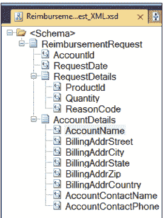

- 5. 向项目添加名为 `ApprovalProcess.odx` 的编排。此编排驱动报销的长时间运行的审批流程。
- 6. 定义两个编排消息，表示初始请求和 Salesforce.com 增强的审查消息。第一个消息名为 **ReimburseInput**，第二个为 **ReimburseOutput**，两者类型均为 **Chapter10-SFDC.ReimbApproval.ReimbursementRequest_XML**。
- 7. 草拟一个编排流程，首先接收一条消息，然后为与 Salesforce.com 的待处理交互设置一个 **Group** 占位符，发送增强的响应消息以供审批，最后分发结果。

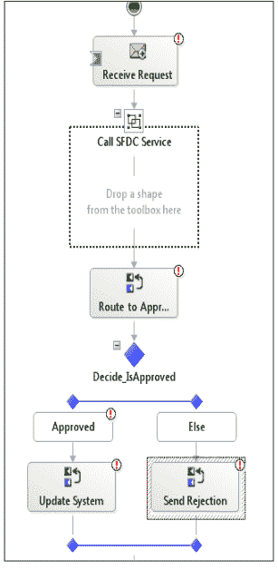

## 自定义 Salesforce.com 数据实体

Salesforce.com 中的对象可以自定义，我们需要在 Account 实体上添加一些新字段。

- 1. 登录到您的 Salesforce.com 账户 (https://login.salesforce.com)，或创建一个新的免费账户。请注意，Salesforce.com 每季度发布一次，因此本章中所示内容不可避免地会出现细微的用户界面或功能差异。
- 2. 我们的大部分时间将花费在配置 Salesforce.com 上，这需要我们访问强大的设置屏幕。您可以通过在屏幕右上角姓名下方找到下拉菜单来访问该网站部分。
- 3. 在 App Setup 部分，我们的一个选项是扩展 Salesforce.com 原生提供的标准对象。在我们的案例中，我们希望为 Account 实体添加一些额外字段。展开 Customize 菜单，然后选择 Accounts 以找到 Fields 选项。

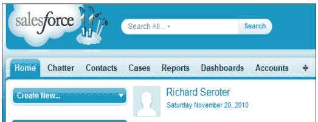

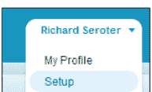

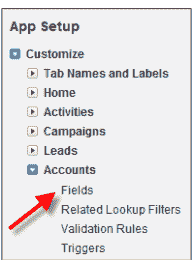

- 4. 在下一个屏幕上，我们可以看到所选实体的标准字段和自定义字段。我们的报销查找流程需要在 Account 实体上有一个“主要联系人”字段和一个“主要联系人电话号码”字段。页面底部有一个 **Account Custom Fields and Relationships** 部分。单击 **New** 按钮开始字段创建向导。
- 5. 将此新字段的数据类型设置为 **Text** 值。我们也可以在这里考虑使用查找值，并指定一个特定的联系记录作为账户的主要联系人。
- 6. 将此新字段的名称设置为 **PrimaryContactName**，并将其长度定义为 100 个字符。

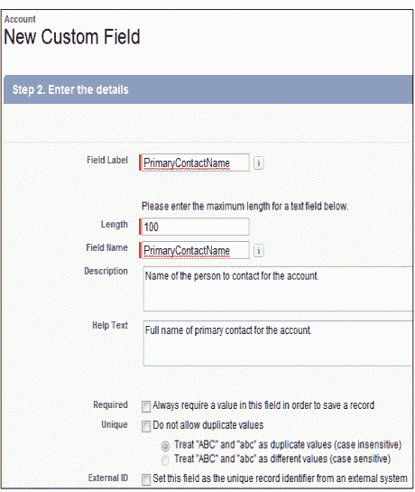

- 7. 在随后的两个向导页面上保留默认的安全性和页面布局选项，并在最后一页单击 **Save & New**。这将创建新字段并重新启动向导。
- 8. 对于此新字段的数据类型，选择 **Phone**，并将字段命名为 **PrimaryContactPhone**。
- 9. 将剩余选项保留为默认选择并保存新字段定义。
- 10. 如果一切成功，您应该在实体定义上看到自定义字段（及其底层 API 名称）。请注意，Salesforce.com 上的所有自定义字段都有“__c”后缀，这使得它们易于识别。

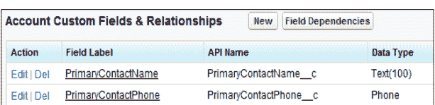

- 11. 回想一下，Salesforce.com 提供了 Enterprise WSDL 定义，描述了我们可以从本地软件系统交互的操作和实体。请注意，WSDL 中同时提供自定义对象以及修改后的标准对象。WSDL 是动态生成的，因此它始终反映我的 Salesforce.com 对象模型的当前状态。
- 12. 导航到 App Setup 部分，然后是 Develop，然后是 API 以找到指向 Enterprise WSDL 的链接。

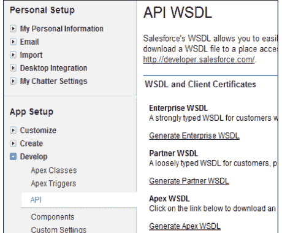

- 13. 单击 Generate Enterprise WSDL 链接并将生成的 WSDL 文件以名称 SFDC_EnterpriseWSDL.wsdl 保存到您的机器上。
- 14. 在 Visual Studio 2010 中打开 WSDL 文件，找到 Account 对象并注意我们的两个自定义字段存在于该对象的定义中。

```
<element name="PartnersFrom" nillable="true" ...>
<element name="PartnersTo" nillable="true" minOccur ...>
<element name="Phone" nillable="true" minOccur ...>
<element name="PrimaryContactName__c" nillable ...>
<element name="PrimaryContactPhone__c" nillable ...>
<element name="ProcessInstances" nillable="tr ...>
<element name="ProcessSteps" nillable="true" ...>
```

## 在 BizTalk Server 中使用 Salesforce.com WSDL

Salesforce.com Enterprise WSDL 包含我们需要提取 Account 数据的所有消息和函数定义。在此步骤中，我们将这些定义导入 BizTalk Server：

- 1. 在撰写本文时下载的 WSDL 文件大小为 455KB，包含所有 Salesforce.com 对象和操作定义。如果您只需要单个对象或操作，您可以选择手动从 WSDL 中提取所需的架构并手工构建 BizTalk 消息端点。对于此场景，我们将引用整个 WSDL，并让 BizTalk 为我们生成架构、编排端口和绑定文件。如果您可能在多个项目中重用这些 Salesforce.com 工件，那么创建单独的 BizTalk 项目来包含它们是有意义的。话虽如此，我们将继续在主要的 BizTalk Server 项目中添加对 Salesforce.com WSDL 的引用。
- 2. 右键单击我们的 BizTalk 项目并选择 **Add Generated Items**，然后选择 **Consume WCF Service**。
- 3. 一旦向导弹出，选择服务元数据的来源为 **Metadata files**，因为我们有一个物理 WSDL 文件需要使用。

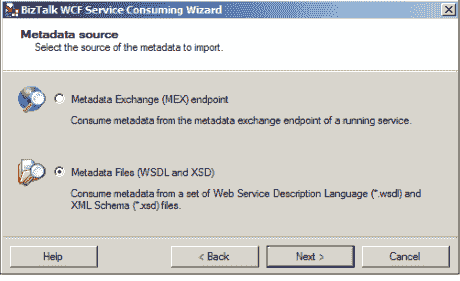

- 4. 当提示添加元数据文件时，浏览到您机器上名为 `SFDC_EnterpriseWSDL.wsdl` 的 WSDL。
- 5. 保留建议的命名空间并完成向导。
- 6. 向导会创建一系列文件：
  - `SforceService.BindingInfo.xml` 文件包含创建 **WCF-BasicHttp** 发送端口所需的信息，该端口使用 Salesforce.com 服务。
  - `SforceService.odx` 文件是一个编排，其中包含一个名为 **Soap** 的单个 **Port Type** 定义，其中包含您可以在 Salesforce.com WSDL 上执行的所有操作。此编排还为每个与端口类型操作对应的输入和输出提供了多部分消息定义。
  - `SforceService_Custom.BindingInfo.xml` 文件是 **WCF-Custom** 适配器绑定，为我们提供了进一步自定义对 Salesforce.com Web 服务调用的机会。
  - `SforceService_enterprise_soap_sforce_com.xsd` 架构描述了 Salesforce.com 操作使用的每个根消息类型（例如 `login`、`sendEmail`、`update`、`queryAll`）。底层消息类型位于不同的架构中。
  - `SforceService_fault_enterprise_soap_sforce_com.xsd` 架构定义了 Salesforce.com 服务返回的所有可能故障类型。
  - `SforceService_sobject_enterprise_soap_sforce_com.xsd` 架构保存了 Salesforce.com 域中可用的所有业务实体（例如 **Account**、**Campaign**、**Case History**）。

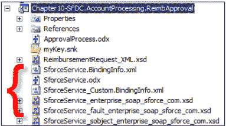


- 7. 在我们原始的编排 `ApprovalProcess.odx` 中，创建一个新的配置端口，命名为 **CallSFDCPort**，它使用现有的、生成的端口 **Chapter10-SFDC.AccountProcessing.ReimbApproval.Soap**。将其设置为发送请求并接收响应，并稍后指定端口绑定。

- 8. 当编排端口配置向导完成后，我们会看到该服务中的每个操作都暴露在编排的端口表面上。这里有两个选择。首先，返回向导生成的编排并从端口类型中删除这些未使用的操作。如果我们将此 Salesforce.com 引用用于其他 BizTalk 项目计划使用的共享程序集中，这并不是非常实用。我们的第二个，也是最好的，选项是简单地忽略我们不需要的操作，并处理编排表面上的额外杂乱。

- 9. 创建 Salesforce.com 服务期望的输入和输出消息。第一个消息，命名为 **SFDC_QueryRequest**，是多部分类型 **Chapter10-SFDC.AccountProcessing.ReimbApproval.queryRequest**，第二个消息，命名为 **SFDC_QueryResponse**，是多部分类型 **Chapter10-SFDC.AccountProcessing.ReimbApproval.queryResponse**。

- 10. 向现有的 **Group** 占位符添加一个 **Transform** 形状，并将 **Construct Message** 形状的 **Message Constructed** 值设置为 **SFDC_QueryRequest** 消息。此映射创建我们的服务查询消息。

- 11. 双击 **Transform** 形状并创建一个名为 **ReimbRequest_To_SFDCQuery** 的新映射，并选择 **ReimburseInput** 消息作为映射的 **Source Transform**，以及 **SFDC_QueryRequest.parameters** 消息作为映射的 **Destination Transform**。

- 12. 目标架构的唯一字段 (`queryString`) 包含检索我们需要的 Account 属性所需的 Salesforce 对象查询语言 (SOQL) 语句。将一个 **Scripting** functoid 拖到映射的网格表面。将 `AccountId` 字段从源架构拖入 functoid。

- 13. 双击 functoid 并切换到 **Script Functoid Configuration** 选项卡，并将 **Select script type** 值设置为 **Inline C#**。

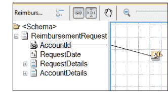

- 14. 在 functoid 的 **Inline Script** 窗口中添加以下代码，该代码接收来自源架构的 account ID 值并构建查询语句：

```
public string BuildSFDCQuery(string accountId)
{
string query;

query = "SELECT Name, BillingStreet, BillingState, BillingCity,
BillingPostalCode, BillingCountry, PrimaryContactName__c,
PrimaryContactPhone__c FROM Account WHERE AccountNumber ='" +
accountId + "'";

return query;
}
```

- 15. 保存 functoid 的配置并将 functoid 连接到目标架构的 queryString 元素。

- 16. 在 **Construct** 形状之后，添加一个 **Send** 形状（命名为 **Send Request**）和一个 **Receive**（命名为 **Receive Response**）形状。将 **SendRequest** 形状与 **SFDC_QueryRequest** 消息关联，并将 **Receive Response** 形状与 **SFDC_QueryResponse** 消息关联。将这些形状连接到编排端口中的 **query** 操作。

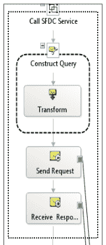

- 17. 在 **Receive Response** 形状下方，拖动一个 **Transform** 形状。将 **Construct** 形状的 **Message Constructed** 属性设置为 **ReimburseOutput**。

- 18. 双击 Transform 形状并创建一个新的映射，其中有两个输入消息 ReimburseInput 和 SFDC_QueryResponse，以及 ReimburseOutput 作为唯一的输出消息。此多部分映射将两个输入值合并在一起，并生成一个完全填充的单个输出消息。

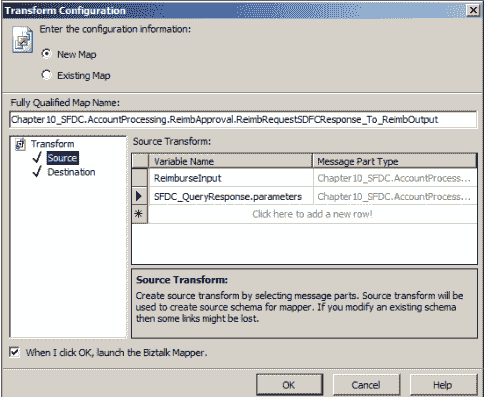

- 19. 在新映射中，展开源架构中的第一个消息部分。将除 AccountDetails 下的字段之外的所有字段连接到目标架构。回想一下，我们的初始消息目前还没有任何联系人详细信息，因此没有理由映射这些字段。

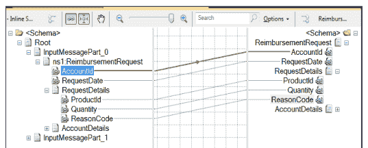

- 20. 接下来，将 Salesforce.com 服务查询的输出映射到目标消息的 AccountDetails 部分。因为 Salesforce.com 查询响应返回一个 sObject 类型（代表所有已知类型），记录节点下的类型列表包含继承自 sObject 的所有可能类型。找到 Account 对象并将所需字段映射到目标架构。

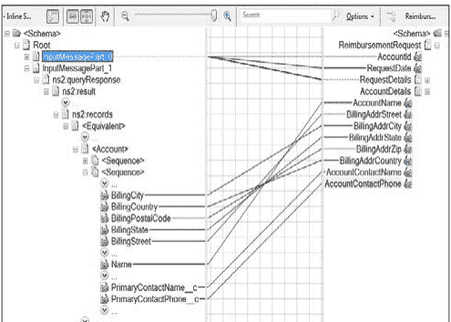

- 21. 保存映射并返回到编排。创建一个编排接收端口，该端口吸收初始报销请求消息。

- 22. 对于本示例，代替实际发送消息进行审查并更新后端应用程序，我们将设置 Expression 形状以写入系统事件日志。

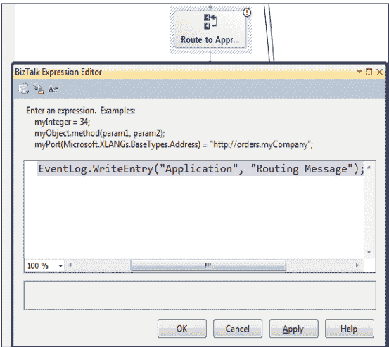

```
EventLog.WriteEntry("Application", "Routing Message");
```

- 23. 在编排的最底部添加一个新的 **Send** 形状，并将 **ReimburseOutput** 消息从编排中发送出去。这将确认我们已成功将 Salesforce.com 数据与原始数据合并。

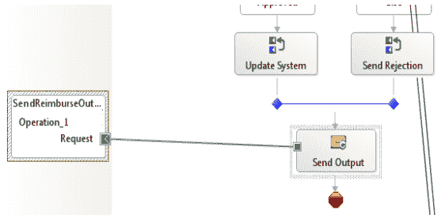

- 24. 解决方案的开发部分几乎已完成。然而，请记住，我们对 Salesforce.com 的调用必须经过身份验证。对 Salesforce.com 的调用需要附加安全令牌，该令牌通过调用 Salesforce.com 服务的 `login` 操作获取。在提供的 Visual Studio 2010 解决方案中有一个类库（`Chapter10-SFDC.TokenManager`），其中包含一个单例对象，该对象在初始化时调用 Salesforce.com 服务并检索会话令牌。单例每小时刷新一次令牌。请注意，Salesforce.com 令牌的默认超时时间为两小时。对 Salesforce.com 服务的每次调用都会重置此超时的时钟。虽然您可以一次获取多个令牌（在单例被多个不同的 BizTalk 主机使用的情况下），请注意 Salesforce.com 限制同时查询的数量（基于您拥有的 Salesforce.com 账户类型），因此您可能需要在解决方案中引入节流机制。

- 25. 编辑 `TokenManager` 类并包含您的 Salesforce.com 凭据（`sfdcUserName`、`sfdcPassword`、`sfdcSecurityToken`）。复合登录密码是账户安全令牌和账户密码的组合。构建此组件，然后运行 `Chapter10-SFDC.TokenTester.exe` 应用程序。此应用程序连接到 Salesforce.com 服务并尝试执行成功登录。如果凭据正确，我们将获得一个 `LoginResult` 对象，其中包含唯一的 Session ID 和服务 URL。复制并保存返回的服务 URL，因为我们稍后在 BizTalk 发送端口中需要它。

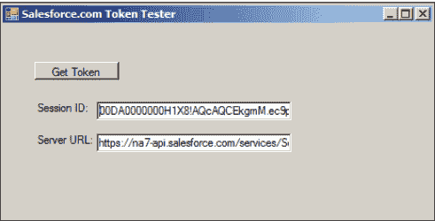

- 26. 将 `Chapter10-SFDC.TokenManager.dll` 组件添加到全局程序集缓存，然后在我们的 BizTalk 项目中添加对该组件的引用。

- 27. 最后一个剩余的开发任务是将我们的会话令牌添加到传出消息中。此令牌不进入消息的有效负载，而是添加到传出标头中。在我们的编排中，并且在构建查询的 **Construct** 形状内，在 **Transform** 形状正下方放置一个 **Message Assignment** 形状。添加以下代码行。不要忘记在 `SessionHeader` 节点上放置命名空间，因为 Salesforce.com API 对此很严格，如果缺少命名空间，将返回无效令牌消息。

```
SFDC_QueryRequest(WCF.Headers) = "<headers><SessionHeader xmlns='urn:enterprise.soap.sforce.com'><sessionId>" + Chapter10_SFDC.TokenManager.TokenManager.SessionId + "</sessionId></SessionHeader></headers>";
```

- 28. 构建并部署 BizTalk 项目。

- 29. 在离开 Visual Studio 2010 之前，生成 `ReimbursementRequest_XML.xsd` 的 XML 实例并将其保存到项目文件夹中。

## 配置 BizTalk 消息端口以调用 Salesforce.com

我们的开发已完成，现在我们可以添加必要的 BizTalk 发送和接收端口来完成我们的解决方案：

- 1. 打开 BizTalk 管理控制台并确认您拥有一个 **Chapter10** 应用程序。


- 2. 创建初始接收端口（**Chapter10.ReceiveReimbursementRequest**）、接收位置（**Chapter10.ReceiveReimbursementRequest.FILE**）以及最终发送端口（**Chapter10.SendCompleteReimbursement.FILE**）。所有文件适配器的地址都应指向解决方案文件夹中“FileDrop”部分的文件夹。

- 3. 请记住，添加对 Salesforce.com WSDL 的引用会生成一对绑定文件。在 BizTalk 管理控制台中右键单击 BizTalk 应用程序，然后选择 **Import**，然后选择 **Bindings**。指向 BizTalk 项目文件夹中的 `SforceService_Custom.BindingInfo.xml`。此操作会生成一个新的发送端口。

- 4. 打开名为 **WcfSendPort_SforceService_Soap_Custom** 的自定义发送端口。注意 **Address(URI)** 值指向 Salesforce.com 登录服务。将此地址更改为我们之前使用的令牌测试应用程序返回的 URL。实际上，我们应该从 Login 操作中获取 Salesforce.com URL 并动态设置到出站发送端口上。对于本示例，硬编码值就足够了。

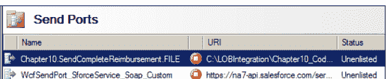

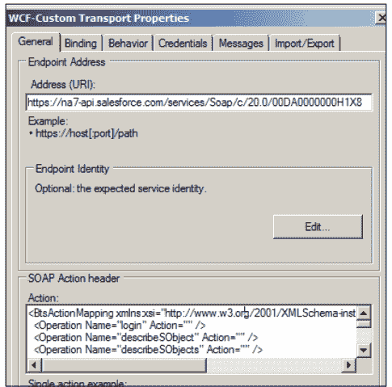

- 5. 最后，转到控制台中的 Orchestrations 文件夹并双击 **ApprovalProcess** 编排。切换到 **Bindings** 选项卡并配置主机、初始接收端口、服务发送端口和最终发送端口。启动发送端口、接收位置、编排和主机。

## 测试应用程序

我们的代码已部署并且所需的消息配置已完成。剩下的就是测试我们的应用程序能否成功使用 Salesforce.com 数据丰富传入数据。

- 1. 要测试应用程序，请转到您的 Salesforce.com 站点并创建新账户，或从现有账户获取账户号码。将该值放入 BizTalk 将接收的 XML 实例文件中。

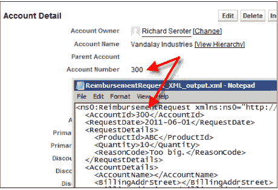

- 2. 发送报销请求并监视输出消息。如果一切配置正确，您将看到初始消息中的数据与 Salesforce.com Account 对象的结果合并。

```
<ns0:ReimbursementRequest xmlns:ns0="http://Chapter10-SFDC.Accou
  <AccountId>300</AccountId>
  <RequestDate>2011-06-01</RequestDate>
  <RequestDetails>
    <ProductId>ABC</ProductId>
    <Quantity>10</Quantity>
    <ReasonCode>Too big.</ReasonCode>
  </RequestDetails>
  <AccountDetails>
    <AccountName>Vandalay Industries</AccountName>
    <BillingAddrStreet>1445 Main Street Suite 1004</BillingAddrStreet>
    <BillingAddrCity>Los Angeles</BillingAddrCity>
    <BillingAddrZip>92130</BillingAddrZip>
    <BillingAddrZip>CA</BillingAddrZip>
    <BillingAddrCountry>USA</BillingAddrCountry>
  </AccountDetails>
</ns0:ReimbursementRequest>
```

在本练习中，我们看到了如何自定义 Salesforce.com 对象并将 Account 记录提取到 BizTalk Server 编排中。Salesforce.com Enterprise WSDL 使发现和消费我们需要的操作变得非常容易。

## 从 Salesforce.com 向 BizTalk Server 通信

集成不应该是 SaaS 解决方案的单向模式。虽然大多数成熟的 SaaS 产品提供一组查询服务，但从云应用程序中检索本地数据通常没有强大的选项。事实证明，Salesforce.com 提供了多种与外部应用程序集成的策略。

首先，Salesforce.com 有一个名为 **Outbound Messaging** 的功能。使用 Outbound Messaging，我们可以指定对给定实体的哪些更改应导致事件发送到外部 URL。此功能与 Salesforce.com 工作流直接相关。发送传出消息是工作流的一种可能操作。Outbound Messaging 提供排队和可靠的传递，并在后台进程中运行。对外部服务的调用不是异步的，并且要求接收服务返回布尔确认。消息可能会被发送多次，因此我们的服务应该是幂等的，这意味着使用相同数据多次调用将成功执行且没有副作用。如果我们担心处理积压或意外先处理旧记录再处理新记录，我们可以选择在传出消息中发送会话令牌，并要求接收服务进行回调以实际提取记录的更改。

虽然 Outbound Messaging 非常有用，但也有一些缺点。首先，您无法对传出的 HTTP 请求进行任何自定义。这意味着如果您想添加 HTTP 标头或将数据转换为不同格式，您就无能为力。同样，每个 Outbound Message 都会生成特定的 WSDL，接收服务必须遵守它。当直接与遗留系统集成而不是通过集成服务器时，这可能是一个问题。

虽然我们可以通过 WSDL 导入生成代理类直接从 Apex 代码调用 Web 服务，但您仍可以执行自定义操作存在限制。我们不会在此演示该特定功能，但我们将展示如何使用 Force.com 中的本机函数执行低级 HTTP 请求和响应处理。当使用原始 Salesforce.com HTTP 对象时，我们控制服务消息的定义、服务的调用、任何编码或解码、密码学和安全。

接下来的两个练习首先向我们展示如何利用 Windows Azure AppFabric Service Bus 来促进 Outbound Messaging，其次如何从 Salesforce.com 向 BizTalk Server 执行低级 Apex 服务调用。为什么我们要将 Windows Azure AppFabric 引入此场景？为了让 Salesforce.com 访问公司的服务，这些服务必须位于公共互联网上。组织可能不愿意公开其服务，而 AppFabric Service Bus 提供了一种安全、干净的方式来将我们的服务保留在内部网络上，并避免在 extranet 中添加面向互联网的代理。

## 从 Salesforce.com 向 BizTalk Server 发送传出消息

在此演示中，我们设置 Salesforce.com，以便每当 Account 记录的账单地址更改时发送传出消息。理想情况下，我们将使用 AppFabric Service Bus 的客户端身份验证功能来保护我们的本地服务。然而，我们无法控制 Salesforce.com 传出消息的低级 HTTP 细节，因此无法直接使用 AppFabric Service Bus 进行身份验证。相反，我们将向入站 BizTalk 通道应用自定义 WCF 行为，该行为会在从 Salesforce.com 传出传输期间插入的唯一令牌。

## 配置 Salesforce.com 工作流以使用传出消息

在此练习的第一部分中，我们扩展 Account 对象，然后制作包含 Outbound Messaging 活动的工作流。

- 1. 登录到您的 Salesforce.com 站点（假设您之前已注册免费 Force.com 账户）并转到设置屏幕。选择自定义 Accounts 对象。导航到字段视图。
- 2. 创建一个新自定义字段，该字段将在 Salesforce.com 发送消息之前填充令牌。选择文本数据类型。将名称设置为 AzureValidationToken。

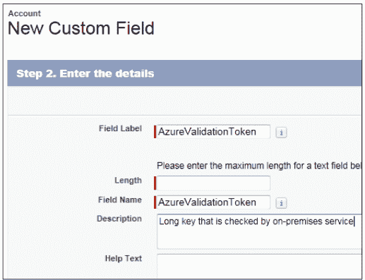

- 3. 在向导的第四步中，当被要求将字段添加到页面时，取消选择所有选项，因为该字段不应在任何用户界面上可见。
- 4. 在 App Setup 菜单下，选择 Create，然后选择 Workflow & Approvals。单击 Workflow Rules。

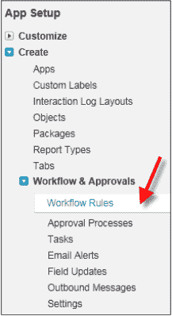

- 5. 单击 **New Rule** 按钮开始工作流向导，然后选择 **Account** 对象作为此工作流作用的实体。
- 6. 接下来，将规则命名为 **BillingStreetChanged** 并将 **Evaluation Criteria** 设置为在 **每次创建或编辑记录时** 运行。
- 7. 设置规则在公式计算为 true 时运行，并将 `ISCHANGED(BillingStreet)` 设置为公式。此公式在字段的值与之前不同时返回 true。保存此配置并继续。
- 8. 指定两个工作流操作。第一个操作向 Account 对象添加唯一令牌，第二个工作流操作实际通过 Azure AppFabric Service Bus 将传出消息发送到 BizTalk Server。
- 9. 将第一个工作流操作设置为 **New Field Update**。

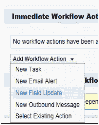


10. 将操作名称设置为 **SetAzureToken**，从 **要更新的字段** 列表中选择 **AzureValidationToken** 字段，并指定一个 GUID 作为新值。

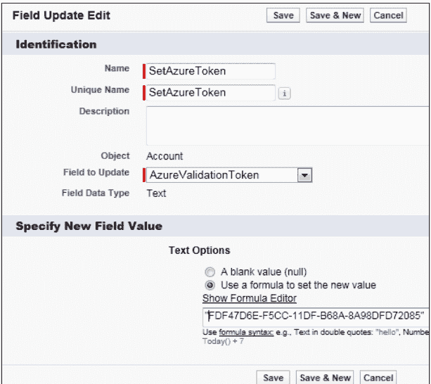

11. 选择为我们的 **BillingStreetChanged** 规则添加另一个工作流操作。选择 **New Outbound Message** 操作以利用 Salesforce.com 中的传出消息功能。

12. 将传出消息名称设置为 **CallBillingUpdateService**，并输入一个临时的 **Endpoint URL**，例如 http://localhost。我们目前还没有本地服务的基于云的地址，因此暂时使用占位符地址即可。

如果我们想要支持回调模式，可以选择在消息负载中发送 **SessionID**。选择发送以下字段：**AccountNumber**、**BillingStreet**、**BillingCity**、**BillingState**、**BillingPostalCode**、**BillingCountry**、**AzureValidationToken__c**、**Name** 和 **LastModifiedDate**。**LastModifiedDate** 字段在您怀疑本地处理存在积压并且需要一种方法来查找最近更新时很有用。

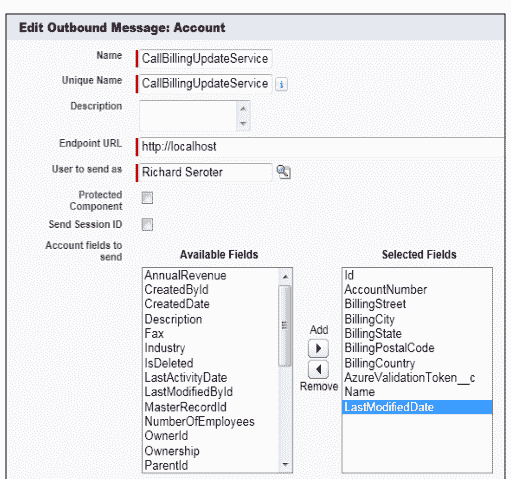

- 1. 保存传出消息配置。
- 2. 在 App Setup 菜单下，在 Create 菜单和 Workflows & Approvals 菜单下，选择 Outbound Messages 链接。
- 3. 点击我们的传出消息的 Name 以查看其详细信息。将 Endpoint WSDL 以 workflowOutboundMessage.wsdl 的名称保存到您的开发机器上。

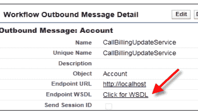

## Building the BizTalk recipient of the Outbound Message

在设置好传出消息后，我们需要配置 BizTalk 以理解消息、公开接收服务并发送预期的确认：

- 1. 在现有的 Visual Studio 2010 解决方案中，创建一个新的空 BizTalk 项目，命名为 `Chapter10-SFDC.AccountProcessing.ChangeRouting`。
- 2. 为项目分配一个强名称密钥，并将部署应用程序设置为 **Chapter10**。
- 3. 我们可以选择手动构建接收和处理 Salesforce.com 传出消息的架构和匹配的编排端口，或者利用 BizTalk 的开发向导来完成大部分工作。右键单击 BizTalk 项目并选择 **Add Generated Items**。
- 4. 选择 **Consume WCF Service** 选项并选择 **Metadata files** 源。虽然我们通常使用此向导来使用 BizTalk 将调用的服务，但我们也可以用它来生成入站服务工件。
- 5. 在向导的 Metadata files 页面上，浏览到您之前保存到机器上的 Salesforce.com WSDL。完成向导并导入引用。
- 6. 向导的输出包括包含所有消息定义的架构以及包含描述交互的端口类型的编排。

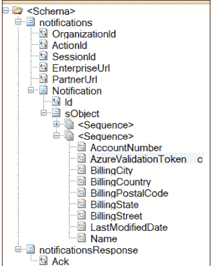

- 7. Salesforce.com 传出消息进程需要服务提供确认。这意味着我们不能仅仅将消息接收到 BizTalk 中并进行路由。相反，我们需要一个能够向 Salesforce.com 返回同步布尔确认的编排。向项目添加一个新的编排，命名为 `ProcessSFDCMessage.odx`。
- 8. 创建两个编排消息。第一个消息名为 **BillingChangeInput**，类型为 **Chapter10-SFDC.AccountProcessing.ChangeRouting.notificationsRequest**，而第二个消息名为 **BillingChangeOutput**，类型为 **Chapter10-SFDC.AccountProcessing.ChangeRouting.notificationsResponse**。
- 9. 我们通常使用任何生成的编排端口作为调用我们引用的服务的方式。然而，我们也可以使用此生成的端口来描述 **inbound** 交互。将新配置的端口拖到 **Port Surface** 并选择现有的 Port Type，命名为 **Chapter10-SFDC.AccountProcessing.ChangeRouting.NotificationPort**。选择接收请求并发送响应，然后完成端口配置向导。
- 10. 按以下顺序排列编排形状：**Receive** 形状、包含 **Message Assignment** 形状的 **Construct Message** 形状、一个 **Send** 形状和另一个 **Send** 形状。此编排接收 Salesforce.com 传出消息，生成确认消息，将其返回给 Salesforce.com，最后将传出消息发布到 BizTalk 总线以进行进一步处理。

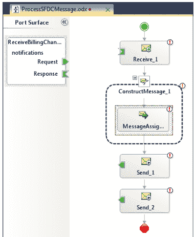

- 11. 最上面的 **Receive** 形状应使用 **BillingChangeInput** 编排消息。**Construct** 形状应将 **Message Constructed** 值设置为 **BillingChangeOutput**。下一个 **Send** 形状应与 **BillingChangeOutput** 消息关联，而最终的发送形状应与 **BillingChangeInput** 消息绑定。
- 12. 创建一个新的编排变量，命名为 **tempXml**，其类型为 **System.Xml.XmlDocument**。
- 13. 在 **Message Assignment** 形状中，实例化 **XmlDocument** 变量，加载指示“true”确认的 XML 内容，并将变量设置为等于响应消息。
- 14. 最后，创建一个配置好的编排端口以将我们接收到的计费更改事件发送出去以供进一步处理。选择稍后指定传输通道的选项。最终的编排应如下所示：

```
tempXml = new System.Xml.XmlDocument();
tempXml.LoadXml("<ns0:notificationsResponse xmlns:ns0='http://soap.sforce.com/2005/09/outbound'><ns0:Ack>true</ns0:Ack></ns0:notificationsResponse>");

BillingChangeOutput.@response = tempXml;
```

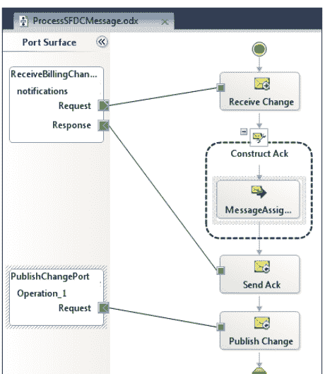

- 15. 构建并部署应用程序，然后切换到 BizTalk Administration Console。
- 16. 我们有几个服务托管选项可供选择。对于此场景，我们将直接在 BizTalk 进程内托管云端点，而不是在 IIS Web 服务器内托管。这不需要我们构建物理服务。通过创建一个新的 Request-Response 接收端口，命名为 **Chapter10.ReceiveBillingChangeNotification**，开始此步骤。
- 17. 向该端口添加一个新的 Request-Response 接收位置，命名为 **Chapter10.ReceiveBillingChangeNotification.HttpRelay**。将 **Type** 设置为 **WCF-Custom**，接收管道设置为 **XMLReceive**。
- 18. 单击适配器类型旁边的 **Configure** 按钮。在 **General** 选项卡上，将 **Address (URI)** 设置为 `https://<your namespace>.servicebus.windows.net/AccountProcessing/BillingChange.svc`。
- 19. 在 **Binding** 选项卡上，将 **Binding Type** 设置为 Azure 提供的 **basicHttpRelayBinding**。展开 **Security** 绑定配置，并确保安全模式设置为 **Transport**，并且 **relayClientAuthenticationType** 为 **None**。请记住，Salesforce.com 传出消息传输详细信息不能由开发人员调整，因此我们不能正式发送额外的凭据或直接向 Service Bus 进行身份验证。

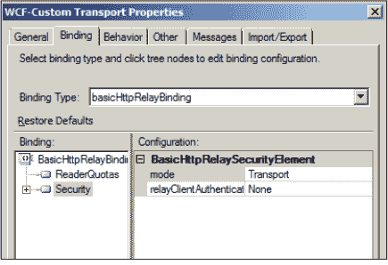

- 20. 导航到 **Behavior** 选项卡并添加一个新的 Endpoint 行为。从列表中选择 **transportClientEndpointBehavior**。此行为提供了 BizTalk 连接到 Service Bus 端点地址并监听所需的凭据。选择 **SharedSecret** 凭据类型并填写您的 AppFabric Service Bus 帐户的 **issuerName** 和 **issuerSecret** 值。

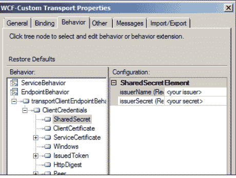

- 21. 保存接收位置配置。
- 22. 创建一个新的单向发送端口，命名为 **Chapter10.SendBillingChange.FILE**，我们的编排将绑定到该端口并向其发送计费更改消息。该端口应将其输出发送到文件系统。
- 23. 将 **ProcessSFDCMessage** 编排绑定到主机、relay 接收位置，最后绑定到 FILE 发送端口。
- 24. 启动依赖的发送端口、编排，最后启动接收位置。如果接收位置配置正确，您现在应该在云上进行监听。

## Triggering the outbound message from Salesforce.com

配置完成后，我们可以发起传出消息并确认 BizTalk 能够接收它：

- 1. 返回您的 Salesforce.com 站点并编辑传出消息配置，使 Endpoint URL 现在指向 `https://<yournamespace>.servicebus.windows.net/AccountProcessing/BillingChange.svc`。确保我们的 workflow 规则已激活。


- 2. 在你的 Salesforce.com 站点中查找一个账户并更改 **BillingStreet** 值，以便触发我们的工作流并发送消息。
- 3. 切换到 **Outbound Messages** 视图并点击 **View Message Delivery Status** 按钮以查看传输状态。确认消息已接收到 BizTalk 中，并在文件系统上看到一条消息。
- 4. 最后的练习是对我们的端点应用一层安全措施。目前，任何知道我们 Service Bus URL 的人都可以向此服务发送消息。为了解决这个问题，我们可以利用自定义 WCF 行为来定位并验证添加到我们传出消息中的长安全令牌。
- 5. 在 Visual Studio 2010 解决方案中，找到一个名为 `Chapter10.XmlMessageInspector` 的现有项目。此 WCF 行为会查找指定的节点和值，除非找到它，否则用户会收到 HTTP 未授权错误，并且没有任何内容发布到 BizTalk MessageBox。构建此项目并将其添加到机器的全局程序集缓存中。
- 6. 为了使 BizTalk Server 识别此 WCF 行为，我们必须在 `System.ServiceModel/extensions.behaviorExtensions` 节点下向 `machine.config` 文件添加一个条目：
```
<add name="XmlInspectorBehavior" type="Chapter10_SFDC.XmlMessageInspector.XpathInspectorBehaviorExtension, Chapter10-SFDC.XmlMessageInspector, Version=1.0.0.0, Culture=neutral, PublicKeyToken=<your public key token>"/>
```
- 7. 打开 BizTalk 管理控制台并找到连接到云的接收位置。双击接收位置，然后点击适配器类型旁边的 **Configure** 按钮。
- 8. 切换到 **Behavior** 选项卡并选择添加新的端点行为。找到 **XmlInspectorBehavior** 并选择它。将 **namespaceValue** 属性设置为 **urn:sobject.enterprise.soap.sforce.com**。该行为将名为 "custom" 的 XPath 前缀映射到 **namespaceValue** 字段中指定的命名空间。因此，找到验证令牌的 XPath 语句可以表示为 **//custom:AzureValidationToken__c**。最后，设置此节点必须包含的实际值。在我们的例子中，它是在工作流规则中设置的 GUID 值。

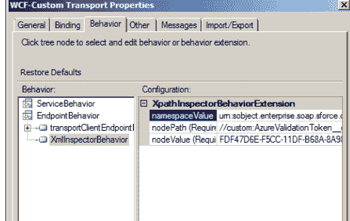
- 9. 保存配置并再次从 Salesforce.com 触发传出消息。所有操作应按预期进行，BizTalk 发送端口应发出一条消息。我们如何确认我们的 WCF 行为按预期工作？返回 Salesforce.com 并在 **Workflow & Approvals** 菜单下导航到 **Field Updates**。通过在现有 GUID 末尾附加一个字符来更改公式值。通过这样做，我们在 Salesforce.com 发送的内容与 BizTalk Server 预期之间创建了不匹配。
- 10. 保存更新并通过更改账户的账单街道地址再次触发 Outbound Messaging。观察 **Outbound Messaging Delivery Status** 中交付失败并显示 **HTTP 401 (Unauthorized)** 消息。

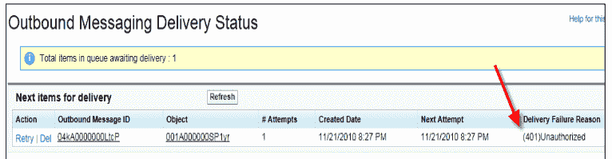

虽然这不是一种万无一失的安全机制，但此最后一步向我们展示了，如果我们发送错误的值，或完全省略该节点，服务调用将失败，BizTalk 将永远不会处理该消息。总的来说，Outbound Messaging 是一项强大的功能，使 Salesforce.com 变得非常事件驱动，并减少了进行低效轮询操作的需求。

## 从 Salesforce.com 查询 BizTalk Server

Outbound Messaging 很棒，但肯定会有一些情况，我们希望发送的不仅仅是对本地系统的事后异步请求。如果我们在本地系统中嵌入了敏感或复杂的查询数据，但在云中需要访问它们怎么办？我们可以选择复制这些数据和逻辑，但可能存在物流和法律上的原因导致这种做法并不理想。

相反，我们可以通过 Azure AppFabric Service Bus 将本地系统暴露给 Salesforce.com。为此，我们需要进行低级 Apex 编程，以公开对原始 HTTP 请求和响应负载的访问。在之前的练习中，我们向传出消息中注入了一个长令牌，并在 BizTalk Server 中验证了该令牌。我们这样做是因为我们无法直接对 Service Bus 进行身份验证。然而，当我们进行 Apex 编程时，这就不是问题了。然而，一个新的挑战出现了：监听 Service Bus 的基于 REST 的服务期望在 HTTP 头中包含访问控制令牌。这使得构建并将令牌附加到 Service Bus 调用变得容易。不幸的是，监听 Service Bus 的基于 SOAP 的服务期望在 SOAP 头中包含复杂的令牌，创建正确的令牌要困难得多。对于本章的解决方案，我们将在 BizTalk 生成的 SOAP 服务前面构建一个 REST 服务代理。这样，我们就可以在向 BizTalk Server 发送请求/回复消息之前正式对 Service Bus 进行身份验证。

本次练习的最后一部分要求我们构建一个调用 Service Bus 的 Visualforce 页面。我们的完整解决方案反映了一个端到端场景，其中 Salesforce.com 用户需要本地数据，而 BizTalk Server 满足该请求。

## 构建云启用的 REST 服务代理

对于此场景，我们已经有一个正在运行的 BizTalk 流程，用于计算我们给予客户的折扣。这是我们不想在云中复制的专有知识。在这第一步中，我们将此 BizTalk 协调作为 Web 服务公开，并在其前面放置一个面向云的 REST Web 服务：
- 1. 部署现有的 BizTalk 项目 `Chapter10-SFDC.AccountProcessing.ContractCalc.`
- 2. 启动 BizTalk WCF 服务部署向导，并从 LookupDiscountRate 协调创建新的 Web 服务（和接收位置）。完成向导并确保服务已成功部署到 Web 服务器。将新的接收位置绑定到 LookupDiscountRate 协调，并启动协调和相应的接收位置。
- 3. 要创建面向云的 REST 代理服务，请返回 Visual Studio 2010 并向解决方案添加一个新网站。选择 WCF Service 类型并将站点命名为 Chapter10-SFDC.AccountProcessing.RestDiscountService。
- 4. 向我们之前从 BizTalk 项目生成的 WCF 服务添加一个名为 CalcServiceReference 的服务引用。
- 5. 打开定义 Web 服务接口的 IService.cs 文件。创建一个名为 Discount 的对象类型，表示 BizTalk 服务返回的负载的相关部分。
```
[DataContract (Namespace="http://Chapter10-SFDC.AccountProcessing")]
public class Discount
{
    [DataMember]
    public string AccountId { get; set; }
    [DataMember]
    public string DateDelivered { get; set; }
    [DataMember]
    public float DiscountPercentage { get; set; }
    [DataMember]
    public bool IsBestRate { get; set; }
}
```
- 6. 为 IDiscountService 接口构建服务契约，该接口接收账户 ID 并返回 Discount 对象。请注意，我们使用名为 WebGet 的 REST 属性装饰此操作，允许我们通过 URI 将输入值传递给服务。
```
[ServiceContract]
public interface IDiscountService
{
    [WebGet(UriTemplate="/{accountId}/Discount")]
    [OperationContract]
    Discount GetDiscountDetails(string accountId);
}
```
- 7. 打开 Service.cs 文件并创建服务类并继承 IDiscountService 接口。向 BizTalk 生成的 Web 服务添加一个名为 CalcServiceReference 的服务引用，并插入调用服务所需的代码。
```
public class DiscountService : IDiscountService
{
    public Discount GetDiscountDetails(string accountId)
    {
        Discount customerDiscount = new Discount();
        CalcServiceReference.Chapter10_SFDC_AccountProcessing_ContractCalc_LookupDiscountRate_ReceiveDiscountRequestPortClient client = new CalcServiceReference.Chapter10_SFDC_AccountProcessing_ContractCalc_LookupDiscountRate_ReceiveDiscountRequestPortClient();

        CalcServiceReference.DiscountRequest req = new CalcServiceReference.DiscountRequest();
        req.AccountId = accountId;

        CalcServiceReference.Discount discount = client.GenerateDiscount(req);

        customerDiscount.AccountId = accountId;
        customerDiscount.DateDelivered = discount.DateDelivered;
        customerDiscount.DiscountPercentage = discount.DiscountDetails.DiscountPercentage;
        customerDiscount.IsBestRate = discount.DiscountDetails.IsBestRate;

        client.Close();

        return customerDiscount;
    }
}
```
- 8. 打开 Service.svc 文件并确保更新引用的服务类，并为我们的 REST 服务添加 Factory 属性。
```
<%@ ServiceHost Language="C#" Debug="true" Service="DiscountService" CodeBehind="~/App_Code/Service.cs" Factory="System.ServiceModel.Activation.WebServiceHostFactory" %>
```
- 9. 接下来，更新 web.config 文件以将此 REST 服务连接到云。首先，我们创建一个绑定元素并指定需要客户端安全。我们的先前（传出消息）服务关闭了客户端安全并强制服务对用户进行身份验证。在此示例中，我们强制 Salesforce.com 在传输请求之前提供有效的 Service Bus 身份验证令牌。
```
<bindings>
<webHttpRelayBinding>
<binding name="WebRestBinding">
```

```
<security relayClientAuthenticationType="RelayAccessToken" />
</binding>
</webHttpRelayBinding>
</bindings>
```

10. 定义一个行为，指定本地服务的连接详细信息以及用于 RESTful 服务的 webHttp 行为。这些凭据在服务尝试在云地址上开始侦听时发送到 Service Bus。

```
<endpointBehaviors>
    <behavior name="CloudBehavior">
        <transportClientEndpointBehavior>
            <clientCredentials>
                <sharedSecret issuerName="owner" issuerSecret="your secret" />
            </clientCredentials>
        </transportClientEndpointBehavior>
        <webHttp />
    </behavior>
</endpointBehaviors>
```

11. 最后，我们通过定义服务和端点将所有内容连接起来。引用上面创建的绑定和行为。

```
<services>
<service name="DiscountService">
<endpoint
address="https://<your namespace>.servicebus.windows.net/DiscountService"
behaviorConfiguration="CloudBehavior" binding="webHttpRelayBinding"
bindingConfiguration="WebRestBinding"
name="CloudRestEndpoint"
contract="IDiscountService" />
</service>
</services>
```

12. 将服务部署到 IIS Web 服务器并启动服务。确保可以通过浏览到您的云服务端点（在我这里是 https://richardseroter.servicebus.windows.net/DiscountService/12345/Discount）成功连接，您应该会收到一条消息，提示授权标头丢失。我们的服务需要客户端身份验证，而浏览器不会传递有效的 Service Bus 凭据，因此此消息是预期的。

## 构建一个消费云服务的 Visualforce 页面

在本步骤中，我们构建一个 Visualforce 页面和 Apex 控制器。控制器负责获取访问控制令牌，然后将该令牌传递到 Service Bus 调用中。Visualforce 页面包含显示 Account 详细信息和 Service Bus 结果所需的标记：

- 1. 我们的本地和云连接环境已准备好供使用。前往 Salesforce.com 并进入设置屏幕。

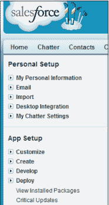

- 2. 为了使 Apex 代码与 Azure 之间的调用成功，我们必须显式允许对 Service Bus 端点的出站调用。具体来说，我们必须将 Azure 访问控制和 Service Bus URL 注册到我们的 Salesforce.com 账户。在管理设置下，导航到安全控制，并单击远程站点设置。

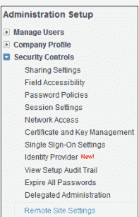

3. 单击 **新建远程站点** 按钮并提供名称 **AzureAC**，将 **Url** 设置为 `https://<your namespace>-sb.accesscontrol.windows.net`，并确保 **Active** 标志已选中。

4. 再添加一个名为 **AzureSB** 的远程站点，并将 **Url** 设置为 `https://<your namespace>.servicebus.windows.net`，并将站点设置为 **Active**。

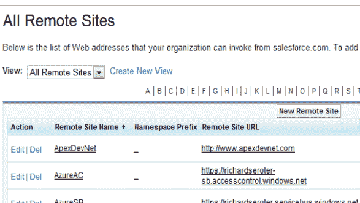

5. 我们此处的目标是将从 BizTalk Server 查询到的折扣详细信息添加到账户对象中。因此，让我们扩展该对象以包含保存所需值的字段。在设置屏幕中，导航到 **App Setup**，然后 **Customize**，找到 **Accounts**。单击 **Fields** 链接。添加一个名为 **DiscountPercentage** 的新字段，使用 **Percent** 数据类型，**Length** 为十六且最多保留两位小数。接下来，添加一个名为 **DiscountLastUpdated** 的字段，其数据类型为 **Text**，长度为 50 个字符。最后，创建一个名为 **DiscountBestPrice** 的字段，使用 **Checkbox** 数据类型。

6. 通过查看 Salesforce.com 站点中的任何账户并找到新字段，确认我们的字段已成功添加。

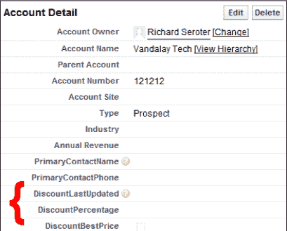

7. 我们现在准备构建一个自定义 VisualForce 页面，显示账户详细信息并允许我们通过云查询 BizTalk Server 服务。Salesforce.com 使用模型-视图-控制器（MVC）模式，我们的本地服务由控制器调用。需要构建的第一件事是自定义页面使用的控制器。导航到 App Setup，然后 Develop，选择 Apex Classes。单击 New 按钮构建新的 Apex 类。您看到的下一个屏幕是基于 Web 的 Apex IDE。

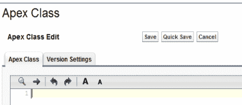

8. 在 Visualforce 环境中，我们可以选择控制器类型。标准控制器与开箱即用的 Salesforce.com 对象（如 Accounts）相关联。它们公开像 Save 这样的操作，可保存对底层对象的更改。自定义控制器是不使用标准控制器并指定全新行为的控制器。最后，控制器扩展扩展标准或自定义控制器。我们想要使用控制器扩展，以便在添加调用云的新功能的同时获得与 Account 控制器关联的现有操作和数据。通过定义指向活动账户的本地引用变量并在默认构造函数中实例化它来开始控制器类。

```
public class accountDiscountExtension{

private final Account myAcct;

public accountDiscountExtension(ApexPages.StandardController controller) {
    this.myAcct = (Account)controller.getRecord();
}

}
```

9. 定义将调用 Azure AppFabric 服务的操作。添加一个执行 HTTP 通信的 Http 对象变量。然后，为访问控制（AC）服务和 Service Bus 服务添加 HTTP 请求对象。

```
public void GetDiscountDetails()
{
    Http httpProxy = new Http();
    HttpRequest acReq = new HttpRequest();
    HttpRequest sbReq = new HttpRequest();
}
```

10. 创建保存 AC URL 以及编码密码的变量。

// ** Getting Security Token from STS
String acUrl =
'https://<your namespace>-sb.accesscontrol.windows.net/WRAPv0.9/';
String encodedPW = EncodingUtil.urlEncode('<issuer password>',
'UTF-8');

11. 设置 HTTP 请求以向 AC 服务执行 POST。请注意，我们手动构建负载，其中包含发行者名称、密码和请求的范围。请记住第 6 章中我们可以将发行者与范围关联到更细粒度的级别；实际上，您将为 Salesforce.com 定义一个发行者，并仅将其分配给其有权访问的范围。在本例中，我们将利用账户所有者凭据。

```
acReq.setEndpoint(acUrl);
acReq.setMethod('POST');
acReq.setBody('wrap_name=owner&wrap_password=' + encodedPW +
'&wrap_scope=http://<your namespace>.servicebus.windows.net/');
acReq.setHeader('Content-Type','application/x-www-form-urlencoded');
```

12. 我们现在准备调用 AC 服务。服务调用的结果被放入字符串变量以供后期处理。

```
HttpResponse acRes = httpProxy.send(acReq);
String acResult = acRes.getBody();
```

13. 我们从 AC 服务收到的令牌与 Service Bus 所需的格式并不完全匹配。来自 AC 服务的原始响应如下所示：

```
wrap_access_token=net.windows.servicebus.action%3dListen%252cSend%252cManage%26Issuer%3dhttps%253a%252f%252frichardseroter-sb.accesscontrol.windows.net%252f%26Audience%3dhttp%253a%252f%252frichardseroter.windows.net%26ExpiresOn%3d1290807349%26HMACSHA256%3dEcvt eRJ9T1hDo9gwWT5MWwfhOL OOR eoeCKP9esor p7JA%253d&wrap_access_token_expires_in=1200
```

14. SB 不需要全部内容，因此我们需要解析出几部分。首先，删除与号（&）之后的部分（wrap_access_token_expires_in），然后提取开头部分（wrap_access_token=），最后进行 URL 解码。我们的令牌需要 WRAP access_token= 前缀，以便 Service Bus 知道提供了何种类型的身份验证。

// clean up result
    String suffixRemoved = acResult.split('&')[0];
    String prefixRemoved = suffixRemoved.split('=')[1];
    String decodedToken = EncodingUtil.urlDecode(prefixRemoved, 'UTF-8');
    String finalToken = 'WRAP access_token="' + decodedToken + '"';

15. 手持可供 Service Bus 使用的令牌后，我们可以调用 Service Bus 端点并调用我们的本地 BizTalk 服务（通过 REST 代理）。由于我们拥有 REST 服务，HTTP 请求中没有需要传递的“正文”，因为所有详细信息都在 URL 中。我们使用客户的账户号码构建 REST URL，并向 HTTP 请求添加授权标头。

```
String sbUrl = 'https://<your namespace>.servicebus.windows.net/DiscountService/' + myAcct.AccountNumber + '/Discount';
sbReq.setEndpoint(sbUrl);
sbReq.setMethod('GET');
sbReq.setHeader('Content-Type', 'text/xml');
sbReq.setHeader('Authorization', finalToken);
```


16. 通过发送请求调用 Service Bus，然后将响应加载到 XML 文档中。

```
// invoke service bus
HttpResponse sbRes = httpProxy.send(sbReq);
Dom.Document responseDoc = sbRes.getBodyDocument();
Dom.XMLNode root = responseDoc.getRootElement();
```

17. 最后，解析响应并提取值以设置在账户字段上。

```
myAcct.DiscountPercentage__c = Decimal.valueOf
    (root.getChildElement('DiscountPercentage',
    'http://Chapter10-SFDC.AccountProcessing').getText());
myAcct.DiscountLastUpdated__c = root.getChildElement
    ('DateDelivered', 'http://Chapter10-SFDC.AccountProcessing').getText();
myAcct.DiscountBestPrice__c = Boolean.valueOf
    (root.getChildElement('IsBestRate',
    'http://Chapter10-SFDC.AccountProcessing').getText());
```

18. 我们现在可以构建自定义 Visualforce 页面。获取一个空白页面进行操作的一个简单方法是转到浏览器 URL 并输入一个（不存在的）页面地址，Salesforce.com 将提示你创建该页面。在服务器地址之后（在我这里是 https://na7.salesforce.com/），输入 apex/DiscountLookup。

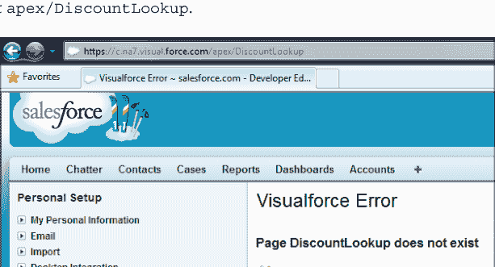

19. 点击 Create Page DiscountLookup 链接，你将获得一个全新的空白 Visualforce 页面。如果已打开“开发模式”（设置、个人设置、我的个人信息、个人信息、开发模式复选框），你将在底部看到一个 Page Editor 按钮，可让你查看页面的源代码并实时编辑它。

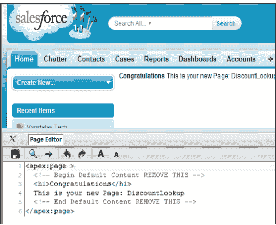

20. 回想一下我们之前构建了一个控制器扩展，因此在此页声明中，我们希望同时调用 Account 对象的 standardController，以及扩展名 accountDiscountExtension。通过选择 Account 控制器，页面上会选中 Account 选项卡，并且我们可以在后续步骤中在 URL 中提供账户 ID。

```
<apex:page standardController="Account" extensions="accountDiscountExtension">
<!-- Begin Default Content REMOVE THIS -->
<h1>Congratulations</h1>
    This is your new Page: DiscountLookup
<!-- End Default Content REMOVE THIS -->
</apex:page>
```

21. 我们希望在此页面上看到账户详情，而单个 Apex 标签即可使整个对象详情网格可见。relatedList 属性决定是否拉取相关详情或仅核心账户详情。在页面标签关闭之前立即添加此标签：

```
<apex:detail relatedList="false" />
```

22. 此时你的页面上仍不会显示任何内容，因为我们没有提供要显示的账户。显示的账户是从查询字符串值读取的。在 Salesforce.com 中查看当前账户并观察 URL。在我这里，该值为 https://na7.salesforce.com/001A00000SP1yr。从 URL 中提取唯一 ID，然后返回你的页面编辑视图，并在 URL 后附加 ?id=[你的账户 ID]，即可在页面上看到账户。

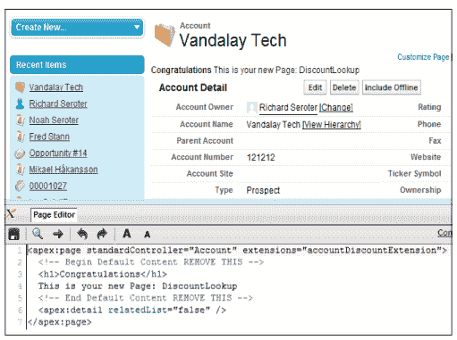

23. 对于五行代码来说，这已经是非常可观的页面内容了！接下来，用一个 Apex 页面块替换该默认占位符文本（从 begin default content 注释开始，到 end default content 注释结束），该块将按名称欢迎用户并显示所选账户的名称。

```
<apex:pageBlock title="Contract Discount Lookup">
  Hello {!$User.FirstName } <br />
  You are viewing the {!account.name} account.
</apex:pageBlock>
```

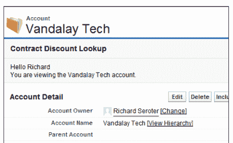

24. 最后的任务是添加一个表单，显示来自账户的字段以及调用 Web 服务的按钮，然后将结果保存回账户。Save 按钮来自默认的 Account 控制器，而 Get Discount 按钮调用我们控制器扩展中的操作。带有 rendered=false 属性的 outputText 字段存在的原因是标准控制器会根据 Visualforce 页面中引用的字段查询账户对象。我们的控制器扩展需要 AccountNumber 字段来构建 REST 查询字符串，因此我们必须将该（不可见）字段放在表单上，以便控制器可以访问此字段。

```
<br /><br />
<apex:form >
<apex:outputText value="{!account.AccountNumber}"
rendered="false"/>
<b>Customer Discount Percentage: </b>{!account.
DiscountPercentage__c}<br />
<b>Last Discount Calculation Date: </b> {!account.
DiscountLastUpdated__c} <br />
<b>Is Best Discount: </b> {!account.DiscountBestPrice__c}<br /><br />
</>
<apex:CommandButton value="Get Discount" action="{!GetDiscountDetails}"/><apex:CommandButton value="Save" action="{!save}"/>
</apex:form>
```

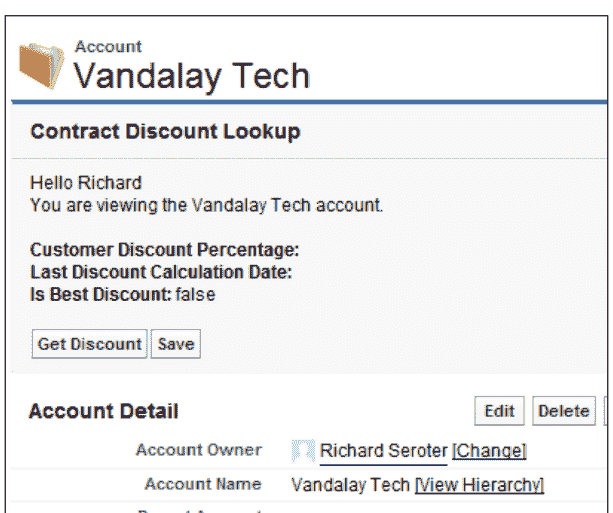

25. 确保云端点在线，如果在线，请点击 **获取折扣** 按钮，让 Salesforce.com 调用我们的本地服务。

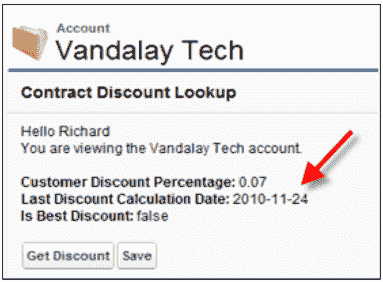

在本练习中，我们看到 Azure AppFabric Service Bus 不仅适用于 WCF 客户端。我们可以安全、快速地从 SaaS 环境利用本地资源，而无需不必要地复制数据或更改网络基础设施。

## 摘要

在我们的第一个示例中，我们看到了如何在 BizTalk 解决方案中消费强类型的 Salesforce.com WSDL。在第二个示例集中，我们研究了从 Salesforce.com 向本地服务发送请求的策略。这两个演示都利用了 Windows Azure AppFabric 将消息从云中中继回内部服务。第一个示例使用了 Salesforce.com Outbound Messaging，使用嵌入在消息中的令牌来验证调用者。在第二个示例中，我们使用 Salesforce.com APEX 代码获取 AppFabric Access Control 令牌并将我们的客户端认证到 Service Bus。然后请求消息被中继到代理服务，该服务随后将消息发送到 BizTalk Server。

可以肯定的是，我们可以通过公开的服务或代理在 Salesforce.com 和我们的本地系统之间进行通信。如果你的组织具有成熟的 extranet 策略，并通过反向代理通信连接到内部服务，那么你不需要利用 Microsoft 云集成服务。然而，Windows Azure AppFabric 为我们提供了一种以简单、安全的方式公开内部服务的方法，而无需额外的硬件或软件。

Salesforce.com 是一个出色的 SaaS 环境，而 Force.com 为解决方案开发开辟了新的可能性。只要对本地软件的投资存在，就需要集成技术。BizTalk Server 是 Salesforce.com 解决方案的强有力补充，因为它具有原生的 Web 服务适配器和强大的消息引擎。

## 索引

## 符号

## A

32-bit
  与 64 位 161
64-bit
  与 32 位 161
.NET Business Connector
  安装 411, 452
Access Control Service Components, building
  关于 264-268, 289, 290
AccountChangeEvent message 145
AccountChangeEvent object 150
accountEntity variable 149
acsHostName property 277
action mappings 43, 44
AddCustomer operation 136
Advanced Business Application Programming (ABAP) 158
Advanced Functoids tab 115
AIF Queue manager 439
Apex controller
  构建 493-502
AppFabric Access Control (AC) service, Windows Azure AppFabric
  关于 254
  问题 254
  解决方案 255
AppFabric Service Bus, Windows Azure AppFabric
  问题 256
  解决方案 256
Application Interface Framework Module

(AIF) 410
Application Service Providers (ASP) 457
ASDK
  功能 45
  消息日志记录 49, 50
  架构，生成 45-47
  超时 48, 49
  工具 45
  跟踪 49, 50
ASDK adapters
  安装 11, 12
ASDK development tools
  BizTalk 应用程序，构建 18-41
  echo 适配器 16-18
  使用 16
ASDK SQL Adapter
  绑定属性选项卡 59, 60
  在 Visual Studio 中使用 56
  提供凭据 56, 57
  在 BizTalk 管理控制台中 62
  入站操作 54, 62-64
  操作 54
  出站操作 55, 64, 65
  架构，生成 60, 61
  连接到 SQL Server URI 属性 58
  WCF-SQL 与 WCF-Custom 适配器 66, 67
ASDK SQL Adapter, examples
  关于 68, 69
Binding properties tab 71
Binding Properties tab 74
composite operations 98-104
execute reader 77-85
multiple result sets 89-95
OK button 75
PolledDataAvailableStatement 71


PolledDataAvailableStatement 属性 73
PollingStatement 设置 72
SalesOrderHeader 表 68
表值函数 77-85
TypedPolling 操作 70
异步演练示例，Dynamics AX 消息流出
关于 439
Dynamics AX，批处理设置 449-451
消息设置 440, 441
.NET business connector，使用 454
编排设置 442, 444
端口配置 444-448
Attributes 节点 118

## B
### BAPIs
- 关于 211
- 陷阱 251, 252
- 提示 251, 252
- 故障排除 251, 252
- 与 IDOCs 对比 211
### BAPI_TRANSACTION_COMMIT
- 216
### BAPI_TRANSACTION_ROLLBACK
- 216
### BasicHttpBinding
- 257
### BasicHttpRelayBinding
- 257
### BASIS
- 157
### Binding Properties tab
- 74
### Binding Type property
- 397, 400
### BizTalk
- 优势 159, 160
- 开发人员面临的挑战 160
- 调用 RFCs 214, 215
- 调用 tRFCs 214, 215
### BizTalk adapter
- 配置 Dynamics AX 2009 Application Integration Framework (AIF) 412-420
### BizTalk Adapter Pack 2010
- 安装 14, 15
### BizTalk application
- 构建 18-41
- 测试 192, 200-205, 403-405
### BizTalk application, building
- 关于 370
- BAPI 演练 231-242
- ERP 平面文件 392-395
- 编排，初始化 377, 378
- RFC 演练 218-222
- 为 SharePoint Web 服务生成架构 370-376
- SharePoint 请求映射 378-386
- 非结构化响应 387-392
### BizTalk application, testing
- BAPI 演练 249
- RFC 演练 229-231
### BizTalk Endpoints
- 配置 123-126
- Customer_XML 消息 126
### BizTalk Messaging Ports
- 配置以调用 Salesforce.com 473-475
### BizTalk Recipient, outbound messages
- 构建 482-486
### BizTalk Scheduled Task Adapter
- 364
### BizTalk server
- 与 Salesforce.com 集成 458, 459
- 从 BizTalk server 查询 489
- 触发传出消息 486-489
- 发布 Service Bus 消息 257
### BizTalk server, integration to
- 编写 Dynamics CRM 插件 147, 150
- 注册插件 151-154
- 测试插件 155
- 设置 143-145
### BizTalk Server Messages
- 构建访问控制服务组件 289, 290
- 构建 BizTalk 解决方案组件 290-294
- 配置 BizTalk 解决方案以使用 Service Bus 绑定 294, 296
- 发布到服务总线 288
- 场景描述 288
- 解决方案设计 288
### BizTalk Server, querying from Salesforce.com
- 关于 489
- 构建 Apex 控制器 493-502
- 构建云启用 REST 服务代理 489-492
- 构建 Visualforce 页面 493-502
### BizTalk Server to Dynamics CRM, communicating from
- 关于 109-111
### BizTalk Components, building
- 126-139
### BizTalk Endpoints, configuring
- 123-142
### Dynamics CRM 2011 SOAP API, direct integration
- 111
### Dynamics CRM Proxy Service, setting up
- 134
### Dynamics CRM Proxy Service, using with BizTalk server
- 134
### Dynamics CRM, querying from BizTalk server
- 111-123
### LogicalName
- 110
### new records, adding to Dynamics CRM from BizTalk Server
- 126
### Proxy Service, generating
- 134-138
### web resource
- 109
### BizTalk Server to Salesforce.com, communicating from
- 关于 459, 461
- 测试应用程序 475, 476
- 配置 BizTalk 消息端口以调用 Salesforce.com 473-475
- 配置基础 BizTalk 组件 461, 462
- 自定义 Salesforce.com 数据实体 463-466
- 在 BizTalk Server 中使用 Salesforce.com WSDL 466-473
### BizTalk Service
- 配置以验证声明 276, 277
### BizTalk solution
- 配置 395-402
- 部署 395-402
- 重新配置以使用 Service Bus 绑定 283-286
### BizTalk solution components, building
- 关于 290-294
- 定义消息架构 259, 260
- 公开服务终结点 261-264
### Business Application Programming Interfaces. See BAPIs
业务应用程序编程接口。参见 BAPIs
### Business Connectivity Services (BCS)
- 406
### Business Data Catalogue (BDC)
- 406

## C
### Canadian Dollar (CAD)
- 421
### claimType property
- 277
### claimValue property
- 277
### closeTimeout property
- 49
### Collaborative Application Mark-up Language (CAML)
- 363
### Compatible Units (CU)
- 157
### composite operation
- 55
### composite operations, ASDK SQL Adapter
- 98-104
### Construct shape
- 473
### Consume WCF Service option
- 482
### ContactRetrieve_Response message
- 122
### count, binding property
- 17
### CrmCustomerProxy_Custom.BindingInfo.xml file
- 140
### custom BAPIs
- 与开箱即用 BAPIs 对比 217
### custom controller
- 495
### Customer Relationship Management (CRM)
- 157, 458
### Customer_XML message type
- 133
### custom IDOCs
- 关于 193-195
- 测试 BizTalk 应用程序 200-204
- 接收平面文件 IDOCs 205, 206
- 接收 200-204
- 从 SAP 接收 195-200
### custom List GUIDs
- 368, 369
### Custom Lists
- 360
### custom RFCs
- 与开箱即用 RFCs 对比 217
### custom SharePoint List
- 创建 365-368

## D
### Dynamics AX
- 关于 410
- 安装适配器 411
- 配置 BizTalk 适配器的应用程序集成框架 412-420
- 批处理设置 449-451
- 配置 455
- 开发 454
- 集成方法 410, 411
- 维护 455
- 安装 .NET Business Connector 411
### Dynamics AX 2009 Application Integration Framework (AIF)
- 为 BizTalk 适配器配置 412-420
### Dynamics AX BizTalk Adapter
- 关于 410, 411
- 安装 411
### Dynamics AX schemas
- 关于 421-428
- Dynamics AX 创建消息 429, 430
- Dynamics AX 查询消息 428
- 编排设置 430-433
### Dynamics CRM
- 从 BizTalk Server 添加新记录 126
- 从 BizTalk Server 查询 111-123
### Dynamics CRM 2011
- 关于 107, 108
- 与 BizTalk Server 集成 108, 109
### Dynamics CRM 2011 SOAP API
- 直接集成 111
### Dynamics CRM Proxy Service, using with BizTalk server
- 构建 BizTalk 组件 138, 139
- 配置 BizTalk 终结点 140-142
- 生成代理服务 134-138
- 设置 134
### Dynamics CRM to BizTalk Server, communicating from
- 关于 142, 143
- 集成到 BizTalk Server 143
- 编写 Dynamics CRM 插件 147-150
- 注册插件 151-153
- 测试插件 155, 156

## E
### echo adapter
- 关于 16
- count 绑定属性 17
- FileSystemWatcherFolder 绑定属性 17
- 入站 16, 17
- 出站 17
### Electronic Data Exchange (EDI)
- 256
### Enterprise Resource Planning (ERP)
- 410
### Entity data structure
- 110
### ERP flat file
- 392-395
### execute reader operation
- 55
### execute scalar operation
- 55

## F
### FileSystemWatcherFolder, binding property
- 17
### Finance (FI)
- 157
### Foundational BizTalk components
- 配置 461

## G
### Get Discount button
- 501
### GetListItems node
- 378

## H
### Human Resources (HR)
- 157

## I
### IDOC
- 关于 172
- 深入探讨 182, 183
- 架构生成 172
- 生成架构 172-181
- 发送 183-192
- 与 BAPIs 对比 211
- 与 RFCs 对比 211
### InboundId Property
- 396
### inbound operations
- 关于 214
- Notification 操作 54
- Polling 操作 54
- TypedPolling 操作 54
- XmlPolling 操作 54
### inboundOperationType property
- 397
### Inline XSLT option
- 116
### installation, ASDK adapters
- 安装 BizTalk Adapter Pack 2010 14, 15
- 安装 WCF LOB Adapter SDK 13, 14
### installation, WCF SAP Adapter
- 32 位与 64 位 161
- 测试 BizTalk 应用程序 192, 193
- IDOC，架构生成 172-181
- 支持的 SAP 配置 171
- SAP 先决条件 DLL 161-168
- WCF-SAP 适配器与 WCF 自定义适配器，使用 SAP 绑定 168-171
### installation, Windows SharePoint Services Adapter Web Service
- FinalizeDocuments Web 方法 308
- GetDocuments Web 方法 309
- IsAlive Web 方法 309
- PutDocuments Web 方法 309
- 安装
- BizTalk Adapter Pack 2010 14, 15
- WCF LOB Adapter SDK 13, 14
### Intermediate Document. See IDOC
中间文档。参见 IDOC

## L
### Line-of-Business Applications (LOB)
- 7
### ListData.svc service
- 362
### List GUID. See custom List GUIDs
List GUID。参见 custom List GUIDs
### Lists.asmx Web Service
- 360, 363, 403
### Lists.BindingInfo.xml
- 375
### Lists_Custom.BindingInfo.xml
- 375
### Lists_microsoft_com_wsdl_types.xsd
- 375
### Lists.odx
- 375
### Lists.schemas_microsoft_com_sharepoint_soap.xsd
- 375
### LogicalName
- 110
### Logical Units of Work (LUW)
- 210
### login function
- 460
### LoginResult object
- 472
### Looping functoid
- 128

## M
### Material Management (MM)
- 157, 158
### message logging
- 49, 50
### Metadata Exchange (MEX) endpoint
- 113
### Microsoft Axapta. See Dynamics AX
Microsoft Axapta。参见 Dynamics AX
### Microsoft Dynamics AX. See Dynamics AX
Microsoft Dynamics AX。参见 Dynamics AX
### Microsoft Dynamics CRM
- 107, 108
### Microsoft.SharePoint.Client.dll
- 405
### Model View Controller (MVC) pattern
- 495
### msgGetListItemsRequest
- 385

## N
### namespaceValue property
- 488
### NetOneWayRelayBinding
- 257
### NetTcpBinding
- 257
### NetTcpRelayBinding
- 257
### NetWeaver
- 158
### Notification operation
- 54

## O
### OK button
- 75
### openTimeout property
- 49
### orchestration
- 初始化 377, 378
### outbound messages
- 关于 476
- 构建 BizTalk 接收方 482-486
- 配置 Salesforce.com 工作流 478-481
- 从 Salesforce.com 发送到 BizTalk Server 477
- 从 Salesforce.com 触发 486, 488, 489
### outbound operations
- 关于 55, 212, 213
- composite 操作 55
- execute non query 操作 55
- execute reader 操作 55
- execute scalar 操作 55
- procedures 操作 55
- scalar functions 操作 55
- strongly typed procedures 操作 55
- tables 操作 55
- table valued functions 操作 55
- views 操作 55
### out-of-box BAPIs
- 与 custom BAPIs 对比 217
### out-of-box interface
- 212
### out-of-box RFCs
- 与 custom RFCs 对比 217

## P
### Plant Maintenance (PM)
- 157, 158
### Platform as a Service (PaaS) software
- 458
### platform as a service (PaaS) solution
- 254
### polledDataAvailable property
- 397
### PolledDataAvailableStatement property
- 73
### pollingIntervalInSeconds property
- 397
### Polling operation
- 54
### pollingStatement property
- 397


PollingStatement 设置 72
procedures 操作 55
PublishAccountChange 方法 146

## Q
queryString 元素 469
queued RFC (qRFC) 210

## R
receiveTimeout 属性 49
records
  从 BizTalk Server 添加到 Dynamics CRM 126
  BizTalk Components，构建 127, 128
  BizTalk Endpoints，配置 131-134
  Customer_Input 类型 131
  Looping functoid 128
Registered Selected Plugins 按钮 152
关系数据库管理系统 (RDBMS) 157
远程函数调用。参见 RFCs
rendered=false 属性 501
表征状态转移 (REST) 361
REST
  URL 361
RESTful List Service
  URL 363
RetrieveSharePointGUIDsFromSQL 396
RFCs
  关于 210
  陷阱 251, 252
  提示 251, 252
  故障排除 251, 252
  类型 210
  与 IDOCs 对比 211
RFC，类型
  queued RFC (qRFC) 210
  synchronous RFC 210
  transactional RFC (tRFC) 210
Riley Semiconductor 258

## S
Salesforce.com
  关于 458
  与 BizTalk Server 集成 458, 459
workflow，配置为使用出站消息 478-481
Salesforce.com 数据实体
  自定义 463-466
从 Salesforce.com 向 BizTalk Server 通信
  关于 476, 477
  构建出站消息的 BizTalk 接收方 482-486
  从 Salesforce.com 查询 BizTalk Server 489
  构建 Cloud-Enabled REST Service Proxy 489-492
  发送出站消息 477
  从 Salesforce.com 触发出站消息 486-489
  配置 Salesforce.com Workflow 以使用出站消息 478-481
  构建 Visualforce Page 493-502
Salesforce.com WSDL
  在 BizTalk Server 中使用 466-473
Salesforce Object Query Language (SOQL) 460
SalesOrderHeader 表 68
SAP
  关于 157
  BizTalk，优势 159, 160
  BizTalk，挑战 160
  BizTalk，需要 159
  从自定义 IDOCs 接收 195-200
  需要 158
Save 按钮 501
scalar functions 操作 55
schema generation，RFC/BAPI
  自定义对象 215
  入站操作 214
  出站操作 212, 213
  在 BizTalk 中托管的 RFCs/tRFCs，调用 214, 215
  事务 216
schemas
  生成 45-47
  为 SharePoint Web Service 生成 370-376
Security 属性 400
Security-Transport 属性 400
sendTimeout 属性 49
Service Bus Binding 328
BizTalk Solution，配置 294, 296
BizTalk Solution，重配置 283-286
Service Bus 消息
Access Control Service 组件，构建 264-268
配置 BizTalk Service 以验证声明 276, 277
构建 BizTalk 解决方案组件 259
重新配置 BizTalk Solution 以使用 service bus binding 283-286
发布到 BizTalk 服务器 257
场景，描述 257-259
创建 Service Bus Access Control Permissions 281-283
构建服务使用者 277-283
Service Consumer，重配置以使用 Service Bus binding 286, 287
构建 Token Validator WCF Behavior 269-275
Service Consumer
构建 277-281
重新配置为使用 Service Bus Binding 286, 287
serviceNamespace 属性 277
SharePoint 2010 Foundation 365
SharePoint 与 BizTalk 集成
组件 301, 302
设备更换图像，优势 299
设备更换图像，问题 299
设备更换图像，解决方案 299
现场事故报告，优势 301
现场事故报告，问题 300
现场事故报告，解决方案 301
需要 299
车辆维护列表 300
车辆维护列表，问题 300
车辆维护列表，解决方案 300
SharePoint，从中接收文档
应用程序，构建 329-334
应用程序，测试 336, 337
从中接收文档 316
构建 InfoPath 表单库 317-324
创建 SharePoint 归档库 327
构建 SharePoint 表单库 317-324
创建 SharePoint 视图 325-327
SharePoint，向其发送文档
关于 338
应用程序，测试 354-356
构建 BizTalk 应用程序 348-354
创建 SharePoint 表单库 338-348
与 SharePoint 集成
Business Connectivity Services (BCS) 406
确定正确的解决方案 407
SharePoint Client Object Model 405
SharePoint REST 服务 406
方式 405
SharePoint List
创建自定义 SharePoint List 365-368
概述 360
场景 364
Web 服务 360-363
SharePoint 请求
映射 378-386
SharePoint Web Service
为其生成 schemas 370-376
SOAP actions
操作映射 43, 44
与 WCF-Custom adapter 41, 42
动态设置 44
动态设置 SOAP Actions 44
SOAP Adapter 363
Software as a Service (SaaS) 457
SQL Server Adapter 364
standard controllers 495
String Concatenation Functoid 380
strongly typed procedures 操作 55
Supply Chain Management (SCM) 157
synchronous
与 asynchronous 对比 211
synchronous RFC 210
同步演练示例，货币汇率
关于 420
Dynamics AX 创建消息 429, 430
Dynamics AX 查询消息 428
Dynamics AX schemas 421-428
编排设置 430-433
端口配置 434-438

## T
table valued functions 操作 55
timeouts 48
TokenManager 类 472
构建 Token Validator WCF Behavior 269-275
toXML 方法 391
tracing 49, 50
transactional RFC (tRFC) 210
Transform 形状 473
trustedAudience 属性 277
trustedTokenPolicyKey 属性 277
TypedPolling 操作 54, 70

## U
United States Dollar (USD) 421
SharePoint 关于非结构化响应 387-392
Utilities (ISU) 157

## V
Value Added Networks (VAN) 256
Value 属性 116
varbinary(max) 数据类型 55
viewName 属性 380
views 操作 55
Visualforce page
构建 493-502

## W
WatsonBSafe 257, 258
WCF-BasicHttp Adapter 363
WCF-Custom adapter
与 SOAP actions 41, 42
与 WCF-SQL 对比 66, 67
WCF Customer Adapter
支持的 SAP 配置 171
与使用 SAP 绑定的 WCF-SAP Adapter 对比 168-171
WCF LOB adapter 8, 9
WCF LOB Adapter SDK
安装 13, 14
WCF LOB SDK adapters
与 WCF services 对比 10, 11
WCF-LOB SDK (ASDK) 7
WCF LOB SQL Adapter 53
WCF SAP Adapter
32 位与 64 位 161
安装 161
SAP 先决条件 DLL 161-168
与使用 SAP 绑定的 WCF Customer Adapter 对比 168, 169-171
WCF services
与 WCF LOB SDK adapters 对比 10, 11
WCF-SQL
与 WCF-Custom adapter 对比 66, 67
WebHttpBinding 257
WebHttpRelayBinding 257
webID 节点 383
weblog，参见 blog
web resource 109
Web Service Description Language (WSDL) 370
Windows Azure AppFabric
关于 254
AppFabric Access Control 服务 254
AppFabric Service Bus 256
Windows Identity Foundation (WIF) 组件 134
Windows SharePoint Services Adapter，配置
适配器 Web 服务端口，接收适配器 310
适配器 Web 服务端口，发送适配器 313
归档文件位置 URL，接收适配器 311
批大小，接收适配器 311
上下文属性 315
Microsoft Office Integration，发送适配器 314
命名空间别名，接收适配器 311
命名空间别名，发送适配器 313
单向适配器 315, 316
轮询间隔，接收适配器 311
接收适配器 310
发送适配器 312
SharePoint 列，发送适配器 314
SharePoint 站点 URL，接收适配器 311
SharePoint 站点 URL，发送适配器 313
模板文档库，发送适配器 314
模板命名空间列，发送适配器 314
视图名称，接收适配器 312
Windows SharePoint Services Adapter Web Service
安装 303-308
Windows SharePoint Services (WSS) Adapter 359
Ws2007HttpBinding 257
Ws2007HttpRelayBinding 257
WSS 3.0 SP2 365

## X
XmlPolling 操作 54
XMLSCHEMA 参数 54
XPath 语句 387
xRM 108


## 感谢您购买
Microsoft BizTalk 2010: Line of Business
Systems Integration

## 关于 Packt Publishing

Packt，读作 'packed'，于 2004 年 4 月出版了首本书 "Mastering phpMyAdmin for Effective MySQL Management"，随后继续专注于出版针对特定技术和解决方案的高度聚焦的书籍。

我们的书籍和出版物分享了您的同行 IT 专业人士在适应和定制当今系统、应用程序和框架方面的经验。我们的基于解决方案的书籍为您提供定制您正在使用的软件和技术以完成工作的知识和能力。与过去所见的 IT 书籍相比，Packt 的书籍更具体、更少泛化。我们的独特商业模式使我们能够为您提供更集中的信息，让您了解所需的内容，而非不需要的内容。

Packt 是一家现代而独特的出版公司，专注于为开发者、管理员和新手社区生产高质量的前沿书籍。如需更多信息，请访问我们的网站：www.packtpub.com。

## 关于 Packt Enterprise

在 2010 年，Packt 推出了两个新品牌 Packt Enterprise 和 Packt Open Source，以继续其专业化重点。本书是 Packt Enterprise 品牌的一部分，该品牌是出版企业软件书籍的所在地——由主要供应商（包括但不限于 IBM、Microsoft 和 Oracle）创建的软件，通常供其他公司使用。其标题将为使用该软件的各类用户提供相关信息，包括管理员、开发者、架构师和终端用户。

## 为 Packt 撰写

我们欢迎所有有兴趣撰写的作者的咨询。书稿提案应发送至 author@packtpub.com。如果您的书稿想法仍处于早期阶段，并且您希望在撰写正式书稿提案之前先讨论，请联系我们；我们的其中一位编辑会与您联系。

我们不仅寻找已出版的作者；如果您具有强大的技术技能但没有写作经验，我们经验丰富的编辑可以帮助您发展写作生涯，或为您提供专业知识的额外回报。


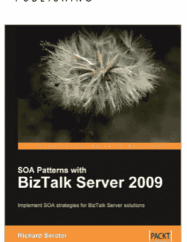

## BizTalk Server 2009 的 SOA 模式

ISBN: 978-1-847195-00-5      平装版：400页

使用本书和电子书实施面向 Microsoft BizTalk Server 解决方案的 SOA 策略

- 1. 讨论 SOA 的核心原则并展示其在 BizTalk 解决方案中的应用
- 2. 对 BizTalk 与 WCF 集成的最全面探讨，任何现有书籍中都无出其右
- 3. 对新的 WCF SQL Server 适配器、UDDI Services 版本 3 和 ESB Guidance 2.0 的领先见解

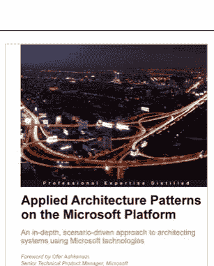

## Microsoft 平台上的应用架构模式

ISBN: 978-1-849680-54-7      平装版：544页

使用本书和电子书，采用深入的基于场景的方法，使用 Microsoft 技术构建系统架构

- 1. 提供一种架构方法论，用于选择满足解决方案需求的 Microsoft 应用平台技术
- 2. 考虑消息传递、工作流、数据处理和性能场景的解决方案
- 3. 由 Microsoft 领域的资深专家团队撰写
