## 将 IIS 10.0 与 Windows Server 2016 集成

在本章中，我们将涵盖以下食谱：

+   - IIS 10.0 架构
+   - 在 Windows Server 2016 上安装 IIS 10.0
+   - IIS 管理器
+   - IIS 10.0 的基本配置
+   - 主机静态页面
+   - 测试静态页面网站

### 引言

IIS 10.0 是 Internet Information Services (IIS) 的最新版本，IIS 是由 Microsoft 开发的可扩展 Web 服务器。IIS 10.0 随 Windows Server 2016 和 Windows 10 推出。IIS 10.0 的新功能包括 HTTP/2、Nano Server 上的 IIS、通配符主机头和 PowerShell 5 cmdlet 等。此外，它还支持所有先前支持的功能：HTTP、HTTPS、SMTP、SNMP、FTP 和 FTPS。

本章中的食谱将主要关注 IIS 10.0 与 Windows Server 2016 的集成。

我们将从有关 IIS 10.0 的一些基本信息开始。之后，我们将把 IIS 10.0 与 Windows Server 2016 集成，并配置和测试我们的第一个示例网页。

### 了解 IIS 10.0

在本食谱中，我们将了解如何使用 IIS 10.0 的新功能。我们将概述添加到 IIS 10.0 的以下新功能：

+   - **HTTP/2**
+     HTTP/2 请求现在比以往更快。此功能在 Windows Server 2016 和 Windows 10 上的 IIS 10.0 中默认处于活动状态。
+   - **Nano Server 上的 IIS 10.0**
+     IIS 10.0 易于快速安装在 Nano Server 上。您可以使用 PowerShell 或 IIS 管理器控制台远程管理 IIS 10.0。Nano Server 运行速度更快，消耗的内存和磁盘空间比功能齐全的 Windows Server 少。重新启动也更快，因此您可以更有效地管理时间。
+   - **通配符主机头**
+     IIS 10.0 支持您父域名的子域功能。这将真正帮助您使用相同的首要域名管理更多子域名。
+   - **PowerShell 5 cmdlet**
+     IIS 10.0 添加了一个新的、简化的 PowerShell 模块，用于快速轻松地管理。您可以使用 PowerShell 远程访问服务器管理功能。它还支持现有的 `WebAdministration` cmdlet。
+   - **FTP**
+     FTP 是一种用于传输文件的简单协议。此系统可以使用默认端口 21 在公司局域网和广域网内传输文件。IIS 10.0 包含一个易于配置和管理的 FTP 服务器。
+   - **FTPS**
+     FTPS 与 FTP 相同，唯一的区别是它是安全的。FTPS 使用 SSL 传输数据。我们将使用 HTTPS 端口 443。为此，我们需要创建并安装 SSL 证书以安全地加密和解密数据。SSL 确保在私有或公共网络上传输期间，Web 服务器和浏览器之间传递的所有数据在上传和下载过程中保持私密和一致。
+   - **多网站托管**
+   
+     IIS 10.0 允许您在同一服务器上创建多个网站和多个应用程序。您可以轻松管理和创建位于默认位置或自定义位置的新虚拟目录。
+   - **虚拟目录**
+   
+     IIS 10.0 使管理和创建所需的虚拟目录变得容易。

### IIS 10.0 的基本要求

在我们以操作或暂存模式运行 Web 服务器之前，我们必须对其进行规划。我们要发布什么类型的网站和应用程序？例如，我们的网站需要一个支持 IIS 10.0 上 .NET framework 4.5 的服务器。我们需要了解支持的操作系统和硬件要求。

让我们详细了解要求。

#### 操作系统要求

以下小节详细说明了 Windows Server 2016 的估计系统要求。如果您的计算机低于最低要求，您将无法正确安装此产品。实际要求将根据您的系统配置以及您安装的应用程序和功能而有所不同。除非另有说明，否则这些最低系统要求适用于所有安装选项（Windows 2016 Server Core、Windows Server 2016、Nano Server 和 Windows 10）以及标准版和数据中心版。IIS 10.0 Express 支持 Windows 7 Service Pack 1、Windows 8.1、Windows 8、Windows Server 2008 R2、Windows Server 2012、Windows Server 2012 R2、Windows 10 和 Windows Server 2016。

为获得最佳效果，请进行测试部署以确定特定部署方案的适当系统要求。

#### 硬件要求

我们来看看运行 Windows Server 2016 和 Windows 10 的最低硬件要求：

##### Windows Server 2016

- 处理器：1.4 GHz 64 位
- 内存：64 位操作系统至少 2 GB
- 硬盘空间：32 GB

##### Windows 10

- 处理器/SoC：1 GHz
- 内存：32 位操作系统至少 1 GB，64 位操作系统至少 2 GB
- 硬盘空间：32 位操作系统至少 16 GB，64 位操作系统至少 20 GB
- 显卡：支持 WDDM 1.0 驱动程序的 DirectX 9

#### 操作系统介质

安装 IIS 10.0 需要操作系统介质。在 Windows Server 2016 上安装 IIS 10.0 时，有时它会要求提供操作系统介质以获取所需文件。我们必须以 CD 或 USB 驱动器形式插入介质。

如果只需安装 IIS 10.0 Express，则需要 IIS 10.0 Express 软件，该软件可在 Microsoft IIS 网站（https://www.microsoft.com/en-us/download/details.aspx?id=48264）上获取。你只需要该软件和互联网连接。

### IIS 10.0 架构

我们需要了解 IIS 应用程序可以使用哪些资源；它如何处理不同类型的内容文件（如静态文件、ASP 文件或 ISAPI 文件）；以及它如何将内容文件分组到应用程序中。对于不熟悉 Web 服务器的初次读者，这里还介绍了客户端/服务器关系的入门知识。

IIS 7 及更高版本提供了请求处理架构。由于默认配置会监视每个请求并验证已实施的安全规则，因此我们获得了以下请求处理方面的额外好处：

- Windows 进程激活服务（WAS），使站点能够使用 HTTP 和 HTTPS 以外的协议
- 可通过添加或删除模块进行自定义的 Web 服务器引擎
- IIS 和 ASP.NET 的集成请求处理管道

#### 准备就绪

我们需要一个正在运行的 IIS 10.0 实例。应安装安全组件。你应具有管理权限。

#### 操作步骤

现在，我们将回顾组件和模块。

1. 在 Windows Server 2016 上启动服务器管理器，该服务器上应已安装 IIS 10.0。
2. 转到顶部的“工具”菜单。
3. 你将能够看到 Internet 信息服务管理器（IIS）。
4. 单击“IIS 服务器”，它位于“IIS 管理器”窗口的左侧，如下所示：

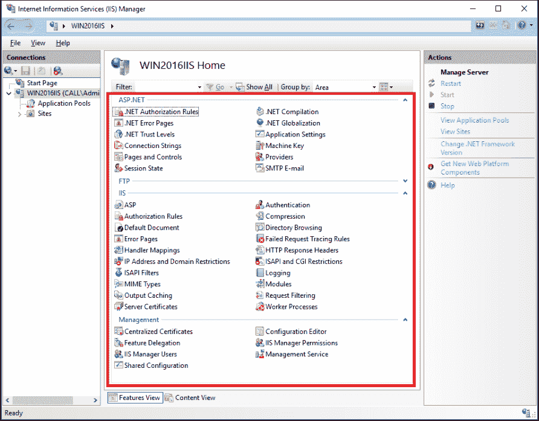

5. 在“服务器管理器”面板中，你将看到已安装的默认组件列表。你可以根据需要配置它们。例如，你可以配置安全和管理选项。

6. 让我们了解模块在哪里。在上图中，你会看到一个名为“模块”的图标，此时它将打开默认配置。

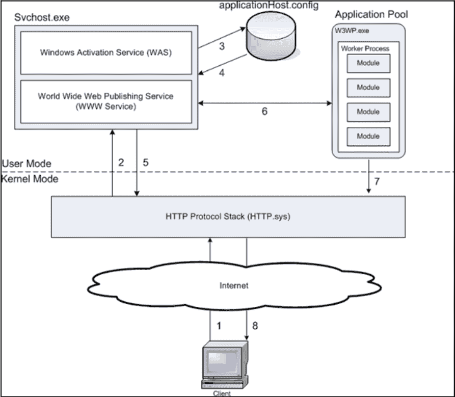

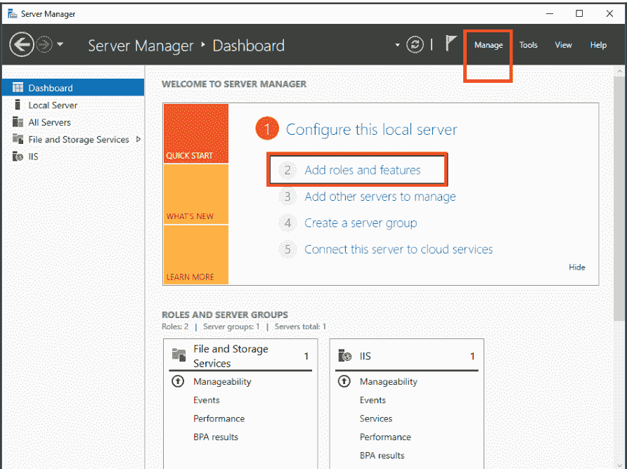

4. 在“开始之前”向导中，只需单击“下一步”按钮。此窗口仅用于提供有关安装前提条件的信息。
5. 在“选择安装类型”向导中，保持默认选项“基于角色或基于功能的安装”选中，并单击“下一步”。

6. 现在我们必须选择要在哪台服务器上安装 IIS 10.0。我们正在安装到本地计算机，因此保持“从服务器池中选择服务器”选中当前计算机，并单击“下一步”。或者，你也可以从此处选择你正在管理的另一台服务器。你可以在下图中了解这一点：

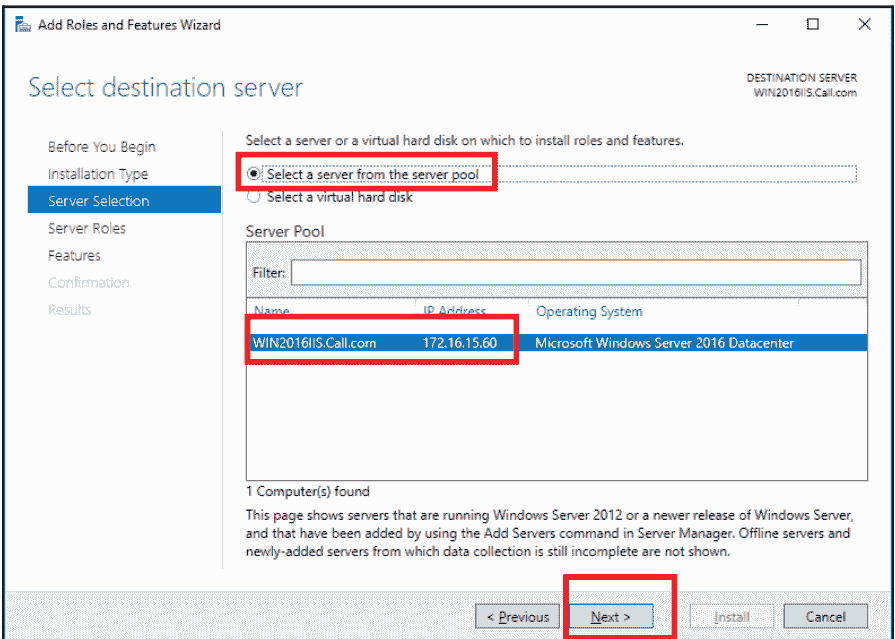

7. 现在我们必须从“选择服务器角色”向导中选择角色。选中“Web 服务器（IIS）”旁边的复选框。这样做可能会打开一个新的弹出窗口，提示需要附加功能；只需单击“添加功能”按钮即可同时安装它们。完成此操作后，在“选择服务器角色”菜单上单击“下一步”。

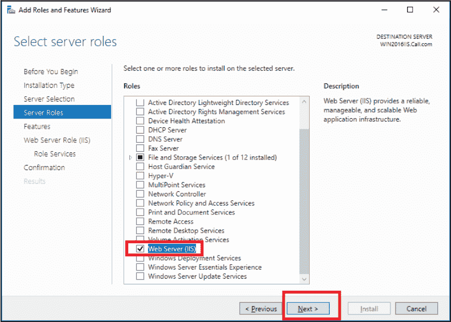

8. 一旦我们选择了“Web 服务器（IIS）”，我们将获得一个附加功能列表，我们可以从中选择。在此阶段，我们不会选择任何功能，因此只需在“选择功能”向导中单击“下一步”。

9. 阅读提供的信息后，在“Web 服务器角色（IIS）”向导上单击“下一步”。

11. 现在我们在“确认安装选择”向导上，因此请查看要安装的项目，并单击“安装”以继续在 Windows Server 2016 上安装 IIS 10.0 Web 服务器。

12. 在这里，你可以看到重新启动复选框。普通 IIS 10.0 安装无需勾选它——只有当你从服务器卸载某些内容或安装需要重启服务器的附加组件时，才需要重新启动系统。

请看这个截图，它显示了在 Server 2016 上运行的 IIS 10.0。

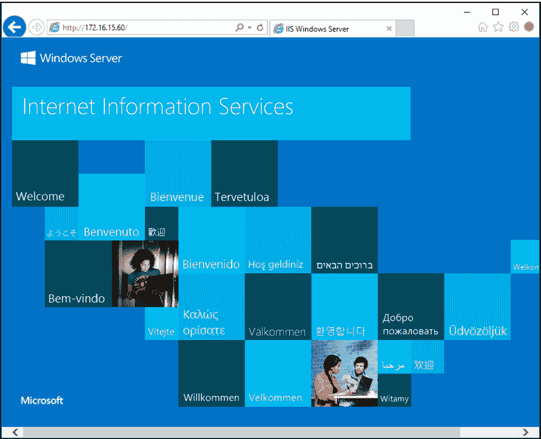

### IIS 管理器

既然我们知道了如何安装 IIS 10.0，让我们来看看 IIS 管理器，它是 Microsoft 提供的 IIS 10.0 管理工具的一部分。IIS 10.0 可以通过 GUI 模式或 PowerShell 命令进行管理。IIS 管理器 GUI 界面默认随 Windows Server 2016 一起提供。

我们还将学习如何使用 IIS 管理器连接远程 IIS 服务器。

#### 准备就绪

要逐步完成本教程，你需要在 Windows Server 2016 上运行一个 IIS 10.0 实例。对于远程 IIS 管理，你需要安装 IIS 管理工具。

#### 操作步骤

1. 在 Windows Server 2016 上启动服务器管理器，该服务器上应已安装 IIS 10.0。
2. 单击“工具”菜单。
3. 在顶部，你将能够看到 Internet 信息服务管理器（IIS）。此图将向你展示如何到达那里：

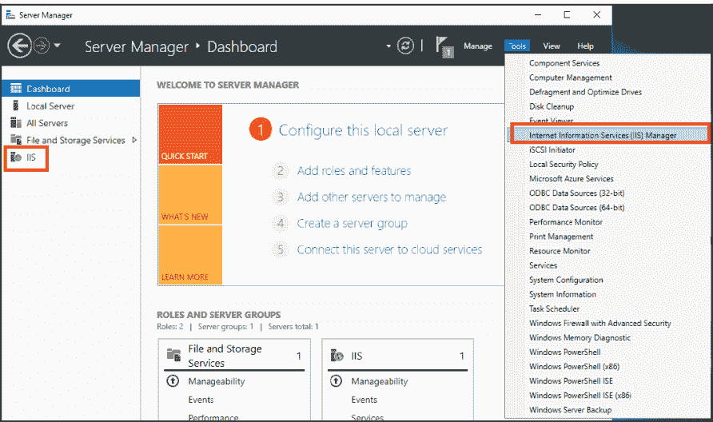

4. 你现在将看到 IIS 管理器主屏幕。

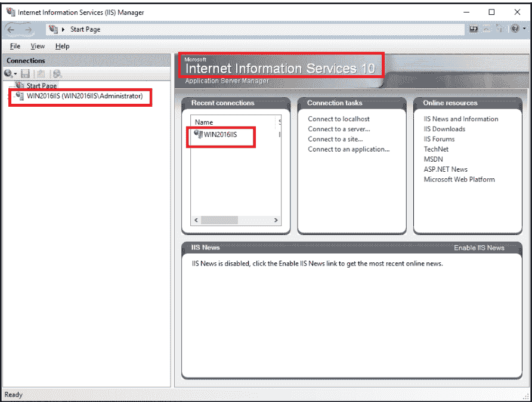

5. IIS 管理器显示其已连接且已安装 IIS 10.0 的服务器。
6. 然后，我们选择左侧的 WIN2016IIS（WIN2016IIS\Administrator）。
7. IIS 管理器主屏幕将显示 IIS 10.0 的默认功能。

8. 如下面的图所示，左侧有一个应用程序池以及你的默认网站。然后，中间部分有可用的功能配置选项，右侧有管理服务器、重新启动、启动和停止。你可以从此处浏览网站。

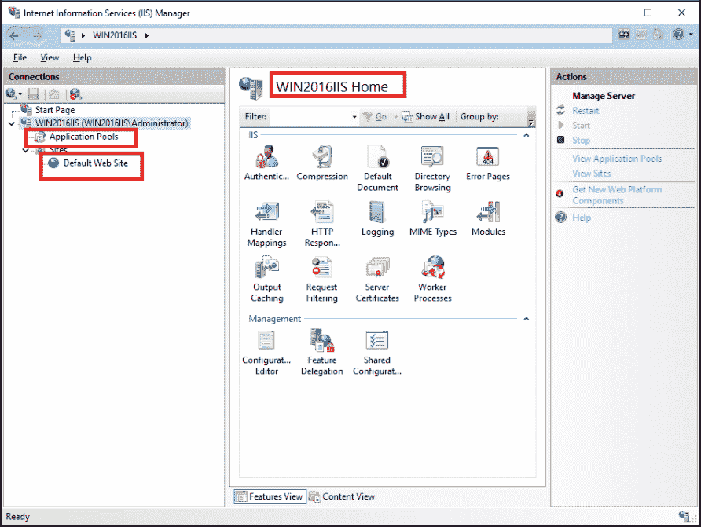

### 如何管理远程 IIS？

1. 你有多个 IIS 服务器实例，即使只想从 IIS 管理器管理一个网站或 Web 应用程序。
2. 我们将使用 Windows Server 2016 上的 IIS 管理器连接远程 IIS 服务器实例。你可以使用任何支持 IIS 10.0 的操作系统来执行此操作。

8. 右键单击“开始页面”图标，或单击“连接”下方的地球图标。你将看到连接到 IIS 服务器、网站或应用程序的选项。

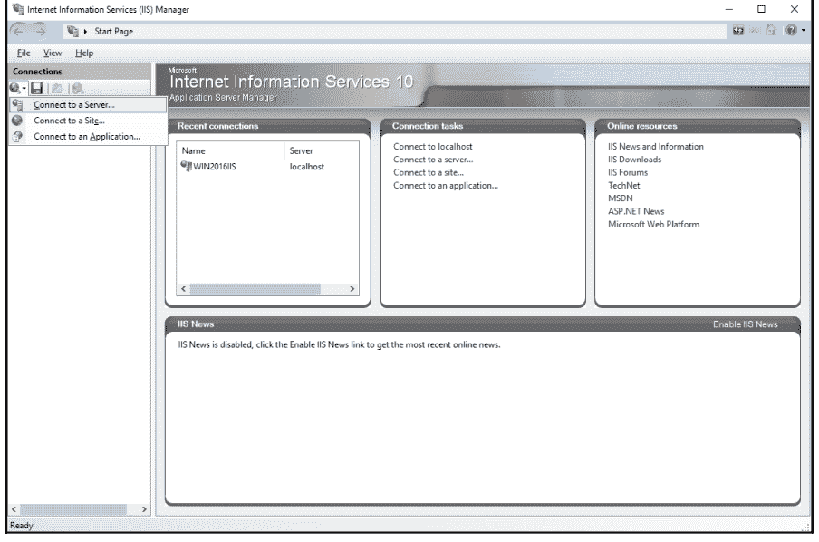

9. 我们首先处理服务器连接选项。单击上一屏幕截图中列出的“连接到服务器”。在下一个屏幕上，它将询问你是要选择远程服务器 IP 还是计算机名称。

10. 输入服务器 IP 地址，即 `172.16.15.212`。你将看到下一个屏幕。单击“下一步”按钮以完成当前步骤。

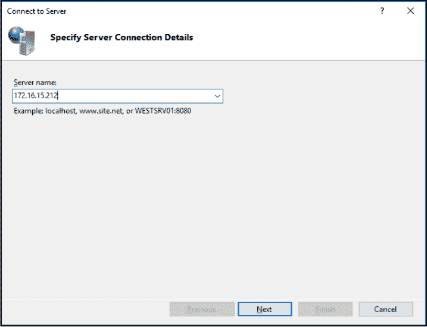

11. 现在你必须输入用户名和密码，之后在成功验证用户名和密码后，会弹出服务器证书确认提醒消息。单击“连接”按钮。

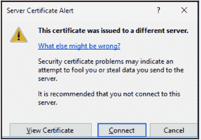

- 3. 默认情况下，所有网站文件都将存储在 `wwwroot` 文件夹中。路径为 `C:\inetpub\wwwroot`。以下截图显示了默认的 IIS 10.0 网站文件：

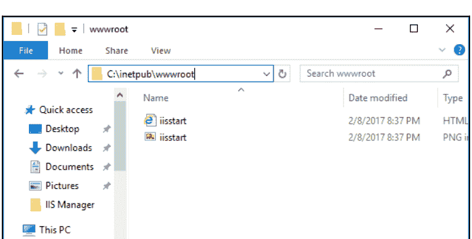

- 4. 现在，我们来看 `logs` 文件夹。它位于 `C:\inetpub\logs`：

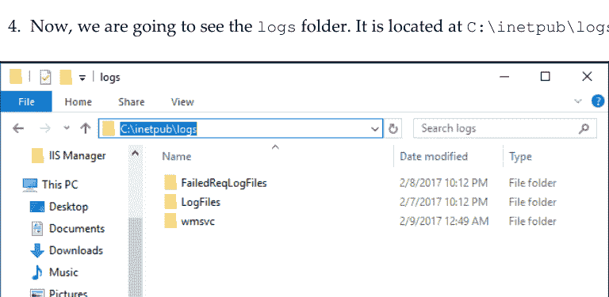

- 5. 启动 IIS 管理器并选择 **Default Web Site**。你将在右侧获得 **Actions** 窗口。在 **Actions** 列表中，我们有 **Edit Site** 选项。

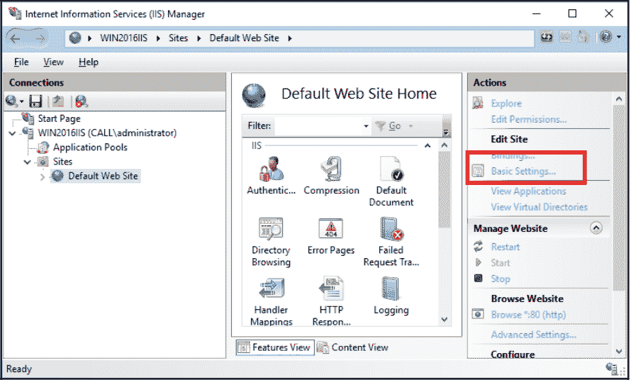

- 6. 点击 **Basic Setting...** 文本按钮。你将获得以下基本设置窗口：

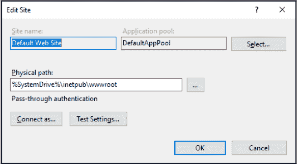

- 7. 我们选择了 **Default Web Site**；现在你可以看到 **Site name**、**Application pool**、**Physical path** 和 **Connect as...** 身份验证选项。

- 8. 在 **Edit Site** 窗口中，你可以更改 **Application pool** 并定义你的网站文件夹路径或默认的身份验证类型。最后，你可以测试默认设置。

- 9. 让我们看一些绑定选项。在 **Actions** 列表中，你会看到有一个 **Bindings...** 选项。绑定用于定义你的网站参数：**Type** `http`、**Host Name** `www.xyz.com`、**Port** `80`，以及 **IP Address** `*`，例如，如下所示：

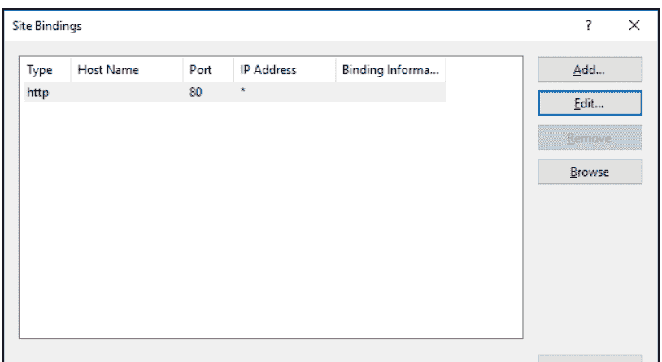

- 10. 现在，为网站访问设置 **Limits**。在 IIS 管理器右侧可用的 **Actions** 列表中，进入 **Default Web Site** 属性。

## 2. Hosting Static Web Pages

在本教程中，我们将托管我们的简单 HTML 网页。

#### Getting ready

我们需要创建一个 HTML 网页并运行 IIS 10.0。你还需要用户管理员权限来托管站点。

#### How to do it...

- 1. 打开记事本并输入一些内容，如以下截图中所示。你可以写任何你想要的内容。
- 2. 将记事本文件保存在桌面上，名称为 index.html。

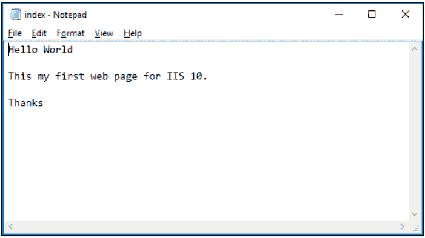

- 3. 接下来，你需要打开 IIS 管理器，选择 Default Web Site，然后右键单击它：

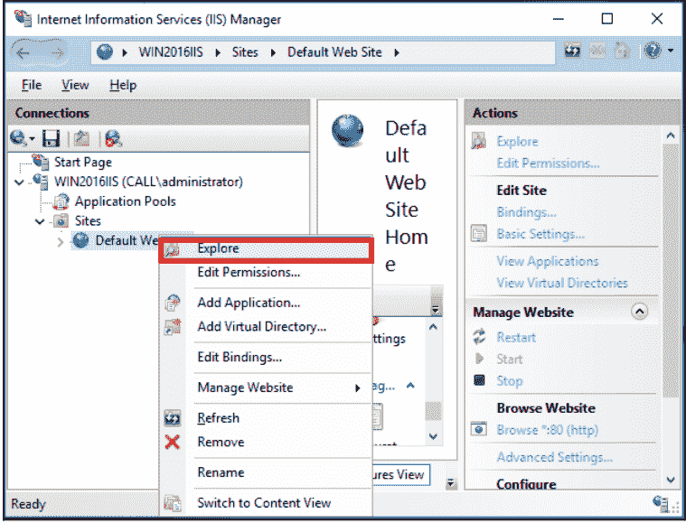

- 4. 从弹出菜单中点击 Explore 选项。

- 5. 它将打开 Inetpub 文件夹，从 C:\inetpub\wwwroot 默认网站文件夹位置开始，在那里你将保存你的 Web 应用程序或网站文件。wwwroot 文件夹是你的托管目录。

- 9. 点击 **Default Web Site**。你将看到属性页面弹出：

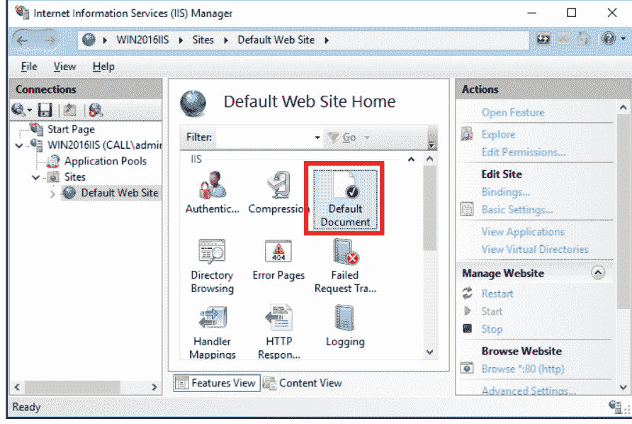

- 10. 打开 **Default Document**。你会找到 Default.htm、Default.asp、Index.html 等多个名称列出。我们的文件名是 Index.html，默认文档中已包含相同的名称。

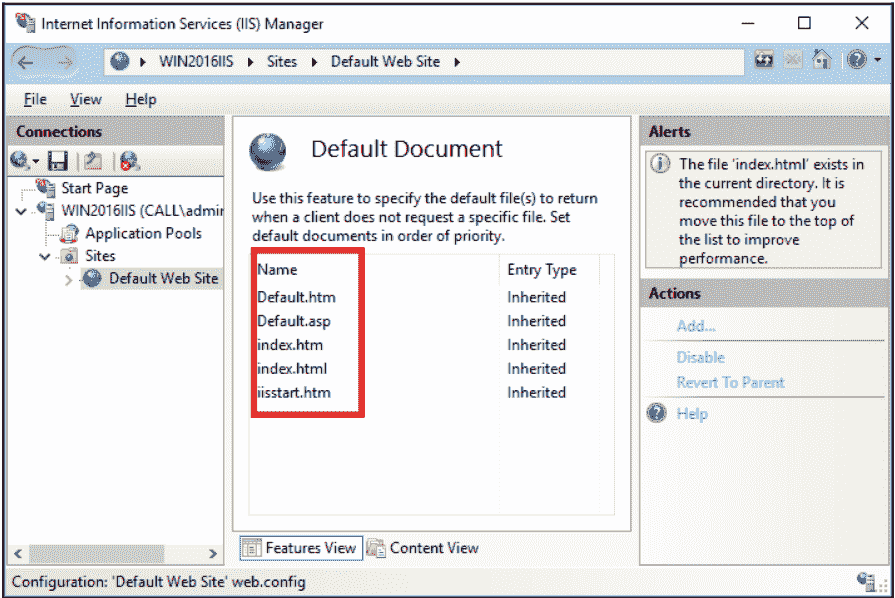

#### How it works...

一旦我们检查默认文档配置并发现 index.html 名称已列出，我们需要打开网页，默认主页将会打开。默认文档设置对于启动你的网站非常有帮助，因为你会选择它，并且需要告诉 IIS 服务器你的主页是什么。

### Testing a static-page website

我们已经将静态 index.html 页面上传到 wwwroot 文件夹，并检查了默认主页的默认文档设置。现在让我们看看如何测试静态网页。

#### Getting ready

我们需要测试网页是否正常工作。你需要一个正在运行的 IIS 10.0 服务器实例和一个静态 HTML 网页。

我们已经创建了 `index.html` 页面并将其上传到 IIS `wwwroot` 目录。

#### How to do it...

- 1. 打开 Internet Explorer。
- 2. 你需要在地址栏中提供你的网页 URL。我们在 localhost（本地服务器）上安装了 IIS 10.0。
- 3. 输入 URL `http://localhost/` 并按 **Enter**。你的页面将如下所示：

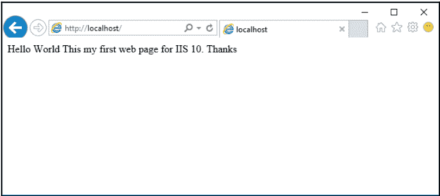

#### How it works...

一旦你通过 IIS 访问网页，页面将通过 HTTP 端口 80 显示。你可以尝试上传更多页面。

应用程序池的好处是，如果其中一个应用程序池出现问题，它只会影响相关的应用程序池。

应用程序池使我们能够隔离 Web 应用程序，以获得更好的安全性、可靠性和可用性。

有两种类型的应用程序管道。我们可以选择集成模式（支持 IIS 7.5 或更高版本）或经典模式（IIS 6.0）。

### Understanding application pools in IIS 10.0

在本教程中，我们将了解应用程序池。我们可以简单地说，应用程序池是 IIS 10.0 的核心。应用程序池是 Web 应用程序的逻辑分组，它们将在一个公共进程中执行，从而允许对哪些程序在单个进程中聚类进行更大的粒度控制。例如，如果你需要每个 Web 应用程序都在单独的进程中执行，你只需为每个不同框架版本的应用程序创建一个应用程序池即可。

假设我们有多个版本的网站，一个支持框架 2.0，另一个支持框架 4.0 或其他不同的应用程序，如 PHP 或 WordPress。所有这些网站进程都通过应用程序池进行管理。

#### Getting ready

要逐步完成本教程，你需要一个正在运行的 IIS 10.0 实例。你还应具有管理员权限。

- 3. 点击 **DefaultAppPool**，然后你将获得 **DefaultAppPool** 的 **Actions** 面板。在这里，你将看到右侧高亮显示的 **Application Pool Tasks** 选项，你可以 **Start**、**Stop** 和 **Recycle** IIS 10.0 的服务。

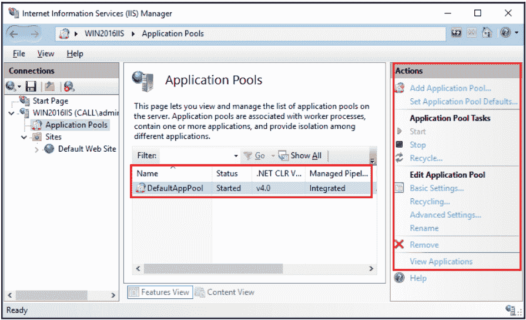

- 5. 在 **Edit Application Pool** 部分，你可以更改应用程序池的设置到 **Basic Settings...** 和 **Advanced Settings...**、**Rename** 应用程序池，并执行 **Recycling....**

#### How it works...

让我们回顾一下我们在 IIS 管理器和应用程序池中探索的内容。我们了解了应用程序池的基础知识以及可以在其中进行更改的属性。默认的 IIS 10.0 应用程序池框架是 v4.0，支持到 v4.6，但我们还有更多安装不同版本应用程序池的选项。我们可以轻松自定义应用程序池，这有助于我们满足典型的 Web 应用程序需求。

在操作窗格中，我们有多个应用程序池选项。我们可以添加新的应用程序池，并且可以启动、停止和回收应用程序池任务。我们也可以执行编辑和自动回收。

在下一个教程中，我们将学习更多关于应用程序池的内容，以安装较低的框架版本。

### Installation of lower framework version

在本教程中，我们将在 Windows Server 2016 上安装框架 3.5。默认情况下，IIS 10.0 具有框架版本 4.0。我们将安装较低版本的框架，它支持使用 .NET 框架版本 2.0 到 3.5 的 Web 应用程序。

例如，如果你有一个几年前创建的 Web 应用程序，它是在 v2.0 .NET 框架中开发的，你可以使用本教程使其在 IIS 10.0 上运行。让我们开始吧。

#### Getting ready

要逐步完成本教程，你需要安装框架 v3.5，它基于 v2.0 框架。你需要一个 Windows Server 2016 实例。你应该有 Server 2016 操作系统媒体用于框架 3.5 文件或互联网连接。你还需要管理员权限。

#### How to do it...

- 1. 在 Windows Server 2016 上打开服务器管理器，并点击突出显示的 Add roles and features 选项。

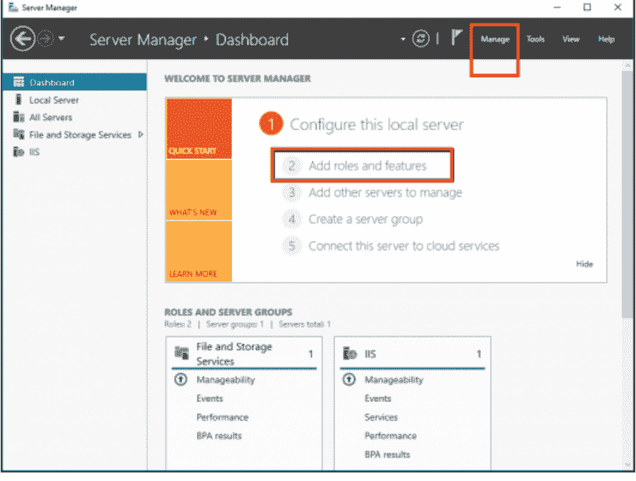

3. 单击“功能”选项卡并单击 .NET Framework 3.5 功能的复选框。它还会安装受支持的 2.0 框架。进入下一步：

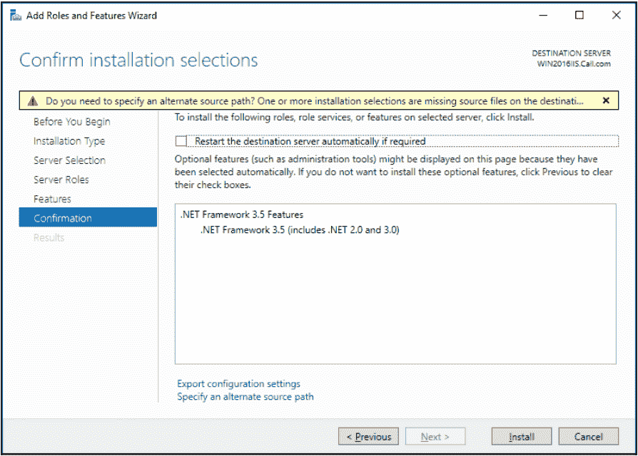

6. 这里，我的 Windows Server 2016 媒体在 D: 驱动器中。这是我的媒体路径，我已下载，但在你的情况下，它可能不同或是一个实际的光驱。里面有一个名为 sources 的文件夹和一个子文件夹 sxs。在此文件夹中，安装文件可用：

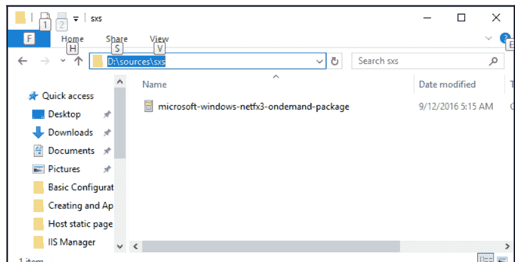

7. 现在你知道源文件夹在哪里。进入确认屏幕并单击“安装”。下图显示了 WIN2016IIS 上的安装进度：

8. 安装完成后单击“关闭”；现在你的服务器上已可以使用框架 3.5。

9. 现在你需要验证框架 3.5 是否已安装。它应该在功能向导中可用。

10. 打开服务器管理器并单击“添加角色和功能”。

11. 不断单击“下一步”，直到进入“选择功能”向导。你会看到 .NET framework 3.5 复选框已勾选，并且该框呈灰色，表示它已禁用：

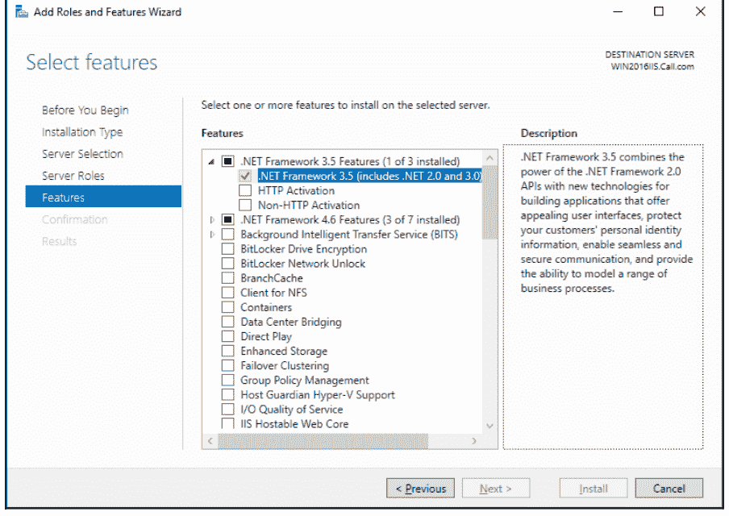

12. 我们已确认 .NET v3.5 已安装在我们的服务器上。

这可以通过 PowerShell 安装。我们也可以直接从 Windows Update 安装，但你需要 Internet 连接并且 Windows Server 上正在运行 Windows Update 服务。

#### 如何运作...

在本教程中，IIS 管理员已安装在框架 v3.5 上。Windows Server 2016 上的版本 3.5 框架帮助我们运行内置的 .NET v2.0 或 v3.5 应用程序。框架 v3.5 处理在框架 v3.5 或 v2.0 中构建的应用程序。

我们还找到了 sources\sxs 文件夹的位置，并在安装后验证了 .NET framework v3.5 是否可用。

我们现在将创建一个应用程序池以支持 .NET framework v3.5。

### 在 IIS 10.0 中创建不同的应用程序池

在本教程中，我们将创建一个支持 .NET 版本 2.0 到 3.5 的应用程序池。我们已经有用于 4.0 的默认应用程序池。本教程将指导你创建所需的不同的应用程序池。

#### 准备工作

在本教程中，我们需要 IIS 10.0 和 .NET framework 3.5。你应该具有管理员权限。

#### 如何操作...

- 1. 在 Windows Server 2016 上打开服务器管理器。单击“工具”菜单并打开 IIS 管理器。

2. 展开 IIS 服务器（WIN2016IIS）。你将看到列出的应用程序池。看一下：

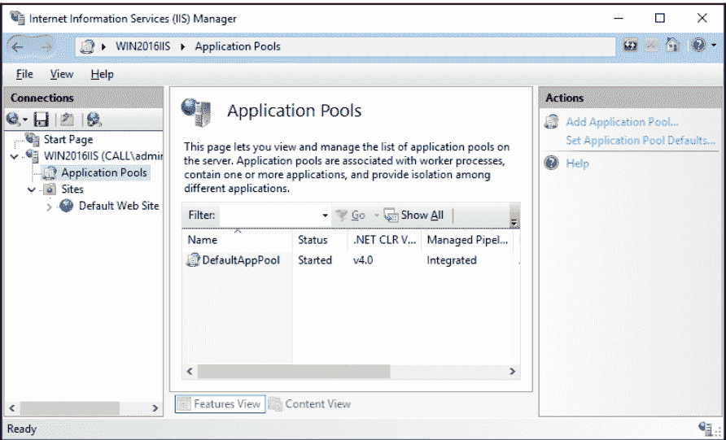

3. 此屏幕截图显示在应用程序池下，我们有 DefaultAppPool，状态显示为已启动，版本为 v4.0，托管管道显示为集成。

4. 让我们为 v2.0 和集成管道创建一个新的应用程序池。

5. 在右侧的 **Actions** 窗口中单击 **Add Application Pool**。你将获得 **Add Application Pool** 向导：

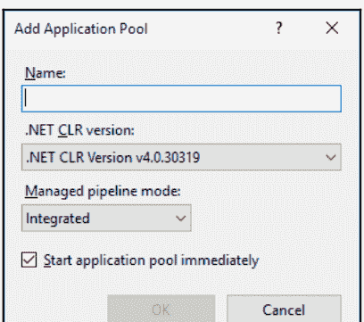

6. 根据应用程序名称选择一个应用程序显示名称以便轻松识别。我将我的池命名为 **2and3.5AppPool**。该名称表明它将支持 2.0 和 3.5 .NET framework 版本。

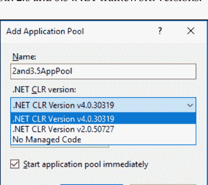

7. 接下来是 .NET CLR 版本。单击下拉菜单并选择 .NET Version V2.0.50727。此 .NET CLR 版本支持 2.0 和 3.5 框架网站。

8. 接下来是托管管道模式下拉菜单。我们可以从集成或经典模式中选择。在本示例中，我们将选择集成托管管道模式。

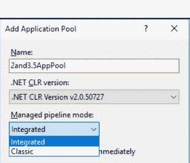

9. 你也可以在创建应用程序池时选择自动启动选项。选择“立即启动应用程序”，以便一旦创建应用程序池，它会自动启动。如果你取消选中“启动应用程序”复选框，你可以稍后从“操作”窗口手动启动它。单击“确定”按钮。现在你已成功创建了应用程序池。你可以在应用程序池列表中找到新创建的应用程序池。

#### 如何运作...

应用程序池处理一个或多个 Web 应用程序。我们创建了一个应用程序池，我们需要设置网站属性以更新配置。你可以将框架属性设置为你的 Web 应用程序支持的框架。

#### 如何操作...

- 1. 在 Windows Server 2016 上打开服务器管理器。单击“工具”菜单并打开 IIS 管理器。
- 2. 展开 IIS 服务器（WIN2016IIS）。你将看到列出的应用程序池：
- 3. 我们已经创建了一个应用程序池，它显示在应用程序池窗口中。我们创建了 2and3.5AppPool、Asp.net 和 DefaultAppPool（默认的）。
- 4. 在“操作”面板中，我们可以添加多个应用程序池，并且我们可以将其中任何一个创建的应用程序池设为默认。默认应用程序池在创建网站时很有用：它是选定的应用程序池，除非另有设置。
- 5. 选择 2and3.5AppPool。你将看到“操作”窗格，其中列出了可用的属性，如果需要，你可以在其中进行一些更改。2and3.5AppPool 的版本为 v2.0：

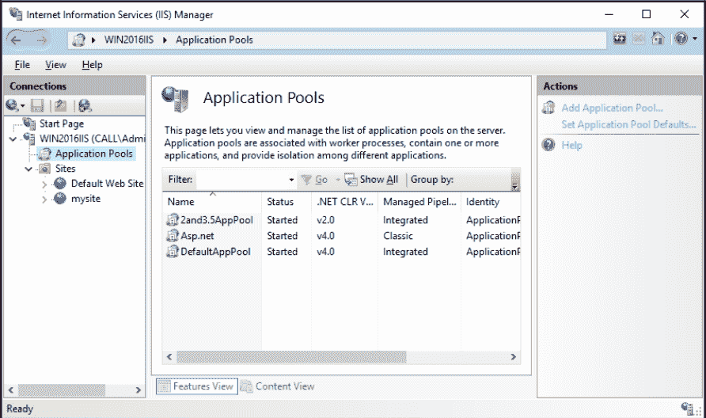

### 在 IIS 10.0 中创建应用程序池

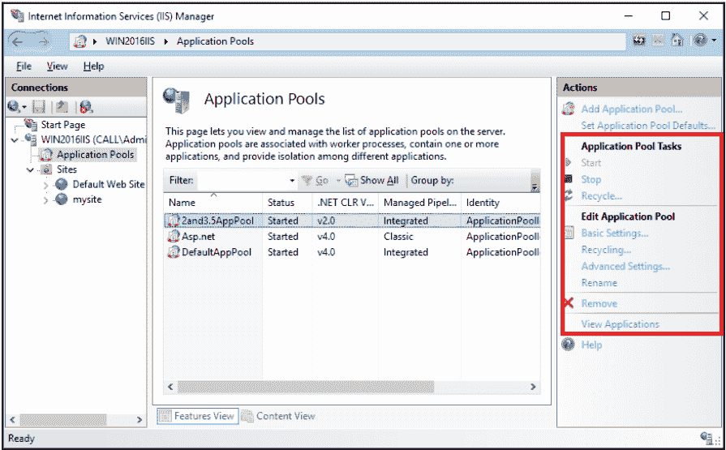

6. 看一下“操作”面板，其中有“应用程序池任务”和“编辑应用程序池”选项。从“应用程序池任务”列表中，我们可以启动、停止和回收...应用程序池。

7. 现在让我们来看看应用程序池的基本属性。从“编辑应用程序池”中单击“基本设置...”，你会看到此弹出窗口：

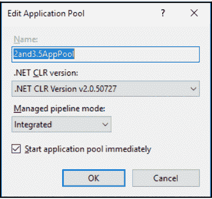

- 16. **回收**是为了刷新应用程序池重叠。我们可以设置默认回收值。
- 17. 我们可以通过单击 **Recycling...** 通过 **Recycling settings** 添加更具体的设置。这就是窗口的样子：

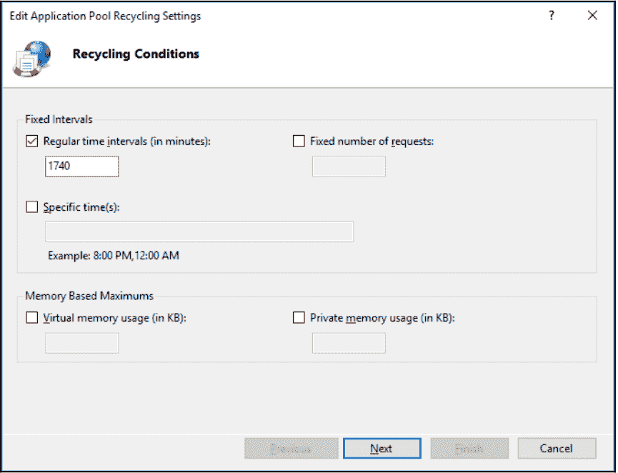

- 18. 回收基于诸如虚拟内存使用、私有内存使用、特定时间、定期时间间隔和固定请求数等条件。也将为你生成日志文件，帮助你了解何时执行了什么操作。在这里，你将根据时间和请求数设置固定间隔，或根据内存利用率和虚拟和私有内存设置特定时间。单击 **Next**。

### 编辑应用程序池回收设置

#### 要记录的回收事件

在回收应用程序池时可以生成事件日志条目。选择要记录的回收事件。

可配置的回收事件：

- 定期时间间隔
- 计划时间
- 虚拟内存使用
- 私有内存使用
- 请求数

运行时回收事件：

- 按需
- 配置更改
- 不健康的 ISAPI

19. 在“要记录的回收事件”窗口中，我们可以生成回收事件的日志。

#### 如何运作...

在本教程中，我们学习了 IIS 应用程序的三种属性：基本属性、高级属性和回收。我们可以使用这些属性用于我们将在 IIS 服务器上托管的 Web 应用程序，以便通过应用程序池处理它们。托管 Web 应用程序时，始终有一些需要在应用程序池设置中配置的要求。

例如，我们的管理层可能会决定我们需要限制 2and3.5apppool 应用程序的队列。我们只需进入高级设置并更改它即可。

在下一节中，我们将托管一个 v4.0 .NET framework 网站并使用 v4.0 应用程序池。

### 托管 .NET 网页

在本教程中，我们将托管一个受 .NET 默认 v4.0 支持的网页。我们将查看默认网站属性。我们将上传网页到默认的 `wwwroot` 目录。

#### 准备工作

我们需要在 IIS 10.0 服务器上安装 v4.0 应用程序，并且我们的 v4.0 .NET 网页应该准备就绪。我们需要安装一些尚未在 IIS 10.0 中安装的 IIS 组件。为此，你必须具有管理员权限。

#### 如何操作...

首先，我们必须安装一些 .NET 支持组件。

- 1. 在 Windows Server 2016 上打开服务器管理器并单击 **Manage** 菜单。进入后，单击 **Add Roles and features**。
- 2. 单击 **Next**，直到进入 **Select server roles** 向导。按照此图中突出显示的确切路径操作：

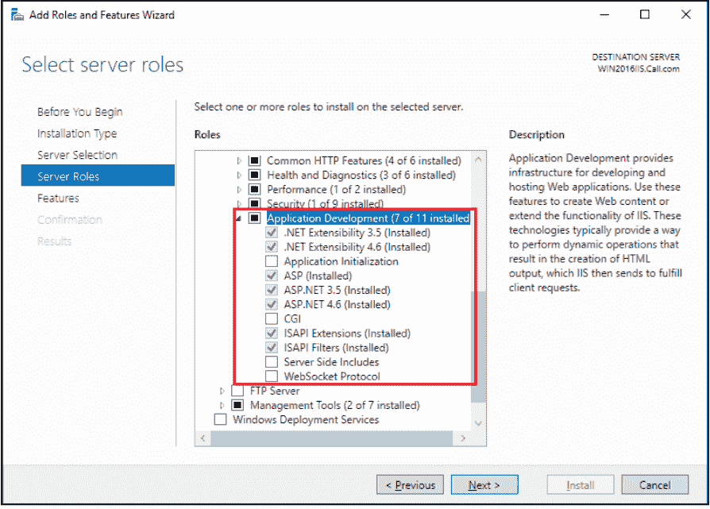

- 3. 扩展应用程序开发。您需要选择 .NET Extensibility 3.5、.NET Extensibility 4.6、ASP、ASP.NET 3.5、ASP.NET 4.6、ISAPI Extensions 和 ISAPI Filters。
- 4. 点击 Next 完成。现在让我们继续上传我们为演示目的创建的 .NET 框架网页。
- 5. 打开 IIS 管理器，点击 **Default Web Site**，您会看到以下屏幕：

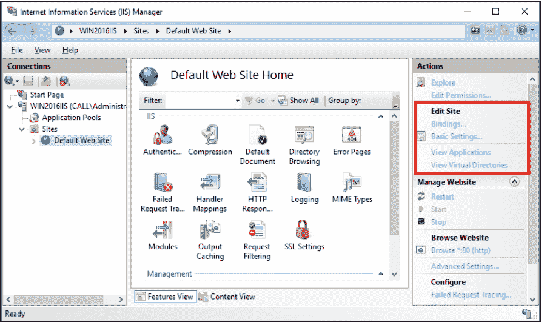

- 6. 在 **Actions** 窗格中，您需要点击 **Basic Settings...** 并检查与默认网站关联的应用程序池的哪个版本。

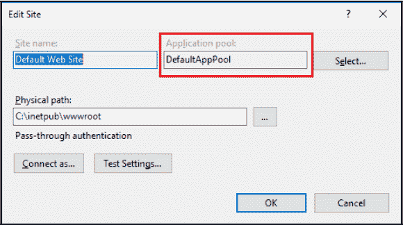

- 9. 我们创建了 ASP.NET v4.0 文件，需要将其粘贴到 wwwroot 文件夹中，如下所示：

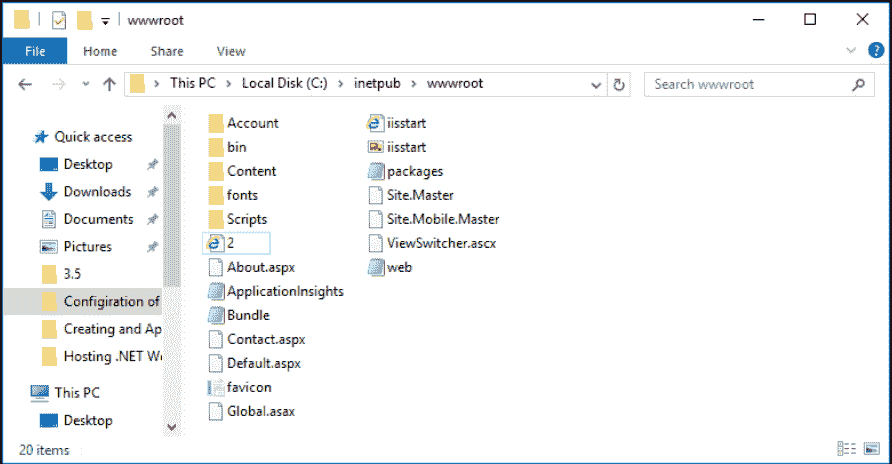

- 10. 这里，我们已上传为测试和演示目的创建的 .NET 应用程序文件。我们将在本章最后一个配方中稍后测试该应用程序。

#### How it works...

在本配方中，我们安装了 .NET Extensibility 3.5 和 4.6 组件。我们还安装了 ASP、ASP.NET 和 ISAPI 的支持，这些在默认安装的 IIS 10.0 中不可用。我们探索了应用程序池属性并上传了为演示目的创建的 v4.0 .NET 应用程序文件。

现在，将您的文件上传到 wwwroot 目录，该目录与默认网站关联。一旦访问默认网站 URL，您的 .NET 应用程序文件将被应用程序池处理。

### Hosting different versions of a .NET website

在本配方中，我们将托管一个受 .NET v2.0 支持的网页。我们将更改 **Default Web Site** 的属性。我们将网页上传到默认的 `wwwroot` 目录。

#### Getting ready

我们已在 IIS 10.0 服务器上安装了 v2.0 和 v3.5 框架版本。我们创建的 v4.0 .NET 网页应该已准备就绪。您必须具有管理员权限。

#### How to do it...

- 1. 打开 IIS 管理器并点击 **Default Web Site**。
- 2. 在 **Actions** 窗格中，点击 **Basic Settings...** 然后点击下一张图中突出显示的 **Select...** 按钮：

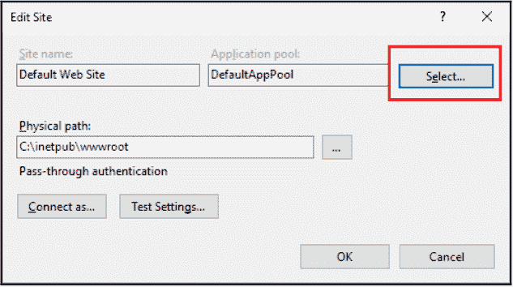

- 3. 应用程序池窗口将弹出。点击 Application pool: 下拉菜单，选择 Application Pools 下的 2and3.5AppPool，然后点击 OK 完成此步骤。

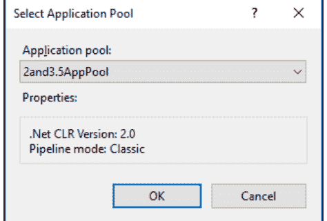

- 4. 现在，在站点属性中，您将看到与 Default Web Site 关联的 v2.0 应用程序池：

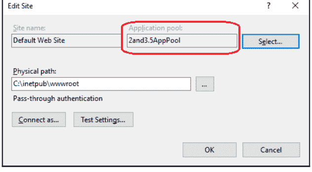

- 5. 接下来，右键点击 Default Web Site，点击 Explore，您将获得 wwwroot 目录，您需要在其中上传 v3.5 .NET 网页文件：

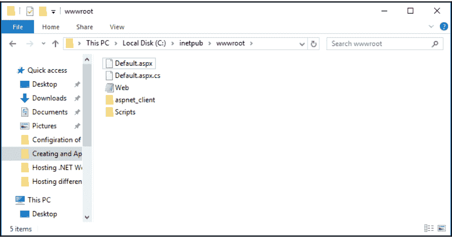

- 6. 我们已将 v3.5 文件上传到 wwwroot 目录。

#### How it works...

在本配方中，我们将应用程序池属性从 v4.0 .NET 更改为 v2.0 .NET。我们已将 v3.5 .NET 文件上传到与 Default Web Site 关联的 wwwroot 目录。

一旦访问 Default Web Site URL，您的 .NET 应用程序文件将被选定的应用程序池处理。

### Testing different versions of a website

在本配方中，我们将测试我们创建的 v3.5 应用程序池。也将测试默认的 v4.0 应用程序池。

我们将测试 v4.0 和 v3.5 框架。我们已创建了两个文件并已将其上传到 wwwroot 文件夹。

#### Getting ready

在本配方中，我们需要已配置的 v4.0 和 v3.5 框架。对于网页，我们已创建了 v4.0 和 v3.5 框架应用程序文件。我们将逐一测试 localhost URL 并查看结果。我们还将跨框架版本和 Web 应用程序文件进行测试。

#### How to do it...

- 1. 我们将测试 v4.0 应用程序，即 DefaultAppPool。您已在上一个配方中将 Web 应用程序文件上传到 wwwroot 文件夹。
- 2. 打开 Internet Explorer，在地址栏中输入 http://localhost/ 并按 Enter。您将看到以下屏幕：

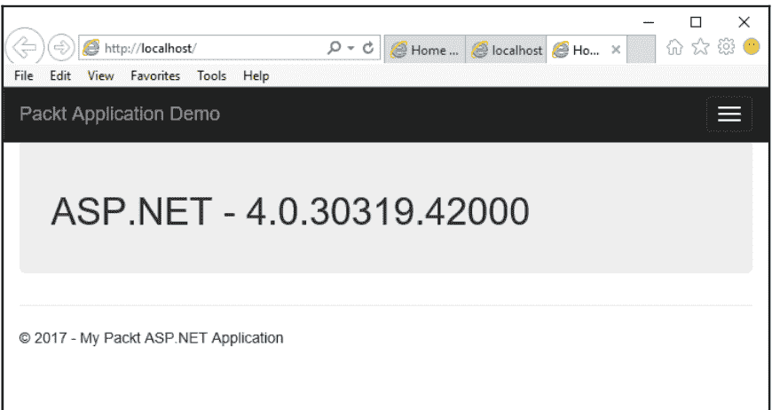
