## 3. Hosting Multiple Websites on IIS 10.0

在本章中，我们将介绍以下配方：

- Hosting multiple websites
- Creating a website folder
- Configuring websites
- Configuring ports
- Configuring the website IP
- Deploying websites
- Testing websites

### Introduction

使用 Microsoft IIS 10 Server 中的多个 Web 主机，您可以在同一台 IIS 10 服务器上托管一个或多个网站。网站可以使用 SSL（安全套接字层）通过超文本传输协议（HTTPS）使用默认端口 80 进行托管。通常，所有网站都通过 HTTP 或 HTTPS 访问默认端口 80。如果您以加密方式运行网站，协议为 HTTPS，是一个安全端口。

网站是访问网络所必需的，可以通过局域网（LAN），称为内联网，或广域网（WAN），称为互联网。

您需要域名、IP地址和端口来运行您的网站或 Web 应用程序。

我们已经执行了安装并创建了应用程序池。现在让我们在同一台 IIS 10 服务器上启动多个 Web 主机，并使用其主机名（域名）访问网站。

### Hosting multiple websites

在本配方中，我们将在 IIS 10.0 中创建三个网站：mysite.com、v2mysite.com 和 v4mysite.com。我们将在本章后面在 `hosts` 文件中进行主机名条目。我们将使用其主机名访问网站。

让我们继续到下一节，我们将在那里详细介绍。

#### Getting ready

要逐步完成本配方，您需要一台正在运行的 IIS 10 实例和管理员用户帐户。您将创建和配置网站的属性。

#### How to do it...

- 1. 在 Windows Server 2016 中打开 Server Manager。点击 **Tools** 菜单并打开 IIS 管理器。
- 2. 从 **Connections** 面板展开 IIS 服务器。我们得到列出的 **Application Pools** 和 **Sites** 文件夹。
- 3. 在计算机名称下方的左侧面板中展开 **Sites** 菜单并点击 **Default Web Site**。您可以使用此图找到它：

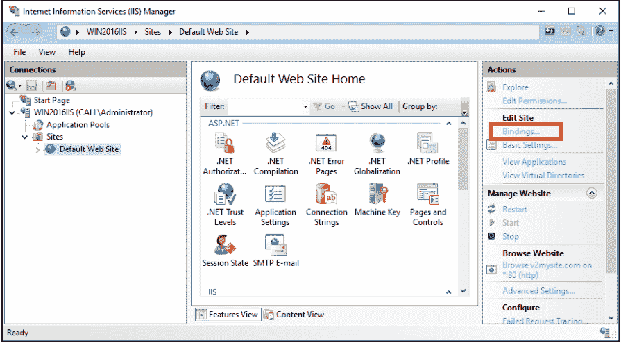

- 5. 转到右上方的 Actions 面板并点击 Bindings 下的 Edit Site。您将获得默认的 Site Bindings 选项：

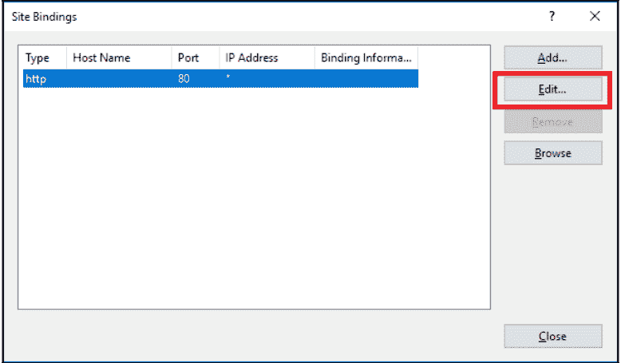

- 11. 转到 IIS Server Manager 的 Site 菜单，该菜单在左侧面板中可用并选择 Default Web Site。通过右键点击获取上下文弹出菜单选择 Rename 或在 Actions 窗格下点击 Basic Settings 以获得相同的重命名选项，将其重命名为 v2mysite.com。重命名网站仅用于标识网站。
- 12. 现在我们将添加 v4mysite.com。在 Connections 窗格中，点击 Sites 菜单，转到 Actions 面板并点击 Add Websites...。您将获得 Add Websites... 窗口：

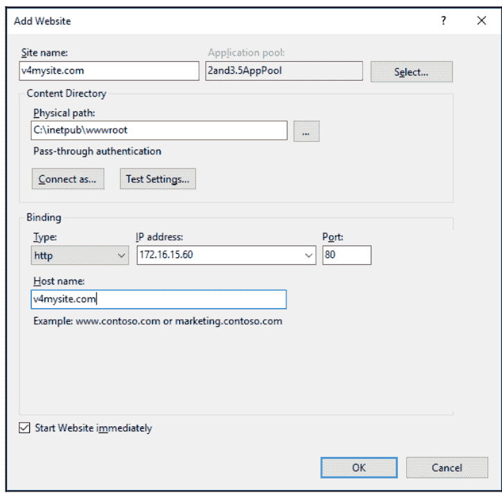

- 13. 我们添加 **Site name** `v4mysite.com` 并选择 **Application pool** `2and3.5AppPool`。
- 14. 保留默认目录为 `wwwroot`。我们添加的 IP 地址与服务器 IP 相同。
- 15. 将端口号保留为默认端口号，即 `80`。主机名为 `v4mysite.com`。**Start Website immediately** 是默认选项，已选中。点击 **OK** 按钮。
- 16. 我们将按照相同的步骤添加更多网站；我们将再创建一个名为 `mysite.com` 的网站。
- 17. 现在我们创建了三个具有不同名称但使用相同 IP 地址的网站：

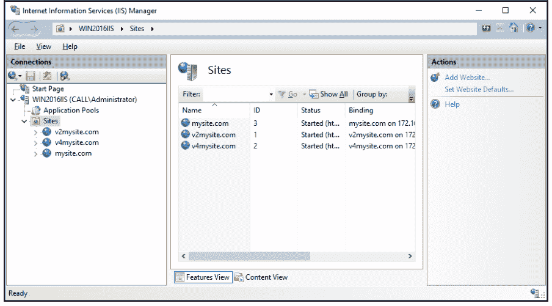

- 21. 在记事本中打开 hosts 文件。确保记事本以管理员权限打开，右键单击记事本图标并点击“以管理员身份运行”；这样才能保存更改。现在我们需要添加网站主机名条目：

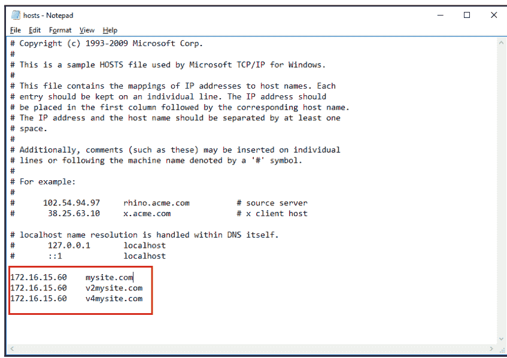

- 22. 如上图所示，我们创建了三个网站条目，分别是 mysite.com、v2mysite.com、v4mysite.com。所有站点的 IP 均相同，为 172.16.15.60。在你的环境中，IP地址应不同。

- 23. 保存 hosts 文件并关闭它。现在你已完成多网站托管的所有配置。

#### How it works...

在同一台 IIS 10 服务器上托管多个网站，有助于我们在同一服务器上轻松管理所有网站相关任务。我们刚刚在同一台 IIS 服务器上创建了三个网站。你可以根据需要创建任意数量的网站。

当你想通过域名访问网站时，例如 mysite.com，就需要 hosts 文件条目。你也可以使用 DNS 服务器通过局域网或广域网访问该网站。

### Creating a website folder

在本教程中，我们将在 c:\inetpub\wwwroot 路径下为每个网站创建单独的网站目录，例如 mysite、v2mysite 和 v4mysite，后续章节中我们可以在此上传网站应用程序文件。我们之前使用默认的 wwwroot 文件夹上传网站文件，现在需要发布多个网站。我们需要将所有 Web 文件上传到各自独立的目录中。

#### Getting ready

要逐步完成本教程，你需要一台正在运行的 IIS 10 实例。你必须拥有管理员权限，以便创建网站文件夹。

#### How to do it...

我们将在 wwwroot 文件夹内为每个网站创建一个网站文件夹。

- 1. 打开文件资源管理器，点击 **This PC**。在右侧你会看到可用的驱动器。
- 2. 打开 c:\ 驱动器，进入名为 inetpub 的文件夹，你将看到 IIS 10.0 相关的文件夹列表。你需要找到 wwwroot 文件夹。
- 3. 打开 `wwwroot` 文件夹。在 `wwwroot` 文件夹内，你需要创建 `mysite`、`v2mysite` 和 `v4mysite` 子文件夹：

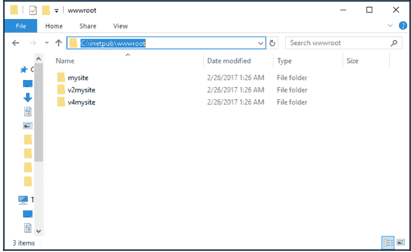

- 4. 现在我们需要配置网站的物理路径；我们已有三个网站：`mysite.com`、`v2mysite.com` 和 `v4mysite.com`。让我们逐一配置它们。
- 5. 进入 Server Manager，点击 Tools 菜单，打开 IIS Manager。
- 6. 在 Connections 窗格中展开你的 IIS 服务器，展开 Sites 文件夹，你会看到列出的三个网站。选择 mysite.com。
- 7. 进入 Actions 窗格，点击 Basic Settings，你将看到属性：

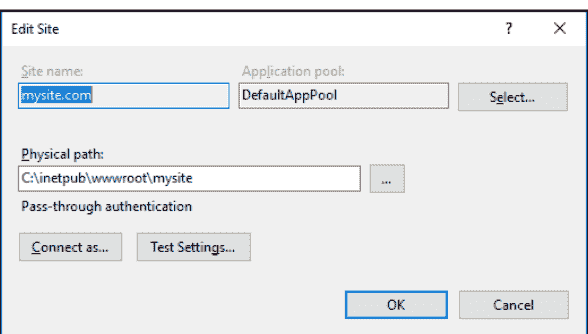

- 8. 我们添加网站目录的 **Physical path** `C:\inetpub\wwwroot\mysite`，供此网站 mysite.com 使用。
- 9. 点击 **OK** 按钮完成。
- 10. 按照之前的步骤添加/更新网站目录的 **Physical path** `C:\inetpub\wwwroot\v2mysite`，供此网站 v2mysite.com 使用。
- 11. 点击 **OK** 按钮。

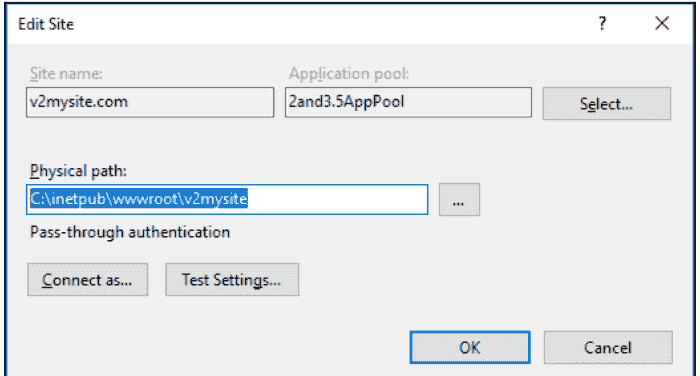

- 12. 我们将按照相同步骤添加/更新 v4mysite.com 的物理路径：

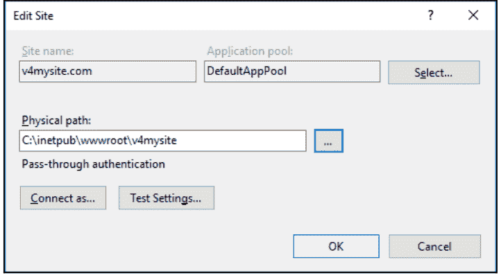

- 13. 现在你可以根据网站名称和文件夹上传 Web 应用程序文件。如果需要使用不同版本的应用程序池，可以从 Basic Settings 中更改应用程序池。

#### How it works...

我们首先在 wwwroot 目录内为多个 Web 应用程序创建子文件夹。然后为 mysite.com、v2mysite.com 和 v4mysite.com 创建了单独的目录。我们还更改了所有网站的物理路径。现在我们可以用各自独立的物理路径访问所有网站。

### Configuring websites

在本教程中，我们将配置网站属性。我们将探索基本设置和高级设置。也将介绍限制网站访问的设置。

#### Getting ready

要逐步完成本教程，你需要一台正在运行的 IIS 10 服务器和管理员用户账户以编辑网站设置。

#### How to do it...

- 1. 在 Windows Server 2016 上打开 Server Manager。点击 Tools 菜单并打开 IIS Manager。
- 2. 展开 IIS 服务器（WIN2016IIS）。我们可以看到列出的应用程序池和站点。
- 3. 在连接窗格中点击 mysite.com，你将在 Actions 窗格中看到 mysite.com 的属性。我们得到 Basic Settings... 和 Advanced Settings...：

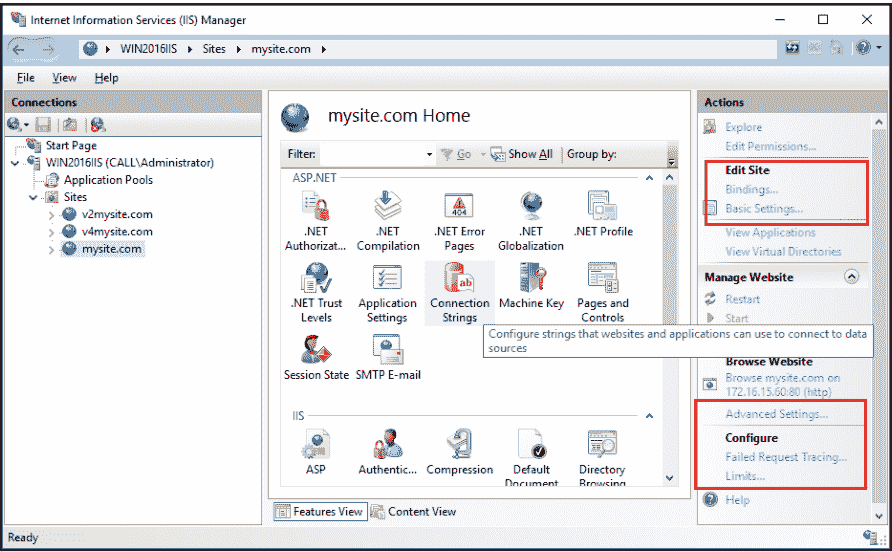

- 4. 点击 **Basic Settings...**，你将看到 **Edit site** 属性显示。

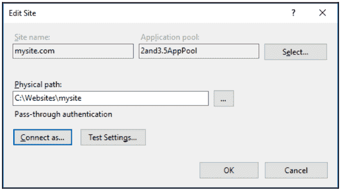

- 5. **Edit Site** 窗口显示你选择的网站和分配的应用程序池。
- 6. **Physical path** 是网站应用程序文件所在的路径，位于 `wwwroot` 文件夹中。你可以自定义 **Connect as...** 选项并测试设置以检查其在浏览器中是否正常工作。
- 7. 现在让我们继续配置所选网站的 **Advanced Settings...**。
- 8. 点击 **mysite.com**。在 **Actions** 窗格中，你会看到 **Advanced Settings...** 选项。点击 **Advanced Settings...**，你将看到高级设置窗口：

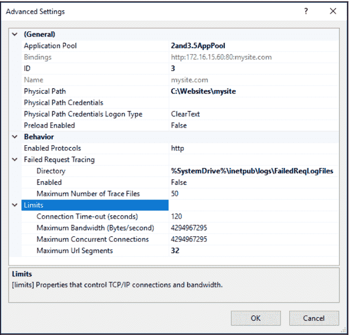

- 9. **Advanced Settings** 包含四个设置组：**General、Behavior、Failed Request Tracing 和 Limits。**
- 10. 在 **General** 中，你可以更改 **Application pool、website ID、website Physical Path、Physical Path Credentials Logon Type 和 Preload Enabled。**
- 11. 在 **Behavior** 中，你可以更改 **Enabled protocols**，其为 **http** 或 **https**。
- 12. 你可以配置 **Failed Request Tracing** 的设置。**Directory** 是存储跟踪信息日志的位置，跟踪服务启用为 true 或 false，以及最大跟踪文件数。
- 13. 你还可以根据连接超时、每秒最大带宽、最大并发连接数和最大 URL 段数设置网站访问的 **Limits**。

#### How it works...

在本教程中，我们从步骤 1 到 3 对网站 mysite.com 进行了概述。我们进入了 Connections 窗格并展开了 Sites 文件夹以获取 mysite.com 的属性。从步骤 4 到 13，我们讨论了 mysite.com 的基本和高级设置配置与自定义。我们了解了 Failed Request Tracing 以及如何限制 mysite.com 的并发连接。

### Configuring ports

在本教程中，我们将配置网站访问端口；默认网站访问类型为 HTTP，端口号为 80。我们将为所有单独托管的站点配置不同的端口以访问网站。

#### Getting ready

要逐步完成本教程，你需要一台正在运行的 IIS 10 服务器和管理员用户账户，以便编辑网站设置。

#### How to do it...

- 1. 在 Windows Server 2016 上打开 Server Manager。点击 Tools 菜单并打开 IIS Manager。
- 2. 展开 IIS 服务器（WIN2016IIS）。我们可以看到列出的应用程序池和站点。
- 3. 我们已有之前创建的列出网站。点击 mysite.com，你将在 Actions 窗格中看到 mysite.com 的属性。我们可以在 IP 172.16.15.60:80 浏览网站；这里 80 是端口号。
- 6. 在这里你会看到 Site Bindings。Type 为 http，Host Name 为 mysite.com，Port 为 80，IP 地址为 172.16.15.60。让我们继续配置端口号 8080。
- 7. 选择 mysite.com，编辑按钮将被激活；点击 Edit 按钮，你将看到 Edit Site Binding 窗口：

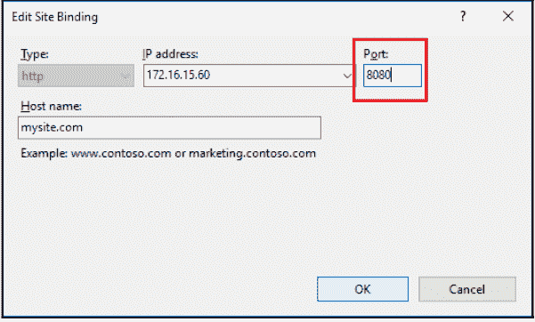

- 8. 将端口更改为 8080，然后点击 OK 按钮。现在，你可以看到默认端口已更改：

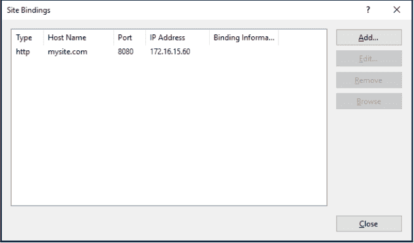

### 在 IIS 10.0 上托管多个网站

- 10. 点击 **在 172.16.15.60:8080 上浏览 mysite.com**。你将看到你的网站，如图所示：

  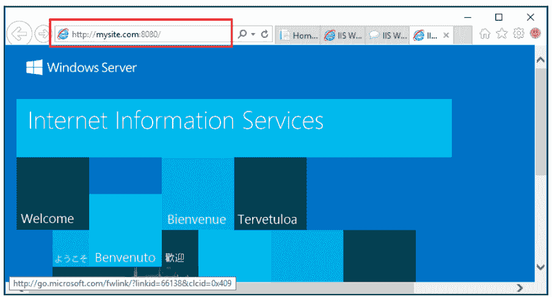

- 11. 你可以看到地址栏中带有 mysite.com:8080 的 URL。这意味着该网站是通过 8080 端口进行访问的。

#### 如何运作...

在本教程中，我们配置了网站 mysite.com 的端口，其默认端口为 80。我们查看了 mysite.com 的默认端口概述并添加了新的端口 8080，之后我们通过新添加的端口 8080 从 URL mysite.com 访问网站。

你也可以根据服务器的可用情况配置不同的端口。

### 配置网站 IP

在本教程中，我们将配置网站 IP 172.16.15.61。默认网站 IP 为 172.16.15.60；我们将配置不同的 IP 以通过此新配置的 IP 访问网站。

#### 准备工作

要逐步完成本教程，你需要一个正在运行的 IIS 10 实例、一个静态 IP 地址，以及用于编辑属性和文件的管理员用户帐户。

#### 如何操作...

- 1. 在 Windows Server 2016 上打开服务器管理器。点击 **Tools** 菜单并打开 **IIS Manager**。
- 2. 展开 IIS 服务器（WIN2016IIS）。我们可以看到列出的应用程序池和站点。
- 3. 选择网站 v4mysite.com，点击 **Bindings** 选项，你将看到主机名、端口和 IP 地址的 **Site Bindings** 详细信息，如图所示：

  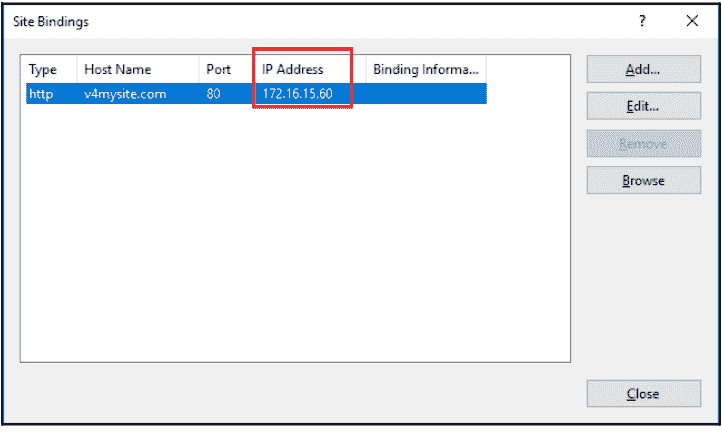

- 4. **v4mysite.com** 具有现有的 IP `172.16.15.60`；它也可能是 `*`。
- 5. 点击 **Edit** 按钮，你将获得 **Edit Site Binding** 属性窗口：

  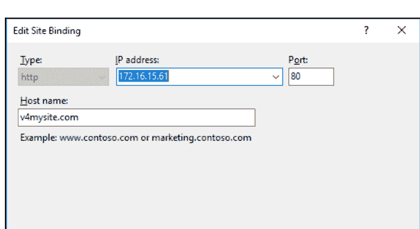

- 6. 你需要添加新的 IP `172.16.15.61`，端口保持为 80，主机名保持不变。
- 7. 点击 **OK** 按钮。现在我们为网站绑定属性设置 IP。让我们对 IP `172.16.15.61` 的配置进行必要的更改，以便它将为网站 **v4mysite.com** 工作。
- 8. 点击开始，前往 **Settings**，并点击 **Network and Sharing Center**。
- 9. 现在，你需要点击 **Change adapter settings**：

  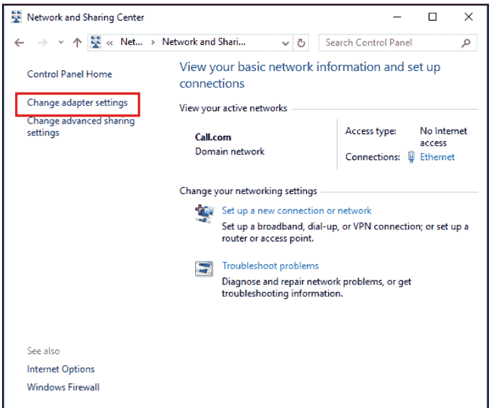

- 10. 你将获得网络连接窗口。在此窗口中，我们可以看到以太网（服务器网络端口）属性：

  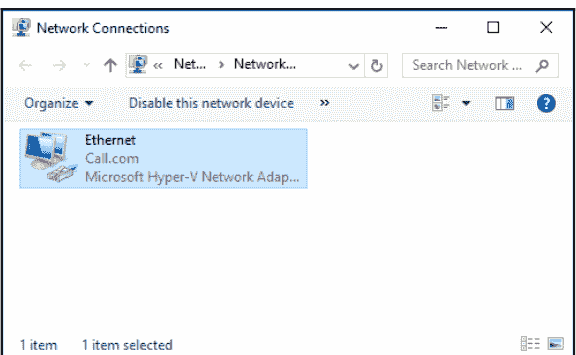

- 11. 右键点击 **Ethernet**，你将获得 **Ethernet** 的属性上下文菜单（Ethernet 是默认名称；你可以重命名它），如本截图所示：

  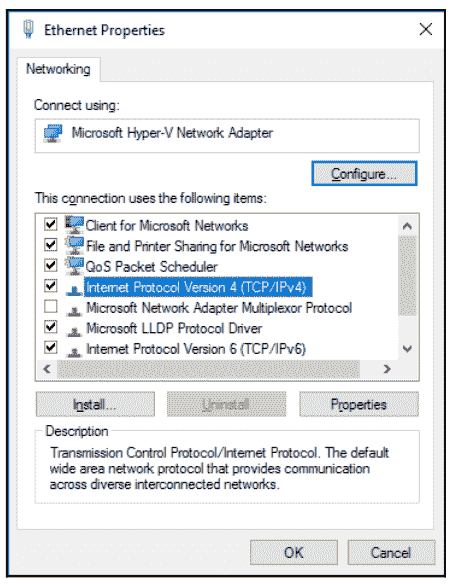

- 12. 在以太网属性中，你将看到 IP 版本 4（TCP/IPv4）。我们使用 IP 版本 4，因此我们只配置 TCP/IPv4。如果你有 TCP/IPv6 IP 地址，你可以使用 TCP/IPv6 协议。
- 13. 点击 **Properties** 按钮：

  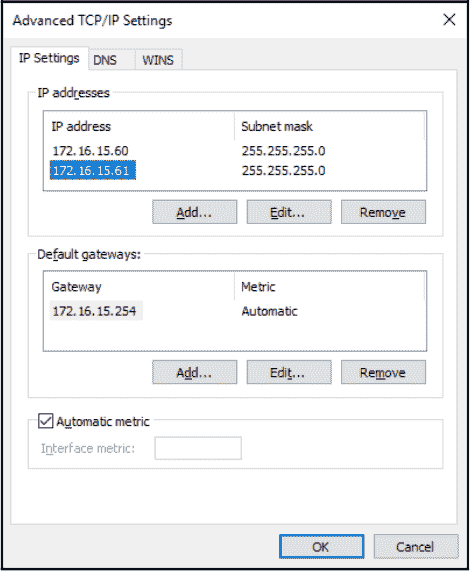

- 14. 你需要在此处添加新的 IP。
- 15. 点击 **Add** 按钮，并输入 172.16.15.61。它还要求你定义子网。我们将添加子网掩码 255.255.255.0（给定的子网掩码是默认的）。点击 **OK** 按钮。多次点击 OK 直到关闭以太网属性。
- 16. 现在你已为你的网站和 IIS 服务器配置了新的 IP，它将识别 IIS 服务器的额外 IP 地址。你需要配置 IP 地址，该选项位于 IP 设置选项卡的“高级 TCP/IP 设置”属性下。在 IP 设置选项卡中，我们可以在同一台 IIS 服务器上添加多个 IP，我们可以将其用于每个网站的专用。

#### 如何运作...

一旦我们为网站配置了专用 IP，我们就需要执行 TCP/IP 协议设置的配置。我们需要添加新的 IP。IIS 10 服务器将检查 IP 是否处于活动状态并已配置。现在你可以通过 IP 172.16.15.61 访问网站 v4mysite.com。

### 部署网站

在本教程中，我们将部署三个网站，即 mysite.com、v2mysite.com 和 v4mysite.com。在我们的例子中，我们已经为部署准备好了这些站点，但在你的情况下，你需要创建自己的站点，或者你可以使用任何可用的旧版本上传到适当的站点文件夹，我们在之前的示例中已经学习过。

#### 准备工作

要逐步完成本教程，你需要一个正在运行的 IIS 10 实例，以及已配置的网站 mysite.com、v2mysite.com 和 v4mysite.com。你需要三套网站应用程序文件，如我们的演示所示，或带有管理员用户帐户的 HTML 页面。

#### 如何操作...

- 1. 在 Windows Server 2016 上打开服务器管理器。点击 **Tools** 菜单并打开 **IIS Manager**。
- 2. 展开 IIS 服务器（WIN2016IIS）。我们可以看到列出的应用程序池和站点；在 Sites 文件夹内，我们创建了三个网站，即 mysite.com、v2mysite.com 和 v4mysite.com。
- 3. 选择 mysite.com，前往 **Actions** 面板，点击 **Basic Settings**，并检查 mysite.com 的物理路径。你将获得 mysite.com 的物理路径。
- 4. mysite.com 的物理路径是 `C:\inetpub\mysite`：

  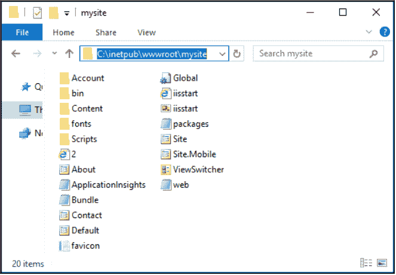

- 5. 按照之前的步骤将 `v2mysite.com` 复制到适当的文件夹。
- 6. 打开 IIS 管理器，前往 **Connections** 面板，在左侧面板的 **Sites** 菜单下右键点击 **v2mysite.com**，并点击 **Explore**。它将打开 `v2mysite.com` 的物理路径：

  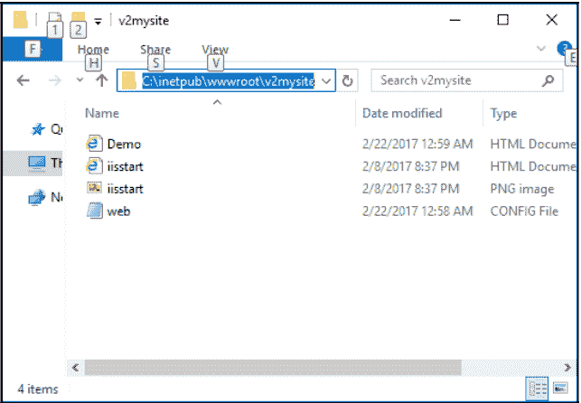

  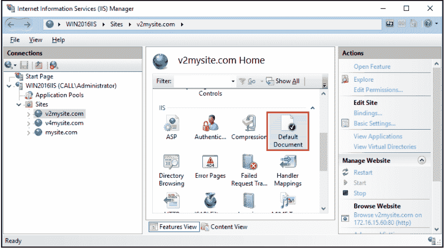

#### 如何运作...

在步骤 1 到 9 中，我们打开了每个网站的不同类型的物理路径，并上传了网站文件。在步骤 10 中，我们知道从哪里进行主页或默认页面的设置。

### 测试网站

在本教程中，我们将在 IIS 10.0 中测试三个网站：mysite.com、v2mysite.com 和 v4mysite.com。我们已经创建了一些网页文件，并将其上传到网站文件夹。

#### 准备工作

你已经有一个配置良好的 IIS 10.0 服务器实例和网站（mysite.com、v2mysite.com 和 v4mysite.com）。我们还配置并预先上传了网站应用程序文件或 HTML 页面。根据需要进行更改，你可能需要管理员用户帐户。

#### 如何操作...

- 1. 打开浏览器并输入 `mysite.com`。
- 2. 查看地址栏；它默认显示 `http://mysite.com`。让我们在下一步测试 `v2mysite.com`。
- 3. 在地址栏中输入 URL `v2mysite.com`：

  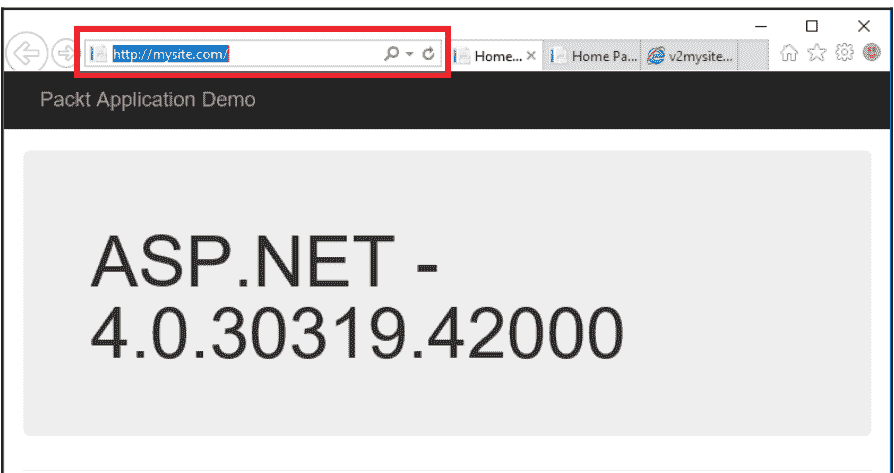

- 6. 我们有 IIS 10 服务器，其 IP 地址为 `172.16.15.60`。我们在 IP `172.16.15.60` 上运行两个网站，`mysite.com` 和 `v2mysite.com`。我们为网站 `v4mysite.com` 添加了专用 IP `172.16.15.61`，并且在同一台 IIS 服务器上，你可以配置多个 IP 地址以使用特定 IP 用于各个站点。

#### 如何运作...

在本教程中，我们在步骤 1 和 2 中使用 **DefaultAppPool** 测试了网站 mysite.com。在步骤 3 和 4 中，我们使用默认登陆页面 `Demo.html` 测试了网站 v2mysite.com，该页面已通过 IIS 服务器管理器在默认文档下配置。在步骤 5 和 6 中，我们使用专用 IP `172.16.15.61` 测试了网站 v4mysite.com。

例如，你在 IIS 服务器上有位于不同位置的网站页面，如 `d:\VD`。你可以创建一个虚拟目录并在现有网站中使用它。如果你有一个需要网站中应用程序池的不同 Web 应用程序，你可以创建一个虚拟目录并添加所需的应用程序池。

### 在 IIS 10.0 中构建虚拟目录

在本教程中，我们将逐步创建一个虚拟目录。我们将添加虚拟目录的别名（别名是物理目录的虚拟名称）。我们还将应用虚拟目录物理路径的设置。

#### 准备工作

要逐步完成本教程，你需要一个正在运行的 IIS 10.0 实例。你还应具有管理员权限。

#### 如何操作...

- 1. 前往 C: 驱动器。我们已经创建了一个名为 Websites 的文件夹；在 Websites 文件夹下，你需要创建一个名为 VirtualDirectory 的文件夹，如下所示：

- 2. 打开 VirtualDirectory 文件夹，并粘贴其中一些我们在上一章托管的 HTML 文件。我们仅使用 Demo.html。你可以创建自己的 HTML 文件：

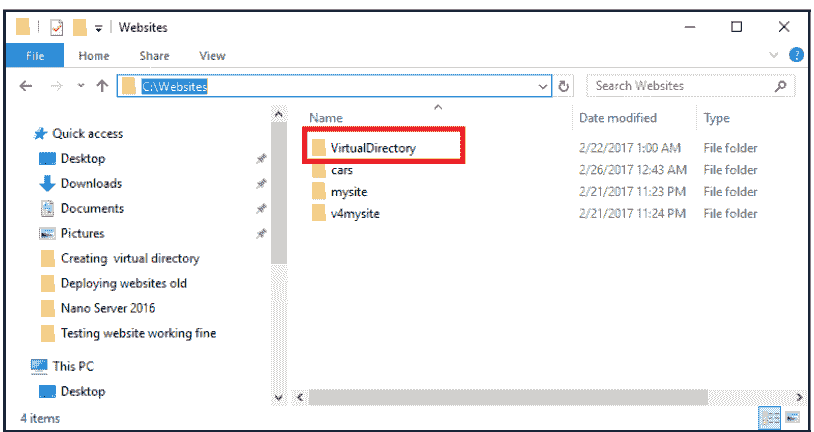

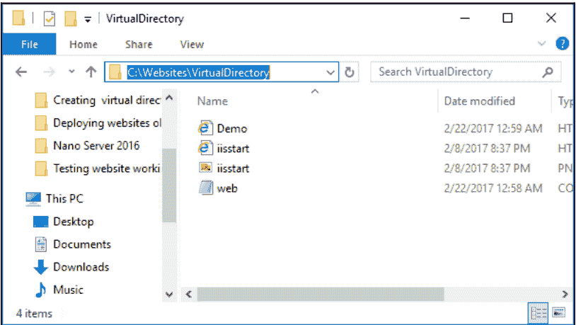

- 3. 接下来，你需要在 Windows Server 2016 上打开 Server Manager。点击 **Tools** 菜单并打开 IIS Manager。
- 4. 展开 IIS 服务器（**WIN2016IIS**）。我们可以看到列出的 **Application Pools** 和 **Sites** 文件夹。
- 5. 在 **Connections** 窗格中展开 **Sites** 文件夹，右键点击 **mysite.com**，上下文窗口将会弹出。你需要选择 **Add Virtual Directory**，如下所示：

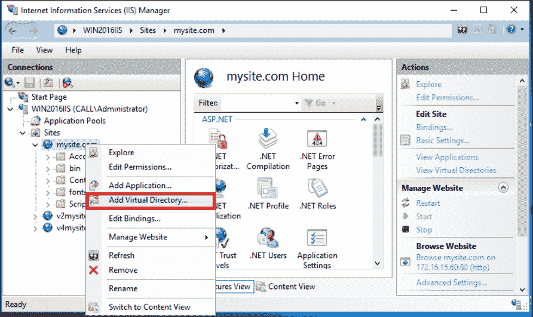

- 6. 在 **Add Virtual Directory** 对话框中，在 **Alias** 文本框中输入一个名称。此别名用于通过 URL 访问内容。你需要提供 **Virtual Directory** 文件夹所在的物理路径。在 **Physical path** 文本框中，输入内容文件夹的物理路径，或点击 **Browse** 在文件系统中导航以找到该文件夹。在 `C:\` 驱动器中，创建了一个 **Websites** 文件夹来映射虚拟目录的物理路径。我们添加了此路径：

#### Getting ready

要逐步完成本食谱，你需要一个正在运行的 IIS 10.0 实例。你还应具有管理员权限。

#### How to do it...

- 1. 在 Windows Server 2016 上打开 Server Manager。点击 Tools 菜单并打开 IIS Manager。
- 2. 展开 IIS 服务器（WIN2016IIS）。我们可以看到列出的 Application Pools 和 Sites。你将看到三个已列出的网站——mysite.com、v2mysite.com 和 v4mysite.com——我们已经创建了它们。在这里，我们仅使用其中一个。
- 3. 在左侧 Sites 面板下展开 mysite.com：

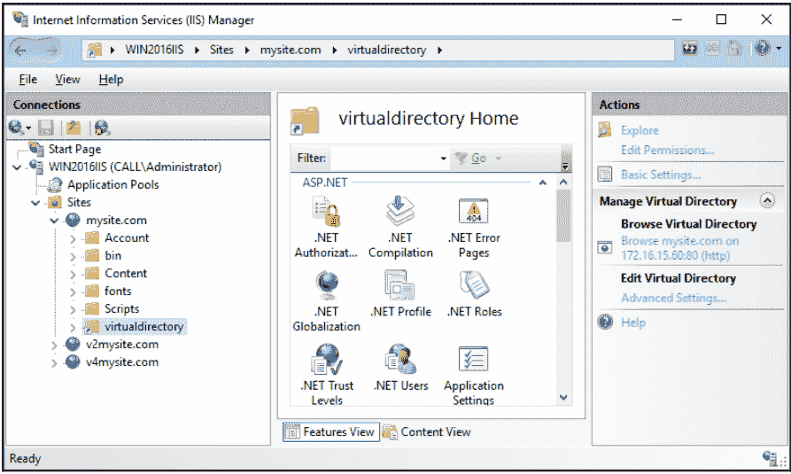

- 4. 我们现在要回顾虚拟目录。我们已经在网站 mysite.com 内部创建了一个名为 virtualdirectory 的虚拟目录。
- 5. 一旦我们选择 `virtualdirectory`，我们将在右侧面板的 Actions 下看到 `virtualdirectory` 的属性——Edit Permissions...、Basic Settings... 和 Advanced Settings...。我们也可以浏览虚拟目录。
- 6. **virtualdirectory** 功能帮助我们查看 **mysite.com** 中所有可用的选项。
- 7. 在当前示例中，你可以看到子网站的 **virtualdirectory** 条目，它位于 **mysite.com** 下。

#### How it works...

在本食谱中，我们打开了 Server Manager 和 IIS Manager。在 **Connections** 窗格中，我们选择了 **Sites** 文件夹。我们展开了 **Sites**。我们已经创建了一个虚拟目录并将其命名为 `virtualdirectory`。接下来，我们检查了虚拟目录并对 `virtualdirectory` 进行了属性概述，在此我们可以管理权限以及基本和高级设置。

### Configuring virtual directories in IIS 10.0

在本食谱中，我们将逐步配置虚拟目录。我们将修改虚拟目录的默认文档设置和物理目录的权限。我们还将设置虚拟目录的基本和高级设置。

#### Getting ready

要逐步完成本食谱，你需要一个已创建虚拟目录的正在运行的 IIS 10.0 实例。你还应具有管理员权限。

#### How to do it...

- 1. 在 Windows Server 2016 上打开 Server Manager。点击 **Tools** 菜单并打开 IIS Manager。
- 2. 展开 IIS 服务器（**WIN2016IIS**）。我们可以看到列出的 **Application pools** 和 **Sites** 文件夹。
- 3. 在 **Connections** 面板下展开 **Sites** 文件夹，点击 **mysite.com**，你将在右上角看到 **Actions** 面板，在其下你将看到 VirtualDirectory 的 **Edit Permissions...** 选项。
- 4. 点击 **Edit Permissions...**，你将获得 **VirtualDirectory** 的属性。这些是物理文件夹属性。转到 **Security** 选项卡并点击 **Edit**。
- 5. 找到 **IUSR** 用户和 **IIS_IUSRS** 组并将它们添加到 **Security** 选项卡。点击默认权限框中的 **Read & execute**、**List folder contents** 和 **Read**。这些设置用于通过 Web 用户或网站应用程序访问网站；IIS_IUSRS 和 IUSR 用于应用程序池的内部身份验证和通信。
- 6. IIS_IUSRS 是 IIS 工作进程帐户的组。这意味着应用程序池本身运行的身份。IUSR 是匿名用户身份。

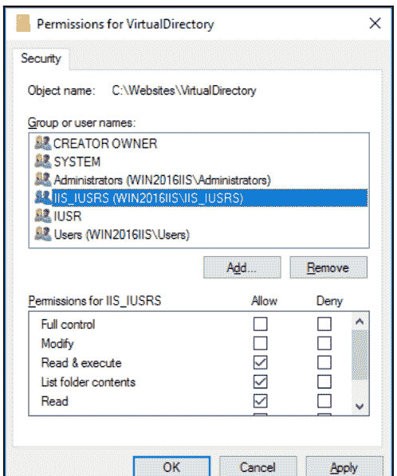

- 7. 点击 OK 按钮完成。接下来，你需要点击虚拟目录的 **Basic Settings...**，它位于 **Actions** 窗格中：

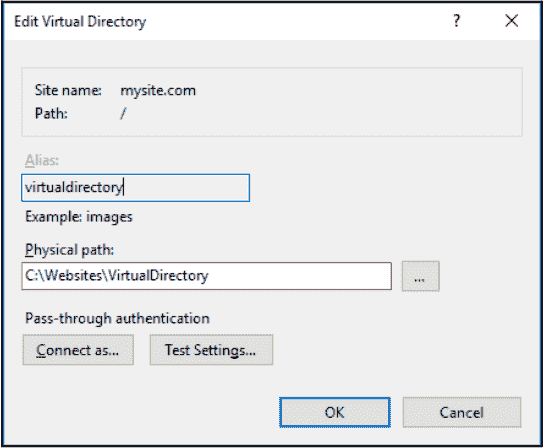

- 8. 在 **Basic Settings...** 中，你有更改 `virtualdirectory` 物理路径的选项；我们可以将 **Connect as...** 设置设为屏幕截图中所示，但保持其默认值。

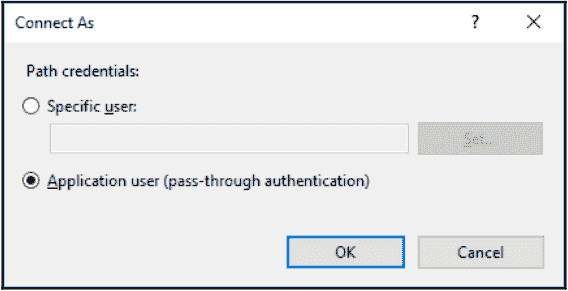

- 9. 我们可以选择特定用户来访问此目录或 IIS 内部应用程序池默认的 IUSR 用户之一。我们已为测试连接选择了默认选项，Application user。
- 10. 点击 OK 按钮，转到 Basic Settings...，并点击屏幕截图中所示的 Test Settings 按钮。你将通过选择在上一个食谱中创建的 VirtualDirectory 获得此选项。转到右侧的 Actions 面板，并点击 Basic Settings...。用于编辑虚拟目录的属性编辑窗口出现。你会找到的最后一个选项是 Test Settings，它将打开以下窗口。在 Test Connection 下，你将有两个 Test results，Authentication 和 Authorization，它们负责验证应用程序池和虚拟目录的物理路径。

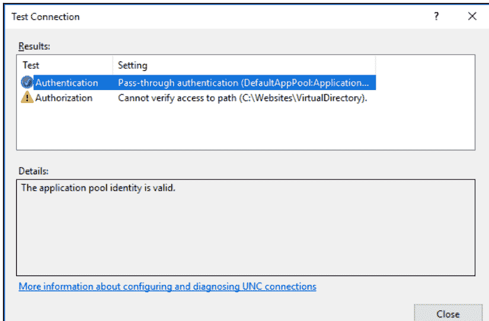

- 11. Test Connection 窗口显示网站的应用程序池身份验证是直通身份验证（defaultAppPool）应用程序池。应用程序池通过默认 IIS 用户 IUSR 或 IIS_IUSRS 组进行身份验证。我们没有设置任何授权，因此它显示我们 **Cannot verify access to path**。点击 **Close** 按钮，然后移动到 **Advanced Settings....**
- 12. 如图所示，在 **Actions** 面板中点击 **Advanced Settings...**：

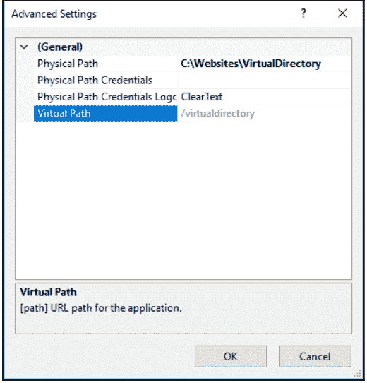

- 13. 在这里，**Advanced Settings...** 用于更改 **virtualdirectory** 的 **Physical Path**、**Physical Path Credentials** 和 **Physical Path Credentials Logon type**。
- 14. 接下来，我们需要在 **Default Document** 中应用设置，这将帮助我们访问我们在上一个食谱中添加的 `Demo.html` 页面。
- 15. 从 **Sites** 文件夹展开 **mysite.com** 并选择 `virtualdirectory`。你将在中间窗格中看到 **Default Document** 选项。

- 9. 右键点击 virtualdirectory 并点击 Convert to Application。一旦你将其转换，虚拟目录图标将会更改，你可以在上一个图中看到它被高亮显示：

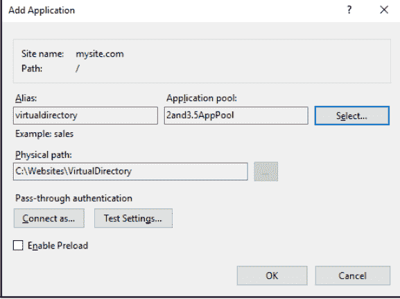

- 10. 接下来，你将获得 Add Application 窗口，如上一个图所示。只有 Change Application Pool 选项可用；你可以选择 2and3.5AppPool 应用程序池。点击 OK 按钮。
- 11. 现在你创建了两个具有不同应用程序池的虚拟目录：VDApplication 使用 DefaultAppPool，Virtual Directory 使用 2and3.5AppPool。

#### How it works...

在本食谱中，我们在步骤 1 到 6 中创建了应用程序目录和虚拟应用程序目录，并向虚拟目录添加了应用程序池。在步骤 7 到 11 中，我们从现有虚拟目录添加了自定义应用程序池。

### 上传 .NET 网页

在本操作指南中，我们将上传网站应用程序页面。这些网站应用程序页面使用 .NET framework 4 开发。这些网站应用程序页面将从 VDapplication 应用程序池的虚拟目录中运行。

虚拟目录 virtualdirectory 的网站应用程序页面已使用 .NET framework 2.0 开发。

#### 准备工作

要完成本操作指南，你需要一个正在运行的 IIS 10.0 实例，并已创建好虚拟目录。你还应具有管理员权限。

#### 操作步骤...

- 1. 在 Windows Server 2016 上打开“服务器管理器”。单击“工具”菜单并打开“IIS 管理器”。
- 2. 展开 IIS 服务器（WIN2016IIS）。你将看到列出的所有应用程序池和站点。你将看到三个列出的网站：mysite.com、v2mysite.com 和 v4mysite.com。我们已经创建了它们。

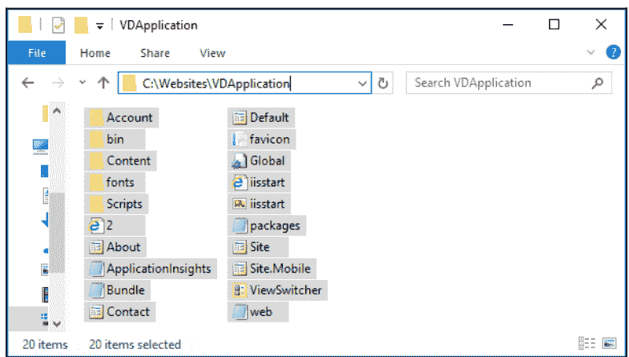

- 7. 将你的 4.0 版网站应用程序页面复制并粘贴到 `C:\WebSites\VDApplication\` 文件夹中。
- 8. 现在我们需要单击 virtualdirectory，然后转到“操作”面板。单击“浏览”，并将它们粘贴到 2.0 版网站应用程序页面文件夹中：

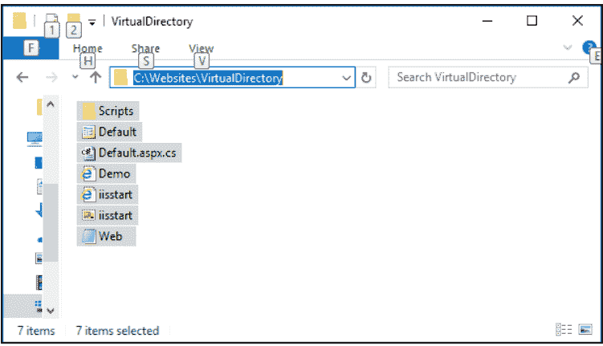

- 9. 关闭虚拟目录和物理文件夹。
- 10. 打开 IIS 管理器，展开 mysite.com，并单击 VDapplication 虚拟目录。前往功能视图，打开“默认文档”，然后将 `default.aspx` 添加到顶部。对 virtualdirectory 重复相同步骤。

#### 工作原理...

我们已经创建了两个虚拟目录：VDapplication 和 virtualdirectory。我们将 4.0 版网站应用程序文件上传到 VDapplication 虚拟目录，将 2.0 版网站应用程序文件上传到 virtualdirectory。我们还为默认主页配置了默认文档条目。

### 测试上传的网页

在本操作指南中，我们将测试使用 framework 4 开发并上传到自定义虚拟目录 VDapplication 池中的 Web 应用程序页面。较低版本（framework 2.0）的 Web 应用程序页面已上传到 virtualdirectory 虚拟目录。

我们还将使用自定义虚拟目录测试普通 HTML 页面。

#### 准备工作

要完成本操作指南，你需要一个正在运行的 IIS 10.0 实例，并已创建好虚拟目录和网站应用程序。

#### 操作步骤...

- 1. 在 Windows Server 2016 上打开“服务器管理器”。单击“工具”菜单并打开“IIS 管理器”。
- 2. 展开 IIS 服务器（WIN2016IIS）。你将在“连接”窗格中看到应用程序池和站点列表。你会看到三个列出的网站，这些网站在上一个操作指南中已上传：mysite.com、v2mysite.com 和 v4mysite.com。
- 3. 转到“站点”文件夹，展开 mysite.com，并单击 virtualdirectory。这是一个使用默认应用程序池的简单虚拟目录。
- 4. 转到**操作**面板并单击**浏览**。你将获得 `http://mysite.com/virtualdirectory` URL：

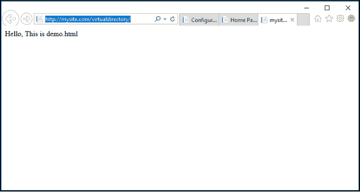

- 5. 现在让我们测试之前步骤中为**VDapplication**和**virtualdirectory**创建的两个自定义虚拟目录站点。你可以通过任何浏览器访问这两个站点 URL，但在我的案例中，我使用了 Internet Explorer。
- 6. 打开 Internet Explorer，在地址栏中输入 URL `http://mysite.com/vdapplication`。你将看到网站应用程序：

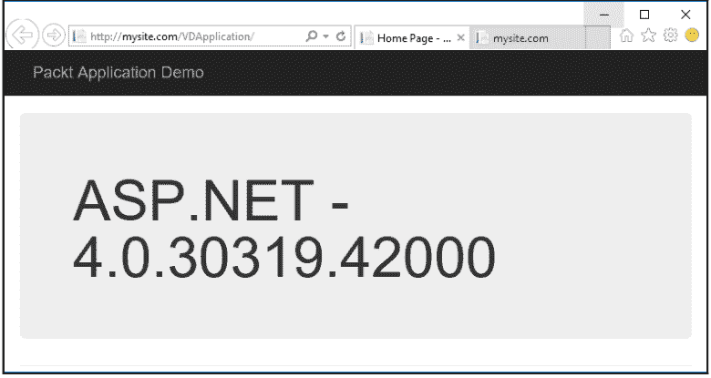
