## 5. 在 IIS 10.0 上安装 HTTP/2

在本章中，我们将介绍以下操作指南：

- 了解 HTTP/2
- 在 IIS 10.0 上安装 HTTP/2
- 在 IIS 10.0 上配置 HTTP/2
- 上传 .NET 网页
- 测试上传的网页

### 简介

HTTP/2 是 HTTP/1.1 的更新版本，通过在 TCP 连接上进行语义流传输，减少延迟和连接负载对 Web 服务器的影响。HTTP/2 协议可在 Windows 10 和 Windows Server 2016 上运行。Windows 10 和 Server 2016 都拥有最新版本的 IIS 服务器，即 IIS 10.0。目前，只有 IIS 10.0 支持 HTTP/2。在 HTTP/2 中，可以使用持久连接为多个同时请求提供服务。

我们知道，每个 TCP 连接都需要一次往返来在服务器和客户端之间建立连接。HTTP/2 大大减少了请求在新连接建立时等待，或等待现有连接变为空闲的需求。

HTTP/2 引入了 HPACK，这是一种用于 HTTP 标头的压缩方案，可减少请求之间的冗余。压缩有助于多路复用，因为请求更小。这使得客户端可以在连接上发送首批数据包时发出大量请求，而此时 TCP 流控制窗口仍然很小。

HTTP/2 还引入了**推送**的概念：服务器响应客户端尚未发出的请求，但以客户端可以缓存并在其他页面上重用的形式进行。如果底层连接支持**推送**，则会发生两件事：

- 1. 向客户端发送一个 `PUSH_PROMISE`，以便客户端可以检查资源是否已存在于缓存中。
- 2. 将一个新请求添加到被推送资源的请求队列中。

### 了解 HTTP/2

在本操作指南中，我们将了解 HTTP/2。我们将在本章稍后访问几个网站，并检查是否支持 HTTP/2。我们将了解如何检查网站运行在 HTTP/2 还是 HTTP/1.1 上。

让我们详细介绍一下。

#### 准备工作

要完成本操作指南，你需要一个正在运行的 HTTP/2 网站和互联网连接。

#### 操作步骤...

- 1. 在 Windows 10 PC 或 Server 2016 上打开 Internet Explorer；这里我们使用 Windows 10 PC。
- 2. 转到地址栏并输入 `www.google.ae`：

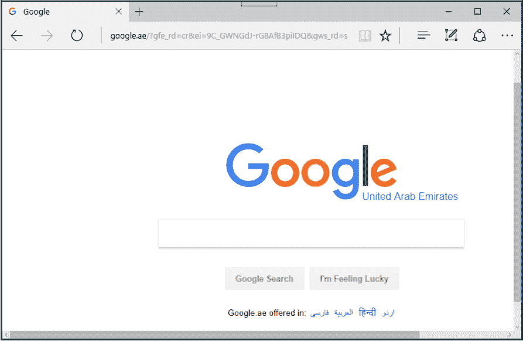

- 3. 打开 `www.google.ae` 后，它会重定向到 `https://www.google.ae/`。现在我们需要检查 `www.google.com` 使用的是 HTTP/2 还是 HTTP/1.1。
- 4. 按 F12。你也可以按以下步骤操作：
- 5. 转到**设置**并启用 F12 开发者工具；你将看到 DOM 资源管理器、控制台、调试器、网络、性能和内存。现在你需要切换到**网络**选项卡：

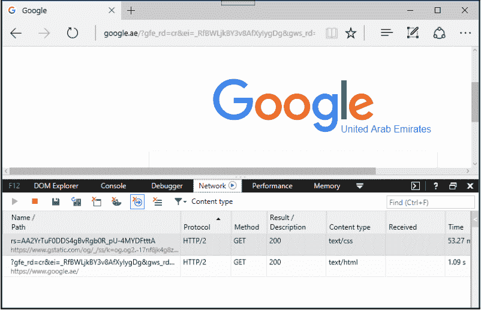

- 6. 在这里，你将看到 `https://www.google.ae` 正在使用 HTTP/2。接下来，我们将在 IIS 10.0 服务器上应用 HTTP/2 设置，以使用 HTTP/2 协议。

#### 工作原理...

在本操作指南中，我们启动了 URL www.google.ae。浏览器自动重定向到 https://www.google.ae。接下来，我们通过开发者工具测试 HTTP/2，该工具可以通过 F12 键运行，也可以从“设置”菜单启用。

### 在 IIS 10.0 上安装 HTTP/2

在本操作指南中，我们将通过 IIS 10.0 设置 HTTP/2 并启用日志记录选项。我们还将介绍如何在注册表中进行必要的更改以及在何处进行更改。

- 3. 双击“日志记录”。在下一张图中，你会看到“站点”被选为默认日志文件类型，日志文件格式为 W3C，并且有许多字段可供选择。

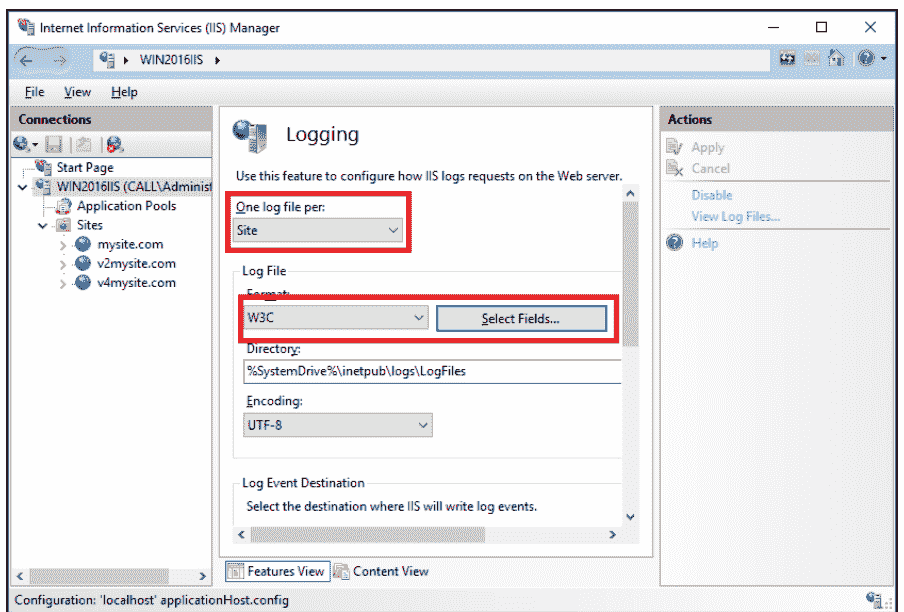

- 4. 日志记录配置步骤可帮助我们跟踪日志文件，并通过 HTTP 或 HTTP/2 检查网站访问情况。
- 5. 如图所示，“每个站点一个日志文件”意味着每个网站都有自己的日志文件。因此，使用日志文件信息将很容易。我们还可以选择为服务器指定日志文件，这样它将为你的服务器创建一个日志文件。这意味着，如果你在一台服务器上托管了许多网站，并且该服务器只有一个日志文件，那么跟踪日志信息可能非常困难。这就是我们选择按站点划分日志文件的原因——W3C 日志记录字段中有很多选项，可用于通过主机名、IP 地址、端口以及客户端 IP 地址等来识别。我们刚刚验证了我们推荐的选项。

6. 现在你可以选择日志文件格式；默认选择的是 W3C。现在我们需要启用其中一种协议。

7. 点击 Select fields... 选项，你将得到 W3C Logging Fields 窗口，如下所示：

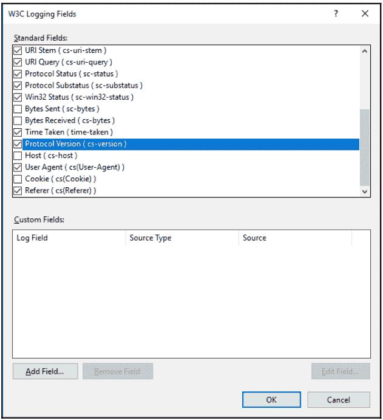

8. 你需要勾选 Protocol Version 的复选框。Protocol Version 将为 HTTP/1.1 和 HTTP/2 生成日志文件条目。Server Request 将为网站生成站点级日志文件，并根据客户端请求的协议版本将协议版本记录到日志文件中。你可以在 C:\inetpub\logs\LogFiles 查看此日志的详细信息。

9. 现在我们需要为 HTTP/2 创建一个注册表项。Internet Explorer 通过 TLS 连接到 IIS 服务器，TLS 通过 TLS 扩展协商 HTTP/2，因此你无需在服务器端进行任何更改。这是因为指定使用 HTTP/2 Draft 14 的 h2-14 头默认通过 TLS 发送。

我们勾选的协议版本选项将为使用 HTTP 或 HTTP/2 协议的网站访问生成日志文件。

- 1. 在命令提示符中，输入 `regedit` 如屏幕截图所示，然后按 Enter。确保命令提示符以管理员身份运行，方法是右键单击其图标并选择 **Run as Administrator** 选项。

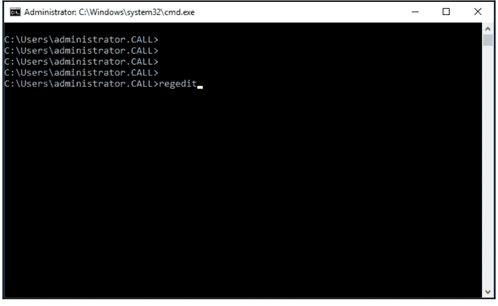

- 5. 你可以看到一个名为 `DuoEnabled` 的值，其值数据为 `1`。选择 **Base** 为 **Hexadecimal**。点击 **OK**。

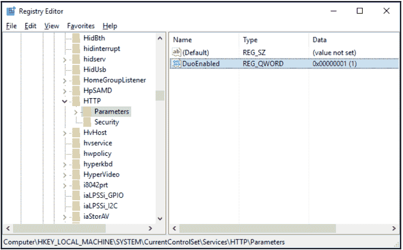

- 6. 关闭 **Registry Editor** 并重新启动。
- 7. 你已成功完成 HTTP/2 的设置。

#### How it works...

在本教程中，我们首先打开了 IIS 管理器并设置了日志设置以追踪网站访问日志。日志记录无非是将网站活动信息写入日志文件。我们启用了协议版本，这将帮助我们获取有关 HTTP 和 HTTP/2 的网站访问活动信息。

然后我们打开了注册表编辑器并创建了一个名为 **DuoEnabled** 的条目，该条目将用于 HTTP/2 协议。

### Configuring HTTP/2 on IIS 10.0

在本教程中，我们将配置一个 HTTP/2 网站。网站将通过 HTTPS 端口访问。我们还将介绍如何添加/安装证书并将该证书附加到网站。

#### Getting ready

要逐步完成本教程，你需要一个正在运行的 IIS 10.0 实例。你还应具有管理员权限。

#### How to do it...

- 1. 在 Windows Server 2016 上打开服务器管理器。点击 Tools 菜单并打开 IIS 管理器。
- 2. 选择 IIS 服务器（WIN2016IIS）。你将得到功能视图，其中可以找到 Server Certificates 选项：

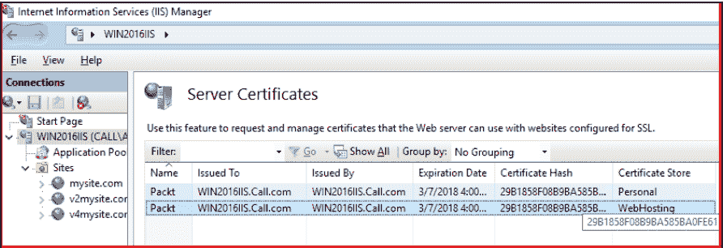

- 3. 我们已经创建了两个证书。这些是用于测试的本地证书。它们不适用于生产环境。在这里，我们将使用现有的用户证书名称 Packt；你会看到它是由 Issued To WIN2016IIS.Call.com 发行的，并且也可以看到其 Certificate Hash 键。证书哈希用于加密我们访问的网站数据，并且它使用哈希算法来加密网站数据并解密。IIS 10.0 使用 SHA256 256 位加密。证书存储具有列出的证书类别；我们将使用 WebHosting。

10. 你也可以检查证书。点击 View 按钮，你将得到证书属性：

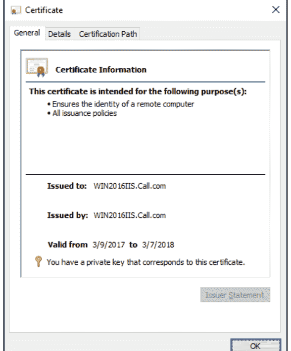

11. 证书属性将向你显示有关证书的一般信息，详细信息选项卡将向你显示有关证书属性配置和类型的完整详细信息。证书路径具有有关证书是否安装在本地或远程服务器上及其状态的信息。现在点击 OK。再次点击 OK 以添加站点绑定。现在你将来到站点绑定窗口：

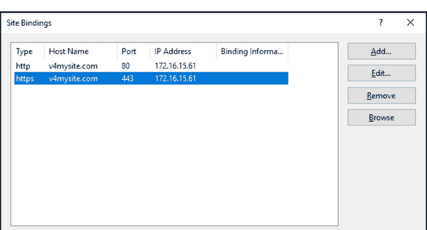

12. 在站点绑定列表中，HTTP 和 HTTPS 绑定类型必须具有相同的主机名。

13. 为站点绑定窗口点击 OK。你现在已将选定的网站 v4mysite.com 配置为使用 HTTP/2。

#### How it works...

在本教程中，我们打开了服务器证书设置页面并找到了我们创建的证书。服务器证书用于 HTTPS 网站绑定。我们为网站 v4mysite.com 添加了 HTTPS 绑定。我们还查看了证书属性。现在你拥有两种类型的绑定，HTTP 和 HTTPS。

### Uploading .NET web pages

在本教程中，我们将把使用 .NET 框架版本 4.0 制作的网站页面上传到 v4mysite.com。我们将概述相关的应用程序池，并为 v4mysite.com 物理文件夹路径部署网页。

#### Getting ready

我们需要在 IIS 10.0 服务器上安装版本 4.0 应用程序。你还应具有管理员权限。

#### How to do it...

- 1. 在 Windows Server 2016 上打开服务器管理器。点击 Tools 菜单并打开 IIS 管理器。
- 2. 展开 IIS 服务器（WIN2016IIS）。我们得到列出的应用程序池和站点。
- 3. 展开 Sites 文件夹，你将得到三个网站：mysite.com、v2mysite.com 和 v4mysite.com。选择 v4mysite.com，因为我们已经对其进行了 HTTP/2 配置的初始设置。现在你需要上传 .NET 框架版本 4.0 的网站页面。

6. 编辑站点窗口为我们提供了 v4mysite.com 的物理路径 C:\inetpub\wwwroot\v4mysite 的详细信息。你可以浏览该路径并粘贴网站页面；同时，我们也可以交叉检查版本 4.0 应用程序是否与 v4mysite.com 关联。

7. 点击应用程序池列中的 Select 按钮。你将得到名为 DefaultAppPool 的应用程序池。一旦点击 Select 按钮，你将得到应用程序池详细信息窗口：

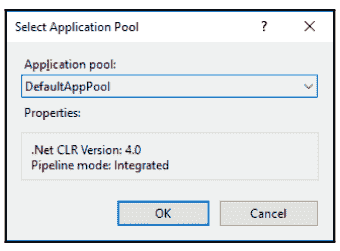

8. 你现在可以看到 DefaultAppPool 属性已正确设置。此应用程序池的版本为 4.0。关闭应用程序池窗口和编辑站点窗口。

9. 让我们移动到 IIS 管理器。展开 Sites 并点击 v4mysite.com。

10. 转到 Actions 面板，点击 Explore，它将带你到 v4mysite.com 网站的物理路径：

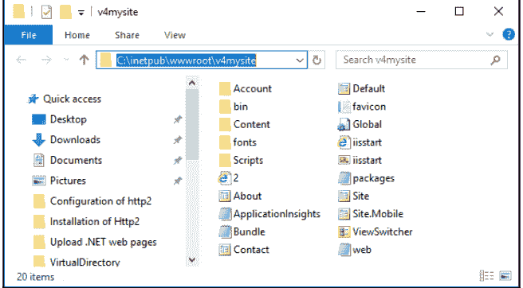

5. 转到 **Actions** 面板，点击 **Browse v4mysite.com on 172.16.15.61:443**，你将得到如下图所示的页面：

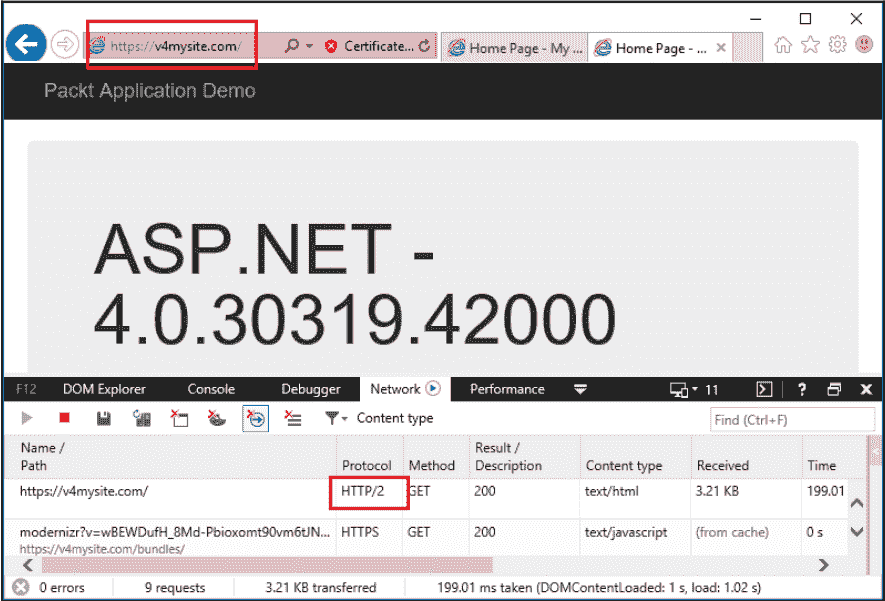

6. 在 Internet Explorer 中，你将得到 **v4mysite.com** 网站的 HTTPS。现在你需要按 *F12*。你将得到开发者窗口。刷新网站。现在你应该能够看到在网络选项卡下，高亮的协议是 HTTP/2。

7. 让我们从浏览网站选项打开 http://v4mysite.com:80 网站：

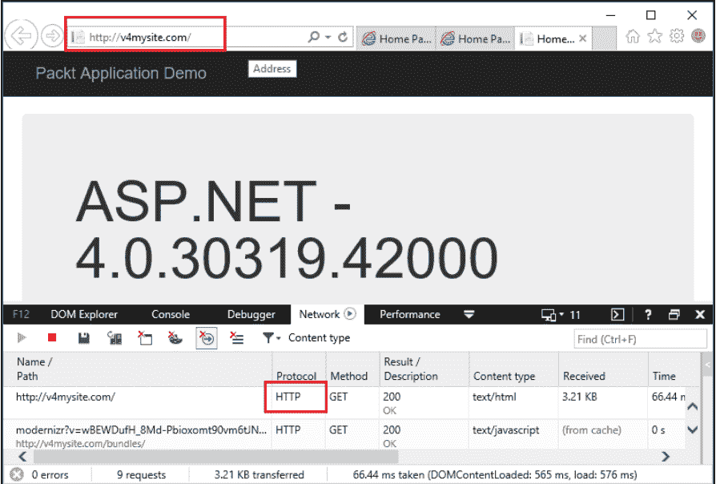

8. 在这里我们可以看到我们正在使用 HTTP 浏览 v4mysite.com。

#### How it works...

在本教程中，我们首先打开了 IIS 管理器并查看了两种不同类型的网站浏览选项。我们测试了 v4mysite.com 的 HTTPS 版本，并看到它在 HTTP/2 上运行正常。

我们还使用 HTTP 对其进行了测试，并成功使用该协议使用了 v4mysite.com。

## 
