## 在 Nano Server 上部署 IIS 10.0

在本章中，我们将介绍以下操作：

- 了解 Nano Server 上的 IIS 10.0
- 在 Nano Server 上安装 IIS 10.0
- 管理 Nano Server 上的 IIS 10.0
- 在 Nano Server 上创建 IIS 10.0 网站
- 在 Nano Server 上配置 IIS 10.0 网站
- 上传网站页面
- 测试上传的网页

### 简介

Nano Server 是一种远程管理的服务器操作系统，针对私有云以及本地或远程数据中心进行了优化。Nano Server 类似于 Windows Server 核心模式操作系统。它没有任何 GUI 界面，并且比 Windows Server 的核心模式更小。

Nano Server 没有本地登录功能。它仅支持 64 位应用程序、工具和代理。

与 Windows Server 相比，Nano Server 占用的磁盘空间非常少，安装速度快，需要的更新更少，重启时间也更短。

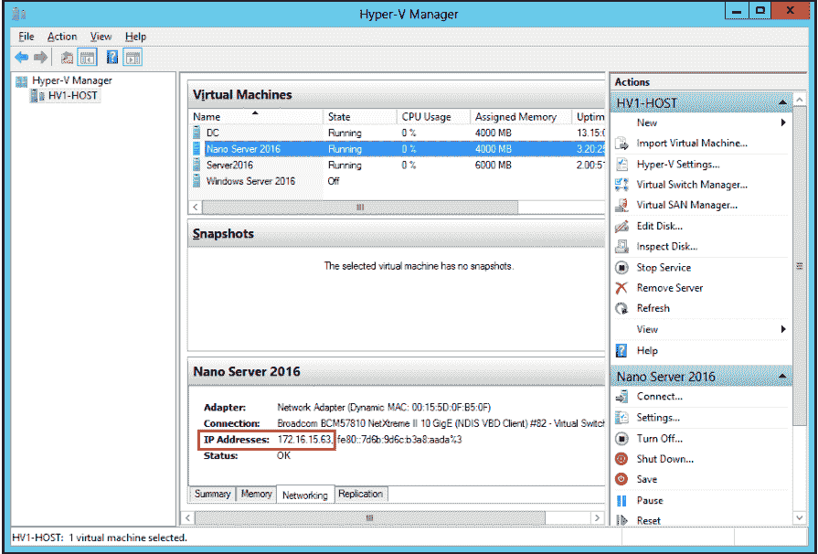

- 3. 在 Hyper-V 管理器下，我们有四台虚拟机：DC，即域控制器；Nano Server 2016；Server 2016，即我们的 IIS 服务器；以及 Windows Server 2016。

- 4. 我们选择了 Nano Server 2016。你可以看到在虚拟机列表的“已分配内存”标题下，服务器有 4000 MB RAM，并且虚拟机状态为“正在运行”。

- 5. Nano Server 2016 是 Nano Server 虚拟机的显示名称，服务器名称是 Nano，其 IP 地址是 172.16.15.63，在上图中已突出显示。这是我的情况，但在你的情况下，IP 可能会不同。这一点需要注意。

- 6. 选择 **Nano Server 2016** 虚拟机。转到 **Hyper-V 管理器** 中的 **操作面板**，你会发现两种属性：**HV1-Host** 属性，可以在其中对 Hyper-V 主机服务器进行更改；以及 **Nano Server 2016**，可以在其中更改 Nano Server 虚拟机的属性。在 Nano Server 2016 的 **操作** 窗格中，单击右侧面板中选定服务器名称下方的 **连接**，你将打开 **Nano Server 2016** 控制台：

  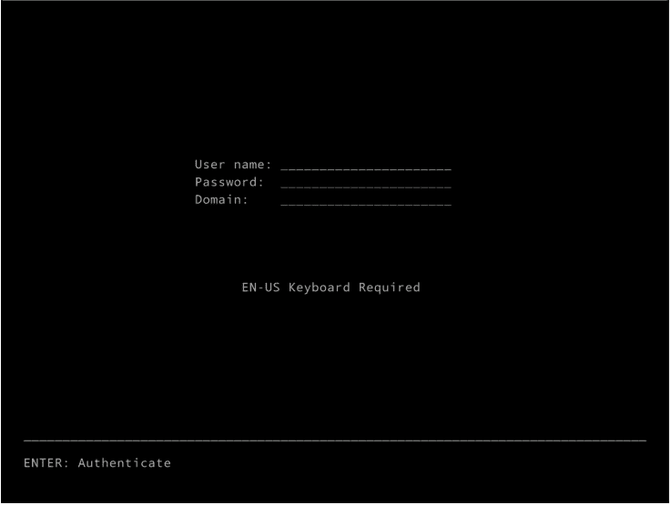

- 7. 如屏幕截图所示，你可以看到 Nano Server 的登录屏幕。我们已经将 IIS 10.0 安装到了 Nano Server 2016 上，并且确认了 IP 地址 `172.16.15.63` 已分配给 Nano Server 2016。
- 8. 让我们打开 Nano Server 2016 上的默认 IIS 网页。
- 9. 转到 Internet Explorer，输入 `http://172.16.15.63`（Nano Server IP），然后按 *Enter*。如果你已经在 Nano Server 2016 上安装了 IIS，它将显示 IIS 默认主页，如下所示。


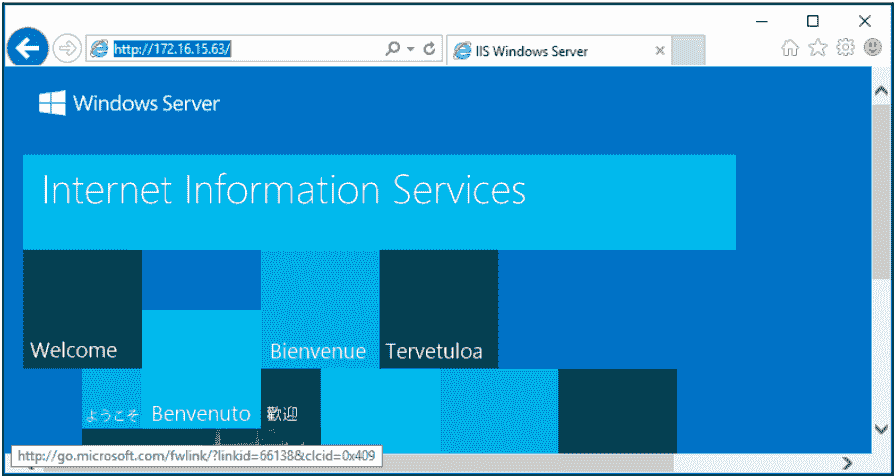

10. 现在你可以看到默认的 IIS 欢迎网页已显示。

#### How it works...

在本教程中，我们对 Nano Server 进行了概述。我们查看了 Nano Server 主屏幕。我们检查了分配给它的 IP 地址。我们访问了默认的 IIS 10.0 网站以检查 IIS 10.0 是否已安装在 Nano Server 上。我们还在 Microsoft Hyper-V 主机上运行了 Nano Server 2016。

### Installing IIS 10.0 on Nano Server

在本教程中，我们将在 Nano Server 上安装 IIS 10.0。我们将使用 PowerShell 创建一个 Nano Server 2016 虚拟机，该虚拟机将附加到我们的 Hyper-V 主机服务器。我们可以使用 PowerShell 命令在 Nano Server 2016 上安装 IIS。

#### Getting ready

为了逐步完成本教程，我们将使用 PowerShell 命令创建带有 IIS 10.0 的 Nano Server 实例。你需要一个 Windows Server 2016 虚拟实例或 Nano Server 2016 的物理实例，并且你还需要 Windows Server 2016 媒体。你已经准备好了一个 Hyper-V 主机，在该主机上你需要附加你的虚拟机。对于安装和配置，你应该具有管理员权限。

#### How to do it...

1. 登录到 Windows Server 2016。我们的 Windows Server 2016 实例的 IP 为 `172.16.15.60`，名称为 **WIN2016IIS**，如图所示。

   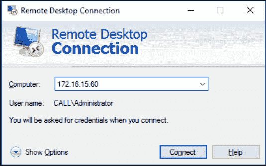

2. 将 Windows Server 2016 媒体 ISO 挂载到 CD 驱动器上。打开 CD 驱动器，你会找到 `NanoServer` 文件夹：

   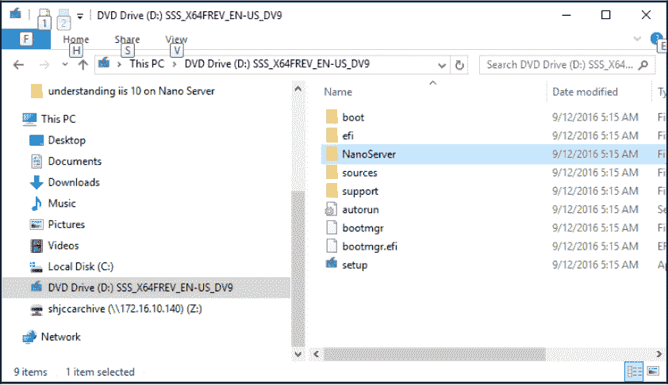

3. 将 NanoServer 文件夹从 DVD/CD 驱动器复制出来（本例中为 D:），并粘贴到 C: 本地磁盘驱动器中：

   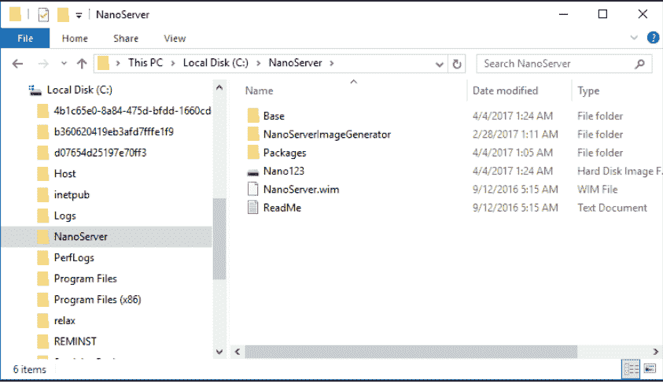

4. 你可以在图中看到，在 NanoServer 文件夹内，你应该有以下文件夹和文件：Base、NanoServerImageGenerator、Packages、NanoServer.wim 和 Nano123.vhd。现在你可以关闭 NanoServer 文件夹。

5. 接下来，你需要以管理员权限打开 PowerShell。从键盘按下 Windows + R 键。你会得到运行窗口：

   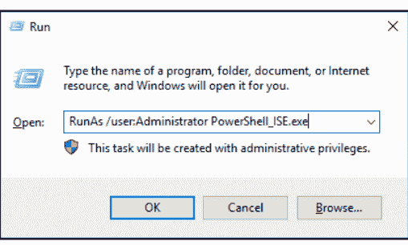

6. 输入命令 `RunAs /user:Administrator PowerShell_ISE.exe` 并按 OK。现在它会要求你输入管理员密码。输入管理员密码并按 Enter。你会得到 PowerShell 命令窗口：

13. 你可以为 Nano Server 2016 选择自己的密码。按下 OK 按钮，你会得到如图所示的处理窗口：

    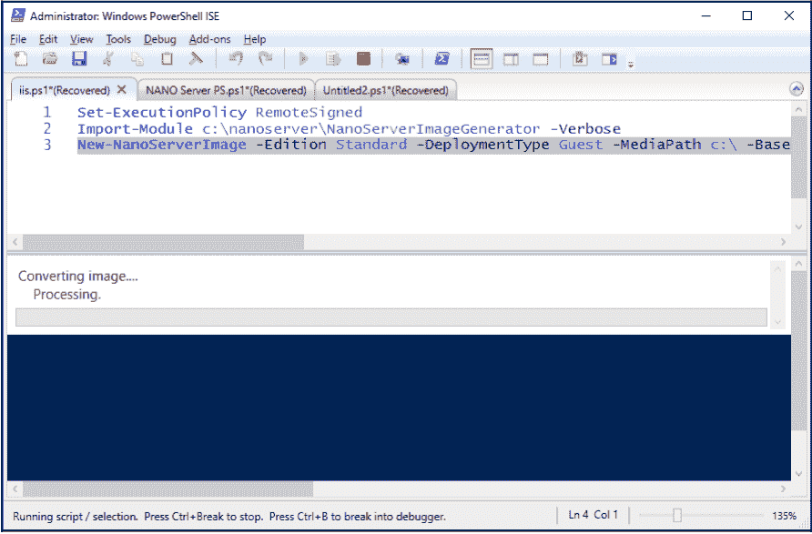

14. 一旦 `New-NanoServerImage` 的处理完成，你将在 `C:\NanoServer` 文件夹下得到 `Nano.vhd` 文件。就这样！PowerShell 中会显示一条 Done 消息。日志位于 `C:\BaseLogs2017-04-08_23-12-34-41`。让我们进入 `C:\NanoServer` 文件夹并检查 `Nano.vhd` 是否可用：

    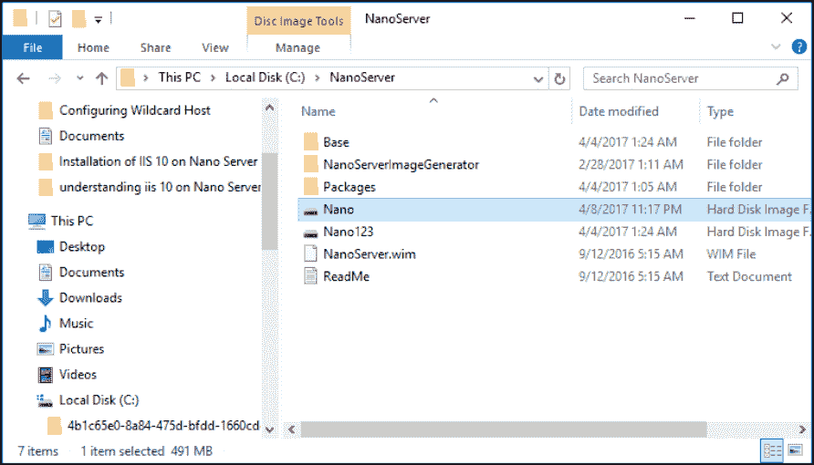

15. 将 `Nano.vhd` 文件从 `C:\NanoServer` 文件夹复制并粘贴到 Hyper-V 主机（`IP 172.16.15.181`）服务器的 `D:\vhdx` 文件夹中。我们创建了一个虚拟机并将 `Nano.vhd` 附加到 Nano Server 2016 虚拟机上：

    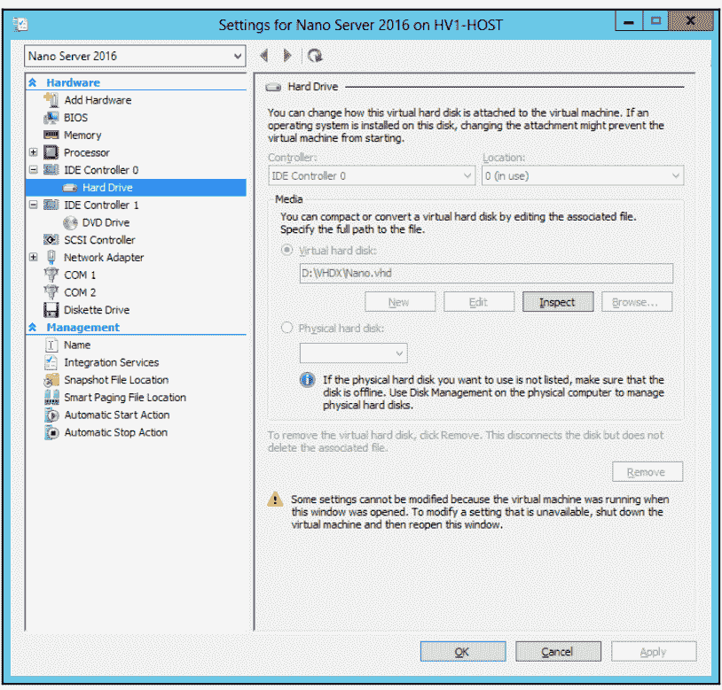

16. 单击 OK 关闭 Nano Server 2016 设置窗口。

17. 进入 HV1-Host（172.16.15.181）服务器，打开 Hyper-V 管理器，进入虚拟机窗格，选择 Nano Server 2016 VM。进入 Nano Server 2016 操作窗格，打开 Nano Server 2016。接下来，你需要单击 Connect 以查看服务器登录屏幕。输入管理员用户名和密码（你在创建 Nano Server 实例时设置的自己的密码），按 Enter，即可登录。

#### How it works...

在本教程中，我们在 Nano Server 上安装了 IIS 10.0 并创建了一个 Nano Server 2016 虚拟机，我们将其附加到我们的 Hyper-V 主机服务器。我们为 Nano Server 设置了 `172.16.15.63` IP 地址。我们使用 PowerShell 在 Nano Server 2016 上安装 IIS，并修改了执行策略并将其设置为 `RemoteSigned`。我们随后导入了 `NanoServerImageGenerator` 模块，通过 PowerShell 创建了一个 Nano Server 实例。我们还讨论了如何通过 PowerShell 命令创建新映像。

### Managing IIS 10.0 on Nano Server

在本教程中，我们将通过 PowerShell 远程连接到 Nano Server，并查看默认网站。我们将启动和停止默认网站的网站服务。

#### Getting ready

为了逐步完成本教程，我们将通过 PowerShell 在 Nano Server 2016 上管理 IIS 10.0。Nano Server 上的 IIS 10.0 只能使用 PowerShell 进行管理。你需要一个 Nano Server 2016 实例。对于所有这些安装和配置工作，你应该具有管理员权限。

#### How to do it...

1. 进入 WIN2016IIS 服务器。要通过 PowerShell 连接 Nano Server 2016，我们首先需要登录到 **WIN2016IIS** 服务器（任何 Windows Server 2016 或 Windows 10 机器均可）。我们将使用 PowerShell 远程连接到 IP 地址为 `172.16.15.63` 的 Nano Server。

2. 在 **WIN2016IIS** 服务器上以管理员权限打开 PowerShell，按下 *Windows + R*，你将得到 **运行** 窗口，如上一章所示。

3. 输入命令 `RunAs /user:Administrator PowerShell_ISE.exe` 并按下 OK 按钮。现在，它会要求你输入 WIN2016IIS 的管理员密码。输入管理员密码并按 Enter。PowerShell 将以管理员权限打开：

   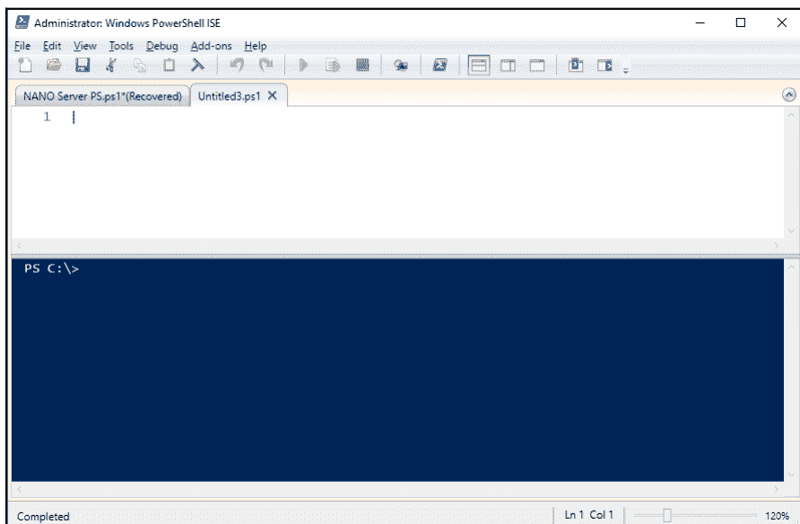

4. 你现在在屏幕截图中看到我们有一个脚本编辑器和 PowerShell 命令提示符。让我们连接到 172.16.15.63 上的 Nano Server。我们首先需要将 Nano Server 实例设置为 WIN2016IIS 服务器的受信任主机。执行 PowerShell 命令 `Set-Item WSMan:\localhost\ClientTrustedHosts -Value 172.16.15.63 -Concatenate`，你将得到一个弹出窗口以确认受信任主机，选项有 是、全部是 和 否。我们将单击 是 按钮。通过此操作，你已完成受信任主机的设置。

5. 让我们继续连接 Nano Server 实例。编写 PowerShell 命令 `Enter-PSSession -ComputerName "172.16.15.63" -Credential Administrator` 以连接 Nano Server。然后按 **Enter** 运行命令。会出现 Nano Server 管理员密码的弹出窗口，你需要提供你的 Nano Server 密码并按 **Enter**。你将通过 PowerShell 远程登录：

   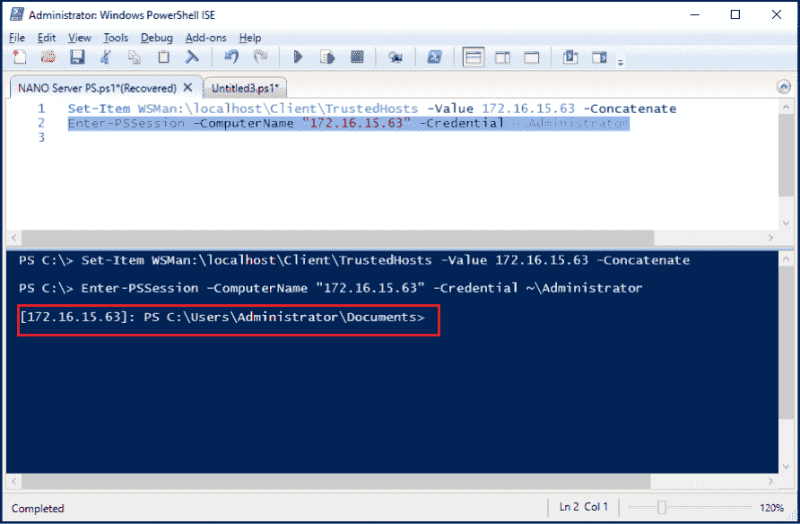

6. 连接到 Nano Server 后，我们需要检查 IIS 中默认列出的网站。首先，我们需要导入 IIS 模块。在 PowerShell 中编写 PowerShell 命令 `Import-Module IISAdministration`。这将导入 IISAdministration 模块。

7. 在 PowerShell 中执行命令 `Get-IISSite`，你将列出 IIS 实例中的所有网站：

   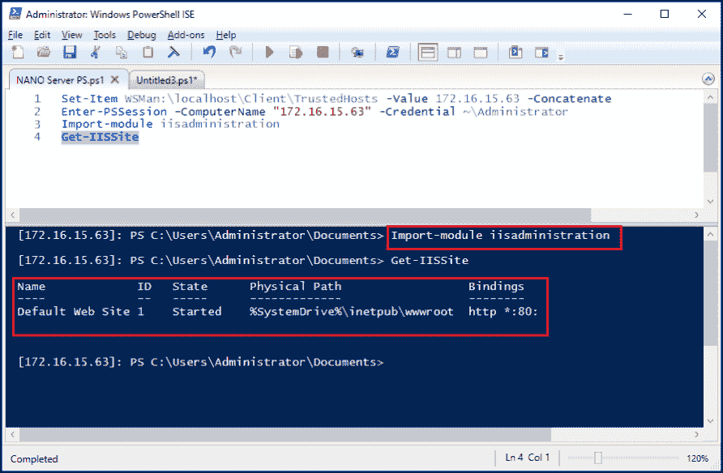

8. 你可以在图中看到我们只有一个默认网站，**Default Web Site**，其 **State** 为 **Started**，**Physical Path** 为 `%SystemDrive%\inetpub\wwwroot`。系统驱动器是默认的操作系统驱动器，绑定为 `http *:80:`，这意味着 Nano Server 上任何可用的 IP。

9. 你可以使用 PowerShell 命令 `Stop-IISSite -Name "Default Web Site"` 和 `Start-IISSite -Name "Default Web Site"` 分别停止和启动网站。

10. 你可以通过 PowerShell 在 IIS 中执行更多操作；更多参考信息可使用网址 `https://technet.microsoft.com/itpro/powershell/windows/iisadministration/iisadministration`。


#### How it works...

In this recipe, we performed some management tasks for IIS 10.0 on Nano Server. We added the Nano Server IP 172.16.15.63 as a trusted host for the WIN2016IIS server and connected Nano Server using a remote PowerShell command. We also checked the listed default website on IIS server. We used PowerShell commands to start and stop the website's default website services.

### Creating an IIS 10.0 website on Nano Server

In this recipe, we'll use PowerShell commands to connect to our Nano Server instance. We will import the IIS administration module and create a website. Finally, we will check the website's status.

#### Getting ready

To step through this recipe, we are going to create a website in IIS 10.0 on Nano Server 2016 through PowerShell. IIS 10.0 on Nano Server can only be managed using PowerShell. You will need Nano Server 2016 with the IIS package installed. For all this installation and configuration work, you should have administrative privileges.

#### How to do it...

- 1. Go to the **WIN2016IIS** server to connect to Nano Server 2016 through PowerShell. We have to first log in to the **WIN2016IIS** server or (a Windows Server 2016 or Windows 10 machine will do). We will use PowerShell to remotely connect to Nano Server 172.16.15.63. This is the IP in my case, but it can be different in yours.
- 2. Open PowerShell with administrative rights on the **WIN2016IIS** server. Press *Windows + R* key from your keyboard. You will get the **Run** window.
- 3. Type the command `RunAs /user:Administrator PowerShell_ISE.exe` in the **Run** window and click on **OK**. Now it will ask you the administrator password of **WIN2016IIS**, so type in the password for **WIN2016IIS** and press *Enter*. You will see PowerShell open with administrative rights.

Have a look at the *Installing IIS 10.0 on Nano Server* recipe to learn how to run PowerShell.

- 4. Let's connect to Nano Server on `172.16.15.63`. We have to first set up our Nano Server instance as the trusted host for **WIN2016IIS** server. We will write the PowerShell command `Set-Item WSMan:localhostClientTrustedHosts -Value 172.16.15.63 -Concatenate` and press *Enter*. You will get a pop-up to confirm the trusted host. Click on **Yes**. You have now finished the trusted host setup for Nano Server.
- 5. Let's now connect Nano Server. Run the PowerShell command `Enter-PSSession -ComputerName "172.16.15.63" -Credential ~Administrator` to connect to Nano Server. You will get the popup for the Nano Server administrator password, as shown here:

In the command `-ComputerName "172.16.15.63"`, substitute your IP address.

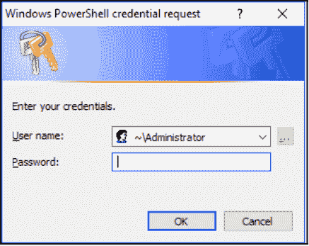

- 6. You have to provide your Nano server password and press *Enter*. You will be logged in through PowerShell remotely.

3. Open the file explorer on the **WIN2016IIS** server, and type `172.16.15.63\c$\Windows\System32\inetsrv\config` in the address bar of your browser. We are going to access the `C:` drive of Nano Server on the default hidden share, `c$`. It will prompt you for the administrator password. Once you've provided the correct password for Nano Server, you will get Nano Server to open to `172.16.15.63\c$\Windows\System32\inetsrv\config`, as shown here:

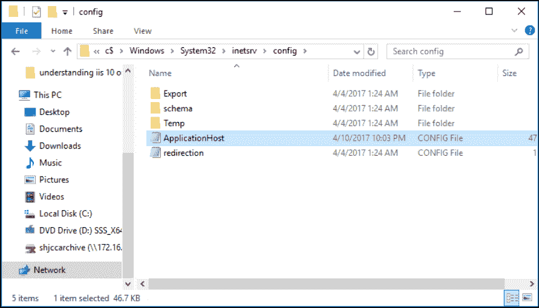

4. You have to make some changes in `ApplicationHost.config`. Open it in Notepad:

> 💡 **TIP**
> 
> Make the changes carefully. It's better to keep a backup file in a safe place before editing the original one!

```
<configuration>
    <!--
        The &lt;configSections&gt; section controls the registration of sections.
        Section is the basic unit of deployment, locking, searching and
        containment for configuration settings.

        Every section belongs to one section group.
        A section group is a container of logically-related sections.

        Sections cannot be nested.
        Section groups may be nested.

        &lt;section
            name="" [Required, Collection Key] [XML name of the section]
            allowDefinition="Everywhere" [MachineOnly|MachineToApplication|AppHostOnly|Everywhere]
            [Level where it can be set]
            overrideModeDefault="Allow" [Allow|Deny] [Default delegation mode]
            allowLocation="true" [true|false] [Allowed in location tags]
        /&gt;

        The recommended way to unlock sections is by using a location tag:
        &lt;location path="Default Web Site" overrideMode="Allow"&gt;
            &lt;system.webServer&gt;
                &lt;asp /&gt;
            &lt;/system.webServer&gt;
        &lt;/location&gt;
```

5. The ApplicationHost.config file has all the IIS website-related property configuration options. Make sure you're changing the ApplicationHost.config file and not something else. You'll find nanosite.com, as shown here:

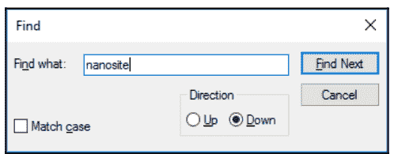

6. Click on Find, and it will take you inside applicationHost.config, where the nanosite.com details are available:

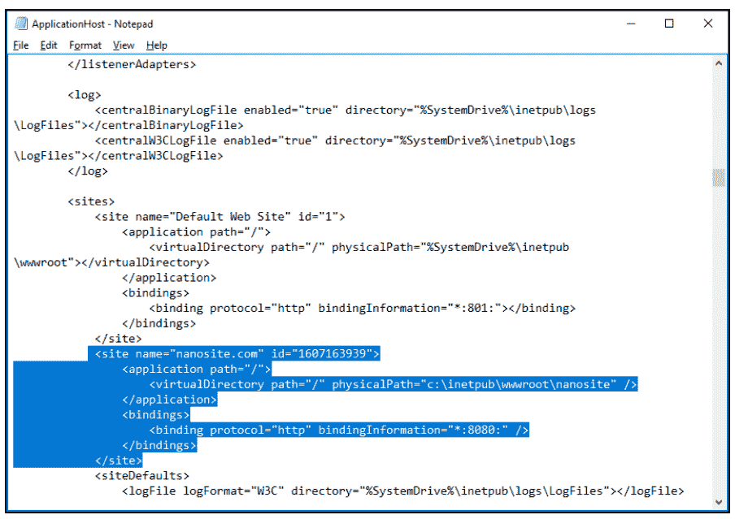

7. As shown in the screenshot, we've selected the site property. Here, you can change the Site Name, Physical Path, Binding Protocol, and Binding Information. We will change only the nanosite.com IP address and port number. You can see in screenshot the code bindingInformation="172.16.15.63*:8080:" *. This will used any available IP, but we will assign Nano Server's 172.16.15.63 and we change the port to 8081, as shown here:

```
</listenerAdapters>
    <log>
        <centralBinaryLogFile enabled="true" directory="%SystemDrive%\inetpub\logs\LogFiles"></centralBinaryLogFile>
        <centralW3CLogFile enabled="true" directory="%SystemDrive%\inetpub\logs\LogFiles"></centralW3CLogFile>
    </log>
    <sites>
        <site name="Default Web Site" id="1">
            <application path="/">
                <virtualDirectory path="/" physicalPath="%SystemDrive%\inetpub\wwwroot"/></virtualDirectory>
            </application>
            <bindings>
                <binding protocol="http" bindingInformation="*:801:"></binding>
            </bindings>
        </site>
        <site name="nanosite.com" id="1607163939">
            <application path="/">
                <virtualDirectory path="/" physicalPath="c:\inetpub\wwwroot\nanosite" />
            </application>
            <bindings>
                <binding protocol="http" bindingInformation="172.16.15.63:8081:"></binding>
            </bindings>
        </site>
    <siteDefaults>
        <logFile logFormat="W3C" directory="%SystemDrive%\inetpub\logs\LogFiles"></logFile>
```

8. If you want to change the physical path of nanosite.com, you can edit the path as you want. Now you can Save the applicationHost.config file and close it.

9. Let's check the modified nanosite.com binding information through PowerShell. On the WIN2016IIS server, open the Run prompt and execute RunAs /user:Administrator PowerShell_ISE.exe. It will ask you for the administrator password of WIN2016IIS; type it in and press Enter. You will get PowerShell open with administrative rights.

10. We need to first set up a Nano Server instance that is the trusted host for the WIN2016IIS server. Run the command Set-Item WSMan:\localhost\client\trustedhosts -Value 172.16.15.63 -Concatenate. You will get a popup to confirm the trusted host. Click on Yes.

11. We need to run this PowerShell command to connect Nano Server to PowerShell: Enter-PSSession -ComputerName "172.16.15.63" -Credential ~Administrator. You will get a popup for the Nano Server administrator password. Enter the administrator password and press OK.

5. Run Import-module iisadministration. After this, you can create a web page through PowerShell using the following commands:

```
"Welcome to IIS on Nano Server by Ashraf Khan This Nanosite.com" | Out-File -PSPath "c:\inetpub\wwwroot\nanosite\Default.htm"
```

"Welcome to IIS on Nano Server by Ashraf Khan This Nanosite.com" is the text that will be displayed on the web page, and Out-file -PSPath is used to define the type of file and physical path of your website. You can see this in the following screenshot:

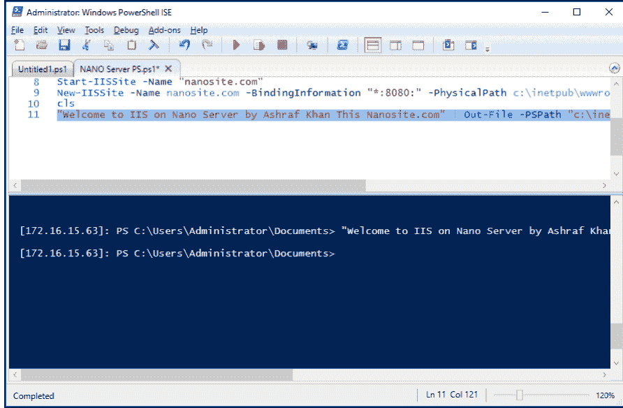

6. So we've just written a single line of easy code to create an HTML webpage. Let's check the nanosite folder and see whether the file has been created.


7. 打开 172.16.15.63\c$\inetpub\wwwroot\nanosite。如以下截图所示，default.htm 文件已创建：

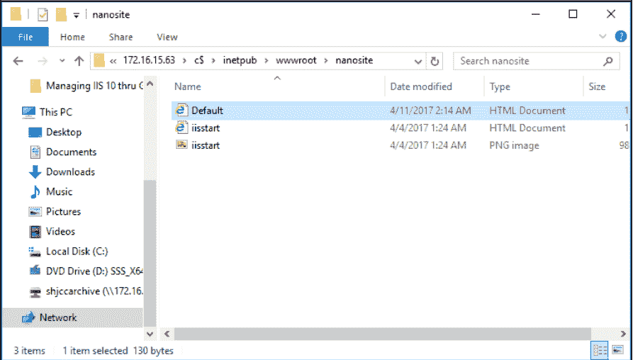

#### 工作原理...

在本节中，我们将默认的 IIS 网站页面 IISStart.htm 和 IISStart.png 上传到了位于 Nano Server 的 C:\inetpub\wwwroot\nanosite 文件夹中的 nanosite 文件夹。我们通过 PowerShell 创建了 default.htm 文件，并确认该文件已在该文件夹中创建。

### 测试上传的网页

在本节中，我们将为 Nano Server 打开防火墙端口。我们已经修改了 nanosite.com 的 8081 端口绑定信息。我们需要在 Nano Server 中打开防火墙端口 8081，这样才能通过端口 8081 访问网站。我们将打开通过 PowerShell 创建的 default.htm 页面。

6. 从截图中可以看到，防火墙允许规则已创建。现在让我们测试 nanosite.com:8081，检查它是否正常工作。

## PowerShell DSC:

PowerShell DSC 是一个用于测试和确保系统声明状态的平台。DSC 允许你跨环境扩展复杂部署，实现管理协作，并纠正配置漂移。

## PowerShell ISE:

PowerShell 集成脚本环境 (ISE) 是一个 Windows 应用程序，可为初学者和专家 alike 提供增强的 PowerShell 使用支持。ISE 的众多功能包括：

- 用于编写、测试和调试脚本的内置编辑器
- 完整的 IntelliSense 选项卡补全、语法高亮和上下文相关帮助
- 大量的键盘快捷键
- 支持从右向左的语言
- 可扩展的插件

有关详细信息，请参阅 https://msdn.microsoft.com/en-us/powershell/mt173057.aspx。

## 使用 PowerShell cmdlet 管理 IIS

在本节中，我们将使用不同的 PowerShell 远程管理模块登录 Nano Server 来管理 IIS 服务器。我们将通过服务器管理器登录到 PowerShell，并且还会查看 PowerShell 远程脚本。

#### 准备工作

在本节中，我们将通过 PowerShell 和 IISAdministrator 模块访问 Nano Server。你需要一台 Windows Server 2016 虚拟机或物理机，用于对 Nano Server 2016 进行远程 PowerShell 管理。对于所有这些安装和配置工作，你应具有管理员权限。

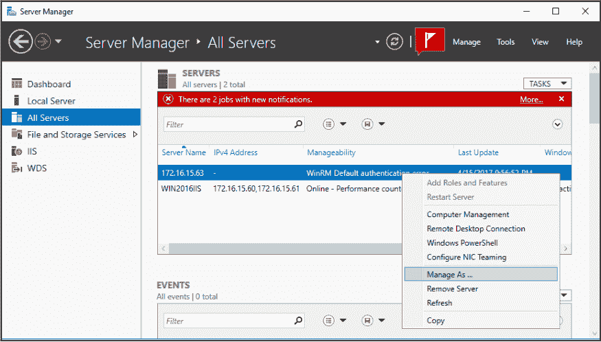

5. 在 **所有服务器** 窗口中，我们已添加了 IP 172.16.15.63，即我们的 Nano Server 2016 IP。现在右键单击 Nano Server IP `172.16.15.63`，然后点击 **管理方式...**。它会打开一个名为 **Nano Server 的 Windows 安全性** 的新身份验证窗口，如下所示：

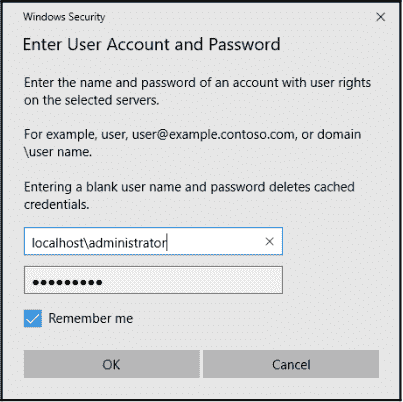

14. 转到 **WIN2016IIS** 服务器，通过 PowerShell 连接到 Nano Server 2016。你必须先登录到 WIN2016IIS 服务器（任何 Windows Server 2016 或 Windows 10 计算机都可以）。我们将使用 PowerShell 远程连接到位于 172.16.15.63 的 Nano Server。

15. 现在按 Windows + R 键，会出现“运行”窗口。以管理员权限打开 PowerShell ISE，输入命令 RunAs /user:Administrator PowerShell_ISE.exe，然后按 OK。此时它会要求你输入 Windows Server 2016 实例的管理员密码。输入管理员密码并按 Enter。现在你应该会看到 PowerShell 窗口，如下所示：

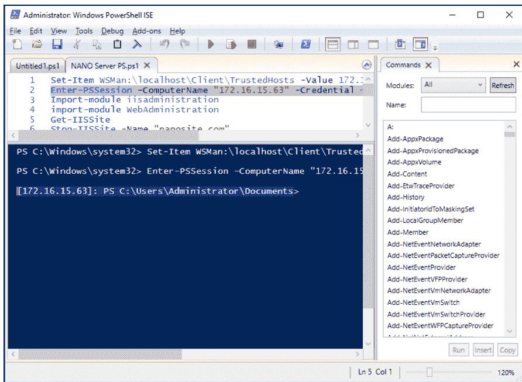

16. 我们在第 7 章“在 Nano Server 上部署 IIS 10.0”中已经执行过此步骤。这里我们只需简单回顾。你可以看到 PowerShell ISE 中有几个简单易用的选项。使用脚本编辑器，我们可以编写脚本，它还会显示高级自动化编写选项。你可以保存并多次使用它。我们有“命令”窗口，显示 PowerShell 中可用的命令以及可用的 PowerShell 模块功能。你可以打开 Windows Server 中提供的简单 PowerShell 提示符；如果需要 PowerShell ISE 的管理员权限，则需要管理员用户名和密码才能访问 PowerShell ISE。一旦你远程访问 Nano Server，请将 Nano Server 设为受信任的主机，然后使用正确的用户名和密码连接到它。

#### 工作原理...

在本节中，我们在 WIN2016IIS 服务器上打开了服务器管理器，并将 Nano Server 主机添加到“所有服务器”列表中。然后，我们使用服务器管理器对 Nano Server 进行身份验证，并为 Nano Server 打开了 PowerShell 远程管理以管理 IIS 服务器。我们通过服务器管理器登录到 PowerShell，导入了 IISAdministration 模块，并运行了 Get-Site 命令。此外，我们还查看了 PowerShell ISE 远程脚本。

### 在 Nano Server 上创建高级 IIS 10.0 网站

在本节中，我们将创建一个带有网站标头（网站名称）的网站，并同时添加应用程序池。我们将创建一个单独的应用程序池，并将该应用程序池添加到我们的网站。我们将在 IIS 服务器中查看所有可用的应用程序池列表。

#### 准备工作

我们将通过 PowerShell 远程连接 Nano Server，并通过 IISAdministrator 模块管理 IIS。你需要一台 Windows Server 2016 虚拟机或物理服务器，用于对 Nano Server 2016 进行远程 PowerShell 管理。对于所有这些安装和配置工作，你应具有管理员权限。

#### 操作步骤...

- 1. 登录 Windows Server 2016。Windows Server 2016 的 IP 地址为 172.16.15.60，服务器名称为 **WIN2016IIS**。
- 2. 按键盘上的 Windows + R 键。会出现 **运行** 窗口。以管理员权限打开 PowerShell ISE，在 **运行** 窗口中键入 `RunAs /user:Administrator PowerShell_ISE.exe`，然后按 **确定**。
- 3. 此时它会要求你输入 Windows Server 2016 实例的管理员密码（不是 Nano Server）。输入管理员密码并按 *Enter*。PowerShell 窗口将会打开。
- 4. 现在我们需要远程连接到 IP 为 172.16.15.63 的 Nano Server 2016。
- 5. 我们将在 PowerShell 中使用以下命令：

```
Enter-PSSession -ComputerName "172.16.15.63" -Credential \Administrator
```

你可以使用计算机名称或 IP 地址作为 `-ComputerName` 的值。在此命令中，我们使用 IP 地址。

- 6. 此时会出现一个弹出窗口，要求输入 Nano Server 管理员用户名和密码。我们将输入 Nano Server 管理员密码，然后按 **确定** 登录。连接成功后，运行 `Import-module iisAdministration` 命令。按 **Enter** 后，PowerShell 模块将导入。
- 7. 让我们使用高级脚本创建网站。我们将使用以下命令：

```
$manager = Get-IISServerManager
$site = $manager.Sites.Add("v5mysite", "http", "*:8082:v5mysite.com", "C:\v5mysite") $site.Id = 4
$site.Bindings.Add("*:8083:", "http")$manager.CommitChanges()
```

10. 现在让我们检查已创建的网站 v5mysite。在 PowerShell 中运行命令 `Get-IISSite`：

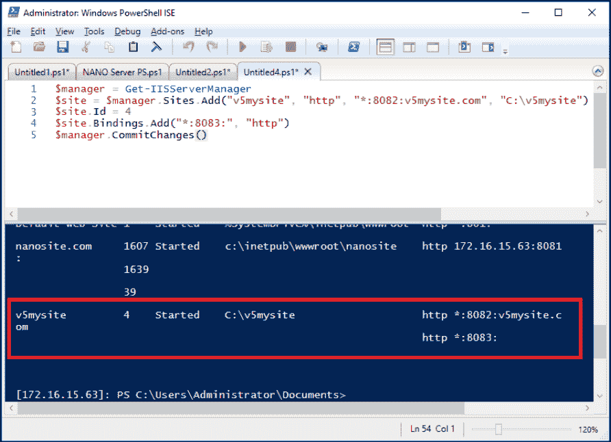

11. 在图中你会看到，你有一个名为 **v5mysite** 的网站，ID 为 4，状态为 `Started`，物理路径为 `c:\v5mysite`，并且有两条绑定信息，一条带有标头，另一条没有。

12. 让我们在 Nano Server 上的 IIS 10.0 中创建应用程序池。在 PowerShell 中运行以下命令：

```
$manager = Get-IISServerManager
$pool = $manager.ApplicationPools.Add("NanoAPP")
$pool.ManagedPipelineMode = "Integrated"
$pool.ManagedRuntimeVersion = "v4.0"
$pool.Enable32BitAppOnWin64 = $false
$pool.AutoStart = $true
$pool.StartMode = "OnDemand"
$pool.ProcessModel.IdentityType = "ApplicationPoolIdentity"
$manager.CommitChanges()
```


- **13.** 接下来，我们创建一个名为 NanoApp 的应用程序池并设置应用程序池的属性，如下所示：

  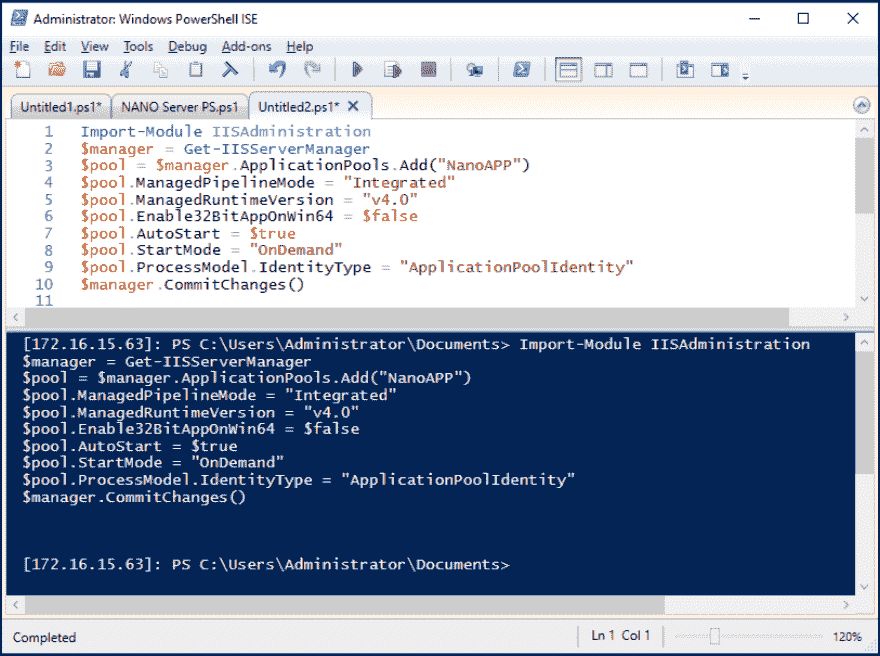

- **14.** 创建应用程序池后，您可以使用命令 `Get-IISAppPool` 检查其状态，如下所示：

  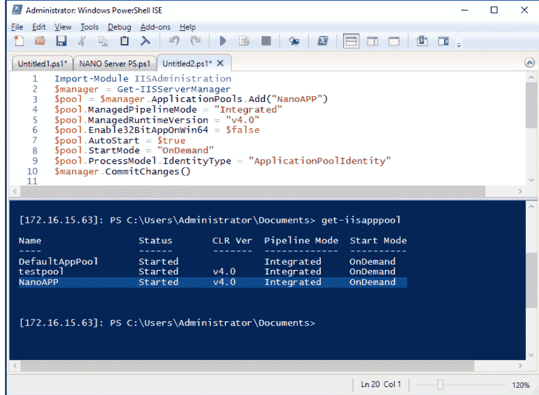

- **15.** 您可以看到我们已创建名为 NanoApp 的应用程序池。让我们将 NanoApp 添加到 v5mysite.com。使用以下命令：

  ```powershell
  $manager = Get-IISServerManager
  $website = $manager.Sites["v5mysite"]
  $website.Applications["/"].ApplicationPoolName = "NanoApp"
  $manager.CommitChanges()
  ```

  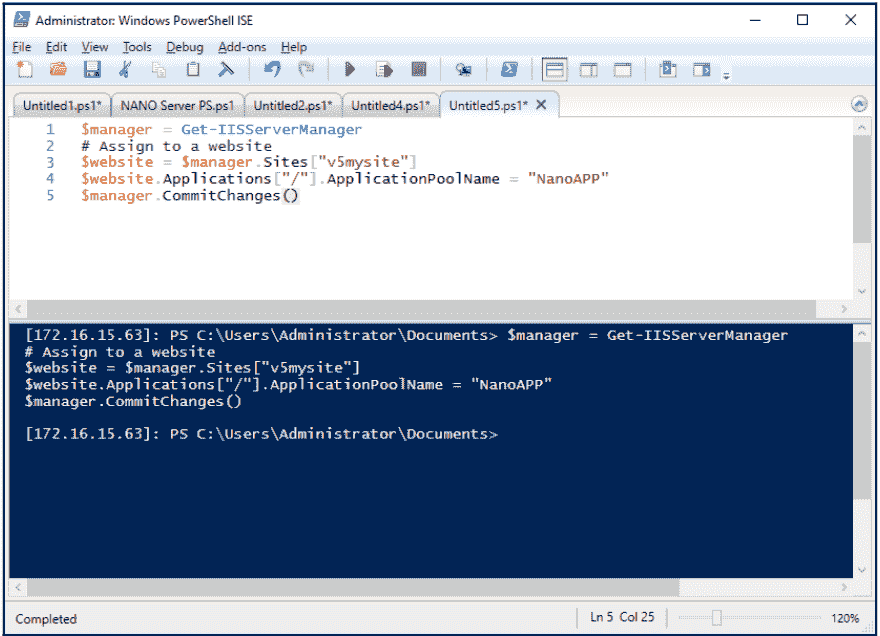

- **16.** 我们已将应用程序池 NanoApp 分配给网站 v5mysite。现在让我们检查 v5mysite.com 的应用程序池名称。

- **17.** 使用以下命令：

  ```powershell
  $manager = Get-IISServerManager
  $website = $manager.Sites["v5mysite"]
  $website.Applications["/"].ApplicationPoolName
  ```

### 在 Nano Server 上配置 IIS 10.0 网站

在本教程中，我们将使用 PowerShell 命令回收 `v5mysite.com` 应用程序池。我们将检查默认的 **文档设置** 和列出的页面名称，并将新文件名添加到默认文档 `v5mysite.htm`。我们将在 `v5mysite.com` 网站的物理路径中进行更改。

#### 准备工作

在本教程中，我们将通过 PowerShell 远程连接到 Nano Server 并通过 `IISAdministrator` 模块配置我们的网站。您需要一台 Windows Server 2016 虚拟或物理服务器来远程通过 PowerShell 管理 Nano Server 2016。对于所有这些安装和配置工作，您应具有管理员权限。

#### 操作方法...

- **1.** 使用 IP `172.16.15.60` 和名称 **WIN2016IIS** 登录到 Windows Server 2016。在键盘上按 *Windows + R*，您将得到 **运行** 窗口。使用管理员权限打开 PowerShell ISE，并在 **运行** 窗口中输入命令 `RunAs /user:Administrator PowerShell_ISE.exe`，如下所示：

  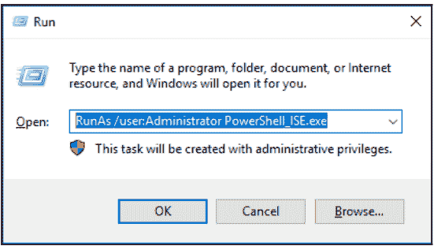

- **2.** 按 **确定**。它会要求您输入 Windows Server 2016 实例的管理员密码（不是 Nano Server）。输入管理员密码并按 *Enter*。现在 PowerShell 窗口将打开。

- **3.** 现在我们必须远程连接到 IP 为 172.16.15.63 的 Nano Server 2016。在 PowerShell 中编写以下命令：

  ```powershell
  Enter-PSSession -ComputerName "172.16.15.63" -Credential .\Administrator
  ```

- **4.** 现在您将得到一个用于 Nano Server 管理员用户名和密码的弹出窗口。输入管理员密码并按 **确定** 登录。您已成功连接。

- **5.** 现在让我们导入 IIS 管理模块。编写命令 `Import-Module IISAdministration` 并按 *Enter*。您将得到 PowerShell 模块已导入。

- **6.** 编写以下命令以回收应用程序池 NanoAPP，如下所示：

  ```powershell
  Get-IISAppPool
  $sm = Get-IISServerManager
  $sm.ApplicationPools["NanoAPP"].Recycle()
  ```

  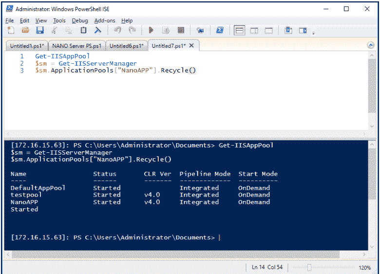

- **7.** 运行命令后，我们将得到 Nano Server 上 IIS 中可用的应用程序池列表；PowerShell 命令将仅回收应用程序池 **NanoAPP**，并且我们会将其状态看到为 Started。我们可以使用启动和停止命令分别对应用程序池进行操作：

  ```powershell
  $sm = Get-IISServerManager
  $sm.ApplicationPools["NanoAPP"].Stop()
  $sm.ApplicationPools["NanoAPP"].Start()
  ```

  我们可以根据需要随时使用这些命令。

- **8.** 现在我们要检查 **默认文档** 设置中可用的默认文档文件列表。在 PowerShell 中编写以下命令并按 Enter，如下所示：

  ```powershell
  Get-IISConfigSection -SectionPath "system.webServer/defaultDocument" | Get-IISConfigCollection -CollectionName "files"
  ```

  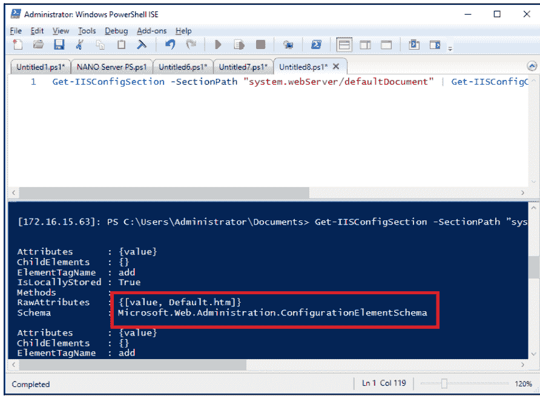

- **9.** 我们现在可以看到我们已列出 IIS 服务器中所有可用的文件名。标记为 `default.htm`。

- **10.** 现在我们要在 **默认文档** 设置中创建一个名为 `v5mysite.htm` 的文件。编写以下命令并按 *Enter*，您将看到文件名 `v5mysite.htm` 已添加到 **默认文档**：

  ```powershell
  Get-IISConfigSection -SectionPath "system.webServer/defaultDocument" | Get-IISConfigCollection -CollectionName "files" | New-IISConfigCollectionElement -ConfigAttribute @{"Value" = "v5mysite.htm"}
  ```

- **11.** 现在我们要检查 `v5mysite.htm` 是否在 **默认文档** 中可用。运行以下命令，如下所示：

  ```powershell
  Get-IISConfigSection -SectionPath "system.webServer/defaultDocument" | Get-IISConfigCollection -CollectionName "files"
  ```

  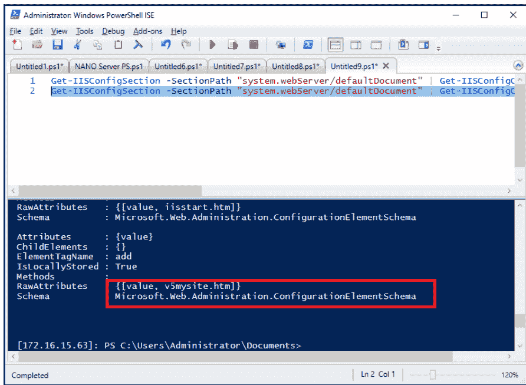

- **3.** 现在我们必须使用 IP 172.16.15.63 远程连接到 Nano Server 2016。运行命令 `Enter-PSSession -ComputerName "172.16.15.63" -Credential .\Administrator`。

- **4.** 现在您将得到一个用于 Nano Server 管理员帐户密码的弹出窗口。输入 Nano Server 管理员帐户密码并按 **确定** 登录。您已成功连接。现在在 PowerShell 中运行命令 `Import-Module IISAdministration` 并按 Enter。您将得到 PowerShell 模块已导入。

- **5.** 我们将从 `C:\inetpub\wwwroot\` 复制 `iisstart.htm` 和 `iisstart.png` 到 v5mysite-new 目录 `C:\v5mysite-new`。运行：

  ```powershell
  copy C:\inetpub\wwwroot\iisstart.htm C:\v5mysite-new
  copy C:\inetpub\wwwroot\iisstart.png C:\v5mysite-new
  ```

  如下所示：

  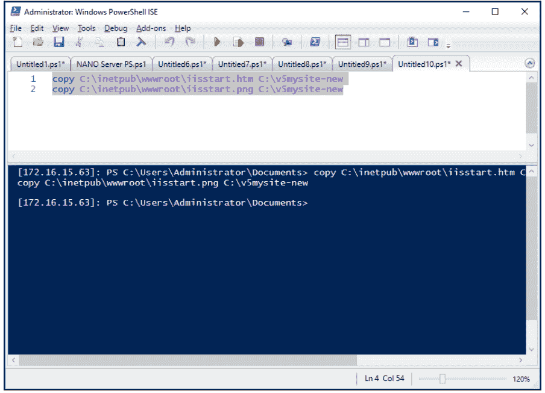

- **6.** 编写这两个命令并运行它们。现在您必须检查这些文件是否已复制。进入 C:\v5mysite-new 文件夹：

  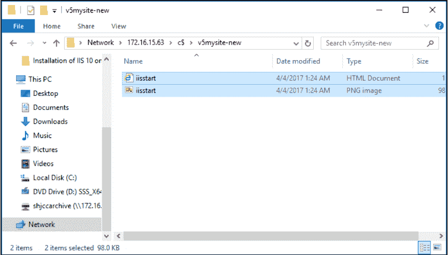

- **7.** 在这里，您可以看到 `iisstart.htm` 和 `iisstart.png` 已被复制。现在我们必须为测试创建另外两个 HTML 文件。运行以下命令：

  ```powershell
  "Welcome to IIS on Nano Server by Ashraf Khan This is Index.htm page" | Out-File -PSPath "c:\v5mysite-new\index.htm"
  "Welcome to IIS on Nano Server by Ashraf Khan This is v5mysite.htm page" | Out-File -PSPath "c:\v5mysite-new\v5mysite.htm"
  ```

  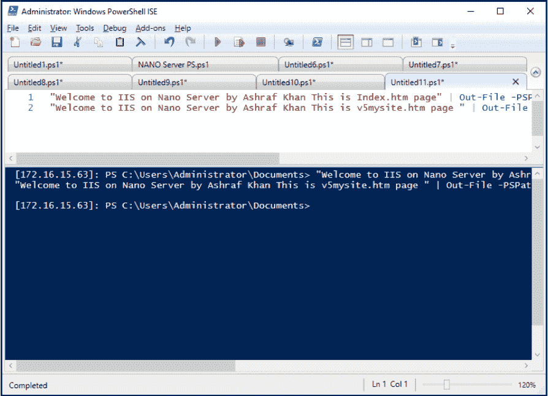

- **8.** 逐一运行命令。现在让我们检查 C:\v5mysite-new 文件夹：

  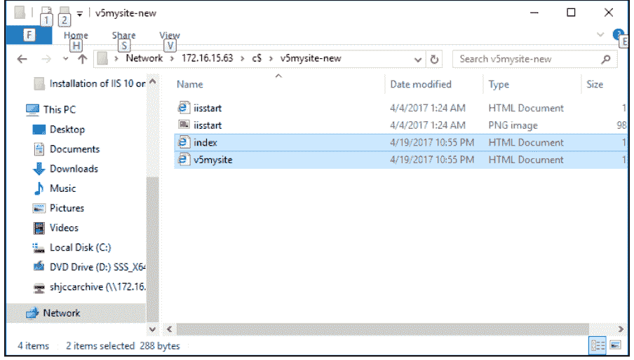

- **9.** 您可以看到 C:\v5mysite-new 文件夹已创建了另外两个文件。

#### 工作原理...

在本教程中，我们从 C:\inetpub\wwwroot 复制了两个网站页面到 C:\v5mysite-new，并使用 PowerShell 命令创建了两个 HTML 文件 index.htm 和 v5mysite.htm。

### 测试已上传的网页

在本教程中，我们将测试我们已创建和配置的网站 v5mysite.com。我们将在防火墙中为 Nano Server 的端口 8082 创建一个允许规则，并将在网站 v5mysite.com 的默认文档设置中将默认页面设置为 v5mysite.htm。我们将浏览 v5mysite.com 并验证默认页面。

#### 准备工作

我们将通过 PowerShell 远程连接到 Nano Server 并使用 IISAdministrator 模块。您需要一台 Windows Server 2016 虚拟或物理服务器来远程通过 PowerShell 管理 Nano Server 2016。对于所有这些安装和配置工作，您应具有管理员权限。

#### 操作方法...

- **1.** 我们已创建应用程序池 NanoAPP 并将其分配给网站 v5mysite；我们尚未在 IIS 服务器上进行 ASP.Net 配置。我们将在下一章中测试应用程序池。让我们删除 v5mysite 中的应用程序池条目。

- **9.** 我们已创建了一个名为 Allow Inbound Port 8082 的防火墙规则。

- **10.** 打开 Internet Explorer 并输入 URL http://172.16.15.63:8082/，如下所示：

  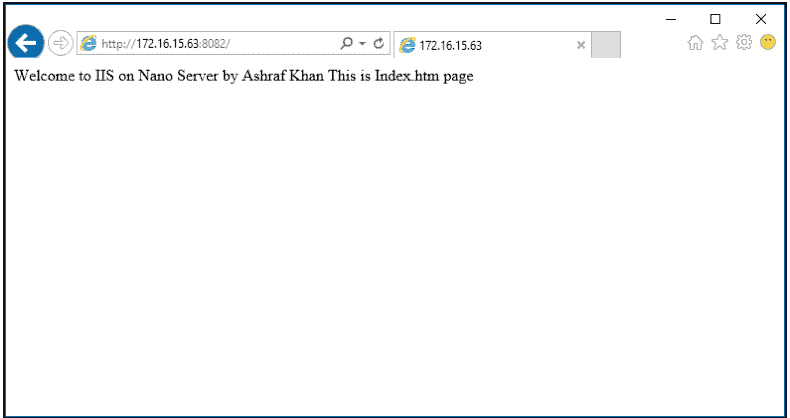

- **11.** 如屏幕截图所示，我们得到网页 index.htm 作为 v5mysite 的默认页面。现在我们必须设置默认文档以访问默认页面 v5mysite.htm。

- **12.** 我们必须删除我们之前创建的默认文档条目 v5mysite.htm，以便删除现有的默认文档文件名。在 PowerShell 中输入以下命令：

  ```powershell
  Get-IISConfigSection -SectionPath "system.webServer/defaultDocument" | Get-IISConfigCollection -CollectionName "files" | Remove-IISConfigCollectionElement -ConfigAttribute @{value = "v5mysite.htm"}
  ```

  运行此命令后，将出现一个确认弹出窗口，如下所示：

  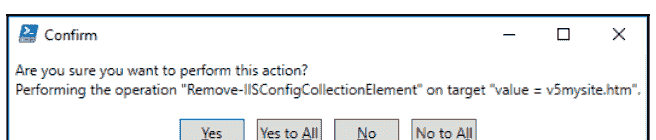


13. 点击 **Yes**。现在你需要在 **Default Document** 设置中为 `v5mysite.htm` 创建一个新条目。在 PowerShell 中输入以下命令：

```
Get-IISConfigSection -SectionPath "system.webServer/defaultDocument" | Get-IISConfigCollection -CollectionName "files" | New-IISConfigCollectionElement -ConfigAttribute @{Value = "v5mysite.htm"} –AddAt 0
```

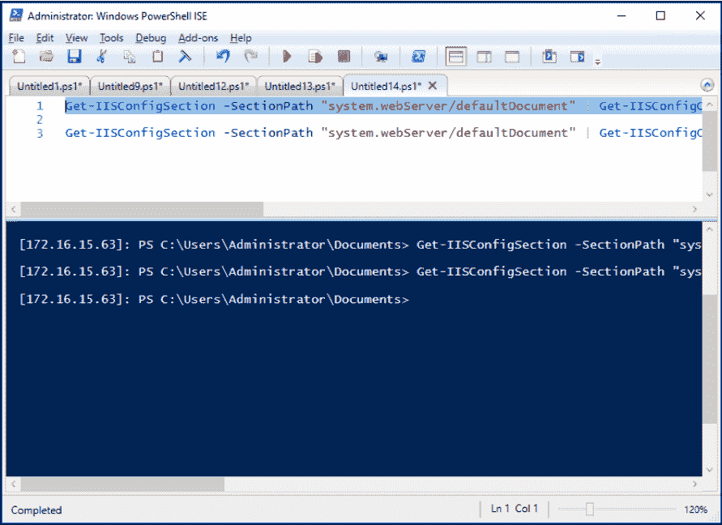

14. 让我们测试网站 `v5mysite.com` 并检查默认页面。打开 Internet Explorer 并输入 URL `http://172.16.15.63:8082/`：

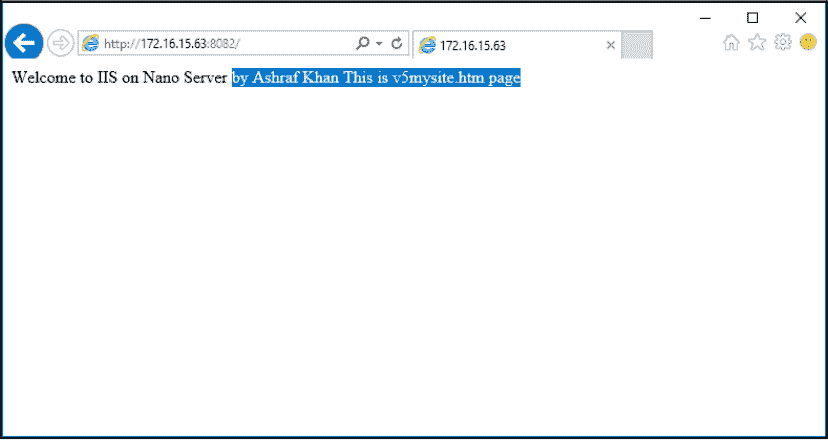

15. 在这里你可以看到网站打开了默认页面，`v5mysite.htm`。

#### How it works...

在本教程中，我们测试了我们创建并配置的网站 `v5mysite.com`。我们在 Nano Server 的防火墙上为端口 `8082` 创建了一个允许规则。我们为网站 `v5mysite.com` 的默认页面 `v5mysite.htm` 设置了 **Default Document** 设置，并将 `v5mysite.htm` 的默认页面条目置于顶部。我们浏览了网站 `v5mysite.com` 并看到了默认页面。
