## Enabling ASP.NET Core with IIS on Nano Server

在本章中，我们将介绍以下教程：

- Understanding ASP.NET Core with IIS on Nano Server
- Configuring ASP.NET Core with IIS on Nano Server
- Creating an IIS 10.0 virtual directory on Nano Server
- Configuring a virtual directory in IIS 10.0
- Uploading and testing web pages in a virtual directory

### Introduction

ASP.NET Core 是一个开源的跨平台框架，可在有或没有 ASP.NET 应用程序池的任何操作系统上运行。它帮助我们独立于 macOS、Linux 或 Windows Server Core 等平台开发和发布基于 Web 的应用程序。ASP.NET Core 也被称为 ASP.NET 5。Nano Server 2016 针对 ASP.NET Core。

一旦我们开始开发 ASP.NET Core 应用程序并发布它，它将自动复制所有必需的运行时 DLL 和其他文件到 Web 应用程序发布目录，以便核心 Web 应用程序独立运行，而无需在 IIS 服务器上要求任何框架。

ASP.NET 2.0 将无法在 Nano 上运行。

### Understanding ASP.NET Core with IIS on Nano Server

在本教程中，我们将创建一个 ASP.NET Core 网站应用程序并在 Visual Studio 2017 上运行它。

#### Getting ready

要逐步完成本教程，你需要设置 Visual Studio 2017。对于所有安装和配置工作，你应具有管理员权限。

#### How to do it...

1. 登录到你的 Windows 10 PC 或 Windows Server 2016。我们已经为测试安装了 Visual Studio，因此打开它。
2. 打开 File 菜单，创建一个新项目，并选择 **.Net Core** 和应用程序类型 **ASP.NET Core Web Application (.NET Core)**，如下所示：

#### New Project

.NET Framework 4.5.2
Sort by: Default
Search Installed Templates: (Ctrl+E)
Recent
Installed
Templates
Visual C#
Windows Universal
Windows Classic Desktop
Web
.NET Core
.NET Standard
Android
Cloud
Cross-Platform
iOS
Test
tvOS
WCF
Visual Basic
Visual C++
Online
Console App (.NET Core) Visual C#
Class Library (.NET Core) Visual C#
Unit Test Project (.NET Core) Visual C#
xUnit Test Project (.NET Core) Visual C#
ASP.NET Core Web Application (.NET Core) Visual C#
Type: Visual C#
Project templates for creating ASP.NET Core applications for Windows, Linux and macOS using .NET Core.
Name: WebApplication4
Location: c:\users\administrator\documents\visual studio 2017\Projects
Solutions: Create new solution
Solution name: WebApplication4
Create directory for solution
Create new Git repository
OK
Cancel

3. 点击 OK 按钮。你将获得一个 New ASP.NET Core 窗口来选择 ASP.NET Core 应用程序的类型，如下所示：

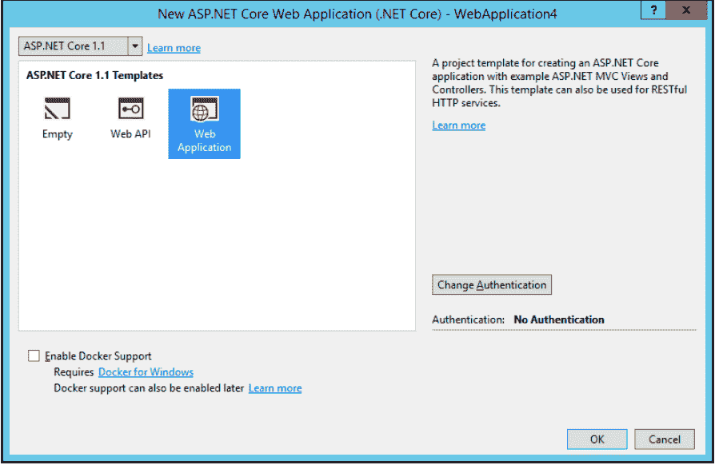

4. 现在选择 Web Application 选项并点击 OK。你将创建默认的 ASP.NET Web 应用程序。这只是为了演示，展示 ASP.NET Web 应用程序的外观。

5. 现在让我们在 Visual Studio 2017 上运行创建的项目，你将获得 Web 应用程序页面，如以下屏幕截图所示。


要从 Visual Studio 运行应用程序，点击顶部工具栏中的“播放”图标或按 F5。

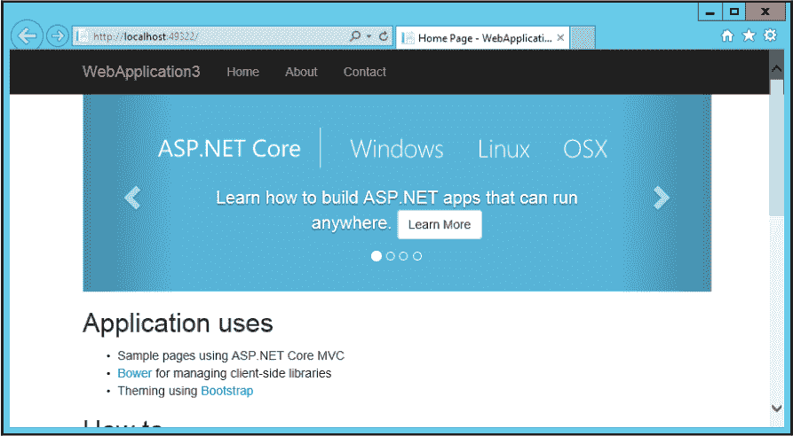

6. 你现在可以看到我们使用 ASP.NET core 创建的默认示例应用程序。

#### How it works...

在本教程中，我们登录到 Windows Server 2016 并打开 Visual Studio 2017 软件。我们还创建了 ASP.NET Core 网站应用程序并在 Visual Studio 2017 上运行它。

### Configuring ASP.NET Core with IIS on Nano Server

在本教程中，我们将在 **WIN2016IIS** 服务器上安装 `HttpPlatformHandler` 并将 `httpPlatformHandler.dll` 和 `httpplatform_schema.xml` 从 **WIN2016IIS** 配置到 Nano Server。我们将在 Nano Server 上配置我们的 ASP.NET Core 应用程序。我们将通过 PowerShell 远程连接 Nano Server 并通过 `IISAdministrator` 模块管理和 Nano Server。

2. 点击所选链接，它将开始下载 **HttpPlatformHandler**。
3. 在 WIN2016IIS 上运行 **HttpPlatformHandler**。你将获得 **HttpPlatformHandler** 的安装页面，如下所示：
4. 点击 **Next**，按照默认步骤，完成 **HttpPlatformHandler** 的安装。

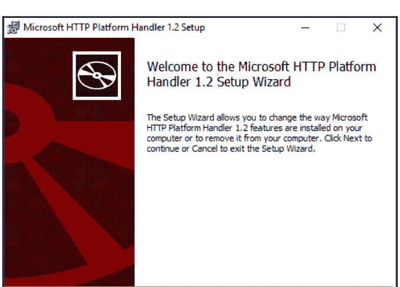

5. 在 WIN2016IIS 服务器上，进入 C:\Windows\System32\inetsrv，找到 httpPlatformHandler.dll，并将其复制到 WIN2016IIS 服务器的桌面。我创建了一个名为 ASP Net core\ASP.net 的文件夹，我将 httpPlatformHandler.dll 粘贴到其中。现在，进入 C:\Windows\System32\inetsrv\config\schema 并将 httpplatform_schema.xml 复制到 Asp Net core\ASP.net，如下所示：

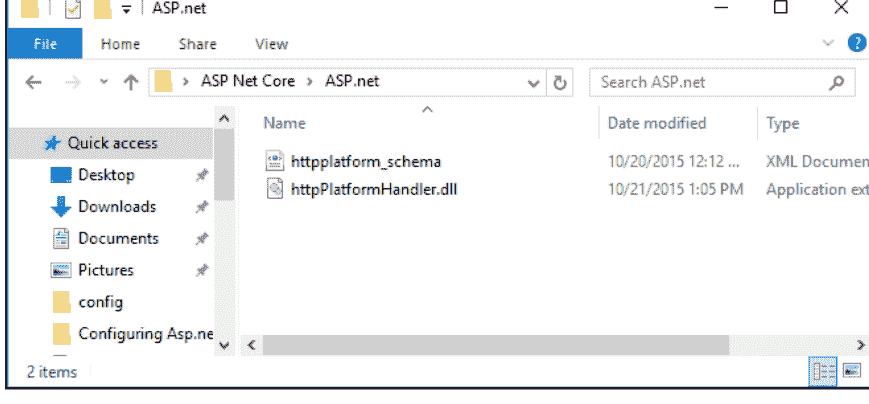

6. 如屏幕截图所示，我们已复制 httpplatform_schema.xml 和 httpPlatformHandler.dll 文件。

7. 从 ASP Net Core\ASP.net 复制 httpPlatformHandler.dll，远程访问 Nano Server 位置 \\172.16.15.63\c$\Windows\System32\inetsrv\，并粘贴，如下所示：

### Enabling ASP.NET Core with IIS on Nano Server

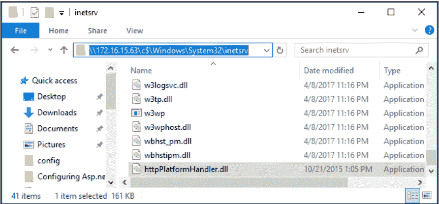

8. 从 ASP Net Core\asp.net 复制 httpplatform_schema.xml，远程访问 Nano Server 位置 \\172.16.15.63\c$\Windows\System32\inetsrv\config\schema，并粘贴。

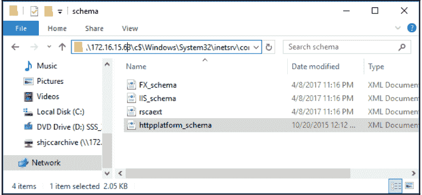

8. 登录到 Windows Server 2016。IP 地址为 `172.16.15.60`，服务器名称为 **WIN2016IIS**。在键盘上按 *Windows + R*，你将获得 *Run* 窗口。使用管理员权限打开 PowerShell ISE，在 **Run** 命令窗口中输入 `RunAs /user:Administrator PowerShell_ISE.exe`，并按 **OK**。

> 在此命令中，`Administrator` 是该机器的用户名；你可以使用任何具有管理员权限的用户名来执行给定的任务。

9. 现在它会要求你输入 Windows Server 2016 实例的管理员密码。输入管理员密码并按 *Enter*。你将获得 PowerShell 窗口。

10. 现在你需要远程连接到 Nano Server 2016 `172.16.15.63`。运行命令 `Enter-PSSession -ComputerName "172.16.15.63" -Credential ~\Administrator`。现在你将获得一个 Nano Server 管理员账户密码的弹出窗口。输入密码并按 **OK** 登录。你现在已成功连接。写入 `Import-module isAdministrator` 并按 *Enter*。这将导入 PowerShell 模块。

11. 现在你需要安装在 Nano Server `C:\` 驱动器上的 `Packages` 文件夹中创建的 Reverse Forwarders 包，并复制 Nano Server Packages，如下所示：

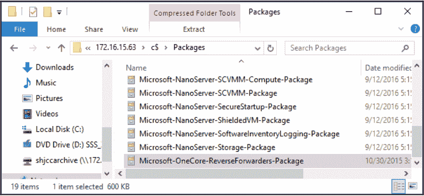


12. 输入 `dism/online/addpackage/packagepath:c:\packages\Microsoft-OneCore-ReverseForwarders-Package.cab` 和 `dism /online /add-package /packagepath:c:\packages\en-us\Microsoft-OneCore-ReverseForwarders-Package.cab` DISM 命令并运行它们，如下所示：

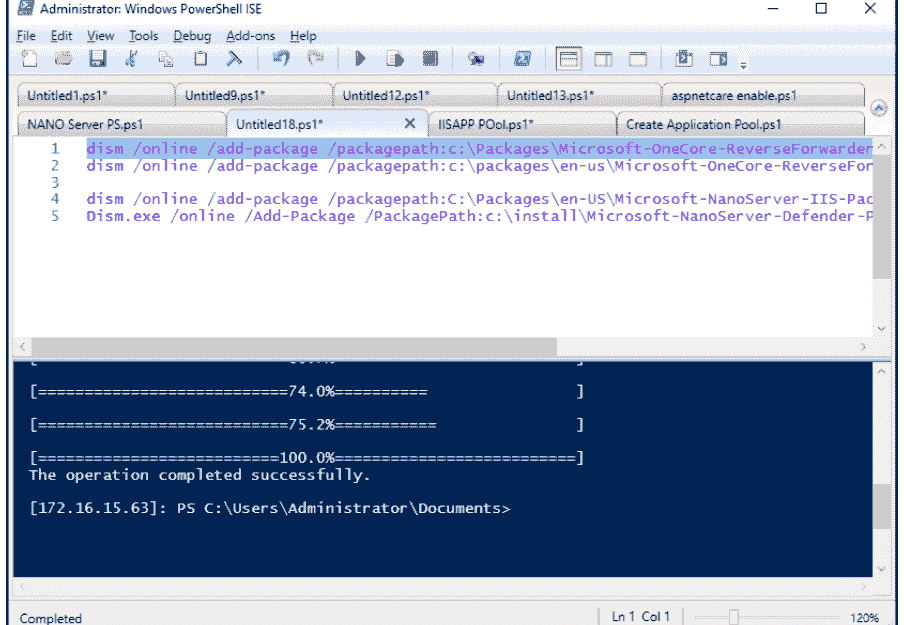

13. 接下来，我们继续配置 ASP.NET Core。我们已经复制了所需的 DLL 和 XML 文件。请在 PowerShell 中键入以下命令：

```
$sm = Get-IISServerManager
$sm.GetApplicationHostConfiguration()
.RootSectionGroup.Sections.Add("appSettings")
$appHostconfig =
$sm.GetApplicationHostConfiguration()
$section =
```

### 在 Nano Server 上通过 IIS 启用 ASP.NET Core

```
```powershell
$appHostConfig.GetSection("system.webServer/handlers")
$section.OverrideMode="Allow"
$sectionHttpPlatform = $appHostConfig.RootSectionGroup.SectionGroups["system.webServer"].Sections.Add("httpPlatform")
$sectionHttpPlatform.OverrideModeDefault = "Allow"
$globalModules = Get-IISConfigSection "system.webServer/globalModules" | Get-IISConfigCollection
New-IISConfigCollectionElement $globalModules -ConfigAttribute @{"name"="httpPlatformHandler"; "image"="%SystemRoot%\\system32\\inetsrv\\httpPlatformHandler.dll"}
$modules = Get-IISConfigSection "system.webServer/modules" | Get-IISConfigCollection
New-IISConfigCollectionElement $modules -ConfigAttribute @{"name"="httpPlatformHandler"}
$sm.CommitChanges()
```
```

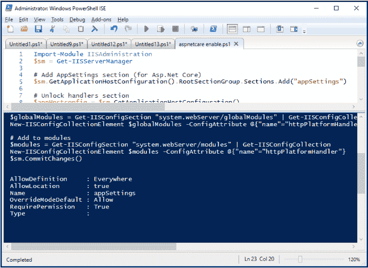

14. 从屏幕截图中可以看到，我们已经配置了在 Nano Server 上运行 ASP.NET Core 所需的步骤。但是，你还需要在核心应用程序中执行一些额外操作，并使用 DNU publish 命令发布代码。更多信息请访问 `https://blogs.iis.net/davidso/nano/aspnet`。

#### 工作原理

在本节中，我们在 WIN2016IIS 服务器（物理服务器，而非 Nano Server）上安装了 HttpPlatformHandler。然后，我们从 WIN2016IIS 复制了 `httpPlatformHandler.dll` 和 `httpplatform_schema.xml`，并将它们粘贴到 Nano Server。我们通过 PowerShell 在 Nano Server 上配置了 `httpPlatformHandler.dll` 和 `httpplatform_schema.xml`，此外还配置了 ReverseForwarders 包。

### 在 Nano Server 上创建 IIS 10.0 虚拟目录

在本节中，我们将创建一个名为 `NanoAspnet` 的网站，并在这个名为 `NanoAspnet` 的网站内创建一个虚拟目录。然后，我们将使用 PowerShell 远程连接到 Nano Server，并使用 `IISAdministration` 模块和 Nano Server 管理 IIS。

#### 准备工作

要完成本节操作，你需要一台 Windows Server 2016 虚拟机或物理服务器，用于远程 PowerShell 管理以及在 Nano Server 2016 上创建虚拟目录。进行所有这些安装和配置工作时，你需要具有管理员权限。

#### 操作步骤

- 1. 登录 Windows Server 2016。IP 地址为 `172.16.15.60`，服务器名称为 **WIN2016IIS**。按 *Windows* + R 键，会弹出**“运行”**窗口。以管理员权限打开 PowerShell ISE，输入 `RunAs /user:Administrator PowerShell_ISE.exe`，然后按**确定**。

6. 从截图可以看到，我们已经创建了使用端口 8000 的 NanoAspNet 网站。现在，我们来在 NanoAspNet 上创建虚拟目录 MyApp。首先，我们必须创建一个物理目录（Nano Server 上的文件夹），用于虚拟目录。我们在 `C:\inetpub\wwwroot` 下创建了一个名为 MyApp 的目录，如下所示：

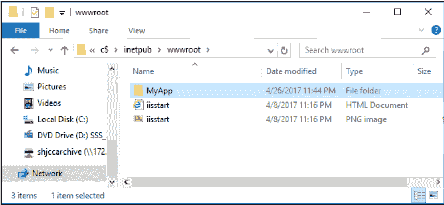

### 在 Nano Server 上通过 IIS 启用 ASP.NET Core

7. 现在，打开已经连接到我们的 Nano Server 实例的 PowerShell，并输入以下命令来创建虚拟目录：

```
```powershell
$manager = Get-IISServerManager
$app = $manager.Sites["NanoAspNet"].Applications.Add("/MyApp", "c:\inetpub\wwwroot\MyApp")
$manager.CommitChanges()
```
```

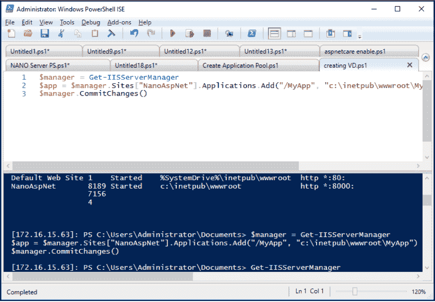

8. 你已成功为 NanoAspNet 创建了 MyApp 虚拟目录。

#### 工作原理

在本节中，我们使用 PowerShell 远程连接到 Nano Server，通过 IISAdministrator 模块管理 IIS。我们使用 Windows Server 2016 虚拟机/物理服务器实例进行远程 PowerShell 管理，并在 Nano Server 2016 上创建虚拟目录。我们还创建了名为 `NanoAspnet` 的网站，并在 `NanoAspNet` 中创建了虚拟目录 `MyApp`。

### 在 IIS 10.0 中配置虚拟目录

在本节中，我们将创建一个应用程序池，并将其分配给我们的虚拟目录 `MyApp`。我们还将创建一条防火墙规则，以允许 `NanoAspNet` 的入站端口 `8000`。

#### 准备工作

要完成本节操作，你需要一台 Windows Server 2016 虚拟机或物理服务器，用于远程 PowerShell 管理以及在 Nano Server 2016 上配置虚拟目录。进行所有这些安装和配置工作时，你需要具有管理员权限。

#### 操作步骤

- 1. 登录 Windows Server 2016。IP 地址为 `172.16.15.60`，名称为 **WIN2016IIS**。按 *Windows + R* 键，会弹出**“运行”**窗口。以管理员权限打开 PowerShell ISE：输入 `RunAs /user:Administrator PowerShell_ISE.exe`，然后按**确定**。
- 2. 现在，它会要求你输入 Windows Server 2016（不是 Nano Server）计算机的管理员密码。输入密码并按 *Enter* 键。你将进入 PowerShell 窗口。
- 3. 现在，你需要使用 IP `172.16.15.63` 远程连接到 Nano Server 2016。输入命令 `Enter-PSSession -ComputerName "172.16.15.63" -Credential ~\Administrator.`。此时会弹出 Nano Server 管理员帐户密码输入窗口。输入密码并按**确定**。你将成功连接。然后输入 `Import-module iisAdministration` 并按 *Enter* 键。这将导入 PowerShell 模块。

4. 输入命令 `$sm = Get-IISServerManager\n$sm.ApplicationPools.Add("NanoAppPool")` 来创建应用程序池 NanoAppPool，如下所示：

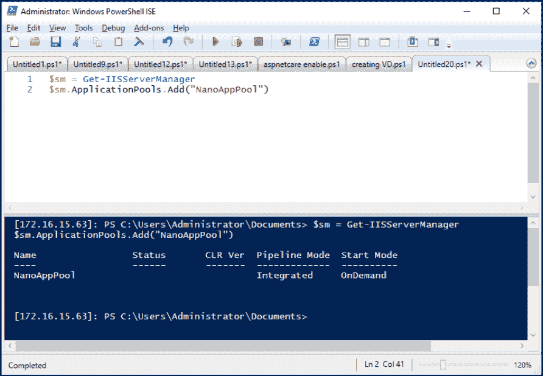

5. 现在，我们已经创建了 NanoAppPool 应用程序池。接下来，将 NanoAppPool 分配给 MyApp 虚拟目录。输入以下命令：

```
$manager = Get-IISServerManager
$website = $manager.Sites["NanoAspNet"]
$website.Applications["/MyApp"].ApplicationPoolName = "NanoAppPool"
$manager.CommitChanges()
```

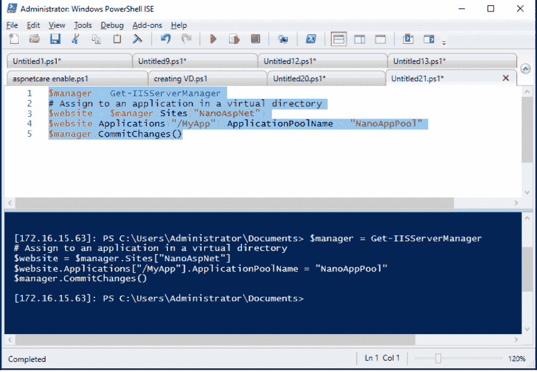

6. 让我们检查该命令是否成功。远程访问 Nano Server 的 \\172.16.15.63\c$\Windows\System32\inetsrv\config。在 config 文件夹中，你会找到 ApplicationHost.config 文件。打开 ApplicationHost.config 并搜索 MyApp 虚拟目录，如下所示：

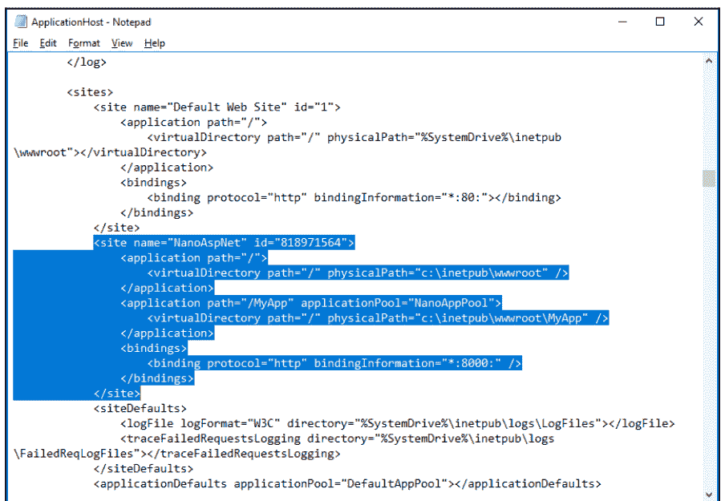

7. 在这里，你可以看到 NanoAspNet 网站，其中包含虚拟目录 MyApp 以及虚拟目录应用程序池 NanoAppPool。

8. 我们必须开放防火墙端口 8000（默认情况下，Nano Server 允许 IIS 端口 80 和 443）。输入命令 New-NetFirewallRule -DisplayName "Allow Inbound Port 8000" -Direction Inbound -LocalPort 8000 -Protocol TCP -Action Allow，如下所示：

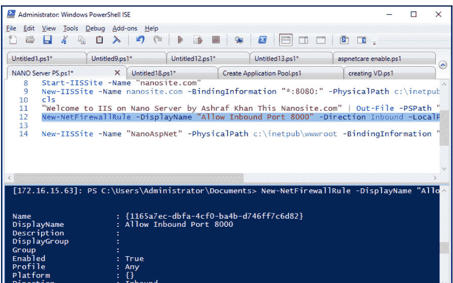

9. 正如你所看到的，防火墙已允许端口 8000，并且规则已创建完成。

#### 工作原理

在本节中，我们创建了应用程序池 NanoAppPool，并将该应用程序池分配给 MyApp。我们在 ApplicationHost.config 文件中检查了 MyApp 的应用程序池 NanoAppPool。我们还创建了一条防火墙规则，允许网站 NanoAspNet 的入站端口 8000。

### 在虚拟目录中上传并测试网页

在本节中，我们将远程登录 Nano Server。我们将使用 PowerShell 检查已创建的站点。我们将访问 Nano Server 的 C$ 共享以上传网页。我们将在端口 8000 上测试 NanoAspNet 网站，并同时测试 MyApp 虚拟目录。

#### 准备工作

要完成本节操作，你需要一台 Windows Server 2016 虚拟机或物理服务器，用于远程 PowerShell 管理以及在 Nano Server 2016 上配置虚拟目录。进行所有这些安装和配置工作时，你需要具有管理员权限。

#### 操作步骤

- 1. 登录 Windows Server 2016。IP 地址为 172.16.15.60，服务器名称为 WIN2016IIS。按 Windows + R 键，会弹出“运行”窗口。我们需要以管理员权限打开 PowerShell ISE。在“运行”窗口中输入 RunAs /user:Administrator PowerShell_ISE.exe，然后按“确定”。
- 2. 现在，它会要求你输入 Windows Server 2016（不是 Nano Server）计算机的管理员密码。输入密码并按 Enter 键。你将进入 PowerShell 窗口。
- 3. 现在，你需要使用 IP 172.16.15.63 远程连接到 Nano Server 2016。请在 PowerShell 中运行以下命令：
- ```
+ "Enter-PSSession -ComputerName "172.16.15.63" -Credential ~\Administrator"
+ ```
- 4. 现在，你会看到一个用于输入 Nano Server 管理员帐户密码的弹出窗口。输入密码并按“确定”登录。你将成功连接。


5. 现在在 PowerShell 中运行 Import-module iisAdministration 并按 Enter 键。这将导入 IISAdministration PowerShell 模块。

6. 在远程连接的 PowerShell 窗口中运行命令 Get-IISSite，如下所示：

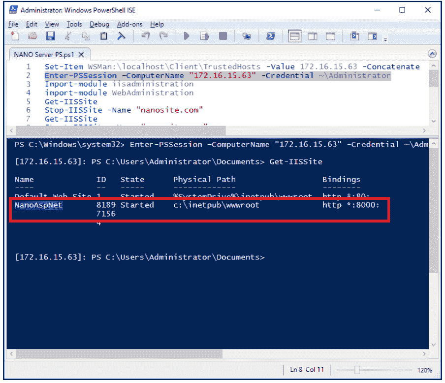

7. 在这里可以看到，我们获得了已在 Nano Server 中创建的网站列表。让我们上传已有的 HTML 网页。

8. 转到 Windows Server 2016，打开“运行”窗口，输入 Nano Server 的 UNC 路径：\\172.16.15.63\c$\inetpub\wwwroot，并单击“确定”。将出现 Nano Server 的用户名/密码窗口。输入用户名和密码，并单击“确定”。现在你将看到 Nano Server 的 wwwroot 文件夹，如下所示：

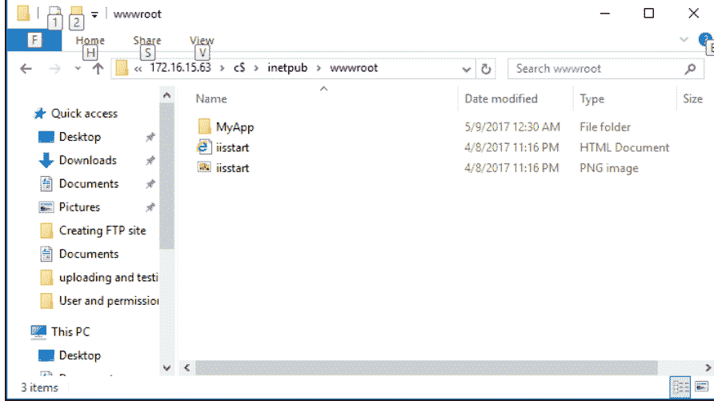

9. 在 wwwroot 文件夹中，我们有 MyApp 虚拟目录文件夹以及 IISstart.htm 和 iisstart.png 文件。iisstart 文件用于位于 http://172.16.15.63:8000 的 NanoAspNet。打开 MyApp 文件夹，如下所示：

### 在 Nano Server 上通过 IIS 启用 ASP.NET Core

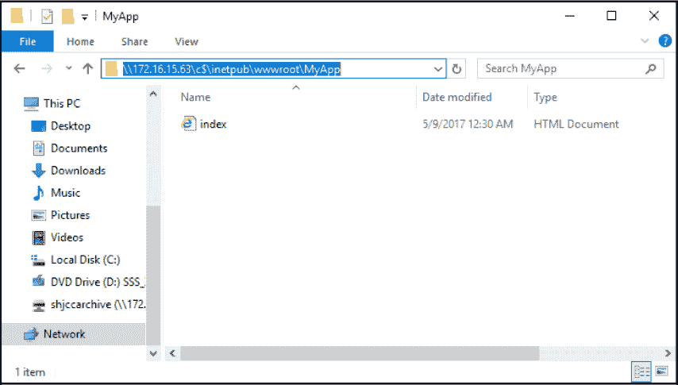

10. 在 MyApp 虚拟目录文件夹中可以看到一个名为 `index.htm` 的文件：

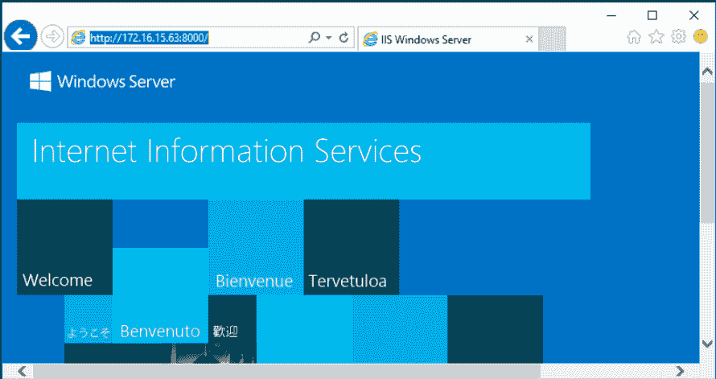

11. 让我们在 Nano Server 上打开虚拟目录并浏览到 http://172.16.15.63:8000/MyApp，如下所示：

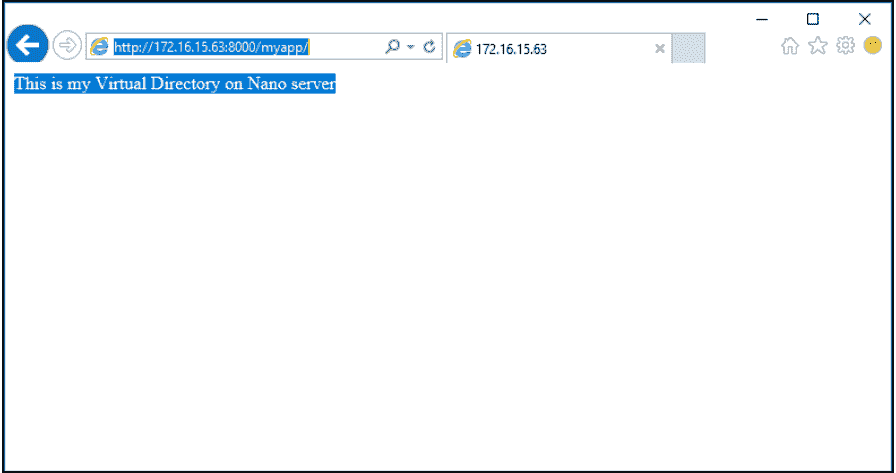

12. 可以看到我们可以访问虚拟目录的内容。

#### 工作原理...

在本操作指南中，我们使用 PowerShell 远程登录 Nano Server。我们使用 PowerShell 检查已创建的站点，并访问 Nano Server 的 C$ 共享以上传网页。我们在 8000 端口上测试了 NanoAspNet，并测试了 MyApp 虚拟目录。

## 
