## 将 IIS 10.0 扩展到 FTP

在本章中，我们将介绍以下教程：

- 了解 FTP
- 在 IIS 10.0 上安装 FTP
- 创建、保护和配置 FTP 站点
- 创建 FTP 用户并管理用户权限
- 测试我们的 FTP 服务器

### 简介

**文件传输协议（FTP）**用于通过网络和互联网在两台计算机之间传输文件。

FTP 是一种标准网络协议，用于在计算机网络中采用客户端-服务器模型将计算机文件从服务器传输到客户端。FTP 的默认网络端口号是 20 和 21。

FTPS，也称为 FTPES、FTP-SSL、S-FTP 和 FTP Secure，是常用 FTP 的扩展，增加了对**传输层安全性（TLS）**和**安全套接层（SSL）**加密协议的支持。

### 了解 FTP

在本教程中，我们将打开已安装在 Windows 10 PC 上的 FileZilla FTP 客户端软件。我们还将打开托管在远程服务器上的 FTP 站点。我们将了解如何上传和下载文件、文件夹、媒体文件和程序文件。

FileZilla 是一款可免费在线下载的第三方应用程序。有两种类型的 FileZilla 程序可用：FileZilla Client 和 FileZilla Server。

FileZilla 专为 FTP 服务器连接设计，用于文件下载和上传。

在本书中，示例使用 FileZilla Client 应用程序进行演示，该应用程序可在 https://filezilla-project.org/ 获取。

#### 准备工作

要完成本教程，你需要一个运行中的 FTP 站点。你还应该具有该 FTP 站点的管理权限、FileZilla FTP 客户端软件（或任何 FTP 客户端软件）以及互联网连接。

#### 操作步骤...

- 1. 我们已在 Windows 10 PC 上安装了 FileZilla FTP 客户端软件。在桌面上找到 FileZilla 客户端快捷方式并打开它：

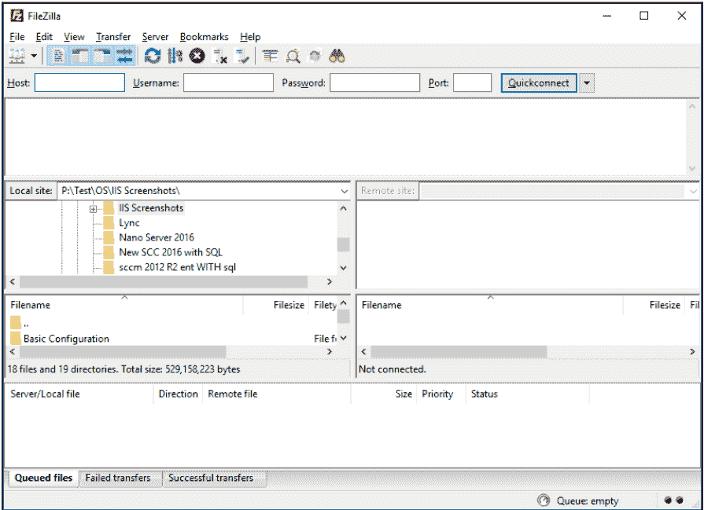

- 2. 你可以看到顶部有“快速连接”选项。你只需在“主机”字段中输入 FTP 服务器名称或 IP，并输入 FTP 用户名和密码。如果你的 FTP 服务器使用自定义端口，你可以在“端口”选项中设置它。让我们连接到一个远程 FTP 服务器。

- 3. 在客户端上转到“文件”菜单，单击“站点管理器”：

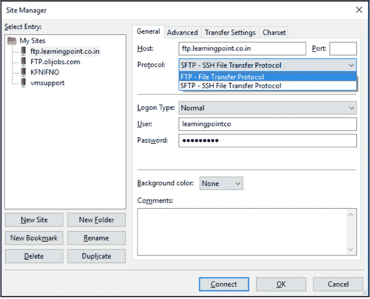

- 4. 如你所见，我们已经添加了几个站点。我们将选择 `ftp.learningpoint.co.in`，并将协议设置为 FTP 或 SFTP。然后，单击“连接”按钮。你将连接到远程 FTP 站点，如下所示：

### 在 IIS 10.0 上安装 FTP

在本教程中，我们将在 Windows Server 2016 上安装 FTP 服务器。我们将打开 IIS 管理器，检查 FTP 服务器是否已安装。

#### 准备工作

要完成本教程，你需要一个安装了 IIS 10.0 的正在运行的 Windows Server 2016 实例。你还应该具有管理权限。

#### 操作步骤...

- 1. 使用管理员账户登录 Windows Server 2016。
- 2. 单击“开始”菜单或搜索“服务器管理器”并打开它。
- 3. 你必须单击“添加角色和功能”链接，或者你也可以在顶部的“管理”菜单中找到相同的选项：

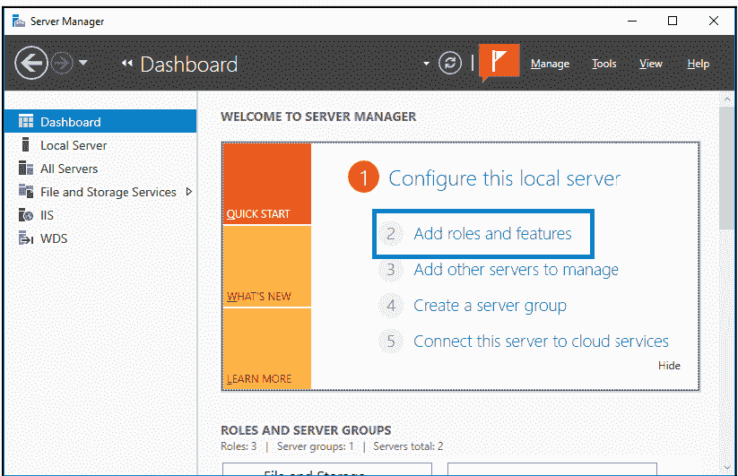

4. 打开 **Add Roles and Features** 窗口后，单击 **Next** 直到进入 Server Roles 窗口。

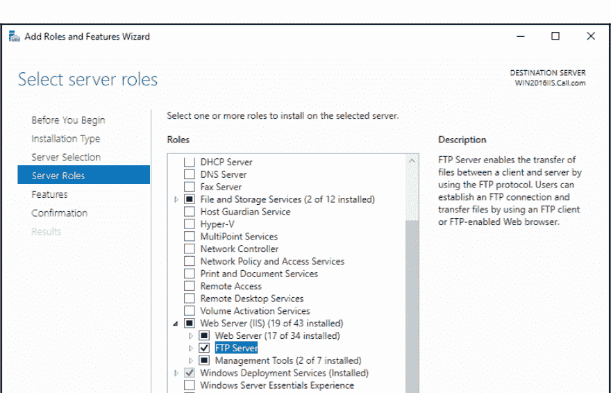

5. 选择 **FTP Server** 复选框，单击 **Next**，然后单击 **Install** 按钮。你将在 **WIN2016IIS** Windows Server 2016 服务器上安装 **FTP server**：

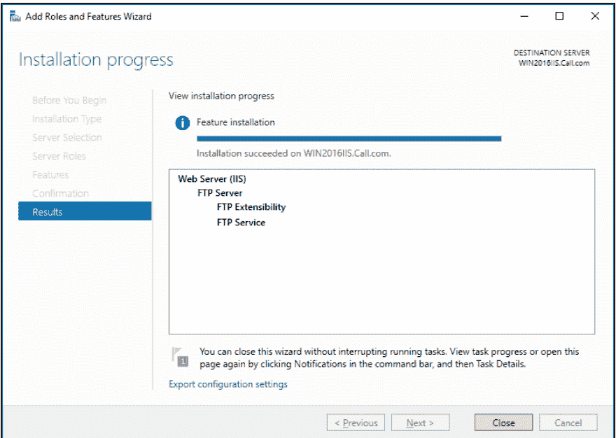

6. 单击 **Close** 按钮。现在我们需要检查 IIS 服务器上是否已安装 FTP 功能。
7. 在 Windows Server 2016 上打开 IIS Manager。单击 **WIN2016IIS** 服务器。你将看到功能视图。我们已成功安装 FTP 组件，如下所示：

### 创建、保护和配置 FTP 站点

在本教程中，我们将创建一个 FTP 站点并创建 FTP 站点绑定。我们将讨论如何设置 SFTP（安全 FTP）。我们还将了解如何向 FTP 站点添加 SSL 证书以使其安全，并创建具有匿名访问权限的基础 FTP 站点。我们将概述 FTP 站点的属性。

#### 准备工作

要逐步完成本教程，你需要一台运行 Windows Server 2016 且已安装 IIS 10.0 和 FTP 服务器的实例。你还应具有管理员权限。

#### 操作方法...

+   1. 使用管理员账户登录 Windows Server 2016。
+   2. 打开 Server Manager。
+   3. 你需要单击 Tools 并进入 IIS Manager。打开 IIS Manager，并右键单击 WIN2016IIS，如下所示：

## Internet Information Services (IIS) Manager

## WIN2016IIS Home

## Connections

Start Page
WIN2016IIS (CALL\Administra
Application Pools
Sites

+   - Refresh
+   - Remove Connection
+   - Add Website...
+   - Start
+   - Stop
+   - Add FTP Site...
+   - Rename
+   - Switch to Content View

## Actions

## Manage Server

+   - Restart
+   - Start
+   - Stop
+   - View Application Pools
+   - View Sites
+   - Change .NET Framework Version
+   - Get New Web Platform Components
+   - Help

File View Help

Filter Go Show All

.NET Error Pages
.NET Globalization
Connection Strings
Machine Key
Pages and Controls
Providers
Session State
SMTP E-mail

## FTP

FTP Authentic...
FTP Authorizat...
FTP Directory Browsing
FTP Firewall Support
FTP IP
FTP Logging
FTP Logon Attempt R...
FTP Messages

Features View Content View

Ready

### Extending IIS 10.0 to FTP

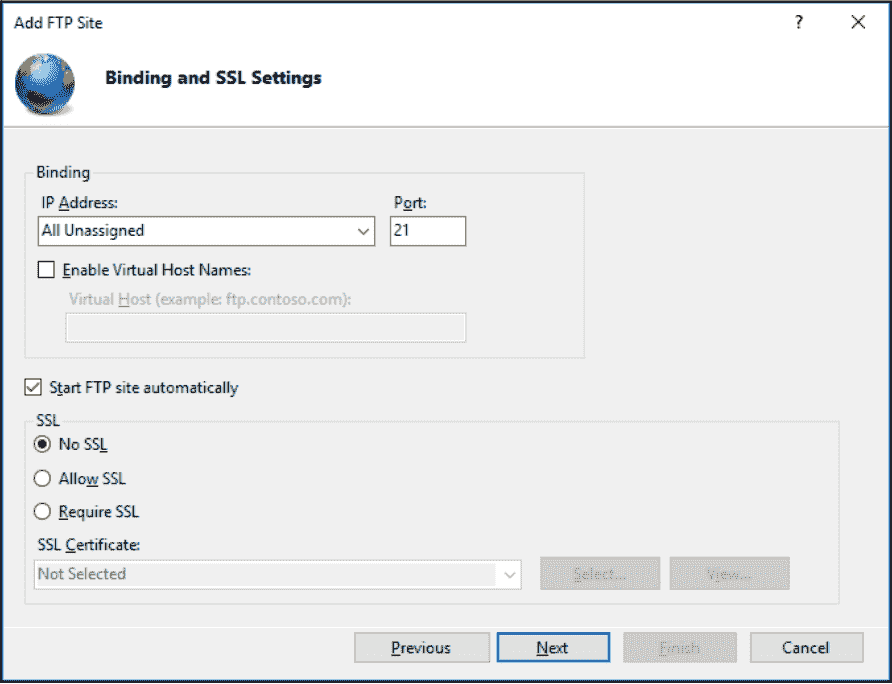

6. 在这里，你可以为 FTP 站点提供专用的 IP 地址。我们将其保持在默认的 **All Unassigned**，默认端口为 21（如果你需要，也可以为 FTP 站点创建自定义端口号，但你需要为自定义端口配置防火墙规则）。

10. 让我们进入 IIS Manager。展开 Sites 文件夹，你将看到已创建的 myftp 站点：

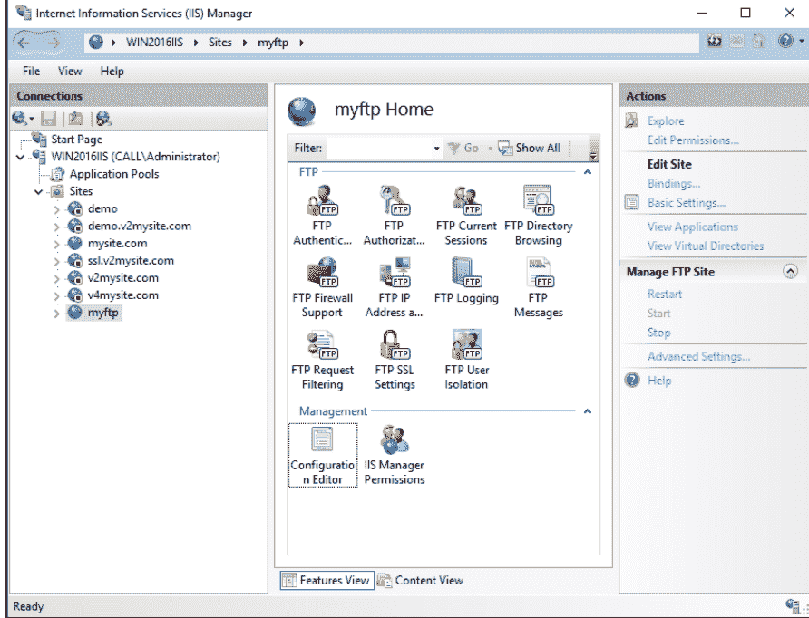

11. 进入 myftp 站点的 Actions 面板并单击 Bindings。你将获得绑定的窗口，如下所示：

### Extending IIS 10.0 to FTP

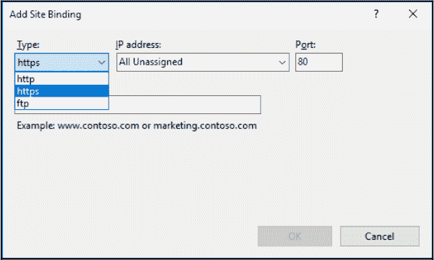

+   12. 在 **Add Site Binding** 窗口中单击 **Type:** 下拉菜单，你将看到我们有选项可选择 **http**、**https** 和 **ftp**。如果你已有现有站点，可以将站点绑定设置为 **ftp**。
+   
+   13. 基本属性与我们在前面章节中讨论的网站属性相同。单击 **Advanced Settings...** 选项，你将获得 **Advanced Settings...** 窗口，如下所示：

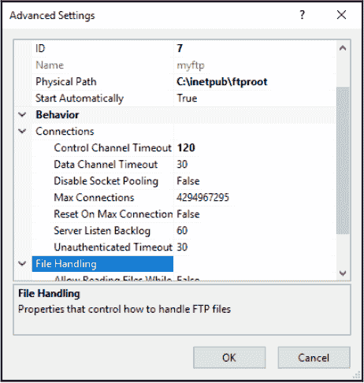

14. 你需要在此处设置连接属性。如果你愿意，可以创建更具体的连接，但我们保持默认。单击 OK 关闭 **myftp** 站点的 **Advanced Settings...** 窗口。

#### 工作原理...

在本教程中，我们创建了 FTP 站点 **myftp**。我们制作了 FTP 站点绑定并讨论了自定义绑定。我们讨论了如何设置 SFTP（安全 FTP）以及如何向 FTP 站点添加 SSL 证书以使其安全。我们创建了一个名为 **myftp** 的具有匿名访问权限的基础 FTP 站点。我们概述了 FTP 站点的属性。

### 创建 FTP 用户和管理用户权限

在本教程中，我们将为 Windows Server 2016 创建一个用于 FTP 访问的用户，并为该 FTP 用户授予 FTP 文件夹权限。我们还将配置 FTP 身份验证和 FTP 授权规则。我们将允许 Windows 用户访问 FTP 站点。

#### 准备工作

要逐步完成本教程，你需要一台运行 Windows Server 2016 且已安装 IIS 10.0 和 FTP 服务器的实例。你还应具有管理员权限。

#### 操作方法...

+   1. 使用管理员账户登录 Windows Server 2016。
+   2. 打开 Server Manager。
+   3. 单击 **Tools** 并打开 **Computer Management**。
+   4. 在 **WIN2016IIS** 的 **Computer Management** 窗口中，展开 **System tools**。展开 **Local Users and Groups**，如下所示：

6. 填写用户详细信息：User name、Full name、Description、user Password 和 Confirm password。你可以根据需要选择任意或全部复选框以设置这些选项。单击 Create，你将创建 ftpadmin 用户，如下所示：

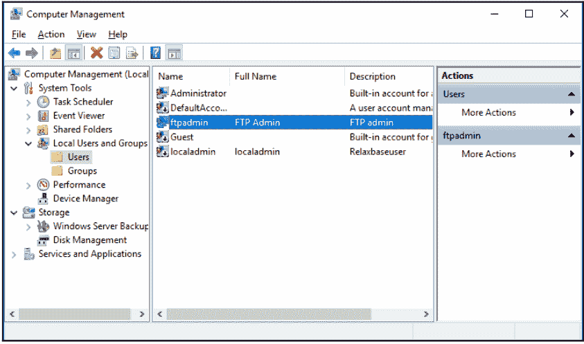

7. 现在让我们进入设置 FT PROOT 文件夹的用户权限。这是在文件夹上管理 NTFS 权限的最佳实践。

8. 进入 C:\inetpub，找到名为 ftproot 的文件夹。右键单击 ftproot 并打开其属性。在属性窗口中，进入 Security 选项卡并单击 Edit 按钮。安全窗口将打开。单击 Add 按钮。在 WIN2016IIS（本地计算机）中找到用户窗口并选择 ftpadmin 用户。按 OK，用户将列在安全窗口中，如下所示：

### Extending IIS 10.0 to FTP

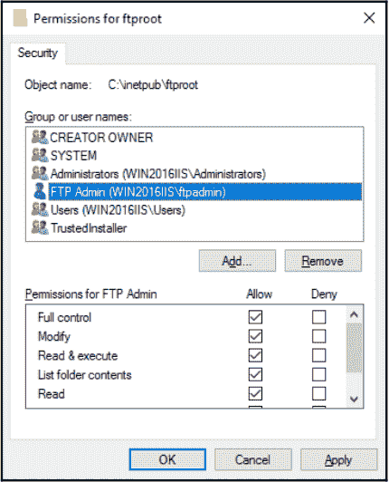

在这里，你也可以通过根据用户要求勾选框来限制或提供某些特权。FTP Admin 的权限如下 1. 完全控制 2. 修改 3. 读取和执行 4. 列出文件夹内容 5. 读取 6. 写入

+   9. 现在你可以设置权限。我们将允许所有权限。单击 **Apply** 和 **OK**。现在我们已完成 `ftproot` 文件夹权限的设置。让我们继续允许用户在我们的 FTP 站点上访问 FTP 文件夹。

10. 打开 IIS Manager，展开 **WIN2016IIS**，并展开 **Sites** 文件夹。单击 **myftp**，如下所示：

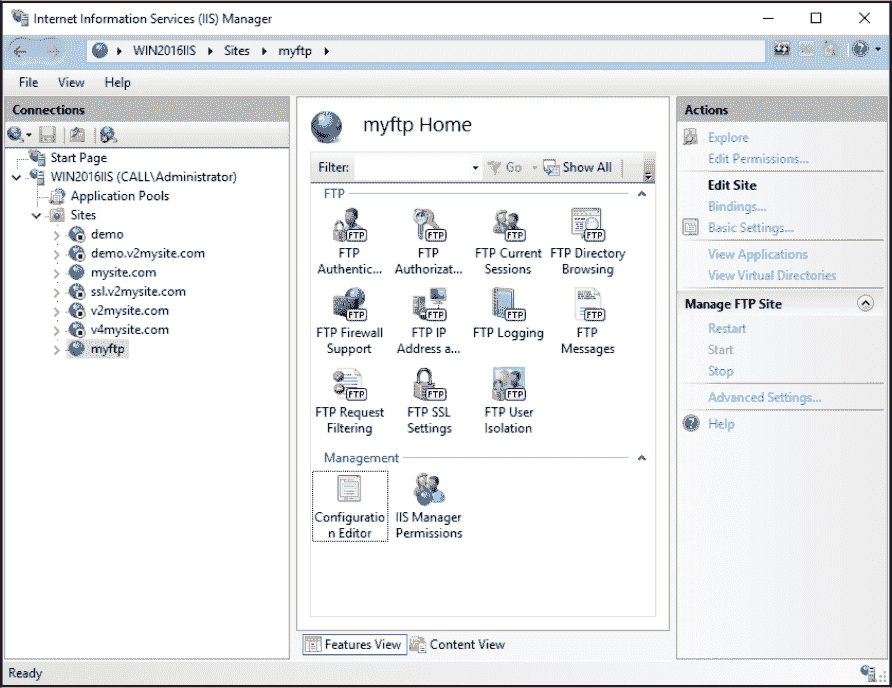

11. 进入 ftpsite **Features View**，打开 FTP authentication，禁用 **Anonymous Authentication**，并启用 **Basic Authentication**，如下所示：

12. 接下来，进入 ftpsite Features View，打开 FTP authorization rules，并添加新规则：

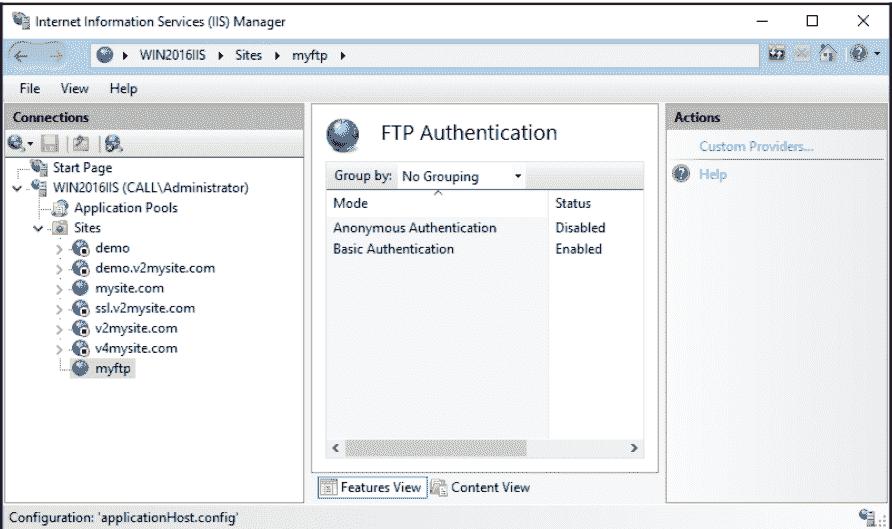

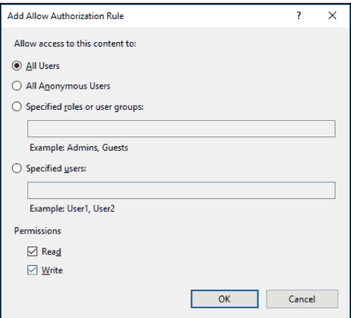

+   13. 选择 **All Users** 并提供 **Read** 和 **Write** 权限。单击 **OK**。检查 **FTP Authorization Rule**。如果有其他规则可用，你可以删除它们。我们将使用我们创建的规则。

+   14. 接下来，进入 ftpsite **Features View** 并打开 IIS Manager Permission。在这里，你可以允许用户访问 FTP 站点。从 **Actions** 面板单击 **Allow User...**。你将获得 **Allow User...** 窗口，如下所示：

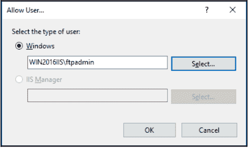

+   15. 我们从 **WIN2016IIS** 服务器选择了 `ftpadmin` 用户。单击 **OK** 按钮。

#### 工作原理...

在本教程中，我们在 WIN2016IIS 上创建了一个用于 FTP 访问的用户，并授予该 FTP 用户对 `ftproot` 文件夹的完全权限。我们配置了 FTP 身份验证和 FTP 授权规则以供所有用户使用。我们允许 Windows 用户从 IIS Manager Permission 访问 FTP 站点。

### 测试我们的 FTP 服务器

在本教程中，我们将使用 FileZilla 测试名为 `ftpsite` 的 FTP 站点。我们将在 FileZilla 中创建 FTP 站点并连接到 WIN2016IIS 上的 `ftpsite`。我们将上传一个示例文件并在 `ftproot` 文件夹中进行交叉检查。

3. 我们将 IIS 服务器 **WIN2016IIS** 的 IP 设置为 172.16.15.60，用户名为 `ftpadmin`，密码为我们为 **WIN2016IIS** 服务器设置的密码。点击 **连接** 按钮。你将连接到 `ftpsite`：

本例中的 IP 是 172.16.15.60，但在你的环境中可能有所不同。请查明你的 FTP 服务器的 IP 地址，以便配置 FileZilla FTP 客户端工具进行访问。获取 IP 的方法有很多种，其中一种方法是打开命令提示符并运行 `ipconfig`。你将看到列出的所有 IP，请选择 IPv4 地址。

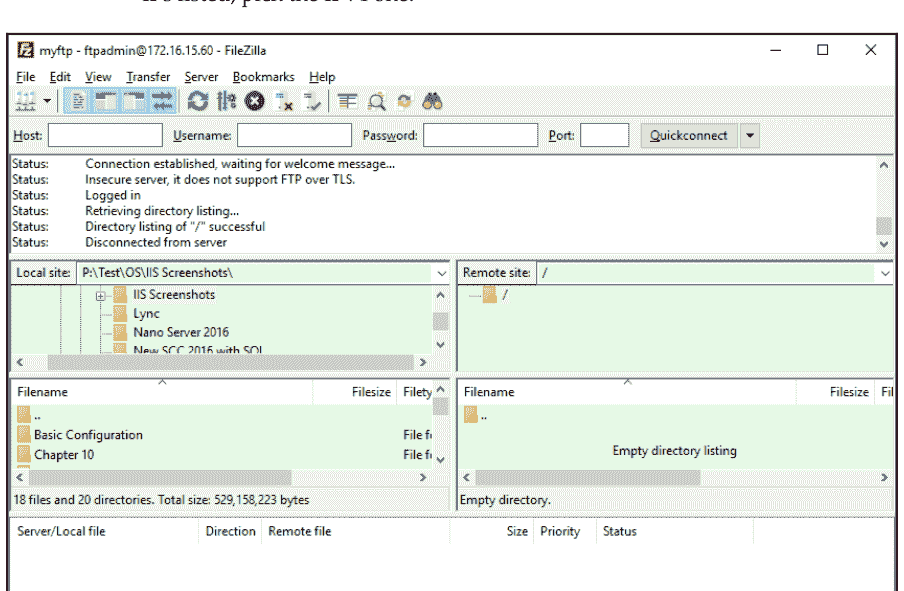

4. 你可以看到“远程站点”文件夹中没有任何内容。让我们上传 `chapter 7.rar` 文件。从本地站点中选择 `chapter 7.rar`，右键单击并选择上传。你将看到该文件已上传到远程站点：

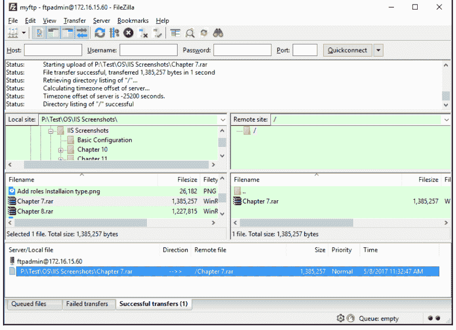

5. 从图中可以看到，远程站点中已有我们上传的 `chapter 7.rar` 文件。让我们检查一下 FTP 根文件夹。

6. 在 **WIN2016IIS** 服务器上转到 `C:\inetpub\ftproot`：

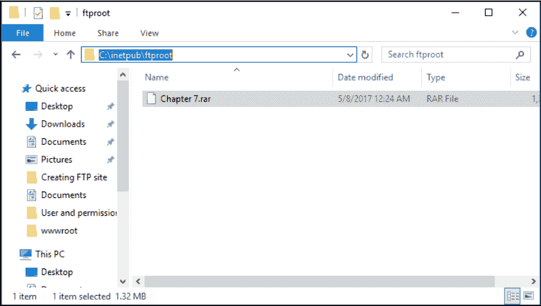

7. 从图中可以看到，`ftproot` 目录中已有该文件。

**工作原理...**

在本节中，我们使用 FileZilla FTP 客户端软件创建并测试了 FTP 站点 `ftpsite`。我们使用 FileZilla 创建并连接到了该 FTP 站点。我们还上传了 `chapter 7.rar`，并检查了它是否存在于 `ftproot` 文件夹中。
