## 13. 管理和故障排除 IIS 10.0

在本章中，我们将涵盖以下教程：

- 管理 IIS 10.0
- 安装健康、诊断和性能功能
- 配置健康和诊断
- 配置失败请求跟踪规则
- 配置静态内容压缩

### 简介

健康和诊断提供了一种基础设施，用于监控、管理和排查 Web 服务器、站点和应用程序的健康状况。

其优势在于详细的跟踪事件，可在完整的请求和响应过程中跟踪请求。为了启用这些跟踪事件的收集，IIS 服务器可以配置为基于经过的时间或错误响应代码，自动捕获特定请求的完整跟踪日志，格式为 XML。

#### 如何操作...

1. 使用管理员账户登录到 Windows Server 2016。
2. 打开 **Server Manager**。
3. 点击 **Tools**，你会找到 IIS Manager。打开 IIS Manager 并点击 IIS 服务器 **WIN2016IIS**。转到 **Features View**，如下所示：

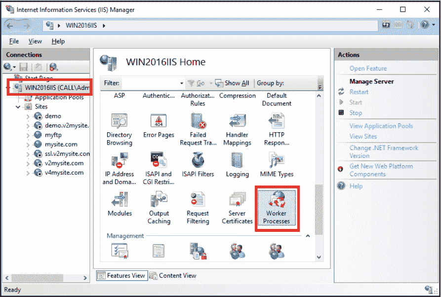

4. 你可以在图中看到，我们选择了 **Worker Processes**。**Worker Processes** 仅在 IIS 服务器的 **Features View** 中可用，而不在网站的 **Features View** 中。**Worker Processes** 使你能够查看应用程序进程对服务器资源的利用情况。

5. 接下来，我们需要展开 Sites 文件夹并点击 mysite.com，如下所示：

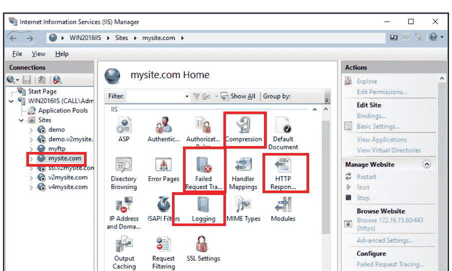

6. 如你所见，我们正在选择 Compression、HTTP Responder、Failed Request Tracer 和 Logging。这些是 IIS 服务器的健康和性能功能。在下一个教程中，我们将继续安装健康、诊断和性能功能。

#### 如何运作...

在本教程中，我们登录到 IIS 服务器并打开 IIS Manager。我们浏览了 IIS 服务器的功能视图以查看健康和诊断功能，并检查 `mysite.com` 功能视图中的可用健康和诊断选项。

### 安装健康、诊断和性能功能

在本教程中，我们将登录到 Windows Server 2016，在该服务器上我们已经安装了 IIS 10.0。我们将打开 Server Manager 并安装 IIS 10.0 服务器的健康和诊断功能。然后我们将安装 IIS 10.0 服务器的性能功能。

#### 准备工作

对于本教程，我们需要一台正在运行的 Windows Server 2016 上的 IIS 10.0 实例。你应该拥有管理员权限。

#### 如何操作...

1. 使用管理员账户登录到 Windows Server 2016。
2. 打开 Server Manager。

4. 在添加角色和功能窗口中，点击 Next 直到到达服务器角色向导。展开 Web Server，如下所示：

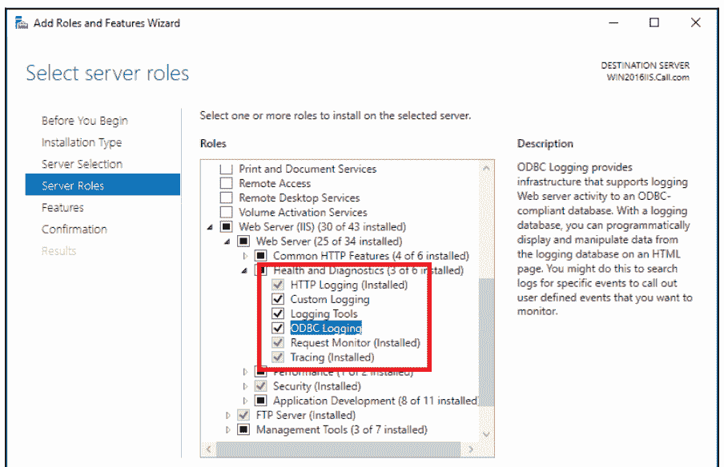

5. 选择 Custom Logging、Logging Tools、ODBC Logging；预安装的选项为 Request Monitor、Tracing 和 HTTP logging。

6. 从服务器角色中展开 Performance features 选项以在 IIS 上安装它们，你可以在此图中看到详细信息：

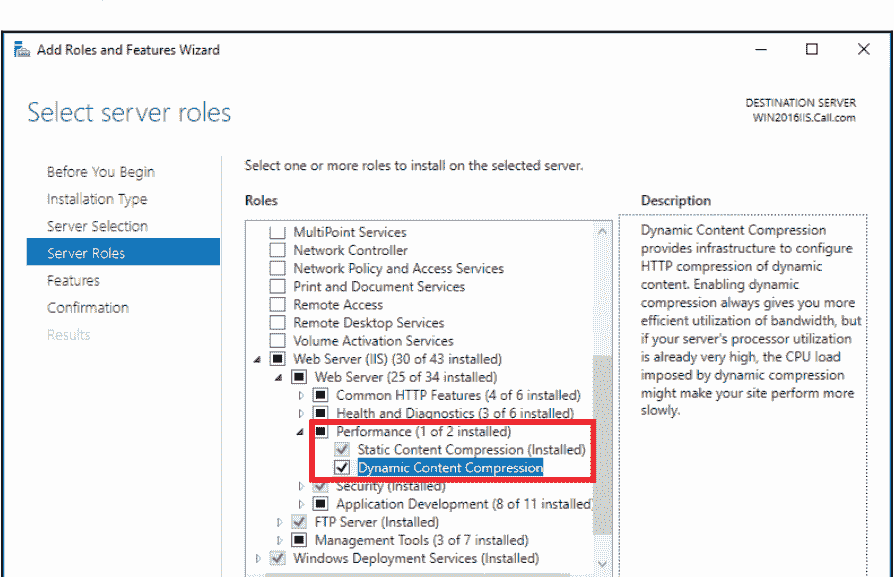

7. 我们已经安装了 Static Content Compression。现在选择 Dynamic Content Compression。

8. 点击 **Next**，跳过功能向导，再次点击 **Next**。你将看到 **Confirmation** 窗口，如下所示：

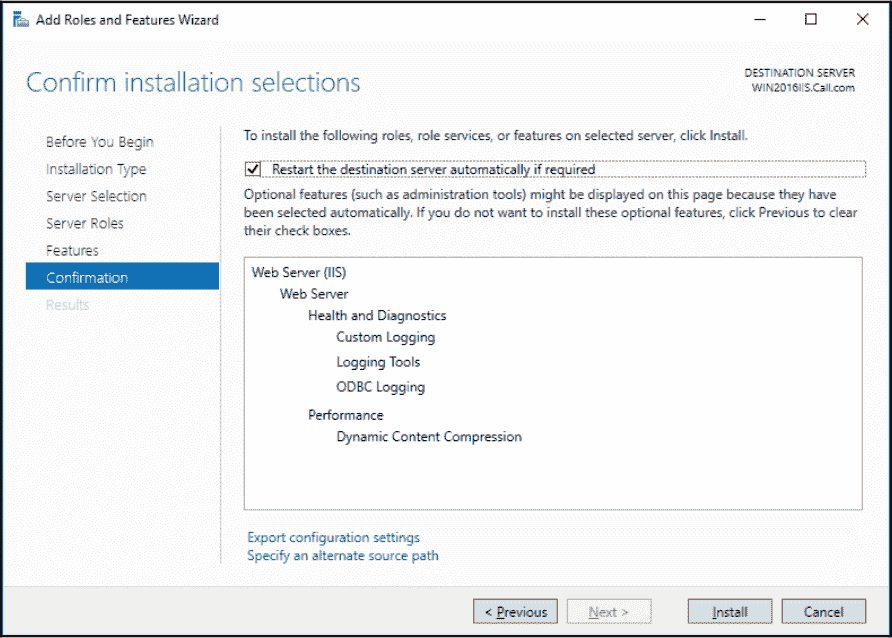

9. 你可以看到我们已选择 **Health and Diagnostics** 和 **Performance** 功能，即将安装。我还勾选了顶部的重启复选框。接下来，你需要点击 **Install**。你可以在下一张图中看到它已成功安装：

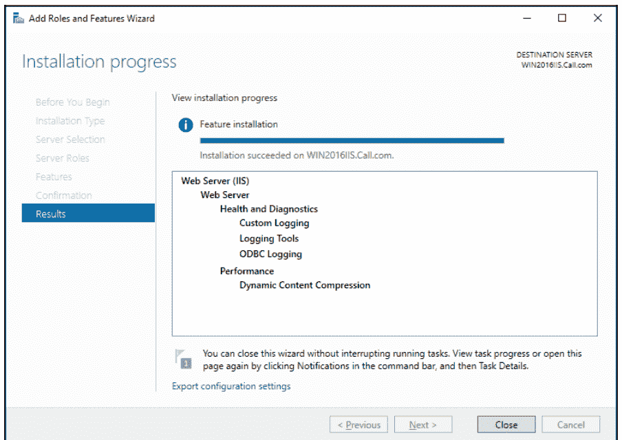

10. 我们现在已完成安装。在下一个教程中，我们将设置配置。

3. 在 Server Manager 中点击 Tools 菜单，你会找到 IIS Manager。打开 IIS Manager 并点击名为 WIN2016IIS 的 IIS 服务器。转到 Features View，并选择 Worker Processes，如下所示：

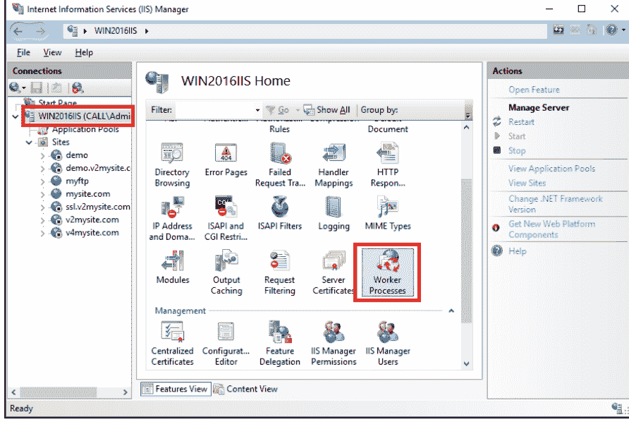

4. 转到 **Actions**，并点击 **Open Feature**。这将打开 **Worker Processes**，如下所示：

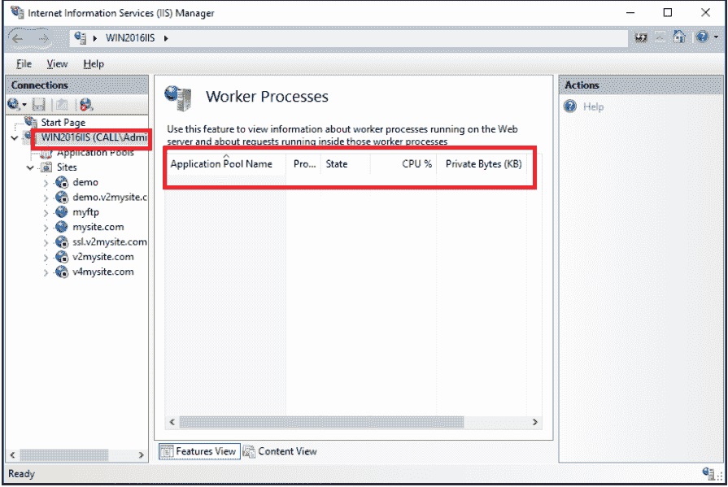

5. 你会在图中看到我们目前在 worker processes 中没有任何应用程序池，因为我们现在没有使用任何应用程序池。如果你的 Web 服务器托管了一个网站应用程序，这里你会找到应用程序池的服务器利用详情。你可以在 IIS 服务器中管理应用程序池负载。

6. 让我们转到 Logging。展开 WIN2016IIS，展开 Sites，点击 mysite.com，转到 Features View，并点击 Logging，如下所示：

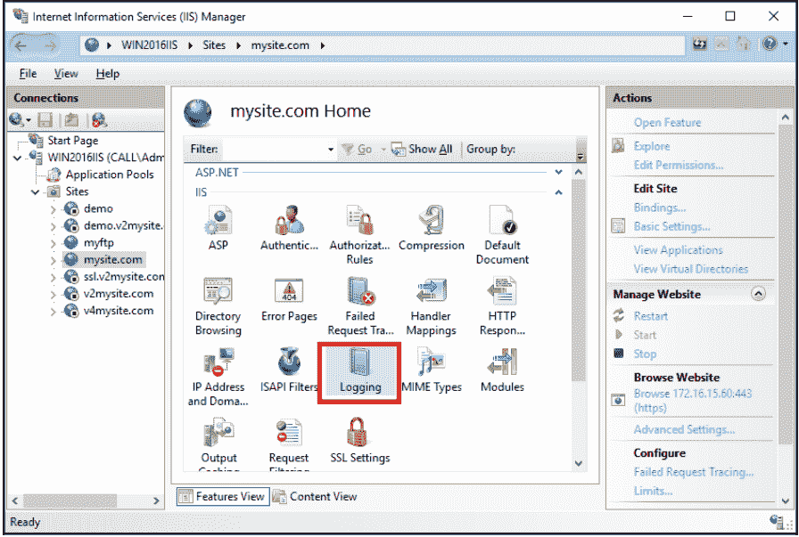

8. 你可以在图中看到 **Log File | Format**，我们已将其选择为默认的 W3C。现在你需要点击 **Select Fields...** 按钮。你将看到 **W3C Logging Fields**，如下所示：

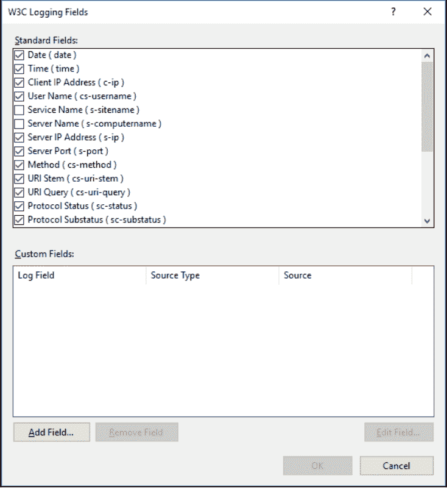

9. 在此 **W3C Logging Fields** 窗口中，你可以根据需要选择复选框以生成日志文件。点击 **Cancel** 按钮。我们将使用默认值。
10. 点击 mysite.com，转到 **Features View**，并点击 **HTTP Response Header**，如下所示：

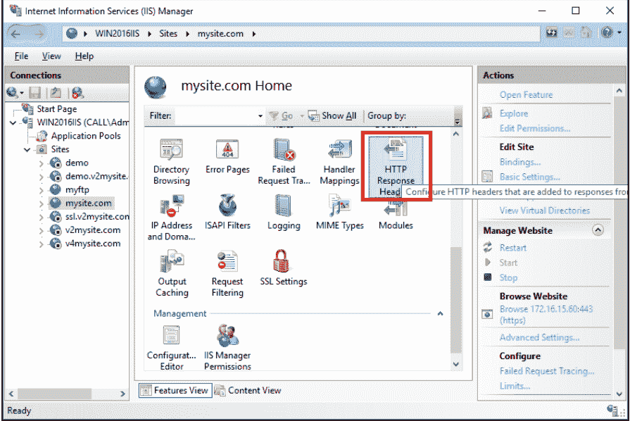

#### 如何运作...

在本教程中，我们登录到 IIS 服务器并打开 IIS Manager。我们打开了 IIS 服务器的功能视图以配置 worker-process 功能。我们还配置了日志功能并讨论了 HTTP Response Header 功能。

### 配置失败请求跟踪规则

在本教程中，我们将登录到 IIS 服务器并打开 IIS Manager。我们将打开 mysite.com 的 Features View 以添加失败请求跟踪规则。我们将查看如何编辑它们。我们还将查看失败请求跟踪规则日志文件目录并启用规则。

#### 准备工作

在本教程中，我们需要一个正在运行的 IIS 10.0 实例。失败请求跟踪规则组件应已安装。你应该拥有管理员权限。

#### 如何操作...

1. 使用管理员账户登录到 Windows Server 2016。
2. 打开 Server Manager。

3. 点击 **Tools**，你会找到 IIS Manager。打开 IIS Manager，并展开 IIS 服务器 **WIN2016IIS**。展开 Sites 文件夹，点击 mysite.com，转到 **mysite.com** 的 **Features View**，并选择 **Failed Request Tracing Rules**，如下所示：

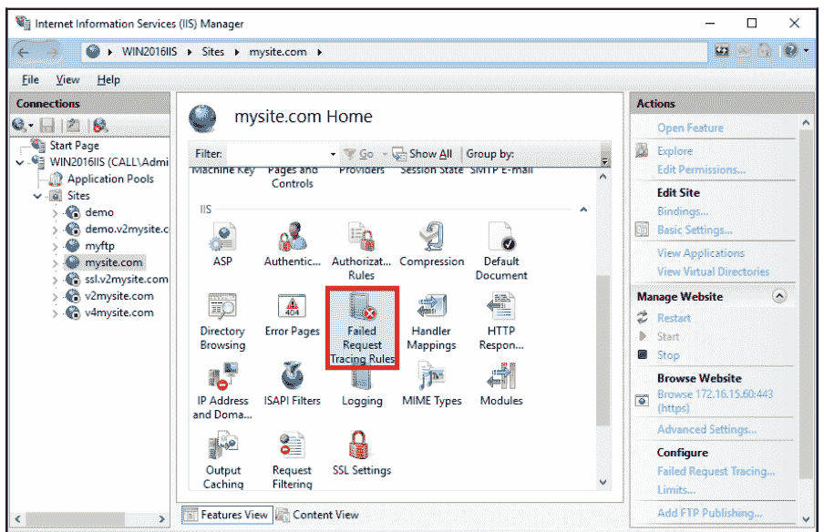

4. 打开 **Failed Request Tracing Rules** 选项，如下所示：

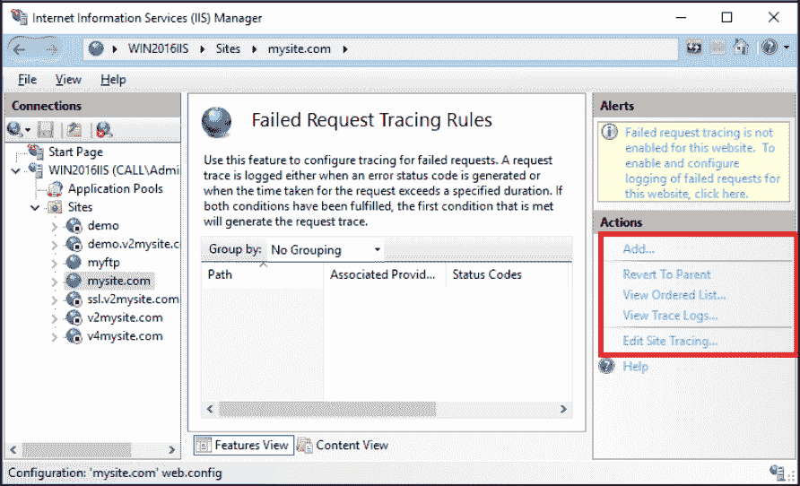

5. 你可以看到我们已选择 **Actions** 侧边栏。我们有一系列可用选项。我们将添加 **Failed Request Tracing Rules**。点击 **Actions** 侧边栏中的 **Add** 选项：

### 添加失败请求跟踪规则

#### 指定要跟踪的内容

你想跟踪什么？

- 所有内容 (*)
- ASP.NET (*.aspx)
- ASP (*.asp)
- 自定义：

示例：tr*.aspx

上一步   下一步   完成   取消

6. 选择 **All content (*)** 单选按钮。你还有其他选择；**ASP.NET** 或 **ASP** 以及自定义。点击 **Next**：

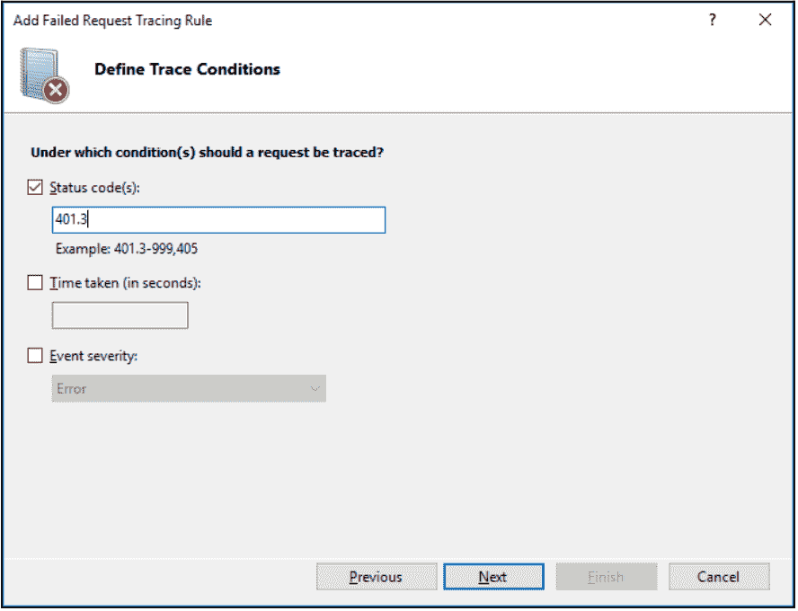

7. 现在我们已经定义了跟踪条件，可以选择任意“失败请求跟踪”代码。我们来添加 401.3 并点击“下一步”：

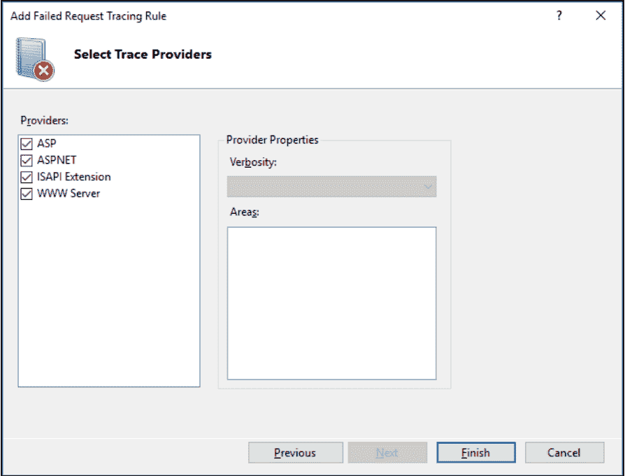

8. 在“跟踪提供程序”窗口中，选择其中任意一个或全部。这里我们选择全部。点击“完成”，规则就创建完成了，如下图所示：

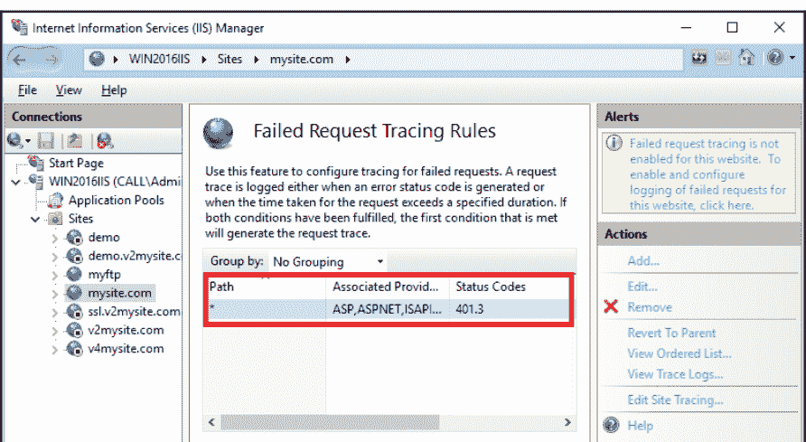

9. 一旦创建了“失败请求跟踪规则”，你就可以编辑它。只需按照“失败请求跟踪规则”的“操作”窗格中的编辑选项操作即可。

10. 让我们为 mysite.com 启用刚刚创建的“失败请求跟踪规则”。点击“操作”窗格中的“编辑站点跟踪...”选项，就会出现 mysite.com 的“启用失败请求跟踪规则”窗口，如下图所示：

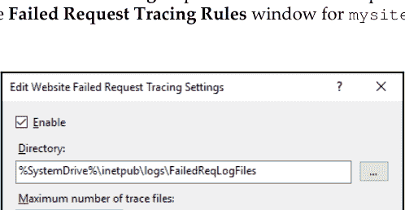

11. 点击顶部的**启用**。从屏幕截图中可以看到，我们拥有失败请求跟踪日志的**目录**路径，跟踪文件的最大数量为 50。点击**确定**。现在，你的**失败请求跟踪规则**已为**mysite.com**启用。

12. 让我们检查日志文件目录。转到**失败请求跟踪规则**的**操作**窗格，然后点击**查看跟踪日志...**。你将获得**失败请求跟踪规则**的日志文件目录，如下图所示：

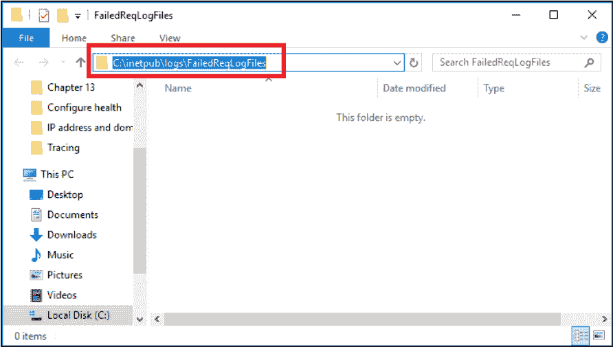

13. 目前，我们没有任何日志文件，但如果我们的网站有失败的操作，日志文件将自动生成。

#### 工作原理...

在本节中，我们登录 IIS 服务器并打开 IIS 管理器。我们通过 `mysite.com` 的**功能视图**添加**失败请求跟踪规则**。我们看到了如何编辑**失败请求跟踪规则**，并检查了**失败请求跟踪规则**的日志文件目录。然后我们启用了失败请求跟踪规则。

### 配置静态内容压缩

在本节中，我们将登录 IIS 服务器。在 IIS 管理器中，我们将打开 IIS 服务器 WIN2016IIS 的**功能视图**来配置内容压缩。我们将打开 `mysite.com` 的功能视图，以启用或禁用静态和动态内容压缩。

#### 准备工作

在本节中，我们需要一个正在运行的 IIS 10.0 实例。应安装“压缩”组件。你需要具有管理员权限。

#### 操作步骤

1. 使用管理员账户登录 Windows Server 2016。
2. 打开服务器管理器。

4. 现在打开**压缩**文件，你将看到**压缩**的配置选项，如下图所示：

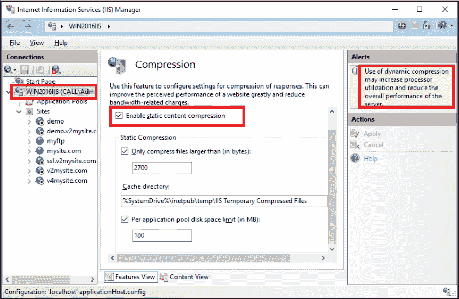

5. 如图所示，我们有一些默认设置。这些设置适用于 IIS 服务器。设置完成后，你必须启用要应用压缩的网站。你会看到我们已经启用了静态内容压缩，它会压缩大于 2700（字节）的文件。缓存目录位置是临时文件可以被压缩或解压缩的地方。每个应用程序池的磁盘空间限制为 100 MB。

6. 你可以在图中看到我高亮了“警报”部分。如果使用动态压缩，它将消耗更多服务器资源，这可能会降低服务器速度。

7. 让我们看看如何在网站上启用和禁用压缩。

8. 展开 IIS 服务器**WIN2016IIS**，展开“站点”文件夹，点击**mysite.com**，转到**mysite.com 的功能视图**，然后选择**压缩**，如下图所示：

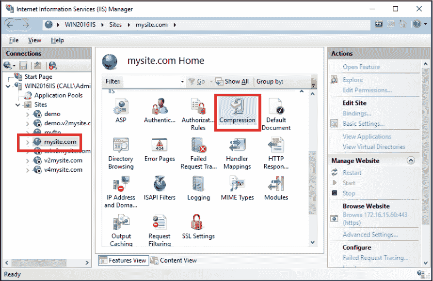

9. 打开**压缩**选项，你将看到启用和禁用窗口，如下图所示：

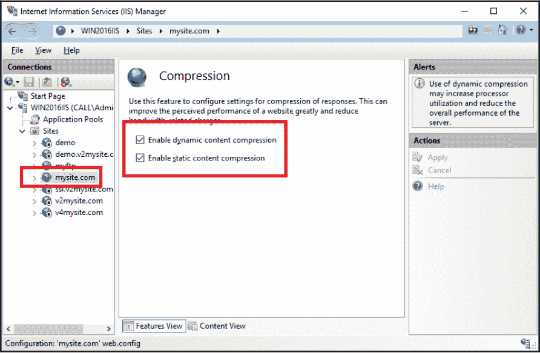

10. 我们勾选了“启用”复选框，因此压缩已启用。如果我们取消勾选**动态内容压缩**或静态内容压缩复选框，当你点击**压缩操作**窗格中的**应用**按钮时，它们将被禁用。

IIS 例程可显著将你的 Web 应用程序的 IIS 服务器性能提升到一个新水平。

1. 通过高级属性进行应用程序池挂起。
2. 如果应用程序支持，使你的页面异步。
3. 不要写入 wwwroot。
4. 删除未使用的视图引擎和语言。
5. 管道模式。
6. 删除未使用的模块。
7. runAllManagedModulesForAllRequests。
8. 内核模式缓存。
9. 从 Glabal.asax 中移除方法。
10. 不要使用 SqlDataSource。
11. 使用 HTTP Keep Alive。
12. 删除 ETag。通常，人们忽略这些提示，但它们具有巨大的性能提升潜力，可以快速应用于 IIS 服务器，以促进健康前景。

#### 工作原理...

在本节中，我们登录 IIS 服务器并打开 IIS 管理器。我们打开了 IIS 服务器 WIN2016IIS 的功能视图来配置内容压缩。我们打开了 mysite.com 的功能视图，以启用和禁用静态和动态内容压缩。
