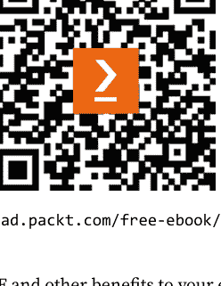

# 贡献者

# 关于作者

**Greg Deckler** 是七次获得 Microsoft Data Platform 方向的 MVP（微软最有价值专家）。他是一位活跃的博主和 Power BI 社区成员，为社区问题撰写了超过 7,000 个解决方案。Greg 撰写过多本关于 Power BI 的书籍，包括 *Learn Power BI First and Second Editions*、*DAX Cookbook*、*Power BI Cookbook Second Edition* 和 *Mastering Power BI Second Edition*。Greg 还为 Power BI 创建了几个外部工具，并定期向其 YouTube 频道 *Microsoft Hates Greg* 和 *DAX For Humans* 发布视频内容。

*我要感谢精彩的 Power BI 社区，它每天都在激励和教育我。同时，我也要感谢我优秀的儿子 Rocket，他在我所有的创意努力中给予我动力和支持。*

**Brett Powell** 是 Microsoft 商业智能顾问和作者。Brett 拥有超过 15 年的商业智能经验，跨越多个行业，担任过开发人员、架构师和管理员。虽然他最为人所知的是撰写了 *Microsoft Power BI Cookbook* 和 *Mastering Microsoft Power BI* 以及他的 *Insights Quest* 博客，但 Brett 主要致力于通过 Frontline Analytics LLC（一家 Microsoft BI 咨询公司和合作伙伴）为客户成功交付项目。

*我将所有的荣耀和赞美归于我的主和救主耶稣基督。*

# 关于审校者

**Erin Ostrowsky** 是一位数字游民，无论走到哪里，她都努力建立健康、快乐的人际关系。她对 STEAM 充满热情——别忘了艺术，朋友们！——并希望激励他人加入这个世界所需的有趣问题解决行列。Erin 热爱学习、创造、结交朋友、旅行，以及书写生活中的种种奇闻趣事。她目前专注于运营 Fit 4 Duty Data，这是一家数据与报告咨询和培训机构，服务于全球采矿和能源行业。

> 我要感谢我的造物主、我的朋友和我的家人——你们让生活变得美好，尤其是在艰难时期。

**Andrei Khaidarov** 是数据管理、数据分析、机器学习和信息技术领域的资深专家。他拥有博士学位，其学位论文专注于数学模型相关研究。

在他的职业生涯中，Andrei 对学术界和工业界都做出了重要贡献。他撰写和合著了超过 70 篇科学论文、专利、书籍、软件包和教育指南。他的专业经验包括在多个组织中担任高级职务和领导职务，并成功推动了众多创新项目。

Andrei 自 2023 年起成为 Microsoft 最有价值专家（MVP），因其对技术社区的贡献而获得赞誉。他拥有多项 Microsoft 和 Google 技术认证，包括 Microsoft Fabric、Power BI、Power Apps、Azure 和 Google Analytics，并持有许多其他专业认证。他还是 Microsoft 认证培训师，与下一代专业人士分享他的广博知识。

除了技术专长外，Andrei 还深入参与导师计划和社区活动。他指导了众多本科生和研究生，组织了会议，并担任国际竞赛和拨款基金的评审团成员和专家。

Andrei 以审校者身份参与过多本技术书籍，提供详细的反馈和技术见解，以确保最高质量的内容。他的专业知识涵盖数据管理、数据可视化、机器学习、AI 等，使他成为任何技术工作中的宝贵资产。

> 我要向我的妻子 Vlada Poliachkova 和我的父母致以最深切的感谢，感谢他们在本书审校过程中给予我坚定不移的支持和鼓励。他们的耐心、理解和爱在帮助我投入必要的时间和精力来完成这个项目方面起到了重要作用。感谢你们永远是我的力量支柱。

# 加入我们的 Discord 社区

加入我们社区的 Discord 空间，与作者和其他读者讨论：

https://discord.gg/ebXZqyrxJb


第2章，*访问、检索和转换数据*，深入探讨了Power BI Desktop的获取数据体验，并逐步讲解建立和管理数据源连接与查询的过程，包括如何转换和清理数据。

第3章，*构建Power BI语义模型*，探讨了设计和开发健壮语义（数据）模型的主要流程，包括创建关系、配置元数据、利用聚合表等。

第4章，*编写Power BI报表*，阐述并描述了最基本的报表可视化和设计概念。此外，还提供了在Power BI服务以及移动设备上使用和交互Power BI报表时增强和控制用户体验的指导。

第5章，*使用Power BI服务*，涵盖用于对关键度量和高影响业务活动进行简单、一目了然的监控而构建的Power BI仪表板。此外，本章还涵盖警报、订阅、流式处理、数据流和计分卡。

第6章，*认真对待日期智能*，包含准备数据模型以支持强大日期智能的操作指南，以及编写自定义日期智能度量的操作指南。

第7章，*参数化Power BI解决方案*，涵盖Power BI中的标准参数化功能和技术，以及更高级的自定义实现。

第8章，*在Power BI中实现动态的基于用户的可见性*，包含为导入和DirectQuery模型构建和部署动态的基于用户的安全性的详细示例，以及开发动态筛选上下文功能以改善用户体验。

第9章，*应用高级分析和自定义视觉对象*，包含广泛的操作指南，重点介绍Power BI最新、最受欢迎的自定义可视化效果和高级分析功能。

第10章，*增强和优化现有Power BI解决方案*，包含顶级数据建模、DAX度量公式和M查询模式，以增强Power BI数据集的性能、可扩展性和可靠性。

第11章，*部署和分发Power BI内容*，包含通过Power BI服务以及Microsoft Teams等替代渠道部署和分发Power BI内容的详细示例和注意事项。

第12章，*将Power BI与其他应用程序集成*，重点介绍Power BI与SSRS、Excel、PowerPoint、Power Apps、Power Automate和Dynamics 365之间的强大集成。

第13章，*使用Premium和Microsoft Fabric*，涵盖Power BI Premium和Microsoft Fabric租户可用的工作负载，如数据仓库、数据工程和数据科学。

第14章，*管理和治理Power BI*，重点介绍最常见且最有影响力的管理和治理主题与决策，包括管理门户、租户设置、使用情况分析，以及管理自定义视觉对象和数据网关安装。本章可在 https://packt.link/RMiGj 在线访问。

## 充分利用本书

- 建议具备一定的Power BI基础知识。
- 需要Power BI Desktop和Power BI服务账户（两者均免费）。
- 需要SQL Server（任何版本，包括免费的Express和Developer版），并安装AdventureWorksDW2022数据库。该数据库可免费下载，安装说明见本书第一章。
- 某些操作指南需要额外的Microsoft许可证，如Excel、Teams、PowerPoint、OneDrive、Power Automate、Power Apps和Dynamics 365。
- 针对Microsoft Fabric的操作指南需要Fabric容量（试用或生产）。

## 下载示例代码文件

本书的代码包托管在GitHub上，地址为 https://github.com/PacktPublishing/Power-BI-Cookbook-Third-Edition。我们丰富的图书和视频目录中还有其他代码包，可在 https://github.com/PacktPublishing/ 获取。快去看看吧！

## 下载彩色图片

我们还提供了一份PDF文件，包含本书使用的截图/图表的彩色图片。您可以在此下载：https://packt.link/gbp/9781835464274。

## 使用约定

本书通篇使用了多种文本约定。

CodeInText：表示文本中的代码词、数据库表名、文件夹名、文件名、文件扩展名、路径名、虚拟URL、用户输入和Twitter账号。例如：“完成这些步骤后，报表都会与数据集CH5_R1_SalesAndFinanceDataset建立实时连接。”

代码块如下所示：

```
let
    Source = AdWorksDW,
    Data = Source{[Schema="dbo",Item="vCH3R2_Products"]}[Data]
in
    Data
```

当我们需要您注意代码块的某一部分时，相关行或项会以粗体显示：

```
Products Rows (Sales) = CALCULATE(COUNTROWS('Products'),'Internet Sales')
```

粗体：表示新术语、重要词，或者您在屏幕上看到的词语，例如菜单或对话框中的文字，也会以这种形式在文中出现。例如：“管理角色”对话框包含设置“优先级”的功能。


## 分享您的想法

阅读完*《Microsoft Power BI Cookbook（第三版）》*后，我们非常期待听到您的想法！请点击此处直接前往本书的亚马逊评论页面并分享您的反馈。

您的评论对我们以及技术社区都非常重要，并将帮助我们确保持续提供高质量的内容。

## 下载本书的免费 PDF 副本

感谢您购买本书！

您喜欢随时随地阅读，但无法将纸质书带在身边吗？

您购买的电子书与您所选择的设备不兼容吗？

不用担心，现在购买任何 Packt 图书，您都可以免费获得该书的无 DRM PDF 版本。

随时随地、使用任何设备阅读。您还可以直接将喜爱的技术书籍中的代码搜索、复制并粘贴到您的应用程序中。

福利不止于此，您还可以获得专属折扣、新闻简报以及每日发送到收件箱中的精彩免费内容。

请按照以下简单步骤获取这些福利：

1. 扫描二维码或访问下面的链接：

   

   https://download.packt.com/free-ebook/9781835464274

2. 提交您的购买凭证。

3. 就这么简单！我们会将免费的 PDF 及其他福利直接发送到您的电子邮箱。
