# 1 安装和许可 Power BI 工具

Microsoft Power BI 是一套商业分析工具和服务，它们协同工作，用于访问数据源、整理、分析和可视化数据，以及共享洞察。虽然并非每个 Power BI 项目或部署都需要所有工具，但通过将多个工具的不同功能和使用场景作为集成解决方案的一部分加以利用，可以实现协同效应，涵盖多种数据源、丰富的数据分析方式和可视化类型。

本章将介绍**商业智能（BI）**专业人员用于设计和开发 Power BI 内容的主要工具和服务的安装与配置过程。其中包括 Power BI Desktop、Power BI Report Builder、SQL Server、本地数据网关等 Microsoft 官方工具，以及 DAX Studio、ALM Toolkit 和 Tabular Editor 等多种第三方工具。

本章包含以下操作方法：

- 安装和配置 Power BI Desktop
- 安装 SQL Server 和 AdventureWorks 数据库
- 安装和使用 Power BI Report Builder
- 创建本地数据网关
- 安装其他工具
- 考虑许可问题

### 技术要求

假设读者拥有 Power BI Pro 或**每用户高级版（PPU）**许可证，具备在其计算机上下载和安装开发工具的权限，并且拥有在 Power BI 服务中部署和管理内容以及使用 Power BI 移动应用的必要访问权限。此外，要完成本章中的操作方法，还需要满足以下要求：

- 运行 Windows 10 或 Windows 11 的 Windows PC
- 至少 10 GB 可用磁盘空间；Power BI Desktop 下载文件最大约为 600 MB，安装后的应用程序超过 1.5 GB

此外，Microsoft 本地数据网关还需要满足以下要求：

- Microsoft 帐户
- .NET Framework 4.7.2（2020 年 12 月或更早发布的网关版本）
- .NET Framework 4.8（2021 年 2 月或之后发布的网关版本）
- 64 位版本的 Windows 10 或更高版本，或者 64 位版本的 Windows Server 2012 R2 或更高版本
- 用于性能监视日志的 4 GB 磁盘空间（默认配置下）

### 安装和配置 Power BI Desktop

Power BI Desktop 是用于开发可视化和分析内容的主要工具，这些内容随后会部署到 Power BI 服务中并在那里进行协作，也可以嵌入其他应用程序和门户，甚至共享到公共互联网。虽然 Power BI Desktop 作为单个应用程序运行，但它包含三个紧密集成、各自具有选项和设置的组件：

- Power Query 和 Power Query 编辑器体验，包括其底层的 M 语言和数据混搭引擎
- Analysis Services 表格数据建模引擎及其 DAX 分析语言
- 交互式报表和可视化引擎

除了高级分析和自定义功能（例如 R、Python、移动布局和自然语言查询）之外，对这些功能进行配置和利用，还可以构建强大而优雅的 BI 和分析解决方案。

### 准备工作

大多数组织都会限制员工在企业设备上安装 Power BI Desktop 等软件的能力。这些组织通常会制定策略和流程，将特定版本的 Power BI Desktop 推送到所有用户设备或特定用户组，从而避免兼容性问题，并确保用户能够使用最新功能。

### 如何安装和配置 Power BI Desktop

Power BI Desktop 应用程序实际上有以下三个不同版本：

- Power BI Desktop（Microsoft Store 应用）
- Power BI Desktop（Microsoft Installer）
- Power BI Desktop RS（Report Server 版本）

首选的安装方式是使用 Microsoft Store 应用。要从 Microsoft Store 安装 Power BI Desktop，请按照以下步骤操作：

1. 打开 Microsoft Store 应用并搜索 Power BI Desktop。或者，您可以在任意浏览器地址栏中输入 https://aka.ms/pbidesktop，Microsoft Store 应用将自动打开 Power BI Desktop 应用页面，如图 1.1 所示。

   请务必确认您获取的是 Power BI Desktop 应用，而不仅仅是 Power BI 应用。Power BI 应用仅用于查看已发布到 Power BI 服务的报表。

   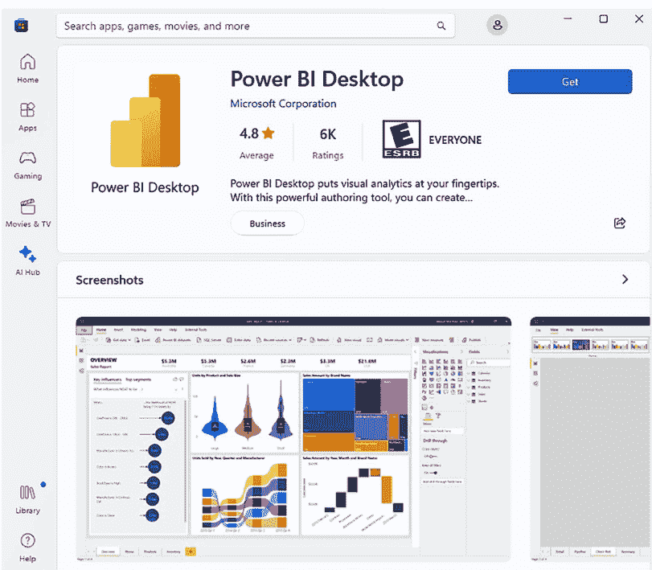

   *图 1.1：Microsoft Store 中的 Power BI Desktop 应用*

2. 单击“获取”按钮。

3. 下载和安装完成后，单击“打开”按钮。

Power BI Desktop 现已安装完成，您可以开始使用这一强大的 BI 工具。

### 工作原理

Power BI Desktop 为当前打开的文件以及指定设备上的所有 Power BI Desktop 实例提供了丰富的配置选项。这些选项用于控制预览功能和最终用户功能的可用性，并定义默认行为、资源使用情况、安全性以及数据源的隐私性和隔离性。

无论安装的是哪个版本的 Power BI Desktop，都可以通过功能区中的“文件”菜单访问这些选项：选择“选项和设置”，然后选择“选项”，如图 1.2 所示。

*图 1.2：Power BI Desktop 的“选项和设置”*

选择“选项”后，会弹出“选项”窗口，如图 1.3 所示。

*图 1.3：Power BI Desktop 的“选项”（2021 年 2 月）*

**全局**选项会应用于用户创建或访问的所有 Power BI Desktop 文件，而**当前文件**选项则必须针对每个 Power BI Desktop 文件进行定义。对于**全局**选项，建议执行以下步骤：

1. 在**数据加载**选项卡中，在**数据缓存管理选项**下，确认当前使用的数据缓存低于**允许的最大值（MB）**设置。如果接近限制且本地磁盘空间充足，请增加**允许的最大值（MB）**。除非本地磁盘空间不足，否则不要清除缓存，因为这会导致执行额外的、通常没有必要的查询。

   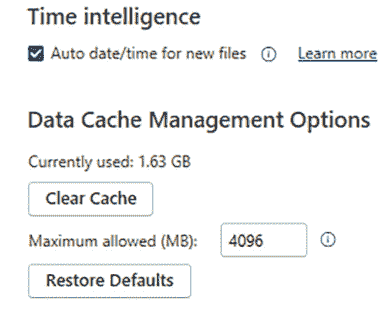

   *图 1.4：全局数据加载选项*

   此外，在图 1.4 所示的**时间智能**标题下，可以考虑关闭**新文件的自动日期/时间**。虽然为日期列提供开箱即用的日历层次结构功能可能很方便，但这也会显著增加数据模型的大小，因此强烈建议使用通用日期维度表，最好来自企业数据仓库。最后，在**类型检测**标题下，建议选择**从非结构化源中永不检测列类型和标题**选项。对文本文件或 Excel 文件等非结构化源默认检测列类型，会对源文件中的列名产生硬编码依赖。此外，此默认转换会在任何筛选表达式之前应用，因此可能需要更多时间和资源来执行刷新。

2. 在**Power Query 编辑器**选项卡的**布局**标题下，确保**显示查询设置窗格**和**显示公式栏**均已勾选，如图 1.5 所示。

   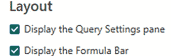

   *图 1.5：Power Query 编辑器布局设置*


5. 如果需要排查 Power BI Desktop 的特定问题，请使用*图 1.8* 所示的**“诊断”**选项卡来提供版本信息和诊断选项。**“诊断选项”**标题下的**“启用跟踪”**选项会将详细的跟踪事件数据写入本地硬盘，因此仅在复杂的故障排除场景下才应激活该选项。

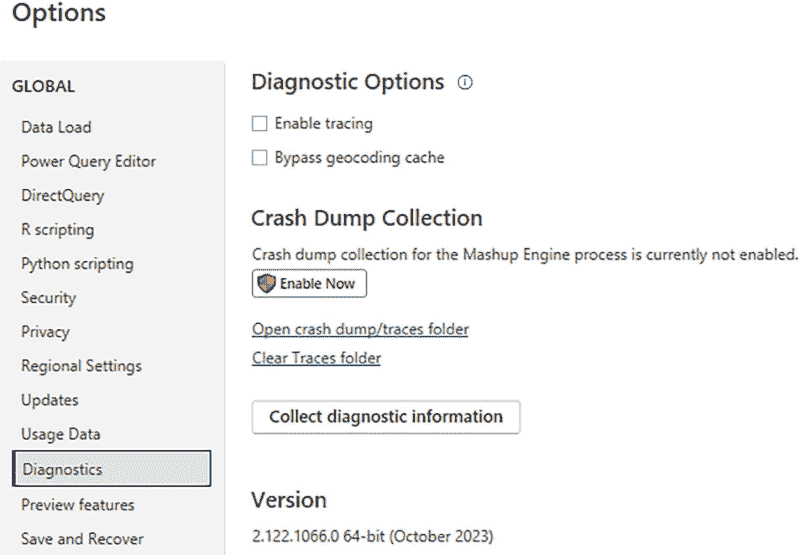

*图 1.8：Power BI Desktop 中的诊断选项*

6. 使用**“预览功能”**选项卡启用预览功能以进行评估。**“预览功能”**下的选项会随新版本而变化，因为某些以前的选项已正式推出，同时引入了新的预览功能。Power BI Desktop 每月更新视频和博客文章（请参阅 https://powerbi.microsoft.com/en-us/blog/）提供了这些新功能的详细信息和示例。更改预览功能后，需要重启 Power BI Desktop 应用程序。

### 预览功能

以下功能可在本版本中试用。预览功能可能会在将来的版本中更改或移除。

- ☑ 形状地图视觉对象 了解更多
- ☐ Q&A 的西班牙语支持 了解更多
- ☑ 实时连接的 Analysis Services 数据库的 Q&A 了解更多
- ☐ 连接到与我共享的外部数据集 了解更多 | 分享反馈
- ☑ 现代视觉对象工具提示 了解更多 | 分享反馈
- ☑ 迷你图 了解更多
- ☑ 指标视觉对象 了解更多
- ☑ 快速度量建议 了解更多 | 分享反馈
- ☑ 字段参数 了解更多
- ☑ 增强的行级安全性编辑器 了解更多
- ☐ 对象交互 了解更多 | 分享反馈
- ☑ Desktop 中的 Power BI 主页 了解更多 | 分享反馈
- ☑ 在导出的 PDF 上启用敏感度标签设置 了解更多
- ☑ 度量的动态格式字符串 了解更多
- ☑ 保存到 OneDrive 和 SharePoint 了解更多
  - ☑ 共享到 OneDrive 和 SharePoint 了解更多
- ☑ Power BI 项目 (.pbip) 保存选项 了解更多
- ☑ 新卡片视觉对象 了解更多
- ☑ 模型资源管理器和计算组创作 了解更多

*图 1.9：Power BI Desktop 2023 年 10 月版本提供的预览功能*

7. 在**“当前文件”**下的**“数据加载”**选项卡中，更有经验的用户应禁用**“类型检测”**和**“关系”**标题下的所有选项；这些模型设计决策应由了解源数据的 Power BI 开发者显式实现。

另外，请注意，如果你未在**“全局”**级别禁用**“自动日期/时间”**选项，则可以在单个文件的基础上在此处禁用它。

### 选项

- 全局
  - 数据加载
  - Power Query 编辑器
  - DirectQuery
  - R 脚本
  - Python 脚本
  - 安全
  - 隐私
  - 区域设置
  - 更新
  - 使用情况数据
  - 诊断
  - 预览功能
  - 保存和恢复
  - 报表设置
- 当前文件
  - 数据加载

### 类型检测

- 检测非结构化源的列类型和标题

### 关系

- 首次加载时从数据源导入关系
- 刷新数据时更新或删除关系
- 数据加载后自动检测新关系

了解更多

### 时间智能

- 自动日期/时间

了解更多

### 后台数据

- 允许在后台下载数据预览

### 表的并行加载

- 最大并发作业数

了解更多  
默认

*图 1.10：当前文件数据加载选项*

### 还有更多…

在 Power BI 服务中，有一些用于开发和编辑 Power BI 报表、模型和源查询的选项。但是，这些 Web 服务体验通常只提供专用客户端应用程序功能的一小部分子集。此外，在 Power BI Desktop 和其他客户端工具中创建的文件可以使用版本控制系统进行存储和管理。因此，目前建议将 Web 服务开发限制为仅针对那些没有专用客户端应用的项目（例如数据流）。

由于多种原因，可能无法安装和使用 Microsoft Store 应用版本的 Power BI Desktop。这可能是因为运行的是较旧版本的 Windows、公司策略、希望使用 32 位版本的 Power BI Desktop（Microsoft Store 应用仅支持 64 位），或者你可能正在使用本地部署版本的 Power BI 报表服务器。在这些情况下，你可以下载可执行安装程序（.EXE 文件）。要安装 EXE 版本，请按照以下步骤操作：

1. 可执行安装程序版本的 Power BI Desktop 可以从 Power BI 下载页面下载：https://powerbi.microsoft.com/downloads。

### Microsoft Power BI Desktop

使用 Power BI Desktop，你可以通过自由格式的拖放画布、广泛的现代数据可视化效果和易于使用的报表创作体验来直观地浏览数据。


**下载**  
**高级下载选项**

*图 1.11：使用高级下载选项下载可执行安装程序版本*

2. 在**“Microsoft Power BI Desktop”**下，选择**“高级下载选项”**。

3. 选择你的语言首选项，然后单击**“下载”**按钮。

4. 选择 64 位版本（`PBIDesktopSetup_x64.exe`）或 32 位版本（`PBIDesktopSetup.exe`），然后单击**“下一步”**按钮。

5. 文件下载完成后，单击**“打开文件”**。

6. Microsoft Power BI Desktop 安装向导将启动。选择一种语言，然后单击**“下一步”**按钮。如果系统提示你是否允许此应用更改你的设备，请单击**“是”**按钮。

7. 完成安装向导的其余步骤，包括接受许可条款和目标文件夹，并每次单击**“下一步”**按钮。

8. 在最终屏幕上，单击**“安装”**按钮。

9. 安装完成后，单击**“完成”**按钮。

如果你使用的是本地部署版本的 Power BI 报表服务器，则需要下载专为报表服务器优化的相应版本 Power BI Desktop（RS 版本）。Power BI 报表服务器的更新按季度发布，同时会发布一个专门针对每个季度版本优化的 Power BI Desktop 特定版本。安装过程与可执行安装程序（EXE）版本相同。但是，要查找 RS 版本的下载，请按照以下步骤操作：

1. 使用浏览器导航到 `https://powerbi.microsoft.com/report-server/`。

2. 使用**“下载免费试用版”**按钮正下方的**“高级下载选项”**链接。

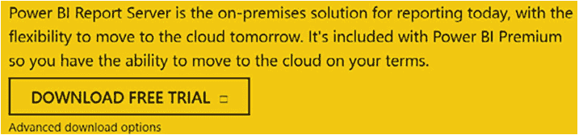

*图 1.12：使用高级下载选项下载 RS 版本*

之后，说明与刚才介绍的可执行安装程序版本相同。从第 3 步开始按照安装步骤操作。

### 另请参阅

有关本操作指南所涵盖主题的更多信息，请参阅以下链接：

- Power BI 安全白皮书：http://bit.ly/22NHzRS
- 数据源隐私级别：http://bit.ly/2nC0Lmx
- Power BI 自动日期/时间：http://bit.ly/3bH59cn
- 更改 Power BI 报表的设置：http://bit.ly/2OP8m0F

## 安装 SQL Server 和 AdventureWorks 数据库

Microsoft SQL Server 是一种流行的关系数据库管理系统（RDBMS）。诸如 SQL Server 之类的数据库软件产品的主要功能是按照其他软件应用程序的请求存储和检索数据，这些应用程序可能在同一台计算机上运行，也可能在网络中的另一台计算机上运行。

SQL Server 经常充当 Power BI 报表的数据源。此外，本书中的一些操作指南和示例都围绕着访问托管在 SQL Server 上的 Microsoft AdventureWorks 示例数据库展开。本操作指南将帮助你创建此环境，以便你能够完成这些操作指南。

### 准备工作

要为本操作指南做准备，请从以下链接下载 SQL Server 开发者版：https://www.microsoft.com/en-us/sql-server/sql-server-downloads。下载的文件应命名为 SQL2022-SSEI-Dev.exe。

此外，请下载用于查看和配置 Microsoft SQL Server 的 SQL Server Management Studio。请从以下链接下载 SSMS-Setup-ENU.exe 文件：https://aka.ms/ssmsfullsetup。

### 如何安装 SQL Server

首先，我们将安装 SQL Server 开发者版，然后安装 SQL Server Management Studio。

### 安装 SQL Server 开发者版

要安装 SQL Server，请使用以下步骤：

1. 运行 SQL2022-SSEI-Dev.exe 文件。

2. 如果系统提示用户账户控制，请选择“是”。

3. 在安装启动页上，选择“基本”。

4. 按“接受”按钮以同意条款和条件。

5. 单击“安装”按钮，或单击“浏览”按钮选择其他文件夹，然后单击“安装”。默认安装位置为 C:\Program Files\Microsoft SQL Server。


6. 安装完成后，您将看到与图 1.13 类似的屏幕：

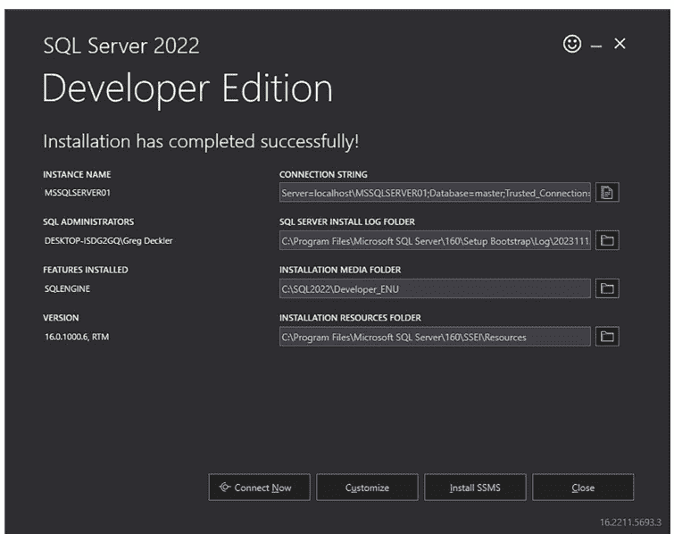

图 1.13：SQL Server 成功安装

7. 单击关闭按钮。

## 安装 SQL Server Management Studio

- 1. 运行 SSMS-Setup-ENU.exe 文件。
- 2. 在安装启动屏幕上，单击安装按钮。
- 3. 如果收到用户账户控制提示，请选择是。
- 4. 如果安装失败，请重新启动计算机，然后再次运行 SSMS-Setup-ENU.exe 文件。
- 5. 安装完成后，单击重启按钮以重新启动计算机并完成安装。

Microsoft SQL Server 以及 SQL Server Management Studio 现已安装完成并可供使用。

## 如何安装 AdventureWorks 数据库

AdventureWorks 数据库是由 Microsoft 提供的一个示例数据库，常用于演示和学习目的。该数据库旨在展示 Microsoft SQL Server 的功能和特性。AdventureWorks 数据库已随着不同版本的 SQL Server 而演进，截至本书出版时最新版本为 2022。

该数据库代表了一个名为 AdventureWorks Cycles 的虚构公司，这是一家生产和销售自行车及相关产品的制造公司。AdventureWorks 数据库包含各种表，用于模拟公司运营的不同方面，例如客户、销售、产品、员工等。

AdventureWorks 数据库的每个版本都包含三种不同的备份（.bak）文件：

- - **联机事务处理（OLTP）**：完整数据集
- - **数据仓库（DW）**：用于报告目的的数据集汇总版本
- - **精简版（LT）**：OLTP 数据集的精简版本

就我们的目的而言，我们将使用 AdventureWorks 数据库的数据仓库（DW）版本。

要安装和配置 AdventureWorks DW 数据库，请按照以下步骤操作：

- 1. 使用以下链接从 GitHub 下载备份（.bak）文件：https://bit.ly/3QTnCXI。下载的文件名为 AdventureWorksDW2022.bak。
- 2. 打开 Windows 文件资源管理器，将 AdventureWorksDW2022.bak 文件从下载目录移动到 C:\Program Files\Microsoft SQL Server\MSSQL16.MSSQLSERVER\MSSQL\Backup 目录。
- 3. 如果尚未打开，请打开 SQL Server Management Studio 并连接到本地 SQL Server 实例，如本食谱的“工作原理”部分所述。
- 4. 在对象资源管理器中展开 SQL Server 实例，然后右键单击数据库并选择还原数据库...
- 5. 在常规页面上，选择设备，然后选择省略号（...）。在选择备份设备窗口中，单击添加按钮。选择 AdventureWorksDW2022.bak 文件并单击确定按钮。单击选择备份设备窗口中的确定按钮，最后单击常规页面上的确定按钮。请使用图 1.14 作为按顺序执行这些步骤的指导。

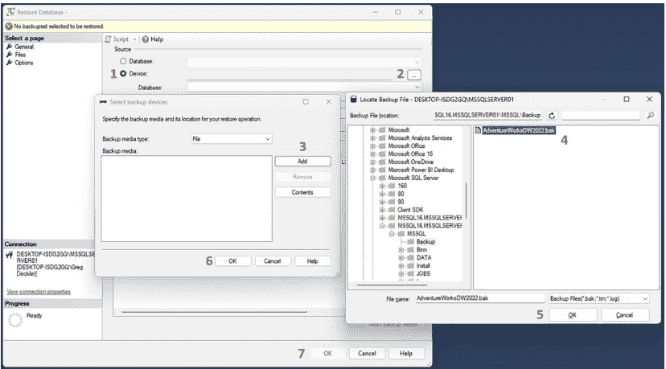

图 1.14：还原 AdventureWorksDW2022 备份文件

在 **连接到服务器** 窗口中，确保 **服务器类型** 选择为 **数据库引擎**，**服务器名称** 显示为本地计算机的名称，并且 **身份验证** 设置为 **Windows 身份验证**。单击 **连接** 按钮以连接到本地 SQL Server 实例，如图 1.18 所示：

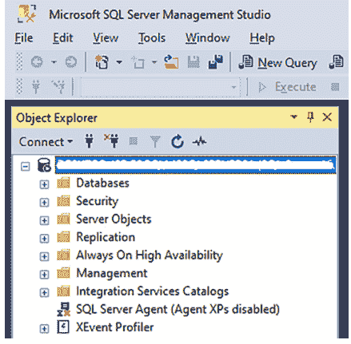

图 1.18：SQL Server Management Studio

## 另请参阅

有关本食谱中涵盖主题的更多信息，请参阅以下链接：

- - Microsoft SQL Server 文档：https://bit.ly/3FVerji
- - SQL Server Management Studio 文档：https://bit.ly/47x3nV8
- - AdventureWorks 示例数据库：https://bit.ly/3Ue8y8J

## 安装和使用 Power BI Report Builder

Power BI Report Builder 是 Microsoft Power BI 软件套件的一部分的独立免费报表制作工具。Power BI Report Builder 是久负盛名的 Report Builder 工具的演进版，它允许用户创建分页报表（也称为传统 SQL Server Reporting Services 或 SSRS 报表）。在 Power BI Report Builder 中创建的报表可以发布到 Power BI 服务中并在其中查看，与传统的 Power BI Desktop 报表类似。

## 准备工作

要为本食谱做好准备，首先从以下链接下载 Power BI Report Builder 安装程序：https://www.microsoft.com/en-us/download/details.aspx?id=105942。

在浏览器中打开页面后，选择您的语言，然后单击 **下载** 按钮下载 PowerBiReportBuilder.msi 文件。

## 如何安装 Power BI Report Builder

要安装 Power BI Report Builder，请按照以下步骤操作：

- 1. 下载 PowerBiReportBuilder.msi 后，在下载窗格中单击打开文件或从下载目录运行该文件。
- 2. 在欢迎页面上，单击下一步按钮。
- 3. 接受许可条款并单击下一步按钮。
- 4. 选择目标文件夹或接受默认值并单击下一步按钮。
- 5. 单击安装按钮。
- 6. 如果收到用户账户控制提示，单击是按钮。
- 7. 安装 Power BI Report Builder 后，单击完成按钮。

Power BI Report Builder 现已安装完成并可供使用。

## 工作原理

与创建文件扩展名为 PBIX 的 Power BI Desktop 不同，Power BI Report Builder 将报表文件保存为报表定义语言（.rdl）文件。RDL 文件实际上是可扩展标记语言（XML）文件，这也是 SQL Server Reporting Services（SSRS）使用的文件格式。Power BI Report Builder 文件可以发布到 Power BI 服务或 Power BI Report Server，后者是 SQL Server Reporting Services 的继任者。

分页报表与 Power BI Desktop 报表的工作方式截然不同。分页报表针对打印进行了优化，可显示跨越多个报表页面的长表格或矩阵。这与 Power BI Desktop 只能在不滚动的情况下显示有限行数的方式不同。

另一个关键区别是，与 Power BI Desktop 报表相比，分页报表具有有限的交互功能。在 Power BI Desktop 中，单击视觉对象可以影响并改变页面上其他视觉对象的显示。分页报表之间没有这种视觉对象的交互。分页报表的交互是通过参数完成的，其功能类似于 Power BI Desktop 报表中的切片器。

分页报表与 Power BI Desktop 报表之间的最后一个关键区别是，可用的视觉对象数量有限，分页报表约有 ~12 个，而 Power BI Desktop 有数十个默认视觉对象，以及 AppSource 上提供的数百个自定义视觉对象。

要运行 Power BI Report Builder，在 Windows 搜索栏中开始输入 Power BI Report Builder，然后在 Windows 开始菜单中运行 Power BI Report Builder 应用。接下来，请按照以下步骤操作：

- 1. 在开始窗口中，选择新建报表然后选择表或矩阵向导。
- 2. 确保已选择创建数据集单选按钮，然后单击下一步按钮。
- 3. 单击新建...按钮开始创建新数据集。
- 4. 在数据源属性窗口中，单击生成...按钮。

## 另请参阅

有关本食谱中涵盖主题的更多信息，请参阅以下链接：

- - 什么是 Power BI Premium？：https://bit.ly/3QY30L
- - 什么是 Power BI 嵌入式分析？：https://bit.ly/3QY4fgg

## 创建本地数据网关

Microsoft 本地数据网关（或简称为网关）是在本地环境中运行或作为在云中运行的基础设施即服务（IaaS）资源运行的 Windows 服务。网关的唯一目的是在本地和 IaaS 数据源与 Microsoft Azure 服务（例如 Power BI、Power Apps、Power Automate、Azure Analysis Services 和 Azure Logic Apps）之间通过到 Azure Service Bus 的出站连接实现安全（加密）和高效的数据传输。需要注意的是，如果 Power BI 报表使用的所有数据源都在云中（因此不是本地的）并且可由 Power BI 服务访问，则不需要 Microsoft 本地数据网关，因为 Power BI 服务将使用原生云网关来访问原生云数据源；这可能是例如 Azure SQL 数据库或 Azure SQL 受管实例。

安装后，网关可用于安排导入的 Power BI 数据集的数据刷新，以支持使用 DirectQuery 构建的 Power BI 报表和仪表板，以及对 Analysis Services 数据库的实时连接。网关也可由 Power Apps、Azure Logic Apps、Power Automate、Azure Analysis Services 和数据流使用。

单个本地数据网关可以支持多个数据源的刷新和查询活动，并且网关的使用权限可以与多个用户共享。目前，网关通过计划导入支持所有常见数据源，包括开放数据库连接（ODBC）连接，以及通过实时连接和 DirectQuery 支持许多最常见的数据源。

## 准备工作

网关所需硬件资源取决于连接类型（例如导入与实时连接）、Power BI 服务中报表和仪表板的使用情况，以及网关处理的与本地源系统相比的数据量比例。建议从 8 核 CPU、8 GB RAM 服务器和 64 位 Windows 2012 R2 或更高版本的操作系统开始。还建议使用至少 4 GB 磁盘空间的固态硬盘。该机器不能是域控制器，并且为了保持 Power BI 内容的可用性，网关服务器应始终开启并连接到互联网。

网关的另一个重要考虑因素是网关服务器相对于 Power BI 租户和由网关支持的数据源的位置。例如，如果 SQL Server 数据库是主要网关源并运行在美国西部的一台服务器上，并且组织的 Power BI 租户位于美国西部 Azure 区域，则网关应安装在美国西部 Azure 区域的服务器或潜在的 Azure 虚拟机（VM）上，或美国西部的位置。


根据当前和预期工作负载的分析，网关资源可以扩展或缩减，并且可选地，可以在单独的服务器上安装额外的网关，以分担整个 Power BI 刷新和查询部署工作负载。

例如，一个网关服务器可以专用于计划刷新/导入工作负载，从而将此活动与负责 DirectQuery 和 Live Connection 查询的另一个网关服务器隔离开来。

网关不需要打开入站端口，默认使用 HTTPS，但也可以强制使用 TCP。对于默认通信模式，建议在防火墙中将数据区域的 IP 地址加入白名单。该列表每周更新，可通过 Microsoft Azure 数据中心 IP 列表获取 (https://bit.ly/40APL97)。

要准备本任务，请执行以下步骤：

- 1. 从 https://powerbi.microsoft.com/downloads/ 下载最新的 Microsoft 本地数据网关。

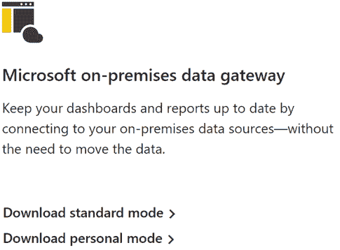

*图1.20：下载 Microsoft 本地数据网关*

- 2. 选择**下载标准模式**链接。

现在，您已准备好安装网关。

## 如何创建网关

网关有两种模式：标准模式和个人模式。个人模式仅供个人使用，因此无法在企业内部用户之间共享。我们将重点介绍标准模式，因为个人模式的安装和配置基本相同：

- 1. 下载网关后，选择**打开文件**以运行 `GatewayInstall.exe`。
- 2. 选择安装目录，接受使用条款和隐私协议，然后点击**安装**按钮。如果系统提示是否允许此应用更改设备，请点击**是**按钮。

3. 登录 Power BI 服务以注册网关：

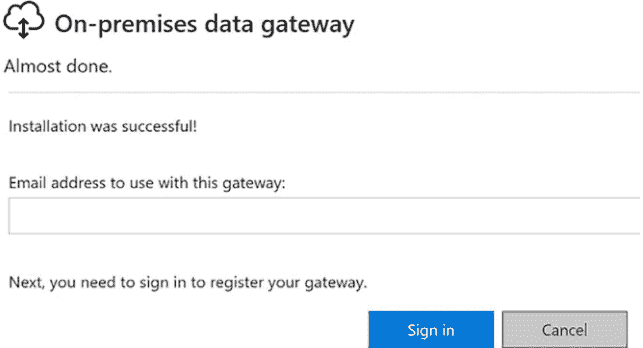

图 1.21：正在注册网关

4. 登录后的下一个屏幕上，选择“在这台计算机上注册新网关”，然后点击“下一步”按钮。

5. 为网关输入一个易记的名称和恢复密钥，然后点击**配置**按钮。

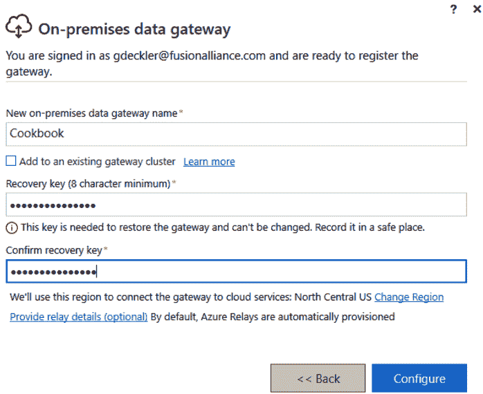

图 1.22：网关的最终配置信息

- - 将网关及其配置的数据源迁移到另一台计算机
- - 还原网关以在不同的域账户下运行服务，或从已崩溃的计算机还原网关
- - 从现有网关管理员处接管现有网关的所有权
- - 将网关添加到现有群集

> 务必将恢复密钥存储在 BI/IT 组织可访问的安全位置。此外，应在 Power BI 服务中分配多个用户作为网关管理员，以提供冗余。

## 更多内容…

图 1.22 中显示的 Microsoft 本地数据网关最终配置屏幕提供了几个高级选项，包括以下内容：

- - 添加到现有网关群集
- - 更改区域
- - 提供中继详细信息

网关群集消除了本地数据访问的单点故障。由于一台计算机只能安装一个标准网关，因此每个额外的网关群集成员都必须安装在不同的计算机上。如果主网关不可用，数据刷新请求将路由到其他网关群集成员。使用网关群集时，所有网关群集成员都必须运行相同版本的网关，并且应删除或禁用离线的网关成员——离线的网关成员会对性能产生负面影响。加入群集时，您必须知道并输入先前安装的网关的恢复密钥。

默认情况下，网关会安装在与 Power BI 服务中 Power BI 租户相同的 Azure 区域。在几乎所有情况下，都不应更改此设置。但是，借助 Power BI Premium 中的多地理位置支持，可能需要在不同的 Azure 区域安装网关。“更改区域”选项提供了这种灵活性。

Azure 中继在安装时为已安装的网关自动预配。但是，如果您希望将中继与 Azure 订阅关联并管理中继的发送方和侦听方密钥，则“提供中继详细信息”选项允许您提供自己的中继详细信息。这是一个非常高级的选项，在尝试此配置之前，您应该充分了解 Azure 中继以及您想要实现的目标。请注意，此功能仅支持使用 NetTcp 的 WCF 中继。

## 另请参阅

- - 通过本地网关配置和管理数据源的详细信息，请参阅第 11 章“部署和分发 Power BI 内容”
- - 为本地数据网关设置 Azure 中继：http://bit.ly/3rMJMVp

## 安装其他工具

负责开发语义模型（数据集）的 Power BI 专业人员通常会在 Power BI Desktop 之外使用其他工具来创建和管理模型。例如，他们使用 Tabular Editor 快速实施对度量值的更改或添加新对象，如透视和计算组。同样，ALM Toolkit 通常用于向 Power BI 部署增量更改和仅元数据更改。

另一个此类工具是 DAX Studio，这是一个第三方工具，用于查询数据模型、编辑和格式化代码、浏览数据模型的结构和元数据，以及分析 DAX 查询的性能和执行特征。对于更大、更复杂的数据模型和表达式，以及涉及多个模型的项目，DAX Studio 是开发和性能调优过程中必不可少的补充工具。

数据分析表达式（DAX）是“Power BI 的语言”，因为它用于创建在 Power BI 报表和仪表板中可视化的度量值和查询。Power BI 根据可视化的结构、用户选择和筛选器生成 DAX 查询并将其提交到源数据模型——就像 Excel 等其他工具根据工作簿中透视表和切片器的选择和结构生成 MDX 查询一样。DAX 表达式还用于定义安全角色，并可选地用于根据模型中的其他表和列创建数据模型中的列和表，这些表和列可以在处理时刷新，并由度量值和查询使用。DAX 在 Azure Analysis Services (AAS) 和 SQL Server Analysis Services (SSAS) 表格模型以及 Power Pivot for Excel 模型中具有相同功能。BI 专业人员必须拥有一个可靠的工具来开发和分析 DAX 代码以及包含这些表达式的数据模型。

## 准备工作

要准备本任务，请遵循以下步骤：

- 1. 从 DAX Studio 网站下载当前版本：https://daxstudio.org/downloads/。安装程序版本是一个单一文件，提供基于向导的安装和设置；而便携版是一个 ZIP 文件，不提供基于向导的安装。建议使用安装程序版本。

现在，您已准备好安装 DAX Studio。

## 如何安装 DAX Studio

- 1. 使用“打开文件”链接，或从“下载”文件夹运行该文件。该文件的名称类似于 DaxStudio_3_0_10_setup.exe。
- 2. 安装开始后，选择“为所有用户安装（推荐）”选项。
- 3. 如果出现“用户账户控制”提示，请选择“是”按钮。
- 4. 接受许可协议，然后点击“下一步”按钮。
- 5. 选择要安装工具的文件夹路径，然后点击“下一步”按钮。
- 6. 选择是否同时安装 Excel 的 DAX Studio 加载项。点击“下一步”按钮。请注意：

- a. 需要 Excel 加载项才能连接到 Power Pivot for Excel 数据模型。
- b. 此外，从 Excel 打开 DAX Studio 时，查询结果可以直接导出到 Excel 表格。

- 7. 选择“开始”菜单文件夹（默认为 DAX Studio），然后点击“下一步”按钮。
- 8. 勾选“创建桌面快捷方式”复选框，并保持“隐私”复选框不勾选。点击“下一步”按钮。
- 9. 最后，点击“安装”按钮。

## 工作原理

完全安装（包括 Excel 加载项）后，启动 Power BI Desktop 时，功能区中将显示一个额外的菜单选项“外部工具”。在功能区中选择“外部工具”会显示所有已安装的外部工具，如图 1.24 所示：

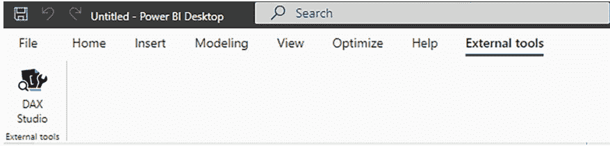

图 1.24：Excel 加载项功能区中的 DAX Studio

在 Power BI Desktop 中点击 DAX Studio 图标即可启动 DAX Studio，并自动连接到当前 Power BI 数据集。

如果在安装期间选择了 Excel 加载项，Excel 功能区的“加载项”选项卡上也会出现 DAX Studio 图标。

Power BI 外部工具使用 JavaScript 对象表示法（JSON）文件，该文件存储在目录 C:\Program Files (x86)\Common Files\Microsoft Shared\Power BI Desktop\External Tools 中。这些文件的扩展名为 .pbitool.json，例如 DAX Studio 的 daxstudio.pbitool.json 文件。这些文件的格式如下：

```
{
  "version": "1.0",
  "name": "DAX Studio",
  "description": "Use DAX Studio for DAX authoring, diagnosis, performance tuning and analysis.",
  "path": "C:\\Program Files\\DAX Studio\\DaxStudio.exe",
  "arguments": "/server=\"%server%\" /database=\"%database%\"",
  "iconData": "image/svg+xml;base64, ..."
}
```


此信息在 Power BI Desktop 启动时被读取，并填充到功能区中的 **External tools** 工具栏。这意味着安装或卸载外部工具需要在 Power BI Desktop 中反映更改之前重新启动 Power BI Desktop。

## There’s more...

除了 Power BI 还有两个有用的工具，分别是：

- ALM Toolkit
- Tabular Editor

ALM Toolkit 是 MAQ Software 提供的一个第三方工具，提供高级功能，例如 Power BI 数据集比较、代码合并、部分部署和错误修复、数据集元数据的源代码控制集成，以及在表格模型之间重用定义。要下载并安装 ALM Toolkit，请按照以下步骤操作：

- 1. 在浏览器中，导航到 `http://alm-toolkit.com`。
- 2. 在页面顶部，点击 **DOWNLOAD LATEST VERSION** 按钮。
- 3. 使用 **Open file** 链接启动 `AlmToolkitSetup.msi` 或从下载文件夹打开该文件。

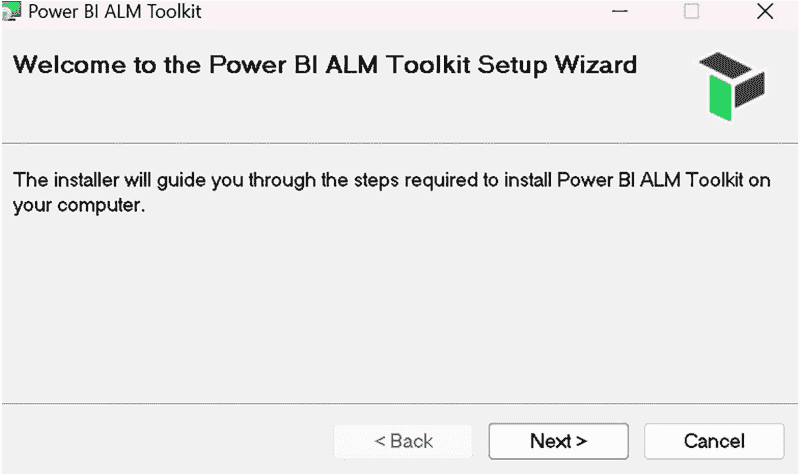

*图 1.25：ALM Toolkit 的初始安装屏幕*

- 4. 在初始安装屏幕上点击 **Next** 按钮。
- 5. 接受许可协议并点击 **Next** 按钮。
- 6. 选择文件夹路径并点击 **Next** 按钮。
- 7. 在最终安装屏幕上，点击 **Next** 按钮开始安装。
- 8. 如果出现 **User Account Control** 提示，点击 **Yes** 按钮。

Power BI ALM Toolkit 现在可以从 Windows 开始菜单或 Power BI Desktop 的 **External tools** 工具栏启动。

另一个强大的工具是 Tabular Editor。在本书出版时，Tabular Editor 有两个版本，免费的开源版本 2 和商业版本 3。Tabular Editor 是用于 Analysis Services 的表格模型作者和编辑的 **SQL Server Data Tools (SSDT)** 的替代方案。Tabular Editor 提供您表格模型元数据中对象的层次视图，例如列、度量和层次结构。Tabular Editor 与 Power BI Desktop 集成，允许对 DAX 度量进行批量更改并启用高级功能，例如计算组和透视。最后，Tabular Editor 还通过允许您直接从 Model.bim 文件打开表格模型来启用离线编辑功能。要安装和使用 Tabular Editor，请按照以下步骤操作：

- 1. 从此处下载最新版 Tabular Editor：https://bit.ly/3bJFBv1。
- 2. 在页面顶部，点击 **Windows installer version**，例如 TabularEditor.2.24.0.Installer.msi。确切的版本号可能会有所不同。
- 3. 文件下载完成后，使用 **Open file** 链接或从下载文件夹打开该文件。

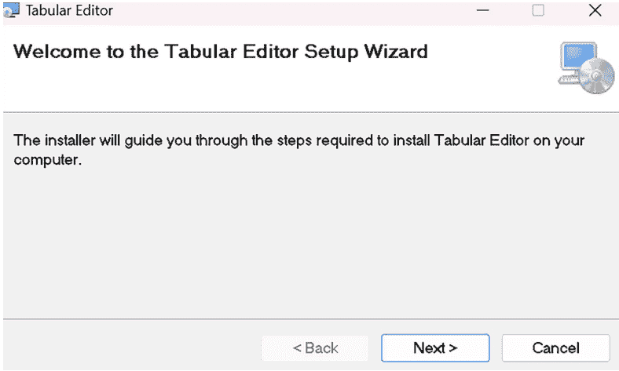

*图 1.26：Tabular Editor 的初始安装屏幕*

- 4. 在初始安装屏幕上点击 **Next** 按钮。
- 5. 接受许可协议并点击 **Next** 按钮。
- 6. 选择文件夹路径并点击 **Next** 按钮。
- 7. 勾选 **Create Desktop shortcut** 和 **Create Program Menu shortcut** 复选框，然后点击 **Next** 按钮。
- 8. 在最终安装屏幕上，点击 **Next** 按钮开始安装。
- 9. 如果出现 **User Account Control** 提示，点击 **Yes** 按钮。
- 10. 安装完成后，点击 **Close** 按钮。

唯一例外是 Publish to Web 功能，它会创建一份报告的匿名链接，任何人都可以访问。显然，这缺乏安全性，只能用于演示目的或非敏感数据。

Pro 许可证提供标准 Power BI 服务功能，包括能够发布和与其他用户共享报告以及查看他人共享的报告。Pro 许可证还使用户能够按报告每天安排 8 次报告刷新，并且允许最大数据集模型大小为 1 GB，每个用户最多 10 GB 的数据集模型存储。Power BI Pro 许可证售价为每用户每月 $10。

PPU 许可证启用通常保留给专用容量许可的功能，包括更大的模型大小（100 GB）、每个用户增加的存储（100 TB/用户）、增加的刷新次数（每天 48 次）、能够使用数据流使用人工智能和机器学习，以及能够使用 XML for Analysis (XMLA) 端点通过 SQL Server Management Studio 或其他软件连接到数据集。访问 PPU 工作区的所有用户都必须拥有 PPU 许可证。此外，PPU 工作区仍在共享容量中运行，而不是专用容量。PPU 许可证售价为每用户每月 $20。

专用容量有两种形式：

- Premium
- Embedded

Premium 容量许可已被微软停用。有关传统 Premium 容量许可的信息在此简要介绍，以求完整并与新的 Fabric 许可进行比较。Premium 容量以 P 库存保持单位（SKUs）购买。P SKU 从 P1 到 P5，每次递增都会使前一个 SKU 的 CPU 和内存翻倍。每月每容量价格也翻倍。因此，P4 SKU 的价格是 P1 SKU 的八倍，CPU 数量是八倍，内存也是八倍。P1 SKU 的零售价从每月 $4,995 开始，配备 8 个虚拟 CPU 内核（v-cores）和 25 GB 内存。容量的可用内存限制了 Power BI 模型的最高数据集大小。使用任何 Premium 容量意味着只有报告作者需要拥有 Power BI Pro 许可证。仅需查看报告的用户只需要免费的 Power BI 许可证。

Power BI Embedded 适用于独立软件供应商（ISVs）和希望在面向外部的 Web 应用程序中嵌入 Power BI 内容的组织。Embedded SKU 称为“A”SKU，大小从 A1 到 A8。A4 SKU 的 v-cores 和内存相当于 P1 SKU，每个高于 A4 SKU 的递增都会使 v-cores 和内存数量翻倍。每次递增的成本也翻倍。然而，A SKU 按小时计费，而不是固定的月费，这意味着可以停止容量以节省成本。还有 A1、A2 和 A3 SKU 可用，分别配备 1、2 和 4 个 v-cores 以及 3 GB、5 GB 和 10 GB 内存。

## How it works

对于希望发布和共享报告的较小组织而言，Power BI Pro 是逻辑选择。以每用户每月 $10 的价格，对于少于 500 名使用 Power BI 的个人而言，定价具有吸引力。如果需要 Premium 的额外功能和功能，较小的组织也可以选择 PPU 许可证（有关完整计划列表，请参阅本配方“另请参阅”部分中的 Power BI 定价和产品比较链接）。

一旦组织内有 500 名或以上个人定期访问服务中的 Power BI 报告（如果组织使用 PPU 许可证，则为 250 名），转向 Power BI Premium 容量可能更有意义。使用 Premium，每月仅收取容量费用，以及仍需要 Power BI Pro 许可证的报告发布者许可证。但是，所有仅在服务中查看报告的其他 Power BI 用户只需要免费许可证。

希望在其应用程序中公开 Power BI 内容并为外部用户提供服务的 ISV 应选择 Power BI Embedded 许可。

## There’s more…

除了迄今为止涵盖的许可 SKU 外，还有一种特殊的 Premium 许可证称为“EM”SKU。EM SKU 旨在为组织（仅限内部用户）提供 Power BI 嵌入功能。EM SKU 有三种尺寸，EM1、EM2 和 EM3，其 v-cores 和内存与相应的 A SKU 相当。

最后，微软开始推广 Microsoft Fabric 定价。Microsoft Fabric 是 Power BI 功能的超集，其中包括以前的 Azure Synapse 工作负载，例如数据仓库、数据工程（数据湖）、数据科学（Python 笔记本）和数据工厂，以及诸如 Data Activator 用于高级数据警报功能等新增工作负载。

Fabric 定价分为容量和存储，分别计费。这与传统 Premium 容量不同，后者包括以 v-cores 和内存形式固定的容量，以及固定数量的最大存储空间（每个容量 100 TB）。Fabric 容量定价基于“F”SKU，范围从最小的 F2 SKU 到最大的 F2048 SKU。F SKU 每次递增容量和成本都会翻倍。然而，与 Premium 和 Embedded SKU 不同，每个 F SKU 的数字名称也会翻倍。这意味着存在 F4 SKU 和 F8 SKU，但不存在 F3 SKU 或 F5–F7 SKU。因此，F8 SKU 的容量是 F2 SKU 的四倍，每小时成本也是四倍。

与 A SKU 一样，F SKU 采用按需付费方式计费，这意味着您可以停止容量或降低容量规模以减少费用。如前所述，存储作为 OneLake 存储单独计费，并根据每月使用的 GB 计费。

最后，64 及以上的 F SKU 在分配的工作区中读取报告时不需要 Pro 许可证。实际上，F64 SKU 基本上等同于传统的 P1 SKU，F128 SKU 等同于 P2 SKU，以此类推。


## 另请参阅

如需了解本配方中涵盖主题的更多信息，请参阅以下链接：

- Important update coming to Power BI Premium licensing: https://bit.ly/3VVM6mg
- Power BI pricing and product comparison: https://bit.ly/4aPutbL
- What is Power BI embedded analytics?: https://bit.ly/3QY4fgg
- Microsoft Fabric concepts and licensing: https://bit.ly/46cJ0R6

## 摘要

在本章中，我们介绍了 BI 专业人员用于设计和开发 Power BI 内容的主要工具的安装和配置，包括官方 Microsoft 工具，如 Power BI Desktop、Power BI Report Builder、本地数据网关，以及第三方工具，如 DAX Studio、ALM Toolkit 和 Tabular Editor。这些工具与 Power BI 服务相结合，是 BI 专业人员高效使用 Power BI 所需的主要资源。此外，我们还介绍了 Microsoft SQL Server 和 AdventureWorks 数据库的安装，该数据库将在本书的多个配方中被使用。

最后，我们讨论了如何根据组织的规模和需求为组织正确许可 Power BI。

本章为本书的其余部分奠定了基础，我们将探索 Power BI 强大的分析功能。在下一章中，我们将通过了解如何访问和检索数据，开始探索 Power BI 功能。

## 在 Discord 上加入我们的社区

加入我们社区的 Discord 空间，与作者和其他读者进行讨论：

https://discord.gg/ebXZqyrxJb


