# 2 访问、检索和转换数据

# 访问、检索和转换数据

Power BI Desktop 和 Power BI 服务中的数据流包含丰富的连接器和转换功能，支持从许多不同来源集成和增强数据。这些功能都由强大的函数式语言和查询引擎 M 驱动，M 在可能的情况下利用源系统资源，并且可以大大扩展数据检索过程的范围和稳健性，超出仅通过标准查询编辑器界面所能实现的能力。与几乎所有 BI 项目一样，数据访问和检索过程的设计和开发对整体 Power BI 解决方案的分析价值、可扩展性和可持续性具有重大影响。

在本章中，我们深入探讨了在 Power BI Desktop 的 Get Data 体验以及 Power BI 服务中数据流的等效流程中建立和管理数据源连接和查询。虽然这些示例是在 Power BI Desktop 中实现的，但 Microsoft 已将 Power Query（M）作为 Excel、Power Platform 和 Fabric 等多个其他数据工具和服务的通用选项，从而增强了 Power Query（M）技能和经验的价值。提供了使用 Power Query 编辑器界面和直接使用 M 语言构建和完善查询以满足常见数据转换和清理需求的示例。实践中，正如示例所示，建议将两种工具结合使用，以帮助查询开发过程。

对 M 语言及其在 Power BI 中的实现的完整解释超出了本书的范围，但标题为 There’s more... 和 See also 的部分中包含了额外的资源和文档。

本章包含以下配方：

- Importing data
- Using DirectQuery
- Creating dataflows
- Applying filters
- Transforming and cleansing source data
- Creating custom columns
- Combining and merging queries
- Profiling source data
- Diagnosing queries
- Extending the core M library

## 技术要求

完成本章中的配方需要以下条件：

- Power BI Desktop。
- SQL Server 2022 或更新版本，并安装了 AdventureWorksDW2022 数据库。有关详细信息，请参阅 *Chapter 1, Installing and Licensing Power BI Tools* 中的 *Installing SQL Server and the AdventureWorks Database* 和 *Installing and Configuring Power BI Desktop* 部分。

## 导入数据

Power Query（M）查询的输出要么可以作为压缩的内存本地表加载（导入），要么仅可定义数据源通过 DirectQuery 连接使用的源表。导入存储模式是大多数场景的默认和首选选项，因为它提供了最佳性能，同时还提供了更大的建模灵活性，支持更多 DAX 函数，并更轻松地集成不同的源。导入是 Power BI Desktop 的默认存储模式。导入表和 DirectQuery 表的集合称为语义模型。

在 Power BI Desktop 中创建的导入语义模型使用与 Analysis Services Tabular Import 模型相同的内存列式压缩存储引擎（VertiPaq）。导入模式模型支持不同数据源的集成（例如 SQL Server 和 DB2），并允许通过完全支持所有 DAX 函数来更灵活地开发度量值和行级安全性角色。

然而，导入模式语义模型存在一些限制。例如，Power BI Pro 许可证用户无法将 Power BI Desktop 文件发布到 Power BI 服务中共享容量超过 1 GB。Power BI Premium（专用、隔离硬件）支持 10 GB 及更大的语义模型（启用大型语义模型后，语义模型大小受 Premium 容量大小或管理员设定的最大大小限制）。对于如此大的语义模型，重要的是要考虑采用增量刷新，仅刷新和导入新的和更改的数据，而不是刷新整个语义模型。此外，导入模式会创建一个额外的“跳跃”，其中从一个源的数据副本被加载到另一个源，并且此加载过程必须进行计划或编排。IT 专业人员可以理解地更喜欢利用现有数据源以 DirectQuery 模式进行报告的简化架构，但在大多数场景中，导入模式的诸多好处证明了其开销是合理的。

本配方描述了使用 M 和查询编辑器为标准星型架构分析模型开发导入模式查询的过程。

## 准备工作

为准备本配方，我们将首先通过用户界面构建一个连接到 AdventureWorksDW2022 SQL Server 数据库的查询。此查询将用作我们在配方后面创建的其他查询的参考查询。要创建此查询，请按照以下步骤操作：

1. 打开 Power BI Desktop 并创建一个新报表。
2. 点击功能区的 **Home** 选项卡中的 **Get Data**。从数据库源列表中选择 **SQL Server**。供将来参考，如果数据源未列在 **Common data sources** 中，可以通过点击列表底部的 **More...** 查看更多数据源。
3. 将出现一个对话框，要求输入连接信息。确保 **Data Connectivity mode** 设置为 **Import**。输入您的 SQL 服务器名称以及 AdventureWorksDW2022 数据库。在 *Figure 2.1* 中，SQL 服务器安装在本地并在默认实例 MSSQLSERVER 下运行。由于它是默认实例，因此仅使用托管 SQL 实例的计算机名称或 localhost，即当前计算机的引用。如果 **Database** 字段留空，这只会导致一个额外的导航步骤来选择所需的数据库。

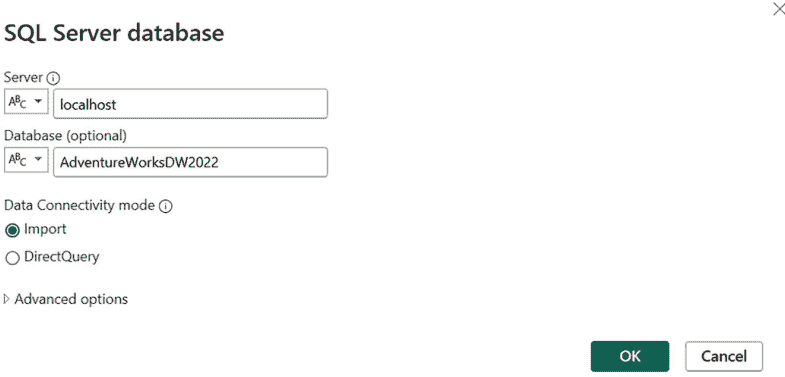

*Figure 2.1: SQL Server Get Data dialog*

4. 如果这是您第一次从 Power BI 连接到此数据库，您可能会被提示输入一些凭据。此外，您还可能收到无法与服务器建立加密连接的警告。只需输入正确的凭据进行连接并点击 **Connect** 按钮即可。对于加密警告，只需点击 **OK** 按钮继续。
5. 将出现一个导航窗口，其中显示数据库的不同对象和架构。您可以选中任何表或视图旁边的复选框，但对于本示例，请选中 **DimGeography** 表旁边的复选框，然后点击 **Transform Data** 按钮。


- 6. Power Query 编辑器在新窗口中启动，其中包含一个名为 DimGeography 的查询。Power Query 编辑器是随 Power BI Desktop 提供的补充工具，用于连接和转换数据。Power Query 编辑器窗口应类似于图 2.2 所示：

    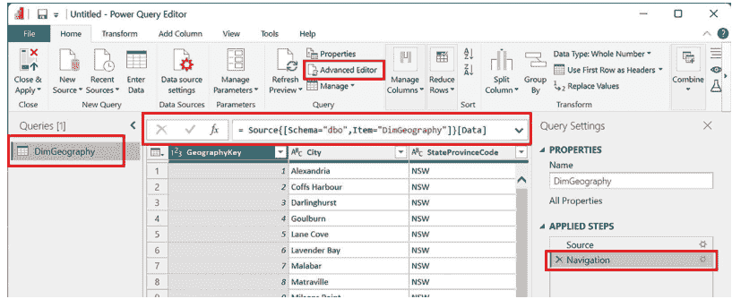

    图 2.2：Power Query 编辑器窗口

- 7. 观察图 2.2 中突出显示的元素。左侧是包含我们刚刚创建的查询的查询窗格。中央区域显示数据的预览。右侧在 APPLIED STEPS 下显示我们在数据上执行的操作。图 2.2 中预览数据上方突出显示的块显示了所选步骤的实际 Power Query（M）代码。这是公式栏。

    公式栏有助于快速了解特定查询步骤背后的 M 代码，仅显示当前步骤的 M 函数。此公式栏出现在窗口中央部分的预览数据列标题正上方。如果看不到此公式栏，请单击“视图”选项卡，并在功能区的“布局”部分中选中“公式栏”旁边的复选框。

    每当您单击按钮以连接到 Power BI Desktop 支持的任何数据源或在 Power Query 编辑器中对数据源对象应用任何转换时，例如导航到数据源中的表或更改列的数据类型，就会创建一个或多个 M 表达式，反映您的选择。这些 M 表达式会自动写入专用的 M 文档中，如果保存，则存储在 Power BI Desktop 文件中作为查询。M 是一种类似 F# 的函数式编程语言，Power BI 开发人员必须熟悉分析、理解、随后编写和增强支持其查询的 M 代码。

- 8. 在 APPLIED STEPS 下单击 Navigation 步骤旁边的 X 图标。注意预览数据变为 AdventureWorksDW2022 数据库中表和视图的列表。此外，公式栏切换为显示：

    ```
    = Sql.Database("localhost", "AdventureWorksDW2022")
    ```

- 9. 如前所述，公式栏仅显示查询中当前步骤的 M 代码。要查看查询的整个 M 代码，请单击公式栏上方突出显示的“高级编辑器”，如图 2.2 所示。将会出现“高级编辑器”对话框，如图 2.3 所示：

    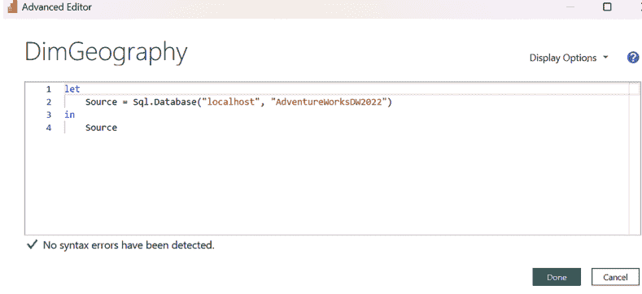

    图 2.3：高级编辑器对话框

- 10. 为 Power BI 创建的大多数查询都遵循 let ... in 结构，如图 2.3 所示。本章后面将更详细地介绍这一点。

- 11. 使用的 M 函数是 Sql.Database。该函数接受两个参数：服务器名称 localhost\MSSQLSERVERDEV 和数据库名称 AdventureWorksDW2022。单击 APPLIED STEPS 下的其他步骤会显示这些步骤的公式，这些公式在技术上是单独的 M 表达式。

- 12. 单击“完成”按钮返回到 Power Query 编辑器窗口。

- 13. 在 APPLIED STEPS 区域上方是 PROPERTIES 区域。使用“名称”字段将查询的名称更改为 AdventureWorksDW2022。

这完成了本菜谱的准备工作。

## 如何导入数据

要实现本菜谱，请执行以下步骤：

- 1. 在“查询”窗格中，右键单击 AdventureWorksDW2022 查询并选择“引用”。这将创建一个引用 AdventureWorksDW2022 查询作为其源的新查询。
- 2. 选择此新查询，并在预览数据中，在“名称”列中找到 DimProduct 表。单击此行的“数据”列中的“表”链接。
- 3. 将此查询重命名为 Products。
- 4. 在预览数据区域向右滚动，直到看到 DimProductSubcategory 列。单击列名右侧的展开表图标并取消选中所有列，仅保留 EnglishProductSubcategoryName 和 DimProductCategory，如图 2.4 所示：

    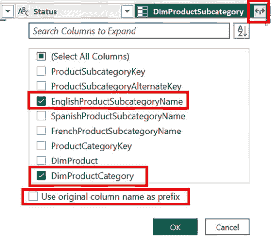

    图 2.4：展开表对话框

- 5. 如图 2.4 所示，取消选中“使用原始列名作为前缀”复选框，然后单击“确定”按钮。

- 6. 在预览数据区域中，您现在拥有 EnglishProductSubcategoryName 和 DimProductCategory 列。请注意，APPLIED STEPS 区域中已添加一个步骤。

- 7. 单击 DimProductCategory 列右侧的展开图标并取消选择所有列，仅保留 EnglishProductCategoryName。

- 8. 确保未选中“使用原始列名作为前缀”框，然后单击“确定”按钮。请注意，APPLIED STEPS 区域中已添加一个步骤。

- 9. 双击 EnglishProductCategoryName 列标题并将此列重命名为 Product Category。请注意，APPLIED STEPS 区域中已添加“重命名列”步骤。

- 10. 重复步骤 9，分别将 EnglishProductSubcategoryName 和 EnglishProductName 重命名为 Product Subcategory 和 Product Name。请注意，这次 APPLIED STEPS 下没有添加额外步骤，而是公式栏会更改以反映这些额外列的重命名。

- 11. 在 **Queries** 窗格中，右键单击 AdventureWorksDW2022 查询并取消选择 **Enable load**。请注意，查询名称现在为斜体。禁用查询加载可防止这些查询将数据加载到数据模型中。

- 12. 现在，再次右键单击 AdventureWorksDW2022 查询并选择 **Move To Group, New Group...**，如图 *Figure 2.5* 所示：

    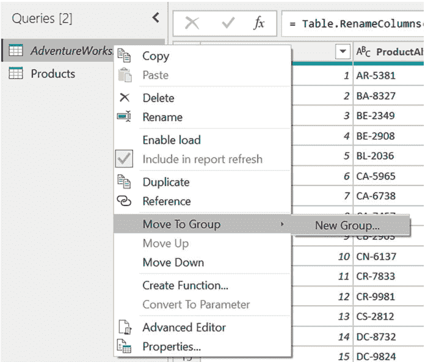

    图 2.5：分组查询

- 13. 在 **New Group** 对话框中，为组名输入 Data Sources，然后单击 **OK** 按钮。

分组查询有助于您组织和维护查询。在复杂的数据模型中，可能有数十甚至数百个单独的查询，因此保持良好的卫生习惯对于有效管理查询非常重要。

- 14. 回想一下，我们使用 AdventureWorksDW2022 查询作为 Products 查询的引用。我们可以通过单击功能区 **View** 选项卡中的 **Query Dependencies** 来观察此依赖关系。这会以图形方式显示依赖关系，如 *Figure 2.6* 所示。

要创建此层次结构，请右键单击数据窗格中的 Product Category 列并选择创建层次结构。将此层次结构重命名为 Product Hierarchy。接下来，右键单击 Product Subcategory 列并选择添加到层次结构 | Product Hierarchy。对 Product Name 列重复此步骤。

## 其工作原理

导入数据会创建在运行 Power BI Desktop 的本地计算机上缓存的数据源连接。可以通过在 Power BI Desktop 或 Power Query 编辑器的功能区中转到“文件”菜单，选择“选项和设置”，然后选择“数据源设置”来查看这些数据源连接。这样会显示类似于图 2.8 的对话框：

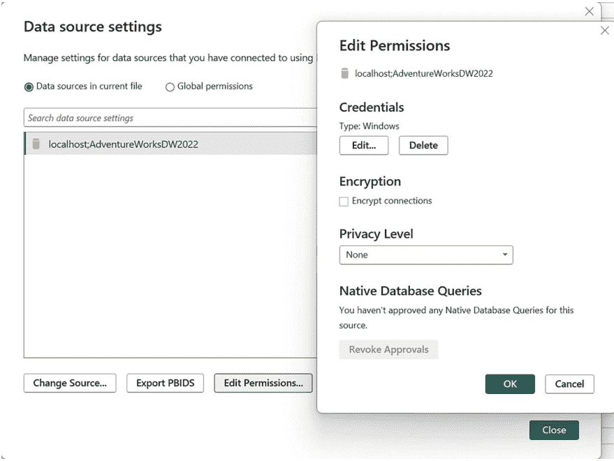

图 2.8：数据源设置

如图所示，选中了 localhost;AdventureWorksDW2022 数据源连接，然后单击了“编辑权限”按钮。这允许编辑或删除凭据，并显示是否加密连接及其隐私级别。

*Table 2.1* 中提供了可用的 **Privacy Level** 设置的定义。

| Privacy Setting | Description |
|---|---|
| None | 未定义隐私级别。 |
| Private | **Private** 数据源在查询检索期间完全与其他数据源隔离。例如，将文本文件标记为 **Private** 将防止该数据在外部服务器上处理。 |
| Organizational | **Organizational** 数据源与所有公共数据源隔离，但在检索期间对其他组织数据源可见。 |
| Public | **Public** 数据源对其他来源可见。只有文件、互联网来源和工作簿数据可以标记为 **Public**。 |

*Table 2.1: Privacy Level settings*

单个数据源连接可被多个查询使用。任何连接到数据源连接中指定的源系统的查询都将使用该源系统的缓存连接信息。

连接到源系统后，Power Query 编辑器窗口右侧的 **APPLIED STEPS** 区域中指定的转换步骤将应用于数据。然后将转换后的数据导入到运行 Power BI Desktop 的计算机上本地托管的 Analysis Services 多维模型中。导入到此 Analysis Services 多维模型中的表随后在 Power BI Desktop 的数据窗格中显示。

要了解导入时数据的转换方式，请单击“主页”选项卡上“查询”部分中的“转换数据”。在 Power Query 编辑器中，选择“查询”窗格中的 Products 查询。接下来，在“主页”选项卡上“查询”部分中选择“高级编辑器”。查询应包含以下 M 代码：

```
let
    Source = AdventureWorksDW2022,
    dbo_DimProduct = Source{[Schema = "dbo", Item = "DimProduct"]}[Data],
    #"Expanded DimProductSubcategory" = Table.ExpandRecordColumn(
        dbo_DimProduct,
        "DimProductSubcategory",
        {"EnglishProductSubcategoryName", "DimProductCategory"},
        {"EnglishProductSubcategoryName", "DimProductCategory"}
    ),
    #"Expanded DimProductCategory" = Table.ExpandRecordColumn(
        #"Expanded DimProductSubcategory",
        "DimProductCategory",
        {"EnglishProductCategoryName"},
        {"EnglishProductCategoryName"}
    ),
```


```m
#"Renamed Columns" = Table.RenameColumns(
    #"Expanded DimProductCategory",
    {
        {"EnglishProductCategoryName", "Product Category"},
        {"EnglishProductSubcategoryName", "Product Subcategory"},
        {"EnglishProductName", "Product Name"}
    }
)
in
#"Renamed Columns"
```

在 let 块中，存在多个步骤，这些步骤之间存在依赖关系。例如，第二步 dbo_DimProduct 引用了之前的步骤 Source。各个表达式由逗号分隔，而 in 关键字之后引用的表达式即为查询返回的表达式。各个步骤表达式在技术上被称为“变量”。

M 表达式中的变量名称如果包含空格，则必须以井号开头并用双引号括起来。当使用查询编辑器图形界面创建 M 查询时，此语法会自动应用，同时会加上描述所应用的 M 转换的名称。这种行为可以在 Renamed Columns 步骤中看到。应用简短且描述性强的变量名称（无空格）通常可以提高 M 查询的可读性。

请注意 let 语句下方的五行。这些五行对应于我们查询中的五个 APPLIED STEPS：Source、Navigation、Expanded DimProductSubcategory、Expanded DimProductCategory 和 Renamed Columns。查询返回的是查询的最后一步的信息，即 Renamed Columns。随着从 Power Query 编辑器用户界面中应用更多步骤，这些步骤会被插入到 in 语句上方，而其下方的行会更改为引用查询中的最后一步。

M 是一种区分大小写的语言。这包括在 M 表达式中引用变量（RenameColumns 与 Renamecolumns），以及 M 查询中的值。例如，值“Apple”和“apple”在 M 查询中被视为唯一值。

建议在开始使用新查询并学习 M 语言时使用 Power Query 编辑器用户界面。在应用了若干步骤后，使用高级编辑器来查看并选择性地增强或自定义 M 查询。作为一种丰富的函数式编程语言，M 提供了许多函数和可选参数，这些参数并未通过 Power Query 编辑器的图形用户界面公开。超越 Power Query 编辑器的限制可以实现更稳健的数据检索、集成和数据 mashup 流程。

M 引擎还具有强大的“惰性求值”逻辑，用于忽略任何冗余或不必要的变量，并在结果确定时进行短路求值（计算），例如当 OR 逻辑运算符的一侧（操作数）计算为 True 时。惰性求值使 M 查询引擎能够通过忽略任何不必要或冗余的步骤（变量）来减少给定查询所需的资源。表达式的求值顺序在运行时确定——不必从上到下按顺序进行。

作为迄今为止所涵盖概念的回顾以及供将来参考，表 2.2 提供了本书中使用的 M 语言主要概念的词汇表。

| Concept | Definition |
|---|---|
| Expression | Formulas evaluated to yield a single value. Expressions can reference other values, such as functions, and may include operators. |
| Value | The result of evaluating an expression. Values can be categorized into types that are either primitive, such as text ("abc"), or structured kinds, such as tables and lists. |
| Function | A value that produces a new one, based on the mapping of input values to the parameters of the function. Functions can be invoked by passing parameter values. |
| Type | A value that classifies other values. The structure and behavior of values are restricted based on the classification of their type, such as Record, List, or Table. |
| let | An expression that allows a set of unique expressions to be assigned names (variables) and evaluated (if necessary), when evaluating the expression following the in expression in a let...in construct. |
| Variable | A unique, named expression within an environment to be conditionally evaluated. Variables are represented as APPLIED STEPS in Query Editor. |
| Environment | A set of variables to be evaluated. The global environment containing the M library is exposed to root expressions. |
| Evaluation | The computation of expressions. Lazy evaluation is applied to expressions defined within let expressions; evaluation occurs only if needed. |
| Operators | A set of symbols used in expressions to define the computation. The evaluation of operators depends on the values to be operated on. |

表 2.2：M 语言元素

M 查询并非旨在替代企业数据集成和编排工具通常处理的典型数据加载和转换工作负载，例如 Azure Data Factory (ADF)、Azure Databricks 或 SQL Server Integration Services (SSIS)。然而，正如 BI 专业人员仔细审查 SQL 存储过程和支持其各种多维数据集和报表环境的提取转换加载 (ETL) 包的逻辑并测试其性能一样，他们也应审查为支持 Power BI 模型和报表而创建的 M 查询。在为 Power BI 模型开发检索流程时，请考虑以下常见 ETL 问题：

- 查询对源系统有何影响？
- 我们能否使查询对源数据变化更具弹性，从而避免失败？
- 我们的查询是否高效且易于遵循和维护，还是存在不必要的步骤和查询？
- 我们的查询是否能为 BI 应用程序提供足够的性能？
- 我们的流程是否灵活，以便我们可以快速对数据源和逻辑进行更改？
- 是否可以在源系统中实现部分或全部所需的转换逻辑，例如数据仓库表的加载过程或 SQL 视图？

M 查询引擎的一项顶级性能和可扩展性功能称为查询折叠。如果可能，Power BI Desktop 中开发的 M 查询会被转换为 SQL 语句并传递给源系统进行处理。

事实上，本食谱中的查询已被折叠为 SQL 语句并发送到服务器进行处理，而不是由 M 查询引擎在本地执行处理。要了解其工作原理，请执行以下操作：

1. 在 **Queries** 窗格中选择 **Products** 查询。
2. 右键单击查询设置窗格中 **APPLIED STEPS** 部分的 **Renamed Columns** 步骤，然后选择 **View Native Query**，如图 2.9 所示：

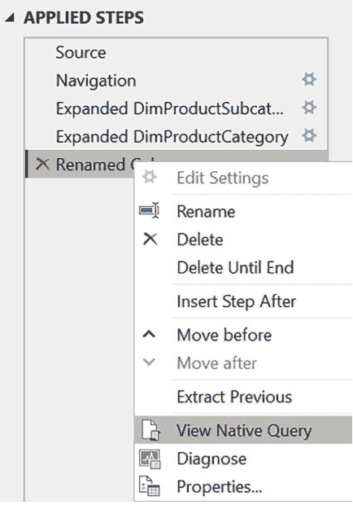

图 2.9：查询设置中的查看本机查询

3. 然后将出现本机查询对话框，如图 2.10 所示：

Native Query

```sql
select [$Outer].[ProductKey] as [ProductKey],
    [$Outer].[ProductAlternateKey] as [ProductAlternateKey],
    [$Outer].[ProductSubcategoryKey] as [ProductSubcategoryKey],
    [$Outer].[WeightUnitMeasureCode] as [WeightUnitMeasureCode],
    [$Outer].[SizeUnitMeasureCode] as [SizeUnitMeasureCode],
    [$Outer].[EnglishProductName] as [Product Name],
    [$Outer].[SpanishProductName] as [SpanishProductName],
    [$Outer].[FrenchProductName] as [FrenchProductName],
    [$Outer].[StandardCost] as [StandardCost],
    [$Outer].[FinishedGoodsFlag] as [FinishedGoodsFlag],
    [$Outer].[Color] as [Color],
    [$Outer].[SafetyStockLevel] as [SafetyStockLevel],
    [$Outer].[ReorderPoint] as [ReorderPoint],
    [$Outer].[ListPrice] as [ListPrice],
    [$Outer].[Size] as [Size],
    [$Outer].[SizeRange] as [SizeRange],
    [$Outer].[Weight] as [Weight],
    [$Outer].[DaysToManufacture] as [DaysToManufacture],
    [$Outer].[ProductLine] as [ProductLine],
    [$Outer].[DealerPrice] as [DealerPrice],
    [$Outer].[Class] as [Class],
    [$Outer].[Style] as [Style],
    [$Outer].[ModelName] as [ModelName],
    [$Outer].[LargePhoto] as [LargePhoto],
    [$Outer].[EnglishDescription] as [EnglishDescription],
    [$Outer].[FrenchDescription] as [FrenchDescription],
    [$Outer].[ChineseDescription] as [ChineseDescription],
    [$Outer].[ArabicDescription] as [ArabicDescription],
    [$Outer].[HebrewDescription] as [HebrewDescription],
    [$Outer].[ThaiDescription] as [ThaiDescription],
```

图 2.10：从 Products M 查询生成的 SQL 语句

查找并修改未折叠到源系统的查询是增强大型 Power BI 语义模型的主要技术。请参阅第 10 章《增强和优化现有 Power BI 解决方案》中“将查询处理推回源系统”食谱，了解此过程的示例。

M 查询引擎还支持部分查询折叠。查询可以“部分折叠”，即创建一个 SQL 语句，仅解决整体查询的一部分。此 SQL 语句的结果将返回到 Power BI Desktop（或本地数据网关），剩余的逻辑将使用 M 的内存引擎和本地资源计算。M 查询可以设计为最大化源系统资源的使用，通过在查询过程中尽早使用查询折叠支持的标准表达式。最大限度地减少本地或本地数据网关资源的使用是提高查询性能的主要考虑因素。

然而，查询折叠存在局限性。例如，一旦本机 SQL 查询已传递给源系统，就不会进行折叠，例如当使用高级选项通过“获取数据”对话框直接传递 SQL 查询时。图 2.11 显示了在“获取数据”对话框中指定的查询，该查询包含在 Source 步骤中。


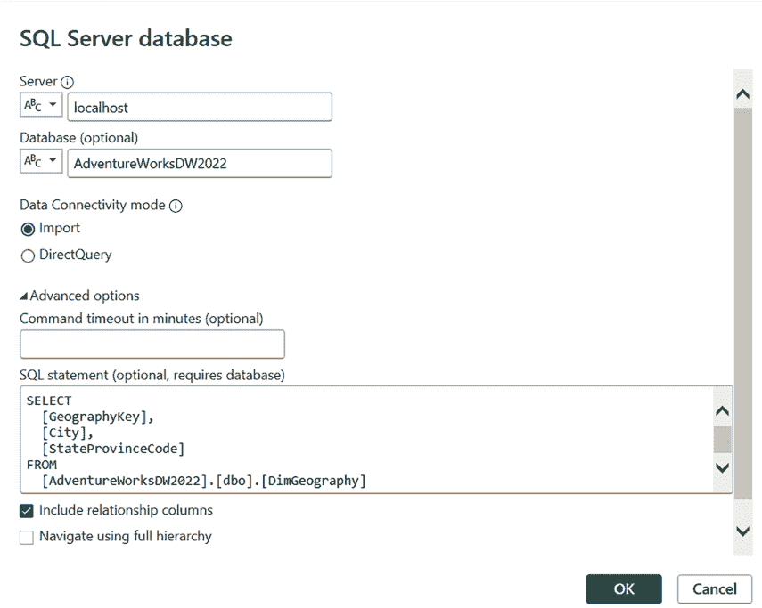

## 图 2.11：提供用户定义的本机 SQL 查询

在本机查询之后应用的任何转换都将使用本地系统资源。因此，使用本机或用户定义的 SQL 查询进行查询开发时，总的启示是：如果使用它们，请尽量包含所有必需的转换（即联接和派生列），或者利用它们来调用折叠查询未用到的源数据库的重要特性，例如索引。

关于查询折叠，还需要注意以下几点：

- 并非所有数据源都支持查询折叠，例如文本文件和 Excel 文件。
- 并非查询编辑器或 M 函数中可用的所有转换都得到某些数据源直接支持。
- 为数据源定义的隐私级别也会影响是否使用查询折叠。
- SQL 语句在发送到源系统之前不会经过解析。
- 可以使用 `Table.Buffer` 函数来避免查询折叠。此函数的表输出会加载到本地内存中，对它所进行的转换也会保留在本地。

## 更多内容...

使用导入模式，我们可以做很多事情来增强查询，以帮助进行报表开发和显示。例如，我们可以添加额外的列，以便在报表视觉对象中自动对某个属性排序。具体来说，假设我们希望美国区域性组织在可视化中默认彼此相邻显示。默认情况下，由于 AdventureWorksDW2019 中 DimOrganization 表的 Organization 列是文本列，根据文本列默认的字母顺序排序，Central Division（美国的一部分）会出现在加拿大和法国之间。我们可以修改一个提取 DimOrganization 表的简单查询，以添加一个数值排序列。要了解其工作原理，请按照以下步骤操作：

- 1. 使用本方案前面使用的同一个 Power BI 文件，打开 Power Query 编辑器，右键单击 AdventureWorksDW2022 查询，然后选择“引用”。
- 2. 将此查询重命名为 Organizations。
- 3. 在“查询”窗格中右键单击 Organizations 查询，然后选择“移动到组 | 其他查询”。
- 4. 在预览数据区域中，单击 DimOrganization 表的 Data 列中的 Table 链接。
- 5. 在 CurrencyKey 列的标题中，单击列名右侧的向下箭头图标，然后选择“降序排序”，如图 2.12 所示：

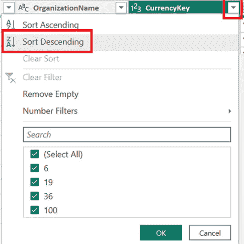

图 2.12：对 CurrencyKey 列进行排序

- 6. 对 OrganizationKey 列重复步骤 5，但这一次选择“升序排序”。
- 7. 选择功能区中的“添加列”选项卡。
- 8. 在“添加列”功能区中，选择功能区“常规”区域中“索引列”右侧的向下箭头图标，然后选择“从 1”，如图 2.13 所示：

## 图 2.13：添加索引列

按住 Ctrl 键，单击列标题以选择 OrganizationKey、OrganizationName、FactFinance 和 Index 列。右键单击其中一个选定列的标题，然后选择“删除其他列”。预览数据现在应如图 2.14 所示。

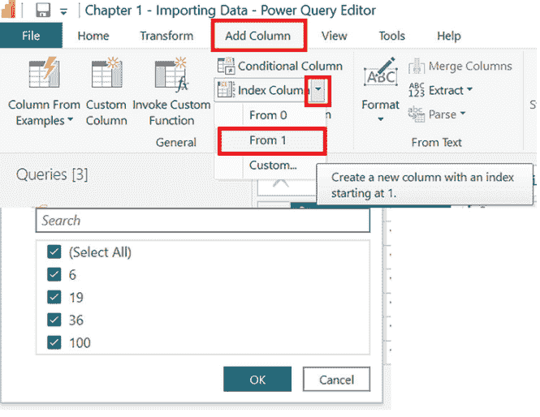

## 图 2.14：修改后的组织维度查询

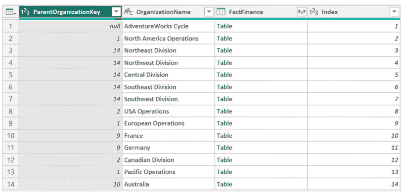

- 9. 展开 FactFinance 列，仅选择 Amount 列，并取消选中“使用原始列名作为前缀”复选框。

- 10. 按住 **Ctrl** 键，选择 `ParentOrganizationKey`、`OrganizationName` 和 `Index` 列，然后右键单击其中一个选定列，并选择**分组依据...**

- 11. 在如*图 2.15* 所示的**分组依据**对话框中，在**新列名**下，将列命名为 `Amount`，将**操作**设置为 `Sum`，并选择 `Amount` 列，如下所示：

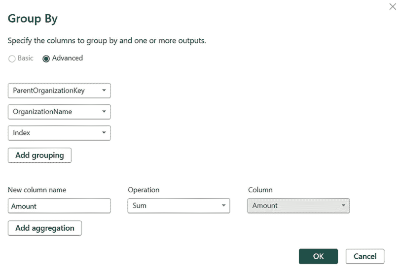

*图 2.15：分组依据对话框*

- 12. 单击**确定**按钮。

- 13. 从功能区的**主页**选项卡中打开**高级编辑器**，查看生成的表达式：

```
let
    Source = AdventureWorksDW2022,
    dbo_DimOrganization = Source{[Schema = "dbo", Item = "DimOrganization"]}[Data],
    #"Sorted Rows" = Table.Sort(
        dbo_DimOrganization,
        {{"CurrencyKey", Order.Descending}, {"OrganizationKey", Order.Ascending}}
    ),
    #"Added Index" = Table.AddIndexColumn(#"Sorted Rows", "Index", 1, 1, Int64.Type),
    #"Removed Other Columns" = Table.SelectColumns(
        #"Added Index",
        {"ParentOrganizationKey", "OrganizationName", "FactFinance", "Index"}
    )
```

```
),
#"Expanded FactFinance" = Table.ExpandTableColumn(
    #"Removed Other Columns",
    "FactFinance",
    {"Amount"},
    {"Amount"}
),
#"Grouped Rows" = Table.Group(
    #"Expanded FactFinance",
    {"ParentOrganizationKey", "OrganizationName", "Index"},
    {{"Amount", each List.Sum([Amount]), type nullable number}}
)
in
    #"Grouped Rows"
```

使用此表达式，表首先按 CurrencyKey 列排序，然后按 ParentOrganizationKey 列排序。新索引列从该排序表的第一行开始，每行递增 1。最终效果是，所有美国部门都会排列在表的顶部附近。

我们使用 Table.SelectColumns 删除除 ParentOrganizationKey、OrganizationName、FactFinance 和 Index 之外的所有列。使用 Table.ExpandTableColumn 函数展开 FactFinance 表以检索 Amount 列会增加返回的行数，因此使用 Table.Group 函数对 Amount 列进行聚合，使表恢复到展开 FactFinance 列之前的原始行数。

现在，我们可以使用这个新的 Index 列来调整 OrganizationName 列默认的字母数字排序行为。要了解其工作原理，请执行以下步骤：

- 1. 选择“关闭并应用”退出 Power Query 编辑器，以加载 Organizations 表。
- 2. 在“数据”窗格中，从 Organizations 表列中选择 OrganizationName 列。
- 3. 在“列工具”选项卡中，将“按列排序”下拉列表设置为 Index 列。

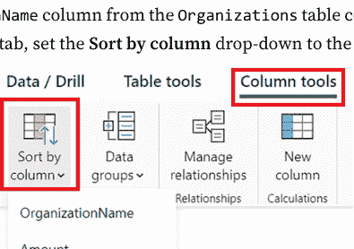

图 2.16：按列排序

- 4. 右键单击 Index 列，然后选择“隐藏”。
- 5. 创建一个簇状条形图视觉对象，将 Organizations 表中的 OrganizationName 放在 Y 轴上，将 Organizations 表中的 Amount 列放在 X 轴上。
- 6. 在“可视化”窗格的“格式”子窗格和“视觉对象”选项卡下，打开“数据标签”开关，然后展开“数据标签”卡片，展开“值”子卡片，并将“显示单位”更改为“百万”，如图 2.17 所示：

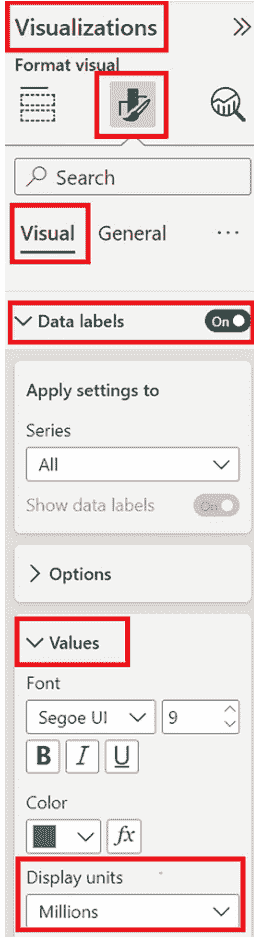

图 2.17：设置显示单位格式

使用 OrganizationName 列的视觉对象现在将按父组织对值进行排序，因此美国组织会显示在一起（但并非按字母顺序）。

## 按 OrganizationName 汇总的 Amount 总和

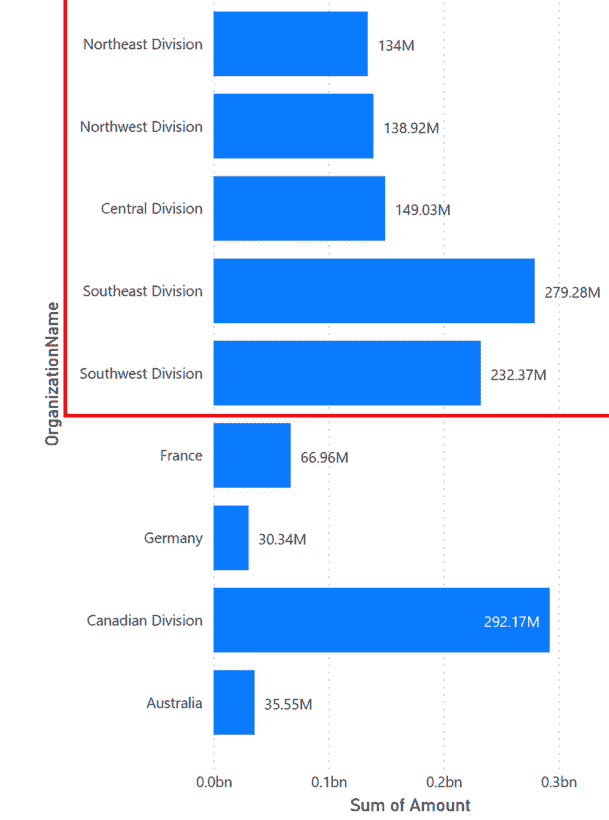

图 2.18：OrganizationName 按 Index 列自动排序

## 另请参阅

- Power BI 服务中的语义模型模式：http://bit.ly/30P2HKF
- 数据源身份验证：http://bit.ly/30It2tV
- Power BI Desktop 隐私级别：http://bit.ly/29blFBR
- Power Query M 语言规范：http://bit.ly/2oaJWwv
- Power Query M 函数参考：http://bit.ly/3bLKJ1M
- 导入建模的数据缩减技术：http://bit.ly/30RsMZI
- Power Query (M) 权威指南：https://www.packtpub.com/product/the-definitive-guide-to-power-query-m/9781835089729

## 使用 DirectQuery

Power BI 最有价值的功能之一是其对实时和流式语义模型的深度支持，能够在此类数据创建或更新时提供对业务流程和事件的即时可见性。随着 Power BI 成为 Microsoft 的旗舰级语义建模工具，并拥有 Azure Analysis Services 或 SQL Server Analysis Services 不具备的独有功能，设计 DirectQuery 模型以及按表混合使用 DirectQuery 和导入存储模式的复合模型已成为可行之举。

DirectQuery 或复合模型项目最常见的三种候选场景如下：

- 如果将所有表都完全加载到内存中，数据模型会消耗过大的内存。即使较大的 Power BI Premium 容量节点在技术上支持这样的内存大小，这也将是对公司资源非常低效且昂贵的浪费，因为大多数 BI 查询只访问占总大小一小部分的聚合数据。将 DirectQuery 和双存储模式表与内存中聚合表混合使用的复合模型，是大型模型的推荐架构，以求两全其美——既可通过聚合获得快速查询性能，又可借助 DirectQuery 近乎实时地查看源数据。
- 对用户或其他应用程序而言，访问近实时数据具有可操作或有必要的价值，例如通知场景。例如，可以在 SQL Server 中基于磁盘的联机事务处理 (OLTP) 表或内存优化表上创建可更新的非聚集列存储索引，以提供对数据库事务的近实时访问。
- 存在可用于服务报表查询的高性能和/或读取优化系统，例如对事实表应用聚集列存储索引的 SQL Server 或 Azure SQL Database。虽然 DirectQuery 数据源可能确实拥有充足的资源和自身的性能调优优势，但导入模式查询的性能基本上必然优于所有 DirectQuery 数据源。对于高性能 DirectQuery 数据源，只应期望它帮助最小化相对于导入模式的性能差距，而不应期望它超越导入模式。

本方案介绍在 Power BI Desktop 中设计支持 DirectQuery 模型的数据访问层的主要步骤。由于这些模型不会缓存到内存中，而是将报表视觉对象中的 DAX 查询动态转换为 SQL 语句，因此这里提供了保持性能的指导。还包含了有关 DirectQuery 当前限制以及与默认导入模式比较的更多详细信息、资源和文档，以帮助您做出设计决策。


## 准备工作

- 1. 选择一个数据库作为 DirectQuery 数据模型的源。
- 2. 对模型的事实表和维度表进行逻辑和物理设计，包括关系键和事实的粒度。AdventureWorksDW2022 数据库就是一个以这种方式设计数据的良好示例。
- 3. 确定或确认每个事实表与维度表之间的关系是否具有引用完整性。向 DirectQuery 模型提供此信息可以支持更高效的内部联接查询。
- 4. 在源数据库中创建视图对象，以便高效访问物理设计中定义的维度和事实。

请注意，对数据源的任何单个查询返回的行数都有固定限制，即 100 万行。

## 如何使用 DirectQuery

对于本操作指南，我们将使用本章迄今为止一直在使用的 AdventureWorksDW2022 数据库。要实现本操作指南，请执行以下步骤：

- 1. 创建新的 Power BI Desktop 文件。
- 2. 在“主页”选项卡中，单击功能区中的“获取数据”，然后选择“SQL Server”。
- 3. 在“数据连接模式”部分中，选择“DirectQuery”单选选项。

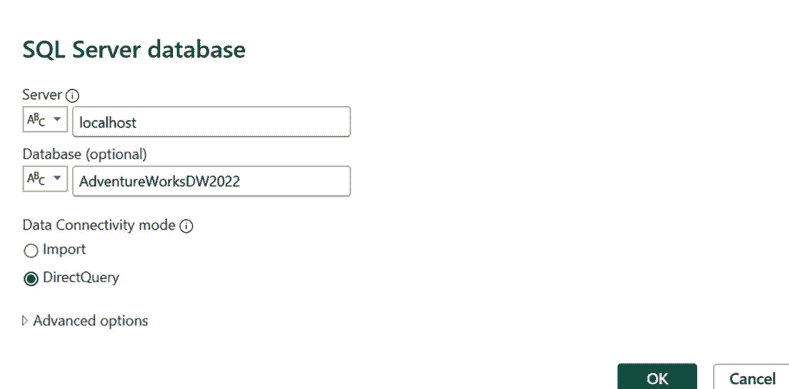

图 2.19：创建 DirectQuery 数据源

- 4. 选择 FactResellerSales 表，然后单击“转换数据”按钮。
- 5. 将查询重命名为“Reseller Sales”。

6. 在 Power Query 编辑器的“查询”窗格中右键单击 FactResellerSales 查询，然后选择“复制”。修改“导航”步骤，以引用支持模型的另一张表，例如 DimReseller 表。这可以通过编辑公式栏中的“Item”来完成，或单击“查询设置”窗格中“应用步骤”下“导航”步骤旁边的齿轮图标来完成。另外，将此查询重命名为能反映所引用数据的名称，例如“Resellers”。

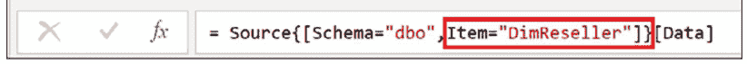

图 2.20：在公式栏中编辑“导航”步骤

7. 对所有必需的事实和维度重复步骤 6。例如：

- DimEmployee
- DimPromotion
- DimCurrency
- DimSalesTerritory

8. 单击“关闭并应用”按钮。

报表画布视图通过右下角的状态栏确认模型处于 DirectQuery 模式（见图 2.21）。此外，左侧窗格中的数据视图（对于导入模型可见）将不可见。

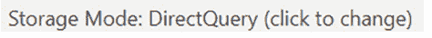

图 2.21：Power BI Desktop 中的 DirectQuery 状态

## 工作原理

DirectQuery 中支持的 M 转换函数受到与源系统兼容性的限制。当某个转换在 DirectQuery 模式下不受支持时，Power Query 编辑器会发出提示，如图 2.22 所示。

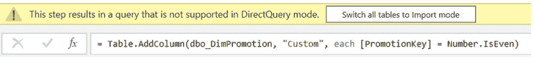

图 2.22：警告 Number.IsEven 函数在 DirectQuery 模式下不受支持

鉴于这一限制以及基于 M 的转换会给解决方案带来的额外复杂性，建议将所有必要的逻辑和转换嵌入源关系层中。理想情况下，源数据库中的基础表本身应体现这些需求。作为次要选项，可以创建一层视图来支持 DirectQuery 模型。

如果无法修改数据库对象本身，可以使用 M 函数 `Value.NativeQuery` 将 SQL 语句直接从 Power BI Desktop 传递给源数据库。例如：

```
let
    Source = Sql.Database("localhost", "AdventureWorksDW2022"),
    Query  = Value.NativeQuery(Source, "select * from DimCustomer", null, [EnableFolding = true])
in
    Query
```

当 Power BI 中的报表视觉对象被刷新或交互时，每个视觉对象的 DAX 查询会被转换为 SQL 语句，并利用源 SQL 语句返回结果。请注意，Power BI 确实会缓存 DirectQuery 模型的查询结果。因此，当访问最近使用过的视觉对象时，可以使用本地缓存，而无需向源发送新的查询。

从 Power BI 传递给 DirectQuery 数据源的 SQL 语句包含视觉对象所引用表中的所有列。例如，一个 Power BI 视觉对象使用来自 FactResellerSales 表的 SalesAmount，并按 DimReseller 中的 ResellerName 分组，这将生成一个 SQL 语句，该语句从两个表中选择列，并实现模型中定义的联接。但是，由于传递的 SQL 语句将这些源视图嵌入为派生表，关系引擎会生成一个查询计划，仅扫描支持联接和聚合所需的列。

## 更多内容…

DirectQuery 模型的性能和可扩展性主要由关系数据源决定。如果不需要近实时可见性，建议使用具有引用完整性并与 OLTP 工作负载隔离的非规范化星型模式。此外，对于报表和分析查询，建议使用受支持的 DirectQuery 源可用的内存和列式功能。

默认情况下，DirectQuery 模型会生成外部联接 SQL 查询，以确保即使没有关联维度，度量值也能返回正确值。但是，你可以配置 DirectQuery 模型以发送内部联接查询。这可以通过在建模视图中编辑表之间的关系，勾选“假定引用完整性”设置来完成，如图 2.23 所示。与源系统资源一起，这是影响 DirectQuery 模型性能的主要因素之一。

## 编辑关系

选择相关的表和列。

Reseller Sales

ProductKey OrderDateKey DueDateKey ShipDateKey ResellerKey EmployeeKey PromotionKey Ci

Promotions

PromotionKey PromotionAlternateKey EnglishPromotionName SpanishPromotionName FrenchF

基数

多对一 (*:1)

交叉筛选方向

单一

使此关系处于活动状态

假定引用完整性

了解详细信息

在两个方向上应用安全筛选器

确定

取消

图 2.23：在关系中激活引用完整性假定

## 如何创建数据流

要创建数据流，请登录 Power BI 服务：https://app.powerbi.com/，导航到本操作指南的 *准备工作* 部分创建的 Power BI Pro 工作区，然后执行以下步骤：

- 1. 在右上角选择“**新建**”，然后选择“**数据流**”，如 *图 2.24* 所示：

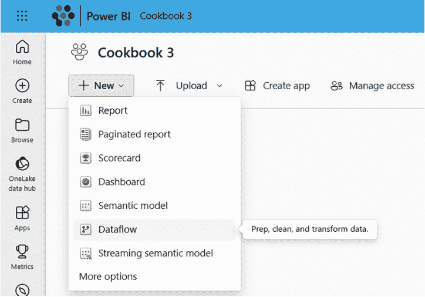

*图 2.24：选择要创建的新数据流*

- 2. 在“**开始创建数据流**”页面上，单击“**定义新表**”区域中的“**添加新表**”按钮。
- 3. 在“**选择数据源**”页面中，选择“**SQL Server 数据库**”。
- 4. 在“**连接到数据源**”页面中，输入 SQL Server 的连接设置和连接凭据，如 *图 2.25* 所示。如果你的网关与 SQL Server 运行在同一台计算机上，则服务器名称可以使用 localhost。否则，请指定运行 SQL Server 的计算机名称。同时，指定数据库（在本例中为 AdventureWorksDW2022）。保持“**连接**”设置为“**创建新连接**”，选择你的数据网关，然后输入 Windows 或 SQL Server 身份验证信息。完成后，单击“**下一步**”按钮。

## Power Query

获取数据

## 连接到数据源

### SQL Server 数据库

数据库

了解详细信息

### 连接设置

服务器 *

localhost

数据库

AdventureWorksDW2022

> 高级选项

### 连接凭据

连接

创建新连接

连接名称

localhost\AdventureWorksDW2022

数据网关

[本地] FabricGateway

身份验证类型

Windows

用户名

[已编辑]

密码

••••••••••••
 
图 2.25：数据源连接信息

- 5. 在“选择数据”页面上，勾选 FactInternetSales、DimCustomer、DimDate 和 DimProduct 旁边的复选框，然后单击“转换数据”按钮。
- 6. 将显示基于 Web 的 Power Query 编辑器版本。在这里，你可以像在 Power BI Desktop 中使用 Power Query 编辑器一样转换数据。在我们的例子中，无需进行数据转换，因此可以直接单击“保存并关闭”按钮。
- 7. 在“保存数据流”对话框中，为数据流输入名称，例如 AdventureWorksDW2022 Internet Sales，然后单击“保存”按钮。
- 8. 右上角会出现一条通知。单击“立即刷新”按钮从 SQL Server 中检索数据。

刷新后，该数据流可在 Power BI Desktop 中使用。为此，请打开 Power BI Desktop，在“主页”选项卡的功能区中单击“获取数据”，然后选择“数据流”。创建的数据流和关联的表将显示在导航器对话框中的工作区内。你可以选择所需的表，然后单击“加载”按钮。


## 工作原理

数据流从源系统引入数据，并将这些数据作为实体存储在符合 Microsoft 通用数据模型的文件夹中。这些实体数据存储在 Azure Data Lake Storage Gen2 中。你可以将实体视为表。

可以像在 Power BI 服务中刷新 Power BI Desktop 查询一样，为数据流创建刷新计划。刷新会更新 Azure Data Lake Storage Gen2 基础设施中的数据。连接到数据流的 Power BI Desktop 报表会从存储在 Azure Data Lake Storage Gen2 文件夹中的数据实体中拉取数据。

使用数据流可以提高 Power BI 报表以及源数据系统的性能。由于只有数据流与源系统交互，而不是可能许多不同的 Power BI Desktop 查询，这可能会减少源系统的负载。此外，特别是当源系统位于本地时，可以改善 Power BI 报表的刷新，因为通过数据网关检索数据的网络延迟被消除，Power BI 语义模型从已经存在于 Microsoft 云中的数据刷新。

## 更多内容…

决定在 Power BI Desktop 中使用数据流还是查询，取决于多种因素，包括你的数据准备需求、协作要求以及解决方案的可扩展性。以下是在 Power BI 中选择数据流和查询时的一些考虑因素：

在以下场景中考虑使用 Power BI 数据流：

- **集中式数据准备：** 如果有多个报表或仪表板需要相同或类似的数据准备步骤，使用数据流可以集中这些转换，确保各种报表之间的一致性。
- **数据转换的复用：** 数据流允许在不同的语义模型之间复用数据转换逻辑。如果你发现自己在多个语义模型中对相同的表应用类似的转换，数据流有助于创建一套标准化的转换。
- **协作：** 当多个用户或团队需要协作进行数据准备时，数据流提供了一个共享环境。这允许在数据准备过程中进行协作，一个用户所做的更改会反映给其他用户。
- **可扩展性：** 数据流适合处理大量数据和复杂的数据准备场景。数据流可以进行性能优化，并可以计划定期刷新数据。
- **与 Power Platform 集成：** 当使用 Power Apps 和 Power Automate 等其他 Power Platform 服务时，使用数据流可以通过通用数据模型促进这些服务之间的数据集成。

在以下场景中考虑使用 Power BI Desktop 查询：

- **针对单个报表的转换：** 如果数据准备需求是针对单个报表的，并且不会在其他报表中复用，使用 Power BI Desktop 查询可能更直接。
- **临时数据探索：** 当你正在为特定报表探索和分析数据时，使用 Power BI Desktop 查询允许进行更多的临时和交互式数据探索。
- **轻量级转换：** 对于相对简单或轻量级的数据转换，不需要大量复用或协作，使用 Power BI Desktop 查询可能就足够了。
- **个人项目：** 在处理个人项目或小规模报表任务时，使用 Power BI Desktop 查询提供了更独立的环境。

简而言之，数据流对于需要跨多个报表或仪表板进行集中和可复用的数据准备逻辑的场景非常有益。此外，如果协作和性能很重要，数据流可能是更好的选择。Power BI Desktop 查询更适合单独的、针对特定报表的数据转换，尤其是在不需要大量复用或协作的场景中。选择最终取决于具体的用例和要求。

## 另请参阅

- Dataflow Gen1 与 Dataflow Gen2 之间的差异：https://bit.ly/3MK9Zrx
- 数据流和自助式数据准备简介：https://bit.ly/3R4w46C

## 应用筛选器

精确且通常复杂的筛选条件的应用一直是商业智能的核心，Power BI Desktop 在其查询、数据模型和可视化组件中支持丰富的筛选功能。在许多场景下，通过 Power Query 编辑器和 M 函数在查询级别进行筛选是最佳选择，因为这可以减少导入和 DirectQuery 数据模型的工作量，并消除了在多个报表或可视化中重复应用相同筛选逻辑的需求。

尽管可以使用 Power Query 编辑器的图形界面来配置筛选条件，但本方案演示了 M 的核心筛选函数以及 M 在常见多条件筛选场景中的使用。本方案中构建的 M 表达式查询旨在突出一些最常见的筛选用例。

请注意，作为数据仓库 ETL 或 ELT（提取-加载-转换）流程的一部分应用数据转换，通常比使用 Power Query (M) 更可取。BI 团队和开发人员应注意避免创建与现有“事实来源”严重偏离的 Power BI 语义模型。

本方案将开发以下八个筛选查询：

- 1. 仅限美国客户。
- 2. 有3个或更多子女的客户。
- 3. 中间名或头衔列为空值的客户。
- 4. 首次购买日期在2012年到2013年之间的客户。
- 5. 管理岗位中性别为女性或学历为学士的客户。
- 6. 按收入排名的前100名客户。
- 7. 销售区域国家/地区的去重列表。
- 8. 小于等于当前日期且早于当前日期10年以上的日期值。

## 准备工作

为准备本方案，请执行以下操作从 AdventureWorksDW2022 数据库中导入 DimCustomer 和 DimDate 表：

- 1. 打开 Power BI Desktop，从“主页”选项卡的功能区中选择“转换数据”，打开 Power Query 编辑器。
- 2. 创建一个名为 AdventureWorksDW2022 的导入模式数据源查询。该查询应与以下内容类似：
- 3. 通过在“查询”窗格中右键单击查询并选择“移动到组”|“新建组”，将此查询隔离到名为“数据源”的查询组中。
- 4. 右键单击 AdventureWorksDW2022 查询并选择“引用”。
- 5. 在“数据”列中选择 DimCustomer 表链接，并将查询重命名为 Customers。
- 6. 对 DimDate 表重复步骤4和5，并将查询命名为 Dates。
- 7. 将维度查询分组到名为“基本查询”的查询组中。
- 8. 通过在“查询”窗格中右键单击每个查询并取消选择“启用加载”，禁用所有查询的加载。
- 9. 对于 DimCustomer 查询，找到 DimGeography 列。在列标题中，单击分叉箭头图标，取消选中“选择所有列”和“使用原始列名作为前缀”复选框，然后选中 CountryRegionCode 和 DimSalesTerritory 旁边的复选框，再单击“确定”按钮。

```
let
    Source = Sql.Database("localhost", "AdventureWorksDW2022")
in
    Source
```

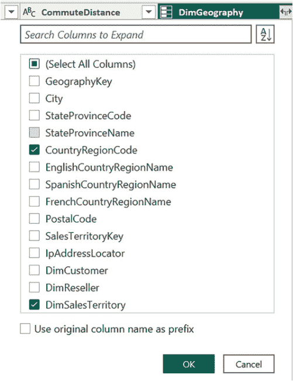

*图2.26：展开DimGeography以包含CountryRegionCode和DimSalesTerritory*

- 10. 现在，展开 DimSalesTerritory 列，并且只选择 SalesTerritoryCountry 列。

有关执行这些步骤的更多详细信息，请参阅本章中的*导入数据*方案。

## 如何应用多重筛选器

要实现本方案，请执行以下步骤：

- 1. 右键单击 Customers 查询，选择**引用**，然后打开此查询的**高级编辑器**窗口。使用 `Table.SelectRows` 函数应用美国查询谓词，并将查询重命名为 `United States Customers`。完成后的查询应与以下内容相同：

```
let
    Source = Customers,
    USCustomers = Table.SelectRows(
        Source, each [CountryRegionCode] = "US")
in
    USCustomers
```


+   2. 重复 *步骤 1*，但这次在 `TotalChildren` 列上筛选 `>= 3` 并将此查询重命名为 `Customers w3+ Children`：

```
let
    Source = Customers,
    ThreePlusChildFamilies = Table.SelectRows(
        Source, each [TotalChildren] >= 3)
in
    ThreePlusChildFamilies
```

+   3. 重复 *步骤 1*，但这次使用条件逻辑运算符 `or` 来定义 `MiddleName` 或 `Title` 列中空白值的筛选条件。使用小写字面量 `null` 表示空白值。将此查询命名为 `Missing Titles or Middle Names`：

```
let
    Source = Customers,
    MissingTitleorMiddleName =
        Table.SelectRows(
            Source, each [MiddleName] = null or [Title] = null
        )
in
    MissingTitleorMiddleName
```

+   4. 重复 *步骤 1*，但这次使用 `#date` 字面量对 `DateFirstPurchase` 列应用 2012–2013 筛选。将此查询重命名为 `2012–2013 First Purchase Customers`：

```
let
    Source = Customers,
    BetweenDates =
        Table.SelectRows(
            Source,
            each [DateFirstPurchase] >= #date(2012, 01, 01) and
                 [DateFirstPurchase] <= #date(2013, 12, 31)
        )
in
    BetweenDates
```

+   5. 重复 *步骤 1*，但这次使用括号来定义 `EnglishOccupation` 为 Management，且性别为女性（F）或教育程度为 Bachelors 的筛选条件。括号确保职业筛选条件与性别/教育条件隔离。将此查询重命名为 `Management and Female or Bachelors`：

```
let
    Source = Customers,
    MgmtAndFemaleOrBachelors =
        Table.SelectRows(
```

```
Source,
    each
        [FullDateAlternateKey] <= DateTime.Date(DateTime.
LocalNow()) and
        [CalendarYear] >= Date.Year(DateTime.LocalNow()) - 10
    )
    in
    TrailingTenYearsFromToday
```

## 如何工作

`Table.SelectRows` 函数是 M 语言中主要的表格筛选函数，其功能与 SQL 中的 FROM 和 WHERE 子句相对应。请注意变量名被用作 M 函数的输入，例如 Source 行被用作 `Table.SelectRows` 函数的第一个参数。

你不必担心 `Table.SelectRows` 函数的 each 语法。在许多语言中，这会暗示逐行迭代，但在可能的情况下，M 引擎会将该函数折叠到提交给源系统的 SQL 查询的 WHERE 子句中。

在查询 United States Customers、Customers w3+ Children、Missing Titles or Middle Names（步骤 1-3）以及 Management and Female or Bachelors（步骤 5）中，注意每种选择条件的各种形式。语法支持多种比较运算符以及复杂的逻辑，包括使用括号来隔离逻辑测试。

在 2012-2013 First Purchase Customers 查询（步骤 4）中，使用了 `#date` 字面量函数来生成比较值。字面量也适用于 DateTime（#datetime）、Duration（#duration）、Time（#time）和 DateTimeZone（#datetimezone）。

在 Top US Customers by Income 查询（步骤 6）中，使用了 `Table.Sort` 函数按指定列和排序顺序对行进行排序。`Table.Sort` 函数还支持多个列，如本章的 Importing Data 食谱所述。然后使用 `Table.FirstN` 函数返回 100 行，从排序后表格的最顶部开始。在此示例中，由于收入相同，返回的集合不是确定的。

Customer Sales Territory List 查询（步骤 7）返回的是列表而不是表格。这从查询窗格中该查询与其他查询不同的图标可以看出。列表在 M 中与表格不同，在处理列表而不是表格时必须使用不同的函数集。不同值的列表可以用多种方式使用，例如作为参数的动态可用输入值来源。

最后，在 `Trailing 10 Yrs from Today` 查询（*步骤 9*）中，当前日期和年份从 `DateTime.LocalNow` 函数中获取，然后与日期维度的列进行比较。

## 还有更多...

对于简单的筛选条件以及概念验证项目，使用 UI 开发筛选条件可能有助于加快查询开发速度。然而，开发人员应审查这些界面生成的 M 表达式，因为它们仅基于设计时可用的数据预览，并且在某些条件下可能会做出逻辑筛选假设。

要访问 Filter Rows 对话框，请单击列标题中的下拉按钮，然后选择 Text Filters 选项，然后指定起始筛选条件。

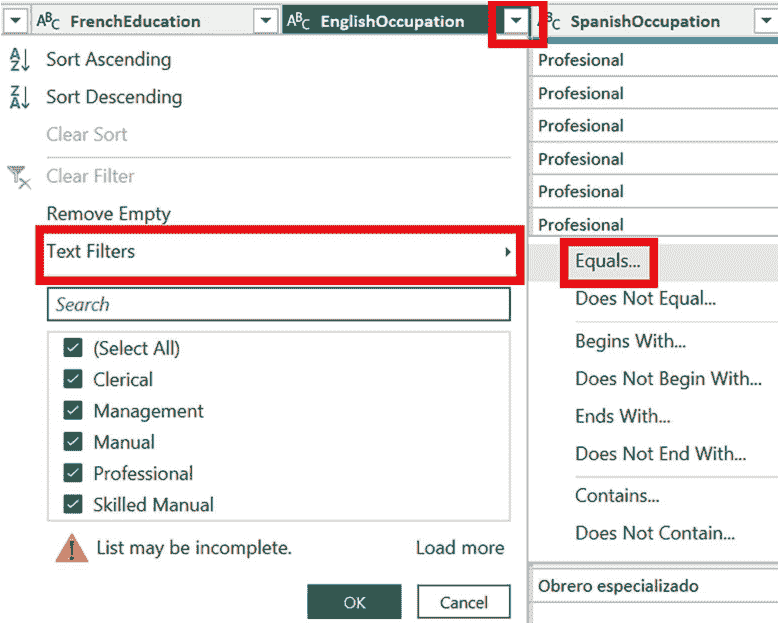

*Figure 2.27: Accessing the Filter Rows dialog*

Filter Rows 对话框的 Basic 选项仅允许你使用当前选定的列进行操作。但是，通过单击 Advanced 单选按钮，你可以使用表格中的任何列。

## Filter Rows

对此表格中的行应用一个或多个筛选条件。

Basic Advanced

保留行条件

| And/Or | Column | Operator | Value |
|---|---|---|---|
|  | EnglishOccupation | equals | Management |
| And | Gender | equals | F |
| Or | EnglishEducation | equals | Bachelors |

Add Clause

OK Cancel

Figure 2.28: Advanced Filter Rows dialog in Query Editor

尽管如此，即使是 Filter Rows 对话框的高级版本也不提供分组逻辑筛选条件的能力。虽然图 2.28 中的对话框看起来像是重建了 Management and Female or Bachelors 的查询，但生成的 M 代码不包含对 Gender 和 EnglishEducation 子句进行分组的括号。因此，生成代码必须在 Advanced Editor 中手动编辑，才能返回与原始 Management and Female or Bachelors 查询相同的结果。图 2.28 中显示的 Filter Rows 对话框生成的 M 代码生成以下代码：

```
Table.SelectRows(
    Source,
    each
        [EnglishOccupation] = "Management" and
        [Gender] = "F" or
        [EnglishEducation] = "Bachelors"
)
```

## 另请参阅

+   - Table.SelectRows: http://bit.ly/3bSkEyj
+   - Table.Sort: http://bit.ly/3qPaeUo
+   - Table.FirstN: http://bit.ly/3ttb0In

+   - List.Distinct: http://bit.ly/3InCqwq
+   - List.Sort: http://bit.ly/30QLEb1
+   - 10 Common Mistakes You Do In #PowerBI #PowerQuery – Pitfall #3: http://bit.ly/2nLX6QW

## 转换和清理数据

在 Power BI 的 M 查询中应用的转换用于保护数据模型的完整性并支持增强的分析和可视化。具体转换因数据质量、集成需求以及整体解决方案的目标而异。至少，开发人员应寻求保护模型关系的完整性，并通过非规范化和标准化简化用户体验。此外，开发人员应与数据源所有者沟通，以确定所需的转换是否可以在源中实现或通过 SQL 视图对象提供。

本食谱演示了如何保护模型免受源数据中重复值的影响，这些重复值可能会阻止数据模型中正确关系的形成，甚至可能导致查询失败。虽然使用了简单的场景，但本食谱演示了在尝试合并多个数据源并消除重复时可能遇到的场景。

## 准备工作

为准备工作，请从 AdventureWorksDW2022 数据库导入 DimProduct 和 FactResellers 表，执行以下操作：

+   1. 打开 Power BI Desktop 并从 Home 选项卡的 ribbon 中选择 Transform data 以打开 Power Query Editor。
+   2. 创建一个名为 AdventureWorksDW2022 的 Import 模式数据源查询。此查询应类似于以下内容：
+   3. 将此查询隔离在名为 Data Sources 的查询组中并禁用查询的加载。
+   4. 右键单击 AdventureWorksDW2022 查询并选择 Reference，在数据预览区域中选择 DimProduct 表，并将此查询重命名为 Products。右键单击 EnglishProductName 列并选择 Remove Other Columns。
+   5. 重复步骤 4，但这次选择 FactResellerSales。将此查询重命名为 Reseller Sales。
+   6. 展开 DimProduct 列并仅选择 EnglishProductName 列。确保未选中 Use original column name as prefix 并单击 OK。
+   7. 将 Products 和 Reseller Sales 查询拖到 Other Queries 组并将查询应用于数据模型。

```
let
    Source = Sql.Database("localhost", "AdventureWorksDW2022")
in
    Source
```


8. 在 Power BI Desktop 的模型视图中，尝试使用两个表中的 EnglishProductName 列在表之间建立关系。注意显示出的警告。

> 此关系具有多对多基数。仅当预期两个列（EnglishProductName 和 EnglishProductName）都不包含唯一值，并且理解多对多关系的显著不同行为时，才应使用此关系。了解更多信息

图 2.29：多对多关系基数警告

有关执行这些步骤的更多详细信息，请参阅本章中的“导入数据”一节。

## 如何转换和清理数据

我们希望从 Products 查询中的 EnglishProductName 列中删除重复项。要实现此方法，请执行以下步骤：

1. 在 Power Query 编辑器中，选择 Products 查询。
2. 使用 Text.Trim 函数删除 EnglishProductName 列中前导和尾随的空格。可以通过在用户界面中右键单击 EnglishProductName 列标题，选择“转换”，然后选择“修剪”来完成此操作。
3. 使用 Table.DuplicateColumn 函数创建 EnglishProductName 键列的重复列，并将此新列命名为“Product Name”。可以通过在用户界面中右键单击 EnglishProductName 列标题并选择“复制列”来完成此操作。
4. 添加一个表达式，通过 Table.TransformColumns 函数强制将 EnglishProductName - Copy 列转换为大写。此新表达式必须在应用删除重复项的表达式之前应用。可以通过在用户界面中右键单击 EnglishProductName 列标题，选择“转换”，然后选择“大写”来完成此操作。
5. 使用 Table.Distinct 函数向 DimProduct 查询添加一个表达式以删除重复行。可以通过在用户界面中右键单击 EnglishProductName 列标题并选择“删除重复项”来完成此操作。
6. 通过 Table.RemoveColumns 删除大写化的 EnglishProductName - Copy 列。可以通过在用户界面中右键单击 EnglishProductName 列标题并选择“删除”来完成此操作。

最终查询应类似于以下内容：

```m
let
    Source = AdventureWorksDW2022,
    dbo_DimProduct = Source{[Schema = "dbo", Item = "DimProduct"]}[Data],
    #"Removed Other Columns" = Table.SelectColumns(dbo_DimProduct,
        {"EnglishProductName"}),
    #"Trimmed Text" = Table.TransformColumns(
        #"Removed Other Columns",
        {{"EnglishProductName", Text.Trim, type text}}
    ),
    #"Duplicated Column" = Table.DuplicateColumn(
        #"Trimmed Text",
        "EnglishProductName",
        "EnglishProductName - Copy"
    ),
    #"Uppercased Text" = Table.TransformColumns(
        #"Duplicated Column",
        {{"EnglishProductName - Copy", Text.Upper, type text}}
    ),
    #"Removed Duplicates" = Table.Distinct(#"Uppercased Text",
        {"EnglishProductName - Copy"}),
    #"Removed Columns" = Table.RemoveColumns(#"Removed Duplicates",
        {"EnglishProductName - Copy"})
in
    #"Removed Columns"
```

### 工作原理

在 Trimmed Text 表达式中，Text.Trim 函数会删除列开头和结尾的空白。不同数量的空白会使这些行在查询引擎中有所区分，但在模型中不一定不同。因此，最好先使用 Text.Trim，然后再删除重复的行和值。

在下一个表达式中，Table.DuplicateColumn 函数用于复制我们要从中删除重复值的列。这样做的原因是，我们需要转换要从中删除重复项的列中的值，以处理混合大小写的情况，例如“Fender Set”和“Fender set”。因此，我们希望使用此重复列来保留原始值和大小写。

为了消除混合大小写问题，下一个表达式使用 Table.TransformColumns 函数并指定 Text.Upper，将重复列中的所有值更改为大写。M 引擎将混合大小写的值视为唯一，但数据模型引擎不会。

下一个表达式会删除重复列中具有重复值的行。这可以针对整个表完成，也可以仅针对特定列完成。

此时，查询已能够应对重复值和行、混合大小写以及空格问题。我们现在可以使用 Table.RemoveColumns 函数直接删除重复列。

我们现在可以在 DimProduct 和 FactResellerSales 表之间建立一对多关系。

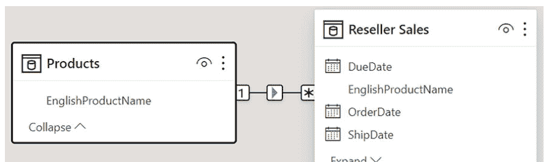

图 2.30：简单的一对多关系模型

### 更多内容...

为支持故障排除，请创建一个查询，该查询访问同一源表并从 EnglishProductName 列中检索具有多行的值。

```m
let
    Source = AdventureWorksDW2022,
    dbo_DimProduct = Source{[Schema="dbo",Item="DimProduct"]}[Data],
    RemoveColumns = Table.SelectColumns(dbo_DimProduct,{"EnglishProductName"}),
    TrimText =
        Table.TransformColumns(
            RemoveColumns,{"EnglishProductName",Text.Trim}
        ),
    UpperCase =
        Table.TransformColumns(
            TrimText,{{"EnglishProductName", Text.Upper}}
        ),
    GroupedRows =
        Table.Group(
            UpperCase, {"EnglishProductName"},
            {{"Rows", each Table.RowCount(_), Int64.Type}}
        ),
    Duplicates = Table.SelectRows(GroupedRows, each [Rows] > 1)
in
    Duplicates
```

选择 EnglishProductName 列，对其进行修剪、转换为大写、分组，然后进行筛选，以始终检索所有重复的键值。禁用此查询的加载，因为该查询仅用于故障排除。

### 另请参阅

- Table.SelectColumns: http://bit.ly/38Qk7Lt
- Table.RemoveColumns: http://bit.ly/3cJju7p
- Table.TransformColumns: http://bit.ly/3tsdxm2
- Table.DuplicateColumn: http://bit.ly/3cIF63X
- Table.Distinct: http://bit.ly/38V8mmN
- Text.Trim: http://bit.ly/3eUmAZ0
- Text.Upper: http://bit.ly/3vFW2R6
- 文本的 M 函数参考：http://bit.ly/2nUYjnw

## 创建自定义列

业务用户通常通过附加列扩展现有报表和数据模型的输出，以帮助分析和展示数据。这些列的逻辑通常通过 Excel 公式或计算得出的 DAX 列来实现。更好的解决方案是通过 Power Query 编辑器和 M 语言创建列，尤其是在逻辑无法迁移到数据仓库或 IT 资源的情况下。

开发自定义列还可以显著提高数据模型及其支持的视觉对象的易用性和分析能力。在本方法中，将创建一些列，以应用自定义命名格式，并通过现有列简化客户维度的分析。

### 准备工作

要为此方法做好准备，请执行以下操作，从 AdventureWorksDW2022 数据库导入 DimCustomer 表：

1. 打开 Power BI Desktop，并从**开始**选项卡的功能区中选择**转换数据**，以打开**Power Query 编辑器**。
2. 创建一个名为 AdventureWorksDW2022 的**导入**模式数据源查询。此查询应类似于以下内容：

```m
let
    Source = Sql.Database("localhost", "AdventureWorksDW2022")
in
    Source
```

3. 将此查询隔离在名为 **Data Sources** 的查询组中，并禁用该查询的加载。
4. 右键单击 AdventureWorksDW2022 查询并选择 **Reference**（引用），在数据预览区域中选择 DimCustomer 表，然后将此查询重命名为 Customers。

有关执行这些步骤的更多详细信息，请参阅本章中的 *导入数据* 一节。

### 如何创建自定义列

要实现此方法，请执行以下步骤：

1. 向 Customers 查询添加变量，使表达式支持当前系统日期与 BirthDate 列之间的比较。然后将以下代码复制到 Customers 查询中，替换所有现有内容。

```m
let
    Source = AdventureWorksDW2022,
    dbo_DimCustomer = Source{[Schema="dbo",Item="DimCustomer"]}[Data],
    CurrentDate = DateTime.Date(DateTime.LocalNow()),
    CurrentYear = Date.Year(CurrentDate),
    CurrentMonth = Date.Month(CurrentDate),
    CurrentDay = Date.Day(CurrentDate)
in
    dbo_DimCustomer
```

2. 使用 `Table.SelectColumns` 从 Customers 表中检索所需的源列：`FirstName`、`LastName`、`MiddleName`、`Title` 和 `BirthDate`。在用户界面中，可以按住 *Ctrl* 键，选择这些列的列标题，右键单击其中一个选定的列标题，然后选择**删除其他列**来完成此操作。

3. 编写一个带有 `if...then` 表达式的 `Table.AddColumn` 函数，该函数在给定目标格式 `Mr. John A. Doe` 的情况下处理不同情景：

```m
NameFormatTable =
    Table.AddColumn(
        #"Removed Other Columns","Formatted Name", each
            if [Title] = null and [MiddleName] = null
                then [FirstName] & " " & [LastName]
            else if [Title] = null
                then [FirstName] & " " & Text.Range([MiddleName],0,1)
                    & ". " & [LastName]
            else
                [Title] & " " & [FirstName] & " "
                    & Text.Range([MiddleName],0,1) & ". " & [LastName]
    )
```

4. 使用 `Table.AddColumn` 函数基于 `BirthDate` 列创建 `Customer Year`、`Customer Month` 和 `Customer Day` 列。

```m
AddCustomerYear =
    Table.AddColumn(
        NameFormatTable, "Customer Year", each Date.Year([BirthDate]),
        Int64.Type
```


```
),
AddCustomerMonth =
    Table.AddColumn(
        AddCustomerYear, "Customer Month", each Date.Month([BirthDate]),
        Int64.Type
    ),
AddCustomerDay =
    Table.AddColumn(
        AddCustomerMonth, "Customer Day", each Date.Day([BirthDate]),
        Int64.Type
    )
```

5. 使用 if...then 表达式添加 Age 列。

```
CustomerAge =
    Table.AddColumn(
        AddCustomerDay,"Customer Age", each
        if [Customer Month] < CurrentMonth
            then CurrentYear - [Customer Year]
        else if [Customer Month] > CurrentMonth
            then CurrentYear - [Customer Year] - 1
        else if [Customer Day] < CurrentDay
            then CurrentYear - [Customer Year]
        else CurrentYear - [Customer Year] - 1
    )
```

6. 通过步骤 5 中计算的列添加 Customer Age Segment 列。

```
CustomerSegment =
    Table.AddColumn(
        CustomerAge, "Customer Age Segment", each
        if [Customer Age] < 30 then "Less than 30"
        else if [Customer Age] < 40 then "30 to 39"
        else if [Customer Age] < 50 then "40 to 49"
        else if [Customer Age] < 60 then "50 to 59"
        else "60 or Older"
    )
```

7. 修改查询末尾的 in 子句以返回 CustomerSegment。

完整的查询可在本教程的 PBIX 文件中找到。

## 更多内容

Power Query 编辑器提供了用于添加列的图形用户界面。这些界面提供了添加列的机制，作为手动编写代码的替代方案。本质上，添加列的 M 代码是这些界面生成的输出。

其中一种界面是**从示例创建列**功能，用户只需输入所需列输出的示例。引擎会确定需要向查询中添加哪些 M 函数和步骤序列，以返回与所提供的示例一致的结果。要探索此功能，请按照以下步骤操作：

- 1. 创建一个引用 AdventureWorksDW2022 查询的新查询。
- 2. 选择 DimCustomer 表。
- 3. 选择 Title、FirstName、MiddleName、LastName 和 BirthDate 列，并删除所有其他列。
- 4. 在功能区中选择“添加列”选项卡，然后单击“从示例创建列”按钮。

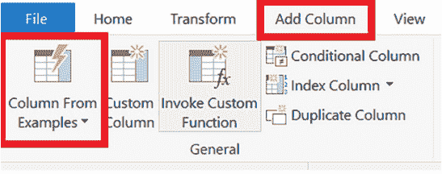

*图 2.31：从示例创建列功能*

- 5. 在第一行输入客户的 FirstName、MiddleName 和 LastName 值，然后按 Enter 键。请注意，其余行将根据这第一行自动计算。

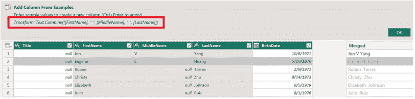

*图 2.32：从示例创建列界面*

- 6. 单击“确定”按钮以接受转换。

另一种添加列的界面是“条件列”功能。此功能提供了一种创建条件列的方法，作为编写 if...then 表达式的替代方案。要了解此功能的运作方式，请按照以下步骤操作：

- 1. 选择“添加列”选项卡，然后从功能区中选择“条件列”。

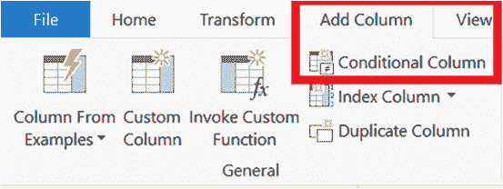

图 2.33：条件列功能

- 2. 在“添加条件列”对话框中填写字段，使用“添加子句”按钮添加额外的 else if 语句；单击“确定”按钮退出对话框并创建新列。

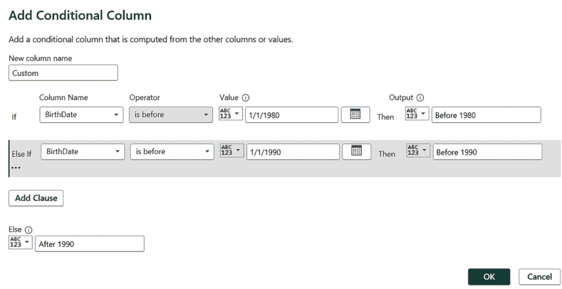

图 2.34：添加条件列对话框

可以引用表中的任何列，并且可以使用省略号 (...) 在评估顺序中上下移动多个已创建步骤。打开高级编辑器以检查创建的代码。

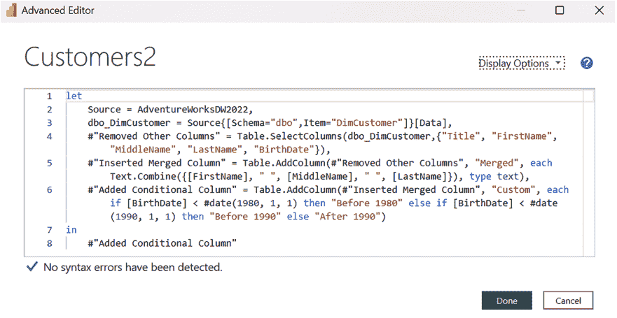

*图 2.35：添加的条件列 M 代码*

## 另请参阅

- - `Table.AddColumn`：http://bit.ly/3vGJZ6b
- - `Table.SelectColumns`：http://bit.ly/38Qk7Lt
- - DateTime 函数：http://bit.ly/3tPtKlJ
- - 从示例添加列：http://bit.ly/3eWTLv6

## 组合和合并查询

Power BI 查询功能的全部力量在于通过其合并和追加转换，将代表不同数据源的不同查询集成在一起。可以高效且安全地开发整合来自多个网络位置的文件或集成来自多个数据源的数据的检索过程。此外，使用 M 语言可以实现 SQL 和 ETL 开发人员所熟悉的相同连接类型和数据转换模式。本教程提供了将多个源合并到单个查询中并利用 M 语言的表连接函数来支持常见转换场景的示例。

## 准备工作

要遵循本教程，您可以使用 Power Query 编辑器“**主页**”选项卡上的“**合并查询**”和“**追加查询**”图标来生成本教程中使用的连接表达式。但是，由于连接查询是检索过程的基础，建议学习如何使用 `Table.Join`、`Table.NestedJoin` 和 `Table.Combine` 函数。

要为本教程做好准备，请执行以下操作，从 AdventureWorksDW2022 数据库中导入 `DimCustomer` 和 `FactInternetSales` 表：

- 1. 打开 Power BI Desktop，然后从“**主页**”选项卡的功能区中选择“**转换数据**”以打开 Power Query 编辑器。
- 2. 创建一个名为 `AdventureWorksDW2022` 的“**导入**”模式数据源查询。此查询应类似于以下内容：

```m
let
    Source = Sql.Database("localhost", "AdventureWorksDW2022")
in
    Source
```

- 3. 将此查询隔离在名为“**数据源**”的查询组中，并禁用查询的加载。
- 4. 右键单击 `AdventureWorksDW2022` 查询并选择“**引用**”，在数据预览区域中选择 `DimEmployee` 表，并将此查询重命名为 `Employees Staging`。
- 5. 重复*步骤 4*，但选择 `FactInternetSales` 表，并将此查询命名为 `Sales 2011`。筛选 `OrderDate` 列，使其介于 2011 年 1 月 1 日和 2011 年 12 月 31 日之间。这可以在用户界面中通过单击 `OrderDate` 列标题中的向下箭头图标，选择“**日期/时间筛选器**”，然后选择“**介于...**”来完成。

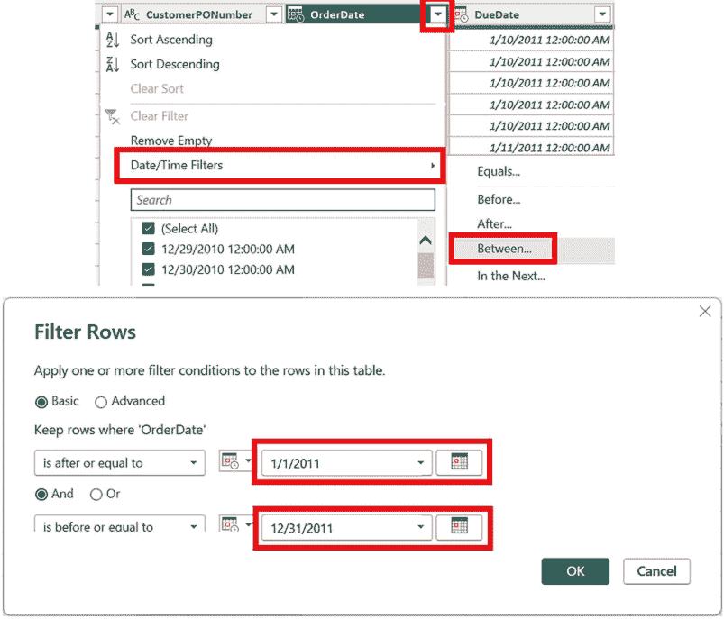

```
SelectCols =
    Table.SelectColumns(
        ManagerName,
        { "EmployeeKey", "Manager Name", "Title" }
    )
in
    SelectCols
```

- 11. 创建一个新查询，使用 `Table.NestedJoin` 函数或功能区中的“合并查询”功能来连接 Managers 查询和 Employees Staging 查询。将此查询命名为 Employees，并将其放在“其他查询”组中。

```
let
    Source = Table.NestedJoin(#"Employees Staging", {"ParentEmployeeKey"}, Managers, {"EmployeeKey"}, "Managers", JoinKind.LeftOuter)
in
    Source
```

- 12. 使用 `Table.ExpandTableColumn` 函数添加 Manager Name 和 Manager Title 列。

```
#"Expanded Managers" = Table.ExpandTableColumn(Source, "Managers", {"Manager Name", "Title"}, {"Manager Name", "Manager Title"})
```

- 13. 添加 Employee Name 列。

```
EmployeeName =
    Table.AddColumn(
        #"Expanded Managers",
        "Employee Name", each [FirstName] & " " & [LastName]
    )
```

- 14. 将 Title 列重命名为 Employee Title。

```
#"Renamed Columns" = Table.RenameColumns(EmployeeName,{{"Title", "Employee Title"}})
```

- 15. 仅选择 EmployeeKey、Employee Name、Employee Title、Manager Name 和 Manager Title 列，并删除所有其他列。

```
#"Removed Other Columns" = Table.SelectColumns(#"Renamed Columns",{"EmployeeKey", "Employee Title", "Manager Name", "Manager Title", "Employee Name"})
```

## 工作原理

对于 `InternetvSalesv2011-2013` 查询，只需使用 `Table.Combine` 函数的一个表达式。在此示例中，无需其他表达式，因为暂存查询具有相同的列名和相同数量的列。`Table.Combine` 函数执行追加操作，并且不删除重复行，类似于 SQL UNION 语句。

在 `Table.Combine` 函数中，输入表中任一表独有的列都将添加到结果集中，其他表的行对应的值为 null。根据具体情况，开发人员可以应用 `Table.Distinct` 函数来避免任何重复行进入数据模型。

`Employees` 查询在 `Table.NestedJoin` 函数中引用 `Employees Staging` 查询作为左表，并通过左外部连接与 `Managers` 查询连接。在此场景中，需要进行左连接以保留所有员工行，因为 `DimEmployees` 表包含一个没有父员工键的员工，即首席执行官。

连接在 `DimEmployees` 查询中的 `ParentEmployeeKey` 列与 `Managers` 查询中的 `EmployeeKey` 列之间进行。此步骤之后，来自匹配 `Managers` 表的所有行将作为 `Table` 对象存储在 `Managers` 列中。使用 `Table.ExpandTableColumn` 函数展开 `Managers` 列时，`Manager Name` 列可以保留相同的名称，但 `Title` 列被重命名为 `Manager Title`，以避免与 `Employees Staging` 查询中的 `Title` 列冲突。

在实现表连接时，您可以选择使用 `Table.Join` 和 `Table.NestedJoin` 函数。这两个函数都支持所有六种连接类型——内连接、左外部、右外部、完全外部、左反和右反。`Table.NestedJoin` 函数将连接结果（右表或第二个表）输入到一个包含表值的新列中，并将使用本地资源执行连接操作，除非使用 `Table.ExpandTableColumn` 函数用右表的列替换此新列。如果未指定 `JoinKind` 参数，则默认连接类型为左外部。出于性能原因，不应在未使用 `Table.ExpandTableColumn` 函数移除表列的情况下使用 `Table.NestedJoin`。

相反，`Table.Join` 函数会自动使用右表输入中的列展开左表（扁平连接），如果未指定 `JoinKind` 参数，则默认为内连接。`Table.Join` 函数无需任何附加函数即可折叠到源，但对于内连接以外的 `JoinKind`，连接的表之间不能有匹配的列名。对于内连接，必须在连接键参数中指定两个表中匹配的列名。需要使用 `Table.SelectColumns` 函数来排除随连接添加的右表中的任何列。

无论是通过 `Table.NestedJoin` 还是 `Table.Join` 实现，如果源表具有引用完整性（例如外键约束），并且这符合要求，开发人员都应考虑使用内连接。对于针对较大表的连接，开发人员应确认是否发生查询折叠，并且可以在性能方面评估替代检索设计生成的不同查询计划。


请注意，Rob Walters 的两行记录是由于源数据库中应用了缓慢变化维度（SCD）类型 2 过程所致。有关 SCD 的更多信息，请参阅此维基百科文章：https://bit.ly/3yIQeI5。

## 还有更多…

与其创建单独的查找/连接暂存查询，不如将这些表达式合并为单个 let...in M 表达式。例如，以下单个查询返回的结果与 Sales 2011、Sales 2012、Sales 2013 和 Internet Sales 2011–2013 查询完全相同：

```
let
    Source = AdventureWorksDW2022,
    Sales = Source{[Schema="dbo",Item="FactInternetSales"]}[Data],
    Sales2011Rows =
        Table.SelectRows(
            Sales, each
                [OrderDate] >= #datetime(2011, 1, 1, 0, 0, 0) and
                [OrderDate] <= #datetime(2011, 12, 31, 0, 0, 0)
        ),
    Sales2012Rows =
        Table.SelectRows(
            Sales, each
                [OrderDate] >= #datetime(2012, 1, 1, 0, 0, 0) and
                [OrderDate] <= #datetime(2012, 12, 31, 0, 0, 0)
        ),
    Sales2013Rows =
        Table.SelectRows(
            Sales, each
                [OrderDate] >= #datetime(2013, 1, 1, 0, 0, 0) and
                [OrderDate] <= #datetime(2013, 12, 31, 0, 0, 0)
        ),
    Append = Table.Combine( {Sales2011Rows, Sales2012Rows, Sales2013Rows} )
in
    Append
```

内联查询方法有助于限制查询数量，但你会失去组文件夹和查询依赖关系视图提供的管理优势。图形化支持使得解释和快速排查数据检索过程变得更容易，而无需使用单个但复杂的 M 表达式。

暂存查询建议用于除最简单项目和检索过程之外的所有情况。暂存查询通常不应加载到数据模型中，因为暂存表可能会让用户感到困惑，并且会要求数据模型使用额外的资源来处理和存储额外的数据。

同样，合并查询也可以合并为单个查询。下表分解了可在 `Table.NestedJoin` 和 `Table.Join` 函数中指定的六种不同连接类型。参数和参数值都可以使用，尽管本书中的配方使用参数，因为这样表达式更容易理解。

| Join type | Parameter | Parameter value |
|---|---|---|
| Inner | `JoinKind.Inner` | 0 |
| Left Outer | `JoinKind.LeftOuter` | 1 |
| Right Outer | `JoinKind.RightOuter` | 2 |
| Full Outer | `JoinKind.FullOuter` | 3 |
| Left Anti | `JoinKind.LeftAnti` | 4 |
| Right Anti | `JoinKind.RightAnti` | 5 |

*Table 2.3: Power Query (M) join types, parameters, and parameter values*

最后一点需要注意的是，对于存储在同一网络目录文件夹中且结构相同的源数据文件，Power BI 提供了 Combine Binaries 转换，可与文本、CSV、Excel、JSON 和其他文件格式一起使用。此功能可在创建文件夹查询时使用。Combine Binaries 功能会自动创建示例查询和与该查询关联的函数，以便可将对源文件的任何必要修改应用于所有文件，并且可以轻松修改文件源位置。

## 另请参阅

- `Table.Combine`: http://bit.ly/3c6L2o0
- `Table.NestedJoin`: http://bit.ly/30Z03jZ
- `Table.Join`: http://bit.ly/31xMRh7
- `Table.ExpandTableColumn`: http://bit.ly/3eY6u0z
- `Table.AddColumn`: http://bit.ly/3vGJZ6b
- `Table.SelectColumns`: http://bit.ly/38Qk7Lt
- `Table.RenameColumns`: http://bit.ly/3rTVfd4
- M table function reference: http://bit.ly/2oj0k0I
- Combining binaries in Power BI Desktop: http://bit.ly/2oL2nM4

## 分析源数据

在开发任何语义模型和报表之前，尤其是在业务利益相关者开始使用内容获取洞察之前，评估和验证源数据质量是一个良好的实践。数据质量分析练习可以揭示各种问题的存在，从某些列中存在空值或空白值，到重复行，到缺乏唯一或标识（主键）列。此练习的结果可为是否可以清理源系统数据本身，或 BI 解决方案是否将通过 Power Query (M) 数据清理功能可用的各种方法来解决这些问题提供决策依据。

数据质量主题涉及语义模型的整体实用性，以及为某些目的轻松处理和使用数据（包括分析和报告）的能力。数据质量是数据治理的重要组成部分，确保业务数据准确、完整、一致且有效。良好的数据质量是任何数据分析和报告工作的基本要素。糟糕的数据质量可能导致企业做出错误的分析和决策——因此有“垃圾进，垃圾出”这一说法。幸运的是，Power Query Editor 提供了强大的数据分析工具，可帮助快速确定所处理数据的质量。本配方演示如何解锁 Power Query Editor 中的强大工具来分析列并了解所处理数据的质量。

## 准备工作

要为本配方做好准备，请通过执行以下操作从 AdventureWorksDW2022 数据库导入 FactFinance 表：

- 1. 打开 Power BI Desktop 并从 **Home** 选项卡的 ribbon 中选择 **Transform data** 以打开 Power Query Editor。
- 2. 创建一个名为 AdventureWorksDW2022 的导入模式数据源查询。此查询应类似于以下内容：
- 3. 通过右键单击 **Queries** 窗格中的查询并选择 **Move To Group | New Group** 将此查询隔离到名为 Data Sources 的查询组中。
- 4. 右键单击 AdventureWorksDW2022 查询并选择 **Reference**。
- 5. 选择 Data 列中的 FactFinance 表链接并将查询重命名为 Finances。
- 6. 将 Finances 查询移动到 Other Queries 组。

```
let
    Source = Sql.Database("localhost", "AdventureWorksDW2022")
in
    Source
```

有关执行这些步骤的更多详细信息，请参阅本章中的 *Importing Data* 配方。

## 如何分析源数据

要实现本配方，请执行以下步骤：

- 1. 选择 Finances 查询。
- 2. 在 View 选项卡中，勾选 Data Preview 区域 ribbon 中的 Column profile 复选框。
- 3. 选择一列以查看列统计信息，类似于图 2.37 中 Amount 列的统计信息：

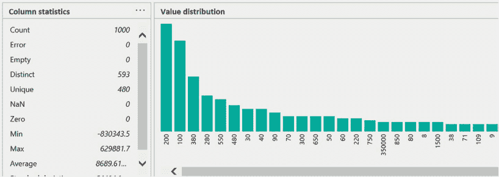

*Figure 2.37: Column profile information*

## 其工作原理

默认情况下，M 查询引擎从指定的数据源提取前 1,000 行数据。这是数据预览区域中使用的数据。仅使用前 1,000 行数据的默认值可以通过单击右下角状态栏中的 Column profiling based on top 1000 rows 并选择 Column profiling based on the entire data set 来更改。

对数据源中的每个列收集统计信息。当启用 Column profile 功能时，选择列会导致列统计信息和值分布显示在数据预览区域的下半部分，包括错误计数、不同值和唯一值的数量、最小值、最大值，以及取决于列数据类型而显示的额外信息，如图 2.37 所示。

## 还有更多...

Power Query Editor 中还提供了额外的<|message|> 数据质量对话框。从 **View** 选项卡中，勾选 **Column quality** 和 **Column distribution** 旁边的复选框。小视觉对象将出现在列标题下方。将鼠标悬停在此区域上会提供一个弹出对话框，提供建议操作，以及通过省略号菜单 (...) 进行常见数据清理活动。

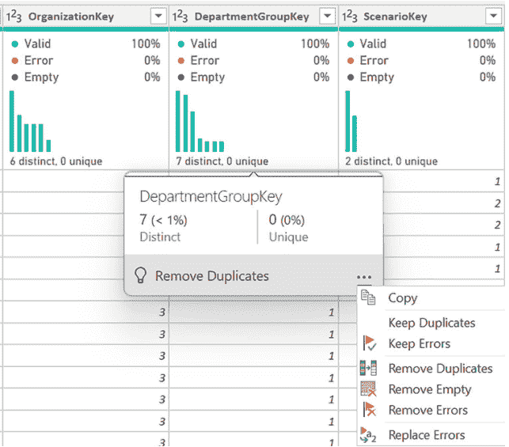

*Figure 2.38: Column quality and Column distribution visuals*

## 另请参阅

- Using the data profiling tools: `http://bit.ly/3c465s5g`

## 诊断查询

Power Query M 引擎是一个极其强大且快速的数据转换和数据准备引擎，用于一系列产品中，包括：

- Excel for Windows
- Excel for Mac
- Power BI


- Power Apps
- Power Automate
- ADF
- SSIS
- SQL Server Analysis Services
- Dynamics 365 Customer Insights

虽然速度快且功能强大，但在某些情况下，你可能会发现某个查询的性能不如预期。在这些情况下，查询诊断可以帮助你精确定位有问题的表达式，更好地了解 Power Query 的执行情况，以便识别查询优化的空间。本教程演示了用户如何使用查询诊断来排查查询，并确定如何优化查询以提高性能。

## Getting ready

要准备就绪，请通过执行以下操作从 AdventureWorksDW2022 数据库导入 FactCurrencyRate 表：

- 1. 打开 Power BI Desktop，并在 **Home** 选项卡的 ribbon 中选择 **Transform data** 以打开 **Power Query Editor**。
- 2. 创建一个名为 AdventureWorksDW2022 的导入模式数据源查询。此查询应类似于以下内容：
- 3. 通过右键单击查询窗格中的查询并选择 Move To Group | New Group，将此查询隔离到名为 Data Sources 的查询组中。
- 4. 右键单击 AdventureWorksDW2022 查询并选择 Reference。
- 5. 选择 Data 列中的 FactCurrencyRate 表链接并将查询重命名为 Currency Rates。
- 6. 在 **Power Query Editor** 中，选择 **Tools** 选项卡，然后选择 **Diagnostic Options**。

```text
let
  Source = Sql.Database("localhost", "AdventureWorksDW2022")
in
  Source
```

- 7. 确保选中 **Enable in Query Editor (does not require running as admin)** 单选按钮，并勾选 **Diagnostics Level** 和 **Additional Diagnostics** 子标题下的所有复选框。

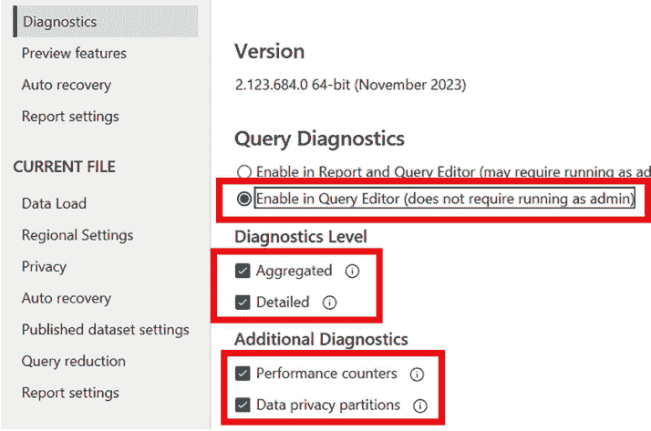

*Figure 2.39: Query Diagnostics options*

有关执行这些步骤的更多详细信息，请参阅本章中的 *Importing Data* 教程。

## How to diagnose queries

要实现本教程，请执行以下步骤：

- 1. 选择 Currency Rates 查询，打开 **Advanced Editor**，并修改查询以计算货币汇率的日变化。

```powerquery
let
    Source = AdventureWorksDW2022,
    dbo_FactCurrencyRate = Source{[Schema="dbo",Item="FactCurrencyRate"]}[Data],
    Sort = Table.Sort(
        dbo_FactCurrencyRate,
        {{"CurrencyKey", Order.Ascending}, {"DateKey", Order.Ascending}}
    ),
    Index = Table.TransformColumnTypes(
        Table.AddIndexColumn(Sort, "Row Index", 1, 1),
        {{"Row Index", Int64.Type}}
    ),
```

```
PrevIndex = Table.TransformColumnTypes(
    Table.AddIndexColumn(Index, "Prev Index", 0, 1),
    {{"Prev Index", Int64.Type}}
),
SelfJoin = Table.NestedJoin(
    PrevIndex, {"Prev Index"}, PrevIndex, {"Row Index"},
    "NewColumn", JoinKind.LeftOuter
),
PrevColumns = Table.ExpandTableColumn(
    SelfJoin, "NewColumn",
    {"EndOfDayRate", "CurrencyKey"}, {"PrevRate", "PrevKey"}
),
AddChange = Table.AddColumn(
    PrevColumns, "Daily Change", each
    if [CurrencyKey] = [PrevKey] then [EndOfDayRate] - [PrevRate]
    else null, type number
),
SelectColumns = Table.SelectColumns(
    AddChange,
    {"CurrencyKey", "EndOfDayRate", "Date", "Daily Change"}
)
in
SelectColumns
```

- 2. 你可能需要等待几分钟才能显示预览数据。要调查正在发生的情况，请单击 Tools 选项卡，然后单击 Start Diagnostics。
- 3. 单击返回 Home 选项卡并单击 Refresh Preview。
- 4. 等待预览数据刷新，然后单击返回 Tools 选项卡并单击 Stop Diagnostics。

## Diagnostics

请等待我们汇总跟踪信息。

Figure 2.40: Diagnostics processing display

5. 当诊断处理完成后，将创建一个名为 Diagnostics 的新查询组，其中包含四个查询，Diagnostics_Counters、Diagnostic_Detailed、Diagnostic_Aggregated 和 Diagnostic_Partitions。

每个查询都以运行诊断的日期和时间戳为后缀，并且每个查询的加载均已禁用。

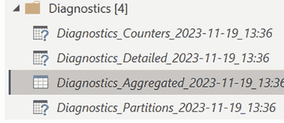

Figure 2.41: Diagnostics queries

6. 单击 Diagnostics_Aggregated 查询。选择 Step、Category、Start Time、End Time、Exclusive Duration (%) 和 Exclusive Duration 列并删除其他列。
7. 按降序对 Exclusive Duration 列进行排序。

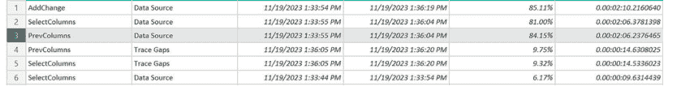

Figure 2.42: Diagnostic results

8. 查找 Exclusive Duration 列中的大幅跳变；我们在第 3 行和第 4 行之间，以及第 5 行和第 6 行之间看到了两次这样的跳变，其中第 3 行和第 4 行之间的跳变更大。此外，请注意第 3 行的 Exclusive Duration (%) 值很高。
9. 查看第 3 行的 Start Time 和 End Time 列，注意到此操作花费了 2 分钟 9 秒完成。Step 列显示第 3 行的查询步骤是 PrevColumns 步骤。
10. 在确定了查询的 PrevColumns 步骤后，单击 Diagnostics_Detailed 查询并将 Step 列过滤为仅显示 PrevColumns。如果 PrevColumns 值未出现在过滤对话框中，请使用 Load More 链接或在 Advanced Editor 中编辑查询以手动添加 Table.SelectRows 表达式：Table.SelectRows(#"Changed Type", each [Step] = "PrevColumns")。
11. 按降序对 Exclusive Duration (%) 列对查询进行排序。
12. 注意顶部行的 Operation 列为 DbDataReader。

此时，很明显，此查询最好在源数据库系统中作为视图或存储过程执行。

## How it works

Currency Rates 查询将基表与其自身连接，以便比较数据的后续行。目标是比较一行与上一行的值，以便计算货币汇率在天之间的变化值。这是通过使用 Table.Sort 函数按货币然后按日期对表进行排序来完成的。

接下来，使用 Table.AddIndexColumn 函数两次，一次添加从 1 开始的索引列（Row Index 列），第二次添加从 0 开始的索引列（Prev Index 列）。然后，这两个索引列在 Table.NestedJoin 函数中用于将表与其自身连接。

使用 Table.ExpandTableColumn 函数来公开上一行的 CurrencyKey 和 EndOfDayRate 列。然后可以使用此信息使用 Table.AddColumns 函数创建 Daily Change 列，最后使用 Table.SelectColumns 函数仅选择必要的列。

当你启动查询诊断时，查询诊断信息会记录到存储在应用程序目录中的 JSON 和 CSV 文件中。这些文件可以通过查看聚合、详细和分区诊断查询的 Source 步骤以及 Counters 诊断查询的 CsvFiles 步骤来定位。对于 Power BI Desktop Store App，路径应类似于以下内容：

```
C:\Users\[user]\Microsoft\Power BI Desktop Store App\Traces\Diagnostics
```

这些文件记录了在刷新预览数据等过程中查询引擎执行的诊断信息。停止查询诊断会结束诊断数据的记录并为每个启用的查询诊断功能生成查询：Aggregated、Detailed、Performance counters 和 Data privacy partitions。由于诊断日志记录在性能和系统资源方面成本高昂，因此建议仅在排查查询性能时使用查询诊断。此外，仅启用识别问题所需的最小诊断日志记录量——例如，通常仅从 Aggregated 诊断数据开始就足以识别有问题的步骤。

## There’s more…

查询诊断还提供 Diagnose Step 功能。要了解如何使用 Diagnose Step，请按照以下步骤操作：

- 1. 从 Tools 选项卡的 ribbon 中打开 Diagnostic Options 并取消选中 Performance counters 和 Data privacy partitions。
- 2. 在 Query Settings 窗格中，选择 SelfJoin 步骤。你现在可以右键单击 SelfJoin 步骤并选择 Diagnose，或在 Tools 选项卡的 ribbon 中选择 Diagnose Step。
- 3. 完成后，将在 Diagnostics 查询组中添加两个额外的查询，Currency Rates_SelfJoin_Detailed 和 Currency Rates_SelfJoin_Aggregated，每个查询都以日期和时间戳为后缀。
- 4. 单击 Currency Rates_SelfJoin_Aggregated 查询。
- 5. 添加一个从 1 开始的 Index 列。


+   6. 按降序对“独占持续时间”列进行排序。
+   7. 在这里，我们可以看到最昂贵的操作发生在流程的早期，位于 3,000 多行中的索引 16 处，似乎是列的初始选择，数据源查询如下：

```
select [__].[CurrencyKey],
    [__].[DateKey],
    [__].[AverageRate],
    [__].[EndOfDayRate],
    [__].[Date]
from [dbo].[FactCurrencyRate] as [__]
order by [__].[CurrencyKey],
    [__].[DateKey]
```

显然，与分析整个查询相比，诊断查询的单个步骤速度更快，占用的系统资源也更少。因此，建议您仅对整个查询运行聚合诊断，以识别有问题的步骤，然后单独对这些步骤运行详细诊断。

如果您查看“Currency Rates_SelfJoin_Detailed”查询，最昂贵的操作在第 50 行，即 DbDataReader 操作。识别出的 SQL 语句实际上在第 49 行，操作为“执行查询”。因此，我们可以得出结论：执行的最昂贵操作不是执行查询，而是读取查询生成的数据。

## 另请参阅

-   - 在 Power BI 中记录查询诊断：http://bit.ly/2ND2yqF
-   - 查询诊断：http://bit.ly/31Fz8ET
-   - 在 Power BI 中可视化和解释查询诊断：http://bit.ly/3s8IFXA

## 扩展核心 M 库

核心 M 库提供了数百个不同的函数，用于帮助进行数据连接、数据清理和数据转换。然而，M 语言的优势之一是其能够通过自定义函数轻松扩展。

在本配方中，我们添加一个简单的自定义函数，作为核心 M 函数库的扩展。

## 准备就绪

要准备本配方，我们首先需要为 Power BI Desktop 查找和/或创建一个“自定义连接”（Custom Connections）文件夹。在当前用户的“文档”目录中查找。如果“Microsoft Power BI Desktop”文件夹不存在，请创建它。导航到“Microsoft Power BI Desktop”文件夹，如果“Custom Connectors”文件夹不存在，请创建它。

6. 在“安全”选项卡的“数据扩展”下，激活“（不建议）允许任何扩展在未经验证或警告的情况下加载”单选按钮。

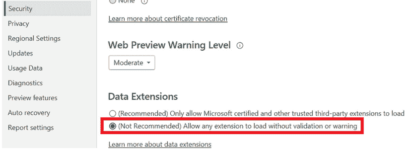

图 2.44：启用数据扩展

7. 单击“确定”按钮并重启 Power BI Desktop。

8. 这次，Power BI Desktop 启动时不会出现“未认证连接器”警告。

9. 在“报告”视图中，单击功能区“主页”选项卡中的“转换数据”按钮。

10. 创建一个新的空白查询，并使用“高级编辑器”将查询更改为以下内容：

```
let
    Source = Cookbook.FullName("Greg", "Deckler")
in
    Source
```

11. 单击“完成”按钮，注意查询返回“Greg Deckler”作为文本值。

## 工作原理

`section` 关键字定义了一个逻辑容器，用于存放命名的、分组的表达式。表达式可以加上 `shared` 关键字前缀，以便将命名的表达式暴露给全局环境。

Power BI Desktop 在启动时会查找 [Documents]\Microsoft Power BI Desktop\Custom Connectors 文件夹，并加载其中所有以 .pq 文件形式存储的扩展。

虽然这个示例配方很简单，但可以在 section 文档中创建任何类型的复杂逻辑和转换。

## 更多内容…

Power BI 的第三方扩展也是按照此处所述的方式创建的。Power BI 中可用的每个第三方连接器都是通过 .pq 文件在 section 文档中创建的。随后，这些第三方连接器由 Microsoft 认证，并在 Power BI Desktop 中提供。

除了使用 section，您还可以创建一个 M 函数库，并通过单个查询导入。例如，您可以创建如下文件：

```
[ 
    AddOne = ( x as number ) => x + 1,
    NumberExp = (x as number) => Number.Exp(x)
]
```

将此文件保存为 MLibrary.pq。然后，您可以使用以下查询从该文件中引入函数：

```
Expression.Evaluate(Text.FromBinary(File.Contents("c:\data\MLibrary.pq")), #shared)
```

此查询返回以下内容：

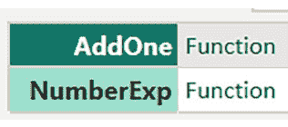

您可以右键单击“Function”字样，然后选择“添加为新查询”以使用该函数。

## 另请参阅

-   - M 语言 section：https://bit.ly/3ulsVqj
-   - 自定义连接器开发常见问题解答：https://bit.ly/3R6gg3n

## 总结

数据摄取和访问能力对每个 BI 项目都至关重要。在 Power BI 中，这种数据摄取和访问由强大的函数语言和查询引擎 M 驱动。Power Query M 语言为数据检索、清理和转换提供了强大、可扩展且灵活的引擎。

在本章中，我们深入探讨了 Power BI Desktop 的数据转换体验，并逐步完成了建立和管理数据源连接与查询的过程。我们探索了导入模式和 DirectQuery 存储模式，以及在 Power BI 服务中创建可重用查询（称为数据流）。然后，我们演示了强大的数据转换技术，包括筛选和清理数据、创建自定义列，以及组合和合并多个查询。最后，我们演示了如何分析数据、诊断性能不佳的查询，以及如何扩展核心 M 函数库。

在下一章中，我们将利用本章获得的知识在 Power BI 中构建一个完整的语义模型。

## 加入我们的 Discord 社区

加入我们社区的 Discord 空间，与作者和其他读者讨论：

https://discord.gg/ebXZqyrxJb


-   - 支持虚拟表关系
-   - 设计列级安全性
-   - 利用聚合表
-   - 使用混合表

## 技术要求

完成本章中的配方需要满足以下条件：

-   - Power BI Desktop。
-   - Tabular Editor。
-   - 安装了 AdventureWorksDW2022 数据库的 SQL Server 2022 或更高版本。请参阅第 1 章“安装和授权 Power BI 工具”。
-   - SQL Server Management Studio 19.2 或更高版本。
-   - 代码示例和其他材料可从以下 GitHub 存储库下载：https://github.com/PacktPublishing/Power-BI-Cookbook-Third-Edition。

## 设计语义模型

Power BI 工具和服务的自助式、低代码特性使其非常适合快速、敏捷的开发，在这种开发中，即使数据源不完善，并且对业务需求和使用案例的理解不完整，也能快速获得重要的数据见解。然而，仓促通过设计阶段会削弱解决方案的可持续性，因为未来的需求需要模型结构修改或复杂变通方案才能满足。一个均衡的设计阶段，在其中分析诸如 DirectQuery 与内存模式等基本决策，同时使用有限的原型模型来生成可视化和业务反馈，可以同时满足短期和长期需求。

本配方描述了设计语义模型的过程，并指出了在此过程中需要考虑的一些主要问题和因素。

## 准备就绪

Power BI 报告能力在视觉和分析上令人印象深刻的示例，常常会导致利益相关者低估与数据集成和语义建模相关的努力和复杂性。

控制任何不切实际的期望并确认可行性非常重要。项目利益相关者通常急于看到报告开发结果，但考虑到语义模型作为给定源数据的单一事实来源的长期价值，设定合理的期望很重要。尽管从技术上讲，每个 Power BI 报告都可以有自己的语义模型，但与这种以报告为中心的方法相关的严重版本控制、可管理性和资源/可扩展性问题强烈暗示，BI 开发人员应努力创建能够长期支持许多报告的模型。本节介绍的标准模型设计过程将大大有助于实现这一目标。


4. **识别事实：** 事实应与所建模的业务流程保持一致；例如，数量的总和或维度的唯一计数。记录主要事实的业务和技术定义，并将其与任何现有报表或元数据存储库进行比较（例如，*净销售额 = 扩展金额 - 折扣*）。在此阶段，你应能够梳理主要的业务问题并检查计划的语义模型是否能够支持这些问题。例如，业务可能希望回答以下问题，*上个月自行车的销售额与计划之间的差异是多少？* 任何明显的差距可以通过以下三种方式之一处理：

- 重新审视并修改此流程的先前步骤
- 将该问题从语义模型的范围中移除
- 计划通过模型中的额外逻辑（M 或 DAX）来解决该问题

在此阶段，仅关注主要事实，例如构成成本事实的各个源列。如果核心事实的业务定义或逻辑涉及多个步骤和条件，请检查语义模型是否能自然简化它，或者逻辑是否可以在数据检索期间开发，以避免复杂的度量值。

## 如何设计语义模型

Power BI 模型最好与可跨模型共享的标准事实和维度企业数据架构框架保持一致。尽管由 Power BI Desktop 使用，但应遵守现有的数据定义和治理。任何使用 Power BI 开发的新事实、维度和度量值都应补充此架构。要实施此配方，请按照以下步骤操作：

1. **创建数据仓库总线矩阵：** 业务流程（事实）和标准维度的矩阵是设计和管理语义模型的主要工具，同时还能传达整体 BI 架构。在此示例中，为模型选定的业务流程为 **Internet Sales**、**Reseller Sales** 和 **General Ledger。**

| BUSINESS PROCESSES | Date | Customer | Product | Vendor | Promotion | Reseller | Sales Territory | Employee | Account | Organization |
|---|---|---|---|---|---|---|---|---|---|---|
| Internet Sales | ✓ | ✓ | ✓ | ✓ | ✓ |  | ✓ |  |  |  |
| Reseller Sales | ✓ |  | ✓ |  | ✓ | ✓ | ✓ | ✓ |  |  |
| General Ledger | ✓ |  |  |  |  |  |  |  | ✓ | ✓ |
| Sales Plan | ✓ |  | ✓ |  |  |  | ✓ |  |  |  |
| Inventory | ✓ |  | ✓ | ✓ |  |  |  |  | ✓ |  |
| Customer Surveys | ✓ | ✓ |  |  |  |  |  |  |  |  |
| Customer Service Calls | ✓ | ✓ | ✓ |  |  |  |  | ✓ |  |  |

*Figure 3.1: Data warehouse bus matrix*

2. **创建实施总线矩阵：** 模型设计过程的结果应包括更详细的实施总线矩阵。对事实表的粒度、主要度量的定义以及所有维度的清晰度和批准，能在进入开发阶段时提供信心。

| BUSINESS PROCESSES | Row Granularity | Measures | Date | Customer | Product | Promotion | Reseller | Sales Territory | Employee | Account | Organization | Department |
|---|---|---|---|---|---|---|---|---|---|---|---|---|
| Internet Sales | Sales Order Line (SKU) | Internet Sales Dollars and Units, Count of Customers and Products | ✓ | ✓ | ✓ | ✓ |  | ✓ |  |  |  |  |
| Reseller Sales | Sales Order Line (SKU) | Gross and Net Sales, Discounts, Margin Amount and % | ✓ |  | ✓ | ✓ | ✓ | ✓ |  |  |  |  |
| General Ledger | GL Account Entity | Account Balance Amount | ✓ |  |  |  |  |  |  | ✓ | ✓ | ✓ |

*Figure 3.2: Implementation bus matrix: Internet Sales, Reseller Sales, and General Ledger*

Power BI 查询（M）和分析逻辑（DAX）不应被视为数据质量、主数据管理和数据仓库问题的长期替代方案。如果有必要继续推进，请记录所产生的“技术债务”，并考虑长期解决方案，例如 **Master Data Services (MDS)**。

3. **选择语义模型存储模式——导入、DirectQuery 或复合：** 在模型的逻辑设计就绪后，最重要的设计问题之一是是否以 DirectQuery 模式、默认的导入内存模式，或两者结合的复合模型来实现此模型。

默认的导入模式针对查询性能进行了高度优化，并支持使用 DAX 函数进行额外的建模和开发灵活性。通过压缩、列式存储、并行查询计划和其他技术，导入模式模型能够支持大量数据（约 5000 万行），并在复杂的分析表达式下仍能良好运行。可以访问并集成多个数据源到单个语义模型中，并且所有 DAX 函数都可用于度量值、列和角色安全。导入模式的主要缺点是语义模型大小限制（Pro 为 1 GB，Premium 为 10 GB），并且数据刷新必须按计划进行（Pro 每天 8 次，Premium 每天 48 次）。Power BI 服务中计划刷新的一种替代方案是使用 REST API 触发已发布语义模型的数据刷新。例如，可以在夜间更新或 ETL 流程脚本末尾添加对 Power BI REST API 的 HTTP 请求，以调用语义模型的刷新，从而使发布的 Power BI 内容与源系统保持一致。

DirectQuery 模式模型为用户提供相同的语义层界面，并包含驱动模型行为的相同元数据，与导入模式模型相同。然而，DirectQuery 模型的性能取决于源系统以及数据如何呈现给模型。通过消除导入或刷新过程，DirectQuery 提供了在数据发生变化时将报表和仪表板暴露给源数据的方式。

这也避免了导入模式模型的文件大小限制。然而，使用 DirectQuery 时需要注意以下限制和约束：

- DirectQuery 模型中只能使用来自单个受支持数据源的单个源。

### See also

- Planning a Power BI Enterprise Deployment: http://bit.ly/2NJ55Qg
- The Ten Essential Rules of Dimensional Modeling: http://bit.ly/1QijUwM
- Semantic model modes in Power BI: http://bit.ly/30P2HKF
- Use composite models in Power BI: http://bit.ly/3tkFTbr
- Composite model guidance in Power BI: http://bit.ly/3sd3aCz

## Implementing a Semantic Model

语义模型的实施从上一配方中描述的设计阶段开始。设计过程及其支持文档阐明了要建模的实体、其粒度、事实到维度的关系以及必须开发的事实度量值。此外，模型模式（导入、DirectQuery 或复合）也已确定，任何通过 M 或 DAX 函数实现的额外业务逻辑也已明确。现在可以开发模型的不同组件，包括数据源连接、查询、关系、度量值和元数据。

在本配方中，我们将介绍模型设计物理实施中的所有主要步骤。三个事实表及其相关维度被检索，建立关系，并添加核心度量值和元数据。完成后，多事实语义模型可以向业务用户公开以进行初步测试和反馈。

### Getting ready

为准备本配方，请执行以下步骤：

1. 为要在语义模型中表示的每个事实和维度表创建一个 SQL 视图。如果您不熟悉 SQL 视图，请参阅本配方 See also 部分。

视图应仅选择模型所需的列并应用模型的列名。为事实表 FactResellerSales、FactInternetSales 和 FactFinance，以及维度 DimEmployee、DimReseller、DimPromotion、DimProduct、DimSalesTerritory、DimDepartmentGroup、DimOrganization、DimAccount、DimCustomer 和 DimDate 创建仅为 SELECT 语句的视图。

视图层可保护模型免受源系统更改的影响，并为管理员提供对模型依赖项的可见性。此外，视图可通过连接对源表进行非规范化以符合模型表的结构，并可能包含源中不可用的派生列。在以下 SQL 示例中，产品维度视图连接了三个表 DimProduct、DimProductCategory 和 DimProductSubcategory，并应用了模型列名：

```
select [$Outer].[ProductKey] as [ProductKey],
    [$Outer].[ProductSubcategoryKey] as [ProductSubcategoryKey],
    [$Outer].[EnglishProductName] as [EnglishProductName],
```


使用此 SQL 代码创建视图并将视图保存为 vCH3R2_Products。如果支持 DirectQuery 模型，则定义 SQL 视图尤其重要。对于 DirectQuery 模型视图，请评估查询计划的效率以及视图之间的引用完整性，以支持内部连接 DirectQuery 查询。

+   2. 打开 Power BI Desktop。
+   3. 创建一个名为 AdventureWorksDW2022 的导入模式数据源查询。此查询应类似于以下内容：
+   4. 将此查询隔离到名为 Data Sources 的查询组中并禁用加载。
+   5. 这两者都可以通过在“查询”窗格中右键单击查询来完成。
+   6. 右键单击 AdventureWorksDW2022 并选择引用。
+   7. 为每个维度表和事实表构建一个 M 查询，该查询访问步骤 1 中定义的 SQL 视图。在此示例中，AdventureWorksDW2022 查询包含数据源信息，并访问了 vCH3R2_Products 视图：
+   8. 复制此查询并将 Item 参数替换为每个剩余事实和维度的源视图。供参考，您应该为事实表 FactResellerSales、FactInternetSales 和 FactFinance 以及维度 DimEmployee、DimReseller、DimPromotion、DimProduct、DimSalesTerritory、DimDepartmentGroup、DimOrganization、DimAccount、DimCustomer 和 DimDate 创建视图。
+   9. 将事实查询分离到 Facts 查询组中。

```
let
    Source = Sql.Database("localhost", "AdventureWorksDW2022")
in
    Source
```

```
let
    Source = AdventureWorksDW2022,
    Data = Source{[Schema="dbo",Item="vCH3R2_Products"]}[Data]
in
    Data
```

10. 将维度查询分离到 Dimensions 查询组中。

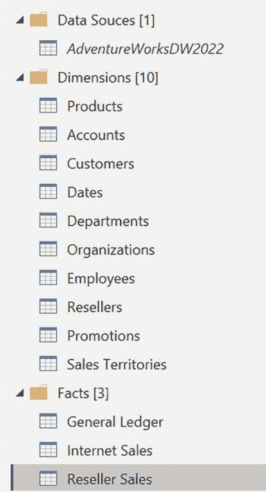

图 3.3：Power Query 编辑器中的 Dimensions、Facts 和 Data Sources 查询

11. 确认列数据类型与设计一致（例如，使用定点小数以避免舍入问题）。另一个示例是确保邮政编码设置为文本数据类型而不是数字，以便保留前导零。

12. 关闭 Power Query 编辑器并通过选择“开始”选项卡功能区的“关闭并应用”将表加载到 Power BI 模型中。

## 如何实现语义模型

要实现此配方，请使用以下步骤：

+   1. 在 Power BI Desktop 中，从“报表”视图的“建模”选项卡或“表格”视图的“表格工具”选项卡中选择“管理关系”，然后单击“新建”按钮。

## 其工作原理

本配方中的步骤与模型开发的逻辑流程一致，可以在团队之间或由单个 Power BI 开发人员在不同的阶段中实现。鉴于模型组件的不同交付时间，推进更成熟或更简单的组件可能是有利的，以便业务团队在增强功能和其他组件部署时参与并提供反馈。

本章中以下配方中包含了所有主要元数据设置的详细信息：

+   - 配置模型元数据
+   - 创建关系
+   - 创建层次结构和组

所有这些设置都会影响语义模型的可使用性和功能，不应被忽视。

## 还有更多…

如果模型的源视图与其他应用程序共享并且可能更改或包含模型不需要的列，则可以使用 Table.SelectColumns() M 函数：

```
let
    Source = AdventureWorksDW2022,
    InternetSales = Source
        {[Schema = "dbo", Item = "vInternetSales"]}
        [Data],
    SalesColumns = Table.SelectColumns(
        InternetSales,
        {"ProductKey", "OrderDateKey"},
        MissingField.UseNull
    )
in
    SalesColumns
```

使用 Table.SelectColumns 函数显式选择模型中表所需的每一列，并且 MissingField.UseNull 参数允许查询在指定列缺失时仍成功刷新——例如当列名已更改时。

## 另请参阅

+   - Create SQL Views: https://bit.ly/2T3FzHF
+   - Create and manage relationships in Power BI: http://bit.ly/3tLwcJM
+   - Model view in Power BI: http://bit.ly/3vUXwag
+   - Model data in Power BI: http://bit.ly/3f8p7yT
+   - Design a semantic model in Power BI: http://bit.ly/3d28LVW

7. 基于 DimProduct、DimProductCategory 和 DimProductSubcategory 表为 Products 创建一个新的空白查询，使用以下代码。或者，使用本章中 Implementing a Semantic Model 配方中的产品 SQL 视图。

```
let
    Source = AdventureWorksDW2022,
    Navigation = Source
        {[Schema = "dbo", Item = "DimProduct"]}
        [Data],
    Subcategory = Table.ExpandRecordColumn(
        Navigation,
        "DimProductSubcategory",
        {
            "EnglishProductSubcategoryName",
            "DimProductCategory"
        },
        {"Product Subcategory", "DimProductCategory"}
    ),
    Category = Table.ExpandRecordColumn(
        Subcategory,
        "DimProductCategory",
        {"EnglishProductCategoryName"},
        {"Product Category"}
    )
in
    Category
```

8. 通过在“查询”窗格中右键单击查询并选择“移动到组”然后选择“新建组”，将事实查询 Internet Sales 分离到 Facts 查询组中。

9. 将维度查询 Customers、Dates 和 Products 分离到 Dimensions 查询组中。

10. 在 Other Queries 组中创建一个名为 Calculations 的空白查询。

11. 在“开始”选项卡的功能区中选择“关闭并应用”以将表加载到语义模型。

## 如何创建关系

要实现此配方，请使用以下步骤：

+   1. 在 Products 表和 Internet Sales 表之间创建关系。这可以在“模型”视图中通过将 Products 表中的 ProductKey 列拖放到 Internet Sales 表中的 ProductKey 列来完成。或者，在“报表”视图中从“建模”选项卡的功能区中选择“管理关系”，或在“表格”视图中从“表格工具”选项卡的功能区中选择。此关系应为 Products 表在“一”侧与 Internet Sales 表在“多”侧之间的一对多关系。交叉筛选方向应设置为单向。

### 编辑关系

选择相关的表和列。

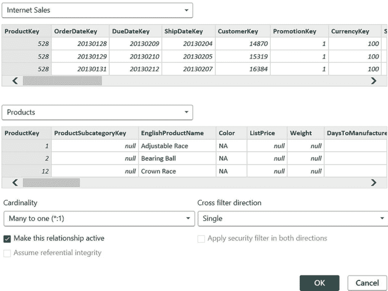

图 3.5：在 Products 和 Internet Sales 之间创建关系

+   2. 在其他维度表和 Internet Sales 表之间创建额外的关系，直到“管理关系”对话框中显示的关系与图 3.6 中显示的关系相同。

### 管理关系

| Active | From: Table (Column) | To: Table (Column) |
| --- | --- | --- |
| ☑ | Internet Sales (CustomerKey) | Customers (CustomerKey) |
| ☑ | Internet Sales (DueDateKey) | Dates (DateKey) |
| ☐ | Internet Sales (OrderDateKey) | Dates (DateKey) |
| ☑ | Internet Sales (ProductKey) | Products (ProductKey) |
| ☐ | Internet Sales (ShipDateKey) | Dates (DateKey) |

New... Autodetect... Edit... Delete

Close

图 3.6：管理关系对话框中的表关系

3. 语义模型的“模型”视图现在应如下图 3.7 所示：

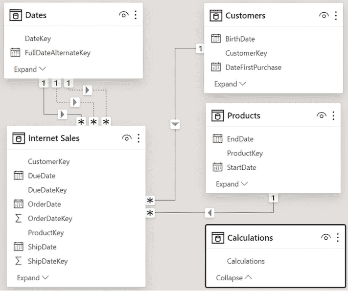

图 3.7：关系的模型视图

4. 右键单击 Dates 表，选择“标记为日期表”，然后再次使用 FullDateAlternateKey 作为日期列“标记为日期表”。

5. 通过右键单击“表格”视图中的 Calculations 表并选择“新建度量”创建以下四个 DAX 度量：

```
Sales Table Rows = COUNTROWS('Internet Sales')
Customers Table Rows = COUNTROWS('Customers')
Dates Table Rows = COUNTROWS('Dates')
Products Table Rows = COUNTROWS('Products')
```

6. 在“表格”视图的“数据”窗格中，右键单击 Calculations 表中的 Calculations 列并选择“隐藏在报表视图中”。

请注意，整个表甚至页面也可以以类似的方式隐藏。此外，外部工具 Tabular Editor 可用于在不同透视中隐藏列。这可用于当您允许用户个性化视觉对象以仅允许用户选择特定列时。请注意，隐藏列、表或页面绝不应被视为安全机制。

7. 在“报表”视图中，使用多行卡片可视化对象显示这四个度量。

8. 为 Dates 表中的 CalendarYear、Products 表中的 Product Category 和 Customers 表中的 Gender 添加切片器可视化对象。

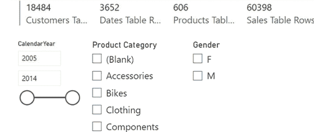

图 3.8：关系和交叉筛选测试可视化对象

9. 在切片器可视化对象中选择切片器值并注意，使用单向关系时，对任何切片器的选择仅会影响切片器中使用的表和 Internet Sales 表中的行计数。

10. 打开“管理关系”对话框并编辑 Internet Sales 和 Products 表之间关系的交叉筛选方向。


图 3.9：来自“编辑关系”对话框的双向关系配置（Both）


+   11. 日历年份和性别的切片器选择现在也会过滤产品表。

+   12. 在计算表中创建 DAX 度量，以对模型中的关系应用替代的交叉筛选行为：

```
Products Table Rows (CF) =
    CALCULATE([Products Table Rows],
        CROSSFILTER('Internet Sales'[ProductKey],'Products'[ProductKey],
OneWay)
    )
```

+   13. 将此度量添加到多行卡片可视化中，并观察此度量不受性别和日历年份切片器的影响。

+   14. 在计算表中编写 DAX 度量以传播筛选上下文。以下度量会尊重应用于 Internet Sales 表的筛选器，例如客户性别 = "M"：

```
Products Rows (Sales) = CALCULATE(COUNTROWS('Products'),'Internet Sales')
```

+   15. 将此度量添加到多行卡片可视化中，并观察在性别和日历年份切片器中选择值时，此度量返回的结果与双向关系相同，除了完全没有切片器选择时——此时度量返回 158。

+   16. 在计算表中编写 DAX 度量以使用日期表和 Internet Sales 表之间的非活动关系：

```
Sales Table (Orders) =
    CALCULATE([Sales Table Rows],
        USERELATIONSHIP('Dates'[DateKey],'Internet Sales'[OrderDateKey])
    )
```

+   17. 将此度量添加到多行卡片可视化中，并注意到在选择日历年份 2011 或更高时，Sales Table Rows 度量返回的数字不同。

## 如何工作

单向交叉筛选关系仅在关系的方向上传播筛选器。因此，当产品表设置为单向过滤 Internet Sales 表时，影响 Internet Sales 的其他筛选器不会传播到产品表。使用双向交叉筛选关系时，影响关系一侧的筛选器始终会传播到关系的另一侧，除非 DAX 度量使用 CROSSFILTER() 等函数来覆盖模型关系定义的默认行为。

在给定维度表也与其他事实表相关联的情况下，事实表和维度表之间的双向关系通常应避免。这可能导致过度筛选或意外的筛选上下文。然而，双向关系是高效解决常见且原本复杂的建模场景的不可或缺的一部分，例如实际与预算，以及经典的多对多场景。

关于日期表关系，DAX 时间智能函数，例如 DATESYTD、DATEADD 和 SAMEPERIODLASTYEAR，都需要基于日期数据类型的关系或标记为日期表的设置。由于日期表的关系是基于代理键 20150101 建立的，因此需要将日期表标记为日期表，以便 DAX 时间智能函数正常运行。

度量 Product Table Rows (CF) 覆盖双向关系，使用 DAX 函数 CROSSFILTER 应用单向交叉筛选。尽管仅限于特定度量，CROSSFILTER 函数可以为模型中定义的关系交叉筛选提供简单而强大的补充。CROSSFILTER 函数需要一个已存在的活动或非活动关系，并且始终覆盖模型的设置。第三个参数接受以下值：

+   - OneWay
+   - Both
+   - None

双向关系和 CROSSFILTER 函数都可与 DirectQuery 模型一起使用。对于 DirectQuery，需要启用全局 DirectQuery 设置“允许不受限制的度量”才能使用 CROSSFILTER。

Products Rows (Sales) 度量通过使用 CALCULATE 函数在 Internet Sales 表的上下文中评估产品表，从而在产品表和 Internet Sales 表之间实现双向交叉筛选。因此，影响 Internet Sales 表的筛选器也会影响对产品表 COUNTROWS 函数的结果。这即使在没有切片器选择时也成立，这就是为什么 Product Rows (Sales) 度量返回 158，因为只有 158 种产品通过互联网销售。请记住，关系本身仅传播针对表的活动筛选器。这就是为什么在没有活动切片器选择时，Products Table Rows 度量会返回全部 606 种产品。

Sales Table (Orders) 度量使用 USERELATIONSHIP 函数来利用模型中的非活动关系。Power BI 语义模型会拒绝模糊关系，即在两个表之间存在多个可能的交叉筛选路径。这些重复关系被设置为非活动状态，但仍可在 DAX 中使用。与 CROSSFILTER 函数一样，USERELATIONSHIP 函数需要一个已存在的活动或非活动关系，并且始终覆盖模型的设置。

## 还有更多…

在图 3.10 所示的多对多模型中，多个客户与给定的账户相关联，并且某些客户拥有多个账户。

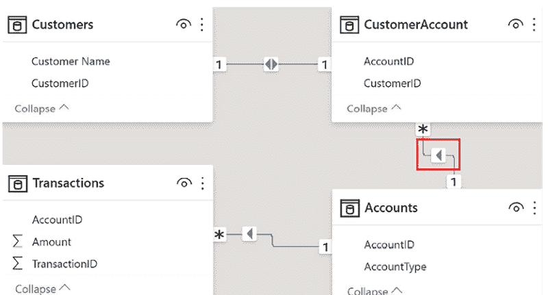

## 图 3.10：具有单向交叉筛选关系的 多对多模型

鉴于从账户表到 CustomerAccount 桥接表的突出显示的单向关系，对客户表的筛选选择不会过滤交易表。通过将账户与 CustomerAccount 之间的关系交叉筛选方向修改为 Both，按客户的报表可视化现在将正确显示事实表的总金额以及与每个客户相关的金额。

双向关系的 DAX 替代方案如下：

```
M2M Tran Amount =
    CALCULATE([Tran Amount], SUMMARIZE(CustomerAccount,Accounts[Account ID]))
```

SUMMARIZE 函数利用客户和账户与桥接表的一对多关系，通过 CALCULATE 函数传递客户的筛选上下文到账户表，从而过滤交易。

对于类似的多对多场景，出于可管理性和性能原因，建议使用双向关系而不是 DAX 方法。

## 另请参阅

+   - Create and manage relationships in Power BI Desktop: http://bit.ly/3tLwcJM
+   - Bidirectional cross-filtering whitepaper: http://bit.ly/2oWdwbG
+   - Let users personalize visuals in a report: http://bit.ly/3c1juvm
+   - Personalize visuals in a report: http://bit.ly/2OZX8a8

## 配置模型元数据

元数据是关于信息的信息。Power BI 语义模型中有许多元数据设置，例如列名、数据类型、对象描述等。对于在 Power BI 报表画布上可见的任何列，有四个重要的元数据属性需要配置：格式、数据类别、默认汇总以及按列排序的选项。数据格式应在数据类型之间保持一致，并有效地传达适当的详细程度。数据类别通过为 Power BI 提供指导其可视化的信息来增强数据探索体验。默认汇总确定在将列添加到报表画布时要应用的聚合（如果有）。按列排序功能使能够根据另一列的顺序显示列中的值。尽管所有这些设置都相对简单易配置，但仔细关注这些属性有助于提供更高质量的 Power BI 可视化以及更用户友好的自助服务平台。

在本教程中，我们演示如何为语义模型中的列和度量配置格式、数据类别、默认汇总和按列排序选项——并展示这些设置对可视化的影响。

## 准备工作

为准备本教程，请执行以下步骤：

+   1. 打开 Power BI Desktop。
+   2. 创建一个名为 AdventureWorksDW2022 的导入模式数据源查询。请参阅本章中《实施语义模型》教程的准备工作部分以供参考。
+   3. 在名为 Data Sources 的查询组中隔离此查询并禁用加载。
+   4. 右键单击 AdventureWorksDW2022 并选择引用。
+   5. 选择 FactFinance 表并将此查询命名为 General Ledger。
+   6. 重复步骤 4 和 5 以创建导入 DimDate 的 Dates 查询和导入 DimDepartmentGroup 的 Departments 查询。
+   7. 重复步骤 4 和 5 以创建导入 DimCustomer 的 Customers 查询，使用以下 Power Query M 代码：

```
let
    Source = AdventureWorksDW2022,
    Data = Source[{[Schema="dbo",Item="DimCustomer"]}][Data],
    #"Expanded DimGeography" =
        Table.ExpandRecordColumn(
            Data, "DimGeography",
            {"City", "StateProvinceName",
            "EnglishCountryRegionName", "PostalCode"},
            {"City", "StateProvinceName",
```


```
"CountryRegionName", "PostalCode"}
)
in
#"Expanded DimGeography"
```

+   8. 将维度查询（Customers、Departments 和 Dates）分离到一个名为 Dimensions 的查询组中，并将 General Ledger 查询分离到一个名为 Facts 的查询组中。
+   9. 在 Other Queries 组中创建一个名为 Calculations 的空白查询。
+   10. 在“主页”选项卡的功能区中选择“关闭并应用”以将表加载到语义模型。
+   11. 使用“管理关系”对话框创建图 3.11 所示的关系。

| 活动 | 来源：表（列） | 目标：表（列） |
| --- | --- | --- |
| ☑ | General Ledger (DateKey) | Dates (DateKey) |
| ☑ | General Ledger (DepartmentGroupKey) | Departments (DepartmentGroupKey) |

图 3.11：关系

## 如何配置模型元数据

要实现本操作指南，请执行以下步骤：

+   1. 选择“表”视图。
+   2. 使用右侧的“数据”窗格导航到 Dates 表并选择 FullDateAlternateKey 列。
+   3. 在“列工具”选项卡的功能区中使用“格式”下拉列表，将格式更改为 3/14/2001（短日期）或其他格式。

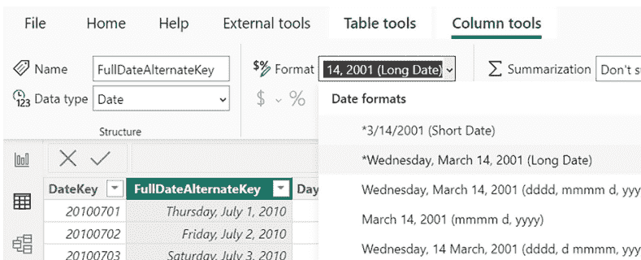

图 3.12：列格式

4. 右键单击 Calculations 表，单击“新建度量值”，使用以下代码创建度量值：

```
Finance = SUM('General Ledger'[Amount])
```

5. 选择 Finance 度量值，在“度量工具”选项卡中使用“格式”选项将格式更改为“货币”。

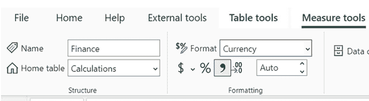

图 3.13：度量值格式

6. 右键单击 Calculations 表中的 Calculations 列，然后选择“在报表视图中隐藏”。

7. 仍在“表”视图中，选择 Customers 表中的 StateProvinceName 列，然后在“列工具”选项卡中将“数据类别”更改为“州或省”。

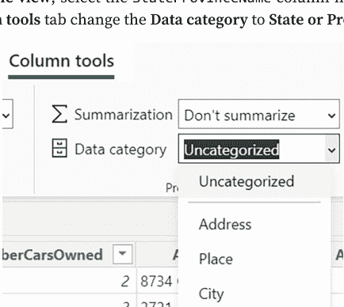

图 3.14：数据类别选择

8. 重复此过程，将 City 列设置为“城市”，将 CountryRegionName 列设置为“国家/地区”，将 PostalCode 列设置为“邮政编码”。请注意，在“数据”窗格中，所有这些列旁边都会出现一个地球图标。

9. 切换到“报表”视图，创建一个地图可视化，将 CountryRegionName 和 PostalCode 放入“位置”字段井，将 CustomerKey 放入“气泡大小”字段井。您可以向下钻取到邮政编码级别并放大，以调查特定区域中有多少客户。

14. 在“列工具”选项卡上，将默认汇总从“计数”更改为“不汇总”。

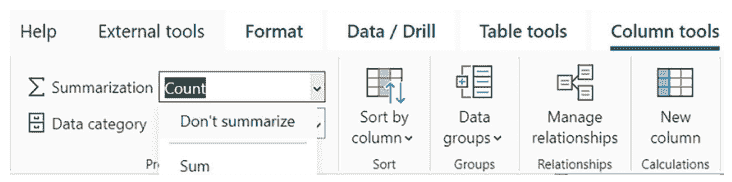

图 3.17：列的默认汇总

## 工作原理

格式化、数据类别、汇总和按列排序的元数据设置都可在“列工具”或“度量工具”选项卡中使用，无论你处于“表”视图还是“报表”视图。请注意，“汇总”和“按列排序”不可用于“度量工具”。

格式设置决策应考虑精度对可视化的影响。较少的小数位数和更简短的日期格式在报表中占用更少的空间，并且在仪表板上更容易直观理解。要了解格式设置的工作原理，请考虑日期数据类型。日期数据类型实际上在模型引擎中以十进制数存储。数字的整数部分是自 1899 年 12 月 30 日以来的天数。小数部分是一天中的分数，小时为 1/24 或 0.04166，分钟为 1/24/60 或 0.0006944，秒为 1/24/60/60 或 0.0000115740。因此，日期的显示格式只是在视觉上更改基础数据显示给用户的方式，而底层数据保持不变。用户可能在屏幕上看到显示为 1/1/1900 00:00:00 的内容，但在语义模型内部，它只是存储为 2。

为列分配位置数据类别有助于 Bing Maps 进行地理定位，并将此类列的默认可视化更改为地图可视化。Web URL 对于诸如 mailto 电子邮件地址链接和报表中公开的任何 URL 链接非常重要。当列在表可视化中使用时，会分别显示电子邮件和链接图标。同样，为列分配图像 URL 后，在使用表可视化时会显示实际图像。条码数据类别可用于移动应用程序。

在考虑使用按列排序时，请确定需要自定义排序的列。诸如 Month 和 Weekday 之类的日历文本列是最常见的候选。其他列可能表示组织结构或实体层次结构，例如总账科目。按列排序的排序对于要排序的列中的每个值必须仅包含一个不同的值。建议将排序逻辑尽可能深入地嵌入到 BI 架构中。例如，可以将排序列添加到数据仓库中的维度表或用于加载语义模型的 SQL 视图中。如果这些选项不可用，则建议使用 M 查询转换而不是 DAX 计算列。

文本和日期数据类型列在首次加载到 Power BI 模型时默认设置为“不汇总”。这些数据类型的默认汇总为“计数”和“计数（非重复）”。此外，在可视化中使用这些数据类型时，“报表”视图提供以下聚合选项：

+   - 文本：第一个、最后一个、计数（非重复）或计数

+   14. 切换到“数据”视图，隐藏 Reseller Measures、Pricing Measures、Customer Measures 和 Currency Measures 表中的单个列。
+   15. 右键单击日期表，选择“标记为日期表”，使用 FullDateAlternateKey 作为日期列。

## 如何使用 DAX 度量值丰富模型

要实现本操作指南，请执行以下步骤：

+   1. 在“表”视图中，在 Reseller Measures 表中创建以下 8 个 DAX 度量值：

```
Reseller Discount Amount = SUM('Reseller Sales'[DiscountAmount])
Reseller Gross Sales =
    SUMX('Reseller Sales',
        'Reseller Sales'[UnitPrice] * 'Reseller Sales'[OrderQuantity])
Reseller Net Sales =
    CALCULATE( [Reseller Gross Sales] - [Reseller Discount Amount],
        'Reseller Sales'[ShipDate] <> DATEVALUE("12/31/2099") )
Reseller Product Cost =
    SUMX('Reseller Sales',
        'Reseller Sales'[OrderQuantity]*'Reseller Sales'[ProductStandardCost])
Reseller Gross Margin % =
    DIVIDE([Reseller Gross Sales] - [Reseller Product Cost],
        [Reseller Gross Sales], 0)
Reseller Margin % =
    DIVIDE([Reseller Net Sales] - [Reseller Product Cost],
        [Reseller Net Sales], 0)
Reseller Count of Products Sold =
    CALCULATE(DISTINCTCOUNT('Products'[ProductAlternateKey]),
        'Reseller Sales')
Reseller Count of Sales Orders = DISTINCTCOUNT('Reseller Sales'[SalesOrderNumber])
```

+   2. 在 Pricing Measures 表中创建以下 7 个 DAX 度量值：

```
Effective Unit Price =
    DIVIDE(SUM('Reseller Sales'[ExtendedAmount]),
        SUM('Reseller Sales'[OrderQuantity]) )
25th Percentile Unit Price = PERCENTILE.INC('Reseller Sales'[UnitPrice],.25)
75th Percentile Unit Price = PERCENTILE.INC('Reseller Sales'[UnitPrice],.75)
Maximum Unit Price = MAX('Reseller Sales'[UnitPrice])
```

```
Median Unit Price = MEDIAN('Reseller Sales'[UnitPrice])
Minimum Unit Price = MIN('Reseller Sales'[UnitPrice])
Range of Unit Prices = [Maximum Unit Price] - [Minimum Unit Price]
```

3. 在 Customer Measures 表中创建以下 3 个 DAX 度量值：

```
Count of Accessory But Not Bike Customers =
VAR BikeCustomers =
    SUMMARIZE(
        CALCULATETABLE('Internet Sales','Products'[Product Category] = "Bikes"),
        'Customers'[CustomerAlternateKey])
VAR AccessoryCustomers =
    SUMMARIZE(
        CALCULATETABLE('Internet Sales',
            'Products'[Product Category] = "Accessories"),
        'Customers'[CustomerAlternateKey])
VAR Result = CALCULATE(
    DISTINCTCOUNT('Customers'[CustomerAlternateKey]),
    EXCEPT(AccessoryCustomers,BikeCustomers) )
RETURN
    Result
Count of Bike Only Customers =
VAR BikeCustomers =
    SUMMARIZE(
        CALCULATETABLE('Internet Sales','Products'[Product Category] = "Bikes"),
        'Customers'[CustomerAlternateKey]
    )
VAR ClothesAndAccessoryCustomers =
    SUMMARIZE(
        CALCULATETABLE('Internet Sales',
            'Products'[Product Category] IN {"Accessories","Clothing"}
        ), 'Customers'[CustomerAlternateKey])
VAR Result = CALCULATE(
    DISTINCTCOUNT('Customers'[CustomerAlternateKey]),
    EXCEPT(BikeCustomers,ClothesAndAccessoryCustomers) )
RETURN
    Result
Count of Last Year Customers ex Current Year =
VAR CurrentYear = 2012
VAR LastYear = CurrentYear - 1
```


```
VAR LYCustomers =
    SUMMARIZE(
        CALCULATETABLE('Internet Sales',
            FILTER(ALL('Dates'),'Dates'[CalendarYear] = LastYear)
        ), 'Customers'[CustomerAlternateKey])
VAR CYCustomers =
    SUMMARIZE(
        CALCULATETABLE(
            'Internet Sales',
            FILTER(ALL('Dates'),'Dates'[CalendarYear] = CurrentYear)
        ), 'Customers'[CustomerAlternateKey])
VAR Result = CALCULATE(
    DISTINCTCOUNT('Customers'[CustomerAlternateKey]),
    EXCEPT(LYCustomers,CYCustomers) )
RETURN
    Result
```

- 4. 在 Dates 表中创建以下两个 DAX 列：

```
YearMonth = [CalendarYear]*100 + [MonthNumberOfYear]
YearMonthIndex =
    COUNTROWS(
        SUMMARIZE(FILTER('Dates',[YearMonth]<EARLIER([YearMonth])),[YearMonth])
    ) + 1
```

- 5. 在 Currency Measures 表中创建以下 11 个 DAX 度量值：

```
Max Daily Rate = MAX('Currency Rates'[EndOfDayRate])
Last Rate =
    CALCULATE(DISTINCT('Currency Rates'[EndOfDayRate]),
        LASTNONBLANK('Dates'[FullDateAlternateKey],[Max Daily Rate]) )
Previous Daily Rate =
    CALCULATE([Last Rate],
        FILTER(ALL('Currency Rates'),
            'Currency Rates'[Index] = MAX('Currency Rates'[Index]) - 1) )
Previous Monthly Rate =
    CALCULATE([Last Rate],
        FILTER(ALL('Dates'),
            'Dates'[YearMonthIndex] = MAX('Dates'[YearMonthIndex]) - 1) )
Previous Year Rate =
    CALCULATE([Last Rate],
        FILTER(ALL('Dates'),
            'Dates'[CalendarYear] = MAX('Dates'[CalendarYear]) - 1) )
Daily Change % = DIVIDE([Last Rate],[Previous Daily Rate])
Monthly Change % = DIVIDE([Last Rate],[Previous Monthly Rate])
Yearly Change % = DIVIDE([Last Rate],[Previous Year Rate])
Daily Geometric Change = GEOMEANX('Currency Rates',[Daily Change %]) - 1
Monthly Geometric Change = GEOMEANX('Currency Rates',[Monthly Change %]) - 1
Yearly Geometric Change = GEOMEANX(DISTINCT('Dates'[CalendarYear]),[Yearly Change %])-1
```

## 工作原理

当数据通过数据治理委员会、主数据服务（MDS）、数据质量服务和 Azure 数据目录等流程与工具在内部进行管理时，度量值定义可以非常直接。正如《Power BI 治理与部署》白皮书所述，所有 BI 项目都能从这些数据清洗和信息管理工具中大幅受益。本章以及第 4 章“创作 Power BI 报表”中引用的数据仓库总线矩阵和利益相关者矩阵，有助于将度量值定义流程集中在版本控制和透明度上。

度量值所使用的名称应当直观，并且应明确对应业务流程。最好遵循命名标准，以便在名称的详细程度与文本对可视化效果的影响之间取得平衡。在实际项目场景中，经过验证后通常还会创建其他度量值。其中可能包括净销售额占毛销售额的百分比、每笔订单的销售额、每笔订单的数量以及未发货销售额。这些度量值以及更高级的度量值都将利用经过验证的度量值。

对于 Reseller Measures，指定了以下业务定义：

- 毛销售额等于单价乘以订单数量，且不应用任何折扣。
- 净销售额是在毛销售额基础上扣除折扣，并且订单必须已经发货。
- 产品成本等于产品标准成本乘以订单数量。

源数据库中存在三个列，用于反映经销商毛销售额总额（ExtendedAmount 和 SalesAmount）以及经销商产品成本总额（TotalProductCost）。不导入这些列，而只导入价格（UnitPrice）、成本（ProductStandardCost）和数量（OrderQuantity）列，并在度量值中进行相乘，可以改善性能并降低内存使用量。对于经销商毛销售额度量值，会使用 SUMX 函数遍历第一个参数中指定的表。第二个参数中指定的计算会针对每一行执行，然后对所有行求和。净销售额度量值会从毛销售额中扣除折扣，并且只包括已发货的产品。这里假设所有尚未发货的销售订单都会被分配日期值 12/31/2099。

还需要创建反映毛销售额和净销售额（含折扣）的利润率百分比度量值。这些度量值分别是 Reseller Gross Margin % 和 Reseller Margin % 度量值。也可以创建利润额度量值，并用其替换 Margin % 度量值中的分子。始终使用带可选第三个参数的 DIVIDE 函数，以避免除零错误。

## 如何创建层次结构和组

要实现此配方，请执行以下步骤：

- 1. 在表视图中，在 Accounts 表中创建以下七个计算列：

```
Path = PATH('Accounts'[AccountKey],'Accounts'[ParentAccountKey])
Account Level 1 =
    VAR __Key = PATHITEM('Accounts'[Path],1,1)
    VAR __Result =
LOOKUPVALUE('Accounts'[AccountDescription],'Accounts'[AccountKey], __Key)
RETURN
    __Result
Account Level 2 =
    VAR __Key = PATHITEM('Accounts'[Path],2,1)
    VAR __Result =
LOOKUPVALUE('Accounts'[AccountDescription],'Accounts'[AccountKey], __Key)
RETURN
    __Result
Account Level 3 =
    VAR __Key = PATHITEM('Accounts'[Path],3,1)
    VAR __Result =
LOOKUPVALUE('Accounts'[AccountDescription],'Accounts'[AccountKey], __Key)
RETURN
    __Result
Account Level 4 =
    VAR __Key = PATHITEM('Accounts'[Path],4,1)
    VAR __Result =
LOOKUPVALUE('Accounts'[AccountDescription],'Accounts'[AccountKey], __Key)
RETURN
    __Result
Account Level 5 =
    VAR __Key = PATHITEM('Accounts'[Path],5,1)
    VAR __Result =
LOOKUPVALUE('Accounts'[AccountDescription],'Accounts'[AccountKey], __Key)
RETURN
    __Result
Account Level 6 =
    VAR __Key = PATHITEM('Accounts'[Path],6,1)
    VAR __Result =
LOOKUPVALUE('Accounts'[AccountDescription],'Accounts'[AccountKey], __Key)
RETURN
    __Result
```

- 2. 在**表视图**的**数据窗格**中，右键单击 Account Level 1 列，然后选择**创建层次结构**。
- 3. 右键单击该层次结构并选择**重命名**，将 Account Level 1 Hierarchy 重命名为 Account Hierarchy。
- 4. 右键单击 Account Level 2 列，选择**添加到层次结构**，然后选择 **Account Hierarchy**。
- 5. 按顺序对 **Account Level 3**、**Account Level 4**、**Account Level 5** 和 **Account Level 6** 列重复步骤 4。

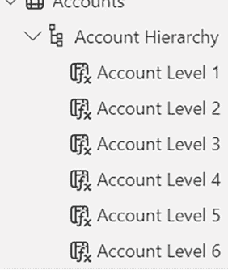

图 3.28：数据窗格中的层次结构

- 6. 右键单击组成该层次结构的各个列，然后选择**在报表视图中隐藏**。
- 7. 切换到**报表**视图，并创建一个**矩阵**可视化对象，将 **Account Hierarchy** 作为行，将 General Ledger 表中的 Amount 列作为值。

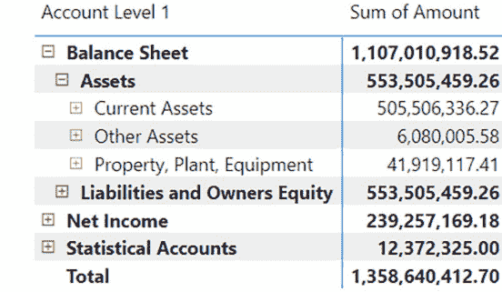

图 3.29：Account Hierarchy 的矩阵可视化对象

- 14. 创建一个簇状条形图可视化对象，将 Products 表中的 Product Subcategories 组作为轴，将 Internet Sales 表中的 SalesAmount 列作为值。

## 按产品子类别汇总 SalesAmount

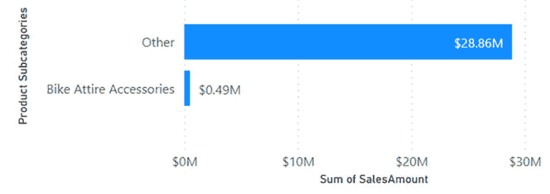

图 3.31：启用 Other 组的 Product Subcategories 组

## 工作原理

对于所创建的层次结构，PATH 函数会将子键列与父键列进行比较，并返回一个分隔文本字符串，其中包含给定行的所有父级成员。

对于 Account Level 列，PATHITEM 函数根据 position 参数，从最高级别到最低级别返回路径中的键值。PATHITEM 函数的第三个也是最后一个参数（1）指定将该值作为整数返回。此外，请注意，Key 的变量名以两个下划线字符作为前缀。这是因为 Key 是 DAX 中的保留字。在 DAX 中，变量名使用一个或多个下划线等字符作为前缀是一个好习惯，这样既可以避免与保留字冲突，也有助于快速识别变量。

LOOKUPVALUE 函数会将账户键与 PATHITEM 函数返回的键进行比较，并返回第一个参数指定的列，即 AccountDescription。某些行在给定列中包含空值，因为该账户位于结构的较高层级；例如，资产负债表账户在第 2 至第 6 级列中没有值。计算列会在数据窗格中以公式图标显示。


尽管物理关系在性能和管理性方面是首选的长期解决方案，但在物理关系不可行时，虚拟关系提供了一种有吸引力的替代方案。在本方案中，我们提供了使用自定义性能分段表和聚合表的虚拟关系示例。

## 准备工作

要为该方案做准备，请执行以下步骤：

- 1. 打开 Power BI Desktop。
- 2. 创建一个名为 AdventureWorksDW2022 的导入模式数据源查询。有关参考，请参阅本章中“实现语义模型”方案的“准备工作”部分。
- 3. 将此查询隔离到名为“Data Sources”的查询组中，并禁用加载。
- 4. 右键单击 AdventureWorksDW2022，然后选择“引用”。
- 5. 选择 FactInternetSales 表，并将此查询命名为“Internet Sales”。
- 6. 重复步骤4和5，创建一个导入 DimDates 的“Dates”查询。
- 7. 创建一个“Customers”查询。有关参考，请参阅本章中“配置模型元数据”方案的“准备工作”中的步骤7。
- 8. 基于 DimProduct、DimProductCategory 和 DimProductSubcategory 表创建一个“Products”查询。有关参考，请参阅本章中“创建关系”方案的“准备工作”中的步骤7。
- 9. 将“Internet Sales”查询移动到名为“Facts”的查询组，并将“Dates”、“Products”和“Customers”查询移动到名为“Dimensions”的查询组。
- 10. 使用“输入数据”查询在“Other Queries”组中创建一个“GrowthTiers”查询。

## 创建表

|  | 增长层级键 | 增长层级 | 最小值 | 最大值 | + |
|---|---|---|---|---|---|
| 1 | 1 | 问题 | -1 | -.25 |  |
| 2 | 2 | 表现不佳 | -.25 | 0 |  |
| 3 | 3 | 平均 | 0 | .25 |  |
| 4 | 4 | 表现优异 | .25 | 10 |  |
| + |  |  |  |  |  |

图3.33：销售增长分段表，GrowthTiers

11. 在 Other Queries 组中创建一个 SubCatPlan 查询，代码如下：

```
let
    Source = Products,
    Sales =
        Table.ExpandTableColumn(
            Source, "FactInternetSales",
            {"SalesAmount", "OrderDate"}, {"SalesAmount", "OrderDate"}
        ),
    RemoveNulls = Table.SelectRows(Sales, each [SalesAmount] <> null),
    Year =
        Table.AddColumn(
            RemoveNulls, "Calendar Year", each Date.Year([OrderDate])
        ),
    Month =
        Table.AddColumn(
            Year, "Calendar Month", each Date.MonthName([OrderDate])
        ),
    Group =
        Table.Group(
            Month,
            {"Calendar Year", "Calendar Month", "Product Subcategory"},
            {{"SalesAmount", each List.Sum([SalesAmount]), type nullable number}}
        ),
    Index = Table.AddIndexColumn(Group, "Index", 1, 1, Int64.Type),
    Plan =
        Table.AddColumn(
            Index, "Plan Amt",
            each if Number.IsEven([Index])
                then 1/Number.RandomBetween(5,10) * [SalesAmount] + [SalesAmount]
                else (-1 * 1/Number.RandomBetween(5,10) * [SalesAmount]) + [SalesAmount]
        ),
    Remove = Table.RemoveColumns(Plan,{"SalesAmount", "Index"}),
    Currency = Table.TransformColumnTypes(Remove,{{"Plan Amt", Currency.Type}})
    in
    Currency
```

12. 在 Other Queries 组中创建一个名为“Calculations”的空白查询。

13. 单击“开始”选项卡功能区中的“关闭并应用”，将表加载到语义模型。

14. 创建如图3.34所示的单一交叉筛选关系；请注意，GrowthTiers 或 SubCatPlan 表没有关系：

| 启用 | 从：表（列） | 到：表（列） |
| --- | --- | --- |
| ☑ | Internet Sales (CustomerKey) | Customers (CustomerKey) |
| ☐ | Internet Sales (DueDateKey) | Dates (DateKey) |
| ☑ | Internet Sales (OrderDateKey) | Dates (DateKey) |
| ☑ | Internet Sales (ProductKey) | Products (ProductKey) |
| ☐ | Internet Sales (ShipDateKey) | Dates (DateKey) |

图3.34：模型关系

15. 切换到“表”视图，并隐藏“Calculations”表中的单列。

16. 在“Calculations”表中创建以下三个度量：

```
Sales Current Year =
    CALCULATE(SUM('Internet Sales'[SalesAmount]),
        FILTER(ALL EXCEPT('Internet Sales','Customers'),
            YEAR('Internet Sales'[OrderDate]) = 2012 ) )
Sales Previous Year =
    CALCULATE(
        SUM('Internet Sales'[SalesAmount]),
        FILTER(ALL EXCEPT('Internet Sales','Customers'),
            YEAR('Internet Sales'[OrderDate]) = 2011 )
Sales Growth =
    DIVIDE([Sales Current Year] - [Sales Previous Year],
        [Sales Previous Year], BLANK() )
```

17. 右键单击“Date”表，然后选择“标记为日期表”，使用 FullDateAlternateKey 作为日期列。

## 如何支持虚拟表关系

要实现本方案，请使用以下步骤：

- 1. 在表视图中，在“Calculations”表中创建“Sales Growth Tier”度量：

```
Sales Growth Tier =
    VAR Growth = [Sales Growth]
    VAR Level1 =
        CALCULATE(MIN('GrowthTiers'[Max]), 'GrowthTiers'[GrowthTierKey] = 1)
    VAR Level2 =
```

## 更多内容...

DAX TREATAS 函数于 2017 年初加入，与涉及 INTERSECT 或 FILTER 使用 CONTAINS 函数参数的替代虚拟关系方法相比，它提供了更简单的语法和更好的性能。我们可以使用 TREATAS 函数将汇总表 SubCatPlan 集成到 Power BI 语义模型中。当业务想要通过其经常使用的相同 Products 和 Dates 表筛选计划数据，并创建实际与计划对比报告时，这非常有用。SubCatPlan 表的粒度是按日历年和日历月的产品子类别；如图 3.37 所示。

| 产品子类别 | 日历年份 | 日历月份 | 计划金额 |
|---|---|---|---|
| 山地自行车 | 2013 | 一月 | $313,596.6261 |
| 水壶和水壶架 | 2013 | 一月 | $2,284.3156 |

图3.37：用于虚拟关系的计划汇总表

由于多对多关系，无法直接创建从 SubCatPlan 表到 Date 和 Product 表的关系。Power BI 中的每个物理关系都基于每个表中的单个列，其中一个关系列唯一标识其宿主表的所有行。这与 SSAS 表格模型和 Excel 的 Power Pivot 模型一致。

要使用 DAX 创建虚拟表关系，请执行以下步骤：

- 1. 在“Calculations”表中创建“Subcat Plan Amt”度量。此度量通过 Products 表和 Dates 表筛选子类别计划度量：

```
Subcat Plan Amt =
    VAR ProductSubCats = VALUES('Products'[Product Subcategory])
    VAR DateTbl =
        SUMMARIZE('Dates','Dates'[CalendarYear],'Dates'[EnglishMonthName])
    RETURN
        CALCULATE(
            SUM('SubCatPlan'[Plan Amt]),
            TREATAS(ProductSubCats,'SubCatPlan'[Product Subcategory]),
            TREATAS(DateTbl,'SubCatPlan'[Calendar Year],'SubCatPlan'[Calendar Month]))
```

- 2. 创建一个“Sales vs Plan”度量：

```
Sales vs Plan = SUM('Internet Sales'[SalesAmount]) - [Subcat Plan Amt]
```

- 3. 创建一个矩阵可视化，以 Products 表中的“Product Subcategory”列作为行，Dates 表中的“EnglishMonthName”列作为列，并将“Subcat Plan Amt”度量、“Sales vs Plan”度量以及 Internet Sales 表中“SalesAmount”列的总和作为值。

| EnglishMonthName | January |  | February |  |
| 产品子类别 | Subcat Plan Amt | SalesAmount | Sales vs Plan | Subcat Plan Amt | SalesAmount |
| 自行车挂架 | $1,362 | $1,560 | $198 | $2,200 | $2,520 |
| 自行车支架 | $1,111 | $1,272 | $161 | $2,946 | $2,544 |

*图3.38：子类别计划与实际对比的矩阵可视化*

在“Subcat Plan Amt”度量中，变量用于存储代表 Products 和 Dates 维度表筛选值的表。TREATAS 函数将这些变量传递到相应的计划列，从而筛选 SubCatPlan 表。任何粒度与 Product Subcategory、Calendar Year 和 Calendar Month 列相同（或更低）的列都可以使用。来自其他表的列或没有虚拟关系的列不会筛选 SubCatPlan 表。

在这种情况下，可以创建桥接表来支持与 Products 和 Dates 表之间的物理关系。这两个桥接表将包含唯一的产品子类别和月份值，一对多关系将桥接表链接到 SubCatPlan、Product 和 Date 表。SubCatPlan 和桥接表可以从报表视图中隐藏，并且会在桥接表与 Products 和 Dates 表之间配置双向关系。为了获得更好的性能和管理性，建议使用物理关系而不是虚拟关系。

## 另请参阅

- DAX 函数参考：http://bit.ly/3rrQF1t
- DAX 中的物理和虚拟关系：http://bit.ly/2oFpe8T

## 设计列级安全性

虽然不像行级安全性（RLS）那么常见，但有时你可能希望向一组报表查看者隐藏语义模型中的特定列，而不向其他查看者隐藏。

虽然在 Power BI Desktop 中不可用，但 Analysis Services 表格语义模型确实支持对象级安全性（OLS）来保护表和列。这种保护对象的方法目前需要第三方工具，例如 Tabular Editor。此外，此方法还有一项优势，即连对象元数据也一并保护，这样没有访问权限的报表查看者甚至不会知道模型中存在这些表和列。

然而，OLS 也有严重的缺点。例如，将受 OLS 保护的列包含在视觉对象或度量中，对于无法访问该 OLS 保护列的用户来说，该视觉对象或度量将无法使用。因此，要为有权和无权访问某些表和列的各种用户创建可用的报表，即使并非不可能，也会变得非常困难。这个问题如此严重，以至于你很可能得出结论：不值得为此花费时间和精力，而报表确实应该是独立的语义模型。

本方案演示了一种在 Power BI Desktop 中实现列级安全性的方法，该方法不需要 OLS，并且可在任何许可级别下在 Power BI Desktop 中原生运行。虽然受保护列的元数据对报表查看者可见，而无需访问受保护列的值，但此方法的优点是更容易编写度量和报表视觉对象，这些视觉对象可以在模型内的任何安全级别下正常工作。


## 准备工作

要准备本配方，请按照以下步骤操作：

- 1. 打开 Power BI Desktop。
- 2. 创建一个名为 AdventureWorksDW2022 的导入模式数据源查询。参见本章《实施语义模型》配方中的准备工作部分作为参考。
- 3. 将此查询隔离到名为 Data Sources 的查询组中并禁用加载。
- 4. 添加一个名为 Reseller Sales Intermediate 的查询，该查询引用 AdventureWorksDW2022 查询，导入 FactResellerSales 表，并添加一个从 1 开始的 Index 列：
- 5. 禁用 Reseller Sales Intermediate 查询的加载。
- 6. 添加一个名为 Reseller Sales 的查询，该查询引用 Reseller Sales Intermediate 查询并删除 ProductStandardCost 和 TotalProductCost 列：
- 7. 添加一个名为 Reseller Costs 的查询，该查询引用 Reseller Sales Intermediate 查询并选择 ProductTotalCost、TotalProductCost 和 Index 列。

```
let
    Source = AdventureWorksDW2022,
    dbo_FactResellerSales = Source{[Schema="dbo",Item="FactResellerSales"]}[Data],
    Index =
        Table.AddIndexColumn(dbo_FactResellerSales, "Index", 1, 1, Int64.Type)
in
    Index
```

```
let
    Source = #"Reseller Sales Intermediate",
    RemoveColumns =
        Table.RemoveColumns(Source,{"ProductStandardCost", "TotalProductCost"})
in
    RemoveColumns
```

```
let
    Source = #"Reseller Sales Intermediate",
    SelectColumns =
        Table.SelectColumns(
            Source,{"ProductStandardCost", "TotalProductCost", "Index"})
in
    SelectColumns
```

DAX RLS 规则 ISBLANK( [Index] ) 会过滤掉 Reseller Costs 表中 Sales Person 角色的所有行，因为 Index 列永远不会为空。请注意，虽然值被隐藏，但受保护列的元数据在模型中仍然可用。

## 还有更多...

列级安全性有替代方法。其中一种方法是使用单个事实表并使用度量来实现列安全性。在这种方法中，会创建一个包含单列和单行的虚拟 Security 表，其中包含一个值。会为诸如 ISBLANK( [Column] ) 的角色创建类似的 DAX RLS 规则。此方法会将模型中需要安全性的所有列隐藏起来，并用度量替换它们，语法类似于以下内容：

```
IF(ISBLANK(COUNTROWS('Security')),BLANK(),SUM('Reseller Sales'[TotalProductCost]))
```

这种方法可以通过在 Security 表中为每个角色设置一行，并使用诸如 [Column] = "Sales Person"、[Column] = "Marketing" 和 [Column] = "Accounting" 等相应的 RLS 规则，来扩展以处理需要不同列安全性的多个角色。DAX 度量将根据需要进行调整。请注意，虽然值被隐藏，但受保护列的元数据在模型中仍然可用。

虽然无法通过 Power BI Desktop 实现 OLS，但可以使用 Tabular Editor 代替来编辑表或列的权限。

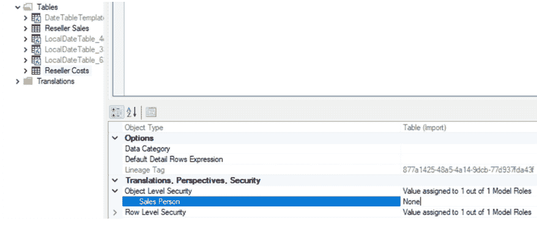

图 3.43：为表分配 OLS

- 4. 对 Dates 表重复步骤 3。
- 5. 打开 SQL Server Management Studio 并连接到源数据库。
- 6. 从 SQL Server Management Studio 的 Tools 菜单打开 SQL Server Profiler 并运行跟踪。
- 7. 创建一个表可视化，使用 Customers 表中的 EnglishEducation 列和 Internet Sales 表中的 SalesAmount 列。请注意，跟踪中没有记录任何内容。
- 8. 创建一个聚类柱形图，使用 Dates 表中的 CalendarYear 列作为轴，使用 Internet Sales 表中的 SalesAmount 列作为值。同样，没有记录任何内容。

## 其工作原理

核心事实表 Internet Sales 必须设置为 DirectQuery 存储模式至关重要，因为聚合表仅适用于设置为 DirectQuery 存储模式的明细表。聚合表本身 Sales Agg 必须设置为 Import 存储模式。与 Internet Sales 表和 Sales Agg 表都有关系的二维表 Customers 和 Dates，应设置为 Dual 存储模式，以便这些表可以在任一模式下最佳运行。配置表的聚合会自动在语义模型中隐藏该表，因为聚合表必须被隐藏。

必须在维度表和聚合表之间存在关系。这是因为聚合表在可能的情况下用作详细 DirectQuery 模式事实表的替代，因此聚合表应与事实表对维度表具有相同的关系。

在配置聚合时，还必须考虑列数据类型。这是因为 Manage aggregations 对话框强制执行 Detail Column 必须与 Aggregation Column 具有相同数据类型的规则。该规则的唯一例外是 Count 和 Count table rows 的汇总。Count 和 Count table rows 需要整数聚合列，但不需要 Detail Column 的数据类型匹配。

其他限制包括链式聚合、使用 DAX USERELATIONSHIP 函数支持的不活动关系，以及使用相同的 Summarization、Detail Table 和 Detail Column 的重复聚合。都不支持这些场景。

## 还有更多…

为了正常运行，RLS 表达式应同时过滤明细表和聚合表。事实上，一旦对表设置了聚合，仅过滤聚合表而不过滤关联明细表的 RLS 表达式将被 Manage roles 对话框禁止。

Manage aggregations 对话框包括设置 Precedence 的功能。这意味着您可以拥有不同粒度级别的多个聚合表，并设置这些聚合表的 Precedence 以允许它们被单个子查询考虑。例如，如果 Products 表包含在此模型中，您可能会为 Product Category 创建一个聚合表，并为 Product Subcategory 创建一个单独的聚合表。

## 准备工作

要准备本配方，请按照以下步骤操作：

- 1. 打开 Power BI Desktop。
- 2. 点击功能区 Home 选项卡上的 Transform data。
- 3. 在 Power Query Editor 中，点击功能区 Home 选项卡上的 Manage parameters。
- 4. 创建一个 Type 为 Date/Time 且 Current Value 为 1/1/2013 12:00:00 AM 的 RangeStart 参数。
- 5. 创建一个 Type 为 Date/Time 且 Current Value 为 12/31/2014 12:59:59 PM 的 RangeEnd 参数。

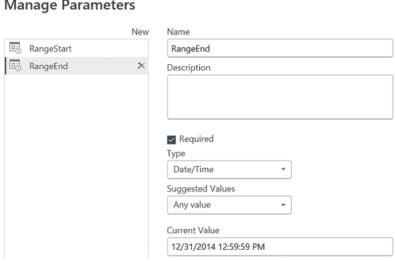

图 3.48：Manage Parameters 对话框

- 6. 创建一个名为 Dates 的 DirectQuery 模式查询，从 AdventureWorksDW2022 数据库加载 DimDate 表。
- 7. 创建一个名为 Internet Sales 的 Import 模式查询，从 AdventureWorksDW2022 数据库加载 FactInternetSales 表。

8. 对于 Internet Sales 查询，导航到 OrderDate 列，点击列标题中的下拉箭头，然后选择 Date/Time Filters 和 Custom Filter...。


图 3.49：创建自定义筛选器

9. 按图 3.50 所示配置 Filter Rows 对话框并点击 OK 按钮：


图 3.50：Filter Rows 对话框

10. 点击功能区 Home 选项卡上的 Close & Apply 按钮以加载数据。

在 Table view 中，确认您的 Internet Sales 表中有一部分行——您应该只有 54,771 行数据，而不是完整的 60,398 行。

## 如何利用混合表

要实施本配方，请使用以下步骤：

- 1. 切换到 Model view。
- 2. 注意 Dates 表与 Internet Sales 表之间指示的弱关系，关系末端已断开。这是因为 Dates 表处于 DirectQuery 存储模式，而 Internet Sales 表处于 Import 存储模式。
- 3. 右键点击 Internet Sales 表并选择 Incremental refresh。


4. 按照 *图 3.51：* 所示配置 **增量刷新和实时数据** 对话框：


*图 3.51：增量刷新和实时数据对话框*

+   5. 单击 **应用** 按钮。
+   6. 按照对话框中的建议（参见 *图 3.51*），在 Dates 表的 **属性** 窗格的 **高级** 部分，将 Dates 表的 **存储模式** 更改为 **双重**。
+   7. 请注意，Dates 表与 `Internet Sales` 表之间的弱关系已得到解决。

## 工作原理

发布到 Power BI 服务后，服务会负责创建和维护相应的表分区。按照此处的配置，初始表分区将包含 2013 年和 2014 年的数据。

系统还会添加其他分区，以纳入最近 5 年的数据。这些存档数据不会作为增量刷新的一部分进行刷新。数据加载后，将保持最初加载时的状态，直到不再处于存档数据时间范围内。因此，整个表中包含滚动的 5 年数据。

按照此处的配置，每次增量刷新只刷新最近 3 天的数据，因此与刷新整个表相比，可以显著缩短刷新时间。每次增量刷新都会添加一个新分区。

将“使用 DirectQuery 实时获取最新数据”选项设置为启用后，Power BI 服务中的表就会成为混合表。呈现可视化效果时，系统会从导入分区中提取数据，同时也会通过 DirectQuery 查询数据源，以纳入导入分区中尚未包含的任何新数据。

## 更多内容……

本篇指南介绍的场景是 Power BI Desktop 当前唯一原生支持的场景。不过，Tabular Editor 3 等第三方工具可以帮助我们配置另一种用例：将最新数据加载到导入分区中，而较旧的数据则通过 DirectQuery 分区提供。

为了演示此功能，我们可以创建如下查询，从 AdventureWorksDW2022 数据库导入最近 11 年的数据。请注意，在实际场景中，这段时间通常可能是最近 2 年或 3 年。以下示例展示了分区表达式在 Tabular Editor 中的形式：

```
let
    Source = Sql.Database("localhost", "AdventureWorksDW2022", [Query="SELECT *#{1f}FROM FactInternetSales#{1f}WHERE OrderDate >= DATEADD(YEAR, -11, CONVERT(DATE,GETDATE()))"])
in
    Source
```

在 Tabular Editor 3 中，我们可以复制此分区，然后将其修改为 DirectQuery 分区，并使用以下表达式：

```
let
    Source = Sql.Database("localhost", "AdventureWorksDW2022", [Query="SELECT *#{1f}FROM FactInternetSales#{1f}WHERE OrderDate < DATEADD(YEAR, -11, CONVERT(DATE,GETDATE()))"])
in
    Source
```

这样，导入部分就包含最新数据；如果需要较旧的数据，则会从 DirectQuery 分区中提取。

## 另请参阅

- 语义模型的增量刷新和实时数据：https://bit.ly/4abr w5X
- Power BI 服务中的语义模型模式：https://bit.ly/3v0c1MH

## 总结

在本章中，我们探讨了在 Power BI Desktop 中设计和开发可靠语义模型的主要流程。我们展示了如何使用 Power BI 的标准功能相对轻松地应对常见的语义建模挑战，包括多个粒度和多对多关系。此外，我们还提供了使用 DAX 语言编写业务逻辑和定义的示例。我们还探讨了如何通过元数据设置和高级功能提升模型的价值与可持续性。最后，我们讲解了更高级的列级安全性、聚合表和混合表等主题。

现在我们已经了解如何构建语义模型，接下来将把注意力转向 Power BI 报表的创作。

## 加入我们的 Discord 社区

加入社区的 Discord 交流空间，与作者和其他读者展开讨论：

https://discord.gg/ebXZqyrxJb


