# 4 编写 Power BI 报表

# 编写 Power BI 报表

Power BI 报表具有沉浸式视觉体验和交互性，这对大多数利益相关者而言正是 Power BI 的核心特质。虽然必须先开发语义模型及其数据源，才能为报表提供数据来源，但精心设计直观、重点明确的报表，让用户能够获得洞察并灵活使用数据，这些报表就能成为组织极具价值的资产。

Power BI Desktop 提供了丰富的数据可视化功能和选项，支持在各种设备上构建高度贴合目标需求、易于使用的报表。每个 Power BI Desktop 报表都可以包含多个页面，每个页面又可以包含多个可视化对象，因此，单个 Power BI 报表可以满足多种使用场景、受众和业务需求。例如，可以将 KPI 可视化对象固定到 Power BI 服务中的仪表板上，同时使用报表页面进行详细的领域专属分析。这些功能可与竞争对手分析平台的可视化产品直接竞争，还可以通过自定义可视化对象和报表主题进一步扩展。

选择和配置 Power BI 可视化功能，对于充分利用 *第 2 章“访问、检索和转换数据”* 以及 *第 3 章“构建 Power BI 语义模型”* 中介绍的数据检索与建模流程至关重要。在本章中，我们将开发并介绍最基本的报表可视化对象和设计概念。此外，我们还将介绍如何增强和控制用户与 Power BI 报表交互，以及在 Windows 和移动设备上使用报表时的体验。

本章将介绍以下指南：

- 构建丰富直观的报表
- 在不同范围内筛选
- 集成卡片可视化对象
- 使用切片器
- 控制可视化对象交互
- 使用图形可视化对象
- 创建表和矩阵可视化对象
- 增强报表
- 设置报表格式以供发布
- 设计移动布局
- 创建分页报表

## 技术要求

完成本章中的指南需要满足以下条件：

- Power BI Desktop 和 Power BI 服务帐户
- SQL Server 2022 或更高版本，并安装 AdventureWorksDW2022 数据库。请参阅 *第 1 章* 中的“安装 SQL Server 和 AdventureWorks 数据库”指南。
- `Chapter 4 Start.pbix` 包含本章使用的模型，可从以下 GitHub 存储库下载：https://github.com/PacktPublishing/Power-BI-Cookbook-Third-Edition/。

## 构建丰富直观的报表

Power BI Desktop 提供了报表设计工具，可让报表高度贴合特定用例和需求，同时符合企业 BI 标准。报表的设计和开发过程应自然地承接语义建模过程：利用模型中的度量值、关系和维度，对业务问题进行可视化和分析。Power BI 报表的用途和范围可能差异很大，从仪表板可视化到交互式分析体验，再到面向特定角色的详细报表，因此，报表创作功能必须与这些不同用例紧密对应。

本篇指南将介绍报表设计规划流程，以明确 Power BI 报表的主要设计要素，例如可视化类型。“工作原理”部分将介绍两个已完成的报表页面及其相关细节；“更多内容……”部分则会讨论其他报表设计功能和实践。

## 准备工作

利益相关者矩阵有助于根据访问模型和报表的不同参与方的需求，构建报表设计规划流程。诸如 **商品管理** 这样的利益相关者或业务部门会列在列轴上，用来替代数据仓库总线矩阵中使用的符合维度（即 **产品** 或 **供应商**）；该总线矩阵已在 *第 3 章“构建 Power BI 语义模型”* 中介绍。


| BUSINESS PROCESSES | Executive | Sales | Finance | Marketing | Merchandising | eCommerce | Customer Service | Supply Chain |
|---|---|---|---|---|---|---|---|---|
| Internet Sales | ✓ | ✓ | ✓ | ✓ | ✓ | ✓ |  |  |
| Internet Sales Plan | ✓ | ✓ | ✓ | ✓ | ✓ | ✓ | ✓ | ✓ |
| Reseller Sales | ✓ | ✓ | ✓ |  | ✓ |  |  |  |
| General Ledger | ✓ |  | ✓ |  |  |  |  |  |
| Inventory |  |  | ✓ | ✓ | ✓ | ✓ |  |  |
| Customer Surveys | ✓ | ✓ | ✓ | ✓ |  | ✓ | ✓ | ✓ |
| Customer Service Calls |  |  | ✓ |  |  |  | ✓ |  |
| Shipping |  |  | ✓ |  | ✓ |  |  | ✓ |

Figure 4.1: Stakeholder matrix

在此示例中，语义模型包含四个高亮的事实表：Internet Sales、Internet Sales Plan、Reseller Sales 和 General Ledger。当某个业务职能内存在多个利益相关者且各有独特需求和使用场景时，这些利益相关者可以作为列添加到利益相关者矩阵中。在 Power BI 中，使用同一个语义模型和底层检索与数据架构，可以有多种方式满足不同利益相关者的独特需求。

## 如何构建丰富且直观的报表

虽然报表开发应是一个敏捷流程，在报表设计和开发过程中应定期征求利益相关者的反馈，但在报表开始前进行扎实的规划和设计过程，对于理解其范围和需求非常有益。

单个报表不应试图解决不相关的业务问题或满足高度多样化的用户需求，例如企业财务分析师或商店经理。多范围报表可能导致用户体验复杂化，以及难以维护和扩展的报表级定制。报表规划和设计过程应回答以下五个问题：

- 1. 谁将访问此报表？
- 2. 该报表的首要优先级在业务问题方面是什么？
- 3. 报表将如何被访问和使用？
- 4. 所需数据的速度如何，这是否会影响模型？
- 5. Power BI 是否是该报表的正确工具？

关于第一个问题，就像 PowerPoint 演示文稿一样，报表页面应支持单一主题并面向特定受众。根据利益相关者矩阵，针对某个语义模型通常存在许多不同的用户和使用场景。请考虑以下几点：

- 如果已识别的用户需求高度分散，请选择一个用户角色并分别处理其他角色。
- 页面级筛选和行级安全性可以为单个团队提供稳健的解决方案。
- 如果模型包含所需的数据和粒度，则可以快速为各个团队开发报表。
- 对数据非常熟悉的用户需要较少的标题、描述性文本和标签。
- 建议在报表设计过程早期就让业务用户或其代表参与其中，甚至在语义模型的所有元素完成之前。报表的任何初始迭代和反馈都可以为最终发布的报表设计做出贡献。

第二个问题可以按如下方式解决：优先考虑的业务问题直接驱动可视化选择，例如折线图/条形图和表格。如果趋势或度量的波动是首要优先级，则可以选择带有自定义刻度以及支持趋势线和参考线的折线图。如果需要精确的单个数据点，无论是作为独立数字还是与一两个维度相关，则应使用卡片、KPI 以及表格或矩阵。视觉对象的选择以及视觉对象在画布上的大小、颜色和相对位置不应是随意决定或猜测。请考虑以下几点：

- 确定分析的起点，包括度量和粒度，例如每周销售额。
- 利益相关者通常有许多相关问题，需要快速浏览模型。
- 可以在报表的起点上添加额外的下钻和筛选功能。
- 标准折线图、条形图/柱形图和散点图在视觉感知和用户理解方面具有自然优势。其他视觉对象应根据其特定用例和优势使用，例如漏斗可视化用于流程阶段，水fall 可视化用于维度值对总体总量的贡献。

报表将如何被访问和使用？报表将如何被访问以及业务用户希望如何与报表交互是开始报表开发前应回答的关键问题。报表访问和交互性是报表设计者应了解的关键组成部分，以确保报表包含适当的元素、视图、筛选器和度量。请考虑以下几点：

- 用户是否只查看报表，还是报表是进一步分析的起点？
- 如果不需要交互或交互有限，请计划在报表中嵌入条件逻辑和异常情况。
- 如果交互性高，请计划使用层次结构、工具提示和切片器以实现数据探索。
- 报表与现有仪表板有何关系？
- 确定报表中将为现有仪表板做出贡献的组件。
- 如果基于报表创建新的仪表板，请确定图块和交互。
- 报表是否仅通过 Web 浏览器访问，还是会定期使用移动设备？
- 如果预计会通过移动设备使用，可以设计报表以优化此体验。
- Power BI 仪表板也可以在 Power BI 服务中针对手机版布局进行优化。

所需数据的速度如何，这是否会影响模型？所需数据的速度可能会影响所选的存储模式，无论是 Import、DirectQuery、Dual 模式还是流式语义模型。对于仅需每天刷新一次或两次数据的业务用户，Import 模式模型可能工作良好，但对于需要更即时速度的业务用户，DirectQuery 模型可能更合适。其他因素也可能影响修订语义模型的需求，包括：

- 如果报表需求对某个利益相关者组的全部报表都是系统性的，请考虑修订模型。
- 如果需要复杂的报表级定制，或性能不佳，请考虑修订模型。
- 这些修订通常包括新的逻辑属性或新的 DAX 度量。

最后，必须认识到，在 Power BI Desktop 中创建的 Power BI 报表并不适用于每种报表类型。诸如多页打印、带有以各种文件格式附加数据的电子邮件订阅以及像素级格式控制等报表需求，更符合使用 Power BI Report Builder 创建的分栏报表。同样，涉及单元格级控制和格式的自定义布局的财务报表和会计报表通常更适合 Excel。值得庆幸的是，这另外两种报表类型在 Power BI 中也得到完全支持，因此可以开发包含全部三种不同报表类型的解决方案。

## 其工作原理

在本示例中，利益相关者是欧洲销售区域组，由法国、德国和英国组成。规划过程揭示了两种主要类型的用户。第一种用户类型是欧洲销售集团经理，负责管理整个销售区域。第二种用户类型是负责各个国家的管理人员。

已确定的首要优先级是按月粒度查看和分析 Internet Sales 与 Plan、Reseller Sales 以及销售额毛利，按国家以及按产品细分与类别、子类别和型号相关。国家经理希望在州/省、市和邮政编码级别获得更细粒度的地理数据。整个组织在会计目的上使用财政日历，但业务利益相关者希望报表在报告数据时使用日历月份，而不是财政月份。业务还希望将客户数量与互联网销售额随时间进行比较。

关于报表将如何被访问和使用，欧洲销售集团经理需要整个欧洲销售区域的关键事实、数据和趋势；预计该经理不会大量与报表交互，但仍应有机会在需要时下钻数据。欧洲销售集团经理希望有一个可在手机上查看的移动报表，因为该个人经常在各国之间旅行，因此几乎一直处于移动状态。各个国家的管理人员希望能够以高度交互的方式分析自己的数据。国家级经理也对销售计划负责，但希望获得更大的自助服务灵活性，并需要一些详细的表格格式报表以显示多个度量的特定值。预计国家经理将通过 Web 浏览器从其桌面访问报表。


在数据刷新频率方面，销售集团经理和国家经理都认为每天刷新一次或两次是可以接受的，因为主要关注的粒度是月度数据。各方还一致认为，使用美式英语的名称、描述和货币最能满足集团的需求。鉴于规划过程中确定的需求，确定模型中必须包含“网络销售”（Internet Sales）、“经销商销售”（Reseller Sales）、“总账”（General Ledger）和“网络销售计划”（Internet Sales Plan）的事实表。此外，还需要以下维度：产品、账户、客户（含地理数据）、日期、部门、组织、员工、经销商、促销和销售区域。目前没有一个模型包含所有期望的信息，因此决定开发一个新模型。

需求收集完成后，确定报表将由两到四个主要报表页组成：每个国家一页（或一个用于钻取的国家/地区页面），以及一个面向欧洲销售集团经理的页面。所有报表页的左上角都将包含相同的四个优先度量值：**月度网络销售额**、**月度网络利润率%**、**月度经销商销售额**和**月度经销商利润率%**，以及一个按日历年/月份显示的**网络销售计划达成**图表。对于没有目标或计划（plan）的度量值，使用过去6个月的平均度量值。

考虑到性能和可用性，决定将每页的视觉对象数量限制为四到五个，并避免使用密集的“数据提取或转储”视觉对象。此限制不适用于卡片图、仪表图和KPI视觉对象。报表视觉对象会生成DAX查询，而与包含多行多列的表格或矩阵等密集视觉对象关联的查询比卡片图和KPI视觉对象慢得多。包含大量视觉对象的报表页面可能会显得拥挤且使用复杂。此外，还将研究在报表级别和页面级别应用简单筛选器（**当前年份**或**上一年份**）的机会，以进一步提高性能。对于这些特定页面，报表将在报表级别按欧洲筛选，并在页面级别按各个国家/地区筛选。

衡量报表效果的一个可靠预测指标是业务洞察（度量值、上下文或分析）与用户消费信息所需的工作量之比。理想情况下，报表应提供开箱即用的分析，用户只需具备访问权限以及对术语和领域的基本了解即可。用户需要滚动、点击以及避开不必要的颜色或数据元素越多，报表的有效性就越低。

在规划和设计之后，创建报表页面的模型，向用户展示，并加以完善。

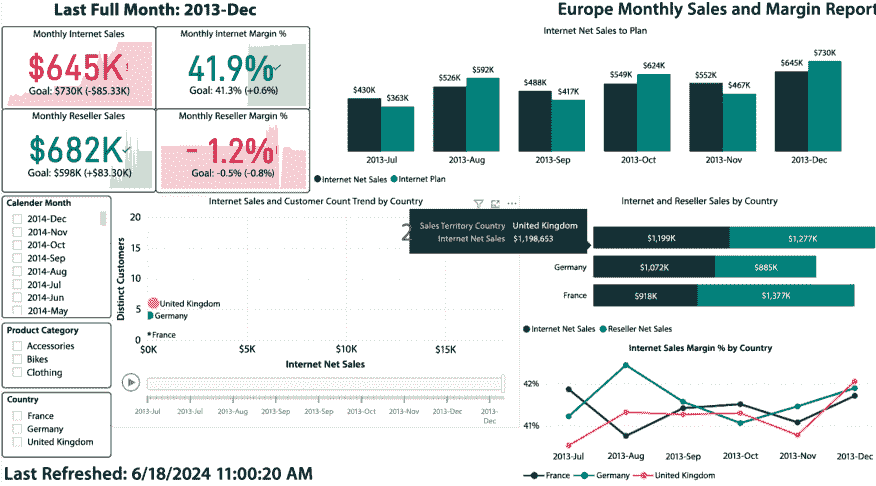

图4.2是区域级别的报表模型，而图4.3显示了国家/地区级别的类似信息。

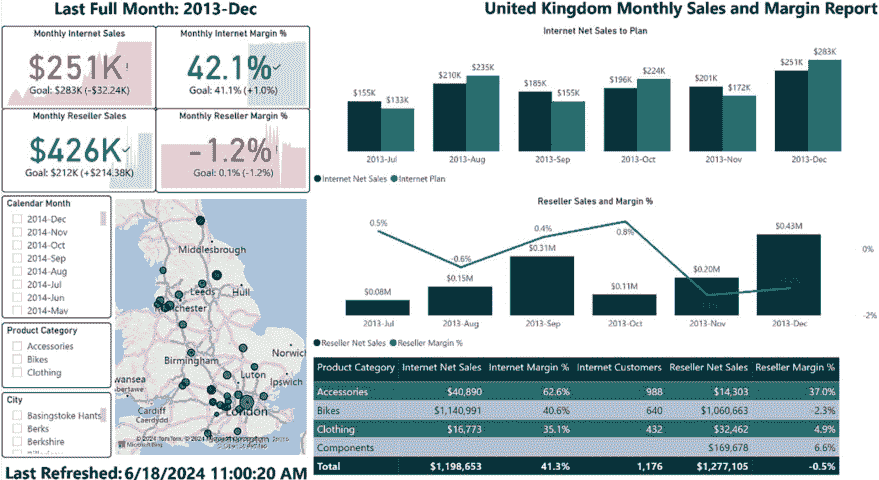

根据用户反馈，采用带有月度趋势和目标度量值的KPI视觉对象，以提供比卡片图或仪表图更丰富的上下文。总体而言，选择了在视觉感知和额外分析上下文方面具有优势的标准视觉对象类型。例如，使用KPI代替卡片图；避免使用仪表图、树状图和饼图。对于网络销售计划达成情况，考虑到每个月单个值的重要性，选择了簇状柱形图而非折线图。每个国家/地区的报表页面还能一目了然地提供数值，KPI视觉对象会自动更新。

与图4.2和图4.3相关的其他设计决策如下：

- 切片器视觉对象以及散点图上的播放轴放在左侧，以支持用户筛选选择。
- 将鼠标悬停在地图中的气泡或图表中的柱形上时，会以工具提示形式显示更多度量值。
- 页面标题使用文本框，最后刷新日期页脚是卡片图。检索使用 DateTime.LocalNow 函数的M查询，并将其传递给返回文本的DAX度量值。
- 图表标题被自定义，并尽可能移除Y轴。

有关本示例中使用的各个报表组件的更多详细信息，请参阅本章中的其他技巧。可通过从本书的GitHub存储库下载 CountryMonthlyReport.pbix 文件来查看图4.2和图4.3中显示的报表。

## 更多内容…

与第3章《构建Power BI语义模型》中分享的简单而重要的语义建模细节类似，许多设计实践可以显著提升Power BI报表的价值和用户采用率：

- **简约：** 任何并非理解报表所严格必需的元素都应移除，例如图片、冗余的图表坐标轴、冗长的文本和不必要的数据图例。
- **高效视觉对象：** 利用视觉对象和功能，在相同的空间内提供更多洞察；例如KPI和组合图视觉对象、工具提示、趋势线和颜色饱和度。
- **有意义的颜色：** 颜色应用来传达含义，例如与目标或度量值相比的高/低差异。要有选择地使用颜色，避免颜色种类过多或密度过大，使用户感到不知所措或分心。
- **有条理：** 报表视觉对象应对齐、均匀分布，并放置在相关视觉对象附近。最重要的视觉对象应靠近画布的左上角，并使用空白区域分隔视觉对象。
- **一致性：** 布局和格式选择（如视觉对象位置、字体和文本对齐）应保持一致。例如，切片器视觉对象应始终放在视觉对象的左侧或顶部。

关于一致性，Power BI支持报表主题，这些主题包含标准调色板、字体、字号以及控制报表和视觉对象默认设置的其他元数据元素。Power BI报表默认设置的几乎每个方面都可以控制，包括是否显示坐标轴标题、标签方向、图例标记，以及“**格式**”窗格中页面和视觉对象显示的任何内容。

许多组织都会使用标准报表主题，甚至标准报表布局。通常，这些主题体现企业品牌和形象。在本示例中，将一个报表主题应用到报表上，以便色觉缺陷用户清晰理解：

- 从 https://aka.ms/pbithmes 的报表主题库下载**色盲友好**主题。使用搜索栏搜索“color blind friendly”。点击该主题的链接，然后下载 ColorblindSafe-Longer.json 文件。
- 在Power BI Desktop中打开 Chapter 4 Start.pbix，并将此文件另存为 Building Rich and Intuitive Reports.pbix。

在“**视图**”选项卡的功能区中，单击“**主题**”区域中的下拉箭头，然后选择“**浏览主题**”：

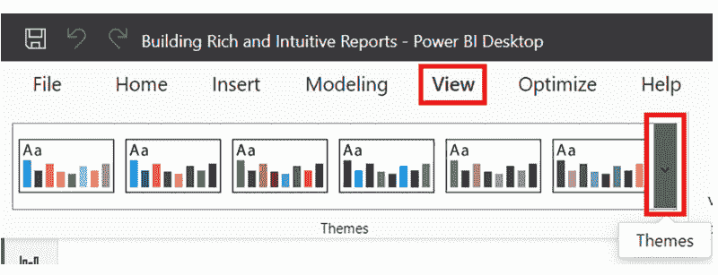

浏览到下载的JSON文件，选择它，然后点击“**打开**”。将出现一条消息，提示主题已成功导入。主题设置将应用到报表。可用于设置画布背景、壁纸和视觉对象格式的颜色现在会体现主题的颜色。

查看这些新颜色的最简单方法是点击报表页面上的任意空白区域。展开“**可视化**”窗格，点击“**设置页面格式**”选项卡。展开“**画布背景**”或“**壁纸**”格式卡片，然后点击“颜色”下拉菜单。

## 主题颜色

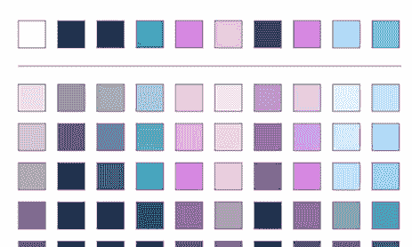

*图4.5：应用于Power BI报表格式窗格的报表主题颜色*

虽然相似，但画布和壁纸略有不同。画布仅包含报表中可放置视觉对象的区域，而壁纸覆盖整个背景显示区域。

主题无法在Power BI服务中应用，并且某些自定义视觉对象不应用报表主题。此外，报表主题不会影响图像的颜色，也不会覆盖应用于视觉对象中特定数据点的任何自定义颜色。在开发报表时尽早应用主题非常重要，以避免出现应用主题后数小时的格式设置突然失效的情况！

每个报表主题JSON文件都具有与图4.6所示一致的颜色代码映射元素结构。

```
{
  "name": "ColorblindSafe-Longer",
  "dataColors": ["#074650", "#009292", "#fe6db6", "#feb5da", "#480091", "#b66dff", "#b5dafe", "#6db6ff", "#914800", "#23fd23"],
  "background": "#FFFFFF",
  "foreground": "#074650",
  "tableAccent": "#fe6db6"
}
```

*图4.6：色盲报表主题JSON文件结构*

JSON文件中只需要 name 字段。dataColors 字段中可以输入任意数量的不同代码。

## 另请参阅

- 适用于Power BI报表设计的技巧——最佳实践： http://bit.ly/3fmfXPf
- Power BI最佳实践指南： http://bit.ly/3cxCs29
- Power BI社区主题库： https://aka.ms/pbithemes
- 在Power BI Desktop中使用报表主题： http://bit.ly/31vBixz


## 在不同范围进行筛选

可以在报表架构的每一层对 Power BI 报表配置筛选器，包括整个报表、报表页面和单个视觉对象。由于报表筛选器是在设计时配置的，不像切片器那样显示在画布上，因此筛选器提供了一种强大而高效的方法，可根据特定需求自定义报表元素。

与访问报表的用户或团队，或与要分析的特定实体保持一致的报表级和页面级筛选器，可提供即时焦点和一定程度的组织性。例如，为一个产品类别构建的报表页面可以复制到其他产品类别页面，每个页面包含不同的页面级筛选器。视觉对象级筛选器提供了更大的灵活性，因为除了任何报表级和页面级筛选器之外，还可以定义包括度量值在内的复杂筛选条件。在本方案中，提供了在三个不同范围实施筛选器的示例。本节演示了 **前 N 项** 视觉对象级筛选条件，并在 *工作原理* 中分享了筛选器类型生成的 DAX 查询示例。

### 准备工作

若要准备本方案，请执行以下步骤：

1. 打开 `Building Rich and Intuitive Reports.pbix` 文件，并将其另存为 `Filtering at Different Scopes.pbix`。
2. 通过右键单击 **Page 1** 选项卡并选择 **重命名**，将 Page 1 重命名为 Europe：

   

   *图 4.7：页面重命名和创建*

3. 使用 + 图标创建四个额外的报表页面，分别命名为 France、Germany、United Kingdom 和 Scratch：

   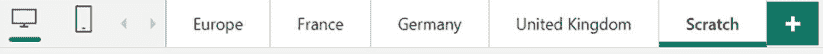

   *图 4.8：报表页面*

4. 保存你的工作。

### 如何在不同范围进行筛选

若要实施本方案，请使用以下步骤：

1. 在**报表**视图中，切换到 Europe 页面。请注意右侧可用的三个默认窗格：**筛选器**、**可视化(生成)**和**数据**。如果尚未展开，请通过单击每个窗格右上角双尖括号图标来展开这些窗格。请注意，根据你启用的预览功能，**可视化**窗格可能标记为**生成**。
2. 在**数据**窗格中，将 `Sales Territory Group` 列从 `Sales Territories` 表拖到**筛选器**窗格中的**所有页面上的筛选器**区域。
3. 使用**基本筛选**选择 Europe。

   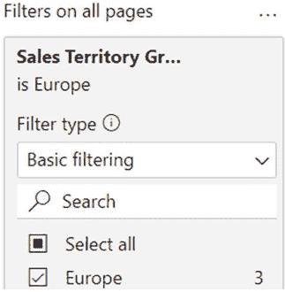

   *图 4.9：欧洲销售和利润月度报表的报表级筛选器*

4. 在 `France`、`Germany` 和 `United Kingdom` 的国家/地区页面上，将 `Sales Territories` 表中的 `Sales Territory Country` 列从**数据**窗格拖到**筛选器**窗格中的**此页面上的筛选器**区域，并在**基本筛选**中选择该页面对应的国家/地区。
5. 现在选择 `Scratch` 页面。
6. 从**可视化(生成)**窗格中选择**表格**视觉对象来创建表格可视化，然后从**数据**窗格中添加来自 `Sales Territories` 表的 `Sales Territory Country` 以及来自 `Internet Sales` 表的 `Internet Gross Sales` 度量值。请注意，你可以使用窗格顶部的搜索栏在**数据**窗格中搜索度量值和列。
7. 选择上一步中刚刚创建的**表格**视觉对象，然后在**筛选器**窗格中，展开**此视觉对象上的筛选器**部分中的 **Internet Gross Sales** 区域。
8. 从**当值满足条件时显示项目**下的下拉列表中选择**大于**，并在下拉列表下方的字段中键入 `3000000`。
9. 单击**应用筛选器**将筛选器应用于视觉对象。

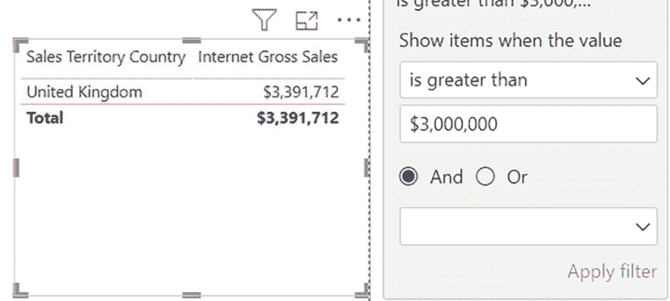

图 4.10：视觉对象级筛选器

### 工作原理

报表级筛选器会影响报表中的所有页面；因此，当筛选器应用于筛选器窗格的“所有页面上的筛选器”区域时，如果模型中存在与维度的关系，并且 DAX 未覆盖该筛选器，则报表所有页面上的所有视觉对象都遵循此筛选器。对于前一方案中描述的报表，已确定欧洲团队无需查看其他销售组或国家/地区，因此我们针对“欧洲”的销售区域组筛选了整个报表（所有页面）。同样，页面级筛选器仅影响应用了筛选器的页面上的视觉对象。因此，我们将每个国家/地区页面筛选为相应的销售区域国家/地区。

报表级和页面级筛选器最常用于实现相对静态且唯一值较少的维度层次结构的不同级别，例如本方案中的示例。日期范围筛选器通常应应用于数据检索查询或报表画布中，使用的视觉对象如日期切片器。由于这些筛选器分别应用于报表或页面中的所有视觉对象，因此请尽量避免对高基数列（如 ProductKey 或 Sales Order Number）进行筛选。DAX 度量值不能用于定义报表级和页面级筛选器。

视觉对象级筛选器可以基于语义模型中的度量值和列。这些度量值和列可以存在于视觉对象中，也可以不存在。

### 更多内容…

除了**基本筛选**之外，还有更高级的筛选选项。其中包括**高级筛选**和**前 N 项筛选**。文本和数字列都支持 AND 条件以及 OR 条件，以创建更复杂的筛选条件。若要查看其工作原理，请执行以下步骤：

1. 选择在 `Scratch` 页面上创建的**表格**视觉对象。
2. 在**筛选器**窗格中，清除来自 `Internet Gross Sales` 的视觉对象级筛选器。
3. 展开**此视觉对象上的筛选器**部分中的 `Sales Territory Country` 区域，并将**筛选器类型**切换为**高级筛选**。
4. 从**当值满足条件时显示项目**下拉列表中选择**包含**，在下方字段中键入字母 a，然后点击**应用筛选器**。`United Kingdom` 将从表格视觉对象中消失。
5. 清除此筛选器，并将**筛选器类型**更改为**前 N 项**。
6. 在**显示项目**下，选择**最大**并键入数字 2。
7. 将 `Reseller Sales` 表中的 `Reseller Net Sales` 度量值拖到**按值**区域，然后点击**应用筛选器**。`Germany` 现在将从表格中消失。

如果需要复杂的筛选条件，或者需要对具有许多不同值的列（例如 `Sales Order Number`）进行筛选，则在数据检索或模型中考虑此逻辑可能是有益的，从而简化生成的 DAX 查询。

此外，报表级、页面级和视觉对象级筛选器可以被 DAX 度量值覆盖。若要查看其工作原理，请在 `Sales Territories` 表中创建以下度量值：

```
Count Countries = COUNTROWS(ALL('Sales Territories'))
```

在 Scratch 页面上使用**卡片**视觉对象显示此新度量值，并观察该度量值的值为 11。无论应用了哪些报表级、页面级和视觉对象级筛选器，此度量值始终为 11。DAX 函数 `ALL` 会覆盖应用于 `Sales Territories` 表的筛选器。

### 另请参阅

- Power BI 报表中的筛选器和突出显示：http://bit.ly/39v0msh
- Power BI 报表中的筛选器类型：http://bit.ly/3sBkMrQ

## 集成卡片视觉对象

鉴于单个度量值和小型度量值集合的重要性，卡片和多行卡片视觉对象通常放置在报表页面的顶部和左侧部分。虽然卡片在其他视觉对象中图形表现力和交互性较弱，但它们也是固定到 Power BI 仪表盘的最常见磁贴，并且还经常用于移动消费的电话布局中。报表设计中的常见做法是，从以卡片或 KPI 视觉对象表示的几个高级度量值开始，并围绕这些度量值构建额外的图表和表格视觉对象。

本方案演示了如何使用卡片、多行卡片、KPI 和仪表视觉对象，以及文本框。


- 4. 接下来，将“背景”滑块切换到“关闭”。操作方法：单击“常规”选项卡，然后展开“效果”格式卡片。

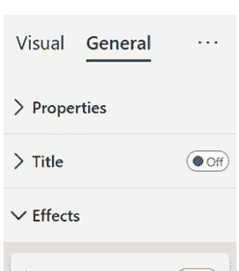

*图 4.12：格式窗格的“常规”选项卡*

- 5. 在“视觉对象”选项卡上，展开“标注值”格式卡片，将“文本大小”设置为 18，将“字体”设置为 Segoe UI (Bold)。
- 6. 在“常规”选项卡上，展开“属性”格式卡片，然后展开“大小”格式卡片。将“高度”设置为 48，“宽度”设置为 448。
- 7. 展开“位置”格式卡片，将“水平”和“垂直”设置为 0，将“Y 位置”设置为 0。
- 8. 选择“卡片”视觉对象，按 Ctrl + C 复制。单击画布上的空白区域，按 Ctrl + V 粘贴副本。将显示的度量值替换为 Date Last Refreshed 度量值，并设置以下属性：“高度”为 36，“宽度”为 305，“水平”为 168，“垂直”为 680。
- 9. 单击页面画布上的空白区域，在“插入”选项卡的功能区中选择“文本框”，然后输入“欧洲月度销售和利润报告”。
- 10. 使用 Ctrl + A 选择全部文本，然后将字体更改为 Segoe UI (Bold)，设置文本大小为 18，并右对齐文本。

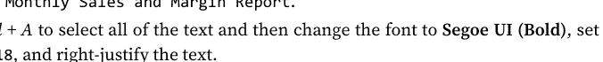

*图 4.13：格式化时要选择的设置*

- 11. 在“格式”窗格中，展开“效果”格式卡片，并将“背景”滑块切换到“关闭”。
- 12. 展开“属性”格式卡片，设置“高度”为 48、“宽度”为 656、“水平”为 624、“垂直”为 0。
- 13. 选择刚创建的“文本框”元素，使用 Ctrl + C 和 Ctrl + V 在页面上复制并粘贴该视觉对象。
- 14. 重新定位新的“文本框”元素，将文本替换为“上次刷新：”，并左对齐文本。
- 15. 展开**“属性”**格式卡片，将**“高度”**设置为 45，**“宽度”**设置为 190，**“水平”**设置为 0，**“垂直”**设置为 675。
- 16. 单击画布上的空白区域，在**“可视化”**窗格中选择 KPI 视觉对象。
- 17. 在**“字段”**列表中，展开 Internet Sales 表，选择 Internet Monthly Net Sales 度量值作为**“值”**，选择 Internet Monthly Sales Goal 度量值作为**“目标”**。从 Dates 表中，使用 Year Month 列作为**“趋势”**轴。
- 18. 通过展开**“常规”**选项卡上的**“标题”**格式卡片并将标题重命名为“月度 Internet 销售”，来设置刚创建的 KPI 视觉对象的格式。同时，将标题的**“水平对齐”**设置为**“居中”**。
- 19. 展开**“属性”**格式卡片，设置**“高度”**为 122、**“宽度”**为 225、**“水平”**为 0、**“垂直”**为 48。
- 20. 展开**“效果”**格式卡片，将**“视觉对象边框”**滑块切换到**“开”**，并将**“圆角”**设置为 5 px。
- 21. 切换到“视觉对象”选项卡，展开**“标注值”**格式卡片，将**“显示单位”**设置为“千”，**“值小数位数”**设置为 0，**“文本大小”**设置为 40。
- 22. 展开**“目标标签”**格式卡片，展开“距目标距离”格式卡片，并将**“样式”**从**“百分比”**更改为**“值”**。

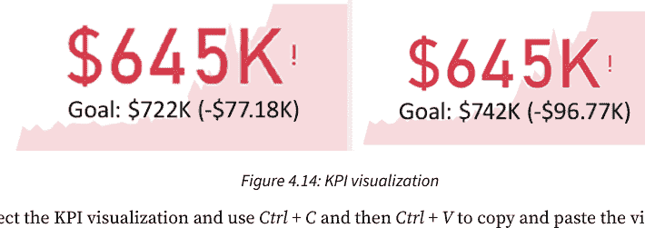

*图 4.14：KPI 视觉对象*

- 23. 选择 KPI 视觉对象，使用 Ctrl + C 和 Ctrl + V 复制并粘贴该视觉对象。
- 24. 重新定位页面上新的 KPI 视觉对象，并分别将“值”和“目标”替换为 Internet Sales 表中的 Internet Monthly Margin % 和 Internet Monthly Margin % Goal 度量值。
- 25. 设置这个新的 KPI 视觉对象的格式：将标题改为“月度 Internet 利润率%”，**“标注值”显示单位**改为**“自动”**，水平位置设为 224，垂直位置设为 48。
- 26. 按住 Ctrl 键，用鼠标选择两个 KPI 视觉对象。
- 27. 使用 Ctrl + C 和 Ctrl + V 复制并粘贴这两个视觉对象，然后重新定位页面上的视觉对象。
- 28. 对于**“月度 Internet 销售”**视觉对象，将“值”和“目标”替换为 Reseller Sales 表中的 Reseller Monthly Net Sales 和 Reseller Monthly Sales Goal 度量值。
- 29. 设置这个新的 KPI 视觉对象的格式：将标题改为“月度分销商销售”，水平位置设为 0，垂直位置设为 168。
- 30. 对于“月度 Internet 利润率%”视觉对象，将“值”和“目标”替换为 Reseller Sales 表中的 Reseller Monthly Margin % 和 Reseller Monthly Margin % Goal 度量值。
- 31. 设置这个新的 KPI 视觉对象的格式：将标题改为“月度分销商利润率%”，水平位置设为 224，垂直位置设为 168。
- 32. 单击页面画布上的空白区域，然后使用 Ctrl + A 和 Ctrl + C 选择并复制 Europe 页面上的所有视觉对象。
- 33. 切换到 France 页面，使用 Ctrl + V 粘贴所有视觉对象，并编辑右上角的“文本框”，将其从 Europe 改为 France。
- 34. 对 Germany 和 United Kingdom 页面重复步骤 33。
- 35. 保存你的工作。

## 工作原理

若要最有效地集成“卡片”视觉对象，请确定以下两项：

- 1. 用户需要最大程度可见的度量值有哪些（例如所有设备、报表和仪表板）？
- 2. 哪些度量值可用或可以创建，用来作为这些度量值的比较目标或指标？

没有明确目标且不带任何趋势指标的数字（例如标准卡片视觉对象）不如提供此额外上下文的 KPI 有价值。然而，KPI 视觉对象需要“值”和“趋势”轴。此外，目标（goal）和目标（target）度量值是将 Plan 和 Budget 事实表集成到语义模型中的主要好处之一。如果无法进行这种集成，则可以将指标度量值的历史平均值（例如过去三个月或六个月的平均值）用作 KPI 的目标。

本配方中使用的语义模型实际上两者都做到了。Internet Sales Plan 表（在“报表”视图中隐藏）包含按区域、国家/地区、年份、月份和产品子类别细分的 Internet 销售计划数字。此事实表用于 Internet Monthly Sales Goal 度量值。此度量值查看 Dates 表中的 Today 度量值，并确定自 Today 起最后一个完整月份。由于我们使用的是 AdventureWorksDW2022 数据库，其数据仅发布到 2014 年初，因此我们将 Today 度量值设置为 1/28/2014。在现实场景中，Today 度量值将设置为等同于 DAX TODAY 函数。其他目标度量值使用最后一个完整月份之后前六个月的平均值来计算。计算此日期的度量值是 Dates 表中的 6 Months Ago 度量值。

类似地，目标（target）和目标（goal）度量值计算其最当前完整月份（本例中为 2013 年 12 月）的值。或者，也可以创建 DAX 度量值，将当月已完成天数的百分比纳入考量，并将该百分比应用于 target 和 goal 度量值。

虽然显示数值时应该优先使用 KPI 视觉对象，但卡片视觉对象也可以非常有效地显示动态文本数据，例如 Date Last Refreshed 列和 Last Refreshed 度量值。Last Full Month 度量值的公式如下：

```
Last Full Month = "Last Full Month: " & FORMAT(EOMONTH([Today],-1),"yyyy-mmm")
```

Date Last Refreshed 列是使用以下 Power Query 查询创建的，该查询创建 Calculations 表：

```
let Source = #table(type table[Date Last Refreshed=datetime], {{DateTime.LocalNow()}}) in Source
```

静态文本信息可以使用简单的文本框元素显示，例如右上角的报表/页面标题和左下角的“上次刷新：”。不过，文本框也可以通过 Q&A 功能实现动态效果，可在文本框格式对话框的“值”和“审阅”对话框中访问该功能。

## 更多内容…

Power BI Desktop 的默认可视化库中提供了另外两种卡片样式和 KPI 样式的视觉对象：多行卡片和仪表视觉对象。多行卡片最好围绕共同的维度和度量值进行组织，通常放在 KPI 或仪表视觉对象的右侧作为补充详细信息。若要查看多行卡片视觉对象的实际效果，请执行以下步骤：

- 1. 切换到 Scratch 页面。
- 2. 从“可视化”窗格中选择“多行卡片”视觉对象，并将 Internet Sales 表中的 Internet Customer Count France、Internet Customer Count Germany 和 Internet Customer Count United Kingdom 度量值放入该视觉对象的“字段”区域中。

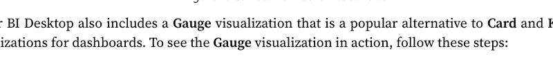

*图 4.15：多行卡片视觉对象*

Power BI Desktop 还包含仪表视觉对象，它是仪表板中卡片和 KPI 视觉对象的常见替代方案。若要查看仪表视觉对象的实际效果，请执行以下步骤：

- 1. 从 Europe 页面复制“月度 Internet 销售”KPI 视觉对象，并将其粘贴到 Scratch 页面。
- 2. 在选中 KPI 视觉对象的情况下，单击“可视化”窗格中的“仪表”视觉对象，将 KPI 视觉对象转换为仪表视觉对象。


切片器的替代方案是使用筛选器窗格。虽然筛选器窗格对最终用户来说可能不那么直观，并且需要专门的培训，但与切片器相比，使用筛选器窗格确实可以节省画布空间。然而，尽管筛选器窗格可以满足切片器常见的一些基本使用场景，但切片器在与页面上不同视觉对象的交互、跨特定页面的切片器同步，以及筛选元素相对于其他视觉对象的布局和位置方面，提供了更大的灵活性。

在本节中，我们介绍切片器的主要使用场景和报表设计注意事项，包括选择属性和格式选项。还会回顾可用于日期数据类型的切片器筛选配置，并提供有关文本搜索和替代切片器视觉对象的更多详细信息。

## 准备工作

要为本节做好准备，请执行以下步骤：

- 1. 打开 Integrating Card Visualizations.pbix 文件，并将其另存为 Using Slicers.pbix。
- 2. 切换到 Scratch 页面，使用 Ctrl + A 然后按 Delete 删除所有视觉对象。

## 如何使用切片器

要实施本节，请使用以下步骤：

- 1. 选择欧洲页面。
- 2. 使用可视化窗格创建切片器视觉对象，然后在字段列表中选择“日期”表中的“年月”列。
- 3. 选中切片器后，使用省略号 (...) 将排序更改为“降序排序”。

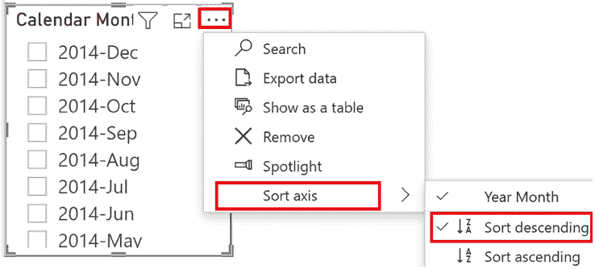

图 4.17：切片器选项

- 4. 在格式窗格的“视觉对象”选项卡上，将“切片器标头”开关切换为“关”。
- 5. 在“常规”选项卡上，将“标题”切换为“开”，并将标题更改为“日历月份”。
- 6. 展开格式窗格中的“效果”格式卡片，将“视觉对象边框”切换为“开”，并将“圆角”设置为 5。
- 7. 展开“属性”格式卡片，将“高度”设置为 178，“宽度”设置为 160。
- 8. 展开**位置**格式子卡片，将**水平**设置为 0，将**垂直**设置为 295。
- 9. 使用 Ctrl + C 和 Ctrl + V 复制并粘贴切片器，将**字段**替换为“产品”表中的**产品类别**列，并将标题更改为“产品类别”。
- 10. 右键单击切片器中的（**空白**）选项，然后选择**排除**。对“组件”重复此操作。
- 11. 在**格式**窗格的**常规**选项卡上，参考*步骤 7 和 8*，将**水平**设置为 0，将**垂直**设置为 479。
- 12. 使用 Ctrl + C 然后 Ctrl + V 复制并粘贴**产品类别**切片器，将切片器的**字段**替换为“销售区域”表中的**销售区域国家/地区**列，并将切片器的标题编辑为“国家/地区”。
- 13. 在**格式**窗格的**常规**选项卡上，参考*步骤 8*，将**水平**设置为 0，将**垂直**设置为 580。
- 14. 按住 *Ctrl* 键的同时，选择三个切片器，然后使用 *Ctrl + C* 复制。
- 15. 切换到法国页面，使用 *Ctrl + V* 粘贴切片器，然后在**同步视觉对象**提示下，选择**同步**。

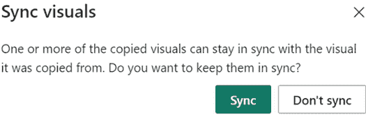

*图 4.18：同步视觉对象提示*

- 16. 从**视图**选项卡的功能区中选择**同步切片器**，选择国家/地区切片器，然后取消选中法国页面的同步。正确的配置如*图 4.19*所示。

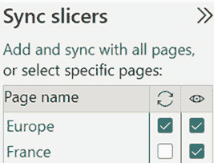

*图 4.19：同步切片器控件*

- 17. 关闭**同步切片器**窗格，将国家/地区切片器的**字段**替换为“客户”表中的“州/省”列，并将**标题**编辑为“区域”。
- 18. 将**日历月份**和**产品类别**切片器复制到德国和英国页面，并两次都选择**同步**。
- 19. 将**区域**切片器从法国页面复制到德国和英国页面，但这次在两个页面都选择**不同步**。
- 20. 在德国页面上，将区域切片器的**标题**更改为“州”。
- 21. 在英国页面上，将区域切片器的字段替换为“客户”表中的“城市”列，并将标题更改为“城市”。
- 22. 在欧洲页面的“日历月份”切片器中，选择以下值：2013-Dec、2013-Nov、2013-Oct、2013-Sept、2013-Aug 和 2013-Jul。
- 23. 切换到其他页面时，这些页面上的“日历月份”切片器也会有这些选择。
- 24. 保存你的工作。

## 工作原理

切片器是重要的 Power BI 视觉对象，因此在确定切片器列时，应仔细考虑。通常，切片器列是年或区域等父级维度，其单独值较少。选择值较少的列可以将这些项以列表形式显示在画布上，而不是使用下拉列表。使用过多切片器，或使用包含过多不同值的切片器，会降低报表页面的可用性。如果没有大量的 DAX 自定义来解释筛选选择，用户可能不确定已应用哪些筛选器。度量值不能用于切片器，但切片器的字段区域支持使用层次结构和临时层次结构。

建议将切片器放在页面上所有其他视觉对象的左侧。使用边框和/或背景色设置切片器视觉对象的格式，使其在页面上更醒目。关于使用切片器标头还是标题，请二选一，并保持页面上所有切片器一致。切片器标头提供一个“清除选择”选项（橡皮擦图标）。

在切片器中选择项目将对页面上的其他视觉对象进行交叉筛选。单击选项旁边的复选框一次可选择该值，再次单击同一复选框可取消选择该值。按住 Ctrl 键可选择多个值。此行为可通过切片器设置格式卡片中的“选择”子卡片进行控制。

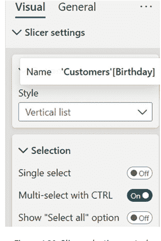

你还可以强制仅**单选**。关闭**使用 Ctrl 多选**后，无需按住键盘上的 *Ctrl* 键即可进行多项选择。**显示“全选”选项**提供了一种快速选择或取消选择所有值的方法。如果切片器包含的值超过 7 到 10 个，**全选**选项会很有帮助。使用**全选**，用户可以轻松构建一个筛选器，仅从长列表中排除少数项。

可以通过从切片器的省略号 (...) 菜单中激活**搜索**选项来搜索切片器。

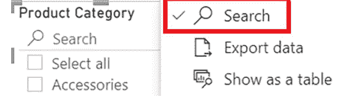

*图 4.21：切片器搜索选项*

激活此选项会在项目列表顶部显示**搜索**栏。**搜索**对于较长的项目列表非常有用。

切片器还可以在报表页面之间同步。同步切片器意味着在一个页面的切片器中选择的项目会影响存在同步切片器的任何其他页面。在页面之间复制和粘贴切片器时会提示**同步视觉对象**对话框，但也可以通过**同步切片器**窗格进行控制。默认情况下，不同页面上具有相同**字段**的切片器会被“分组”，但你可以使用**高级选项**控制这些分组。除了同步之外，**同步切片器**对话框还允许你控制切片器在页面上是否可见。将同步切片器与在页面上隐藏切片器结合使用，可以释放页面画布空间。

## 更多内容…

切片器有很多选项。除了迄今为止讨论的选项外，还有一些特殊类型的切片器，例如水平切片器、范围切片器、相对日期切片器，以及新的切片器视觉对象（预览版）。

水平切片器是一种替代设计，可以通过更改**格式**选项卡的**视觉对象**窗格中**切片器设置**格式卡片的**选项**子卡片中的**样式**设置来激活。水平方向的切片器通常沿报表页面顶部放置，有利于移动端使用。

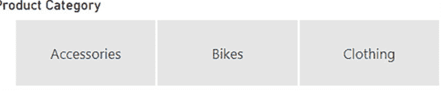

*图 4.22：水平方向的切片器视觉对象*


预览中的**切片器（新）**视觉对象的工作方式与磁贴模式下的切片器非常相似，但添加了许多格式设置功能，例如不同的形状和布局，以及使用图像和按钮的功能。**切片器（新）**视觉对象还支持工具提示，这在以往的切片器中是明显缺失的。

切片器视觉对象与**日期**数据类型结合使用时，包含强大的筛选选项，包括图形日期选择、之前/之后条件、相对日期和相对时间。**日期**数据类型的默认切片器类型是日期范围切片器，也称为**介于**切片器。时间线的起点和终点可以选择和拖动，以修改筛选条件。或者，选择日期输入单元格会显示图形日历选择器元素，用于选择日期。

**之前**和**之后**筛选选项分别将**介于**对话框的起始日期和结束日期输入单元格置灰。**相对日期**选项提供三个输入框。第一个输入框允许选择**上一个**、**下一个**或**本**。中间的输入框允许输入数字，最后一个输入框提供一个下拉列表，用于选择各种日期间隔，如图4.23所示。

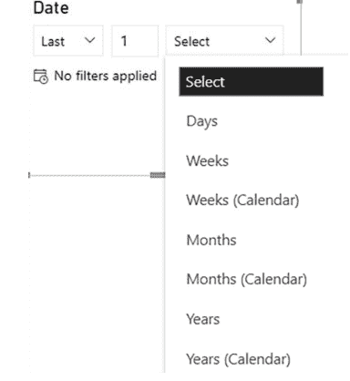

*图4.23：基于日期列配置为相对日期筛选的标准切片器*

您可以使用**可视化**窗格中的**值**格式卡片，指定当前日期是否包含在**相对日期**筛选器中，以及指定**锚点日期**。切片器视觉对象的相对日期筛选选项也可用作报表级、页面级和视觉对象级筛选器。**相对时间**选项的功能与**相对日期**选项类似，只不过间隔单位为**分钟和小时**。

数值数据类型的默认切片器类型也是**介于**切片器。数值切片器的**小于或等于**和**大于或等于**选项类似于日期切片器的**之前**和**之后**选项。

## 另请参阅

- Power BI 中的切片器：http://bit.ly/3mkZcFX
- Power BI 服务中的切片器：http://bit.ly/3fsCdHr

6. 选择任意视觉对象，并在**格式**选项卡的功能区中单击**编辑交互**以关闭编辑交互。
7. 保存您的工作。

## 工作原理

在此示例中，确定 KPI 视觉对象应始终显示所有产品以及所有国家/地区、州/省/自治区和城市的上一个完整月份的统计信息。为确保这一点，使用 Power BI Desktop 上的**编辑交互**功能，将页面中所有其他视觉对象的交互性设置为**无**，而不是默认的**筛选**。

必须认识到，DAX 度量值可以通过使用 ALL、ALL EXCEPT 和 REMOVEFILTERS 等筛选函数来覆盖交叉筛选行为。实际上，根本无需将**日历月份**切片器与 KPI 视觉对象之间的交互设置为**无**，因为驱动 KPI 视觉对象的 DAX 度量值在其计算中包含对 Dates 表使用 ALL 函数。

## 更多内容…

视觉对象之间的交叉筛选交互具有**筛选**、**突出显示**和**无**选项——某些视觉对象（如 KPI 视觉对象）仅包含筛选和无选项，而其他视觉对象（如条形图和柱状图）还包括**突出显示**选项。若要查看**突出显示**选项，请执行以下操作：

1. 在欧洲页面上，使用**可视化**窗格创建一个簇状柱形图，使用 Dates 表中的 Year Month 列作为 X 轴，使用 Internet Sales 表中的 Internet Net Sales 和 Internet Plan 度量值作为 Y 轴。
2. 在**格式**窗格的**可视化**子窗格中，展开**图例**格式卡片，将位置更改为左下，关闭 X 轴的标题，关闭 Y 轴的标题和值，展开数据标签，然后展开值，并将显示单位更改为千，值小数位数设置为 0，方向设置为水平。
3. 在“常规”子窗格中，展开“标题”格式卡片，将文本更改为“Internet 销售额与计划额”，并将水平对齐设置为“居中”。
4. 展开“属性”格式卡片，将高度设置为 241，宽度设置为 831。在“位置”下，将水平设置为 449，垂直设置为 47。
5. 创建一个堆积条形图，使用 Sales Territories 表中的 Sales Territory Country 列作为 Y 轴，使用 Internet Sales 表中的 Internet Net Sales 度量值和 Reseller Sales 表中的 Reseller Net Sales 度量值作为 X 轴。
6. 参考步骤 2、3 和 4，将图例位置设置为左下，关闭 Y 轴标题，关闭 X 轴标题和值；展开数据标签并将显示单位更改为千；将标题文本更改为“按国家/地区的 Internet 和经销商销售额”，水平对齐设置为居中。然后，将高度设置为 212，宽度设置为 527，水平设置为 753，垂直设置为 295。
7. 选择堆积条形图视觉对象，然后在“格式”选项卡的功能区中单击“编辑交互”。

## 准备工作

若要准备本教程，请执行以下步骤：

- 打开 `Controlling Visual Interactions.pbix` 文件，并将其另存为 `Utilizing Graphical Visualizations.pbix`。

## 如何利用图形视觉对象

若要实现本教程，请使用以下步骤：

1. 选择欧洲页面。
2. 在**可视化**窗格中，选择**散点图**视觉对象，并将 `Sales Territories` 表中的 `Sales Territory Country` 列添加为**图例**。
3. 在 `Internet Sales` 表中，将 `Internet Net Sales` 度量值添加为**X 轴**，将 `Internet Customer Count` 度量值添加为**Y 轴**，并将 `Internet Order Quantity Total` 度量值添加为**大小**。
4. 在 `Dates` 表中，将 `Date` 列（*不是*一个**日期**层次结构）添加到**播放轴**。
5. 在**格式**窗格的**常规**子窗格中的**属性**下，将**高度**设置为 381，**宽度**设置为 594。然后，在**位置**下，将**水平**设置为 160，**垂直**设置为 295。
6. 展开**标题**格式卡片，将文本更改为 `Internet Sales and Customer Count Trend by Country`，并将**水平对齐**设置为**居中**。
7. 切换到**可视化**子窗格，将**图例**设置为**关**。然后，展开**Y 轴**部分，在**标题**下，将**标题文本**更改为 `Distinct Customers`。

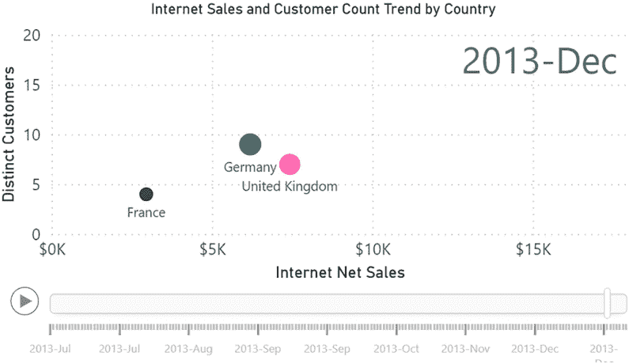

*图4.26：散点图视觉对象*

8. 单击页面画布上的空白区域，然后在**可视化**窗格中选择**折线图**。
9. 使用 `Dates` 表中的 `Year Month` 列作为**X 轴**，`Sales Territories` 表中的 `Sales Territory Country` 列作为**图例**，`Internet Sales` 表中的 `Internet Margin %` 度量值作为**Y 轴**。
10. 在**格式**窗格的**常规**子窗格中，将**高度**设置为 212，**宽度**设置为 526，并在**位置**卡片下，将**水平**设置为 754，**垂直**设置为 508。
11. 展开**标题**格式卡片，将标题**文本**更改为 `Internet Sales Margin % by Country`。将**水平对齐**设置为**居中**。
12. 在**可视化**子窗格中，展开**图例**部分，然后将**位置**设置为**左下**并关闭**标题**。
13. 展开**X 轴**和**Y 轴**部分，并将两者的标题切换为**关**。
14. 将**数据标签**切换为**关**。

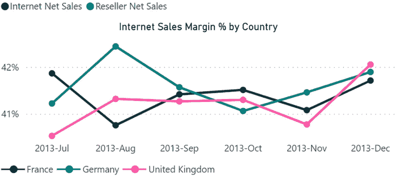

*图4.27：折线图视觉对象*

15. 切换到 `France` 页面。
16. 在**可视化**窗格中，选择**地图**视觉对象，将 `Customers` 表中的 `Location` 列添加为**位置**，并将 `Internet Sales` 表中的 `Internet Customer Count` 度量值添加为**气泡大小**。
17. 在**格式**窗格的**常规**子窗格中，展开**属性**格式卡片，将**高度**设置为 381，**宽度**设置为 288，然后在**位置**下，将**水平**设置为 160，**垂直**设置为 295。
18. 将**标题**切换为**关**。
19. 切换到**可视化**子窗格，并将**类别标签**切换为**关**。
20. 单击画布的空白区域，然后从**可视化**窗格中选择**折线图和簇状柱形图**。
21. 在**字段**列表中，将 `Dates` 表中的 `Year Month` 列添加为**X 轴**。
22. 在 `Reseller Sales` 表中，将 `Reseller Net Sales` 度量值添加为**柱形图 Y 轴**，将 `Reseller Margin %` 度量值添加为**折线图 Y 轴**。


+   23. 在 **格式** 窗格的 **常规** 子窗格中，展开 **属性** 格式卡片，将 **高度** 设置为 232，将 **宽度** 设置为 832，然后在 **位置** 下将 **水平** 设置为 448，将 **垂直** 设置为 295。
+   24. 展开 **标题** 格式卡片，将 **标题文本** 更改为 `Reseller Sales and Margin %`，并将 **水平** 对齐方式设置为 **居中**。
+   25. 在 **视觉对象** 子窗格中，展开 **图例** 部分，将 **位置** 更改为 **左下**。
+   26. 展开 **X 轴** 和 **Y 轴** 部分，将两者的 **标题** 切换为 **关闭**，然后将 **Y 轴** 的 **值** 也切换为 **关闭**。
+   27. 展开 **数据标签** 部分，将 **方向（列）** 更改为 **水平**。将 **背景** 切换为 **关闭**。
+   28. 复制 **地图** 和 **折线和簇状柱形图**，并将其粘贴到德国和英国页面。
+   29. 切换到德国页面并选择 **地图** 视觉对象。
+   30. 将 **位置** 改为使用 **客户** 表中的 **州/省** 列。
+   31. 选中 **地图** 视觉对象后，在 **可视化** 窗格中选择 **形状地图**。如果没有显示 **形状地图**，可以通过 **预览功能** 激活此可视化：从菜单/功能区中选择 **文件**，然后依次选择 **选项和设置** 和 **选项**。
+   32. 在 **格式** 窗格中，展开 **地图类型** 格式卡片，并将 **地图类型** 更改为 **德国各州**。
+   33. 保存所做的更改。

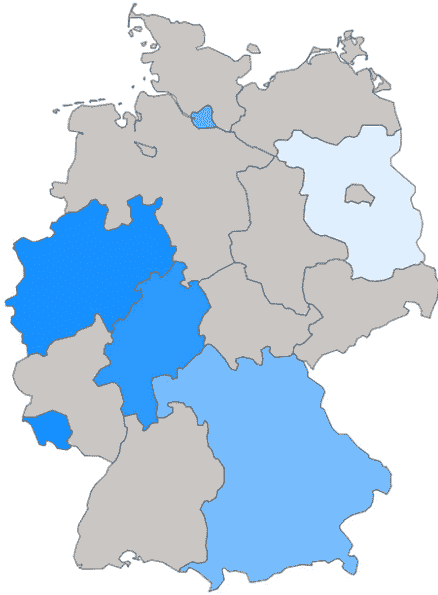

*图 4.28：形状地图可视化*

## 工作原理

当单个值及其比较比趋势更重要时，应选择柱形图。当坐标轴类别标签较长时，应选择条形图，因为与柱形图相比，条形图能够显示更多标签文本。当数据的趋势或形状比单个值及其比较更重要时，应使用折线图。选择散点图可以展示某个维度在两个度量值之间的相关性。可以选择树状图和瀑布图等专用视觉对象，作为标准视觉对象的补充。

鉴于其他视觉对象在视觉感知和理解方面的优势，通常建议避免使用饼图、圆环图、仪表图和树状图视觉对象。

在 **散点图** 视觉对象中，可以单击 **播放** 按钮，以便针对 **播放** 轴中的每个日期计算度量值。形状会随时间移动并改变大小。

对于 **形状地图** 视觉对象，销售额较高的州默认具有更高的颜色饱和度，将鼠标悬停在州上时会显示工具提示。可用的形状地图包括一个 **地图键** 对话框，用于绘制位置列。可以在 **格式** 窗格中，从 **地图设置** 格式卡片中单击 **查看地图类型键** 来查看地图键。使用给定的形状地图之前，请确保位置数据与这些键相匹配。

当位置数据没有可用的自定义形状地图，或者自定义形状地图不适合给定用例时，可以使用 **地图** 和 **填充地图** 视觉对象。这两种视觉对象都使用 **Bing** 来绘制位置点。

## 还有更多内容……

瀑布图视觉对象最适合用于展示各个值对总体总计的贡献。若要了解瀑布图的工作方式，请执行以下步骤：

-   1. 切换到 **Scratch** 页面。
-   2. 使用 Sales Territories 表中的 `Sales Territory Country` 列作为 **类别**，并使用 Internet Sales 表中的 `Internet Plan Variance` 度量值作为 **Y 轴**，创建瀑布图。

## 按销售区域国家/地区划分的 Internet Plan Variance

增加 减少 总计

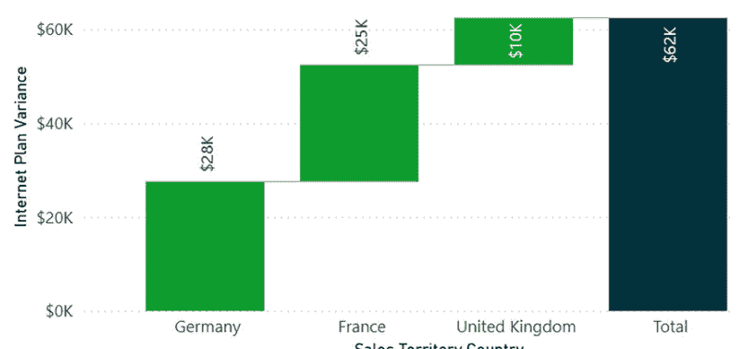

图 4.29：瀑布图

瀑布图应按照给定度量值进行排序，以便支持从各个组成部分到总计列的直观“行进”过程。负值使用红色、正值使用绿色的默认颜色格式通常是合适的。可以向 **类别** 字段添加其他列，以启用向下钻取维度。Dates 表中的 Year Month 列或 Products 表中的 Product Category 列都是不错的候选项。

此外，还可以向 **分解** 字段添加列。**分解** 字段会计算某个维度值在两个类别值之间的差异和差异百分比。将 Product Category 列添加到 **分解** 字段后，可以显示各个国家/地区之间差异最显著的产品类别，详细信息则会显示在工具提示中。

许多图表类型（例如折线图）都提供实用的分析选项。若要演示这些分析功能，请执行以下操作：

-   1. 在 Scratch 页面上，使用 Dates 表中的 Year Month 列作为 **轴**，并使用 Internet Sales 表中的 Internet Net Sales 度量值作为 **值**，创建折线图。
-   2. 选择折线图，然后选择 **分析** 选项卡。

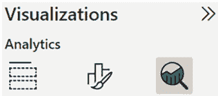

图 4.30：分析选项卡

-   3. 展开 **平均线** 卡片，然后单击 **添加线条**。
-   4. 将 **数据标签** 切换为 **开启**，并将 **样式** 更改为 **两者**。
-   5. 折线图视觉对象的一个实用技巧是使用度量值添加条件格式。请在 **Internet Sales** 表中创建以下度量值：
-   6. 将此度量值添加到折线图的 **值** 字段槽中。条件度量值会包含在折线图中，但只有在满足条件时才会具有值（而不是空白）。这种方法遵循通用的报表设计实践：在不影响可用性的情况下，在相同空间中提供更多分析价值。通过坐标轴中的数据层次结构向下钻取，以及在工具提示中添加其他度量值，可以进一步利用报表画布中的相同空间。

```
Variance Less Than 12% =
    IF(
        ABS([Internet Plan Variance]) < [Internet Net Sales]*.12,
        [Internet Net Sales],BLANK()
    )
```

仅当 X 轴设置为 **连续** 时，才可以使用 **趋势线**。日期列是提供连续坐标轴的不错选择。连续日期列还会启用 **预测** 分析功能。

## 另请参阅

-   - Power BI 中的可视化类型：http://bit.ly/3cHg2vh

## 创建表和矩阵视觉对象

当需要查看精确的单个值，或以详细级别查看数据（例如查看单笔交易）时，表和矩阵视觉对象非常适用。Power BI 中的表视觉对象符合经典的列行式“列表”报表格式，但支持强大的交叉突出显示和格式设置选项，包括条件格式。矩阵视觉对象包含表视觉对象的功能，并对应于 Excel 中数据透视表的布局和基本功能：以二维形式呈现度量值，并能够沿行轴和列轴向上或向下钻取。

在创建基于表或矩阵视觉对象的 Power BI 报表之前，报表作者应考虑本章后面介绍的分页报表是否更符合需求。如果表或矩阵视觉对象包含大量行，从而需要滚动和导出数据，那么分页报表通常是更好的选择。

本配方将演示表和矩阵视觉对象的各种功能，包括条件格式、向下钻取和交叉突出显示。

## 准备工作

要准备此配方，请执行以下步骤：

-   - 打开 `Utilizing Graphical Visualizations.pbix` 文件，并将其另存为 `Creating Table and Matrix Visuals.pbix`。

## 如何创建表和矩阵视觉对象

要实现此配方，请执行以下步骤：

-   1. 选择法国页面。
-   2. 在 **可视化** 窗格中，选择 **表可视化**。
-   3. 添加 Products 表中的 `Product Category` 列、Internet Sales 表中的 `Internet Net Sales`、`Internet Margin %` 和 `Internet Customer Count` 度量值，以及 Reseller Sales 表中的 `Reseller Net Sales` 和 `Reseller Margin %` 度量值。
-   4. 在 **列** 字段槽中，双击 `Internet Customer Count` 度量值，并将其重命名为 `Internet Customers`。
-   5. 在 **格式** 窗格的 **常规** 子窗格中，展开 **属性** 格式卡片，将 **高度** 设置为 194，将 **宽度** 设置为 832，然后在 **位置** 下将 **水平** 设置为 448，将 **垂直** 设置为 525。
-   6. 在 **视觉对象** 子窗格中，展开 **样式预设** 部分，并选择 **对比度交替行**。
-   7. 将此视觉对象复制到德国、英国和 Scratch 页面。
-   8. 在 Scratch 页面上，使用 **列** 字段槽中 `Reseller Margin %` 度量值的下拉菜单，将 **条件格式** 应用于 **背景色**。

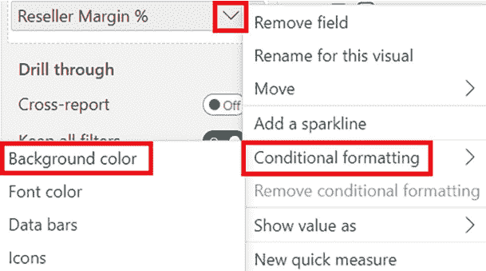

> 图 4.31：条件格式

-   9. 在 **条件格式** 对话框中，选中 **添加中间颜色**，然后单击 **确定** 按钮。


10. 对Internet Net Sales的背景应用条件格式，但这次将**格式方式**更改为**规则**。在**规则**下，将下拉列表更改为**为空**。

**格式样式**

**应用于**

**此格式基于哪个字段？**

**规则**

**如果值为空**

*图4.32：按规则设置格式*

11. 对Reseller Net Sales度量值应用条件格式，但这次选择**数据条**，并在**数据条**对话框中点击**确定**以接受默认设置。

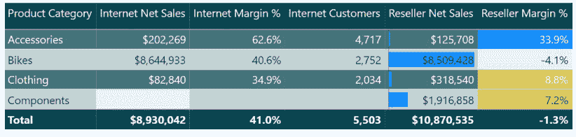

*图4.33：应用了条件格式的表格*

12. 复制并粘贴Scratch页面上的表格视觉对象，然后重新调整其位置。

13. 从这一新的视觉对象中移除Reseller Net Sales和Reseller Margin %度量值，并注意表格中的“组件”行随之消失。

14. 在视觉对象的“列”字段井中，展开Product Category的菜单，选择**显示无数据的项目**，并注意“组件”行与一个完全空白的行一同重新出现。

15. 在视觉对象的“列”字段井中，展开Internet Customers的菜单，选择**显示值方式**，然后选择**占总计的百分比**，并注意现在Internet Customers列中显示了百分比，且空白行和“组件”行消失。

16. 在Scratch页面添加一个矩阵视觉对象。

17. 对于行，使用Sales Territories表中的Sales Territory Hierarchy；对于列，使用Products表中的Product Category Hierarchy；对于值，使用Internet Sales表中的Internet Net Sales度量值。

18. 使用行上的+图标展开欧洲。

19. 将**钻取**切换为**列**，选择向下箭头以打开钻取模式，并点击“自行车”列。

| 产品类别 | 自行车 |  |  | 总计 |
|---|---:|---:|---:|---:|
| 销售区域组 | 山地自行车 | 公路自行车 | 旅行自行车 | 总计 |
| 欧洲 | $3,066,042 | $4,290,493 | $1,288,397 | $8,644,933 |
| 法国 | $899,261 | $1,311,933 | $342,382 | $2,553,576 |
| 德国 | $1,003,801 | $1,380,343 | $424,371 | $2,808,514 |
| 英国 | $1,162,980 | $1,598,217 | $521,645 | $3,282,843 |
| 总计 | $3,066,042 | $4,290,493 | $1,288,397 | $8,644,933 |

*图4.34：矩阵视觉对象*

20. 保存你的工作。

## 工作原理

表格和矩阵视觉对象会自动过滤掉没有数据的行和列。实际上，如果“列”字段井中的聚合或度量值都计算为空白，则该行将不会显示在表格中。**显示无数据的项目**功能会覆盖此默认行为，但并非万无一失，如使用**显示值方式**功能的情况所示。另一种方法是构造度量值，使其返回零而不是空白，如下例所示：

```DAX
Measure = SUM('Internet Sales'[Sales Amount]) + 0
```

或

```DAX
Measure =
    VAR __Sum = SUM('Internet Sales'[Sales Amount])
    RETURN
        IF(ISBLANK(__Sum), 0, __Sum)
```

或

```DAX
Measure =
    COALESCE(
        SUM('Internet Sales'[Sales Amount]),
        0
    )
```

数据条可以与度量值一起显示（如本例所示），也可以作为独立条形显示。还可以输入特定的最小和最大阈值来驱动数据条的条件格式。

除了条件格式化背景颜色和数据条之外，条件格式也可用于字体和图标。如果对字体色阶和背景色阶使用相同的格式逻辑和颜色，则仅显示值的颜色，例如在热图中。

对于添加到表格和矩阵视觉对象中的度量值，可以使用**显示值方式**选项，将度量值显示为行、列或总计的百分比。对于表格视觉对象，由于视觉对象的单一维度，只有**占总计的百分比**可用。另请注意，目前无法将表格和矩阵视觉对象中的度量值格式化为特定的小数位数或显示单位（如千或百万）。

对于矩阵视觉对象，可以通过每行开头的+和–图标导航行层次结构。或者，在**钻取**下拉框中选择**行**，即可使用下钻图标导航到行层次结构。类似地，在**钻取**下拉框中选择**列**，可以通过相同的下钻图标导航列。

有四个下钻图标：向上箭头图标在层次结构中上钻一层；向下箭头图标打开*钻取*模式。当钻取模式激活（实心圆）时，点击行或列仅针对该特定列或行在层次结构中下钻一层。双向下箭头图标为所有行或列在层次结构中下钻一层，但在此情况下会丢失父层次结构上下文。若要为所有行或列在层次结构中下钻一层并保留父层次结构上下文，请使用分叉向下箭头图标。

## 更多内容…

对于表格和矩阵视觉对象，另一个条件格式选项是**Web URL**。使用**Web URL**条件格式可以将显示的值变为实时链接。为了演示其工作原理，请执行以下操作：

1. 在Scratch页面，使用Customers表中的Customer Name、Email和Service URL列创建一个**表格视觉对象**。

2. 在**表格视觉对象**的**列**字段井中，访问Customer Name度量值的**条件格式**，并选择**Web URL**。

3. 在**Web URL**对话框中，将**此格式基于哪个字段？**改为Customers表中的Email列。

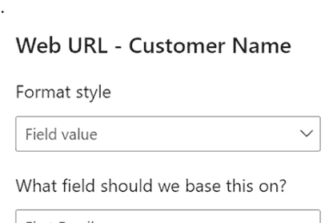

*图4.35：Web URL条件格式*

4. 在“格式”窗格的“视觉对象”子窗格中，展开URL图标格式卡片，并将“值”设置切换为“开”。

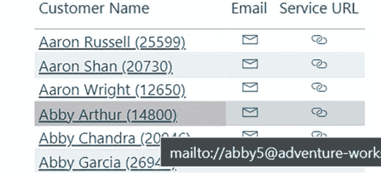

*图4.36：Web URL条件格式和作为实时链接的URL图标*

矩阵视觉对象的一个独特选项是能够显示多个度量值，并将它们显示在视觉对象的行上。这在财务报告中是极为常见的用例。要查看其工作原理，请执行以下操作：

1. 在Scratch页面创建一个矩阵视觉对象，行中使用Products表中的Product Category，列中使用Dates表中的Calendar Year，值中使用Calculations表中的Total Net Sales、Total Margin和Total Margin %度量值。

2. 在“格式”窗格中，展开“值”格式卡片，然后展开“选项”卡片，并将**将值切换到行**选项切换为“开”。

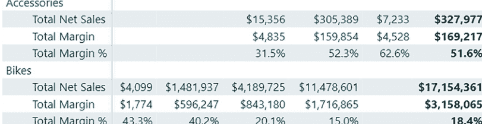

*图4.37：在“值”字段井中有三个度量值并显示在行上的矩阵视觉对象*

## 另请参阅

- Power BI报表和仪表板中的表格视觉对象：http://bit.ly/3fzI6a4
- 在Power BI中创建矩阵视觉对象：http://bit.ly/2PN4Cxd
- 在表格和矩阵中应用条件格式：http://bit.ly/3rMwvma

## 增强报表

有许多报表功能可以增加更丰富的上下文，并增强自助式数据探索体验。其中三个功能是工具提示、工具提示页和钻取报表页。

在本食谱中，我们将逐步使用**工具提示**、**工具提示页**和**钻取报表页**来增强我们的报表。

## 准备工作

要准备本食谱，请执行以下步骤：

- 打开`Creating Table and Matrix Visuals.pbix`文件，并将文件另存为`Enhancing Reports.pbix`。

## 如何增强报表

要实现本食谱，请使用以下步骤：

1. 选择Germany页面。

2. 选择**形状地图**视觉对象。

3. 将来自Internet Sales表的Internet Net Sales、Internet Margin %和Internet Sales Per Customer度量值添加到**工具提示**字段。

4. 将鼠标悬停在彩色的德国州上，即可在**工具提示**弹出窗口中看到新增度量值：

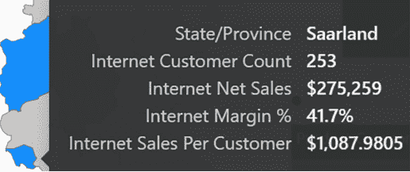

*图4.38：工具提示中显示的其他度量值*

5. 创建一个名为`Product Tooltip`的新页面。

6. 在**格式**窗格中，展开**页面信息**部分，并将**允许用作工具提示**切换为“开”。

7. 创建一个**簇状条形图**视觉对象，并调整其大小以占据整个页面。

8. 将Products表中的`Product Subcategory`列添加到**Y轴**。如果看不到此列，请使用**表视图**取消隐藏。

9. 将Internet Sales表中的**Internet Net Sales**度量值添加到**X轴**。


- 16. 在此页面的“值”区域中，将“客户”表中的“省/州”列添加到“钻取字段”区域，如下所示。

  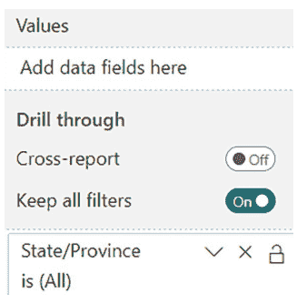

  *图 4.41：页面钻取字段*

- 17. 请注意，页面左上角会自动创建一个返回按钮。

- 18. 创建以客户为中心的视觉对象，如图 4.42 所示。

  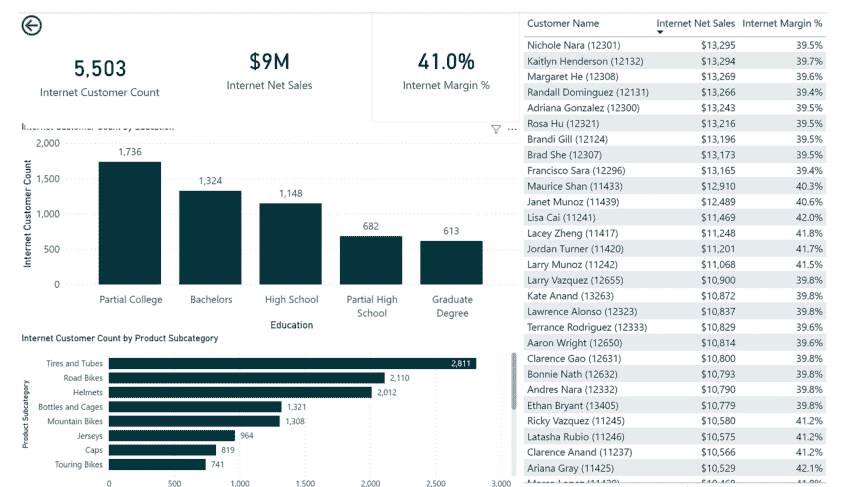

  *图 4.42：客户钻取页面*

- 19. 在“德国”页面上，右键单击其中一个彩色州，选择“钻取”，然后选择“客户钻取”。

- 20. 请注意，钻取筛选器会采用从页面和视觉对象传入的上下文。

  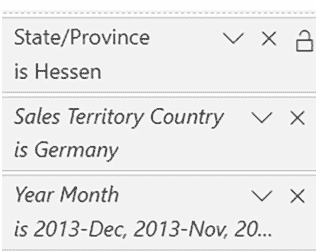

  *图 4.43：钻取后的钻取筛选器*

## 工作原理

工具提示和报表页工具提示是提高报表信息密度和分析密度的绝佳方法，可在相同的报表页面空间内提供额外的见解。工具提示和报表页工具提示都会继承光标悬停的视觉元素粒度级别上的视觉对象上下文。这意味着，工具提示中的任何度量值以及报表页工具提示中的任何视觉对象，都将反映与报表交互的用户的当前上下文。

报表作者还可以设计钻取报表页，使用户能够快速轻松地探索与特定关注项关联的详细信息。钻取报表页上的所有视觉对象都会更新，以反映发起钻取时所选项的筛选器上下文。

钻取是一个非常强大且受欢迎的功能，它实际上相当于一个根据用户查看报表时提出的问题而定制生成的报表。因此，对于被积极交互的热门报表，可以在常见维度上包含多个钻取报表页。可以考虑使用第 7 章“参数化 Power BI 解决方案”中的“使用模板”食谱中描述的 Power BI 模板（.pbix 文件），在新报表中利用现有的钻取报表页。

钻取页对于高基数维度列尤其有价值，因为这些列的各个值很可能没有自己的专用报表或报表页。例如，“产品类别”和“产品子类别”列可能已经有各自的报表和仪表板，但单个“产品型号”（此层次结构的第三级）可能是创建一个或多个钻取报表页的良好候选对象。

当将列添加到“钻取筛选器”字段井时，会自动创建返回按钮。该按钮可以设置格式或完全删除，但通常很有帮助，特别是对于包含多个页面的报表。另外，通过 Power BI Desktop 中功能区的“插入”选项卡添加的任何形状或图像，也可以用作钻取页面的返回按钮。

## 更多内容…

在页面的钻取区域中，您可能已经注意到“跨报表”切换开关。Power BI 确实允许您钻取报表，而不仅仅是页面。源报表必须启用来自其他报表的钻取目标，可以在“选项和设置”|“选项”中的“当前文件的报表设置”中启用，也可以在 Power BI 服务中启用。然后，目标报表需要将“跨报表”选项切换为“开”，并正确配置钻取字段。请注意，跨报表筛选要求报表的语义模型架构匹配。

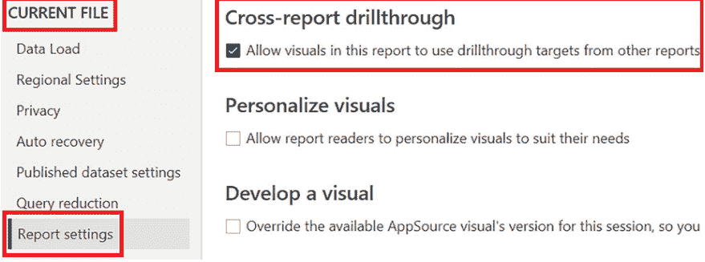

*图 4.44：跨报表钻取*

## 另请参阅

- 基于报表页创建工具提示：http://bit.ly/2OdzeHA
- 使用报表页工具提示扩展视觉对象：http://bit.ly/3cGwBHC
- 在 Power BI 报表中设置钻取：http://bit.ly/31SH2Iv
- 使用报表页钻取：http://bit.ly/3sKg5w0
- 在 Power BI Desktop 中使用跨报表钻取：http://bit.ly/3fzfQjI

## 为发布设置报表格式

Power BI Desktop 包含一些功能，可以在极其详细的级别上控制和增强报表的格式和布局。在将报表发布到 Power BI 服务之前，可以对视觉对象进行对齐、调整大小和均匀分布，以呈现整齐、对称的布局。此外，可以添加补充性报表元素，如形状、文本框和图像，以进一步组织和丰富报表页面的文本和视觉辅助内容。最后，实际画布大小可以从默认的 16:9 宽高比（即高度 720 像素、宽度 1280 像素）更改为 4:3 比例，甚至自定义大小。

本食谱演示如何控制报表视觉对象的位置、对齐和分布，以及分组使用视觉对象和进行演示的技巧。此外，还提供了发布报表前进行最终清理的有用提示，以及发布后设置 Q&A 的方法。

### 准备就绪

要准备本食谱，请执行以下步骤：

- 打开 Enhancing Reports.pbix 文件，并将文件另存为 Formatting Reports for Publication.pbix。

### 如何设置报表格式以供发布

要实现本食谱，请执行以下步骤：

- 1. 将“欧洲”页面中的四个 KPI 视觉对象复制并粘贴到“草稿”页面。
- 2. 在页面上移动 KPI 视觉对象，将它们按不同的水平位置垂直隔开。
- 3. 注意移动或调整视觉对象大小时出现的自动对齐参考线（称为*智能参考线*的红色虚线）。

  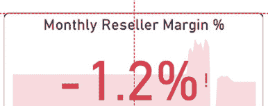

  *图 4.45：自动对齐参考线*

- 4. 使用 Ctrl + A 选择所有 KPI 视觉对象。
- 5. 选择功能区中的**格式**选项卡，选择**对齐**，然后选择**左对齐**。

  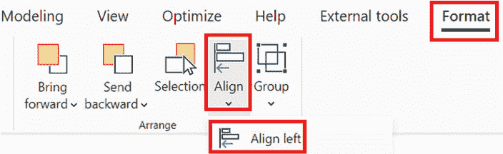

  *图 4.46：格式功能区中的排列选项*

- 6. 所有视觉对象都对齐到最左侧的视觉对象。
- 7. 再次选择**对齐**，然后选择**垂直分布**。
- 8. 视觉对象在页面上垂直分布，间距相等。
- 9. 选择**分组**，然后从**格式**选项卡的功能区中选择**分组**。
- 10. 现在可以将视觉对象作为一个整体在页面上移动。
- 11. 选择**分组**，然后选择**取消分组**。
- 12. 将视觉对象大致堆叠在一起。
- 13. 单击页面上的空白区域，然后选择最顶部的视觉对象。
- 14. 从**格式**选项卡中，选择**下移一层**，然后选择**置于底层**。
- 15. 单击页面画布的空白区域，注意该视觉对象现在位于所有其他视觉对象的下方。
- 16. 选择一个视觉对象，这次从**格式**选项卡的功能区中选择**选择**，以打开**选择**窗格。

  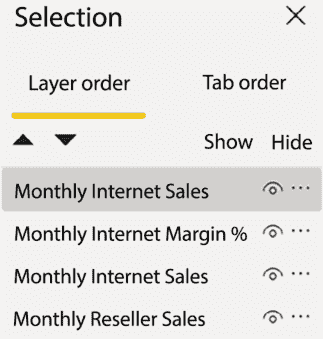

  *图 4.47：选择窗格*

- 17. 使用向上和向下图标更改视觉对象的**层顺序**。
- 18. 切换到**Tab 键顺序**，再次使用向上和向下图标更改视觉对象的 Tab 键顺序。
- 19. 关闭**选择**窗格。
- 20. 在页面上将 KPI 视觉对象水平均匀分布。
- 21. 使用 *Ctrl + A* 选择所有视觉对象。
- 22. 选择**格式**选项卡，然后在功能区中选择**对齐 | 顶端对齐**，然后选择**对齐 | 水平分布**。
- 23. 将每个 KPI 视觉对象转换为**卡片**视觉对象。
- 24. 对于其中一个 KPI 视觉对象，将**边框**和**背景**切换为**关**。
- 25. 选中**卡片视觉对象**后，从**主页**选项卡的功能区中选择**格式刷**。
- 26. 注意光标现在是一个画笔；选择另一个**卡片**视觉对象。
- 27. 再次单击**格式刷**并选择下一个**卡片**视觉对象；对最后一个**卡片**视觉对象重复此操作，直到所有**卡片**视觉对象都不再有**边框**或**背景**。
- 28. 单击**插入**选项卡，在功能区中选择**形状**，然后选择**矩形**。
- 29. 将所有**卡片**视觉对象包围在矩形中。
- 30. 从**格式**选项卡中，使用**下移一层**，然后使用**置于底层**将矩形放到**卡片**视觉对象的后面。
- 31. 选择 *Ctrl + A*，然后从**格式**选项卡的功能区中选择**分组 | 分组**。


32. 在“视图”选项卡中，勾选功能区“页面选项”部分的“网格线”和“对齐网格”选项。

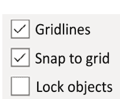

图4.48：视图功能区中的页面选项

33. 移动或调整视觉对象大小现在会吸附到网格点。

34. 取消勾选“网格线”和“对齐网格”。

35. 右键单击“草稿”页面选项卡，然后选择“隐藏”。

36. 对“Product Tooltip”页面和“Customer Drill through”页面重复上一步。

37. 使用“+”选项卡添加名为“信息”的页面。

38. 在“信息”页面上，使用功能区的“插入”选项卡创建类似于图4.49中的文本框。

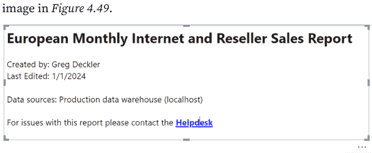

图4.49：报表的信息页面，带有有效的 mailto 链接

39. 在这种情况下，选择了“帮助台”并将其制作成有效的 mailto: 链接。

40. 在“视图”选项卡中，选择功能区中的“锁定对象”。

41. 选择“欧洲”页面并保存您的工作。

42. 在“主页”选项卡中，选择功能区中的“发布”以将报表发布到 Power BI 服务。

## 工作原理

一旦报表准备好发布，最好使用“锁定对象”设置来防止视觉元素意外移动或调整大小。但需要注意的是，“锁定对象”仅影响通过鼠标和键盘对视觉对象进行的移动或调整大小。“属性”格式卡片内“格式”窗格的“常规”子窗格中的“高度”、“宽度”、“水平”和“垂直”设置仍可用于重新定位和调整视觉对象的大小。

在发布报表之前，您应隐藏或删除开发过程中使用的页面，例如“草稿”页。用于报表页工具提示的页面也应隐藏。钻取页面可以隐藏也可以不隐藏，具体取决于它们在报表中的用途。在 Power BI 服务中查看报表时，隐藏页面不会显示给报表读者。

通常最好包含一个**信息**页面。信息页面可用于描述报表中使用的数据源、有助于浏览报表的提示，甚至支持信息。

定位和对齐是专业报表的关键品质。如本配方所示，Power BI 提供了许多选项，确保视觉对象以对称方式对齐和调整大小。每当在页面上移动或调整视觉元素大小时，自动对齐参考线都会出现。

这些对齐参考线相对于页面上其他视觉元素的边缘以及*公共边缘*（如页面中心）出现。或者，**格式**功能区中的**对齐**选项提供了一种同时批量对齐许多视觉对象的方法。此外，**对齐**选项中的分布选项是确保类似视觉对象之间间距均匀的好方法。**视图**功能区中的**网格线**和**对齐网格**功能也可帮助您正确定位页面上的视觉对象。

形状可以更好地组织视觉对象，并且相对于每个视觉对象的边框和背景，可以改善报表的美感。形状通常用于报表标题背景，它们还可以自定义图表的绘图区，例如将散点图拆分为四个方块，每个方块具有不同的背景颜色。

## 更多内容…

将报表和语义模型发布到 Power BI 服务后，我们现在可以为报表配置 Q&A。要了解其工作原理，请执行以下操作：

- 1. 在 Power BI 服务中查看“Germany”页面。将鼠标悬停在其中一个 KPI 视觉对象上，然后使用图钉图标将该视觉对象固定到仪表板。


- 2. 选择**新建仪表板**，输入仪表板名称，然后点击**固定**按钮。

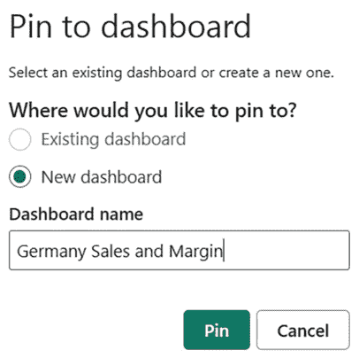

图4.51：固定到仪表板对话框

Q&A 自然语言查询从仪表板针对底层语义模型提交。为了让 Q&A 查询能够访问语义模型及其相关报表，给定 Q&A 仪表板的至少一个磁贴必须依赖于该语义模型。

- 3. 导航到仪表板，注意**“针对你的数据提问”**提示，然后点击该提示。

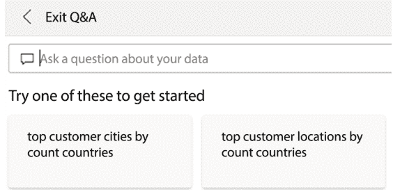

图4.52：仪表板 Q&A

- 4. 使用你自己的问题或建议的问题之一来测试 Q&A；例如：*按经销商净销售额排名的德国顶级经销商。*

- 5. 点击 Power BI 服务右上角的齿轮图标，然后选择**“Power BI 设置”**。

- 6. 选择**“语义模型”**选项卡以及要通过 Q&A 查询的特定语义模型。

- 7. 展开特色 Q&A 问题部分并添加问题；点击“应用”按钮后，这些问题将作为从仪表板使用 Q&A 时的建议出现。

Q&A

特色 Q&A 问题

特色问题显示为 Q&A 中此语义模型的建议。

2017/5/1 之前的按日历年度-月份统计的欧洲互联网净销售额

按产品名称统计的德国互联网净销售额

2017 年按日历年度-月份统计的法国经销商净销售额（折线图）

货运趋势

添加问题

应用

放弃

图4.53：语义模型设置中的特色 Q&A 问题选项

请注意，还可以在 Power BI Desktop 中通过转到“建模”选项卡并选择“Q&A 设置”来管理 Q&A。在此处，可以定义同义词，以及建议或特色问题。此外，还可以在服务中查看用户提出的问题。

## 另请参阅

- - 在 Power BI Q&A 中提问的技巧：http://bit.ly/2pRIZdQ

## 设计移动布局

Power BI 报表可以通过 Power BI Desktop 中的“移动布局”视图针对移动设备上的使用进行优化。此布局允许通过 Power BI 移动应用访问报表的用户在 iOS、Android 或 Windows 移动设备上更轻松地查看和交互这些报表中最重要的内容。鉴于移动体验的重要性以及多页面报表的独特设计考虑，优化 Power BI 报表以供移动访问至关重要。

在此配方中，本章第一个配方提供的示例报表的“欧洲”和“英国”报表页面配置了移动布局。有关优化 Power BI 仪表板的更多详细信息，请参阅“更多内容…”部分。

## 准备工作

要为此配方做准备，请按照以下步骤操作：

- 1. 打开 Formatting Reports for Publication.pbix 文件，并将文件另存为 Designing Mobile Layouts.pbix。

- 2. 切换到“草稿”页面，然后使用 Ctrl + A 再按 Delete 删除所有视觉对象。

## 如何设计移动布局

要实现此配方，请使用以下步骤：

- 1. 选择“欧洲”页面。
- 2. 在“视图”选项卡中，选择功能区中的“移动布局”。

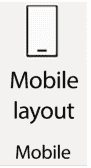

图4.54：移动布局

3. 填充移动布局视图：单击并拖动可视化到设备网格中的所需位置。请注意，“视图”选项卡中的“对齐网格”功能在此特别有用。

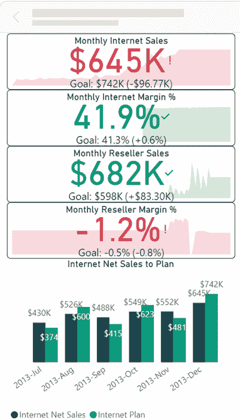

图4.55：已填充的移动布局

4. 切换到“英国”页面，并同样配置移动布局。

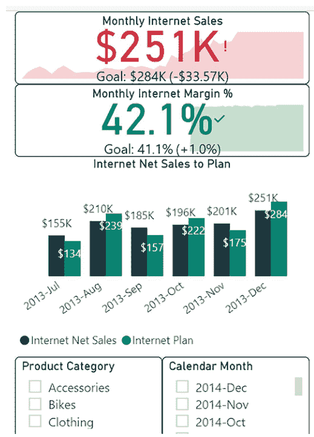

图4.56：英国销售和利润移动布局

- 5. 通过在“视图”选项卡的功能区中单击“移动布局”退出移动布局。
- 6. 保存您的工作。
- 7. 将报表发布到 Power BI 服务。
- 8. 使用您手机上的 Power BI 应用测试移动视图。

## 工作原理

Power BI 报表的使用方式通常因设备而有显著差异。例如，包含多个切片器和表格或矩阵视觉对象的报表页面可能适合在笔记本电脑上进行详细的交互式体验，但可能不完全适合移动消费。在许多情况下，用户更倾向于简单、轻松地访问移动设备上的几个高级视觉对象，例如卡片或 KPI，而不是页面上所有视觉对象的次优表示。


## 另请参阅

- 什么是 Power BI 移动应用？：http://bit.ly/2q6SG8f
- 使用 Power BI 开发移动友好报表的提示：https://bit.ly/3wpUIX8

## 创建分页报表

Microsoft 已付出巨大努力，确保源自 SQL Server Reporting Services (SSRS) 中企业级运营报表的分页报表在 Power BI 中得到全面支持。例如，只需进行相对较小的修改，组织即可将 SSRS 报表迁移到 Power BI，从而继续利用这些报表的独特优势，例如将多页报表文档作为电子邮件附件分发。此外，Microsoft 最近在 Power BI Desktop 中添加了“分页报表”视觉对象，并支持在服务中创作分页报表。

然而，目前分页报表仍必须在单独的工具 Power BI Report Builder 中创建。本指南演示如何下载并安装 Power BI Report Builder，以及如何使用该工具构建分页报表。

## 准备工作

要准备本指南，请执行以下步骤：

- 1. 打开 Designing Mobile Layouts.pbix 文件，并将该文件另存为 Creating Paginated Reports.pbix。
- 2. 切换到 Scratch 页面，使用 Ctrl + A 全选，然后按 Delete 删除所有视觉对象。

在考虑分页报表时，最好先确认是否确实需要开发分页报表。以下问题有助于确认是否需要分页报表：

- 1. 报表是否需要跨多页打印？
- 2. 报表是否更像是仅包含数据表格的静态运营报表？
- 3. 报表数据本身是否需要通过电子邮件订阅提供给用户？

对以上一个或多个问题回答“是”，即可帮助确认需要分页报表。

## 如何创建分页报表

要实现本指南，请执行以下步骤：

- 1. 将新保存的报表发布到 Power BI 服务。
- 2. 切换到 Scratch 页面。
- 3. 在“可视化”窗格中选择“分页报表”视觉对象。
- 4. 选择“创建分页报表”按钮。
- 5. 在“选择要连接的数据”对话框中，选择“Creating Paginated Reports”语义模型，并单击“创建分页报表”按钮。
- 6. 在 Customers 表中选择 Customer Name、Location、# Children 和 # Cars 列。
- 7. 在功能区中，依次选择**文件**和**保存**。将报表保存为 Customers。
- 8. 使用功能区中的下拉列表，将模式从**编辑**切换为**查看**。

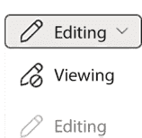

*图 4.58：服务中分页报表的模式选择*

- 9. 使用功能区**主页**选项卡上的页面导航控件来导航报表。报表共有 **857** 页。


*图 4.59：分页控件*

## 工作原理

也可以直接在服务中创建分页报表：导航到工作区，选择“新建”，然后选择**分页报表**。然后，可以通过选择**连接到报表**按钮（而不是创建新的分页报表），使用“分页报表”视觉对象在 Power BI Desktop 报表中显示这些报表。

在服务中创建的报表可以下载为**报表定义语言 (RDL)** 文件。RDL 文件实际上是 XML 文件。以下是一个示例报表的 XML 的第一部分：

```xml
<?xml version="1.0" encoding="utf-8"?>
<Report MustUnderstand="df" xmlns="http://schemas.microsoft.com/sqlserver/reporting/2016/01/reportdefinition" xmlns:rd="http://schemas.microsoft.com/SQLServer/reporting/reportdesigner" xmlns:df="http://schemas.microsoft.com/sqlserver/reporting/2016/01/reportdefinition/defaultfontfamily">
  <df:DefaultFontFamily>Segoe UI</df:DefaultFontFamily>
  <AutoRefresh>0</AutoRefresh>
  <DataSources>
    <DataSource Name="DataSource1">
      <ConnectionProperties>
        <DataProvider>SQL</DataProvider>
        <ConnectString>Data Source=localhost\MSSQLSERVERDEV;Initial Catalog=AdventureWorksDW2022</ConnectString>
        <IntegratedSecurity>true</IntegratedSecurity>
      </ConnectionProperties>
      <rd:SecurityType>Integrated</rd:SecurityType>
      <rd:DataSourceID>a781f7ac-7bae-4de2-bf08-240a90e5e558</rd:DataSourceID>
    </DataSource>
</DataSources>
<Semantic models>
    <Semantic model Name="Semantic model1">
        <Query>
            <DataSourceName>DataSource1</DataSourceName>
```
```

自 SSRS 首次发布以来，RDL 文件就与 **SQL Server Reporting Services (SSRS)** 结合使用。Power BI Report Server 和 Power BI 服务都支持 RDL 文件。分页报表受 Pro 许可证及更高版本支持。

与 Power BI Desktop 不同，你无需将数据导入 RDL 文件。语义模型包含存储在 RDL 文件中的数据源、查询和字段定义。因此，运行报表时总会向数据源发起一个或多个查询。

## 更多内容…

Power BI Report Builder 是使用 RDL 的同类报表构建工具中最新的一款。Power BI Report Builder 包含大量功能和能力，远超单个指南所能涵盖的范围。不过，其中一些亮点包括：能够使用服务中的 Power BI 数据集作为数据源，以及大量可用的视觉元素、计算字段和格式设置。

添加数据源时，可以使用**添加 Power BI 数据集连接**选项。登录 Power BI 服务后，你可以选择你有权访问的任何工作区中的任何数据集。添加 Power BI 数据集数据源后，你可以使用该数据源创建数据集。可以使用**查询设计器**窗口针对数据集构建查询。

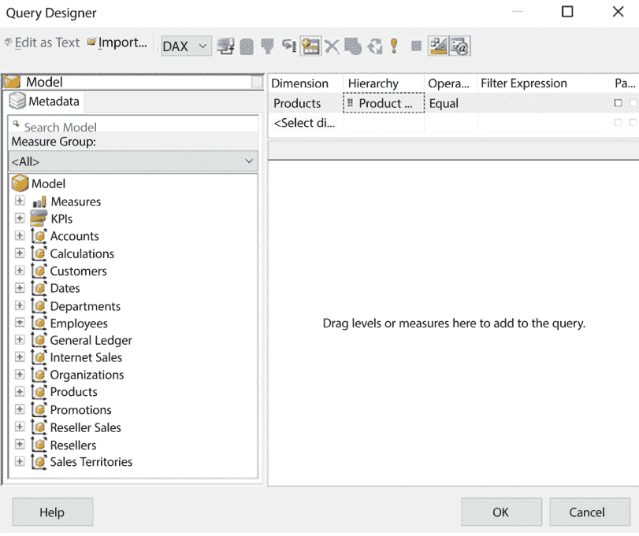

图 4.60：查询设计器

Power BI Report Builder 的“插入”菜单中包含许多视觉元素，包括：

- 表
- 矩阵
- 列表
- 柱形图
- 折线图
- 饼图
- 条形图
- 面积图
- 仪表
- 地图
- ESRI Shapefile
- 数据条
- 迷你图
- 指示器

此外，还可使用**文本框、图像、线条和矩形**等元素。报表还可以包含**子报表、页眉和页脚**。

计算字段可以使用大量函数和运算符创建；以下两个公式分别创建 TaxAndFreight 和 Year 的计算字段：

```text
=Fields!TaxAmt.Value+Fields!Freight.Value
=Year(Fields!OrderDate.Value)
```

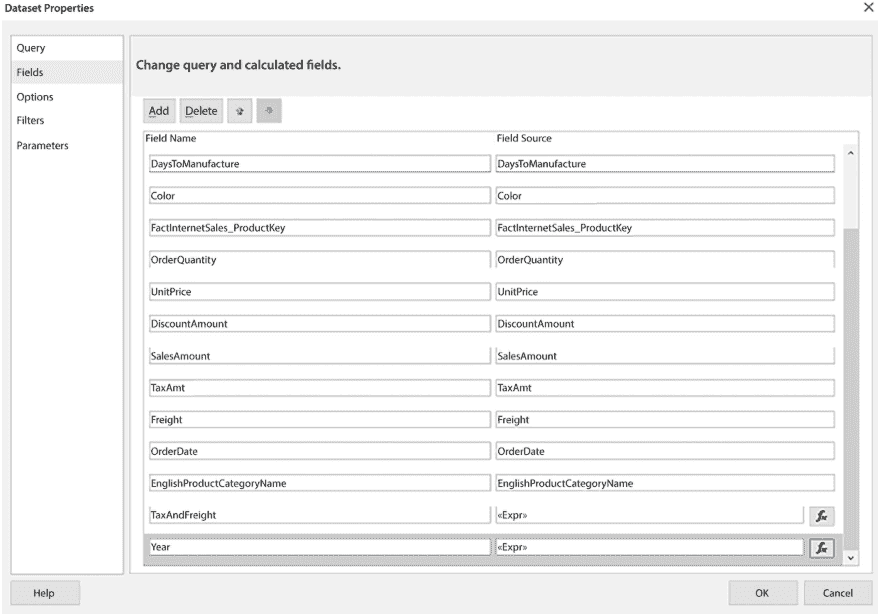

图 4.61：数据集属性

你可以通过单击网格中的单元格，然后使用**主页**选项卡的功能区来设置列和行中信息的格式。例如，可以将行标题设为粗体，并将货币字段设置为“货币”格式。

## Internet 销售

| 年份 | 产品 | 订购数量 | 单价 | 折扣金额 | 销售额 | 税费和运费 |
|------|---------|----------------|------------|-----------------|--------------|---------------|
| 2010 | 自行车 | 14.00 | $43,421.04 | 0.00% | $43,421.04 | $4,559.21 |
| 2011 | 自行车 | 2,216.00 | $7,075,525.93 | 0.00% | $7,075,525.93 | $742,930.34 |
| 2012 | 配件 | 106.00 | $2,147.08 | 0.00% | $2,147.08 | $225.45 |
|  | 自行车 | 3,269.00 | $5,839,695.33 | 0.00% | $5,839,695.33 | $613,168.15 |
|  | 服装 | 22.00 | $642.79 | 0.00% | $642.79 | $67.49 |
| 2013 | 配件 | 34,409.00 | $668,241.53 | 0.00% | $668,241.53 | $70,166.85 |
|  | 自行车 | 9,706.00 | $15,359,502.30 | 0.00% | $15,359,502.30 | $1,612,748.23 |
|  | 服装 | 8,686.00 | $323,806.45 | 0.00% | $323,806.45 | $34,000.09 |
| 2014 | 配件 | 1,577.00 | $30,371.35 | 0.00% | $30,371.35 | $3,189.06 |
|  | 服装 | 393.00 | $15,323.37 | 0.00% | $15,323.37 | $1,608.97 |
|  | 合计 | 60,398.00 | $29,358,677.20 | 0.00% | $29,358,677.20 | $3,082,663.84 |

图 4.62：分页报表

## 另请参阅

- 从此位置下载 Power BI Report Builder：https://bit.ly/2XOp1G1
- Power BI Report Builder：http://bit.ly/3rLCg3I
- Power BI 分页报表示例：http://bit.ly/2PonXVE
- 什么是 Power BI Premium 中的分页报表？：http://bit.ly/31F4tOS

## 总结

Power BI 报表是 Power BI 中仪表板、数据探索以及内容协作和分发的基础。Power BI Desktop 提供了丰富的数据可视化功能和选项，使你能够在各种设备上构建高度针对性强且用户友好的报表。在本章中，我们构建并介绍了最基本的报表视觉对象和设计概念。此外，我们还提供了指导，以增强和控制用户在 Windows 和移动设备上交互和使用 Power BI 报表时的体验。

在下一章中，我们将从在 Power BI Desktop 中工作转入在 Power BI 服务中工作。


## 加入我们在 Discord 上的社区

加入我们社区的 Discord 空间，与作者和其他读者进行讨论：

https://discord.gg/ebXZqyrxJb


