# 5

# 在 Power BI 服务中工作

虽然 Power BI 开发活动的 bulk 都发生在桌面应用程序中，主要是 Power BI Desktop，但某些构件如仪表板和数据流只能在 Power BI Web 服务中独家创建。在 Power BI 服务中创建、管理和集成这些项目，可提供强大的解决方案，满足从 KPI 全面仪表板到企业记分卡再到可扩展数据集成数据流等各种业务需求。

在本章中，Power BI 仪表板被构建以提供关键指标和重要业务活动的直观、一目了然的监控。仪表板的独特功能，如 Q&A 自然语言查询和数据警报，也将被探讨。最后，还包括了其他内容对象的创建，如流式语义模型、记分卡、数据流和共享云连接。

在本章中，我们将涵盖以下配方：

- 构建仪表板
- 为 Q&A 做准备
- 添加警报和订阅
- 流式语义模型
- 编写数据流
- 创建记分卡

### 技术要求

完成本章配方需要以下条件：

- Power BI Desktop 和一个 Power BI 服务账户（Pro 或 PPU）。
- Power Automate 和 OneDrive。
- 安装了 AdventureWorksDW2022 数据库的 SQL Server 2022 或更新版本。参见 *第 1 章 安装和许可 Power BI 工具* 中的 *安装 SQL Server 和 AdventureWorks 数据库* 配方。
- 本章文件可从以下 GitHub 仓库下载：https://github.com/PacktPublishing/Power-BI-Cookbook-Third-Edition。

## 构建仪表板

在 Power BI Desktop 中拥有强大的语义模型和多个报告后，可以在 Power BI 服务中开发仪表板，将最有价值的 KPI、度量和可视化整合到一个单一的玻璃面板上。此外，仪表板还提供了访问支持这些磁贴的详细报告的入口点，并通过 Power BI 移动应用程序针对移动访问进行了优化。

Power BI 仪表板是在 Power BI 服务中创建的磁贴集合，表示来自一个或多个 Power BI 报告的可视化，以及可选的其他来源，如 Excel 和 SQL Server Reporting Services（SSRS）。仪表板最适合将基本关键绩效指标（KPI）、度量和趋势集中在视觉和移动优化的布局中。此外，仪表板可以提供通往其他仪表板或报告的入口，并通过 URL 链接、流式数据、图像、Web 内容和交互性进一步增强。

Power BI 仪表板通常由高管和高级经理使用，他们希望对相关 KPI 和可视化有一个直观的整合视图。在许多情况下，这些利益相关者几乎完全依赖仪表板，而不是仪表板下更详细和交互式的报告。此类仪表板通常源自针对多个语义模型构建的报告，这些模型反映了不同的业务流程和职能领域，如会计和供应链。企业仪表板通常使用卡片和 KPI 可视化来关注战略目标并最大化画布空间。鉴于现代企业的规模和数据来源的广度，需要进行大量协调，以确保支持仪表板的所有语义模型都代表适当的数据质量和治理水平。

*第 4 章 编写 Power BI 报告* 中描述的报告设计规划流程同样适用于仪表板。重要的是要确认现有的语义模型支持仪表板中公开的所需业务问题和指标。

在本配方中，为北美销售管理团队创建了一个销售仪表板。四个报告已针对同一个 Power BI 语义模型构建，并且这些报告的可视化被固定为销售仪表板的磁贴。

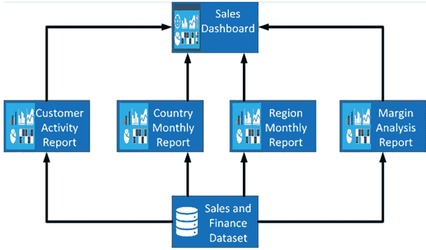

图 5.1：北美销售仪表板结构：四个报告和一个语义模型

### 准备工作

为准备本配方，请按以下步骤操作：

1. 登录 Power BI 服务。
2. 在左侧导航窗格中单击工作区，然后在弹出窗口底部选择新建工作区。如果无法创建工作区，请联系你的 Power BI 管理员，因为他们可能已禁用此选项。
3. 在创建工作区对话框中，输入工作区名称并单击应用。
4. 在功能区的中央区域，单击上传然后浏览。


图 5.2：创建工作区

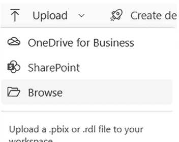

图 5.3：上传文件

33. 在内容区域添加文本；注意你可以使用插入链接图标添加活动链接。例如，你可以添加文档和支持链接，如图 5.10 所示。图像中突出显示的链接按钮用于为文本添加超链接。


图 5.10：文本框磁贴设置

34. 单击应用按钮。

35. 从报告的编辑菜单中选择移动版面。

36. 拖放磁贴以重新定位或使用右下角的尺寸手柄调整其大小。

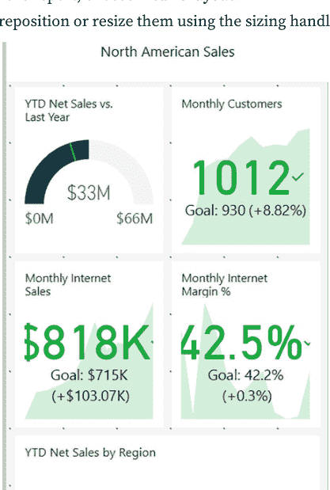

图 5.11：仪表板移动视图

37. 完成后，在右上角单击 **Web 版面**。

### 工作原理

必须理解，仪表板磁贴在报告可视化被固定时保持过滤上下文。这通常是用户和设计师都感到困惑的来源，因为根据设计，磁贴可能看起来没有更新。例如，在配方中，在固定净销售额与去年磁贴之前，2013 年最后六个月已在切片器中被选中。

假设 2013 年 12 月是“今天”，当 2014 年 1 月的数据到来时，这个净销售额与去年磁贴将不会反映 2014 年 1 月的数据。该磁贴必须取消固定并重新固定以包含新月份。为了避免这种情况，使用 **相对日期切片器/筛选器** 或基于返回 1 表示数据在所选范围内且否则返回 0 的标志字段列进行筛选。这可以在 DAX 或 M 中完成；DAX 示例如下：

```
6MonthFlag Column =
    VAR __Today = TODAY()
    VAR __EOM6Months = EOMONTH(__Today, -6)
    VAR __MinDate = DATE(YEAR(__EOM6Months), MONTH(__EOM6Months), 1)
RETURN
    IF('Dates'[Date] >= __MinDate && 'Dates'[Date] <= __Today, 1, 0)
```

如上所示，仪表板磁贴不必来自报告，也可以手动添加以包含图像、视频、文本框、Web 内容和流式数据。此外，单个仪表板可以拥有来自不共享同一语义模型的报告的磁贴。因此，如果本模型中的四个配方使用了不同的语义模型，仍然可以创建完全相同的仪表板，只要所有报告都存在于同一工作区中即可。

在拥有大量仪表板和报告的大型企业组织中，仪表板有时纯粹用作导航设备。通过添加图像或文本的磁贴，并使用设置自定义链接的能力，可以将仪表板配置为仅链接到其他组织仪表板。

### 还有更多…

默认情况下，仪表板的磁贴彼此独立，无法进行筛选或交互，例如在可视化之间进行交叉筛选。此外，在可视化固定到仪表板后对报告进行的修改，如筛选器和布局更改，不会自动反映在仪表板中。

在许多场景中，消费仪表板的用户希望在仪表板内保留 Power BI 报告的交互式筛选体验，因此自动同步报告与仪表板会很有帮助。幸运的是，Power BI 支持将整个报告页面固定到仪表板。要了解其工作原理，请执行以下操作：

1. 在服务中打开 RegionMonthlyReport 报告。


2. 在报表的菜单栏中，点击省略号（...），然后选择**固定到仪表板**。

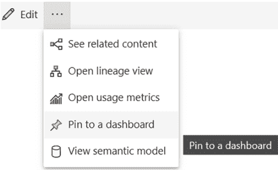

图 5.12：固定到仪表板

3. 选择**固定到仪表板**后，选取**现有仪表板**，选择 North American Sales 仪表板，然后点击**固定实时**按钮。

4. 导航到 North American Sales 仪表板，向下滚动，注意报表现已作为磁贴固定。

仪表板用户可以与实时页面上的区域、日期切片器和其他视觉对象进行交互。考虑到报表页面的大小，通常不建议将实时报表页面固定到**移动视图**。实时页面磁贴右上角的省略号包含**转到报表**选项，可访问实时页面报表的所有页面。对底层报表所做的修改将反映在固定的实时页面上。

## 另请参阅

- *面向 Power BI 设计人员的仪表板简介：* http://bit.ly/31KvIrv
- *设计出色 Power BI 仪表板的技巧：* http://bit.ly/2PspxG3
- *向仪表板添加图像、视频等内容：* https://bit.ly/31QypHP

## 准备 Q&A

Q&A 是让用户探索语义模型的一种强大方法，用户可以通过 Power BI 服务和 Power BI 移动应用直接提交自己的问题。仪表板上的磁贴所表示的每个语义模型的表和度量都可用来回答 Q&A 问题。

本操作指南提供了语义模型设计和元数据方面的技巧，以准备用于 Q&A 的语义模型。此外，还向 Power BI Desktop 语义模型添加同义词，以提高自然语言查询的准确性。

## 准备工作

要准备本操作指南，请执行以下步骤：

- 完成本章中的第一个操作指南：*构建仪表板*。

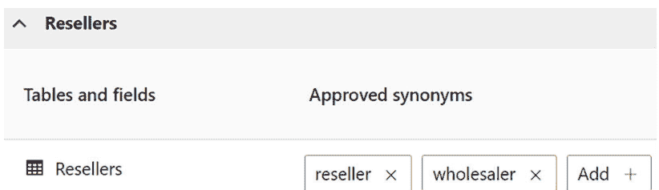

图 5.16：表同义词

13. 使用右上角的关闭按钮关闭 Q&A 设置对话框。

## 工作原理

Power BI Q&A 支持导入模式以及与 Azure Analysis Services、SQL Server Analysis Services（通过网关）和 Power BI 语义模型的实时连接。这些场景均支持 RLS。此外，对某些数据源提供了部分 DirectQuery 支持，但该支持目前为预览版。如果复合语义模型包含导入数据源或支持 APPROXIMATEDISTINCTCOUNT 函数的 DirectQuery 数据源，则支持 Q&A。

同义词是确保业务用户觉得 Q&A 体验简单直观，并获得正确问题答案的关键部分。同义词允许在语义模型中添加语义层，该语义层使用业务术语，而不仅仅是模型中表、列和度量的名称。表、列和度量可以包含在 Q&A 中或从中排除，并且可以定义同义词。

## 更多内容…

设置 Q&A 的一些通用技巧包括：

- 修正任何具有不正确数据类型的列，例如存储为文本数据类型的日期或数字。
- 将维度列的默认汇总设置为“不汇总”。
- 将地理列（如州和邮政编码）与相关的数据类别关联。
- 将包含多个值的列拆分为不同的列。
- 规范化表，使表中的实体移动到其自己的独立表中；例如，产品表中的供应商列可以移动到供应商表。
- Q&A 查询仅适用于模型的活动关系。请考虑具有活动关系的专用角色扮演维度。或者，考虑将非活动关系维度反规范化为事实表。
- 定义最常见或最常用的自然语言问题，并在 Power BI 中测试其准确性。
- 识别语义模型实体的名称与自然语言查询中使用的名称之间的差距。
- 重点关注名称较长且不太直观、用户不随意使用的实体。
- 避免在多个实体之间重复使用同一同义词，因为这可能导致不正确的查询结果。
- 确保模型中每个实体的主要同义词是唯一的。

驱动 Q&A 的整个语义层定义可以通过 Power BI Desktop 在“模型”视图中使用“开始”选项卡功能区中的“语言架构”选项进行导出、修改和导入。导出的文件是 YAML（YAML 不是标记语言）文件。YAML 是一种用于数据序列化的人类可读文本文件。添加 wholesaler net margin 同义词后，YAML 文件的部分内容如下所示：

```
reseller_sale.reseller_net_sales:
  Definition:
    Binding: {Table: Reseller Sales, Measure: Reseller Net Sales}
  State: Generated
  Terms:
  - reseller net sales: {State: Generated}
  - wholesaler net sale: {LastModified: '2021-04-05T16:58:30.2996117Z'}
  - sales: {State: Generated, Weight: 0.97}
  - net sales: {State: Generated, Weight: 0.97}
  - sale: {State: Suggested, Weight: 0.97}
  - net sale: {State: Suggested, Weight: 0.97}
  - reseller net sale: {Type: Noun, State: Suggested, Weight: 0.739}
  - wholesaler net auction: {Type: Noun, State: Suggested, Weight: 0.492}
  - net auction: {Type: Noun, State: Suggested, Weight: 0.485}
  - wholesaler net transaction: {Type: Noun, State: Suggested, Weight: 0.482}
  - auction: {Type: Noun, State: Suggested, Weight: 0.476}
  - net transaction: {Type: Noun, State: Suggested, Weight: 0.475}
  - wholesaler net deal: {Type: Noun, State: Suggested, Weight: 0.468}
  - wholesaler net trade: {Type: Noun, State: Suggested, Weight: 0.468}
  - wholesaler net vending: {Type: Noun, State: Suggested, Weight: 0.468}
  - wholesaler net retailing: {Type: Noun, State: Suggested, Weight: 0.468}
```

## 另请参阅

- 在报表中使用 Power BI Q&A 探索数据并创建视觉对象：http://bit.ly/2QYa7JN
- 优化 Power BI 中 Q&A 的最佳实践：http://bit.ly/3cSddYp
- Power BI Q&A 的局限性：http://bit.ly/2PtCrDL

## 添加警报和订阅

可以在仪表板的磁贴上配置警报，以便在满足特定条件时提供通知。可以在 Power BI 服务中管理警报规则和选项，通知可以仅限于 Power BI 中的通知中心，也可以通过电子邮件共享。数据驱动的警报增强了 Power BI 仪表板的价值，因为一旦支持仪表板磁贴的语义模型刷新，它们就会立即将注意力引向重要事件或结果。

Power BI 仪表板和报表还支持订阅。订阅根据定义的计划将刷新后的报表和仪表板的图像和链接直接发送到用户收件箱。此外，可以将分页报表订阅配置为以常见文件格式（如 Excel 和 PDF）附加报表数据到订阅电子邮件。

本操作指南演示了如何创建和配置警报和订阅，以及如何使用此功能借助 Power Automate 解锁更强大的功能。

## 准备工作

要准备本操作指南，请执行以下步骤：

- 完成本章中的第一个操作指南：*构建仪表板*。

## 如何添加警报和订阅

要实现本操作指南，请使用以下步骤：

- 1. 在 Power BI 服务中打开 North American Sales 仪表板。
- 2. 将鼠标悬停在 **Monthly Customers** KPI 磁贴上，单击右上角的省略号（...），然后选择**管理警报**。
- 3. 在**管理警报**窗格中，单击**添加警报规则**。
- 4. 编辑**警报标题**、**条件**和**阈值**，并确保选中**也通过电子邮件发送给我**复选框。

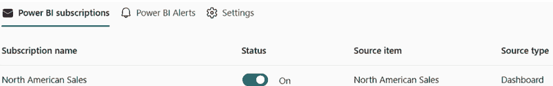

图 5.20：创建订阅

15. 单击 Power BI 警报选项卡，并注意将出现警报。

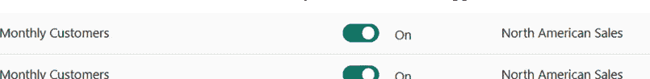

图 5.21：警报管理

## 工作原理

警报只能在显示单个数字指标的仪表板磁贴上设置，例如卡片视觉对象、KPI 视觉对象和仪表视觉对象。可以在多个不同的仪表板磁贴上设置警报，也可以为同一个仪表板磁贴配置多个警报，每个警报具有单独的条件和/或阈值，例如最大值和最小值。

当支持仪表板的语义模型刷新时，Power BI 会评估警报规则。如果警报被触发，Power BI 服务的通知中心（右上角的铃铛图标）中将出现一个图标和消息，其中包含指向为该警报配置的仪表板磁贴的链接。此外，如果选择了电子邮件选项，还将发送一封有关警报的电子邮件。还可以在 Power BI 移动应用中设置和查看数据警报——Power BI 移动版也提供通知访问。

订阅可以设置在仪表板或报表上。为报表设置订阅时，必须为订阅选择报表页面。订阅按指定时间运行，频率可以设置为每小时、每天、每周、每月或数据刷新后（每天一次）。每小时和每周订阅允许选择一周中的各个日期。单个订阅可以支持多个电子邮件地址，允许 Power BI 管理员为其他用户配置订阅。

## 更多内容…

Power BI 服务中的警报仅限于仅向该警报的创建者发送电子邮件。但是，可以使用 Power Automate 通过电子邮件通知他人，甚至触发复杂的工作流。要了解其工作原理，请执行以下操作：

- 1. 在 Power BI 服务中，单击右上角的齿轮图标，然后选择“通知”。
- 2. 选择“Power BI 警报”选项卡，将鼠标悬停在“Monthly Customers Above 1100”警报上，然后点击“编辑”图标。
- 3. 在底部的“管理警报”窗格中，点击“使用 Microsoft Power Automate 触发其他操作”。


## 如何流式传输语义模型

要实现此配方，请使用以下步骤：

- 1. 导航到服务中位于 North American Sales 的工作区。
- 2. 在工作区名称下，选择 New，然后选择 Streaming dataset (semantic model)。
- 3. 在 New streaming dataset (semantic model) 面板中，选择 PUBNUB 然后点击 Next。

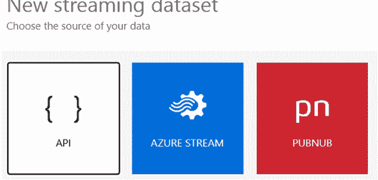

Figure 5.24: New streaming semantic model options

- 4. 为语义模型命名为 Streaming Sensor Data。
- 5. 使用以下 Sub-key：sub-c-99084bc5-1844-4e1c-82ca-a01b18166ca8。
- 6. 使用以下 Channel：pubnub-sensor-network。
- 7. 点击 Next 按钮。
- 8. 下一页显示语义模型的架构；点击 Create 按钮。
- 9. Streaming Sensor Data 语义模型出现在工作区中。
- 10. 导航到 North American Sales 仪表板。
- 11. 在仪表板功能区中，选择 Edit 然后 Add a tile。
- 12. 在 Add a tile 面板中，从 REAL-TIME DATA 区域选择 Custom Streaming Data 然后点击 Next 按钮。
- 13. 在 YOUR DATASETS 下，选择 Streaming Sensor Data，然后点击 Next。
- 14. 对于 Visualization Type，选择 Line chart。
- 15. 对于 Axis，使用 timestamp，对于 Values，使用 ambient_temperature。
- 16. 点击 Next 按钮。
- 17. 输入该磁贴的标题名为 Temperature 然后点击 Apply 按钮。

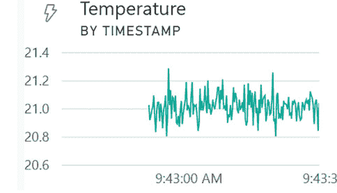

Figure 5.25: Custom Streaming Data tile

18. 在仪表板中向下滚动以找到 Temperature 磁贴。

## 如何工作

Power BI 中实际上有三种类型的流式语义模型：

- Push
- Streaming
- PubNub

Push 语义模型有一个外部程序将数据推送到 Power BI；数据作为语义模型存储在 Power BI 内部。Push 语义模型会永久地在 Power BI 中存储信息，然后可用于创建报表。使用 push 语义模型时，视觉对象通过报表构建然后固定到仪表板。Push 语义模型限制为每秒 1 次请求，每次请求 16 MB，每小时 100 万行。

Streaming 语义模型将数据推送到 Power BI，但不会在 Power BI 语义模型中存储数据。因此，streaming 语义模型不能用于报表——只能用于仪表板。Streaming 语义模型限制为每秒 5 次请求，每次请求 15 KB，但每小时处理的行数没有限制。

PubNub 语义模型也不会在 Power BI 中存储数据，因此只能用于仪表板。关于每秒发送的请求数或每次请求发送的数据量没有限制，因为 Power BI Web 客户端使用 PubNub SDK 读取现有的 PubNub 数据流，而不是将信息推送到 Power BI。

Push 和 streaming 语义模型可以使用 Power BI REST API 创建，使用服务中的 API 选项，通过 Azure Stream Analytics 创建新的 streaming 语义模型；参见 Figure 5.24。

当使用服务中的 API 选项创建 streaming 语义模型时，配置屏幕包含 Historic data analysis 的切换开关。该切换开关默认关闭，将创建 streaming 语义模型——将 Historic data analysis 切换为开启则创建 push 语义模型。一旦创建 push/streaming 语义模型，就可以使用 Power BI REST API 的 push 语义模型功能将数据推送到语义模型中。

撰写本文时，Power BI 服务中的 Azure Stream 选项尚未完全实现，但实现后将提供集成 Azure Stream Analytics 数据到 Power BI 的界面。目前，您必须从 Azure Stream Analytics 激活 Power BI 集成。Power BI 是 Azure Stream Analytics 数据的输出选项。将 Power BI 设置为 Azure Stream Analytics 的输出会创建一个 Power BI 语义模型，该模型可同时利用 push 和 streaming。默认情况下，此语义模型存储 200,000 行数据，并且数据通过先进先出 FIFO 过期。

## 还有更多...

关于实时或接近实时数据，另一个选项是使用自动页面刷新。自动页面刷新用于报表页面，以设置视觉对象的刷新间隔，仅在查看报表时处于活动状态——该选项不适用于导入数据源。自动页面刷新可在 Power BI Desktop 或 Power BI 服务中页面格式选项中配置。刷新类型可以配置为固定间隔或基于更改检测配置。更改检测支持因存储模式、源以及是否使用专用 Premium 或共享容量而异。共享容量不支持任何存储模式或源的更改检测。最小刷新固定间隔也因存储模式、源和容量类型而异。对于专用容量，最小刷新固定间隔为一秒，除 Azure Analysis Services 外，其为 30 分钟。对于共享容量，所有存储模式和源的最小刷新固定间隔为 30 分钟。

## 另请参阅

- Real-time streaming in Power BI: https://bit.ly/39NhYRg
- Push Datasets: https://bit.ly/3dDVW4u
- Welcome to Azure Stream Analytics: https://bit.ly/3xMZAak
- Automatic page refresh in Power BI: https://bit.ly/3utX06q

## Authoring Dataflows

Dataflows 是可在 Power BI 服务中独家创建的可重用、可扩展的自助式提取-转换-加载 ETL 工件。Dataflows 使用与 Power BI Desktop 中一直存在的相同 Power Query M 语言进行数据访问和转换，但可以跨语义模型共享，并且在 Power BI Premium 容量下可以支持大型、资源密集型工作负载。

Power BI 服务中可用的数据流有两种类型：Gen1 和 Gen2。Dataflow Gen1 支持 DirectQuery 和增量刷新。Dataflow Gen2 需要 Fabric 容量并增加了许多新功能或改进功能，包括新的数据目标，如 Azure SQL Database、Azure Data Explorer Kusto 以及 Fabric Lakehouse/Warehouse。因此，Gen 2 数据流或 Power Platform 数据流解决了将 Power Query M 纳入数据仓库和湖仓解决方案的长期限制和挑战。用于检索和准备数据的熟悉且通常已存在的 M 表达式可以作为 Azure SQL Database 等标准、集中式系统的输入来利用。

此外，Dataflow Gen2 支持与数据管道的集成以及对作者、监控和计算规模的改进。然而，Dataflow Gen2 不支持 Dataflow Gen1 提及的功能，即 DirectQuery、增量刷新和 AutoML。

- 12. 右键单击 EnglishProductSubcategoryName 列标题，选择 Rename，并将列重命名为 Product Subcategory。
- 13. 在 Queries 窗格中选择 DimProductCategory 查询。
- 14. 确保 ProductCategoryKey 列为 Whole number 123 图标 类型，如果不是，则右键单击列标题并选择 Change type，然后选择 Whole number。
- 15. 将 EnglishProductCategoryName 列重命名为 Product Category。
- 16. 在 Queries 窗格中选择 DimProduct 查询。
- 17. 确保 ProductSubcategoryKey 列为 Whole number 123 图标 类型，如果不是则右键单击列标题并选择 Change type，然后选择 Whole number。
- 18. 将 EnglishProductName 列重命名为 Product Name。
- 19. 点击 Home 选项卡功能区中的 Merge queries。

## Merge

选择一个表和匹配的列以创建合并表。

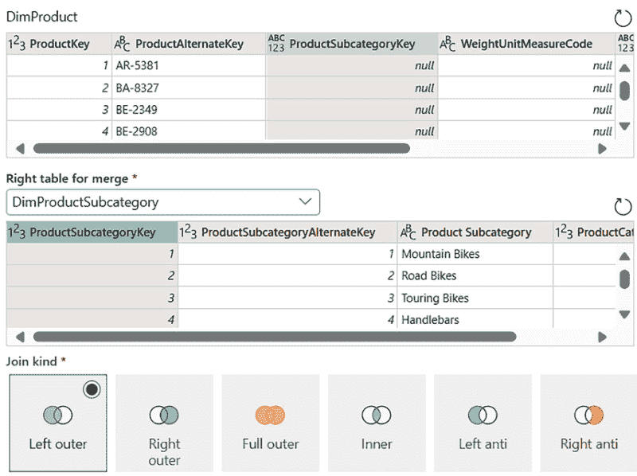

Figure 5.30: Merge dialog

20. 选择 DimProductSubcategory 作为合并的 Right table，选择两个 ProductSubcategoryKey 列，然后点击 OK 以接受默认的 Left outer join kind。


- 21. 单击 DimProductSubcategory 列标题中的列扩展图标，取消选中所有列，选择 Product Subcategory 和 ProductCategoryKey 列，并取消选中“使用原始列名作为前缀”复选框；单击“确定”。
- 22. 在“开始”选项卡的功能区中单击“合并查询”。
- 23. 在“用于合并的右表”中选择 DimProductCategory，选择两个 ProductCategoryKey 列，并单击“确定”以接受默认的“左外部联接”类型。
- 24. 单击 DimProductCategory 列标题中的列扩展图标，取消选中所有列，选择 Product Category 列，取消选中“使用原始列名作为前缀”复选框，并单击“确定”。
- 25. 选择 ProductCategoryKey 列，并在按住 Ctrl 键的同时选择 ProductSubcategoryKey 列。
- 26. 右键单击 ProductSubcategoryKey 列标题，然后选择“删除列”。
- 27. 右键单击“查询”窗格中的 DimProductCategory 查询，并取消选中“启用加载”。对 DimProductSubcategory 查询重复此操作。
- 28. 在右下角，单击“保存并关闭”按钮。
- 29. 将数据流命名为 Products，并单击“保存”按钮。
- 30. 单击返回工作区，注意 Products 数据流已出现。

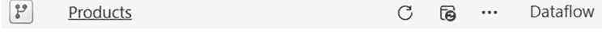

图 5.31：Products 数据流

- 31. 将鼠标悬停在 Products 数据流上，并单击“立即刷新”图标。

## 工作原理

数据流允许在 Power BI 服务中构建 Power Query 查询。此外，与在 Power BI Desktop 中构建的 Power Query 查询不同，数据流可以在多个语义模型之间重复使用。由于数据流和在 Power BI Desktop 中构建的 Power Query 查询使用相同的底层 M 代码技术，因此实际上可以将在 Power BI Desktop 中构建的查询轻松迁移到数据流，方法是使用高级编辑器功能在桌面端和数据流之间复制粘贴代码，或者在创建数据流时使用“导入模型”功能。

数据流将数据从源引入到符合通用语义模型（Dataverse）的文件夹中，这些文件夹存储在 Azure Data Lake Storage Gen2 中。数据流还允许你将你自己的 Azure Data Lake Gen2 存储中的数据公开给其他 Azure 服务。创建后，必须至少刷新一次数据流，以初始化 Azure Data Lake Gen2 存储中的数据。数据流支持与语义模型类似的设置，即你可以配置计划刷新，并在刷新数据时使用网关。

专用容量（如 Premium（现为 Fabric））支持其他数据流功能，例如：

- 增强的计算引擎，使数据流能够利用 DirectQuery 并获得性能改进
- 从其他数据流刷新链接表
- AutoML 和认知服务

创建后，数据流可在 Power BI Desktop 中用作数据源。要了解其工作方式，请执行以下操作：

- 1. 打开一个新的 Power BI Desktop 文件。
- 2. 在“开始”选项卡的功能区中选择“获取数据”，然后选择“数据流”。
- 3. 在“数据流”文件夹下，展开工作区，展开在其中创建 Products 数据流的工作区，展开 Products 数据流，选择 DimProduct 表，并单击“加载”按钮。

DimProduct 表现在已添加到语义模型中。

## 更多内容...

类似于数据流是可共享的数据转换查询，Power BI 服务也支持共享云数据源的概念。

在 Power BI Desktop 中，创建数据转换查询的第一步是创建到源系统的数据连接。该连接及其凭据会缓存在本地计算机上。但是，在不同计算机上打开 PBIX 文件时，需要重新输入凭据。

相反，可以在 Power BI 服务中创建等效的连接对象，然后将该连接分配给一个或多个语义模型。这有很多优点，包括：

- 集中管理网关连接和云连接。
- 如果凭据发生变化，只需在一个位置更新。
- 无需重新输入凭据即可与其他用户共享连接。你甚至可以指定这些用户可以与他人再次共享该连接。
- 可以为同一数据源创建多个共享连接，从而允许不同的语义模型使用不同的连接设置。

要创建共享云连接，请执行以下步骤：

- 1. 在 Power BI 服务中，单击右上角的齿轮图标，然后选择“管理连接和网关”。
- 2. 在左上角，单击“新建”。
- 3. 输入连接名称、类型和身份验证凭据。此处已创建一个名为 AdventureWorksDW2022Cloud 的连接，该连接使用数据网关，通过 Windows 凭据连接到 AdventureWorksDW2022 数据库。

### 设置

| 字段 | 值 |
|---|---|
| 本地部署 |  |
| 虚拟网络 |  |
| 云 |  |
| 网关群集名称 | FabricGateway |
| 连接名称 * | AdventureWorksDW2022Cloud |
| 连接类型 | SQL Server |
| 服务器 | localhost |
| 数据库 | AdventureWorksDW2022 |
| 身份验证 | 身份验证方法 * |

图 5.32：共享云数据源

- 4. 单击“保存”按钮以保存连接。
- 5. 导航到某个语义模型，并使用省略号显示设置。
- 6. 展开“网关和云连接”。
- 7. 请注意，SQL Server 连接现在可以映射到新的共享云连接。

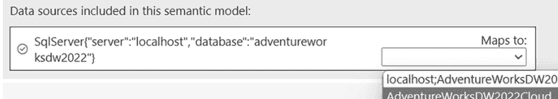

图 5.33：将数据源连接到共享云数据源

## 另请参阅

- 数据流和自助数据准备简介：https://bit.ly/3uCjNZf
- 创建数据流：https://bit.ly/2RiiGPV
- 配置和使用数据流：https://bit.ly/2Rh1VHm
- 数据流最佳实践：https://bit.ly/3cZIIQr
- 数据流的注意事项和限制：https://bit.ly/3t2UChM
- 数据流的高级功能：https://bit.ly/3fZXLLA
- 教程：在 Power BI 中构建机器学习模型：https://bit.ly/3d1XGp7
- AI 与数据流：https://bit.ly/3fT3nYk
- 在 Power BI 服务中创建和共享云数据源：https://bit.ly/47qOEuD
- 在 Power BI 服务中连接到云数据源：https://bit.ly/48C1Td0
- 从数据流第 1 代迁移到数据流第 2 代：https://bit.ly/3MK9Zrx

## 创建记分卡

Power BI 中的记分卡可以简洁明了地显示关键指标相对于其关联目标值的绩效和状态。多年来，公司一直通过各种工具创建自己的自定义记分卡报告来评估绩效；现在，通过指标和记分卡，Power BI 原生支持了这种功能。

记分卡在监视 KPI 方面可发挥关键作用，使利益相关者能够快速评估其组织或组织单位在关键目标上的表现。它们通常用于商业智能和报告，以支持数据驱动的决策过程。本教程演示如何创建基本记分卡。

### 准备工作

要准备本教程，请执行以下步骤：

- 完成本章中的第一个教程“构建仪表板”。

### 如何创建记分卡

要完成本教程，请执行以下步骤：

- 1. 在 Power BI 服务中导航到 North American Sales 所在的工作区。
- 2. 在工作区名称下，选择“新建”，然后选择“记分卡”。
- 3. 双击“无标题记分卡”，将记分卡重命名为 North American Sales Scorecard。
- 4. 在“指标名称”中输入 North American Total Net Sales。
- 5. 在“当前值”下，单击“设置”下拉列表，选择“使用子指标”，然后选择“SUM”。

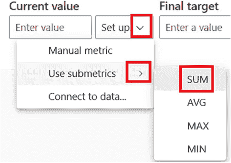

图 5.34：使用子指标作为“当前值”

- 6. 对“最终目标”重复此操作。
- 7. 单击“保存”按钮。
- 8. 将鼠标悬停在新指标上，单击三个垂直点，然后选择“新建子指标”。

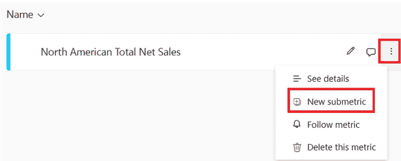

图 5.35：创建新的子指标


19. 单击“选择列和值”，然后从“销售区域”表中选择“销售区域”列。

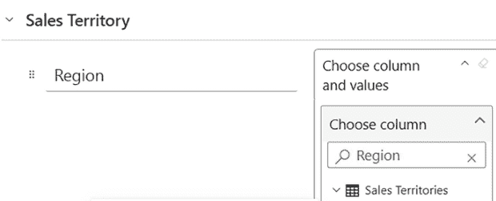

图 5.37：定义层次结构

20. 取消选中“全选”，并勾选以下值：Canada、Central、Northeast、Northwest、Southeast 和 Southwest。

21. 单击“保存”按钮，然后单击“关闭”按钮。

创建后，可通过单击左侧导航窗格中的“指标”图标来访问计分卡。

### 工作原理

请注意，原始的“北美总净销售额”指标现在已填入当前进度值 33.16M/45M。这是两个子指标的“当前值”和“最终值”字段之和。

此外，请注意每个指标的“状态”均设置为“未启动”。此状态可以手动编辑为六种不同的标准状态分类之一：“逾期”、“落后”、“有风险”、“按计划”、“未启动”和“已完成”。你还可以创建自己的自定义状态，甚至创建状态变更的自动规则，例如，如果值大于或等于目标的 100%，则将状态设置为“已完成”。

创建后，计分卡会创建自己的相应语义模型。随着数据刷新，新数据点会自动添加到语义模型中。因此，可以随时间跟踪指标值。对于手动指标，可以通过单击指标名称、单击“新建签入”按钮、输入日期、值以及可能的新状态，然后依次单击“保存”按钮来生成新的指标签入。

计分卡还支持创建层次结构，可以为计分卡指标添加额外的筛选器。在计分卡的左上角，你现在可以单击“选择层次结构”。在“销售区域”层次结构下，你可以单击其中一个值来筛选计分卡指标。

### 更多内容...

创建计分卡时，必须选择对业务重要的 KPI，并设定切实可行的目标或目的。创建计分卡时，请牢记以下重要事项：

## 商业管理 1B

商业管理 1B 六个模块的学习指南。

- **模块一：商业管理导论**
  - 商业在社会中的角色
  - 商业组织的类型
  - 商业环境
  - 企业的利益相关者
- **模块二：管理任务**
  - 计划
  - 组织
  - 领导
  - 控制
- **模块三：创业**
  - 创业过程
  - 识别商业机会
  - 撰写商业计划书
  - 创业的形式
- **模块四：综合管理**
  - 战略管理
  - 管理过程
  - 决策
  - 管理信息系统
- **模块五：市场营销管理**
  - 市场营销概念
  - 消费者行为
  - 市场细分
  - 营销组合
- **模块六：财务管理**
  - 财务报表
  - 财务分析
  - 预算与财务规划

该指标现在显示在 Power BI 报表中。

### 另请参阅

- 在 Power BI 中创建计分卡和手动指标：https://bit.ly/3HgbWzZ
- Power BI 计分卡中的层次结构入门：https://bit.ly/3RYcecA
- 在 Power BI 报表中创建指标视觉对象：https://bit.ly/3TZdmWe

### 小结

Power BI 服务提供创建和共享其他 BI 对象的功能，例如仪表板、应用、流式语义模型、数据流、共享数据源和计分卡，并且这些组件可以通过警报、订阅、图像和 Web 内容进行丰富和增强。本章构建了 Power BI 仪表板，用于对关键度量和影响较大的业务活动进行简单、一目了然的监控。仪表板的独特功能，例如问答自然语言查询和数据警报，也已包含在内。最后，还介绍了流式语义模型、数据流和计分卡的创建和使用。

在下一章中，我们提供有关日期智能处理的深入配方。

### 加入我们的 Discord 社区

加入我们社区的 Discord 空间，与作者和其他读者讨论：

https://discord.gg/ebXZayrxJb


