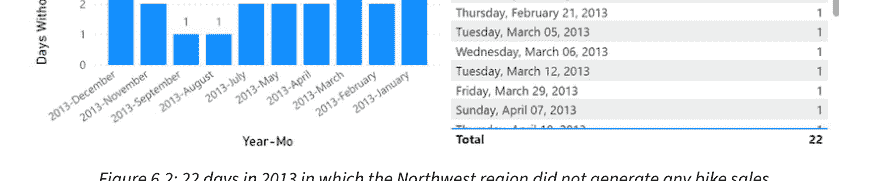

# 6 深入探讨日期智能

日期智能指的是使分析师能够跨时间段进行分析的各种语义建模模式和功能。在本章及全书中，我们用“日期智能”来指代这一广泛的语义建模模式集合，并将其与 DAX 时间智能函数的概念区分开来。这样做有两个原因。首先，从技术上讲，日期智能处理的是日期（天、月、年），而不是时间（小时、分钟、秒）。其次，DAX 时间智能函数通常只适用于标准（公历）日历，但许多企业使用的财务日历与标准日历年不同。日期智能的广义概念既适用于标准（公历）日历，也适用于自定义财务日历。

在第 3 章“构建 Power BI 语义模型”中创建的基础度量（如经销商净销售额）将辅以日期智能度量，用于计算年初至今、前期以及许多其他自定义时间段的计算。这些度量组合使用，以支持增长和差异度量，并经常在 Power BI 仪表板中用作关键绩效指标 (KPI)，因为它们能够传达额外的上下文和见解。如果实施得当，日期智能将极大地扩展语义模型的分析能力，并简化报表和仪表板的开发。

本章包含如何准备语义模型以支持强大的日期智能以及如何编写自定义日期智能度量的配方。我们将介绍以下配方：

- 通过 Power Query 编辑器准备日期维度
- 编写日期智能度量
- 开发高级日期智能度量
- 使用 DAX 和计算表简化日期智能
- 利用计算组

- 指示器列，例如星期指示器、假日指示器和工作指示器。这些列的值应适合报表使用，例如“假日”和“非假日”。

- 支持的不同粒度的开始和结束日期列，例如“周结束日期”和“期间结束日期”。

- 对于创建的每个自然层次结构列，添加一个对应的整数列用于排序。示例包括自然层次结构字符串（2009-Jan）和整数列，例如“日历年月数”（200901）。

设计的另一个方面是考虑使用偏移列和/或序列编号列。偏移列表示从当前期间算起的日期粒度增量数。例如，对于年-月粒度，如果当前期间（今天）为 2024-01，则 2023-12 为 -1，2023-11 为 -2，依此类推。偏移列可以大大简化日期智能计算。例如，前 6 个月将包括偏移量 -1 到 -6（含 -6）。

序列编号列可以作为偏移列的替代或补充。序列编号列提供一个整数值，该值从最早的日期粒度的 0 或 1 开始，每次增加 1。因此，如果日期表中最早的年-月是 2020-01，则其值为 1，那么 2020-02 为 2，2020-03 为 3，依此类推。

其他设计建议包括：

- 尝试将其他日历（如期间日历或财务日历）集成到源数据库的同一个日期表中。可以创建不同的视图来支持角色扮演维度。请参见“更多内容...”部分。
- 识别现有报表中或业务用户在 Excel 或 Power BI 中进行的常见日期操作，并考虑添加日期维度列以消除或简化这些操作。
- 确保日期列（例如“前一年日期”）和数字列（例如“日历年”）分别存储为日期和整数数据类型，这样算术运算和 DAX 函数（如 MAX 和 MIN）无需任何类型转换即可运行。
- 如果日期维度表作为数据仓库提取-转换-加载（ETL）过程的一部分每日更新，则标识当前期间和先前期间的列（如 IsCurrentFiscalPeriod 和 IsPrior60Days）也很常见。

### 如何准备日期维度

要实现此配方，请执行以下步骤：

1. 创建一个新的 Power BI Desktop 文件。

2. 在“开始”选项卡的功能区中单击“转换数据”，打开 Power Query 编辑器。

3. 创建一个从 DateTable.xlsx 导入“Dates”工作表的查询，并将此查询命名为 BaseDateTable。

4. 创建一个新的空白 M 查询，并使用以下代码引用 BaseDateTable 查询，检索最近三年的日期，并通过 M 函数计算 11 个附加列：


let
    Dates = BaseDateTable,
    CurrentDate = DateTime.Date(DateTime.LocalNow()),
    CurrentYear = Date.Year(DateTime.Date(DateTime.LocalNow())),
    CurrentMonth = Date.Month(DateTime.Date(DateTime.LocalNow())),
    FilteredDates =
        Table.SelectRows(
            Dates,
            each [Date] >=
            Date.AddYears(CurrentDate,-3) and [Date] <= CurrentDate
        ),
    DateCol = Table.SelectColumns(FilteredDates,"Date"),
    YearCol =
        Table.AddColumn(
            DateCol, "Year", each Date.Year([Date]), Int64.Type
        ),
    MonthNameCol =
        Table.AddColumn(
            YearCol, "Month Name", each Date.MonthName([Date]), type text
        ),
    YearMonthCol =
        Table.AddColumn(
            MonthNameCol, "Year-Mo",
            each Text.From([Year]) & "-" & [Month Name], type text
        ),
    MonthNumberCol =
        Table.AddColumn(
            YearMonthCol, "Month Number", each Date.Month([Date]), Int64.Type
        ),
    WeekdayNameCol =
        Table.AddColumn(
            MonthNumberCol, "Weekday", each Date.DayOfWeekName([Date]),
            type text
        ),
    DayNumberOfWeekCol =
        Table.AddColumn(
            WeekdayNameCol, "Weekday Number",
            each Date.DayOfWeek([Date]), Int64.Type
        ),
    YearStatusCol =

6. 创建一个名为 Dates 的新空白查询，使用以下代码为日期智能度量添加代理顺序列：

```
let
    Source = BaseDateTable,
    YearMonthCols =
        Table.Distinct(
            Table.SelectColumns(
                Source, {"Calendar Year","Calendar Month Number"}
            )
        ),
    YearMonthColSort =
        Table.Sort(
            YearMonthCols,
            {
                {"Calendar Year", Order.Ascending},
                {"Calendar Month Number", Order.Ascending}
            }
        ),
    YearMonthColIndex =
        Table.AddIndexColumn(YearMonthColSort, "YearMonthIndex",1,1),
    JoinedDateTable =
        Table.NestedJoin(
            DatesInterim, {"Year", "Month Number"},
            YearMonthColIndex, {"Calendar Year","Calendar Month Number"},
            "Year-Mo Index", JoinKind.Inner
        ),
    IndexColumnAdded =
        Table.ExpandTableColumn(
            JoinedDateTable,
            "Year-Mo Index",{"YearMonthIndex"},{"Year Month Number"}
        )
in
    IndexColumnAdded
```

7. 通过右键单击查询并取消选择启用加载来禁用 BaseDateTable 和 DatesInterim 的加载。只有 Dates 查询需要加载到语义模型中。

## 如何工作

对于 DatesInterim 查询（步骤 4 和 5），CurrentDate、CurrentMonth 和 CurrentYear 表达式可以存储为单独的查询。DateTime.LocalNow 函数用于动态 M 日期逻辑，类似于 SQL 语句中使用的 CURRENT_TIMESTAMP 函数。

+   - Power Query 表函数，提供有关用于处理表的各种可用函数的附加信息：https://bit.ly/3wMx1mC

## 编写日期智能度量

有了完整的日期维度表后，即可开发日期智能度量以支持常见需求，包括年初至今（YTD）、同比（YoY）和滚动历史。此外，还可以开发更复杂、特定于上下文的度量，以符合报表用户的独特需求和偏好。

本食谱中描述的日期智能模式适用于标准和非标准财务日历，因为它们使用基本的 DAX 函数和本章前面创建的顺序日期智能列。

本食谱包括核心年初至今和上一年度量的示例，以及更高级的动态前期度量，可调整为日期维度的所有粒度。

## 准备工作

为本食谱做准备，请执行以下步骤：

+   1. 完成本章中的通过查询编辑器准备日期维度食谱，或拥有与该食谱中相同的列的日期表。完成食谱以获得 BaseDateTable、DatesInterim、Dates、DatesInterim2 和 Dates2 查询。如果您已完成食谱，可以通过复制 PBIX 文件或从 GitHub 仓库下载 Preparing the Date Dimension via the Query Editor.pbix 文件开始。

+   2. 编辑 DatesInterim 查询的初始部分以加载所有行，而不仅仅是前三年。下面的代码片段代表了查询的初始部分，其中移除了 FilteredDates 表达式。其余查询与食谱相同。请注意，DateCol 表达式现在引用 Dates 表达式而不是 FilteredDates 表达式：

```
Dates = BaseDateTable,
CurrentDate = DateTime.Date(DateTime.LocalNow()),
CurrentYear = Date.Year(DateTime.Date(DateTime.LocalNow())),
CurrentMonth = Date.Month(DateTime.Date(DateTime.LocalNow())),
DateCol = Table.SelectColumns(Dates,"Date"),
```

+   3. 使用以下代码在 DatesInterim 查询末尾添加两个附加列 Prior Year Date 和 Prior Month Date。将 in 语句上方一行的末尾添加一个逗号，然后用以下代码替换所有后续行：

```
PriorYearDate =
    Table.AddColumn(
        WeekOfMonthCol, "Prior Year Date", each Date.AddYears([Date], -1)
    ),
PriorMonthDate =
```

2. 创建年初至今（YTD）、月至今（MTD）和周至今（WTD）度量：

```
Internet Sales (YTD) =
    CALCULATE([Internet Sales],
        FILTER(ALL('Dates'),
            'Dates'[Year] = MAX('Dates'[Year]) &&
            'Dates'[Date] <= MAX('Dates'[Date])))
Internet Sales (MTD) =
    CALCULATE([Internet Sales],
        FILTER(ALL('Dates'),
            'Dates'[Year Month Number] = MAX('Dates'[Year Month Number]) &&
            'Dates'[Date] <= MAX('Dates'[Date])))
Internet Sales (WTD) =
    CALCULATE([Internet Sales],
        FILTER(ALL('Dates'),
            'Dates'[Year Week Number] = MAX('Dates'[Year Week Number]) &&
            'Dates'[Date] <= MAX('Dates'[Date])))
```

3. 创建上一年（PY）、上一年至今（PYTD）和上月至今（PMTD）度量：

```
Internet Sales (PY) =
    CALCULATE([Internet Sales],
        FILTER(ALL('Dates'),
            'Dates'[Date] >= MIN('Dates'[Prior Year Date]) &&
            'Dates'[Date] <= MAX('Dates'[Prior Year Date])))
Internet Sales (PYTD) =
    CALCULATE([Internet Sales],
        FILTER(ALL('Dates'),
            'Dates'[Year] = MAX('Dates'[Year]) - 1 &&
            'Dates'[Date] <= MAX('Dates'[Prior Year Date])))
Internet Sales (PMTD) =
    CALCULATE([Internet Sales],
        FILTER(ALL('Dates'),
            'Dates'[Year Month Number] = MAX('Dates'[Year Month Number]) - 1 &&
            'Dates'[Date] <= MAX('Dates'[Prior Month Date])))
```

4. 使用当年和上一年度量创建同比（YOY）度量：

```
Internet Sales (YOY YTD) = [Internet Sales (YTD)] - [Internet Sales (PYTD)]
Internet Sales (YOY YTD %) = DIVIDE([Internet Sales (YOY YTD)],[Internet Sales (PYTD)])
```

5. 在日期智能度量中构建逻辑以考虑替代小计筛选上下文，例如当前期度量在按年、按季或按周的小计上下文中计算时：

```
Internet Sales (Prior Period) =
    VAR Periods = DISTINCTCOUNT('Dates'[Year Month Number])
    RETURN SWITCH(TRUE,
        HASONEVALUE('Dates'[Date]),
            CALCULATE([Internet Sales],
                FILTER(ALL('Dates'),'Dates'[Date] = MAX('Dates'[Date])-1)),
        HASONEVALUE('Dates'[Year Week Number]),
            CALCULATE([Internet Sales],
                FILTER(ALL('Dates'),
                    'Dates'[Year Week Number] = MAX('Dates'[Year Week Number])-1)),
        CALCULATE([Internet Sales],
            FILTER(ALL('Dates'),
                'Dates'[Year Month Number] >=
                    MIN('Dates'[Year Month Number]) - Periods &&
                'Dates'[Year Month Number] <=
                    MAX('Dates'[Year Month Number]) - Periods )))
```

6. 创建一个矩阵可视化，使用 Dates 表中的 Year 列作为列，并将 Internet Sales (YTD) 和 Internet Sales (PYTD) 作为值。参考第 4 章《Authoring Power BI Reports》中的 Creating Table and Matrix Visuals 食谱。

## 如何工作

设计日期智能度量时，重要的是要理解当前和先前是由度量运行的可视化上下文定义的。在步骤 2、3 和 5 中，FILTER 函数遍历每一行（一个日期）以确定哪些行传递给 CALCULATE 函数。ALL 函数删除所有现有的日期表筛选器，从而允许度量中的筛选条件访问日期表的全部行。

对于当前日期期间度量（步骤 2），每个度量表达式在代表预期粒度的列上设置等于条件；该列通过 MAX 尊重报表查询的筛选上下文。如果日期表的源查询被筛选为仅检索小于或等于当前日期的日期，则将这些度量添加到报表中时，它们将默认为当前年份、月份（或期间）和周。

请注意，Year Month Number 和 Year Week Number 列应为顺序递增的整数。

对于前期日期度量（步骤 3），对前期列同时应用 MIN 和 MAX 筛选条件可选择相应的日期范围。从列的 MAX 中减去一个值（本示例中为 1）可将所选时间段向后推移。


增长或方差度量（步骤 4）可计算度量在当前时间段的值与之前时间段的值之间的差异，例如同比（YOY）增长，可以通过创建新的度量来实现，该度量用当前期间的度量减去前一期间的度量。其他以百分比表示的增长或方差度量可以使用 DIVIDE 函数将此差异计算为前一期间值的百分比。

先前期间的日期列允许先前期间的度量相对于活动日期筛选上下文应用简单的筛选表达式，直至单个日期粒度。在没有这些列且日期表为期间或月份级别的情况下，度量筛选条件可以按如下方式编写：

```
Prior Year (PY) = 'Dates'[Year Month Number] = MAX('Dates'[Year Month Number])
- 12

Prior Month (PM) = 'Dates'[Year Month Number] = MAX('Dates'[Year Month Number])
- 1
```

对于步骤 5 中的动态先前期间度量 Internet Sales (Prior Period)，DAX 变量（Periods）计算当前筛选上下文中的期间数，例如如果是年份小计则为 12，如果是季度则为 3，如果是个别期间则为 1。HASONEVALUE 的测试条件检查是否选择了单个日期或周，并分别返回相应的前一天或前一周。其余日期粒度（Year、Quarter、Period）由 Periods 变量处理；该值从给定上下文的期间编号的 MIN 和 MAX 中减去。此示例强调了使用顺序日期智能列以访问跨粒度特定时间范围的重要性，以便应用自定义筛选条件。

## 还有更多…

DAX 包含一套完整的日期智能函数，例如 DATESYTD 和 SAMEPERIODLASTYEAR，对于标准（公历）日历，可以计算与本食谱中表达式相同的数值。尽管这些函数通常相对于本食谱中的示例提高了可读性，但在处理非标准日历（例如财政日历和更复杂的场景）时，使用（和了解）核心 DAX 函数（如 FILTER、MAX 和 MIN）是必要的。考虑到绝大多数 DAX 日期智能函数只是 FILTER 函数的语法糖，并且对日历日期有简化假设，因此在许多现实场景中依赖 DAX 日期智能函数是有意义的用处是不明智的。

对于许多刚接触商业智能的人来说，组织衡量和概念化时间的方式各不相同，这令人惊讶；这对于周尤其如此。在这里，DAX 日期智能函数又无用了，因为没有包含周函数。在处理周时，不同的组织会在一周中的不同天开始周。因此，在按年份或月份粒度分配周数时，必须牢记这一点。

此外，组织也会以不同的方式处理不完整的周。例如，在最终的 Dates 表中，有一个 Year Week Number 为 54 的条目。这是因为 2010 年以不完整的第 53 周结束。该周的 2011 年 1 月 1 日星期六这一天落在 2010 年之外。组织会以不同的方式处理这些不完整的周，要么将这一天作为 2010 年开始的周的一部分，要么作为它自己的周，要么作为 2011 年第一个完整周的一部分。

最后，还有一种传统 DAX 编程的替代方法，避免使用 CALCULATE 函数。这种方法称为 No CALCULATE 方法，也许违反直觉，可以产生与使用 CALCULATE 相同的结果，但在许多情况下实际上性能更好。对于矩阵视觉对象中使用的两个度量，No CALCULATE 版本如下：

```
Internet Sales (YTD) NC =
    VAR __Year = MAX('Dates'[Year])
    VAR __Date = MAX('Dates'[Date])
    VAR __Table =
        SUMMARIZE(
            ALL('FactInternetSales'),
            'FactInternetSales'[OrderDate],
            "__Year", YEAR([OrderDate]),
            "__Sales", [Internet Sales]
        )
    VAR __Result = SUMX(FILTER(__Table, [__Year] = __Year && [OrderDate] <= __Date), [__Sales])
    RETURN
        __Result

Internet Sales (PYTD) NC =
    VAR __Year = MAX('Dates'[Year]) - 1
    VAR __Date = MAX('Dates'[Date])
    VAR __Table =
        SUMMARIZE(
            ALL('FactInternetSales'),
            'FactInternetSales'[OrderDate],
            "__Year", YEAR([OrderDate]),
            "__Sales", [Internet Sales]
        )
    VAR __Result = SUMX(FILTER(__Table, [__Year] = __Year && [OrderDate] <= __Date), [__Sales])
    RETURN
        __Result
```

虽然更冗长，但许多人发现这种方法由于其自上而下的编码风格以及能够返回中间变量用于故障排除目的，因此更容易概念化、理解和调试。当使用 TOCSV 函数返回中间表时，这尤其强大。

使用 Year 列和这两个 No CALCULATE 度量创建一个新的矩阵。结果相同，但打开性能分析器窗格会证明，为 No CALCULATE 版本执行的 DAX 查询相对于为其执行的 DAX 查询性能更快。

## 另请参阅

- DAX FILTER 文档，关于本食谱中使用的 FILTER 函数：https://bit.ly/2Q1S45q
- DAX HASONEVALUE 文档，关于本食谱中使用的 HASONEVALUE 函数：https://bit.ly/3wXSEBE
- DAX 日期智能函数，详细介绍 DAX 的默认日期智能函数：https://bit.ly/3mKWtWp
- To **bleep** with Time Intelligence，一篇详细介绍 DAX 默认日期智能函数的复杂性和替代方法的博客文章：https://bit.ly/3gaUHN6
- Your DAX is Garbage，一段视频演示了使用 No CALCULATE 方法进行日期智能度量时的性能提升：https://youtu.be/r0pWLzp1UVI

## 开发高级日期智能度量

日期智能度量通常位于最显眼的 Power BI 报表和仪表板的核心，以及更复杂的业务分析中。因此，鉴于每个组织和 BI 项目的独特要求，了解如何超越上一食谱中描述的标准模式以高效嵌入自定义逻辑非常重要。此外，能够回答业务问题 When did X occur (or not occur)? 是可通过 DAX 度量逻辑支持的语义模型的强大补充。

在本食谱中，提供了一个度量的示例，该度量识别特定区域和产品类别未记录销售的日期。此外，还描述了一个自定义去年同期度量，具有默认（无筛选）行为，并从当年排除不完整的期间。

### 准备就绪

为准备本食谱，请执行以下步骤：

- 1. 打开 Power BI Desktop。
- 2. 完成本章的 *Authoring Date Intelligence Measures* 食谱。如果您已完成该食谱，可以通过复制 PBIX 文件或从 GitHub 仓库下载 `Authoring Date Intelligence Measures.pbix` 文件开始。
- 3. 创建一个名为 AdventureWorks 的导入模式数据源查询。该查询应类似于以下内容：
```
let
    Source = Sql.Database("localhost", "AdventureWorksDW2022")
in
    Source
```
- 4. 在名为 Data Sources 的查询组中隔离此查询并禁用加载。
- 5. 将 FactInternetSales 查询重命名为 Internet Sales。

```
let
    Source = Sql.Database("localhost", "AdventureWorksDW2022")
in
    Source
```

- 6. 右键单击 AdventureWorks 查询并选择引用。
- 7. 选择 DimSalesTerritory 表并将此查询命名为 Sales Territories。
- 8. 基于 DimProduct、DimProductCategory 和 DimProductSubcategory 表创建 Products 查询，使用以下代码：
- 9. 将事实查询 Internet Sales 分离到 Facts 查询组。参考第 3 章《Building a Power BI Semantic Model》中的 Implementing a Semantic Model 食谱。
- 10. 将维度查询 Dates、Sales Territories 和 Products 分离到 Dimensions 查询组。再次参考第 3 章《Building a Power BI Semantic Model》中的 Implementing a Semantic Model 食谱。
- 11. 在 Other Queries 组中创建一个名为 Calculations 的空白查询。
- 12. 在“开始”选项卡功能区的“关闭并应用”中选择以将表加载到语义模型。
- 13. 使用 Dates 表的 Date 列和 Internet Sales 表的 OrderDate 列创建关系。
- 14. 使用 ProductKey 列和 SalesTerritoryKey 列分别在 Internet Sales 表与 Products 和 Sales Territories 表之间创建关系。
- 15. 将 Dates 中 Year-Mo 列的排序依据列设置为 Year Month Number 列。

```
let
    Source = AdventureWorks,
    Navigation = Source[{Schema="dbo",Item="DimProduct"}][Data],
    Subcategory =
        Table.ExpandRecordColumn(
            Navigation, "DimProductSubcategory",
            {"EnglishProductSubcategoryName", "DimProductCategory"},
            {"Product Subcategory", "DimProductCategory"}
        ),
    Category =
        Table.ExpandRecordColumn(
            Subcategory, "DimProductCategory",
            {"EnglishProductCategoryName"}, {"Product Category"}
        )
    in
    Category
```

### 如何开发高级日期智能度量

要实现本食谱，请执行以下步骤：

- 1. 创建一个度量，统计在以下条件下没有对应事实表行的行数（天数）：

```
Days Without Northwest Bike Sales =
    COUNTROWS(
```


```
FILTER('Dates',
    ISEMPTY(CALCULATETABLE('Internet Sales',
        FILTER(CROSSJOIN(ALL('Sales Territories'),ALL('Products')),
            'Sales Territories'[SalesTerritoryRegion] = "Northwest"
            && 'Products'[Product Category] = "Bikes"))))
```

2. 在筛选窗格中添加来自 Dates 表的 Year 列并筛选为 2013 年。

3. 创建 Power BI 报表可视化以分析该度量。执行此操作的结果如图 6.2 所示。



图 6.2：2013 年西北地区未产生任何自行车销售的 22 天

## 如何运作

在此示例中，一个新的度量必须统计西北销售区域在 Bikes 产品类别中没有在线销售的天数。通过 ALL 子句的 CROSSJOIN 移除了 Product 和 Sales Territory 表上的任何现有筛选。Internet Sales 事实表随后被筛选为西北地区和 Bikes 类别，并对筛选上下文中的每个日期应用 ISEMPTY。只有 FILTER 返回没有行的日期以便进行计数。

步骤 1 中使用 CROSSJOIN 是必要的，以移除模型中来自不同表的列的筛选。单个 ALL 函数可用于移除单个表的筛选上下文中的一个或多个列，例如 ALL('Product'[Product Color],'Product'[Product Class])。

## 还有更多…

前期期间日期智能度量可能会变得相当复杂。例如，考虑以下场景：对于按月粒度计算的 Prior Year-to-Date 度量，业务需求是仅按当前年的已完成期间筛选前一年（仅将已完成与已完成进行比较）。目标是自动计算 Prior Year-to-Date 值（仅已完成期间），且报表中不包含任何日期列，并在报表可视化中选择当前不完整期间时返回空白。要实现此度量，请执行以下步骤：

1. 在 Calculations 表中，创建以下度量：

```
Today = DATE(2013,6,28)
Current Year = LOOKUPVALUE('Dates'[Year],'Dates'[Date],[Today])
```

## 准备工作

为准备本配方，请执行以下步骤：

- 1. 打开 Power BI Desktop。
- 2. 创建一个名为 AdventureWorks 的导入模式数据源查询。此查询应类似于以下内容：
- 3. 将此查询隔离到名为 Data Sources 的查询组中并禁用加载。
- 4. 右键单击 AdventureWorks 查询并选择引用。
- 5. 选择 FactInternetSales 表并将此查询命名为 Internet Sales。
- 6. 重复步骤 5 和 6，针对 DimDate 表并将此查询命名为 Order Dates。
- 7. 将事实查询 Internet Sales 分离到 Facts 查询组。参考第 3 章《构建 Power BI 语义模型》中的《实施语义模型》配方。
- 8. 将维度查询 Order Dates 分离到 Dimensions 查询组。同样参考第 3 章《构建 Power BI 语义模型》中的《实施语义模型》配方。
- 9. 在 Other Queries 组中创建一个名为 Calculations 的空白查询。
- 10. 在“开始”选项卡的功能区中选择“关闭并应用”以将表加载到语义模型中。
- 11. 使用 Order Dates 表的 FullDateAlternateKey 列和 Internet Sales 表的 OrderDate 列创建关系。

```
let
    Source = Sql.Database("localhost", "AdventureWorksDW2022")
in
    Source
```

## 如何简化日期智能

要实施本配方，请执行以下步骤：

- 1. 从报表视图中，单击“建模”视图选项卡功能区上的“新建表”。
- 2. 在公式栏中，为日期维度表分配一个名称，例如 Shipment Dates，并使用 SELECTCOLUMNS 函数从现有日期维度表中检索日期列：
- 3. 在 Shipment Dates 表的 Shipment Date 列与 Internet Sales 表的 ShipDate 表之间创建关系。
- 4. 将 Order Dates 表中的 FullDateAlternateKey 列重命名为 Order Date。

```
Shipment Dates =
    SELECTCOLUMNS('OrderDates',
        "Shipment Date", 'OrderDates'[FullDateAlternateKey],
        "Shipment Year", 'OrderDates'[CalendarYear],
        "Shipment Month", 'OrderDates'[EnglishMonthName],
        "Last Refreshed", NOW()
    )
```

- 10. 创建一个 **Matrix** 可视化，使用 Order Dates 表的 CalendarYear 和 EnglishMonthName 列作为行，使用 Internet Sales 度量作为 **Values**，并使用 Date Intelligence Group 的 Name 列作为列。
- 11. 将 Orders 度量添加到 Matrix 可视化作为 **Values**。

## 如何运作

步骤 7 中使用的 SELECTEDMEASURE 函数获取上下文中的当前度量，并用计算组中的计算结果替换度量返回的值。返回值的格式（货币、整数、小数）与所选度量的格式相对应，除非被指定的格式字符串覆盖。对于数值，格式字符串应始终包含三个格式规范，用分号分隔，分别对应正数、负数和零值。

当所有计算项的 Ordinal 属性设置为 -1 时，返回的计算项顺序为字母顺序。可以通过指定从 0 开始的序号数字来覆盖此顺序。序号数字越小，显示越靠前。

## 还有更多…

使用 DAX 时间智能函数也可以实现相同的结果，但需要注意的是 DAX 时间智能函数假定使用标准（公历）日历，因此在处理财政日历和更复杂场景时应避免使用。要了解其工作原理，请执行以下操作：

- 1. 在 **Data** 窗格的 **Model** 选项卡中处于 **Model view** 时，右键单击 **Calculation groups** 标题并选择 **New calculation group**。
- 2. 将新的计算组命名为 Time Intelligence Group。
- 3. 创建以下计算项：
  - **Current:** Current = SELECTEDMEASURE()
  - **YTD:** YTD = CALCULATE(SELECTEDMEASURE(), DATESYTD('Order Dates'[Date]))
  - **MTD:** MTD = CALCULATE(SELECTEDMEASURE(), DATESMTD('Order Dates'[Date]))
  - **QTD:** QTD = CALCULATE(SELECTEDMEASURE(), DATESQTD('Order Dates'[Date]))
  - **PY:** PY = CALCULATE(SELECTEDMEASURE(), SAMEPERIODLASTYEAR('Order Dates'[Date]))
  - **PY YTD:** PYTD = CALCULATE(SELECTEDMEASURE(), SAMEPERIODLASTYEAR('Order Dates'[Date]), 'Time Intelligence Group'[Name] = "YTD")
  - **YOY:** YOY = SELECTEDMEASURE() - CALCULATE(SELECTEDMEASURE(), 'Time Intelligence Group'[Name] = "PY")
  - **YOY %:** YOY % = DIVIDE(CALCULATE(SELECTEDMEASURE(), 'Time Intelligence Group'[Name] ="YOY"), CALCULATE(SELECTEDMEASURE(), 'Time Intelligence Group'[Name] ="PY"))
- 4. 在 **Report view** 中复制 Page 1。
- 5. 选择 Duplicate of Page 1 上的 **Matrix** 可视化并将列替换为 Time Intelligence Group 的 Name 列。

## 加入我们的 Discord 社区

加入我们社区的 Discord 空间，与作者和其他读者进行讨论：

```
https://discord.gg/ebXZqyrxJb
```


