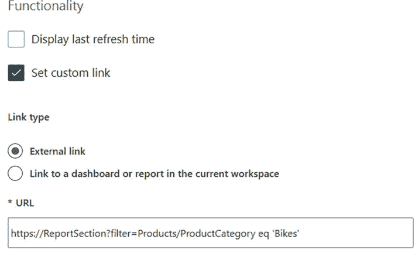
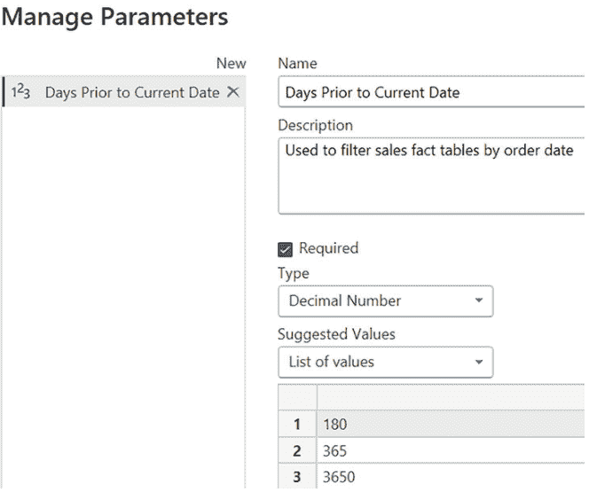
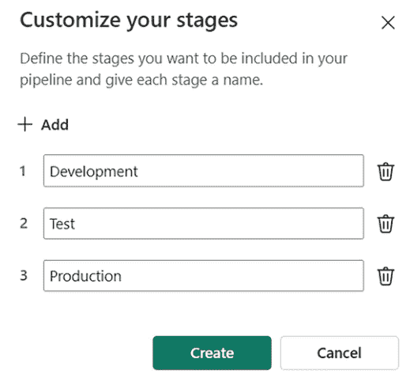
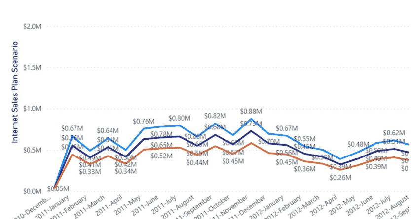
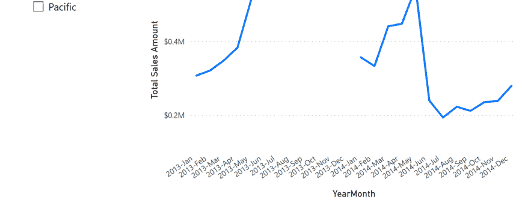

# 7 参数化 Power BI 解决方案

# 参数化 Power BI 解决方案

在 Power BI 部署的基础建立起来后，我们现在将探讨如何参数化 Power BI 的各个方面，以为技术服务和用户提供更大的灵活性。这包括数据检索和报表设计流程的组件、用户体验以及部署流程本身。例如，查询参数可以隔离和限制数据源以支持变化的源系统，模板可以针对预定义元数据实现参数化报表开发，而 M 和 DAX 函数可以提供自定义集成和分析功能。

本章中的配方涵盖了 Power BI 中标准的参数化功能和技术，以及更高级的自定义实现。参数化数据源、查询、用户定义函数和报表的示例进一步体现了 M 语言及其与 Power BI Desktop 其他功能集成的强大功能。其他示例，例如基于 URL 的参数筛选器、专用预测或假设分析工具，以及用户选择参数表，利用 Power BI 的转换和分析功能，使用户能够更好地控制 Power BI 语义模型的分析和可视化。

在本章中，我们将介绍以下配方：

- - 动态筛选报表
- - 利用查询参数
- - 使用模板
- - 将静态查询转换为动态函数
- - 使用参数表捕获用户选择
- - 使用假设分析进行预测


## 技术要求

要完成本章中的配方，需要以下内容：

- Power BI Desktop。
- SQL Server 2022 或更新版本，并安装了 AdventureWorksDW2022 数据库。有关安装 SQL Server 和 AdventureWorks 数据库，请参阅第 1 章《安装和许可 Power BI 工具》中的 Installing SQL Server and the AdventureWorks Database 配方。
- 本章的文件可以从以下 GitHub 仓库下载：https://github.com/PacktPublishing/Power-BI-Cookbook-Third-Edition。

## 动态过滤报表

除了第 4 章《创建 Power BI 报表》中介绍的 Power BI Desktop 中的报表筛选选项外，还可以通过 URL 字符串对已发布的 Power BI 报表应用筛选器。与具有不同筛选条件的多个专用报表和报表页面不同，带有唯一查询字符串的 URL 链接可以利用 Power BI 服务中的单个已发布报表。此外，URL 链接可以嵌入到语义模型中，以便已发布的报表可以公开指向其他报表且具有预定义筛选条件的链接。

在本配方中，创建了两个 URL 字符串以演示单参数和多参数筛选语法。第二个示例通过 M 查询为产品维度表的每一行创建一个 URL 字符串，并在报表视觉对象中公开此动态链接。

### 准备工作

为准备本配方，请执行以下步骤：

1. 从以下 GitHub 仓库下载 Filtering Reports Dynamically.pbix：https://github.com/PacktPublishing/Power-BI-Cookbook-Third-Edition。
2. 在 Power BI Desktop 中打开 Filtering Reports Dynamically.pbix。
3. 编辑 AdventureWorks 查询并将 Source 行更改为指向安装了 AdventureWorksDW2022 数据库的 SQL 服务器。
4. 将报表发布到 Power BI 服务。

### 如何动态过滤报表

要实现本配方，请执行以下步骤：

1. 在 Power BI 服务中打开报表。
2. 将 URL 的查询字符串 (?experience=power-bi) 替换为以下内容并按 Enter。如果没有查询字符串（URL 中没有问号），则只需将以下查询字符串添加到 URL 末尾：

```
?filter=Products/ProductCategory eq 'Bikes'
```

3. 要应用多个 URL 筛选参数，请使用 `and` 运算符分隔列筛选器，如以下示例所示：

神经网络训练中的关键问题包括梯度消失、梯度爆炸、过拟合与欠拟合等。针对这些问题，研究者提出了多种优化算法与正则化手段，如批量归一化、残差连接、Dropout 等。

### 1. 训练挑战与应对策略

- 梯度消失：使用 ReLU 激活函数、残差连接或 LSTM 结构缓解。
- 梯度爆炸：采用梯度裁剪、合理的权重初始化策略。
- 过拟合：增加数据量、使用 Dropout 与权重衰减。
- 欠拟合：增大模型容量、适当增加训练轮数。

### 2. 优化算法比较

| 算法 | 特点 | 适用场景 |
| --- | --- | --- |
| SGD | 稳定、易调参 | 小数据集 |
| Adam | 自适应学习率 | 大规模参数 |
| RMSProp | 处理非平稳目标 | RNN 训练 |

> 好的优化器应当兼顾收敛速度与最终精度。

有关所有支持的运算符以及不同数据类型格式的完整列表，请参阅本配方 See more 部分中的链接。

### 还有更多...

来自带有查询字符串的自定义 URL 的报表视觉对象可以固定到仪表板，并且在刷新后仪表板图块将反映筛选条件。但是，默认情况下，选择固定的仪表板图块将导航到未筛选的源报表。可以通过编辑图块详细信息来将自定义 URL 与仪表板图块关联，以控制仪表板导航，如图 7.1 所示：



*图 7.1：Power BI 仪表板图块的自定义 URL 链接*

### 另请参阅

- Filter a report using query string parameters in the URL: https://bit.ly/3swEJPF

## 利用查询参数

查询参数是构建灵活、可管理的查询检索流程的主要组成部分，也是实现简单筛选选择的关键。查询中的硬编码值可以用参数替换，并且单个参数可以被多个查询使用，从而减少开发时间和维护工作。参数是配置语义模型增量数据刷新策略所必需的，并且通常用于将加载到 Power BI Desktop 本地实例的数据量限制在已发布的 Power BI 语义模型相对范围内。

在开发期间，参数在筛选事实表或大型维度表以仅加载一小部分数据时也很有用。非常大的 Power BI 文件可能会变慢且难以使用，因此语义模型作者可以通过参数添加筛选器，以便仅在本地加载一小部分行。然后，语义模型作者只需修改参数即可加载所有行。这可以在发布之前或通过 API、脚本或部署管道在发布后进行，这些管道会修改 Power BI 服务中的参数值。

在本配方中，使用参数根据当前日期筛选事实表查询的指定天数。还分享了一个更高级的示例，将参数应用于事实表查询的维度列以及日期范围。

### 准备工作

为准备本配方，请执行以下步骤：

1. 在本地打开一个 Power BI Desktop 文件，然后通过单击“开始”选项卡功能区中的“转换数据”访问 Power Query 编辑器。
2. 创建一个名为 `AdventureWorks` 的查询，类似于以下内容：

   ```m
   let
       Source = Sql.Database("localhost", "AdventureWorksDW2022")
   in
       Source
   ```

3. 禁用 `AdventureWorks` 查询的加载（右键单击查询并取消选中“启用加载”）并将其放置在“数据源”查询组中。

### 如何利用查询参数

要实现本配方，请执行以下步骤：

1. 创建一个名为 `CurrentDate` 的空白查询并通过右键单击查询然后取消选择“启用加载”来禁用查询的加载：

   ```m
   let
       Source = #date(2014,1,28)
   in
       Source
   ```

2. 从 Power Query 编辑器的“开始”选项卡中，单击“管理参数”下拉菜单并选择“新建参数”。

3. 为参数命名为 **Days Prior to Current Date**，数据类型为 **Decimal Number**，并且为此示例输入建议值的列表。必要时也可以将参数应用于此建议列表之外的值。



*图 7.2：输入建议值的列表*

4. 基于 **List of values**，输入 **Default Value** 和 **Current Value** 为 180。

5. 创建一个新的空白查询 `StartDate`，该查询基于 `CurrentDate` 查询和新参数计算日期值，然后禁用加载：

   ```m
   let
       Source = Date.AddDays(CurrentDate, -#"Days Prior to Current Date")
   in
       Source
   ```

   在此示例中，基于默认参数值返回当前日期之前 180 天的日期。

6. 创建一个基于以下 M 代码的 `Internet Sales` 查询：

   ```m
   let
       Source = AdventureWorks,
       dbo_FactInternetSales =
           Source{[Schema="dbo",Item="FactInternetSales"]}[Data],
       ChangeType = Table.TransformColumnTypes(
           dbo_FactInternetSales,{{"OrderDate", type date}}),
       RowFilter = Table.SelectRows(
           ChangeType, each [OrderDate] >= StartDate and [OrderDate] <= CurrentDate)
   in
       RowFilter
   ```

7. 从查询编辑器的 **Home** 选项卡中单击 **Close & Apply**。

8. 创建一个卡片视觉对象，显示未格式化的 (**Display units** 为 **None**) 最小 **OrderDateKey**，并注意它是 **20130801**，即 2014 年 1 月 28 日 CurrentDate 之前 180 天。

### 它是如何工作的

在生产场景中，CurrentDate 查询不会硬编码为日期，而应类似于以下内容：

```m
let
    Source = DateTime.Date(DateTime.LocalNow())
in
    Source
```

StartDate 查询使用参数根据从值列表中选择的天数计算早于 CurrentDate 的日期。参数可以在查询中引用，就像引用其他查询或查询中的步骤一样，相同的规则也适用。当参数名称包含空格时，引用参数必须以井号 (`#`) 和双引号开头并以双引号结尾，如 `#"Days Prior to Current Date"`。不包含空格的参数名称可以直接引用，无需前缀或后缀。

Internet Sales 查询在 RowFilter 步骤中使用 Table.SelectRows 函数，使用 OrderDate 列筛选 FactInternetSales 表，使其大于或等于 StartDate（日期值）。OrderDate 列的数据类型和 StartDate 查询的数据类型必须相互匹配。例如，Date 数据类型不能与 DateTime 数据类型进行比较。

在考虑自己的场景时，确定查询参数的候选对象，例如硬编码日期筛选器和具有少数不同值的维度属性（例如部门组）。确定某些业务用户或团队需要对语义模型（即源查询、模型关系和度量）进行编辑权限，但仅需要一个小型、高度筛选的模型用于自助开发的场景。

### 还有更多…

参数可以与 Power BI 中的 **部署管道** 结合使用。技术系统通常支持 **开发 (dev)**、**用户验收测试 (UAT)** 和 **生产 (prod)** 等单独环境。开发环境通常仅使用一小部分数据运行。测试环境通常在数据方面与生产环境镜像，但用于测试新代码和自定义，因为将未经测试的自定义代码部署到生产环境可能会对业务造成灾难性影响。


在开发、UAT 和生产环境中，某些参数在不同环境之间发生变化的情况很常见，例如数据库服务器的名称、数据库的名称，或需要加载的数据天数。Power BI 通过部署管道支持此配置。为了演示如何在部署管道中利用参数，请执行以下步骤：

- 1. 在 Power BI 服务中创建一个新的、**Premium** 工作区，命名为 **Query Parameters Dev**。
- 2. 将本食谱的报表发布到此工作区。
- 3. 在服务中打开 **Query Parameters Dev** 工作区，并从功能区中选择 **Create deployment pipeline**。
- 4. 为部署管道命名为 Query Parameters 并单击 **Next** 按钮。
- 5. 通过单击 **Create** 按钮接受 **Customize your stages** 对话框的默认值。



*Figure 7.3: Deployment pipeline stages*

6. 在 **Assign your workspace to a stage** 对话框中，确保选择了 **Development**，然后单击 **Assign** 按钮。

## Working with Templates

Power BI 模板可以从 Power BI Desktop 文件中创建，作为向用户和其他报表作者提供预定义元数据访问的一种方式，例如 M 查询、DAX 度量、模型关系和报表可视化。由于模板文件不包含实际数据，因此非常轻量级，对于导入模式模型而言，只有在打开模板时才会检索数据。此外，如果已配置查询参数，则会提供用户界面以输入参数值，并且这些参数可以与源查询和语义模型的其他组件集成。

在本食谱中，向 Power BI Desktop 文件添加了一个参数和支持的查询，以支持 Power BI 模板的发布。

### Getting ready

为准备本食谱，请执行以下步骤：

- 1. 从以下 GitHub 仓库下载 Working with Templates Start.pbix：https://github.com/PacktPublishing/Power-BI-Cookbook-Third-Edition。
- 2. 在 Power BI Desktop 中打开 Working with Templates Start.pbix。
- 3. 从“开始”选项卡的功能区中选择 Transform data 以打开 Power Query Editor。
- 4. 编辑 AdventureWorks 查询，使其指向您自己的 AdventureWorksDW2022 数据库副本。

### How to work with templates

在本示例中，目标是提供一个仅检索单个客户国家/地区数据的 Power BI 模板。要实现本食谱，请执行以下步骤：

- 1. 在“查询”窗格中，右键单击 Parameters 查询组并选择 New Parameter。
- 2. 创建一个名为 Customer Country 的参数，类型为 Text，对于 Suggested Values，选择 Query，选择 CustomerCountries 查询，并将 United States 设置为 Current Value。
- 3. 在 Other Queries 组中，创建一个名为 CustomerKeys 的新查询，该查询引用 Customer Country 参数并使用以下代码，然后禁用此查询的加载：

```
let
    CountryParamFilter = Table.SelectRows(Customers, each [Country] = #"Customer Country"),
    CustomerKeys = Table.SelectColumns(CountryParamFilter, {"CustomerKey"})
in
    CustomerKeys
```

### How it works

打开 Power BI 模板时，如果定义了任何查询参数，则参数对话框将打开，允许用户指定参数值。在本食谱中，定义了 Customer Country 参数。该参数使用 Suggested Values，其来源为 CustomerCountries 查询；这是一个 List 查询，返回 List 对象而不是 Table 对象。只有返回列表的查询才能用作参数的 Suggested Values。

CustomerKeys 查询使用所选的 Customer Country 参数值，从 Customers 查询中返回一个包含 CustomerKey 值的单列表。然后 CustomerKeys 查询在 Internet Sales 查询中的 CustomerJoin 表达式中使用，以仅返回属于所选 Customer Country 的指定 CustomerKeys 的销售。

### There’s more…

在某些情况下，例如独立软件供应商（ISV），可以创建利用标准数据架构的报表模板，例如支持其第三方应用程序的供应商数据库。在这些情况下，ISV 可以创建标准 Power BI 报表模板，包含可视化，并将其分发给客户。在这种情况下，数据库连接信息可以参数化，因为每个客户都有自己的数据库本地副本。要了解其工作原理，请执行以下步骤：

- 1. 在 Power BI Desktop 中打开 Working with Templates Start.pbix。
- 2. 从“开始”选项卡的功能区中选择 Transform data 以打开 Power Query Editor。
- 3. 右键单击 Parameters 查询组并选择 New Parameter。
- 4. 在 Manage Parameters 对话框中，创建一个名为 SQL Server Instance 的参数，类型为 Text，Current Value 为托管您 AdventureWorksDW2022 数据库的 SQL Server 实例（例如，localhost）。
- 5. 在 Manage Parameters 对话框中仍处于打开状态时，选择 New 并创建一个名为 SQL Database 的参数，类型为 Text，Current Value 为 AdventureWorksDW2022 数据库的数据库名称。
- 6. 单击 OK 按钮退出 Manage Parameters 对话框。
- 7. 编辑 AdventureWorks 查询以使用新参数：

```
let
    SQLInstance =
        if #"SQL Server Instance" = null
        then "localhost" else #"SQL Server Instance",
    SQLDatabase =
        if #"SQL Database" = null
        then "AdventureWorksDW2022" else #"SQL Database",
    Source = Sql.Database(SQLInstance, SQLDatabase)
in
    Source
```

在这种情况下，修改后的 AdventureWorks 查询演示了如何处理可能不是必需的参数。查询使用 if 语句确定参数值是否为 null，如果是，则为 SQL Instance 和 SQL Database 表达式使用默认值。如果保存为模板，这些用于 SQL Server Instance 和 SQL Database 的参数将在打开 PBIT 文件时向用户展示。这将允许用户连接到他们自己的数据库本地副本以检索报表中使用的数据。用户随后可以将文件保存为 PBIX。

### See also

- Using templates in Power BI Desktop: https://bit.ly/3gpXtxX

## Converting Static Queries to Dynamic Functions

除了 M 查询可用的标准函数库之外，还可以创建用户定义的函数，以封装查询的逻辑，以便针对参数输入进行动态应用。与 SQL 存储过程类似，M 函数可以创建为有或无输入参数，并且参数可以是必需的或可选的。此外，由于函数在 M 语言中是值，就像表和列表值一样，它们可以在给定 Power BI 语义模型内的多个区域按需调用。

在本食谱中，创建一个函数以支持在数据仓库环境外部维护的员工 ID 列表的集成。该函数接受员工 ID 值作为参数输入并检索相关列值。

### Getting ready

为准备本食谱，请执行以下步骤：

- 1. 从以下 GitHub 仓库下载 Employees.xlsx 和 Converting static queries to dynamics functions Start.pbix：https://github.com/PacktPublishing/Power-BI-Cookbook-Third-Edition。
- 2. 打开 .pbix 文件并从“开始”选项卡的功能区中选择 Transform data 以打开 Power Query Editor。
- 3. 编辑 AdventureWorks 查询，使其指向您自己的 AdventureWorksDW2022 数据库副本。

### How to convert static queries to dynamic functions

要实现本食谱，请执行以下步骤：

- 1. 在 Data Sources 组中，为 Excel 文件创建一个数据源查询，命名为 Employees Excel，并禁用该查询的加载：

```
let
    Source = Excel.Workbook(File.Contents("C:\Employees.xlsx"), null, true)
in
    Source
```

请注意，文件路径在您的系统上可能不同。


2. 在 Other Queries 组中创建一个新的空白 M 查询，命名为 `EmployeeKeysAdHoc`，从 Excel 工作簿中检索员工 ID：

```let
    Source = #"Employees Excel",
    Employees_Sheet = Source{[Item="Employees",Kind="Sheet"]}[Data],
    Headers = Table.PromoteHeaders(Employees_Sheet,
        [PromoteAllScalars=true]),
    TypeConversion =
        Table.TransformColumnTypes(
            Headers, {{"EmployeeAlternateKey", type text}}
        ),
    RemoveNullsAndDups =
        Table.Distinct(
            Table.SelectRows(
                TypeConversion,
                each [EmployeeAlternateKey] <> null
            )
        )
in
    RemoveNullsAndDups
```

3. 禁用 `EmployeeKeysAdHoc` 查询的加载。

4. 创建一个函数，通过创建空白查询并使用以下代码，从 Employees 查询中根据给定的 Employee ID 输入参数检索所需的员工列值：

```(EmployeeID as text) =>
    let
        EmployeeDimFilter =
            Table.SelectRows(
                Employees,
                each [EmployeeNationalIDAlternateKey] = EmployeeID and
                [EndDate] = null),
        EmployeeColumnSelection = Table.SelectColumns(
            EmployeeDimFilter,
            {"EmployeeName", "DepartmentName", "EmailAddress"})
    in
        EmployeeColumnSelection
```

5. 将此函数命名为 `EmployeeDetailFunction` 并将其放在 Functions 查询组中。查询编辑器中公式 (fx) 图标将标识该值为函数。

6. 在 Other Queries 组中创建一个新的空白查询，引用 `EmployeeKeysAdHoc` 查询；将此新查询命名为 `EmployeeIDLookup`。

7. 添加一个表达式，在 `Table.AddColumn` 函数中调用 `EmployeeDetailFunction` 函数，然后使用 `Table.ExpandTableColumn` 函数展开该列以显示从 `EmployeeDetailFunction` 函数返回的三个列。以下是完整的 `EmployeeIDLookup` 查询：

```let
    Source = EmployeeKeysAdHoc,
    CallFunction =
        Table.AddColumn(
            Source,
            "FunctionTbl", each
            EmployeeDetailFunction([EmployeeAlternateKey])
        ),
    Expand =
        Table.ExpandTableColumn(
            CallFunction,
            "FunctionTbl",
            {"EmployeeName", "DepartmentName", "EmailAddress"},
            {"EmployeeName", "DepartmentName", "EmailAddress"}
        )
in
    Expand
```

8. 如果提示数据隐私问题，请单击 Continue 按钮，将两个数据源的隐私级别均设置为 Organizational，然后单击 Save 按钮。

9. 在 Home 选项卡的功能区中单击 Close & Apply 并保存你的工作。

## How it works

在本示例中，业务团队在 Excel 工作簿中维护一份员工 ID 列表，并希望能够访问语义模型中员工维度表中与这些 ID 相关的多个列。在 `EmployeeKeysAdHoc` 查询中，应用了三个 M 转换函数来保护集成过程：数据类型转换为文本、删除任何空值以及删除任何重复项。导入文件和非结构化数据源时始终建议进行数据清理操作。

在 `EmployeeDetailFunction` 函数中，`EmployeeID` 参数首先被定义为必需的文本类型输入参数。然后该参数在 `EmployeeDimFilter` 表达式中作为 `Table.SelectRows` 过滤函数的一部分使用。鉴于 Employees 表应用了类型 2 慢速变化维度逻辑，每个员工可能有多行，因此有必要根据 `EmployeeDimFilter` 变量表达式 (`[EndDate] = null`) 过滤当前员工行。设置此过滤条件可确保仅返回员工的当前或“活动”行（无结束日期）。

6. 编辑 `EmployeeKeysAdHoc` 查询的 Source 行以使用 ExcelFolder 和 ExcelFile 参数：

```let
    Source = Excel.Workbook(File.Contents(ExcelFolder & "\" & ExcelFile),
        null, true)
in
    Source
```

Excel 文件的路径和文件名现在由 `ExcelFolder` 和 `ExcelFile` 参数控制。

## See also

- Using custom functions: https://bit.ly/48IMEzm

## Capturing User Selections with Parameter Tables

向 Power BI 报表用户提供参数功能的一种替代方法是使用专用参数表。在此方法中，参数表的参数值要么在语义模型刷新过程中计算，要么作为一次性手动操作加载。DAX 度量引用此参数表以及模型中的其他表和表达式，以丰富自助分析体验并支持 Power BI 报表开发。此方法最适合参数不经常更改的情况，因为 Power BI 中的硬编码参数表意味着语义模型所有者必须进行此类更改。如果参数需要频繁更改，则最好使用数据库表或外部文件作为参数表，以便更轻松地编辑和更改。

本食谱中的示例涉及为基线年度销售计划提供对四种替代场景的简单可见性——高于和低于基线计划的 10% 和 20%。一组内联场景值嵌入在语义模型中，并使用 DAX 度量来捕获过滤上下文——例如业务用户选择——并计算相应的场景逻辑。

### Getting ready

为准备本食谱，请执行以下步骤：

1. 从以下 GitHub 仓库下载 Capturing user selections with parameter tables Start.pbix：https://github.com/PacktPublishing/Power-BI-Cookbook-Third-Edition。
2. 打开 .pbix 文件并从 Home 选项卡的功能区中选择 Transform data 以打开 Power Query Editor。
3. 编辑 AdventureWorks 查询以指向你的 AdventureWorksDW2022 数据库副本。

### How to capture user selection with parameter tables

要实现本食谱，请执行以下步骤：

1. 在 Power BI Desktop 中，在 Report 视图中，单击 Modeling 选项卡功能区中的 New Table。

2. 使用 DAX DATATABLE 函数创建一个计算表，其中包含场景名称、场景值和排序键：

```Plan Scenarios =
    DATATABLE(
        "Plan Scenario", STRING,
        "Var to Plan", DOUBLE,
        "Scenario Sort", INTEGER,
        {
            {"Plan",1,3},{"10% Above Plan",1.1,2},
            {"20% Above Plan",1.2,1},
            {"10% Below Plan",.9,4},
            {"20% Below Plan",.8,5}
        }
    )
```

3. 在 Table 视图中选择新表 (`Plan Scenarios`)，并使用 Column tools 选项卡功能区中的 Sort by column 功能将 `Plan Scenario` 列设置为按 `Scenario Sort` 列排序。

4. 右键单击 `Scenario Sort` 和 `Var to Plan` 列并选择 Hide in report view。

5. 返回 Report 视图并创建一个度量以检索 `Plan Scenario` 列的过滤上下文：

```Sales Plan Scenario Filter Branch =
    SWITCH(TRUE(),
        NOT(ISFILTERED('Plan Scenarios'[Plan Scenario])),
        "No Selection",
        NOT(HASONEFILTER('Plan Scenarios'[Plan Scenario])),
        "Multiple Selections",
        "Single Selection"
    )
```

6. 创建一个 Plan Amount 度量：

```Plan Amount = SUM('CategoryPlan'[Plan Amt])
```

7. 创建一个 Internet Sales Plan Scenario 度量，该度量根据过滤上下文（切片器、可视化对象）动态计算预算/计划金额：

```Internet Sales Plan Scenario =
    VAR FilterContext = [Sales Plan Scenario Filter Branch]
    RETURN
    SWITCH(TRUE(),
        FilterContext = "Single Selection",
        MIN('Plan Scenarios'[Var to Plan]) * [Plan Amount],
        FilterContext = "No Selection",
        [Plan Amount],
        FilterContext = "Multiple Selections", BLANK()
    )
```

8. 将货币格式应用于 `Plan Amount` 和 `Internet Sales Plan Scenario` 度量，并将两者的小数位数设置为 0。

9. 创建可视化对象以显示不同的计划场景；示例显示在 Figure 7.8 中：

| Plan Scenario | Accessories | Bikes | Clothing | Total |
|---|---|---|---|---|
| 20% Above Plan | $843,310 | $33,714,847 | $394,912 | $34,953,068 |
| 10% Above Plan | $702,758 | $28,095,706 | $329,093 | $29,127,557 |
| Plan | $562,207 | $22,476,564 | $263,274 | $23,302,046 |
| 10% Below Plan |  |  |  |  |
| 20% Below Plan |  |  |  |  |

### Internet Sales Plan Scenario by Year-Month and Plan Scenario

Plan Scenario: 20% Above Plan, Plan, 20% Below Plan



*Figure 7.8: Visualizations of plan scenarios*


## 工作原理

在 Plan Scenarios 表中使用 DAX DATATABLE 函数时，需声明列名和类型，每一行用花括号括起来。理想情况下，新的场景表可以持久化存储在数据仓库中，Power BI 解决方案能够灵活应对场景名称和值的变化。

与其他配方一样，通常应使用 DAX 创建表或列视为次要或临时选项，例如在概念验证场景中，或狭窄的静态用例中，如由业务团队拥有和维护的 Power BI 模型。

中间度量值 Sales Plan Scenario Filter Branch 通过计算三种可能的筛选上下文（无选择、单一选择或多重选择）之一，简化了参数选择度量值。该度量值可以从报表视图的“数据”窗格中隐藏。

场景度量值 Internet Sales Plan Scenario 将中间度量值传递给 FilterContext 变量，并利用现有的 Plan Amount 度量值。如果已进行单一场景选择（例如在切片器视觉对象上），则 Plan Scenarios 表中将只有一个值处于活动状态，并通过 MIN 函数检索该值。通常，如果未进行选择，则默认使用标准值或基础值；如果进行了多重选择，则返回空白，这种方法适用于尽量降低复杂性和用户困惑。

标准切片器是在报表中公开参数值的最直接方法，场景值的降序排列（基于 Sort By 列）使切片器对用户而言直观易懂。与矩阵视觉对象一样，Plan Scenario 列也可以在报表视觉对象中使用。此外，任何与计划/预算事实表具有关系的维度表（例如 Products 表）也可以与新的场景度量值一起用于报表可视化。可以使用切片器控制所选计划场景，也可以应用视觉级筛选器仅显示五个场景值中的一个或几个。

断开连接的参数表是 Power BI 中功能强大且易于实现的模式之一，已有许多已发布的示例，例如使用户能够通过切片器按自己的 TOP 条件（即前 5、10、15、20）筛选报告，或促进将度量值结果用作筛选器或切片器。一种更动态、更具分析性且性能更佳的方法是通过 M 查询在每次刷新时计算参数值（例如价格的标准差、中位数和平均值），然后在 DAX 度量值中使用这些查询结果。

## 更多内容…

字段参数（预览功能）允许用户使用切片器动态更改可视化的轴。要演示此功能，请完成以下步骤：

1. 为此配方在 .pbix 文件中添加一个新页面。
2. 在功能区的“建模”选项卡中，选择“新参数”，然后选择“字段”。
3. 创建一个名为 Analysis Dimension 的参数，该参数包含来自 CategoryPlan 表的 Product Category 和 Year-Month 列：

在 **参数** 对话框中：

- 向视觉对象和 DAX 表达式添加参数，以便人们可以使用切片器调整不同的结果。了解更多
- 你的变量将调整什么？字段
- 名称：Analysis Dimension
- 添加并重新排序字段：Product Category、Year-Month
- 字段：搜索：CategoryPlan：Index、Month Number、Plan Amt、Product Category、SalesAmount、Year-Month

*图 7.9：字段参数创建*

4. 确保选中“将切片器添加到此页面”选项，然后点击“创建”按钮。
5. 创建一个“簇状柱形图”视觉对象，X 轴为 Analysis Dimension 表中的 Analysis Dimension 列，Y 轴为 CategoryPlan 表中的 SalesAmount 列。
6. 使用 Analysis Dimension 切片器在按 Product Category 和 Year-Month 分析之间切换簇状柱形图的 X 轴。

最后，当使用 DirectQuery 数据源时，参数表还可用于动态筛选 Power Query 查询。这意味着用户可以使用报表切片器动态筛选来自 DirectQuery 查询的信息。有关此功能的更多信息，请参阅本配方的“另请参阅”部分。

## 另请参阅

- 让报表读者使用字段参数更改视觉对象（预览）：https://bit.ly/48WjsEG
- Power BI Desktop 中的动态 M 查询参数：https://bit.ly/2QYrvhq

## 使用 What-If 分析进行预测

Power BI 可用于直接支持创建预测、预算以及其他未来业务度量和事件的计划值。这些语义模型的关系和逻辑通常在 Excel 公式中实现并由业务团队维护，可以在专门的 Power BI Desktop 文件中高效地复制。在 Power BI 中将 What-If 输入变量与预测创建、存储和可视化相隔离，使用户能够更轻松地创建、分析和协作处理业务预测。

在本配方中，使用 Power BI Desktop 模型从 Excel 中摄取预测变量输入，并通过动态转换过程处理这些变量，以生成可用于可视化的预测表。此设计使业务团队能够快速迭代预测，并最终支持可与其他语义模型集成的官方或已批准的预测或计划。

### 准备工作

要为本配方做准备，请执行以下步骤：

1. 从以下 GitHub 仓库下载 Forecast.xlsx 和 Forecasting with what-if analysis Start.pbix 文件：https://github.com/PacktPublishing/Power-BI-Cookbook-Third-Edition。
2. 打开 .pbix 文件，并从“主页”选项卡的功能区中选择“转换数据”以打开 Power Query 编辑器。
3. 编辑 AdventureWorks 查询，使其指向你的 AdventureWorksDW2022 数据库副本。
4. 编辑 ForecastFile 查询，使其指向你的 Forecast.xlsx 文件副本。

### 如何使用 What-If 分析进行预测

要实现本配方，请执行以下步骤：

1. 右键单击 ForecastFile 查询并选择“引用”。
2. 将查询重命名为 ForecastYear，并使用以下代码：

```m
() =>
    let
        Source = ForecastFile,
        FY = Source[{Item="ForecastYear",Kind="DefinedName"}][Data],
        Rename = Table.RenameColumns(FY,{{"Column2", "ForecastYear"}}),
        SelectColumn = Table.SelectColumns(Rename,{"ForecastYear"}),
        Record = Table.Max(SelectColumn,{"ForecastYear"}),
        Year = Record.Field(Record,"ForecastYear")
    in
        Year
```

3. 将 ForecastYear 函数移动到一个名为 Forecast 的查询组中。
4. 在 Forecast 查询组中，创建一个名为 ForecastTotalGrowth 的新空白查询，并禁用该查询的加载：

```m
let
    Source = ForecastFile,
    Forecast = Source{[Item="TotalSalesGrowthBaseForecast",Kind="DefinedName"]}[Data],
    Promote = Table.PromoteHeaders(Forecast, [PromoteAllScalars=true]),
    Unpivot = Table.UnpivotOtherColumns(Promote, {"Value"}, "Attribute", "Value.1"),
    RemoveColumn = Table.RemoveColumns(Unpivot,{"Value"}),
    Rename = Table.RenameColumns(
        RemoveColumn,{{"Attribute", "Month"}, {"Value.1", "Sales Growth"}}),
    ChangeToPercent = Table.TransformColumnTypes(
        Rename,{{"Sales Growth", Percentage.Type}})
in
    ChangeToPercent
```

5. 在 Forecast 查询组中，创建一个名为 ForecastAllocation 的新空白查询，并禁用查询的加载：

```m
let
    Source = ForecastFile,
    Allocation = Source{[Item="SalesGroupAllocation",Kind="DefinedName"]}[Data],
    Promote = Table.PromoteHeaders(Allocation, [PromoteAllScalars=true]),
    Unpivot = Table.UnpivotOtherColumns(
        Promote, {"Group"}, "Attribute", "Value"),
    Rename = Table.RenameColumns(Unpivot,
        {
            {"Group", "Sales Territory"}, {"Attribute", "Month"},
            {"Value", "Allocation"}
        }),
    ChangeToPercent = Table.TransformColumnTypes(
        Rename,{{"Allocation", Percentage.Type}})
in
    ChangeToPercent
```

6. 在 Forecast 查询组中，创建一个名为 CurrentDate 的函数：

```m
() as date =>
    let
        Current = Date.FromText("6/28/2013")
    in
        Current
```


7. 在 Forecast 查询组中，创建一个新的空白查询，命名为 PriorYearMonthlySales，并禁用加载该查询：

```
let
    CurrentYear = Date.Year(CurrentDate()),
    CurrentMonth = Date.Month(CurrentDate()),
    WorkingMonth =
        if Date.DaysInMonth = Date.Day(CurrentDate())
            then CurrentMonth - 1 else CurrentMonth,
    PYJoin = Table.Join(
        #"Internet Sales","OrderDate",
        Dates,"FullDateAlternateKey",JoinKind.Inner),
    PYFilter = Table.SelectRows(PYJoin, each [CalendarYear] = CurrentYear-1 and
        [MonthNumberOfYear] >= WorkingMonth),
    PYGroup = Table.Group(
        PYFilter,{"CalendarYear", "MonthNumberOfYear", "EnglishMonthName"},
        {"Sales", each List.Sum([SalesAmount]), Currency.Type}),
    RemoveColumns = Table.RemoveColumns(PYGroup,{"MonthNumberOfYear"}),
    Month = Table.TransformColumns(
        RemoveColumns,
        {{"EnglishMonthName", each Text.Start(_, 3), type text}}),
    Rename = Table.RenameColumns(Month,{{"EnglishMonthName", "Month"}})
    in
    Rename
```

8. 在 Forecast 查询组中，创建一个新的空白查询，命名为 CurrentYearMonthlySales，并禁用加载该查询：

```
let
    CurrentYear = Date.Year(CurrentDate()),
    CurrentMonth = Date.Month(CurrentDate()),
    WorkingMonth =
        if Date.DaysInMonth = Date.Day(CurrentDate())
            then CurrentMonth else CurrentMonth - 1,
    PYJoin = Table.Join(
        #"Internet Sales","OrderDate",
        Dates,"FullDateAlternateKey",JoinKind.Inner),
    PYFilter = Table.SelectRows(PYJoin, each [CalendarYear] = CurrentYear and
        [MonthNumberOfYear] <= WorkingMonth),
    PYGroup = Table.Group(
        PYFilter,{"CalendarYear", "MonthNumberOfYear", "EnglishMonthName"},
```



图 7.11：预测视觉对象

## 工作原理

ForecastYear、ForecastTotalGrowth 和 ForecastAllocation 查询使用 Forecast.xlsx 文件中的命名区域来导入所需的预测信息。ForecastYear 查询是一个不带输入参数的函数，为预测年份返回单个数值。ForecastTotalGrowth 和 ForecastAllocation 查询使用 Table.UnpivotOtherColumns 函数对数据中的月份列进行逆透视，分别返回 12 行和 36 行。在 ForecastTotalGrowth 查询中，每一行代表预测年份中的一个月份以及同比预测增长率。在 ForecastAllocation 查询中，每一行代表按销售区域和月份划分的预测增长预期分配。

CurrentDate 查询通过使用不带输入参数的函数来指定当前日期的日期值。该函数被指定返回 Date 数据类型。在本方案中，CurrentDate 的值被硬编码为 2013 年 6 月 28 日。在生产环境中，应改用类似 Date.LocalNow 的函数。

PriorYearMonthlySales、CurrentYearMonthlySales 和 SalesForecastBase 查询共同为报表创建基础预测。PriorYearMonthlySales 和 CurrentYearMonthlySales 查询都从 Internet Sales 查询中按月份检索聚合值。在 PriorYearMonthlySales 和 CurrentYearMonthlySales 查询中使用了 Table.SelectRows 筛选函数，以确保两个查询的组合始终等于完整的 12 个月。例如，在 2013 年 6 月，CurrentYearMonthlySales 查询仅检索 1 月到 5 月的数据，其余月份由 PriorYearMonthlySales 查询检索。

SalesForecastBase 查询使用 Table.Combine 函数将 PriorYearMonthlySales 和 CurrentYearMonthlySales 查询组合到 History 表达式中。然后将组合后的表与 ForecastTotalGrowth 查询联接，以添加预测的 Sales Growth 列。基础预测（Forecast Sales 列）通过将 Internet Sales 中的 Sales 列乘以 1 + Sales Growth 百分比来创建。最后，通过从 Table.AddColumn 表达式中调用 ForecastYear 函数来添加 Forecast Year 列，并删除不必要的列。

最终的 Sales Forecast 查询将 ForecastAllocation 查询与 SalesForecastBase 查询联接，以便按销售区域分配指定的销售增长。使用 Left.Outer 联接来确保 ForecastAllocation 查询中的所有行都出现在结果表中，AllocationTable 列包含来自 SalesForecastBase 查询的列。展开来自 SalesForecastBase 表的列后，可以通过将 Forecast Sales Total 列与 Allocation 列相乘来创建 Forecast Sales 列。最后，删除不必要的列，并创建 YearMonth 列，以确保 Sales Forecast 表能够与模型中的 Dates 表建立关系。

ForecastDateBridge 和 ForecastTerritoriesBridge 表分别包含 YearMonth 和 SalesTerritoryGroup 的唯一值。这些表在模型中用于桥接 Dates 表、Sales Territories 表和 Sales Forecast 表之间不同的粒度。

Total Sales Amount 度量值确定度量值是在当前还是未来的 YearMonth 中执行，并通过以下方式计算值：对于当前 YearMonth 值，对 Internet Sales 表中的 SalesAmount 列求和；对于未来 YearMonth 值，对 Sales Forecast 表中的 Forecast Sales 列求和。

## 更多内容…

可以修改预测，使其包含一个假设参数（what-if parameter），用户可选择该参数来可视化以指定百分比超越预测。为了演示其工作原理，请执行以下步骤：

- 1. 在报表视图中，从“建模”选项卡的功能区中选择“新建参数”，然后选择“数值范围”。
- 2. 将参数命名为 Beat Forecast By，数据类型选择 Decimal number（小数），将 Minimum 设置为 0，Maximum 设置为 0.4，Increment 设置为 0.1：

名称

Beat Forecast By

数据类型

小数

最小值

0

最大值

4

增量

.1

默认值

图 7.12：假设参数

3. 确保选中“将切片器添加到此页面”选项，然后点击“创建”按钮。

4. 修改 Total Sales Amount 度量值，如下所示：

```
Total Sales Amount =
    VAR __BeatForecastValue = [Beat Forecast By Value]
    VAR __ForecastIncrease =
        IF(ISBLANK(__BeatForecastValue),1,1+__BeatForecastValue)
    RETURN
        SWITCH(TRUE(),
            ISBLANK(COUNTROWS('Sales Forecast')),
                IF(
                    MAX('Dates'[FullDateAlternateKey])<[Today],
                    SUM('Internet Sales'[SalesAmount]),
                    BLANK()
                ),
            SUM('Sales Forecast'[Forecast Sales]) * __ForecastIncrease
        )
```

用户现在可以使用 Beat Forecast By 切片器来控制假设情景，即按指定百分比超出销售预测。

## 另请参阅

- 在 Power BI Desktop 中创建和使用参数来可视化变量：https://bit.ly/4b2bf3H

## 摘要

本章中的方案涵盖了 Power BI 中的标准参数化功能和技术，以及更高级的自定义实现。数据源、查询、用户定义函数和报表参数化的示例展示了 M 语言的强大功能及其与 Power BI Desktop 其他功能的集成。其他示例，例如基于 URL 的参数筛选器、专用的预测或假设工具以及用户选择参数表，利用了 Power BI 的转换和分析功能，使用户能够更好地控制 Power BI 语义模型的分析和可视化。

在下一章中，我们将继续探索如何使 Power BI 报表更具动态性，为此我们将研究 Power BI 中基于用户的可见性。

## 加入我们的 Discord 社区

加入我们社区的 Discord 空间，与作者和其他读者进行讨论：

https://discord.gg/ebXZqyrxJb


