# 8. 在 Power BI 中实现基于用户的动态可见性

数据安全（即防止用户或用户组查看语义模型的某一部分）通常是 Power BI 部署中的首要需求。安全实现的复杂度各不相同，既可以是根据单个维度值（如部门或区域）将几个安全组映射到相应的行级安全角色，也可以是基于用户的 DAX 度量值和用户权限表，前者用于检索报表用户的身份，后者则基于该身份筛选数据模型。

鉴于用例的多样性，以及该功能对跨利益相关方安全共享语义模型的重要性，理解可用于开发、测试和运维数据安全角色的流程与技术至关重要。

除了行级安全性（RLS）角色之外，动态的、基于用户的筛选上下文技术也可用于简化和个性化用户体验。例如，内置于报表中的筛选条件以及终端用户的交互式筛选选择，都可以动态更新，并以直观的可视化方式呈现，以帮助理解。

在更高级的场景中，DAX 度量值本身也可以根据与被交互内容相关的用户信息进行筛选，以提供个性化体验。本章包含为 Import 和 DirectQuery 语义模型构建及部署动态、基于用户的安全性的详细示例，以及用于增强用户体验的动态筛选上下文功能示例。

在本章中，我们将介绍以下操作指南：

- 定义 RLS 角色和筛选表达式
- 设计动态安全模型
- 为 DirectQuery 构建动态安全性
- 显示当前筛选上下文
- 避免手动用户点击

### 技术要求

完成本章操作指南需要以下环境：

- Power BI Desktop。
- 安装了 AdventureWorksDW2022 数据库的 SQL Server 2022 或更高版本。参见《第 1 章，安装和授权 Power BI 工具》中的*安装 SQL Server 和 AdventureWorks 数据库*操作指南。
- 本章文件可从以下 GitHub 仓库下载：https://github.com/PacktPublishing/Power-BI-Cookbook-Third-Edition。

### 定义 RLS 角色和筛选表达式

数据安全应始终放在首位，BI 团队和开发人员应努力确保用户永远不会获得超出履行合法业务职能所需的访问权限或权限。

在 Power BI 项目的上下文中，*谁应该看到什么？*这一问题应在发布任何报表或授予语义模型读取权限之前得到充分定义和记录。此外，应有一个定义良好的流程来创建和管理安全实现中使用的安全组。

Power BI 模型的数据安全性由模型中定义的安全角色组成，每个角色包含一组唯一的、由一个或多个 DAX 筛选表达式组成的集合。角色及其相关的筛选表达式在 Power BI Desktop 中创建，用户或组在 Power BI 服务中映射到安全角色。在每个安全角色中，单个 DAX 筛选表达式可以应用于模型的每个表，用户可以选择映射到多个安全角色。安全角色内应用于表的筛选表达式也会通过模型中定义的关系筛选模型中的其他表，其方式类似于应用于 Power BI 报表的筛选器，并且会应用于安全角色成员提交的所有查询。

本操作指南包含一个配置、部署和验证 RLS 角色的端到端示例，适用于 Import 和 DirectQuery 语义模型。此外，还提供了有关整合安全角色表的额外指导，该表可提高不断变化的安全需求的可管理性。

#### 准备工作

- 1. 从以下 GitHub 仓库下载 Defining RLS Roles and Filter Expressions Start.pbix：https://github.com/PacktPublishing/Power-BI-Cookbook-Third-Edition。
- 2. 在 Power BI Desktop 中打开 Defining RLS Roles and Filter Expressions Start.pbix。
- 3. 编辑 AdventureWorks 查询，将 Source 行更改为指向安装了 AdventureWorksDW2022 数据库的 SQL 服务器。
- 4. 在“主页”选项卡的功能区中选择“关闭并应用”。
- 5. 保存您的工作。

该文件中的语义模型如下所示：

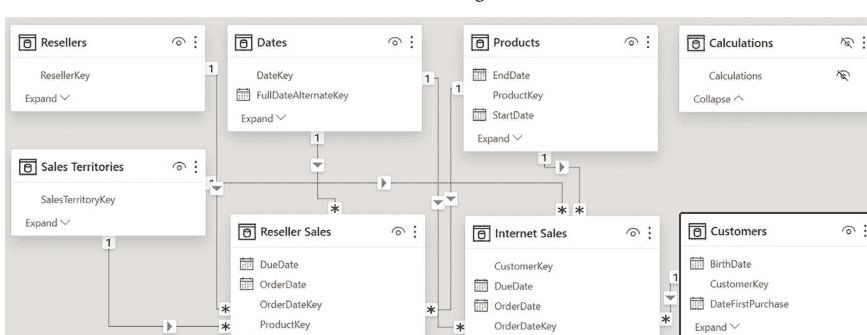

图 8.1：用于 RLS 角色和筛选表达式的语义模型

定义并记录要实现的安全角色需求，以及这些角色的成员或组。使用《第 3 章，构建 Power BI 语义模型》中描述的公交矩阵图（图 3.1 和图 3.2），以帮助传达模型中当前存储的数据。鉴于数据的风险或敏感性，验证角色安全性是否确实必要（而非报表或模型筛选器）。

不要将安全角色筛选器与 Power BI 中其他各种形式的筛选器混淆，例如报表、页面和视觉对象级筛选器，以及 DAX 度量值中的筛选逻辑。RLS 角色筛选器应用于安全角色成员的所有查询，实际上在查询时针对给定角色产生了语义模型的虚拟子集。考虑到安全角色筛选器与报表查询筛选器叠加带来的性能影响，所有用户体验和分析筛选器都应在安全角色筛选器之外实施。安全筛选器应专门用于保护敏感数据。

#### 如何定义 RLS 角色和筛选表达式

要实现本操作指南，请执行以下步骤：

- 1. 在“表”视图中，在 Calculations 表中创建以下度量值：

```
Customers Row Count = COUNTROWS('Customers')
Internet Sales Row Count = COUNTROWS('Internet Sales')
Products Row Count = COUNTROWS('Products')
Reseller Sales Row Count = COUNTROWS('Reseller Sales')
Resellers Row Count = COUNTROWS('Resellers')
Sales Territories Row Count = COUNTROWS('Sales Territories')
Dates Row Count = COUNTROWS('Dates')
```

- 9. 在“建模”选项卡的功能区中单击“身份查看”，选择 United States Online Bike Sales 角色，单击“确定”按钮，并注意表可视化中的行数发生变化，其中 Reseller Sales Row Count 和 Resellers Row Count 度量值为空白。

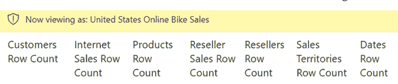

图 8.4：以 United States Online Bike Sales 角色成员身份查看行数

- 10. 在“建模”选项卡的功能区中单击“身份查看”，选择 Europe Reseller Mountain and Touring 角色，取消选中 United States Online Bike Sales 角色，单击“确定”按钮，并注意表可视化中的行数发生变化，其中 Internet Sales Row Count 和 Customers Row Count 度量值为空白。

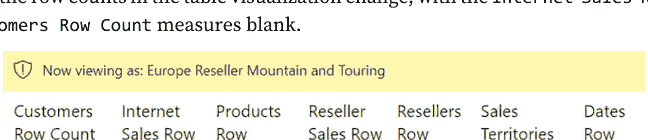

图 8.5：以 Europe Reseller Mountain and Touring 角色成员身份查看行数

- 11. 保存文件，在“主页”选项卡的功能区中单击“发布”，并部署到 Power BI 服务。

- 12. 登录 Power BI 服务，导航到已发布报表所在的工作区。

- 13. 单击语义模型旁边的省略号，然后选择“安全性”。

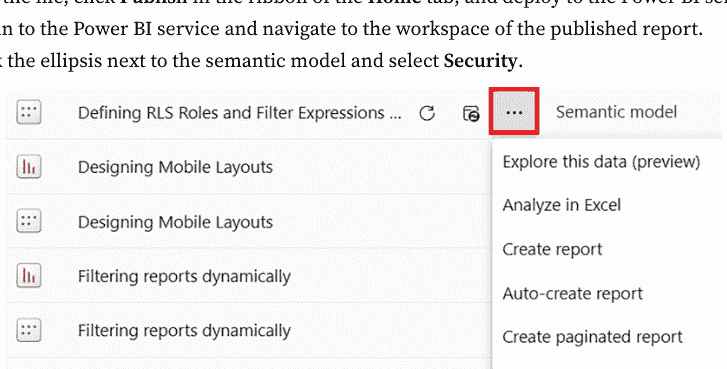

图 8.6：已发布 Power BI 语义模型的安全设置

### 设计动态安全模型

```
PATHCONTAINS(Employees[ManagementPath],[Current User EmployeeKey])
```

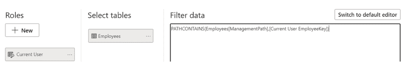

图 8.9：应用于 Employees 表的安全角色 Current User 的动态筛选表达式

- 8. 单击“保存”按钮。

- 9. 使用 Current User Name、Current User Manager、Current User Org Level 和 Employee Row Count 度量值作为字段，创建一个多行卡片可视化。

- 10. 在“建模”选项卡的功能区中选择“身份查看”，然后选择 Current User 角色：

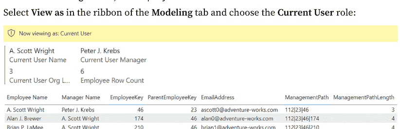

图 8.10：以 A. Scott Wright 身份查看报表

- 11. 将 Current User Principal Name 度量值编辑为 peter0@adventure-works.com。

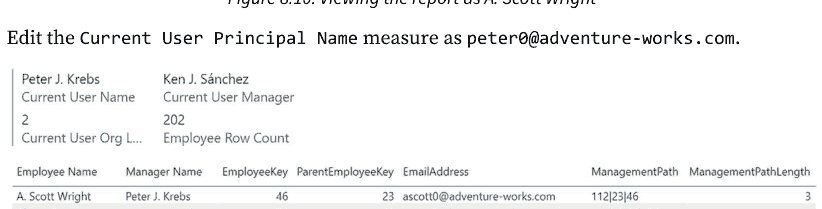

图 8.11：以 Peter J. Krebs 身份查看报表

#### 工作原理

在生产环境中，Current User Principal Name 度量值不会硬编码为电子邮件地址，而应采用以下公式的形式：

```
Current User Principal Name = USERPRINCIPALNAME()
```


Power BI 动态用户安全性和可见性的基础是能够提取连接到 Power BI 服务中内容的业务用户的 **用户主体名称 (UPN)** 或登录凭据。

Power BI 使用 **Microsoft Entra ID (Entra ID)** 对登录到 Power BI 服务的用户进行身份验证，并且 Power BI 登录凭据（如 BrettP@FrontlineAnalytics.onmicrosoft.com）用作用户尝试访问需要身份验证的资源时的有效用户名。

USERPRINCIPALNAME DAX 函数返回用于登录 Power BI 的电子邮件地址。对于使用工作电子邮件地址进行 Power BI 登录的组织，此有效用户名映射到本地活动目录中的 UPN。然后这使得可以在安全角色中对模型的表应用筛选表达式。除了覆盖并影响语义模型所有 DAX 度量的 RLS 角色外，UPN 或 *当前用户* 文本值还可由 DAX 度量使用，以检索 UPN 前缀和后缀，或筛选其他度量。

本食谱中使用的 DAX 函数特定于 `DimEmployee` 源表中存在的父子层次结构。`DimEmployee` 表包含一个电子邮件地址列，该列将对应于登录到 Power BI 服务时 DAX USERPRINCIPALNAME 函数返回的值。此外，本食谱仅适用于导入模式语义模型，因为父子 DAX 函数目前不支持 DirectQuery 模式模型中的计算列或安全筛选表达式。

`Employees` 表有 296 行，但已登录的用户只能看到他们自己的数据以及直接或间接向他们汇报的人员的数据。例如，副总裁仍应具有查看经理的可见性，即使该经理向向副总裁汇报的高级经理汇报。然而，高级经理不应能够查看副总裁的数据或另一位高级经理的数据。可视性仅限于当前用户的数据以及直接或间接通过其他经理向其汇报的员工的数据。

`EmployeeKey` 值是通过 PATH 函数的 `ManagementPath` 列中的最后一项。`Current User EmployeeKey` 度量使用 `Current User Principal Name` 检索 `EmployeeKey` 值，作为 RLS 筛选表达式中 PATHCONTAINS 函数的项参数传递。`step 1` 中创建的计算列 `ManagementPath` 为每个 `Employees` 行提供要进行评估的值字符串。

## There’s more…

RLS 表达式会显著降低查询性能，因为当安全角色的成员访问此内容时，这些筛选器将与来自 Power BI 报告的其他筛选器和表达式一起应用。作为一般规则，尝试使用低基数表之间的关系来实现动态安全，如本章以下食谱所述。诸如 LOOKUPVALUE、CONTAINS 和 PATHCONTAINS 之类的实用或信息函数可以在导入模式模型中满足复杂的规则，但在应用于较大维度表时可能非常昂贵——例如包含超过 100 万行的客户或产品表。

## Getting ready

为准备本食谱，请执行以下步骤：

- 1. 从以下 GitHub 仓库下载 Building Dynamic Security for DirectQuery Start.pbix：https://github.com/PacktPublishing/Power-BI-Cookbook-Third-Edition。
- 2. 在 Power BI Desktop 中打开 Building Dynamic Security for DirectQuery Start.pbix。您可能会收到有关无法连接到数据源的错误。
- 3. 从“开始”选项卡的功能区中单击“转换数据”，并编辑每个查询的“源”步骤，使其指向安装了 AdventureWorksDW2022 数据库的 SQL 服务器。
- 4. 从“开始”选项卡的功能区中选择“关闭并应用”。
- 5. 保存您的工作。

## How to build dynamic security models for DirectQuery

要实现本食谱，请执行以下操作：

- 1. 在“模型”视图中，打开 Countries 与 Employees 关系的属性，并将交叉筛选方向设置为“双向”。
- 2. 选中“假定引用完整性”和“双向应用安全筛选器”两个复选框，然后单击“确定”。

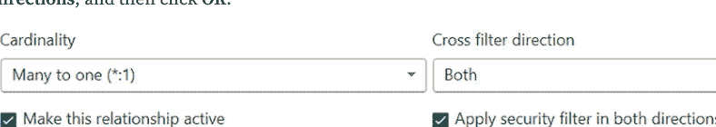

Figure 8.12: Bidirectional relationship between the Countries and Employees tables

- 3. 模型现在应与图 8.13 所示相同：
- 10. 在“建模”选项卡的功能区中单击“查看为”，选择“当前用户”，并单击“确定”按钮以观察聚类柱形图中仅显示“美国”列。
- 11. 将“Current User Principal Name”度量更改为 lynn@adventure-works.com 并观察聚类柱形图中仅显示“澳大利亚”。

## How it works

在生产环境中，Current User Principal Name 度量不会硬编码为电子邮件地址，而是应为以下公式：

```
Current User Principal Name = USERPRINCIPALNAME()
```

当映射到动态安全角色的用户连接到 DirectQuery 语义模型时，其 UPN 会通过 USERPRINCIPALNAME 函数计算。此值将 Employees 表筛选为单行，然后通过双向一对多关系筛选 Countries 表。筛选后的国家/地区，例如澳大利亚和美国，然后筛选 Sales Territories 维度表。最后一步，Internet Sales 事实表由 Sales Territories 表筛选，因此所有 Internet Sales 度量和聚合都反映员工的 SalesTerritoryCountry。

请注意，Countries 表是必要的，因为它仅包含不同的国家/地区值，而 Sales Territories 表包含同一国家的许多区域，并且所有关系都必须有一侧标识表的每一行。

确保为 Countries 和 Employees 表之间的双向（双向）交叉筛选关系选中“双向应用安全筛选器”。此外，“假定引用完整性”设置会导致 DirectQuery 语义模型向源数据库发送内连接 SQL 查询，这当然会显著提高较大模型的性能。

虽然本食谱实现了组织层次结构，但地理（区域和国家）、部门和会计科目表等其他层次结构也很常见，可以以类似的方式实现。

## There’s more…

本食谱的方法可以以相同的方式实现于导入模式模型，并且也可以与合并的安全角色表一起使用。例如，不是包含 UPN（电子邮件地址）的 Employees 表，可以将 Permissions 表加载到模型中，包含每个 RLS 角色的名称和要保护的列。

对于每个角色，可以应用简单的筛选器，引用角色的名称。如本食谱所示，可以创建包含安全列唯一值的桥接表，并且安全筛选器将通过关系从 Permissions 表流向维度表和事实表，经由桥接表。

鉴于关系筛选（包括双向关系筛选）的性能优势，以及避免相对复杂的 DAX，组织可能有价值遵循这种方法来实现导入和 DirectQuery 模型的动态安全。

请记住，优化 RLS 表达式非常重要，因为它们为报告添加了额外的筛选层，必须实时进行评估。因此，最佳做法是在维度表上配置 RLS 表达式，而不是事实表，因为通常必须评估的维度表中的行数较少。

## See also

- Row-level security (RLS) with Power BI: https://bit.ly/3nhx3zW
- Row-level security (RLS) guidance in Power BI Desktop: https://bit.ly/3tUH3kY
- DirectQuery model guidance in Power BI Desktop: https://bit.ly/3VJuAR0

## Displaying the Current Filter Context

可以创建 DAX 度量以动态显示当前筛选上下文给报表用户。这些度量可以检测筛选器、检索值，并对应用于切片器视觉对象以及报表和页面级筛选器的筛选器应用条件逻辑。借助筛选上下文作为视觉辅助，用户在消费或与 Power BI 报表交互时可以专注于数据可视化，更快、更有信心地获得洞察。此外，此类度量在设计 RLS 场景时也很有用，作为检查 RLS 规则是否正确筛选信息的检查。

在本食谱中，创建 DAX 度量以检测并显示应用于特定列的筛选选择，无论是在报表画布本身还是作为报表或页面级筛选器。另一个示例显示列的“剩余”值，鉴于直接和间接通过其他筛选器应用于该列的筛选器。

## Getting ready

为准备本食谱，请执行以下步骤：

- 1. 从以下 GitHub 仓库下载 Displaying the Current Filter Context Start.pbix：https://github.com/PacktPublishing/Power-BI-Cookbook-Third-Edition。
- 2. 在 Power BI Desktop 中打开 Displaying the Current Filter Context Start.pbix。
- 3. 编辑 AdventureWorks 查询并将“源”行更改为指向安装了 AdventureWorksDW2022 数据库的 SQL 服务器。
- 4. 从“开始”选项卡的功能区中选择“关闭并应用”。
- 5. 保存您的工作。


Test the new measure by applying filters on columns that would reduce the available or remaining values, as shown in Figure 8.16.

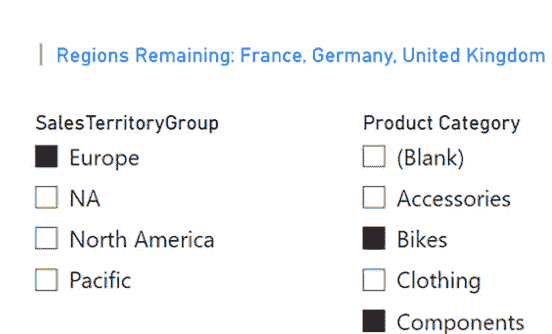

Figure 8.16: Regions Remaining and Subcategories Remaining measures

The SalesTerritoryRegion and Product Subcategory columns are impacted by filters applied to the SalesTerritoryGroup and Product Category columns, respectively. Given the number of characters in the text string of 15 product subcategories, only the number remaining is displayed.

Note that these remaining expressions will return the same string values as the first example, when filters were applied directly on the given column. For example, if the Northwest and Northeast regions were selected on a sales territory region slicer, these would be the only two regions remaining. The techniques applied in these two examples can be blended or enriched further, such as by associating a numeric measure with each dimension value returned by the delimited string.

## See also

- DAX FILTERS function: https://bit.ly/3aAVTFB
- DAX CONCATENATEX function: https://bit.ly/3sVmvHQ
- DAX ISCROSSFILTERED function: https://bit.ly/3vo13gr

## Avoiding Manual User Clicks

Even if it's not a security requirement, it's often a convenient and valuable feature of Power BI solutions to ensure that reports are pre-filtered to respect the given report user's role within the organization such as specific store location or geographic region. A given business user should, ideally, have immediate and default visibility to relevant data without the need to interact with or modify content, such as applying filter selections.

Power BI's extensive self-service capabilities are sometimes a solution—or partial solution—to this need, and additional role-specific, IT-supported reports and dashboards are another realistic option.

A third option, and the one that is the subject of this recipe, is to embed user-based dynamic filtering logic in DAX measures. With this approach, a single or small group of reports and dashboards can be leveraged across multiple levels of an organization, thus avoiding the need for new report development.

## Getting ready

To prepare for this recipe, follow these steps:

- 1. Download Building Dynamic Security for DirectQuery Start.pbix from the following GitHub repository: https://github.com/PacktPublishing/Power-BI-Cookbook-Third-Edition.
- 2. Open Building Dynamic Security for DirectQuery Start.pbix in Power BI Desktop. You may receive an error regarding being able to connect to the data source.
- 3. Click Transform data from the ribbon of the Home tab, and edit the Source step of each of the four queries to point to your SQL server with the AdventureWorksDW2022 database installed.
- 4. Select Close & Apply from the ribbon of the Home tab.
- 5. Save your work.

The semantic model for this recipe is as follows:

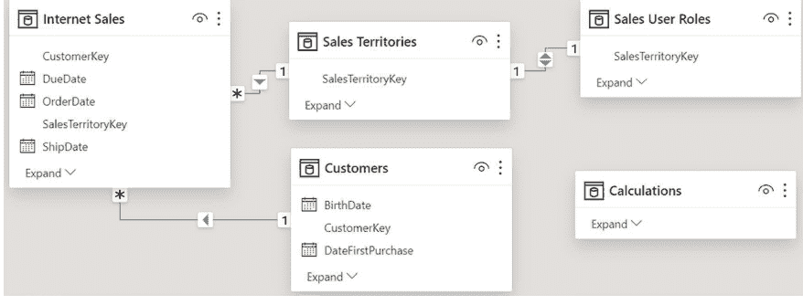

Figure 8.17: The model for this recipe

Within this model is an Enter Data query called Sales User Roles with the following data:

| EmailAddress | SalesTerritoryKey | UserRole |
|---|---|---|
| david8@adventure-works.com | 2 | Country |
| linda3@adventure-works.com | 4 | Region |
| pamela0@adventure-works.com | 6 | Group |

```
[User Sales Role] = "Region",
CALCULATE(SUM('Internet Sales'[SalesAmount]),
FILTER(ALL('Sales Territories'),
'Sales Territories'[SalesTerritoryRegion] =
[User Sales Region])) )
```

3. Create a standard report with the new measure and the Sales Territory table to test or demonstrate the logic.

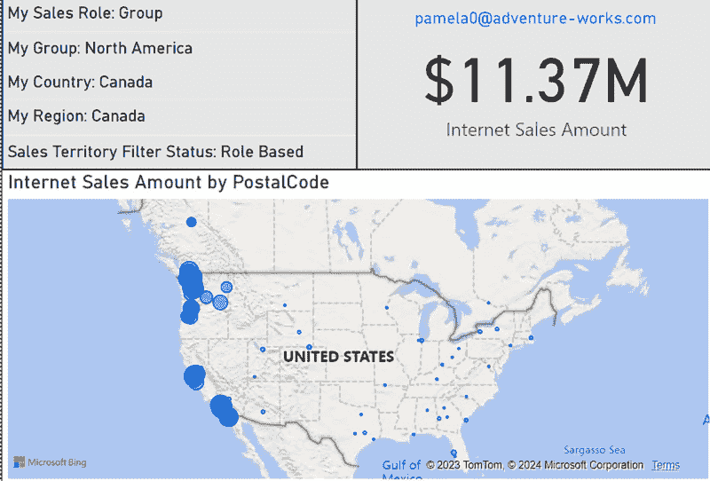

Figure 8.18: Filter context for the user Pamela, a group role member for North America

4. Change the User Principal Name measure to test the three different roles.

## How it works

In a production environment, the User Principal Name measure would not be hardcoded to an email address but would, rather, be of the following formula:

```
User Principal Name = USERPRINCIPALNAME()
```

In addition, a production implementation would store the Sales User Roles table in the SQL data warehouse instead of using an Enter Data query.

Finally, for the map visual to work, we need to apply specific administrative settings at the tenant level within the Power BI service. If these settings are not set to allow the use of map visuals, you may receive an error.

Given the variety of use cases and the importance of this feature to securely share a semantic model across stakeholders, it is important to understand the process and techniques available to develop, test, and operationalize data security roles.

In the next chapter, we will explore more advanced analytics and additional visuals, including custom visuals.

## Join our community on Discord

Join our community's Discord space for discussions with the author and other readers:

https://discord.gg/ebXZqyrxJb


