# 9 Applying Advanced Analytics and Custom Visuals

# Applying Advanced Analytics and Custom Visuals

Power BI Desktop’s standard report-authoring tools provide a robust foundation for the development of rich BI and analytical content. Custom visualizations developed by Microsoft and third parties further supplement these capabilities with their own unique features, and they can be integrated with standard visuals in Power BI reports and dashboards. Additionally, geospatial analysis features such as the ArcGIS maps visual for Power BI, custom dimension groupings, and animation and annotation options further aid in the extraction of meaning from data and also support sharing these insights with others.

Power BI Desktop also includes advanced analytics features reflecting modern data science tools and algorithms, including clustering, forecasting, and support for custom R and Python scripts and visuals. For example, an analytics pane is available to enrich visuals with additional metrics, such as a trend line, and the Quick Insights feature empowers report authors to rapidly analyze specific questions and generate new visualizations.

This chapter contains a broad mix of recipes highlighting many of the latest and most popular custom visualization and advanced analytics features of Power BI. This includes top custom visuals such as bullet charts, the ArcGIS maps visual for Power BI, and data storytelling via animation and annotation. Additionally, examples are provided on leveraging Power BI semantic models and the DAX, R, and Python languages to embed custom statistical analyses and visualizations, respectively.

In this chapter, we will cover the following recipes:

- Incorporating advanced analytics
- Enriching content with custom visuals and Quick Insights
- Creating geospatial mapping with ArcGIS maps
- Democratizing artificial intelligence
- Building animation and storytelling
- Embedding statistical analyses
- Grouping and binning

## How it works

In this example, since a date data type column was used as the axis, the trend line calls out the decline in the average daily unit prices in the first quarter of 2013. Given the volume of individual dates, the Min, Max, and Median lines give the user quick takeaways, such as the median daily unit price for an entire quarter and the option to further analyze sales activity on February 11, when daily unit prices reached a low (Min) of $93 per unit.

The selections applied in the Add further analyses to your visual pane (steps 2 to 8) result in new expressions added to the DAX query of the visual. The analytics calculations are translated into the equivalent DAX expressions (that is, MINX, AVERAGEX) and passed into the GROUPBY table function. Running a SQL Server Profiler trace against a Power BI Desktop file and viewing the full DAX query associated with a given visual (including all filters applied) is a great way to understand advanced DAX functions and filter context.

```
EVALUATE
    GROUPBY(
        _DSOcore,
        "MinInternet_Net_Sales", MINX(CURRENTGROUP(), [Internet_Net_Sales]),
        "MaxInternet_Net_Sales", MAXX(CURRENTGROUP(), [Internet_Net_Sales]),
        "AverageInternet_Net_Sales",AVERAGEX(CURRENTGROUP(), [Internet_Net_Sales]),
        "MinMinDate", MINX(CURRENTGROUP(), [MinDate])
    )
```

Figure 9.3: A SQL Server Profiler trace of a Power BI file's Min, Max, and Average lines

Note that you can also use the Performance analyzer in Power BI Desktop to collect similar DAX query information. The Performance analyzer is covered in the recipe Improving DAX Measure Performance in Chapter 10, Enhancing and Optimizing Existing Power BI Solutions.

## There’s more…

Line charts support even more analytics features than most other visuals, including forecasting and X-axis constant lines. To see line chart analytics in action, do the following:

```
Margin % =
    VAR __Price = SUM('Internet Sales'[SalesAmount])
    VAR __Cost = SUM('Internet Sales'[TotalProductCost])
    RETURN DIVIDE(__Price - __Cost,__Price,0)
```

- 1. Create a measure called Margin % using the following formula and set the format to %:
- 2. In the Report view, create a Line chart visualization using OrderDate (the column, not the Date Hierarchy) as the X-axis and Margin % as the Y-axis.
- 3. In the Add further analyses to your visual tab, add a Y-axis Constant Line named Target: with a Value of 0.4.
- 4. Add an X-axis Constant Line called End of Quarter: for 3/31/2013.
- 5. Add a Min line called Min: and a Max line called Max:, with a Color of black and a Line style of Solid.


+   6. 添加一条名为 75% Percentile: 的 **Percentile line**，并将 **Percentile** 设置为 75%。
+   7. 对所有线条，切换 **Data label** 为 **On** 并将 **Style** 设置为 **Both**。
+   8. 添加一个 **Forecast** 为 **1 Month(s)**，**Confidence interval** 为 75% 且 **Seasonality** 值为 **60** 个点的预测。

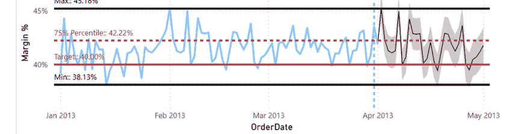

*Figure 9.4: Line chart with analytics lines and forecast*

在此示例中，40% 被视为关键盈利阈值，因此一条常数线有助于突出低于此水平的值。此外，设置为 75% 的百分位线有助于识别最高四分位数值。来自 **Analytics** 画布的线条及其格式可在不为模型添加额外的 DAX 度量或使视觉对象杂乱的情况下为用户提供更多分析价值。

**Confidence interval** 和 **Seasonality** 设置取决于源数据，可能需要一些试验才能获得最佳结果。

## See also

- *Use the Analytics pane in Power BI Desktop:* http://bit.ly/2s2fA0P
- *How to trace a Power BI Desktop file:* http://bit.ly/2tYRLZg

## Enriching Content with Custom Visuals and Quick Insights

Power BI 的自定义视觉对象可以从 AppSource 中查看和下载，以提供超出 Power BI Desktop 标准视觉对象支持的额外功能和选项。目前 AppSource 中已有超过 300 个自定义视觉对象，其中许多由 Microsoft 开发以满足常见需求，例如子弹图、直方图和甘特图。AppSource 中其他由第三方开发但经 Microsoft 安全验证的自定义视觉对象具有独特且强大的功能，例如流图网络可视化和 ZoomCharts 开发的交互式视觉对象。除了自定义视觉对象外，Quick Insights 还可用于 Power BI 服务和 Power BI Desktop，对语义模型应用高级分析算法以提取见解，例如趋势或关系，并快速生成用于报表和仪表板的新可视化。

2. 在右上角使用 Search 查找已认证的 Bullet Chart 视觉对象（蓝色星标/勾选图标），单击 Bullet Chart 视觉对象，然后单击 Add 按钮。

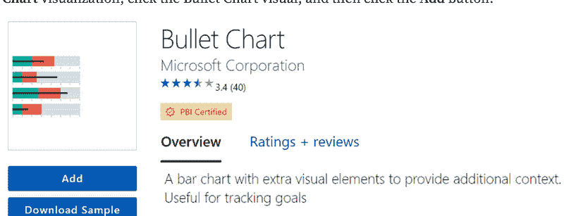

Figure 9.6: Adding a custom visual from AppSource

3. 单击 OK 按钮。

4. 创建以下度量值：

```
Sales 2011 = SUMX(FILTER('Internet Sales',YEAR([OrderDate])=2011),[SalesAmount])
Sales 2012 = SUMX(FILTER('Internet Sales',YEAR([OrderDate])=2012),[SalesAmount])
Sales 2012 Improve = [Sales 2011] * .7
Sales 2012 Sat = [Sales 2011] * .8
Sales 2012 Good = [Sales 2011] * .9
Sales 2012 VG = [Sales 2011]
```

5. 在 Visualizations 画布中选择 Bullet Chart 图标，将其添加到报表画布。

6. 按如下方式配置视觉对象：

- Category: SalesTerritoryCountry 列
- Value: Sales 2012 度量值
- Needs Improvement: Sales 2012 Improve 度量值
- Satisfactory: Sales 2012 Sat 度量值
- Good: Sales 2012 Good 度量值
- Very Good: Sales 2012 VG 度量值

右键单击特定数据点时会出现 **Analyze** 选项，可为所选项目生成额外的可视化，例如折线图上的日期或条形图上的维度值。生成的视觉对象随后可以添加到 Power BI Desktop 文件中并像其他所有视觉对象一样进行编辑。**Analyze** 选项是 Power BI Desktop 中 **Quick Insights** 功能和分析引擎的体现。

**Quick Insights** 也可以针对 Power BI 服务中的整个语义模型执行。要对语义模型运行 Quick Insights，请单击给定语义模型的省略号并选择 **Get quick insights**。生成的见解可通过同一上下文菜单中的 **View insights** 选项访问。每个见解都包含一个 Power BI 视觉对象、所应用的见解标题（算法），例如异常值和相关性，以及简短描述。来自 **View insights** 的视觉对象也可以固定到新的和现有的仪表板。

**Quick Insights** 对语义模型应用复杂的算法，包括类别异常值、相关性、时间序列中的变化点、低方差、大多数、时间序列中的季节性以及时间序列中的总体趋势。见解引擎在渲染结果时受限于设定的时间。

**Quick Insights** 视觉对象可以像其他 Power BI 报表和仪表板图块一样固定到新的和现有的仪表板。此外，**Quick Insights** 可以针对之前由 **Quick Insights** 生成的视觉对象执行。

通过隐藏或取消隐藏列可以改进 **Quick Insights** 的结果。**Quick Insights** 不会搜索隐藏的列，因此隐藏（或删除）不必要的列可以使见解算法仅关注重要列。同样，任何重复的列都可以删除或隐藏，以便为 **Quick Insights** 运行分配的时间得到高效利用。

## See also

- *Create custom data visualizations for Power BI:* https://bit.ly/3xY9GAk
- *Get your Power BI visual certified:* https://bit.ly/2RETFPa
- *Generate data insights on your semantic model automatically with Power BI:* https://bit.ly/33qJErT
- *Optimize your data for Power BI Quick Insights:* https://bit.ly/3trWOPz

## Creating Geospatial Mapping with ArcGIS Maps

来自 **Environmental Systems Research Institute (Esri)** 的 ArcGIS 映射和空间分析软件，Esri 是地理信息系统 (**GISes**) 的市场领导者，已内置于 Power BI Desktop 中，以从数据的空间组件生成见解。熟悉的报表可视化字段井和 Power BI 的交叉筛选功能可以与 ArcGIS 地理空间功能和语义模型相结合，例如分类类型、图钉和参考图层，以将自定义、智能的地理可视化构建到 Power BI 解决方案中。

在本食谱中，创建一个自定义地理列以包含多个地理属性（即街道地址、城市和州）以支持 ArcGIS 服务的准确地理编码。然后使用 Power BI Desktop 中的 ArcGIS 视觉对象将客户地址绘制到 **Cluster** 主题地图可视化中，并辅以 **Pins** 和 **Infographics**。

### Getting ready

为准备本食谱，请执行以下步骤：

- 1. 在 Power BI 服务中，单击右上角的 Settings（齿轮图标），选择 General，单击 Item settings，并启用 ArcGIS maps。这需要对 Power BI 服务具有管理员访问权限。

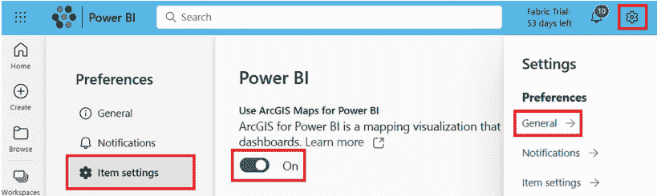

- 2. 从以下 GitHub 仓库下载 Creating Geospatial Mapping with ArcGIS Maps Start.pbix：https://github.com/PacktPublishing/Power-BI-Cookbook-Third-Edition。
- 3. 在 Power BI Desktop 中打开 Creating Geospatial Mapping with ArcGIS Maps Start.pbix。
- 4. 编辑 AdventureWorks 查询，并将 Source 行更改为指向安装了 AdventureWorksDW2022 数据库的 SQL 服务器。
- 5. 从 Home 选项卡的 ribbon 中单击 Close & Apply。

### How to create geospatial mapping with ArcGIS maps

要实施本食谱，请执行以下步骤：

- 1. 在 Report view 中，选择 Customers 表中的 City 列并分配 City 的 Data category。
- 2. 选择 Customers 表中的 Full Address 列并分配 Address 的 Data category。
- 3. 使用 Customers 表中的 SalesTerritoryRegion 列应用页面级筛选器，并仅选择 Southwest。
- 4. 在 Visualizations 画布中选择 ArcGIS Maps for Power BI 视觉对象，然后将视觉对象的大小扩展到整个页面。
- 5. 在视觉对象中单击 Continue as guest 按钮。
- 6. 从 Customers 表中，为 Location 添加 Full Address 列，为 Size 添加 CustomerKey 列，为 Color 添加 YearlyIncome 列。


7. 在 ArcGIS 地图可视化的左上角，选择 Expand 然后 Basemap 最后选择 Light Gray Canvas。

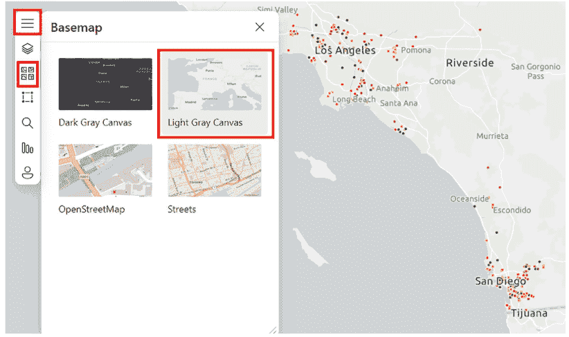

图 9.10：设置 ArcGIS Basemap 类型

8. 点击 Basemap 图标上方的 Layers 图标，点击 Style options 选项卡，向下滚动，展开 Clustering 卡片，并将 Enable clustering 切换为 On。

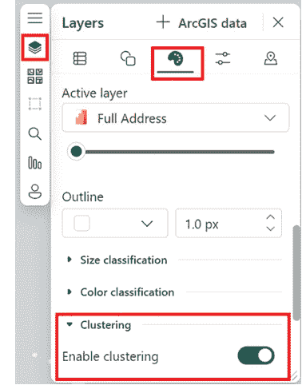

图 9.11：更改地图图层的聚类

## How it works

为列设置数据类别（*步骤 1 和 2*）有助于对基于位置的数据进行地理编码。同样，设置 **Location type**（*步骤 6*）提供了一个地理提示，显著提高了 Esri 服务返回的绘点准确性。请注意，位置也可以表示为边界，例如州或邮政编码。ArcGIS 为 Power BI 可视化提供的几乎所有高级报表开发功能都已公开。

如果用于映射的维度已提供经纬度列，则应在使用 ArcGIS 可视化时使用这些列，而不是 **Location** 字段井。提供经纬度源数据可显著提高性能，因为它消除了 Esri 计算这些值的需求。

## There’s more…

Microsoft 最近为 Power BI 添加了一个功能强大、原生的地图可视化，即 Azure map visual。虽然不如 ArcGIS map visual 先进，但 Azure map visual 比 Map、Filled map 和 Shape map 可视化强大且灵活得多。要查看 Azure map visual 的实际效果，请执行以下操作：

- 1. 通过右键单击 Page 1 并选择 **Duplicate page** 来复制 Page 1。
- 2. 选择该可视化并将其更改为 **Azure map** 可视化。
- 3. 从 Location 字段井中移除 **Full Address** 并替换为 **Postal Code** 列。
- 4. 调整 **Filters** 侧边栏以包含 Northeast、Northwest、Southeast 和 Southwest `SalesTerritoryRegion` 值。
- 5. 将图例配置为 `SalesTerritoryRegion`，**Size** 为 `CustomerKey` 的计数，**Tooltips** 为 `YearlyIncome` 的总和，如 *Figure 9.13* 所示：

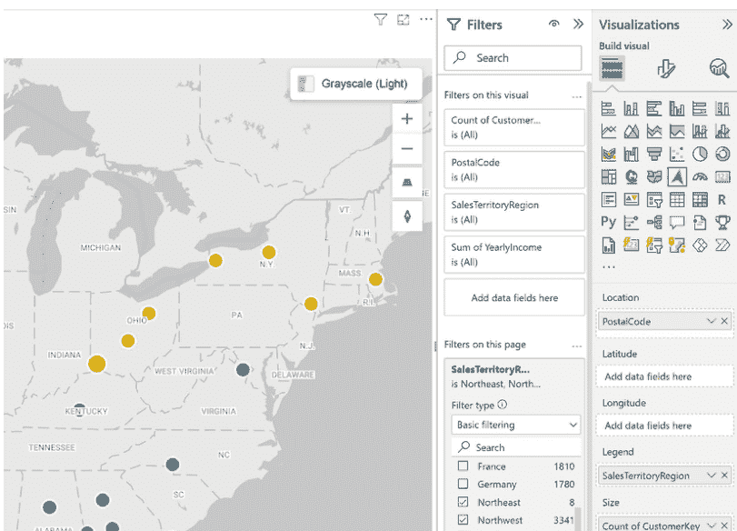

图 9.13：Azure map visual

6. 在 Visualizations 侧边栏的 Format your visual 子窗格（中间图标）中，探索各种图层选项，例如 3D column layer 和 Traffic layer。

## See also

- - Create an ArcGIS map in Power BI: https://bit.ly/3ufFrHX
- - Get started with Azure Maps Power BI visual: https://bit.ly/4biMbo4

## Key influencers

## Top segments

What influences SalesAmount to Increase ?

When...

...the average of SalesAmount increases by

Product Category is Bikes

$1.86K

Product Subcategory is Mountain Bikes

$1.65K

Product Subcategory is Road Bikes

$1.57K

SalesAmount is more likely to increase when Product Subcategory is Road Bikes than otherwise (on average).

Only show values that are influencers

Figure 9.14: Key influencers visualization

- 2. 点击不同的 When 项目以查看与影响因素相关的可视化。
- 3. 点击 Top segments 选项卡以查看识别的不同细分。
- 4. 点击感兴趣的细分以查看其他信息和可视化。

## Key influencers

## Top segments

When is SalesAmount more likely to be High ?

$1.98K $1.94K $1.8K $1.68K

Segment 3

Product Category is Bikes

Product Subcategory is not Mountain Bikes

SalesTerritoryCountry is not Australia

SalesTerritoryGroup is North America

在 segment 3 中，SalesAmount 的平均值为 $1.8K。这比总体平均值 $486.1 高出 $1.32K 个单位。

Segment 3 $1.8K

Overall $486.1

Segment 3 包含 3,768 个数据点（占数据的 6.2%）。

Segment 3 Other

Figure 9.15: Segment detail in the Key influencers visualization

## Building Animation and Storytelling

业务团队和分析师通常负责向其他利益相关者，例如高级管理层，分享或讲解业务结果、趋势以及分析结果。为了最有效地支持信息传递过程，Power BI 为标准散点图和 ArcGIS 地图可视化类型提供了内置动画功能。此外，核心和自定义可视化，例如 pulse chart，通过将用户定义的注释嵌入到可视化中并提供动画的完整回放控制，进一步帮助讲故事的过程。

本食谱包含示例，用于为动画准备标准 Scatter chart 可视化，利用 ArcGIS Maps for Power BI 可视化的日期动画功能。还包括了 Bookmarks 侧边栏以及 Smart narrative 和其他讲故事自定义可视化的详细信息。

## Getting ready

为本食谱做准备，请执行以下步骤：

- 1. 从以下 GitHub 仓库下载 Building Animation and Storytelling Start.pbix：https://github.com/PacktPublishing/Power-BI-Cookbook-Third-Edition。
- 2. 在 Power BI Desktop 中打开 Building Animation and Storytelling Start.pbix。
- 3. 编辑 AdventureWorks 查询并将 Source 行更改为指向安装了 AdventureWorksDW2022 数据库的 SQL 服务器。
- 4. 从 Home 选项卡的 ribbon 中点击 Close & Apply。
- 5. 保存你的工作。

## How to build animation and storytelling

要实现本食谱，请执行以下步骤：

- 1. 在 Report view 中，在 Filters 侧边栏中为 SalesTerritories 表中的 SalesTerritoryGroup 列应用页面级筛选器，仅包含 Europe 值。
- 2. 创建一个 Scatter chart 可视化，使用 SalesTerritories 表中的 SalesTerritoryCountry 列作为 Values，使用 Internet Sales 表中的 CustomerKey 列（计数）作为 X 轴，使用 SalesAmount（总和）作为 Y 轴。
- 3. 在 Visualizations 侧边栏的 Format your visual 选项卡中，展开 Markers 卡片然后展开 Shape 卡片，将 Size 设置为 100，展开 Color 卡片，将 Color by category 切换设置为 On，并将 Category label 切换也打开。
- 4. 将 YearMonth 列拖到散点图可视化的 Play Axis 字段井中。

5. 点击一个或多个圆圈（按住 Ctrl 键可选择多个值）以显示其路径，并通过点击时间轴左侧的播放按钮来测试动画功能。

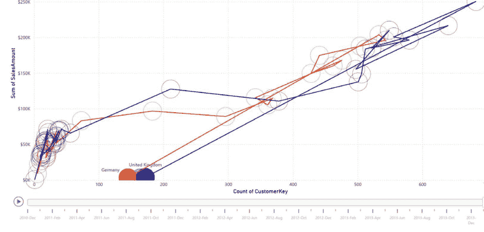

图 9.18：散点图动画和追踪

6. 添加一个新页面并使用 Filters 侧边栏添加页面筛选器，使用 Dates 表中的 CalendarYear 列筛选 2011、2012 和 2013 年。

7. 在 Visualizations 侧边栏中，点击省略号 (...) 并选择 Get more visuals。

8. 搜索、找到并添加 Play Axis (Dynamic Slicer) 可视化。

9. 创建一个 Clustered column chart 可视化，使用 Dates 表中的 YearMonth 列作为 X 轴，使用 SalesAmount 列（总和）作为 Y 轴。

10. 创建一个 Clustered bar chart 可视化，使用 Sales Territories 表中的 SalesTerritoryCountry 列作为 Y 轴，使用 SalesAmount 列（总和）作为 X 轴。可选地，使用 Visualizations 侧边栏中的 Format your visual 选项卡将 Data labels 切换为 On。

11. 添加 Play Axis 可视化并使用 Dates 表中的 YearMonth 列作为 Field。

Play Axis 可视化为没有原生动画功能的视觉对象添加了动画功能。Play Axis 可视化通过利用 Power BI 原生的跨筛选和跨突出显示功能来工作。Play Axis 可视化最好与柱状图、条形图和其他允许 Highlight 可视化交互的图表结合使用。视觉分析中使用动画可以帮助提高观众参与度并帮助讲述故事，并且迎合了数据分析的创造性元素。

## There’s more…

书签使保存特定报表状态成为可能，包括筛选上下文和报表画布上特定项目的可见性。这对于动画视觉对象特别有用，以便跳到动画中最有趣的部分。Bookmarks 侧边栏可在 Report view 中通过 View 选项卡的 ribbon 访问。使用 Add 按钮创建书签。使用 View 选项卡像幻灯片一样轻松浏览书签。

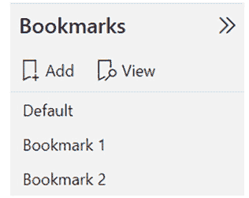

图 9.20：Power BI Desktop 中的 Bookmarks 侧边栏

另外，可以从 ribbon 的 Insert 选项卡中将 Bookmark navigator 添加到页面中，选择 Buttons、Navigator，然后选择 Bookmark navigator。

Selection 侧边栏也可在 View 选项卡的 ribbon 中使用，可与书签一起设置书签的视觉对象可见性。在 Power BI 报表中播放书签类似于 Microsoft PowerPoint 演示文稿（在演示模式下）利用动画。此外，书签可以与报表中的其他对象（如图像）链接，使得在报表页面之间创建直观的导航体验成为可能。

Microsoft 还将叙述和讲故事的可视化添加到 Power BI。Smart narrative 可视化已添加到 Power BI Desktop。要了解 Smart narrative 的工作原理，请执行以下步骤：

- 1. 创建一个新页面并向其添加一个 Clustered column chart 可视化，使用 Dates 表中的 CalendarYear 列作为 Axis，使用 Internet Sales 表中的 SalesAmount 列（总和）作为 Values。
- 2. 复制并粘贴此可视化。


3. 在“可视化”选项卡中选中视觉对象的副本后，单击“叙述”视觉对象。

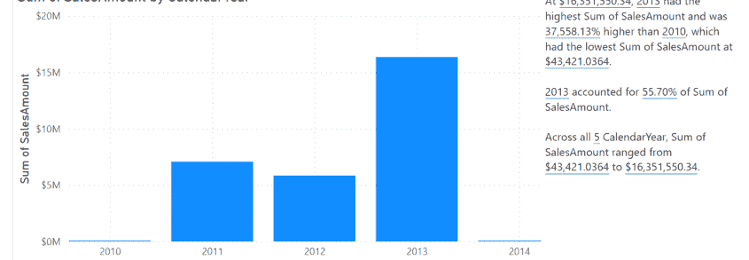

图 9.21：同一数据同时以簇状柱形图和叙述视觉对象呈现

叙述可视化会分析数据并创建数据在可视化中呈现的自然语言叙述。其他专注于将解释性文本或注释与语义模型中的数据集成的自定义视觉对象包括 Add Intelligent Narratives for BI 视觉对象、Enlighten Data Story 视觉对象和 Timeline by Queryon。使用叙述视觉对象是一种简单而有效的方式来展示和突出可能 otherwise 被可视化本身所掩盖或不清楚的关键洞察。

## 另请参阅

- Scatter charts, bubble charts, and dot plot charts in Power BI: https://bit.ly/3u38toZ
- Use bookmarks in Power BI Desktop to share insights and build stories: https://bit.ly/2QK3ACS
- Create smart narrative summaries: https://bit.ly/3e57xuM

## 嵌入统计分析

超出基本聚合的统计分析通常由数据科学家和数据科学应用程序在业务智能语义模型之外实现。然而，只要有可能，利用现有的语义模型、Power BI 技能以及用于其他 Power BI 报表和仪表板的特性——例如本章前面描述的“分析”窗格——会更加高效。

在本配方中，支持线性回归模型的数据点是从现有的 Power BI 语义模型中创建的。然后通过 DAX 度量对该模型进行分析和描述，其中包括斜率、Y 截距以及残差的 Z 分数。最后，构建一个丰富的报表页面来可视化回归模型的强度和准确性并检测异常值。

### 准备工作

1. 从以下 GitHub 仓库下载 Embedding Statistical Analysis Start.pbix：https://github.com/PacktPublishing/Power-BI-Cookbook-Third-Edition。
2. 在 Power BI Desktop 中打开 Embedding Statistical Analysis Start.pbix。
3. 编辑 AdventureWorks 查询，并将 Source 行更改为指向安装了 AdventureWorksDW2022 数据库的 SQL 服务器。
4. 从“开始”选项卡的功能区中单击“关闭并应用”。
5. 保存您的工作。

### 如何嵌入统计分析

要实现本配方，请执行以下步骤：

1. 在“报表”视图中，单击“建模”选项卡的功能区中的“新建表”并使用以下代码：

```
MktSalesRegression =
    FILTER(
        SUMMARIZECOLUMNS(
            'Dates'[YearMonth],
            'Dates'[YearMonthSort],
            CALCULATETABLE('Dates',
                'Dates'[FullDateAlternateKey] >= DATE(2011,1,1) &&
                'Dates'[FullDateAlternateKey] <= DATE(2013,12,31)),
            "Marketing Amount",
                VAR __MonthNum = MAX('Dates'[MonthNumberOfYear])
                VAR __Value = SUM('Internet Sales'[SalesAmount])
                RETURN SWITCH(__MonthNum,
                    1,__Value*.8,
                    2,__Value*.8,
                    3,__Value*.8,
                    4,__Value*.8,
                    5,__Value*.8,
                    6,__Value*1,
                    7,__Value*.8,
                    8,__Value*.8,
                    9,__Value*.6,
                    10,__Value*.8,
                    11,__Value*.8,
                    12,__Value*.8),
            "Internet Sales", SUM('Internet Sales'[SalesAmount])
        ),
        NOT(ISBLANK([Internet Sales]) || ISBLANK([Marketing Amount]))
    )
```

2. 为相关系数、斜率、Y 截距和决定系数（R 平方）创建度量：

```
MktSalesCorrelNum = SUMX(MktSalesRegression,
    ( (MktSalesRegression[Marketing Amount] - AVERAGE(MktSalesRegression[Marketing Amount]) ) *
      ( MktSalesRegression[Internet Sales] - AVERAGE(MktSalesRegression[Internet Sales]) )
    ) )
MktSalesCorrelDenomX = SUMX(MktSalesRegression,
    ( MktSalesRegression[Marketing Amount] - AVERAGE(MktSalesRegression[Marketing Amount]) )^2 )
MktSalesCorrelDenomY = SUMX(MktSalesRegression,
    ( MktSalesRegression[Internet Sales] - AVERAGE(MktSalesRegression[Internet Sales]) )^2 )
Mkt-Sales Correl = DIVIDE([MktSalesCorrelNum], SQRT([MktSalesCorrelDenomX]*[MktSalesCorrelDenomY]) )
Mkt-Sales R Squared = [Mkt-Sales Correl]^2
MktSalesSlope = DIVIDE([MktSalesCorrelNum],[MktSalesCorrelDenomX])
MktSales Intercept = AVERAGE(MktSalesRegression[Internet Sales]) - ( [MktSalesSlope]*AVERAGE(MktSalesRegression[Marketing Amount]) )
```

3. 单击“建模”选项卡的功能区中的“新建表”并使用以下代码：

```
Residuals =
    VAR Intercept = [MktSales Intercept]
    VAR Slope = [MktSalesSlope]
RETURN
    ADDCOLUMNS(MktSalesRegression,"Y Intercept",Intercept,"Slope",Slope,
    "Predicted Internet Sales", ([Marketing Amount]*Slope) + Intercept,
    "Residual",[Internet Sales] - (([Marketing Amount]*Slope) + Intercept))
```

4. 创建以下度量：

```
Residuals Amount = SUM(Residuals[Residual])
Residuals Average = CALCULATE(AVERAGE(Residuals[Residual]),ALL(Residuals))
Residuals Sample Std Dev = CALCULATE(STDEV.S(Residuals[Residual]),ALL(Residuals))
Residuals Z Score = DIVIDE([Residuals Amount] - [Residuals Average],[Residuals Sample Std Dev])
Regression Line Message = "Regression Line: Y= " & FORMAT([MktSalesSlope],"#,###.##") & "X" & "+" & FORMAT([MktSales Intercept],"#,###")

Last Month Internet Sales =
    VAR __LastMonth = MAX('Residuals'[YearMonthSort])
    RETURN
        LOOKUPVALUE('Residuals'[Internet Sales],[YearMonthSort],__LastMonth)
Last Month Predicted Internet Sales =
    VAR __LastMonth = MAX('Residuals'[YearMonthSort])
    RETURN
        LOOKUPVALUE('Residuals'[Predicted Internet Sales],[YearMonthSort],__LastMonth)
```

5. 从“报表”视图创建卡片视觉对象以显示“上月互联网销售额”、“上月预测互联网销售额”、“Mkt-Sales Correl”、“Mkt-Sales R Squared”和“Regression Line Message”度量。
6. 创建一个散点图可视化，使用 MktSalesRegression 表中的 Marketing Amount 列（求和）作为 X 轴，使用 MktSalesRegression 表中的 Internet Sales 列（求和）作为 Y 轴，并使用 MktSalesRegression 表中的 YearMonth 列作为值。
7. 从“分析”窗格添加趋势线。
8. 创建第二个散点图可视化，使用 Residuals 表中的 Predicted Internet Sales 列（求和）作为 X 轴，使用 Residuals 表中的 Residuals Z Score 列（求和）作为 Y 轴，并使用 Residuals 表中的 YearMonth 列作为值。

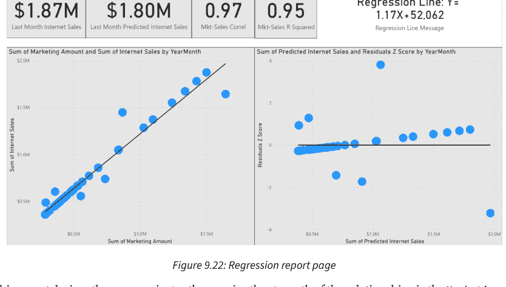

图 9.22：回归报表页面

通过这种报表设计，用户可以立即通过按 YearMonth 的 Marketing Amount 和 Internet Sales 散点图以及相关系数和 R 平方卡片的高值感知关系的强度，如图 9.22 所示。按 YearMonth 的 Predicted Internet Sales 和 Residuals Z Score 求和的散点图有助于识别变化相对较大的月份。

### 工作原理

在本示例中，我们显然人为设计了月度营销支出指标使其与互联网销售额高度相关。如果我们使用总账（FactFinance）事实表中的实际销售和营销支出数字，我们将发现完全没有相关性。

简单的单变量回归模型通常不足以准确估计 Y 值，但本配方中使用的许多概念和技术适用于更复杂的多元线性回归模型。

主要的相关性计算处理 MktSalesRegression 表中的数据。该表创建了我们希望相关联的两个指标之间对应的数据行。SUMMARIZECOLUMNS 函数按月粒度对表进行分组，而 FILTER 函数删除没有互联网销售额和营销值的行（月份）。数据在任何一个时间序列中都不应存在缺口，这对计算至关重要。CALCULATETABLE 函数将过滤后的日期表传递给 SUMMARIZECOLUMNS 以排除某些月份。Marketing Amount 和 Internet Sales 列是我们希望找到或不找到相关性的两个度量。注意，要尝试不同度量之间的相关性，只需更改 Marketing Amount 和 Internet Sales 表达式——所有其他度量和 DAX 计算都可以保持不变。

可以在源系统中开发新的 SQL 视图以满足回归表的要求，另一个替代方案是语义模型中的 M 查询可以利用现有的总账、互联网销售和日期查询。然而，像本示例这样的小型 DAX 表（有 36 行）是支持自定义或高级分析和功能的一个不错的选择。

相关系数被拆分为三个单独的中间度量（MktSalesCorrelNum、MktSalesCorrelDenomX 和 MktSalesCorrelDenomY），这些度量在 Mkt-Sales Correl 度量中被引用。相关性和其组成部分在模型中定义后，斜率（MktSalesSlope）度量可以利用相同的分子度量 MktSalesCorrelNum 以及 MktSalesCorrelDenomX 度量。最后，我们可以计算回归的 Y 截距 MktSales Intercept。

我们现在有了我们直线方程 y = mx + b 的所有组成部分，其中 m 是斜率，b 是 Y 截距。这个公式使我们能够在 Residuals 表中计算 Predicted Internet Sales。Residuals 表中的 Predicted Internet Sales 列通过引用 Marketing Amount 列（x）、斜率（MktSalesSlope）和 y 截距（MktSales Intercept）来实现直线方程（y = mx + b）。最后，Residual 列计算为从 Internet Sales 列中的观测（实际）值中减去预测销售额值。

为每个残差数据点（一个月）计算 Z 分数，以确定预测值和观测值之间的差异（或误差）相对于其他数据点是否较大。为了支持可视化，一个度量返回包含回归模型直线方程的文本字符串。此外，还创建了两个度量以显示分析中最后一个月的实际和预测互联网销售额。

本配方中的两个计算表 MktSalesRegression 和 Residuals 与模型中的其他表没有任何关系。刷新两个 DAX 表的源表（查询）也会刷新计算表。


另一个需要考虑的因素是领先指标和滞后指标。领先指标是指一个时间序列中的值与另一个时间序列相关，但二者之间存在若干周或月的时间偏移。换句话说，一个指标可能上升，并与另一个指标的上升相对应，但第二个指标需要经过一段时间或延迟后，才会反映出第一个指标的变化。

在业务中，找到领先指标极具价值，因为它们能提供预测性指标，帮助企业根据对未来行为的预期做出决策并采取行动。要找到领先指标，相关性分析中的值必须按照适当的时间段数相互错开。通常，这意味着要在多个时间偏移下进行相关性计算，从而确定一个指标是领先还是滞后于另一个指标。

### 另请参阅

- *斜率和截距方程说明：* http://bit.ly/2tdzrgA
- *去季节化相关系数：* https://bit.ly/2SeTSsp
- *LINEST：* https://bit.ly/3znLRqL
- *LINESTX：* https://bit.ly/3zoVOEv

## 分组和分箱

Power BI 中的分组和分箱功能会创建分组列。这些列的粒度较低，可像模型中的其他列一样使用，从而简化报表可视化和自助式分析。此外，分组可在 Power BI Desktop 中管理和编辑，为语义模型所有者提供了灵活的选项，以便快速响应不断变化的需求或偏好。

本操作示例展示了如何在 Power BI Desktop 中使用分组和分箱功能。

### 准备工作

- 1. 从以下 GitHub 存储库下载 Grouping and Binning Start.pbix：https://github.com/PacktPublishing/Power-BI-Cookbook-Third-Edition。
- 2. 在 Power BI Desktop 中打开 Grouping and Binning Start.pbix。
- 3. 编辑 AdventureWorks 查询，并将 Source 行更改为指向已安装 AdventureWorksDW2022 数据库的 SQL Server。
- 4. 在 **Home** 选项卡的功能区中，单击 **Close & Apply**。
- 5. 保存所做的更改。

### 如何进行分组和分箱

要实现此操作示例，请执行以下步骤：

- 1. 右键单击 Customers 表中的 `DateFirstPurchased` 列，然后选择 **New Group**。
- 2. 将 **Name** 设置为 `Customer First Purchase Calendar Quarter`，将 **Group type** 设置为 **Bin**，将 **Bin type** 设置为 **Size of bins**，将 **Bin size** 设置为 3，从下拉列表中选择 **Months**，然后单击 **OK**。

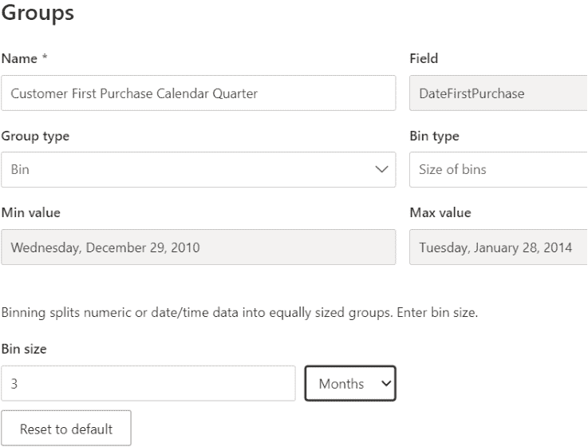

*图 9.23：FirstPurchaseDate 列的 Groups 对话框，分箱大小为 3 个月*

- 3. 创建一个 **Matrix** 可视化对象，分析这些季度客户分箱的销售额：在 Customer 表中，将新建的 `Customer First Purchase Calendar Quarter` 列放入 **Rows**；将 Dates 表中的 `CalendarYear` 列放入 **Columns**；将 `Internet Sales` 表中的 `SalesAmount` 列（求和）放入 **Values**。

- 6. 使用可视化对象右上角的省略号调整排序轴，使可视化对象按 90 Days Since Last Purchase 排序，并选择升序。

### 按 90 Days Since Last Purchase 汇总 SalesAmount

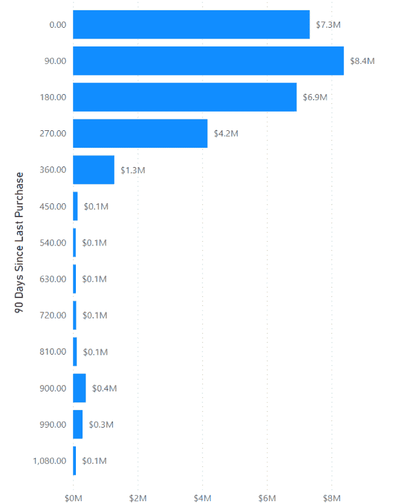

图 9.26：按 90 Days Since Last Purchase 分组的互联网销售额簇状条形图

新的分组列（90 Days Since Last Purchase）有助于确定，历史互联网销售总额中有 1,570 万美元来自过去 180 天内有过购买的客户（0 到 90 天组为 730 万美元，90 到 180 天组为 840 万美元）。

分组实际上是语义模型中的计算列，且源系统无法看到这些列，因此最终应将分组列的逻辑迁移到源数据仓库的新列中。分组对概念验证场景和短期解决方案很有帮助，因为业务用户可以轻松实现；但与其他操作示例一样，应尽量限制在 Power BI Desktop 中进行数据转换，以确保语义模型尽可能易于管理和扩展。如果没有数据仓库可用，可以使用 M 查询转换，而不是 DAX 计算列。

### 另请参阅

- *在 Power BI Desktop 中使用分组和分箱：* https://bit.ly/3xHnMpG

## 检测和分析聚类

聚类是一种数据挖掘和机器学习技术，用于根据一个或多个度量值对某个维度中的项目进行分组（聚类）。考虑到维度中不同项目（例如产品或客户）的数量，以及用于描述这些项目的度量值数量，聚类是一种强大的数据探索方法，可用于发现通过标准报表和分析技术难以识别的关系。Power BI Desktop 内置了创建聚类的支持，并允许用户像管理、修改和使用语义模型中的其他列一样，在 Power BI 报表中管理、修改和使用聚类。

在本操作示例中，将根据销售额、订单数以及距离上次购买的天数创建客户聚类。我们会创建 DAX 度量值来支持此分析，并创建散点图可视化对象以进一步分析这些聚类。

### 准备工作

- 1. 从以下 GitHub 存储库下载 Detecting and Analyzing Clusters Start.pbix：https://github.com/PacktPublishing/Power-BI-Cookbook-Third-Edition。
- 2. 在 Power BI Desktop 中打开 Detecting and Analyzing Clusters Start.pbix。
- 3. 编辑 AdventureWorks 查询，并将 Source 行更改为指向已安装 AdventureWorksDW2022 数据库的 SQL Server。
- 4. 在 Home 选项卡的功能区中单击 Close & Apply。
- 5. 保存所做的更改。

### 如何检测和分析聚类

要实现此操作示例，请执行以下步骤：

- 1. 在 Table 视图中，在 Calculations 表中创建以下度量值：

```
Today = DATE(2014,1,28)
Internet Gross Sales = SUM('Internet Sales'[SalesAmount])
Internet Sales Discounts = SUM('Internet Sales'[DiscountAmount])
Internet Net Sales = [Internet Gross Sales] - [Internet Sales Discounts]
Internet Sales Orders = DISTINCTCOUNT('Internet Sales'[SalesOrderNumber])
Last Purchase Date = LASTNONBLANK('Dates'[FullDateAlternateKey],[Internet Net Sales])
Days Since Last Purchase = DATEDIFF([Last Purchase Date],[Today],DAY)
```

- 2. 在 **Report 视图**中，使用 Customers 表中的 CustomerAlternateKey 列，以及 Internet Net Sales、Internet Sales Orders 和 Days Since Last Purchase 度量值创建表格可视化对象。

- 3. 选择表格可视化对象，单击省略号（**...**），然后选择 **Automatically find clusters**。

- 4. 在 **Clusters** 对话框中，将聚类命名为 Customers (RFM)，并输入说明 Clusters for All CustomerAlternateKey, Internet Net Sales, Internet Sales Orders, Days Since Last Purchase，然后单击 **OK** 按钮。

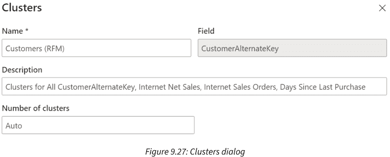

- 5. 在 `Calculations` 表中再创建三个度量值，以帮助描述所创建的聚类：

```
Average Customer Sales =
AVERAGEX(DISTINCT(Customers[CustomerAlternateKey]),[Internet Net Sales])
Average Customer Orders =
AVERAGEX(DISTINCT(Customers[CustomerAlternateKey]),[Internet Sales Orders])
Average Days Since Last Purchase =
AVERAGEX(DISTINCT(Customers[CustomerAlternateKey]),[Days Since Last Purchase])
```

- 6. 在新页面上创建散点图可视化对象，将 Internet Net Sales 度量值用作 X 轴，将 Internet Sales Orders 度量值用作 Y 轴，并将 Products 表中的 EnglishProductName 列用作 Values。

- 7. 选择散点图可视化对象，单击省略号（...），选择 Automatically find clusters，然后单击 OK 按钮。

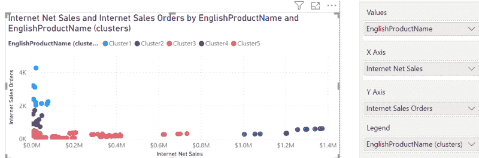

图 9.30：自动添加到散点图图例中的聚类

### 另请参阅

- 应用聚类技术：https://bit.ly/3gVwKK3

## 预测和异常检测

标准的 Power BI 报表和仪表板可视化对象非常适合对历史数据或实时数据进行描述性分析和诊断性分析，但组织最终需要预测性分析和规范性分析来帮助指导涉及未来结果的决策。Power BI Desktop 提供了时间序列预测工具，内置预测建模功能，使报表作者能够快速创建自定义预测、评估预测准确性，并构建直观的可视化对象，将实际数据或历史数据与预测结果结合起来。

本操作示例包含两个完整的预测示例。第一个示例使用自动日期层次结构，构建未来三个月的月度预测。第二个示例构建未来八周的周度预测，并评估将预测应用于近期数据时的准确性。最后，还将介绍一个使用异常检测的示例。

### 准备工作

要为本操作示例做好准备，请执行以下步骤：

- 1. 从以下 GitHub 存储库下载 Forecasting and Anomaly Detection Start.pbix：https://github.com/PacktPublishing/Power-BI-Cookbook-Third-Edition。
- 2. 在 Power BI Desktop 中打开 Forecasting and Anomaly Detection Start.pbix。
- 3. 编辑 AdventureWorks 查询，并将 Source 行更改为指向已安装 AdventureWorksDW2022 数据库的 SQL Server。
- 4. 在 Home 选项卡的功能区中单击 Close & Apply。


+ 5. 确保在“当前文件数据加载选项”中启用了“自动日期/时间”设置（通过 文件 | 选项和设置 | 选项）。

+ 6. 保存你的工作。

## 如何执行预测和异常检测

要实现此配方，请执行以下步骤：

+ 1. 在“表格视图”中，在“计算”表中创建以下度量值：

```
Today = DATE(2014,1,28)
Internet Gross Sales = SUM('Internet Sales'[SalesAmount])
Internet Sales Discounts = SUM('Internet Sales'[DiscountAmount])
Internet Net Sales = [Internet Gross Sales] - [Internet Sales Discounts]
```

+ 2. 在“报表视图”中，使用“日期”表中的 FullDateAlternateKey 列（日期层次结构）作为轴，并使用 Internet Net Sales 度量值作为 Y 轴，创建一个折线图可视化。

+ 3. 使用钻取按钮通过分叉箭头图标导航到月度粒度，以在层次结构中展开所有向下下一级。


图 9.31：层次结构钻取选项

+ 4. 选择折线图后，打开“可视化”窗格中的“为你的视觉对象添加进一步分析”选项卡，并将“预测”切换为“开”。

+ 5. 展开“预测”卡片，输入 3 作为“预测长度”，1 作为“忽略最后”，12 作为“季节性”，然后单击“应用”按钮。

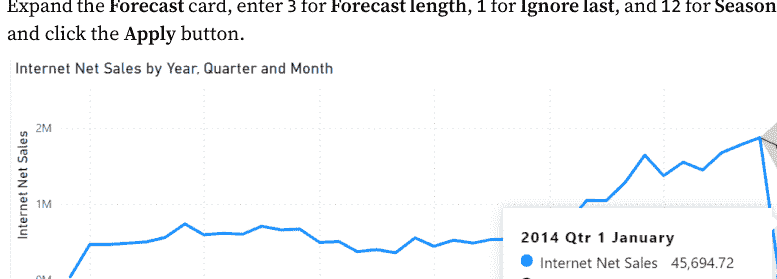

图 9.32：排除最近一个月的三个月预测

6. 在“日期”表中创建三个新列，使用以下代码：

```
Sequential =
    VAR __Date = 'Dates'[FullDateAlternateKey]
    VAR __Year = YEAR(__Date)
    VAR __Calendar = ADDCOLUMNS(ALL('Dates'),
        "__Year", YEAR('Dates'[FullDateAlternateKey]),
        "__WeekNum", WEEKNUM('Dates'[FullDateAlternateKey]))
    VAR __FirstYear = MINX(__Calendar,[__Year])
    VAR __WeekNum = MAXX(FILTER(__Calendar,
        [FullDateAlternateKey] = __Date), [__WeekNum])
    VAR __MaxWeeks = GROUPBY(__Calendar, [__Year],
        "__MaxWeek", MAXX(CURRENTGROUP(), [__WeekNum]))
    VAR __Start = SUMX(FILTER(__MaxWeeks, [__Year]<__Year), [__MaxWeek])
    VAR __Calendar1 = ADDCOLUMNS(__Calendar,
        "__MaxWeek",
        MAXX(FILTER(__Calendar, [__Year] =
            EARLIER([__Year])),[__WeekNum]))
    VAR __SubtractTable = GROUPBY(FILTER(__Calendar1,
        [__Year] < __Year && [__WeekNum] = [__MaxWeek]), [__Year],
        "__NumWeekDays", COUNTX(CURRENTGROUP(),[FullDateAlternateKey]))
    VAR __Subtract = COUNTROWS(FILTER(__SubtractTable, [__NumWeekDays]<7))
    VAR __Sequential = IF(__Year=__FirstYear,
        __WeekNum,
        __Start + __WeekNum - __Subtract)
    RETURN __Sequential
Week Ending Date =
    VAR __CurrentWeek = [Sequential]
    RETURN
        MAXX(FILTER(ALL('Dates'),[Sequential] = __CurrentWeek),
            [FullDateAlternateKey])
IsCurrentWeek =
    VAR __CurrentWeek =
        LOOKUPVALUE('Dates'[Sequential],'Dates'[FullDateAlternateKey],[Today])
    RETURN
        IF([Sequential] = __CurrentWeek,1,0)
```

7. 在“报表视图”中，创建另一个折线图可视化，使用“日期”表中的 Week Ending Date 列（非层次结构）作为 X 轴，并使用 Internet Net Sales 度量值作为 Y 轴。

+ 8. 选择可视化后，使用“筛选”窗格并将 IsCurrentWeek 列添加到可视化的筛选器中，排除值为 1 的项。

+ 9. 选择折线图后，打开“可视化”窗格中“为你的视觉对象添加进一步分析”选项卡（放大镜图标），并将“预测”切换为“开”。

+ 10. 展开“预测”卡片，并在“选项”子卡片中，确保“单位”设置为“点”，输入 8 作为“预测长度”，5 作为“忽略最后”，52 作为“季节性”，95% 作为“置信区间”，然后单击“应用”按钮。

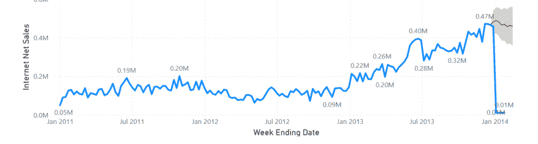

图 9.33：每周销售趋势和预测

## 其工作原理

Power BI 预测工具使用指数平滑时间序列预测算法。此方法在多个领域广泛使用，有助于抑制异常值，同时高效捕捉趋势。预测工具目前仅适用于折线图视觉对象，且该视觉对象上仅允许一个度量值（线）。X 轴值需要具有日期或日期/时间数据类型，或为均匀递增的整数，且至少需要六个日期点。

Power BI 中的预测工具包含“忽略最后”功能，可允许从预测中排除不完整的期间（月、周和日）。然而，对于常见的加性度量值，例如销售额，如果不筛选出当前期间，通常会显著降低视觉对象的可用性，因为当前（不完整）期间表示的陡峭下降。动态更新的日期列，例如 IsCurrentWeek，通常可以解决此类问题。

在第一个折线图中，默认情况下，会为所选度量值创建未来 10 个点（月）的预测，并带有 95% 的置信区间。预测会自动确定步长（月度粒度），并确定要应用于预测的季节性因子。在此示例中，未对报表应用任何筛选器，因此当前不完整的月份最初会被预测使用。通过将“忽略最后”设置为 1 个点，我们排除了最近的不完整月份。

预测现在包含对当前（不完整）月份的预测值。应用在已知粒度（每年 12 个）处的季节性变量会覆盖默认的季节性因子。

当季节性（每个周期的点数）已知时，建议手动应用此值以提高准确性。将鼠标悬停在预测数据点上会显示预测值以及基于 95% 置信区间的上下边界值。

## 使用 R 和 Python 视觉对象

R 和 Python 编程语言，包括其在数据处理、高级分析和可视化方面的强大且可扩展的功能，已深度集成到 Power BI 中。R 和 Python 脚本可用作 Power BI 语义模型的数据源，作为 M 查询中的数据转换和塑形过程，以及作为 Power BI 报表和仪表板中的独立可视化类型。与标准 Power BI 视觉对象一样，R 和 Python 脚本视觉对象直接利用语义模型中定义的关系，并且可通过其他视觉对象（如切片器）动态筛选。

在本配方中，使用 R 脚本在 Power BI Desktop 中创建了两个直方图可视化：一个使用 R 的标准分布基础图形，另一个使用流行的 ggplot2 可视化包。此外，还包含了一个 Python 视觉对象示例。

## 准备工作

为准备本配方，请执行以下步骤：

+ 1. 使用以下链接在本地机器上下载并安装 R 引擎：https://cran.r-project.org/bin/windows/base/。
+ 2. 通过以下命令为 R 安装 ggplot2 包：
+ 3. 可选地，为编辑 R 脚本安装 IDE，例如 RStudio（https://posit.co/products/open-source/rstudio/）。
+ 4. 同样地，从 http://www.python.org 或 Anaconda 捆绑的 Python（https://www.anaconda.com/）安装 Python。
+ 5. 通过在 Windows 搜索栏中键入命令提示符打开命令提示符。
+ 6. 使用以下命令为 Python 安装 Matplotlib：
+ 7. 使用以下命令为 Python 安装 pandas：
+ 8. 从以下 GitHub 仓库下载 Using R and Python Visuals Start.pbix：https://github.com/PacktPublishing/Power-BI-Cookbook-Third-Edition。
+ 9. 在 Power BI Desktop 中打开 Using R and Python Visuals Start.pbix。
+ 10. 验证 Power BI Desktop 中的 R 脚本和 Python 脚本选项（文件 | 选项和设置 | 选项）。

```
install.packages("ggplot2")
```

```
py -m pip install matplotlib
```

```
py -m pip install pandas
```

5. 在 R 脚本编辑器中输入以下 R 脚本并单击“运行脚本”图标：

```
par(bg = "#E6E6E6")
hist(dataset$'ListPrice', breaks = seq(from=0, to = 2500, by = 500), col = "#2C95FF",
main = "Current Year Online Sales List Price Distribution", cex.main = 1.75, cex.axis = 1.2, cex.lab = 1.4, ylab = "Count of Products", xlab = "Product List Price Bins", las = 1, labels = TRUE, border = "black", ylim=c(0,50))
```

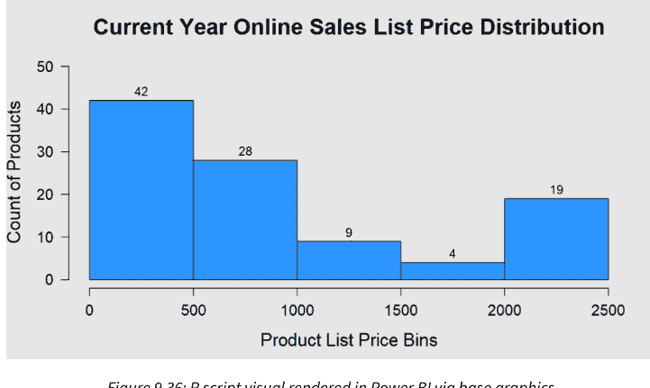

图 9.36：通过基础图形在 Power BI 中呈现的 R 脚本视觉对象

6. 在同一页面上复制并粘贴 R 脚本视觉对象。

7. 选择已粘贴的 R 脚本视觉对象并将代码更改为以下内容：

```
prices <- as.numeric(as.character(semantic model$'ListPrice'))
breakpoints <- seq(from=0, to = 2500, by = 500)
library("ggplot2")
ggplot(dataset, aes(x = prices)) + geom_histogram(breaks = breakpoints, fill = "#2C95FF", color = "black") + xlab("Product List Price Bins") + ylab("Count of Products") + ggtitle("Current Year Online Sales List Price Distribution") + stat_bin(breaks = breakpoints, geom="text", aes(label=..count..), vjust = -1) + coord_cartesian(ylim=c(0,50)) + theme(text = element_text(size = 16)) + theme(plot.title = element_text(hjust = .5))
```


此代码更改的结果如图 9.37 所示。

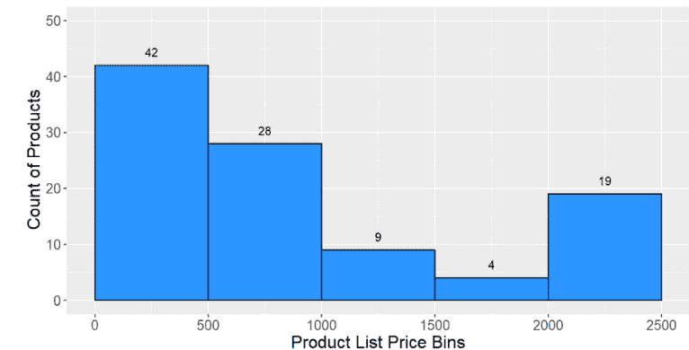

图 9.37：通过 ggplot2 包在 Power BI 中呈现的 R 脚本视觉对象

## 工作原理

本配方中的两个视觉对象均需显示当前日历年内已在线销售的产品的标价分布。第一个示例（步骤 1 到 5）使用 R 基础图形中的标准 hist() 函数，第二个示例（步骤 7）使用 R 的 ggplot2 包提供的 ggplot() 函数。

浅灰色背景颜色通过 par() 函数设置，hist() 函数的参数定义了 X 轴和 Y 轴、标题的文本字符串、数据标签、字体大小以及柱形的浅蓝色。seq() 函数用于配置 X 轴间隔（分箱），宽度或分箱大小为 500 美元，最高价格为 2,500 美元。

ggplot2 的 geom_histogram() 函数要求有连续变量，因此 ListPrice 列在 prices 变量中被转换为数值数据类型。前一个示例中用于 X 轴的向量表达式（seq()，分箱从 0 到 2,500，步长为 500）被用作 geom_histogram() 和 stat_bin() 的 breaks 参数的参数。同样，前一个示例中用于 Y 轴的表达式也被重用，但作为参数传递给了 coord_cartesian() 函数。qplot() 函数（quick plot 的缩写）也可在 ggplot2 包中使用，它可以用更少的代码（通常只需要一行）更快地开发相对复杂的视觉对象。

Power BI Desktop 中的 R 脚本编辑器会根据加载到“值字段井”中的列自动创建数据框并删除重复行。

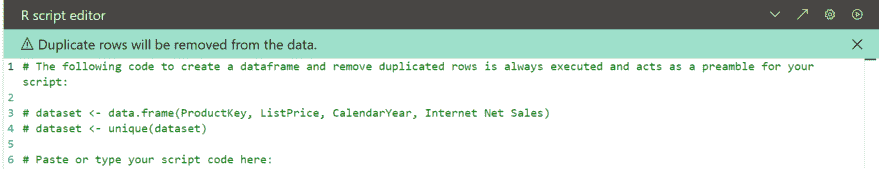

图 9.38：Power BI Desktop R 脚本编辑器数据框与重复项删除

在此示例中，由于目的是统计单个产品（包括标价相同的产品），因此需要向数据框添加一个单独的列（产品键列），使数据框的每一行都是唯一的。在其他场景中，可以使用 Table.AddIndexColumn() M 函数来创建唯一性。

在 R 脚本视觉对象的数据框中包含“Internet 净销售额”度量值，可使该视觉对象按报表页面上的日期维度列和其他维度表进行筛选。

根据本配方的要求，默认情况下，在给定筛选上下文的情况下，没有任何销售记录的产品将不会包含在数据框中。如果要在该视觉对象中包含没有销售记录的产品，可以使用“值字段井”中“产品键”列的“显示无数据的项”选项。

按照“准备工作”一节，如果在“检测到的 R IDE”R 脚本选项中安装并选择了受支持的外部 R IDE，则可以单击“在外部 R IDE 中编辑脚本”（向上箭头图标）。这将启动 IDE 应用程序（例如 RStudio）并从 Power BI Desktop 导出数据框。R 脚本 IDE 的常见功能（如 IntelliSense 和变量历史记录）对于开发复杂的 R 脚本视觉对象很有帮助（如果不是必需的话）。

Power BI 中使用 R 的其他领域包括 R 脚本数据源连接器，可在“获取数据”对话框的“其他”类别中找到。在查询编辑器的“转换”窗口中，也有一个“运行 R 脚本”命令图标。最后，许多使用 R 生成的自定义视觉对象已可在 AppSource 中使用。

## 更多内容…

Python 也可以用来创建视觉对象。要了解如何操作，请执行以下步骤：

- 1. 创建一个 Python 视觉对象，并将 Products 表中的“产品类别”列以及“Internet 净销售额”度量值添加到“值字段井”中。
- 2. 对 Python 视觉对象使用以下代码，并单击“运行脚本”图标：

```
import matplotlib.pyplot as plt
dataset.plot(kind='bar',x='Product Category',y='Internet Net Sales')
plt.show()
```

## 产品类别和 Internet 净销售额

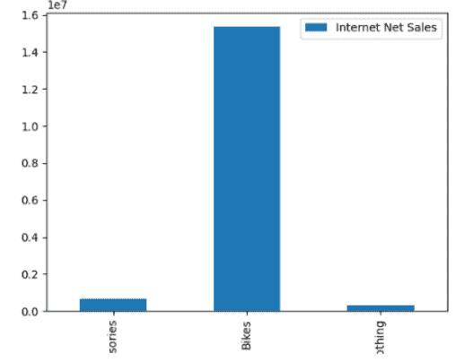

图 9.39：默认 Python 直方图

## 另请参阅

- - 在 Windows 上安装 Microsoft R Client：https://bit.ly/3aYfDD1
- - 使用 R 创建 Power BI 视觉对象：https://bit.ly/3aWN4pP
- - Power BI 的 R 脚本视觉对象展示：https://community.powerbi.com/t5/R-Script-Showcase/bd-p/RVisuals
- - 在 Power BI Desktop 中运行 Python 脚本：https://bit.ly/2QNtDcl
- - 使用 Python 创建 Power BI 视觉对象：https://bit.ly/3aUfVve

## 利用 WINDOW 函数

DAX 函数 WINDOW 是 DAX 语言中相对较新的补充，与之类似和相关联的函数还有 INDEX、OFFSET、ORDERBY 和 PARTITIONBY。这些函数的发布是为了将视觉级别计算引入 Power BI。

在本配方中，WINDOW 函数用于计算滚动 3 个月平均值以及运行总计。

## 准备工作

为了准备本配方，请按照以下步骤操作：

- 1. 从以下 GitHub 存储库下载 Leveraging the WINDOW Function Start.pbix：https://github.com/PacktPublishing/Power-BI-Cookbook-Third-Edition。
- 2. 在 Power BI Desktop 中打开 Leveraging the WINDOW Function Start.pbix。
- 3. 编辑 AdventureWorks 查询，并将 Source 行更改为指向安装了 AdventureWorksDW2022 数据库的 SQL 服务器。
- 4. 单击“开始”选项卡功能区中的“关闭并应用”。
- 5. 保存您的工作。

## 如何利用 WINDOW 函数

要实现本配方，请执行以下步骤：

- 1. 在“表”视图中，在 Calculations 表中创建以下度量值：

```
Internet Gross Sales = SUM('Internet Sales'[SalesAmount])
Internet Sales Discounts = SUM('Internet Sales'[DiscountAmount])
Internet Net Sales = [Internet Gross Sales] - [Internet Sales Discounts]
```

- 2. 在“报表”视图中，使用“筛选器”窗格为 Dates 表中的 CalendarYear 列添加页面筛选器，并仅选择 2012 和 2013。
- 3. 添加一个表视觉对象，并将 Dates 表中的 CalendarYear 和 MonthNumberOfYear 列以及 Internet Net Sales 度量值放在“列字段井”中。确保 CalendarYear 和 MonthNumberOfYear 列设置为“不汇总”。
- 4. 创建以下两个度量值：

```
Internet Net Sales Running Total =
SUMX (
    WINDOW (
        1, ABS, 0, REL,
        ALLSELECTED (
            'Dates'[CalendarYear],
            'Dates'[MonthNumberOfYear]
        ),
        PARTITIONBY ( 'Dates'[CalendarYear] )
    ),
    [Internet Net Sales]
)
Internet Net Sales 3-Month Average =
AVERAGEX(
    WINDOW(
        -2,REL,0,REL,
        ALLSELECTED('Dates'[CalendarYear], Dates[MonthNumberOfYear]),
        ORDERBY('Dates'[CalendarYear], ASC, Dates[MonthNumberOfYear], ASC),
    ),
    [Internet Net Sales]
)
```

## 另请参阅

- - WINDOW 函数（DAX）：https://bit.ly/3HzaDVW
- - 新的 DAX 函数——INDEX、OFFSET 和 WINDOW：https://youtu.be/oxe4u8PgG0Y

## 本章小结

本章包含了包罗广泛的配方，重点介绍了 Power BI 许多最新且最受欢迎的自定义视觉对象和高级分析功能。其中包括自定义视觉对象、ArcGIS 地图视觉对象，以及通过动画和批注进行的数据叙事。此外，还提供了利用 Power BI 语义模型以及 DAX、R 和 Python 语言来嵌入自定义统计分析和视觉对象的示例。

在下一章中，我们将把注意力转向涉及 Power BI 管理和治理的配方。

## 加入我们的 Discord 社区

加入我们社区的 Discord 空间，与作者和其他读者进行讨论：

https://discord.gg/ebXZqyrxJb


