# 10 增强和优化现有 Power BI 解决方案

# 增强和优化现有 Power BI 解决方案

Power BI 直观的、低代码的图形界面使技术经验有限的用户能够快速生成视觉上引人注目的内容。在许多情况下，例如对于小型或聚合的源数据以及最低限度的安全性和分析需求，这些轻量级、非最优化设计的解决方案即使仅使用 Power BI Pro 许可证也可能被证明是足够的。然而，满足更大、更复杂解决方案的更严苛要求，需要额外的工具、设计技术，在某些情况下，还需要 Power BI Premium 每用户或 Fabric 容量等资源。

对于较大的 Power BI 项目——尤其是当 Power BI Premium 和 Analysis Services 选项不可用时——识别改进报告查询性能的机会以及更有效地使用系统资源来存储和刷新语义模型变得很重要。

此外，数据导入过程通常可以变得更健壮、更少资源密集化。而且，在 Power Query (M) 和 DAX 表达式中应用标准的编码语法、变量和注释，进一步提高了 Power BI 语义模型的可维护性。

本章中的配方包含了顶级的语义建模、DAX 度量值和 M 查询模式，以增强 Power BI 语义模型的性能、可扩展性和可靠性。这包括语义模型和度量值的性能调优示例、M 查询的错误处理和查询折叠示例，以及有关 DAX 和 M 查询引擎的支撑性细节。

在本章中，我们将介绍以下配方：

- - 扩展和增强语义模型
- - 提高 DAX 度量值性能
- - 将查询处理推送回源系统
- - 加强数据导入和集成过程
- - 隔离和记录 DAX 表达式
- - 使用增量刷新提高数据加载速度


+   4. 在 Power BI Desktop 的右下角，单击 **Make changes to this model** 链接。

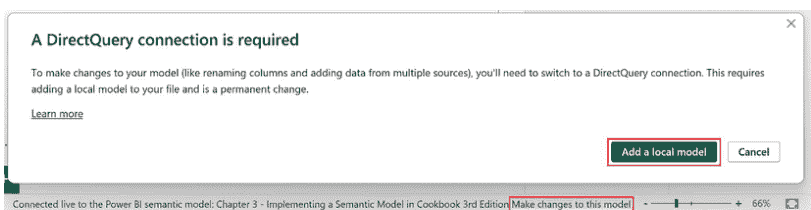

*Figure 10.1: Adding a local model*

+   5. 单击 **Add a local model** 按钮，如 *Figure 10.1* 所示。
+   6. 在下一个屏幕上，保留所有表均被选中，然后单击 **Submit** 按钮。请注意，此过程完成后，Power BI Desktop 的右下角现在显示 **Storage Mode: DirectQuery**。
+   7. 再次选择 **Get data**，然后选择 **Excel workbook**。
+   8. 导航到 **Adworks Sales Plan.xlsx** 文件并选择 **Open**。
+   9. 在 **Navigator** 对话框中，选择 **Table1**，然后单击 **Load** 按钮。
+   10. 显示 **Potential security risk** 对话框；单击 **OK** 按钮。
+   11. 在 **Data** 窗格中，将 **Table1** 重命名为 **Sales Plan**。

请注意，Power BI Desktop 的右下角现在显示 **Storage Mode: Mixed.**

## How it works

首次连接到 Power BI 语义模型时（*steps 2 and 3*），语义模型以实时模式连接。实时模式连接到 Power BI 语义模型允许使用现有语义模型创建报表，并且最初是 Power BI 语义模型可用的唯一连接方法。

微软随后发布了 **DirectQuery for Power BI datasets and Analysis Services models**。*Steps 4, 5, and 6* 使用此功能将连接从实时连接转换为 DirectQuery 连接。*Steps 7 through 10* 向数据模型添加导入模式表，使语义模型成为复合或“混合模式”模型。

语义模型中各种表之间的差异在 Model 视图中可见，如图 10.2 所示：

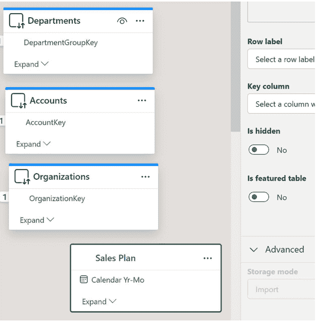

Figure 10.2: Different storage modes in the composite model

在 Model 视图中，DirectQuery 表以蓝色条显示，而导入表则没有此类条。在图 10.2 中，Sales Plan 表被选中，在属性窗格下的高级设置中，存储模式设置为 Import。选择 DirectQuery 表将显示存储模式值为 DirectQuery。

Power BI 中实际上有三种存储模式：Import、DirectQuery 和 Dual。导入表被缓存到内存中，并且对语义模型的此类表的查询通过此缓存得到满足。DirectQuery 表未被缓存，并且使用这些表的语义模型查询只能通过查询源来满足。双模式表可以根据查询以缓存或非缓存方式运行。

需要注意的是，在将表设置为导入模式后，随后不可能再将该表转换为 DirectQuery 或 Dual 存储模式。

## There’s more…

复合模型还引入了聚合表的概念，如第 3 章 Leveraging Aggregation Tables 食谱中所述。

正如该食谱的 There's more... 部分所述，微软随后通过自动聚合扩展了此功能。自动聚合使用机器学习技术自动优化 DirectQuery 模型，以便语义模型的查询可以从缓存的聚合中得到满足，而不是访问源数据系统，从而提高性能。

自动聚合适用于一小部分数据源，包括：

+   - SQL Server 2019 或更高版本
+   - Azure SQL Database
+   - Azure Synapse Dedicated SQL pool
+   - Google BigQuery
+   - Snowflake
+   - Databricks
+   - Amazon Redshift

要了解如何启用自动聚合，请执行以下步骤：

+   1. 确保已安装、配置并正在运行数据网关。参见第 1 章，Creating an On-Premises Gateway。
+   2. 完成第 2 章的 Using DirectQuery 食谱并将报表发布到 Premium、PPU、Fabric 或 Embedded 工作区。
+   3. 在 Power BI Service 中，导航到工作区，单击步骤 2 中发布的语义模型旁边的省略号 (...)，然后选择 Settings。
+   4. 展开 Gateway and cloud connections 部分并确保网关连接已配置，方法是单击 Actions 下的箭头图标。将数据源映射到现有连接或选择 Add to gateway，添加连接，然后重复步骤 3 和 4 以映射数据源。

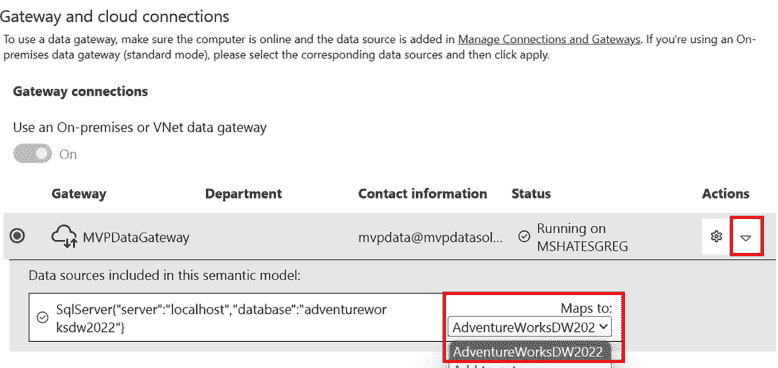

Figure 10.3: Mapping the data source to gateway connection

## Improving DAX Measure Performance

正如先前的食谱中针对特定列和关系可以优化性能一样，经常使用的 DAX 度量也可以针对性能改进。现有的 DAX 度量可能包含低效的数据访问方法，会生成额外的、不必要的查询或主要在单个 CPU 线程中执行。修改度量以更好地利用多线程存储引擎并避免或减少不必要的查询和迭代，可以在不对模型进行侵入性、结构性修改的情况下带来显著的性能改进。

在本食谱中，使用 Power BI Desktop 的 Performance analyzer 功能捕获和分析 Power BI 可视化执行的 DAX 查询。然后在 DAX Studio 中进一步分析这些查询。

### Getting ready

为准备本食谱，请执行以下步骤：

+   1. 下载并安装 DAX Studio：https://daxstudio.org/downloads/。
+   2. 下载并打开本书记述的 GitHub 仓库中的文件 Improving DAX Measure Performance Start.pbix（参见 Technical Requirements 部分）。
+   3. 在 Calculations 表中创建以下四个度量：

```
Internet Sales = SUM('Internet Sales'[SalesAmount])

Internet Sales (TOTALYTD) = TOTALYTD([Internet Sales], 'Dates'[Date])

Internet Sales (CALCULATE YTD) =
    CALCULATE(
        [Internet Sales],
        'Dates'[CalendarYear] = MAX('Dates'[CalendarYear]) &&
        'Dates'[Date] <= MAX('Dates'[Date])
    )

Internet Sales (NC YTD) =
    VAR __Date = MAX('Dates'[Date])
    VAR __Year = YEAR(__Date)
    VAR __Table =
        SUMMARIZE(
            ALL('Internet Sales'),
            'Internet Sales'[OrderDate],
            "__Year", YEAR([OrderDate]),
            "__Sales", [Internet Sales])
    VAR __Result = SUMX(FILTER(__Table, [__Year] = __Year && [OrderDate] <= __Date), [__Sales])
    RETURN
        __Result
```

3. 在 Performance analyzer 窗格中选择 TI 结果并选择 Copy query：

```
// DAX Query
DEFINE
    VAR __DS0Core =
        SUMMARIZECOLUMNS(
            ROLLUPADDSUBTOTAL('Dates'[Date], "IsGrandTotalRowTotal"),
            "Internet_Sales__TOTALYTD_", 'Calculations'[Internet Sales (TOTALYTD)]
        )
    VAR __DS0PrimaryWindowed =
        TOPN(502, __DS0Core, [IsGrandTotalRowTotal], 0, 'Dates'[Date], 1)
EVALUATE
    __DS0PrimaryWindowed
ORDER BY
    [IsGrandTotalRowTotal] DESC, 'Dates'[Date]
```

4. 在 DAX Studio 中，在顶部工具栏中启用 Server Timings、Query Plan 和 Clear on Run 选项。

5. 在 DAX Studio 跟踪运行时，单击 Run 或按 F5 键并注意 Server Timings 窗口中的性能。

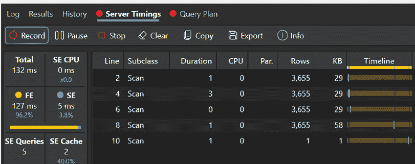

Figure 10.6: DAX Studio server timings for the time intelligence measure

虽然 DAX 传统主义者多年来一直赞扬 DAX 的 CALCULATE 函数以及时间智能函数，但更现代的方法，例如使用 No CALCULATE 方法（由 Brian Julius 提出）可以显著提高 DAX 查询性能。凭借其对 VAR 语句、简单 FILTER 函数、SUMMARIZE 函数和 X 聚合器（SUMX、AVERAGEX 等）的关注，No CALCULATE 方法也往往更容易调试和学习，适合 DAX 的新手用户，因为 CALCULATE 函数的细微差别和复杂性以及 DAX 时间智能函数的黑盒性质。

## There’s more…

DAX 度量可以优化的另一个示例是此示例，其中度量必须按复杂条件进行筛选，例如日期范围。执行与本食谱相同的分析，但使用以下三个度量：

```
Last 7 Days 1 =
    VAR __Date = MAX('Dates'[Date])
    VAR __MinDate = __Date - 6
    VAR __Table = FILTER(ALL('Internet Sales'), [OrderDate] >= __MinDate && [OrderDate] <= __Date)
    VAR __Result = SUMX(__Table, [Internet Sales])
RETURN
    __Result

Last 7 Days 2 =
    VAR __Date = MAX('Dates'[Date])
    VAR __MinDate = __Date - 6
    VAR __Table1 = FILTER(ALL('Internet Sales'), [OrderDate] <= __Date)
    VAR __Table2 = FILTER(__Table1, [OrderDate] >= __MinDate )
    VAR __Result = SUMX(__Table2, [Internet Sales])
RETURN
    __Result

Last 7 Days 3 =
    VAR __Date = MAX('Dates'[Date])
    VAR __MinDate = __Date - 6
    VAR __Table1 = SUMMARIZE(ALL('Internet Sales'), [OrderDate], "Sales", [Internet Sales])
    VAR __Table2 = FILTER(__Table1, [OrderDate] <= __Date)
    VAR __Table3 = FILTER(__Table2, [OrderDate] >= __MinDate )
    VAR __Result = SUMX(__Table3, [Sales])
RETURN
    __Result
```


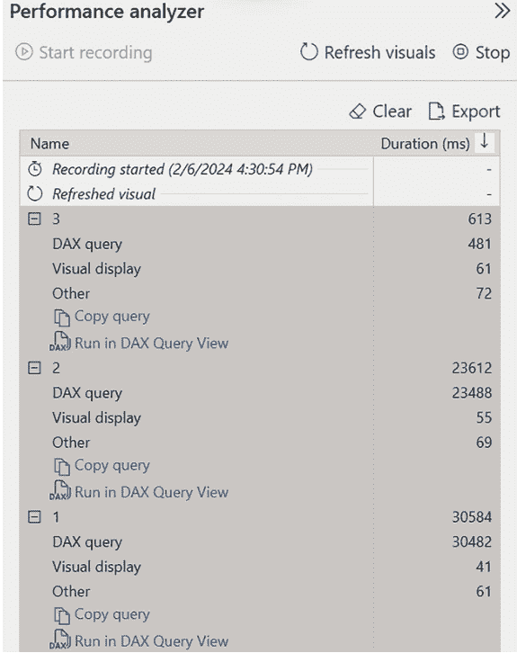

图 10.9：最近 7 天范围度量的性能分析器结果

虽然 Last 7 Days 1（1） 和 Last 7 Days 2（2） 都不是特别高效，但 Last 7 Days 2 度量始终比 Last 7 Days 1 度量快约 25–30%。这是因为 Last 7 Days 1 度量必须使用复杂的筛选条件（&&）对 Internet Sales 表的每一行（约 60,000 行）进行求值，而 Last 7 Days 2 度量使用按顺序的更简单筛选条件，并且第二个简单筛选条件减少了需要分析的行数。Last 7 Days 3 度量更进一步，使用 SUMMARIZE 立即将行数减少到仅 Dates 表中的行数（约 3,600 行），然后再用后续的简单筛选条件对这个缩减后的表进行筛选。

请注意，Last 7 Days 3 度量的性能与传统的 CALCULATE 方法相比并无好坏之分：

```
Last 7 Days (CALCULATE) =
    CALCULATE(
        [Internet Sales],
        'Dates'[Date] <= MAX('Dates'[Date]) && 'Dates'[Date] >= 
```
```
MAX('Dates'[Date]) - 6
)
```

在高层次上，始终考虑被筛选表的大小，并寻找可以用来减小该表大小的简单筛选条件和单列。然后，更复杂的表达式可以对这个更小的表进行操作，这些表达式无法由存储引擎处理。同样，考虑（并测试）嵌套或分层筛选条件，使最具选择性、最有效的筛选条件先被应用。这种方法可以通过将最可能求值为 TRUE 的条件置于 SWITCH 语句顶部，从而显著提高使用 DAX SWITCH 函数的度量的速度。

## 另请参阅

- 使用性能分析器检查 Power BI Desktop 中报表元素的性能：https://bit.ly/3eWXdEb
- The Case for No CALCULATE：https://www.linkedin.com/pulse/case-calculate-greg-deckler/

## 将查询处理推回源系统

在从本地源检索的语义模型计划刷新期间，任何未由源系统执行的查询转换都将需要本地 M（Mashup）引擎的资源，该引擎位于本地数据网关服务器上。对于较大的语义模型，并且在同一网关服务器上可能同时进行其他计划刷新，设计充分利用源系统资源通过查询折叠的 M 查询变得非常重要。虽然针对文件等某些源的转换始终需要本地资源，但在许多场景中，M 查询可以修改以帮助引擎生成等效的 SQL 或其他源系统语句，从而最大限度地减少本地资源消耗。

在本配方中，提供了一个流程和项目列表，用于识别当前未折叠的查询及其潜在原因。此外，还提供了一个基于现有 SQL 语句的查询，该查询使用 M 表达式重新设计以允许查询折叠。

## 准备工作

为准备本配方，请执行以下步骤：

- 1. 识别要评估查询折叠的语义模型。
- 2. 使用网关服务器内存性能计数器数据建立执行刷新时当前使用的资源基线，因为这些计数器应会受到任何更改的影响。

此外，使用 Power Query 编辑器“工具”选项卡中的新诊断工具建立查询性能基线。

要优化的语义模型通常是一个较大的 PBIX 文件（100 MB+），已发布到 Power BI 服务，并配置了计划刷新以使用查询关系数据库（SQL 或 Oracle）作为主要源的本地数据网关。

作为执行此过程的示例，考虑以下案例，其中业务分析师使用 SQL 语句和查询编辑器构建了一个客户查询：

```
let
    Source = Sql.Database("localhost", "AdventureWorksDW2022", {Query="SELECT * FROM dbo.DimCustomer"})
    #"Replaced Value" = Table.ReplaceValue(Source,"M","Married",Replacer.ReplaceText,{"MaritalStatus"}),
    #"Replaced Value1" = Table.ReplaceValue(#"Replaced Value","S","Single",Replacer.ReplaceText,{"MaritalStatus"}),
    #"Filtered Rows" = Table.SelectRows(#"Replaced Value1", each true),
    #"Replaced Value2" = Table.ReplaceValue(#"Filtered Rows","M","Male",Replacer.ReplaceText,{"Gender"}),
    #"Replaced Value3" = Table.ReplaceValue(#"Replaced Value2","F","Female",Replacer.ReplaceText,{"Gender"}),
    #"Filtered Rows1" = Table.SelectRows(#"Replaced Value3", each true),
    #"Renamed Columns" = Table.RenameColumns(#"Filtered Rows1",{{"EnglishEducation", "Education"}, {"EnglishOccupation", "Occupation"}}),
    #"Removed Columns" = Table.RemoveColumns(#"Renamed Columns",{"SpanishEducation", "FrenchEducation", "SpanishOccupation", "FrenchOccupation"}),
    // Customer History Date Bands
    CurrentDate = #date(2014,2,9),
    OneYearAgo = Date.AddYears(CurrentDate,-1),
    TwoYearsAgo = Date.AddYears(CurrentDate,-2),
    ThreeYearsAgo = Date.AddYears(CurrentDate,-3),
    //Customer Dimension
    CustomerHistoryColumn = Table.AddColumn(#"Removed Columns", "Customer History Segment", each
        if [DateFirstPurchase] >= OneYearAgo then "First Year Customer"
        else if [DateFirstPurchase] >= TwoYearsAgo and [DateFirstPurchase] < OneYearAgo then "Second Year Customer"
        else if [DateFirstPurchase] >= ThreeYearsAgo and [DateFirstPurchase] < TwoYearsAgo then "Third Year Customer"
        else "Legacy Customer", type text)
in
    CustomerHistoryColumn
```

图 10.11：基于原生 SQL 语句和 M 转换的客户查询

在此场景中，SQL 语句针对数据仓库中基础客户表（不是视图），并且在每次刷新过程中对查询结果应用的后续转换都使用本地网关服务器资源，因为第一步执行了原生 SQL 查询。可以通过利用查询折叠来修改查询以获得更好的性能，如下所示：

- 1. 创建一个新的 M 查询，该查询使用服务器和数据库的参数，并使用客户 SQL 视图：

```
let
    Source = Sql.Database("localhost", "AdventureWorksDW2022"),
    dbo_Customer = Source[{Schema="dbo",Item="DimCustomer"}][Data],
    #"Replaced Value" = Table.ReplaceValue(dbo_Customer,"M","Married",Replacer.ReplaceText,{"MaritalStatus"}),
    #"Replaced Value1" = Table.ReplaceValue(#"Replaced Value","S","Single",Replacer.ReplaceText,{"MaritalStatus"}),
    #"Filtered Rows" = Table.SelectRows(#"Replaced Value1", each true),
    #"Replaced Value2" = Table.ReplaceValue(#"Filtered Rows","M","Male",Replacer.ReplaceText,{"Gender"}),
    #"Replaced Value3" = Table.ReplaceValue(#"Replaced Value2","F","Female",Replacer.ReplaceText,{"Gender"}),
    #"Filtered Rows1" = Table.SelectRows(#"Replaced Value3", each true),
    #"Renamed Columns" = Table.RenameColumns(#"Filtered Rows1",{{"EnglishEducation", "Education"}, {"EnglishOccupation", "Occupation"}}),
```
```
#"Removed Columns" = Table.RemoveColumns(#"Renamed Columns",{"SpanishEducation", "FrenchEducation", "SpanishOccupation", "FrenchOccupation"}),
    // Customer History Date Bands
    CurrentDate = #date(2014,2,9),
    OneYearAgo = Date.AddYears(CurrentDate,-1),
    TwoYearsAgo = Date.AddYears(CurrentDate,-2),
    ThreeYearsAgo = Date.AddYears(CurrentDate,-3),
    //Customer Dimension
    CustomerHistoryColumn = Table.AddColumn(#"Removed Columns", "Customer History Segment", each
        if [DateFirstPurchase] >= OneYearAgo then "First Year Customer"
        else if [DateFirstPurchase] >= TwoYearsAgo and [DateFirstPurchase] < OneYearAgo then "Second Year Customer"
        else if [DateFirstPurchase] >= ThreeYearsAgo and [DateFirstPurchase] < TwoYearsAgo then "Third Year Customer"
        else "Legacy Customer", type text)
in
    CustomerHistoryColumn
```

使用原生 M 函数访问 DimCustomer 表而不是 SQL 查询语句，整个查询现在可以折叠回 SQL Server。

- 2. 右键单击新修订查询的最后一步，并确保“查看本机查询”已启用。


## Native Query

```
select [_.].[CustomerKey] as [CustomerKey],
[_.].[GeographyKey] as [GeographyKey],
[_.].[CustomerAlternateKey] as [CustomerAlternateKey],
[_.].[Title] as [Title],
[_.].[FirstName] as [FirstName],
[_.].[MiddleName] as [MiddleName],
[_.].[LastName] as [LastName],
[_.].[NameStyle] as [NameStyle],
[_.].[BirthDate] as [BirthDate],
replace([_.].[MaritalStatus], 'S', 'Single') as [MaritalStatus],
[_.].[Suffix] as [Suffix],
replace([_.].[Gender], 'F', 'Female') as [Gender],
[_.].[EmailAddress] as [EmailAddress],
[_.].[YearlyIncome] as [YearlyIncome],
[_.].[TotalChildren] as [TotalChildren],
[_.].[NumberChildrenAtHome] as [NumberChildrenAtHome],
[_.].[EnglishEducation] as [Education],
[_.].[EnglishOccupation] as [Occupation],
[_.].[HouseOwnerFlag] as [HouseOwnerFlag],
[_.].[NumberCarsOwned] as [NumberCarsOwned],
[_.].[AddressLine1] as [AddressLine1],
[_.].[AddressLine2] as [AddressLine2],
[_.].[Phone] as [Phone],
[_.].[DateFirstPurchase] as [DateFirstPurchase],
[_.].[CommuteDistance] as [CommuteDistance],
[_.].[Customer History Segment] as [Customer History Segment]
from (
    select [_.].[CustomerKey] as [CustomerKey],
    [_.].[GeographyKey] as [GeographyKey],
```

Figure 10.12: Native query (folded) based on the revised M query for Customers

新查询返回相同的结果，但现在已折叠回 SQL Server，而不是使用本地资源。if...then...else M 表达式已被折叠为 SQL Server 执行的 CASE 表达式。

### How it works

查询折叠受源系统支持的转换、内部专有 M 引擎逻辑、分配给数据源的隐私级别、原生数据库查询（SQL 语句）的使用以及自定义 M 函数和逻辑的影响。例如，即使从性能角度来看查询折叠是合适的，例如使用服务器与本地文件进行连接操作，如果本地文件配置为私有数据源，则折叠不会发生。

根据本配方中查询折叠重新设计示例，如果查询的第一步或 Source 步骤是原生 SQL 语句，请考虑修改 M 查询步骤以帮助 M 引擎形成 SQL 查询（折叠 M 查询）。默认情况下，通过 Value.NativeQuery 应用于原生 SQL 数据库查询之上的任何 M 转换都不会折叠到源系统。如果使用原生 SQL 查询，例如存储过程调用，建议将所有查询步骤和转换嵌入到原生 SQL 查询本身中。如果不可行，请将最耗资源的运算嵌入到存储过程中，并将过滤参数从 Power BI 传递给存储过程，以减少本地 M 引擎的工作负载。

请注意，通过使用未记录的参数，可以在后续操作中启用查询折叠，使用 Value.NativeQuery。其格式如下：

```
Value.NativeQuery( source, "query statement", null, [EnableFolding=true])
```

这里，最后一个（第 4 个）参数是一个记录，其中包含 EnableFolding 参数设置为 true。可以按如下方式在查询开始时使用：

```
let
    Source = Sql.Database("localhost", "AdventureWorksDW2022"),
    NativeQuery = Value.NativeQuery( Source, "SELECT * FROM dbo.DimCustomer",
null, [EnableFolding=true],
... // additional steps
    in
```

如果存在查询系统不支持查询折叠的必需转换或逻辑，建议将这些步骤移动到查询的最后。例如，允许 SQL Server 通过查询折叠执行过滤、派生列和其他简单步骤，然后再在 SQL 查询结果集之上本地应用复杂步骤。

许多常见的 M 函数不被大多数关系数据库源支持，例如 Table.Distinct，它从表中删除重复行，以及 Table.RemoveRowsWithErrors，它从表中删除包含错误的<|message|>。如果在查询中合并数据源，请检查其隐私设置（Data source settings | Edit Permissions...），以确保隐私配置允许折叠，例如从一个组织源到另一个组织源。

通常，以下操作不受查询折叠支持：

- Changing column data types
- Adding index columns
- Merging or appending queries from different sources
- Adding custom columns using Power Query functions that have no equivalent function in the data source

### There’s more…

对于包含许多查询和大型表的模型，请考虑在 File | Options | Options and settings | CURRENT FILE 中禁用默认的并行加载表，因为同时执行的许多查询可能会使源系统资源不堪重负并导致刷新过程失败。

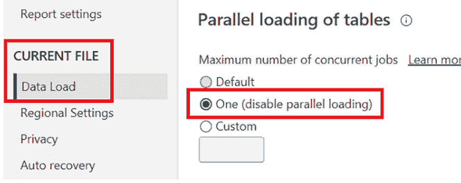

Figure 10.13: Parallel loading of tables—the CURRENT FILE setting

仅仅因为查询被折叠成 SQL 语句，并不意味着没有可能的性能问题。例如，查询可能选择了语义模型不需要的更多列，或者可能在数据库模式支持内连接时执行外连接查询。这些查询的可见性可以为 BI 架构和 M 查询的变化提供信息。

关系数据库系统或数据仓库的所有者可以通过像 Extended Events 这样的工具注意 Power BI 的折叠 SQL 查询。例如，数据库管理员或 BI 团队成员可以根据收集到的信息修改现有的 SQL 视图、表索引等。同样，Power BI 查询作者也可以被告知访问相同数据的更好或首选方法，例如在不同列上连接。

### See also

- Power Query query folding: https://bit.ly/3jB5wrx
- Optimize Power Query when expanding table columns: https://bit.ly/3trdKFA

## Strengthening Data Import and Integration Processes

许多 Power BI 语义模型必须在没有数据仓库甚至关系数据库源系统的情况下创建。这些语义模型通常转换和合并较少结构化和受控的数据源，例如文本和 Excel 文件，一般需要更复杂的 M 查询来为分析准备数据。M 查询复杂性增加、结构定期变化以及这些源中的数据质量问题相结合可能导致刷新失败和支持语义模型的挑战。此外，由于 M 查询有时最初完全通过 Query Editor 界面创建，生成的实际 M 代码可能包含意外的逻辑，从而导致结果不正确并对源数据产生不必要的依赖。

### How it works

通过这些更改，查询可以访问源文件的所有列（不仅仅是 30 列），但仅对所需的四列创建依赖关系。最重要的是，MissingField.UseNull 选项可以保护查询免于在其中一个四列被重命名或从源文件中删除时失败。使用 MissingField.UseNull 选项，如果选定的四列之一被删除或重命名，将替换为 null 值，从而避免查询失败。

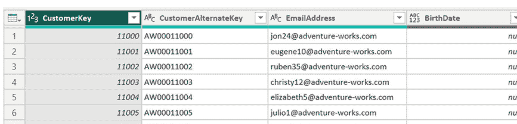

*Figure 10.14: Four columns selected from the text file despite the BirthDate column being removed from the source*

还提供了一个 MissingField.Ignore 选项，仅检索 Table.SelectColumns 中找到的列。

请确保避免默认应用于非结构化源的自动数据类型更改。如果启用，这将有效地对源中的每个列创建硬编码依赖。同样，对于所有其他转换，尽量限制或避免显式引用列名，并始终优先选择所需列而不是删除不必要的列。显式选择的列不太可能在未来被更改或删除，而删除列会带来风险，即源中添加的新列将被加载到语义模型中。

### There’s more…

除了可靠性改进之外，还可以使用 Power Query Editor 工具功能区中的 Query Diagnostics 来分析查询性能。还有改进 Power Query 代码整体可维护性的方法。两种这样的方法是注释和数据源管理。

与所有编程语言一样，注释可用于提高 M 代码的整体可维护性，如下例所示：

/* This query joins the Product query to the Product Subcategory query.
The product subcategory column 'EnglishProductSubcategoryName' is renamed 'Product Subcategory' */
let ProductToProductSubCatJoin =
try
// Nested outer join based on Subcategory Surrogate Key


## 查询依赖项

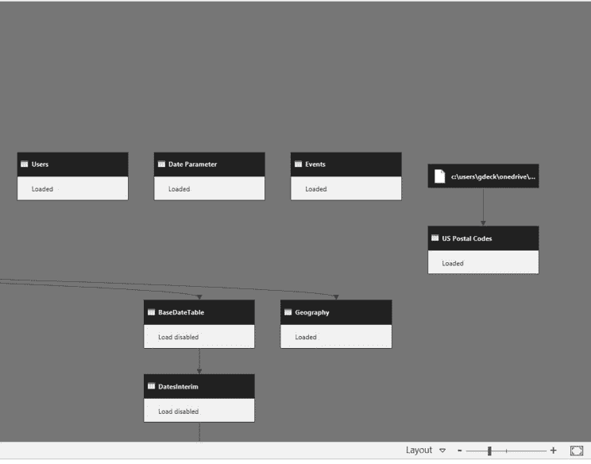

图 10.15：查询依赖项视图

- 4. 在“查询”窗口中创建以下文件夹组：Parameters、Data Sources、Dimensions 和 Facts。
- 5. 创建六个文本参数，以从三个数据源中抽象出文件名、文件路径、服务器和数据库名称。
- 6. 从引用这些参数的各个空白查询中开发三个数据源查询：

```
= Sql.Database("#SQL Server AdventureWorks Server", "#SQL Server AdventureWorks DB")
= #"MS Access AdventureWorks Path" & "\" & #"MS Access AdventureWorks DB" & ".accdb"
= #"MS Excel Ad Works Path" & "\" & #"MS Excel Ad Works File" & ".xlsx"
```

4. 切换到“模型”视图，并将所有经销商度量值的“显示文件夹”更改为“Reseller Metrics”：

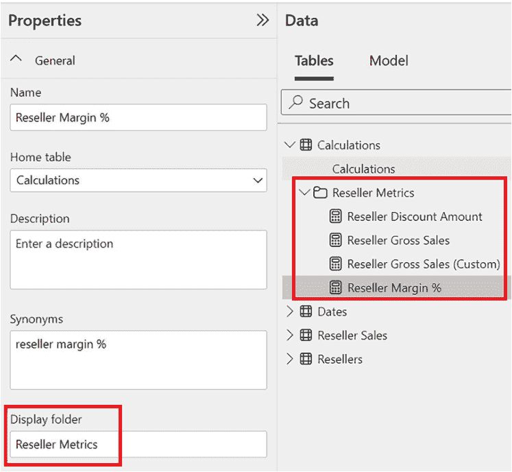

图 10.16：编辑度量值的“显示文件夹”

## 工作原理

“Reseller Margin %”度量值（步骤 2）包含三行注释，用于描述该度量值各组成部分的业务定义。还可以通过 `--` 和 `//` 字符逐行添加注释，Power BI 会对此文本应用绿色编码。对于包含多个组件的复杂度量值以及构成许多其他度量值基础的简单度量值，都建议嵌入注释。

应注意，DAX 度量值中的注释仅供语义模型的开发者查看。但是，可以使用图 10.16 中所示的“描述”字段来提供度量值的简要说明。在“报表”视图的“数据”和“可视化”窗格中将鼠标悬停在度量值上时，该描述将显示为工具提示。

ShippedSales 变量用于筛选 Reseller Sales 事实表，以排除未发货的销售订单行，并且该表在 NetSalesShipped 变量中用作筛选参数。引用了现有的 Reseller Gross Sales 和 Reseller Discount Amount 度量值，但 ProductCost 变量是针对 Reseller Sales 事实表（无论是否已发货）显式定义的。虽然这比用于相同计算的其他 DAX 表达式要长得多，但使用变量和注释消除（或减少）了查看其他度量值以理解逻辑和源列的需求。

对于“Reseller Gross Sales (Custom)”度量值（步骤 3），为每个要筛选的表声明了变量，并插入了一条注释（Trailing 10 Days）来帮助解释 DateHistory 变量。这些变量作为筛选参数调用到 CALCULATE 中，因此 Reseller Gross Sales 度量值反映了这种修改后的筛选上下文。在 CALCULATE 内定义所有筛选逻辑也可以实现相同的功能结果，但这会使表达式更难阅读，从而更难以维护。

将相关度量值分组到显示文件夹中有助于组织度量值，以方便维护。

## 更多内容…

可以在 DAX Studio 中使用 DAX Formatter 将括号与其关联函数对齐。可以从 Power BI Desktop 中复制较长的复杂 DAX 度量值到 DAX Studio 中进行格式化。要使用 DAX Studio 格式化查询，请打开 DAX Studio，将 Power BI Desktop 中的查询复制并粘贴到主窗口中，然后在 DAX Studio 中单击“Format Query”。复制 DAX Studio 中的查询，并将 Power BI Desktop 中的表达式替换为格式化后的表达式。

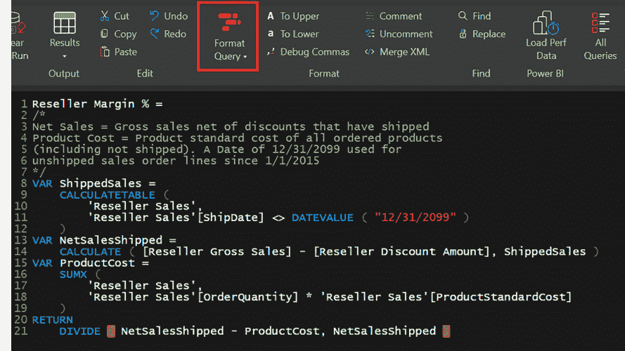

图 10.17：DAX Studio 中的 DAX Formatter，用于格式化年初至今度量值

- 22. 单击语义模型的 **立即刷新** 图标。
- 23. 打开语义模型的 **设置** 并查看 **刷新历史记录**。
- 24. 等待语义模型刷新，然后打开报表以验证最新的 `OrderDate` 是否为 `11/29/2013 12:00:00 AM`。

## 工作原理

增量刷新在执行增量刷新时使用保留参数名称 **RangeStart** 和 **RangeEnd**。虽然这些参数在增量刷新配置期间初始设置，但此后由 Power BI 服务更新，以确定语义模型中哪些行需要增量刷新。

配置增量刷新的筛选行时，**RangeStart** 和 **RangeEnd** 的两个条件不能都包含等于号 (=) 子句，因为这可能导致重复数据。只配置其中一个条件包含等于号 (=) 子句，以避免此类情况。

首次在服务中刷新数据时，Power BI 将根据 **增量刷新** 对话框中的 **存储满足以下条件的行（其中列位于以下时间范围内）** 设置刷新整个语义模型。换句话说，在为增量刷新配置的语义模型的首次刷新期间，刷新过程类似于对所有数据的完全重新加载。除非应用其他筛选器，否则存储期内的所有行都包含在语义模型中。后续刷新仅根据 **刷新满足以下条件的行（其中列位于以下时间范围内）** 设置刷新新数据。

请务必记住，一旦配置了增量刷新，就无法再从服务中导出 Power BI 文件。因此，如果需要进行更改，务必保留原始的 Power BI Desktop 文件。

## 更多内容…

**增量刷新** 对话框中有三个可选的增量刷新设置。这些可选设置如下：

- 检测数据更改
- 仅刷新完整天数
- 使用 DirectQuery 实时获取最新数据（仅限 Premium）

**检测数据更改** 设置可用于进一步优化通过增量刷新刷新的数据。此设置必须使用 **日期/时间** 类型的列，并且该列不应与用于 **RangeStart** 和 **RangeEnd** 参数的列相同。Power BI 服务在刷新时会评估此列的最大值，如果该值自上次刷新以来未更改，则不会在语义模型中刷新任何数据。

**仅刷新完整天数** 设置用于防止不完整的天数被包含在数据刷新中。例如，如果刷新操作检测到某一天不完整（例如计划在凌晨 4 点刷新），则该天的数据不会包含在刷新操作中。这对于那些希望语义模型中仅包含完整每日信息以用于报表目的的组织非常有用。

最后一个选项 **使用 DirectQuery 实时获取最新数据（仅限 Premium）** 顾名思义，是仅适用于 Premium (Fabric) 容量和 Premium Per User (PPU) 工作区的功能。选择此选项会向语义模型添加一个 DirectQuery 分区。简而言之，上次增量刷新后更改的数据将由此分区检索。包含 DirectQuery 分区可以显著减少每天刷新的次数，并确保将最新的数据更改包含在报表中。

## 另请参阅

- *Power BI 中的增量刷新：* https://bit.ly/3f3DSkM
- *语义模型的增量刷新和实时数据：* https://bit.ly/3w10oSv

## 总结

本章的实操配方包含语义建模、DAX 度量值和 M 查询模式，以提升 Power BI 语义模型的性能、可伸缩性和可靠性。这包括语义模型和度量值的性能调优示例、错误处理以及 M 查询的查询折叠示例，此外还提供了有关 DAX 和 M 查询引擎的支持细节。

下一章将介绍如何使用 Power BI 服务、Teams 和移动设备部署和分发 Power BI 内容。

## 加入我们的 Discord 社区

加入我们社区的 Discord 空间，与作者和其他读者讨论：

https://discord.gg/ebXZqyrxJb


如果本地 SSAS 作为 Power BI 的数据源（通过本地数据网关）使用，则利用 Azure ExpressRoute 与 Power BI 租户的 Azure 数据中心建立私有连接可能会有所帮助。

5. 随着采用和需求的变化，规划 Power BI 项目的扩展和迁移，并确定项目生命周期的关键点以及随需求变化进行迁移和扩展所需的能力。

这方面的示例包括添加独立的 Power BI Premium 或 Fabric 容量节点（横向扩展）、更大的容量节点（纵向扩展）、将 Power BI Desktop 语义模型迁移到 SSAS 或 Azure Analysis Services、在开发、测试和生产 Power BI 工作区和应用之间分阶段部署、将工作区移入和移出专用容量，以及跨团队转移内容所有权，例如从业务团队转移到企业 BI 团队。

6. 为 Power BI 团队成员分配角色和职责：
- 语义模型作者，包括源连接、检索查询、语义建模和度量开发。
- 报表作者，包括仪表板、移动端优化的报表和仪表板以及应用。
- 管理员，包括本地数据网关、专用容量和租户设置。

7. 针对这些团队角色的技能和知识目标：
- 语义模型作者应学习 DAX、M 以及 Power BI 和 SSAS 语义建模的基础知识。
- 报表作者应了解或学习可视化标准、交互性和筛选以及自定义视觉对象。
- 管理员应研究用于本地网关监控、工作区、专用容量、Office 365 审核日志和 Power BI 活动日志的监控工具和数据。
- 报表作者通常是 IT 或 BI 组织之外的业务分析师，应定期查看 Power BI 每月更新中发布的新报表功能。

8. 建立跨团队协作流程：
- 语义模型作者应与数据源的所有者和主题专家协作。例如，应传达数据源架构或资源的任何更改。
- 报表作者应能够访问语义模型文档，并与语义模型作者协作。例如，应传达新报表不可用的度量或维度。任何标准（如企业 Power BI 报表主题或字体）都应记录在案。

4. 如果需要，自定义管道的阶段，然后点击**创建**按钮：

## 自定义阶段

定义要包含在管道中的阶段，并为每个阶段命名。

+ 添加

1 开发

2 测试

3 生产

创建 取消

图 11.1：自定义部署管道阶段

5. 在**开发**阶段下，使用下拉菜单选择本配方*准备就绪*部分中创建的工作区，然后点击**分配工作区**按钮：

开发

选择要分配到此阶段的工作区

Cookbook 第3版

为什么我看不到所有工作区？

分配工作区

图 11.2：将工作区分配到部署管道阶段

6. 在**开发**阶段下，点击**部署**按钮。

如果在共享表单上保持启用状态，收件人将收到电子邮件通知以及 Power BI 中的通知。


图 11.8：仪表板收件人的 Power BI 服务中的通知中心

对于收件人，仪表板出现在“与我共享”选项卡中。如果仪表板所有者启用了该选项（并且用户是组织内部用户），则启用与其他人重新共享仪表板的选项。用户将能够收藏该仪表板，从 Power BI 移动应用访问它，并与内容交互（例如筛选选择），但无法编辑报表或仪表板。

## 工作原理

内容应始终从工作区而非“我的工作区”分发。即使在相对非正式的场景中（例如与一个用户共享仪表板），从“我的工作区”共享仪表板也会造成对单个用户维护内容的依赖。从具有多个 BI 团队成员的工作区共享内容，可以解决单个用户无法维护内容的风险，并受益于 Microsoft 持续投资于工作区的管理和治理功能。

具有编辑权限的工作区成员可以禁用仪表板的重新共享并完全停止共享。要编辑权限，请打开仪表板，点击“共享”，点击省略号 (...)，然后点击“管理权限”以识别并可选地修改当前访问权限。

## 如何创建和配置工作区

要实现此配方，请执行以下操作：
1. 登录 Power BI 服务。
2. 通过单击左侧导航窗格中的“工作区”，然后单击“新建工作区”来创建工作区：

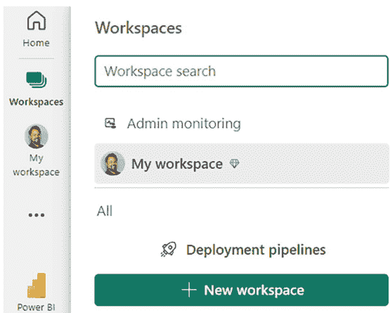

图 11.11：创建新工作区

3. 在右侧的“创建工作区”窗格中，输入新工作区的设置，包括名称、描述和许可证模式。可选地，可以指定域类型（参见第14章“管理和治理 Power BI”中“访问管理门户”配方的“更多内容...”部分），还可以在联系人列表中添加其他联系人，甚至添加工作区图像：

## 创建工作区

名称 *
Power BI Cookbook 第3版
此名称可用
描述
用于 Power BI Cookbook 第3版的工作区
域
公司
了解有关工作区设置的更多信息
工作区图像
上传
重置
高级
联系人列表 *
gdeckler (所有者)  输入用户和组
许可证模式
Pro
选择 Pro 以使用基本 Power BI 功能，并在报表、仪表板和评分卡上协作。要访问 Pro 工作区，用户需要 Pro 每用户许可证。了解更多
试用版
选择免费试用每用户许可证，以在 60 天内试用 Microsoft Fabric 中的所有新功能和体验。Microsoft Fabric 试用许可证允许用户创建 Microsoft Fabric 项目，并在 Microsoft Fabric 试用容量中与他人协作。探索 Power BI、Data Factory、Data Engineering 和实时分析等新功能。了解更多
Premium 每用户
选择 Premium 每用户以使用 Power BI Premium 功能进行协作，包括分页报表、数据流和数据市场。要在 Premium 每用户工作区中协作和共享内容，用户需要 Premium 每用户许可证。了解更多
Premium 容量
如果工作区将托管在高级容量中，请选择高级容量。当您共享、协作和分发 Power BI 和 Microsoft Fabric 内容时，查看者角色中的用户可以在无需 Pro 或 Premium 每用户许可证的情况下访问此内容。了解更多

图 11.12：新工作区设置

4. 单击底部的**应用**按钮以创建工作区。
5. 新工作区加载后，单击**管理访问权限**按钮：


*图 11.13：管理工作区的访问权限*

6. 在右侧的**管理访问权限**对话框中，通过单击**添加人员或组**按钮，将用户添加为**管理员**、**成员**、**参与者**或**查看者**。

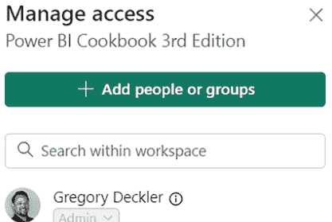

*图 11.14：管理工作区的访问权限*

## 工作原理

根据本章前面的*为内容创建和协作做准备*配方，工作区与应用一一对应，并且可以具有广泛的范围（例如销售）、狭窄的范围（例如特定仪表板），或介于这两个极端之间的平衡，例如欧洲销售。如果使用广泛的工作区范围，则可能无需为特定项目或仪表板创建新工作区，因为新内容可以添加到现有工作区。然而，随着越来越多的报表和仪表板添加到工作区，考虑新的、更集中的工作区和修订策略可能是有益的。

如配方中所述，用户和组可以添加到四种不同的工作区角色之一：**管理员**、**成员**、**参与者**或**查看者**。在分配这些角色时应谨慎，因为每个角色都带有某些可能产生意外后果的权限。

**管理员**角色提供管理工作区所有方面的能力，包括添加和删除用户以及配置所有工作区设置。

**成员**角色提供与管理员角色相同级别的访问权限，但以下功能除外：更新或删除工作区、添加或删除工作区中的任何用户（只能添加成员或权限较低的其他用户）、允许参与者更新工作区的应用以及管理他人的订阅。


**Contributor** 角色主要用于需要简单地向工作区添加内容的个人或团体。贡献者无法影响工作区权限或工作区内内容的权限。

**Viewer** 角色提供查看工作区内所有内容并为其创建报表订阅的能力。

必须理解的是，**Admin**、**Member** 和 **Contributor** 角色都会使 **行级安全性 (RLS)** 失效。这意味着这些角色的任何成员都可以始终查看发布到工作区的所有语义模型中的所有内容，而不管 RLS 规则和角色如何。RLS 规则和角色仍然适用于 **Viewer** 角色。

通常，**Viewer** 角色被用作一种简单的方式，让大量用户访问工作区内的所有内容。然而，这并不是推荐的做法。由于 **Viewer** 角色对所有内容都有查看权限，即使是处于开发中的内容也可能被该角色的成员看到。建议改用应用来广泛地与他人共享内容，并且仅在特殊情况下才考虑使用 **Viewer** 角色。

## 还有更多…

创建后，可在工作区创建过程中指定的工作区设置以及其他设置都可以通过点击 **Workspace settings** 选项进行查看和修改，如 *图 11.15* 所示。工作区设置包括将工作区分配给专用容量、配置 GitHub 集成、OneLake 设置以及配置选项，例如允许贡献者更新工作区应用：

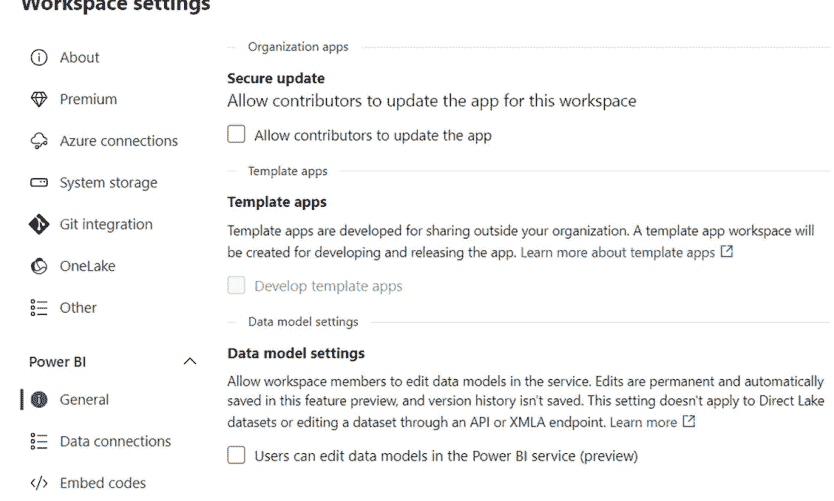

*图 11.15：管理工作区的访问权限*

## 另请参阅

- Workspaces in Power BI: https://bit.ly/3upkPNA
- Roles in workspaces in Power BI: https://bit.ly/49prZ3o

## 配置本地网关数据连接

利用 Power BI 服务和移动应用程序在所有设备上提供丰富的集成仪表板和报表访问的能力，需要对数据源和使用的语义模型进行周到的配置。对于许多组织而言，主要的商业智能数据源托管在本地，因此，除非 Power BI 报表完全通过 Power BI Report Server 在本地部署，否则需要本地数据网关来安全地促进 Power BI 服务与本地系统之间查询和数据的传输。此外，通常支持许多报表和仪表板的语义模型必须配置为使用本地数据网关，以便对导入数据到 Power BI 的计划刷新，或支持来自 Power BI 的 DirectQuery 和实时连接查询。

本配方包含两个配置已发布语义模型的数据源和计划刷新的示例。第一个示例为导入模式 Power BI 语义模型配置两个本地数据源（SQL Server 和 Excel），并安排每日刷新。第二个示例为 DirectQuery Power BI 语义模型配置单独的本地 SQL Server 数据库，并设置 15 分钟的仪表板磁贴刷新计划。

### 准备工作

为准备本配方，请执行以下步骤：

- 1. 下载、安装并配置本地数据网关，如 *第 1 章《配置 Power BI 工具》*中 *《创建本地数据网关》*所述。
- 2. 确保您是网关管理员，如 *第 14 章《管理与治理 Power BI》*中配方 *《控制数据网关安装》*的 *《还有更多...》* 部分所述。

强烈建议为每个安装的网关至少配置两个管理员，以提供冗余和管理员功能的备份。

### 如何配置本地网关数据连接

在本示例中，已使用 Power BI Desktop 创建了一个导入模式语义模型，从两个本地数据源检索数据：SQL Server 数据库和 Excel 文件。要实施本配方，请执行以下操作：

- 1. 确定 Power BI Desktop 文件中使用的服务器名称和数据库名称。
- 2. 确定 Excel 文件的完整路径。
- 3. 在 Power BI 服务中，点击右上角的齿轮图标并选择 **Manage connections and gateways**。
- 4. 在 Data（预览）界面中，点击 Connections 选项卡，然后点击 New 按钮：

图 11.16：创建新的网关连接

- 5. 在右侧的 New connection 对话框中，选择步骤 1 中安装的网关集群名称，提供一个不会与其他源冲突的直观连接名称，并输入服务器、数据库和凭据信息：

图 11.17：将 SQL Server 数据库添加为本地数据网关的源

网关中配置的服务器和数据库名称必须与 Power BI 语义模型中使用的名称完全匹配。

如果为网关配置 Analysis Services 数据源，请确保使用的凭据也是给定 Analysis Services 实例的管理员。服务器管理员凭据用于建立连接，但每次用户从 Power BI 与 Analysis Services 数据源交互时，其 UPN（用户主体名称）都会通过 EffectiveUserName 连接属性传递给服务器。这允许在 Analysis Services 数据库中定义的 RLS 角色应用于 Power BI 用户。

- 6. 确保源使用适当的隐私级别，例如在 **General settings** 下的 **Privacy Level** 中选择 **Organizational** 或 **Private**。
- 7. 点击 **Create** 按钮。用户可以根据 *第 14 章《管理与治理 Power BI》*中配方 *《控制数据网关安装》*的 *《还有更多...》* 部分所述添加到指定的网关和连接。
- 8. 使用文件数据源类型为 Excel 文件添加另一个数据源。
- 9. 如同 SQL Server 数据源一样，为此网关和连接授权用户。
- 10. 将导入模式 Power BI Desktop 文件（语义模型）发布到 Power BI 服务中的工作区。
- 11. 访问工作区，并对语义模型点击 **Schedule refresh** 图标：


*图 11.18：为语义模型安排刷新*

- 12. 展开 **Gateway and cloud connection** 部分。

如果满足以下三个条件，网关将作为数据刷新的选项出现：

- 用户列在网关中数据源的 **Users** 页面上。
- 在 Power BI 服务中为网关配置的服务器和数据库名称与 Power BI Desktop 文件中使用的名称匹配。
- 语义模型使用的每个数据源都已配置为网关的数据源。

- 13. 在 Data sources included in this semantic model 部分，使用 Maps to 下拉菜单选择已配置的网关数据源连接。

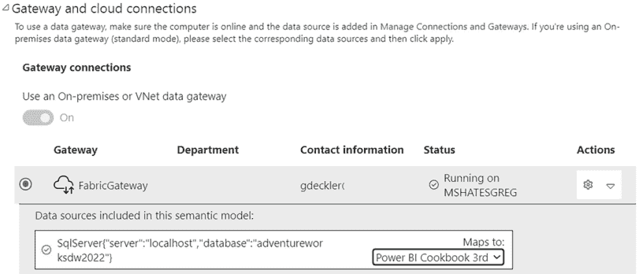

图 11.19：将数据源与 Power BI 网关数据连接关联

- 14. 点击 Apply 按钮以将数据源连接到网关。
- 15. 现在展开 Refresh 部分并将 Configure a refresh schedule 切换为 On。
- 16. 点击 Add another time 链接以添加刷新的计划时间。
- 17. 添加完刷新时间后，点击 Apply 按钮。

导入模式语义模型的刷新操作后，仪表板磁贴使用的缓存会更新（或手动更新）。Power BI 服务还会缓存报表可视化的数据，并在语义模型刷新时更新这些缓存。仪表板磁贴可在 Power BI 服务中通过 Refresh visuals 菜单项（右上角，圆形箭头图标）手动刷新。同样，报表也可以从 Power BI 服务手动刷新，但这仅与 DirectQuery 和 Analysis Services 实时连接相关；这不会启动导入模式语义模型的刷新。

导入模式语义模型可通过 Power BI 服务中的计划或通过 REST API 刷新。Power BI 数据刷新 API 允许 BI 团队以编程方式触发 Power BI 服务中的刷新操作。

例如，可以向现有的夜间（或更频繁）数据仓库或 ETL 流程中添加一个步骤，以启动使用该数据源的 Power BI 语义模型的刷新。这允许 Power BI 服务中的仪表板和报表尽可能快地反映数据源的最新成功刷新。换句话说，源系统刷新与 Power BI 语义模型计划刷新之间的差距或滞后可减少到在 Power BI 服务中刷新语义模型所需的时间。

要在 Power BI 服务中触发语义模型的刷新，只需发出以下 HTTP 请求：

```
POST https://api.powerbi.com/v1.0/myorg/groups/{group_id}/semantic_models/{semantic_model_id}/refreshes
```

请参阅本配方 *另请参阅* 部分中的 Power BI REST API 身份验证文档和 Power BI REST API 参考。

## 还有更多...

在本示例中，基于单独的本地 SQL Server 数据库的 DirectQuery 模式 Power BI Desktop 文件（语义模型）必须部署到 Power BI 服务。目的是使基于该语义模型的仪表板尽可能保持最新。要实施本配方，请执行以下操作：

- 1. 如同导入模式语义模型一样，将 SQL Server 数据库添加为网关的数据源。
- 2. 将用户分配给此数据源和网关。
- 3. 将 DirectQuery Power BI Desktop 文件（语义模型）发布到 Power BI 服务中的 App 工作区。Power BI 会通过匹配 PBIX 文件中配置的数据源和为网关在 Power BI 服务中配置的源，自动将语义模型配置为使用网关。用户还必须列在网关中。
- 4. 在 Power BI 服务中访问工作区，并从列出的语义模型中点击通过省略号 (...) 的 Settings。
- 5. 将 Query Caching 修改为 On，并将 Automatic dashboard tile and metric refresh 从 1 小时更改为 15 分钟：


## 查询缓存

容量默认值：查询缓存关闭

关闭：不为此语义模型缓存查询结果

打开：通过使用以前保存的查询结果来加快报表速度。

应用

放弃

## 计划刷新和性能优化

为了提高浏览报表的性能，启用架构缓存可以缩短查询响应时间。

## 自动聚合训练

为了加快浏览报表的速度，Power BI 可以生成运行更快的聚合，并且具有缓存数据的视觉对象将加载得更快。

关闭

## 自动仪表板磁贴和指标刷新

调整每个仪表板磁贴的自动刷新频率。更多。了解详细信息

打开

刷新计划：

刷新频率

15 分钟

应用

放弃

图 11.21：DirectQuery 语义模型设置

默认情况下，对于 DirectQuery 和实时连接语义模型，仪表板磁贴每小时刷新一次。在此过程中，Power BI 服务会通过网关向语义模型源发送查询。在这种情况下，组织可以接受更频繁的查询，但在其他情况下，仅每日甚至每周的仪表板刷新就足以避免给数据源增加工作负载。

## 另请参阅

- Power BI REST API 数据集——刷新数据集：https://bit.ly/3xWvE6J
- 添加或删除网关数据源：https://bit.ly/3f7GvSG
- 如何配置 Power BI 报表计划刷新：https://bit.ly/3evfZU7

8. 在右侧的“编辑受众”对话框中，将受众设置为“整个组织”，或指定一个或多个“特定用户或组”。

## 编辑受众

Cookbook 3rd Edition

授予访问权限

整个组织 了解详细信息

特定用户或组

输入名称或电子邮件地址

高级

允许人们共享此应用受众中的数据集。

允许人们使用此应用受众中的数据集构建内容。

上述高级设置适用于包括你的工作区用户在内的受众。

工作区用户

图 11.25：编辑受众

9. 单击“发布应用”按钮。

10. 发布后，你将收到一个“已成功发布”对话框：

## 已成功发布

Cookbook 3rd Edition

向用户提供下面的链接，或指引他们转到 Power BI 服务中的“应用”>“获取应用”。

https://app.powerbi.com/Redirect?action=OpenApp&appId=...

复制

转到应用

关闭

图 11.26：应用已成功发布

## 更多内容

向用户分发应用时，一个常见需求是限制或隔离某些报表或仪表板，使其不被某些用户看到。例如，一个应用可能包含特定于三个不同区域的报表，而业务方可能希望不同区域的用户只能看到其所在区域的报表。为了满足这一需求，可以创建多个特定于区域的受众，仅显示相关的区域报表，并将每个区域的安全组映射到相应的受众。应用新增的“受众”功能消除了以前通过创建完全独立的工作区和应用来将内容与用户分离的做法。

应用发布后，可以进行修改。在工作区中，通过单击功能区的“更新应用”按钮即可完成操作。一旦创建了应用，“更新应用”按钮就会替换“创建应用”按钮。

“设置”页面包含一些附加选项，可以上传应用徽标、应用主题颜色以及自定义联系信息：

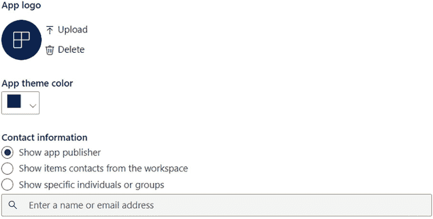

图 11.28：应用设置选项

此外，还有一些高级选项。这些选项控制应用的导航窗格行为、安装行为以及用户如何获得应用支持。

## 高级设置

## 导航窗格

默认展开导航窗格

默认折叠导航窗格

## 对隐藏内容的访问

如果要授予对内容的访问权限，即使该内容在导航中已隐藏，也请打开此设置。

了解有关访问的详细信息

关闭

## 全局应用设置

自动安装此应用。

允许用户复制此应用中的报表。

## 支持网站

分享你的用户可以在哪里找到帮助

图 11.29：应用设置对话框上的高级选项

“内容”选项卡允许向应用添加更多内容。此外，还可以添加链接和分区：

1 设置 2 内容 3 受众

Cookbook 3rd Edition

+ 添加内容

添加链接

添加新分区

图 11.30：添加链接和分区

图 11.33：隐藏或取消隐藏链接和分区

这意味着虽然每个工作区只能有一个应用，但根据受众的不同，单个应用可以呈现为多个不同的应用。

应用也可以被取消发布。同样在工作区中，使用省略号 (...) 然后选择“取消发布应用”即可完成。

图 11.34：取消发布应用

可以看出，应用提供了一种灵活的方法来向用户分发内容。

## 另请参阅

- Power BI 中的应用：https://bit.ly/3fMYsI5
- 在 Power BI 中发布应用：https://bit.ly/39NWl2S

## 使用 Teams 分发内容

Microsoft Teams 是一个统一的协作和通信平台，将视频会议、电话呼叫、文件存储、持久的工作场所聊天以及应用程序集成整合到一个统一的界面中。Teams 是 Microsoft 365 Office 生产力套件的一部分，与 Word、PowerPoint、Excel 和 SharePoint Online 原生集成。此外，功能扩展还支持与第三方应用程序集成。

本方法演示如何利用 Teams 分发和协作处理 Power BI 内容。

## 准备工作

要准备执行此方法，请按照以下步骤操作：

- 1. 请与你的 Microsoft Teams 管理员确认，确保 Power BI 应用在 Microsoft Teams 管理中心内未被屏蔽并且对你可用。Microsoft 的默认设置是 Power BI 应用未被屏蔽且对所有人可用。但是，组织安全团队和管理员可能会限制 Teams 中任何或所有应用的使用。
- 2. 确保你已将报表、仪表板或应用发布到 Power BI 服务。
- 3. 打开 Microsoft Teams 并加入或创建一个团队。

现在你已准备好完成此方法。

## 如何使用 Teams 分发内容

要实施此方法，请使用以下步骤：

- 1. 在 Teams 中，选择导航窗格中的“Teams”，然后选择一个团队内的频道。
- 2. 在 Teams 的标题区域（选项卡）中，选择加号图标 (+) 以添加选项卡。


图 11.35：在 Microsoft Teams 中添加选项卡

- 3. 搜索 power bi 并选择 Power BI 应用。


图 11.36：在 Microsoft Teams 中添加 Power BI 选项卡

- 4. 选择“保存”按钮以创建选项卡。
- 5. 粘贴指向 Power BI 内容的链接，或使用“浏览工作区”查找内容：

## 选择 Power BI 报表、应用或记分卡

粘贴 Power BI 链接

添加链接

添加

或从你的 Power BI 内容中选择

浏览工作区

图 11.37：向 Power BI 选项卡添加内容

6. 如果要浏览内容，请选择内容，然后点击“添加”按钮：

## 选择报表、应用或记分卡

工作区

应用

与我共享

搜索

名称

我的工作区

项目

管理员监控

Fabric

取消

添加

图 11.38：浏览内容

7. 单击“保存”按钮。

报表或仪表板名称将作为选项卡添加到团队中。

8. 如果选中了“将关于此选项卡的帖子发布到频道”，则“常规”频道的“帖子”选项卡中会出现一篇帖子。

恭喜你成功将第一个 Power BI 报表发布到 Teams！

## 工作原理

在 Teams 中添加 Power BI 选项卡不会生成嵌入代码（如“发布到 Web”或嵌入到 SharePoint Online），而是使用 Teams 的功能扩展能力与 Power BI 集成。此外，在 Teams 中创建 Power BI 选项卡并不会授予对通过 Teams 分发的仪表板或报表的权限。指定团队的成员必须通过 Power BI 服务获得对 Power BI 内容的权限。


6. 在 Teams 中，从导航窗格中选择省略号 (...) 并搜索 power bi。

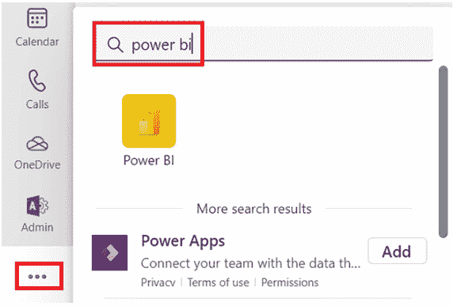

图 11.41：在 Teams 中添加 Power BI 应用

7. 选择 Power BI 应用。

8. Power BI 应用现在已固定到 Teams 导航栏。

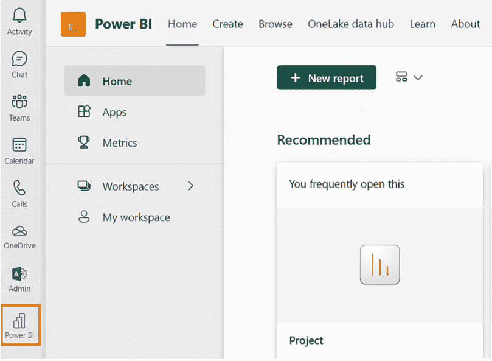

图 11.42：Teams 中的 Power BI 应用

正如你所见，Power BI 与 Teams 之间存在许多集成点。

## 另请参阅

- Collaborate with Power BI in Microsoft Teams, Outlook, and Office: https://bit.ly/2QYrXg1
- Add the Power BI app to Microsoft Teams: https://bit.ly/2RD81y8

## 摘要

本章包含通过 Power BI 服务部署和分发 Power BI 内容的详细示例和注意事项。这包括应用工作区和应用的创建与配置、配置数据网关、配置数据源和刷新计划，以及工作区的最佳实践。此外，还分享了流程和示例架构，描述了在开发和生产环境之间进行分阶段部署。

在下一章中，我们将探讨 Power BI 与其他应用程序的集成，包括 SQL Server Reporting Services、Excel、PowerPoint、Azure Analysis Services、Dataverse、Dynamics 365 等！

## 在 Discord 上加入我们的社区

加入我们社区的 Discord 空间，与作者和其他读者进行讨论：

https://discord.gg/ebXZqyrxJb


