# 12 将 Power BI 与其他应用程序集成

# 将 Power BI 与其他应用程序集成

Power BI 工具和服务，包括 Power BI Desktop、Power BI 网页服务和 Power BI 移动应用程序，本身就构成了一个现代、强大的商业智能和分析平台。Power BI Premium 和 Microsoft Fabric 容量进一步扩展了 Power BI 解决方案的可扩展性和部署选项，使组织能够通过 Power BI 服务中的应用、嵌入到自定义应用程序中、本地 Power BI 报表服务器，或这些分发选项的组合，将 Power BI 内容交付给大量用户。

然而，许多组织要么已经在 Excel、Analysis Services 和 Reporting Services 等其他工具中拥有广泛的自助式和企业级 BI 资产和技能，要么有兴趣利用这些工具的独特功能作为其 Power BI 解决方案的一部分。例如，组织可能会选择保留许多现有的 Excel 报表在 Excel 中，而不是将其转换为 Power BI 报表，鉴于 Excel 的独特功能，例如单元格级数据、格式控制和立方体公式。或者，鉴于 Power BI 语义模型的许多附加功能和优势，具有基于旧版 Excel 的数据模型的组织可能会选择将这些资产迁移到 Power BI。

本章中的配方重点介绍了 Power BI 与 Excel、PowerPoint、Power Apps、Power Automate、Dataverse 和 Dynamics 365 之间强大的集成点。在本章中，我们将涵盖以下配方：

- 从 Excel 的 Power Pivot 迁移到 Power BI
- 在 Excel 中访问和分析 Power BI 语义模型
- 将 Power BI 报表构建到 PowerPoint 演示文稿中
- 与 Power Automate 和 Power Apps 集成
- 利用 Dataverse 和 Dynamics 365
- 连接 Dynamics 365 和 Power Platform

在本章结束时，你将对 Power BI 如何工作以及如何与其他 Microsoft 技术集成有坚实的理解。

## 技术要求

完成本章中的配方需要以下条件：

- Power BI Desktop。
- Excel。
- PowerPoint。
- Visual Studio。
- Power Apps。
- Power Automate Premium。
- Dynamics 365。
- SQL Server 2022 或更新版本，并安装了 AdventureWorksDW2022 数据库。有关安装 SQL Server 和 AdventureWorks 数据库，请参阅第 1 章《安装和许可 Power BI 工具》中的《安装 SQL Server 和 AdventureWorks 数据库》配方。
- 本章的文件可以从以下 GitHub 仓库下载：https://github.com/PacktPublishing/Power-BI-Cookbook-Third-Edition/。

## 从 Excel 的 Power Pivot 迁移到 Power BI

鉴于 Power BI 作为平台的成熟度以及用户对 Power BI Desktop 的舒适度提高，通常将语义模型（以前称为 Power Pivot）和 M 查询从 Excel 迁移到 Power BI 是有益的。从数据管理和治理的角度来看，最好将语义模型整合到 Power BI 和/或 Analysis Services 模型中，并将 Excel 的作用限制为自助式分析，例如通过“在 Excel 中分析”连接到 Power BI 服务中的语义模型的透视表。

在本配方中，包含在 Excel 工作簿中的语义模型及其源 M 查询通过“导入 Excel 工作簿到 Power BI Desktop”迁移功能迁移到 Power BI 语义模型。有关导入的工作簿内容以及 Excel 到 Power BI 迁移的其他选项和注意事项的更多详细信息，请参阅“工作原理”和“更多内容...”部分。

## 准备工作

分析 Excel 工作簿以确定可以导入到 Power BI Desktop 的组件。例如，Excel 工作表中的数据表或范围不会被导入，但 Excel 语义模型中的表将被导入。同样，Excel 中的 Power View 报表工作表及其视觉对象将被迁移，但标准 Excel 图表、透视表和工作表公式和格式不会被迁移。

在某些情况下，可能需要修改 Excel 工作簿以建立将被迁移的数据源连接和查询。此外，可能需要使用 Power BI Desktop 报表创作视觉对象重新创建 Excel 特定的报表可视化，例如透视表和图表。包含大量自定义的 Excel 工作簿，例如 VBA 宏和复杂的 Excel 公式逻辑，可能需要对 Excel 工作簿、Power BI Desktop 模型或两者进行重大修改以支持迁移。

- 6. 单击 **开始** 按钮。
- 7. 将出现迁移完成消息，分解已完成的各项：

## 导入 Excel 工作簿内容

迁移已完成

查询（5 项）
✓ DimAccount
✓ DimCurrency
✓ DimCustomer
✓ DimDate
✓ FactInternetSales

数据模型表（5 项）
✓ DimAccount

图 12.3：导入 Excel 模型到 Power BI Desktop 迁移已完成

- 8. 单击 **关闭** 按钮。
- 9. 保存 Power BI Desktop 文件并使用 **模型视图** 确认所有关系是否成功导入。
- 10. 从 **主页** 选项卡的选项卡中单击 **刷新** 以测试所有 M 查询是否成功导入。
- 11. 在完成基本测试后，从 **主页** 选项卡的选项卡中单击 **发布** 并为新的语义模型选择一个工作区。

你的新 Power BI 语义模型现在可在 Power BI 服务中使用。如果你愿意，甚至可以针对此语义模型创建新的实时连接报表。

## 工作原理

迁移可能需要几分钟时间，具体取决于导入的语义模型的大小。Power BI Desktop 导入 M 查询、语义模型表、DAX 度量值和 KPI，以及任何 Power View for Excel 工作表。

依赖于不导入的项目（如 Excel 公式、标准 Excel 表（非模型表）、工作表范围数据、标准 Excel 图表和条件格式）的程度较大的工作簿可能需要在一定程度上继续支持。例如，可以将最少量的数据导入 Excel 的语义模型以继续驱动基于 Excel 的报表，并且可以将此工作簿上传到 Power BI 服务并进行刷新。

## 准备工作

为准备本配方，请执行以下步骤：

- 1. 确保用户拥有 Power BI Pro 许可证。
- 2. 确认 Power BI Pro 用户有权访问包含 Power BI 报表和语义模型的工作区。
- 3. 选择用于分析的报表。例如，如果你已完成第 5 章《在服务中工作》中的配方，CountryMonthlyReport 是一个不错的选择。你可以从 GitHub 下载此报表的 PBIX 并将其发布到 Power BI 服务。

你现在可以完成本配方。

## 如何在 Excel 中访问和分析 Power BI 语义模型

要实施本配方，请执行以下操作：

- 1. 在 Power BI 服务中打开所选报表。
- 2. 在报表的页眉/功能区中，选择导出然后选择在 Excel 中分析。
- 3. 在线打开 Excel 文件，然后在 Excel 桌面应用程序中打开该文件。
- 4. 单击透视表并从语义模型中添加度量值和列：

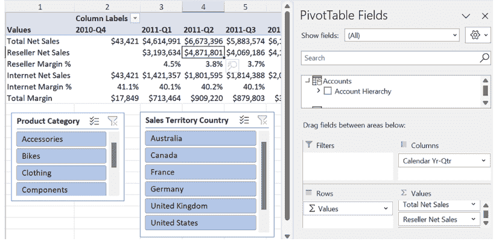

图 12.4：基于 Power BI 语义模型的 Excel 透视表，包含两个切片器

- 5. 选择透视表中的一个单元格。
- 6. 从“数据透视表分析”选项卡中选择 OLAP 工具下拉菜单并单击转换为公式：


7. 在 Excel 表格中选择一个单元格，右键单击并选择“表格”，然后选择“编辑查询...”。

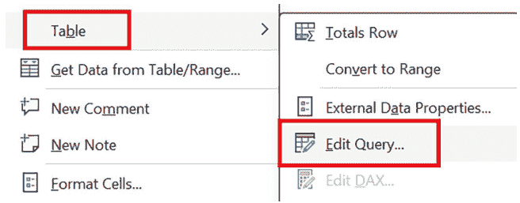

图 12.8：Excel 表格选项

8. 如果需要，“命令文本”区域可以修改为 DAX 查询。

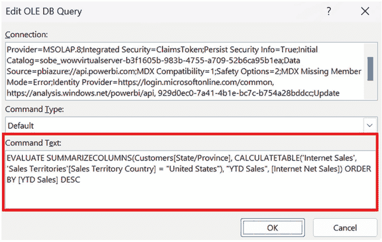

图 12.9：在“命令文本”区域插入 DAX 查询

9. 如果查询有效，Excel 表格将更新以返回查询中指定的列。

10. 视觉对象（例如地图视觉对象）可以使用此表格（DAX 查询）作为其数据源。

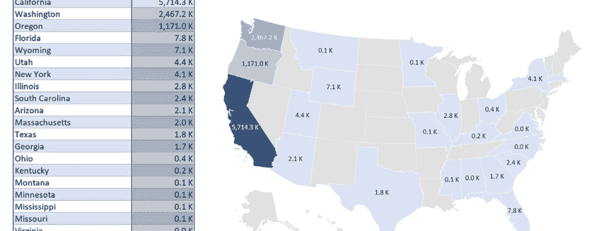

图 12.10：DAX 查询的 Excel 表格结果（左）和 Excel 地图视觉对象（右）

可在“连接属性”中的“OLAP 钻取”属性中调整要检索的行数。已对视觉对象应用自定义数据标签格式，以千为单位并保留一位小数来表示值。请注意，默认的数据透视表不能用作此视觉对象或其他几种新 Excel 视觉对象的数据源。

## 另请参阅

- 使用可刷新的 Power BI 数据创建 Excel 工作簿：https://bit.ly/3bIMSeM
- CUBEVALUE 函数：https://bit.ly/3DfftUA
- CUBEMEMBER 函数：https://bit.ly/3AXr1Kq

## 将 Power BI 报表构建到 PowerPoint 演示文稿中

Microsoft PowerPoint 仍然是标准的幻灯片演示应用程序，而将外部工具中的数据分析与可视化集成到演示文稿中，通常是高效演示文稿组合的关键组成部分。Microsoft 现在为其客户提供了多种无需任何第三方加载项或许可证即可在 PowerPoint 演示文稿中呈现 Power BI 内容的选项。一种选择是，通过将报表的每一页转换为独立的 PowerPoint 幻灯片，从头创建新的 PowerPoint 幻灯片母版。另一种备受重视的集成方式（在“更多内容...”部分中介绍）是能够在 PowerPoint 幻灯片中插入实时交互式 Power BI 报表，从而无需离开 PowerPoint 即可在会议或演示期间进行数据探索和讲述。

标题页还包含上次数据刷新时间以及日期和时间下载值。每个报表页都会被转换为一张幻灯片，其中包含报表页的高质量渲染图像。为视觉对象指定的任何替代文本都会包含在各页的备注中。

与其他高度可见内容（如高管仪表板）的规划和预防措施类似，重要的是要了解数据源、刷新过程、数据质量和所有权并对其建立信心。例如，如果源语义模型从多个源（包括临时 Excel 文件）检索数据，并且有刷新失败的历史记录，则该报表可能不适合用于 PowerPoint 演示文稿。相比之下，基于 IT 托管的 Analysis Services 模型且已经过验证并有明确所有者的报表，则是更好的选择。

背景图像会随着图表的边界区域被裁剪，因此建议移除或避免使用背景图像。此外，导出的报表页始终生成标准的 16:9 PowerPoint 幻灯片尺寸，因此也应避免使用自定义或非标准的页面尺寸。矩形和线条等用于提供自定义分组、边框和视觉对象背景颜色的形状也可能需要移除，以便在 PowerPoint 中正确渲染。最后，在使用导出到 PowerPoint 功能的报表中，应避免使用未认证的视觉对象、R 视觉对象和 Python 视觉对象。

## 更多内容...

如图 12.13 所示，另一种选择是将报表导出为连接到 Power BI 实时数据的 PowerPoint 文件。同样，在 PowerPoint 中，您可以使用“插入”选项卡将 Power BI 内容插入到现有 PowerPoint 文件中。

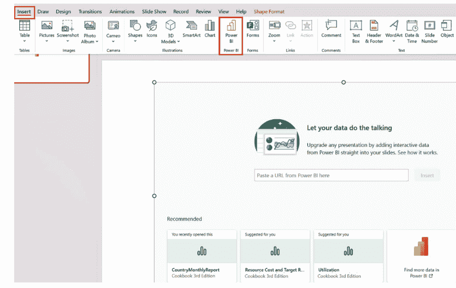

图 12.14：将 Power BI 内容插入 PowerPoint 文件

## 另请参阅

- *将实时 Power BI 数据添加到 PowerPoint：* https://bit.ly/3SzU0hD
- *将报表导出为 PowerPoint：* https://bit.ly/3tIaPZl

## 与 Power Automate 和 Power Apps 集成

Power BI 的工具和服务主要是只读的，因为它们的使命是从数据中获取见解，而不是创建新数据或修改现有数据。虽然数据分析和可视化当然是基本功能，但只有基于见解采取的行动才能创造价值。因此，Power Platform 包含 Power Automate 和 Power Apps，这两个功能丰富且成熟的应用程序支持业务流程自动化以及用于创建和编辑业务数据的业务应用程序的开发。

Power BI Desktop 现在包含 Power Automate 和 Power Apps 的视觉对象，使报表作者能够直接在 Power BI 报表中轻松展示这些工具的功能。例如，Power BI 报表页面可以显示一个 Power Apps 表单，供用户选择性地编辑产品值。此外，Power BI 报表可以包含 Power Automate 视觉对象，使报表用户能够触发各种工作流，例如发送电子邮件或刷新语义模型。

在本食谱中，将创建一个 Power Automate 工作流来支持 Power BI 服务中的流式语义模型。具体来说，Power Automate 工作流被配置为每五分钟从本地 SQL Server 表读取数据，并将此数据推送到 Power BI，从而提供近实时的可见性，并支持数据驱动的警报和通知。

## 准备工作

要准备本食谱，请按照以下步骤操作：

- 1. 打开 **SQL Server Management Studio (SSMS)**，连接到包含 AdventureWorksDW2022 数据库的本地 SQL 数据库，并熟悉 dbo.FactSurveyResponse 表的列：

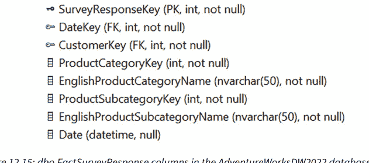

*图 12.15：AdventureWorksDW2022 数据库中的 dbo.FactSurveyResponse 列*

- 2. 确保您有一个与 Power Automate 兼容的数据网关正在运行。有关安装说明，请参阅*第 1 章，配置 Power BI 工具*。

在本食谱中，使用本地数据网关通过 Power Automate 从本地 SQL Server 数据库表支持 Power BI 流式语义模型。根据前面章节的内容，支持 Power BI 刷新过程和实时连接或 DirectQuery 模型的同一个网关也可用于 Power Apps 和 Power Automate。根据这些不同活动和应用程序生成的工作负载，并基于网关资源监控，可能有必要将 Power Apps 和 Power Automate 隔离到专用的本地网关，或者将来向高可用性网关集群添加服务器。

## 如何与 Power Automate 和 Power Apps 集成

要实现本食谱，请执行以下操作：

- 1. 在 Power BI 服务中打开一个工作区，并单击顶部菜单栏中的**新建**按钮。

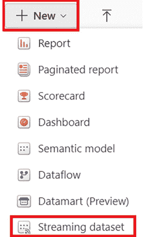

*图 12.16：Power BI 服务中工作区的新建选项*

- 2. 选择**流式数据集（语义模型）**，单击 **API** 图标，然后单击 **下一步** 按钮。

3. 配置流式语义模型，使其与 FactSurveyResponse 表的列和数据类型一致。

## 新建流式数据集

创建流式数据集，并将我们的 API 集成到您的设备或应用程序中以发送数据。详细了解 API。

* 必填

数据集名称 *
Customer Survey Response

来自流的值 *
SurveyResponseKey  数字
CustomerKey  数字
ProductCategory  文本
ProductSubcategory  文本
Date  日期时间
输入新的值名称  文本

```
[
  {
    "SurveyResponseKey" : 98.6,
    "CustomerKey" : 98.6,
    "ProductCategory" : "AAAAA555555",
    "ProductSubcategory" : "AAAAA555555",
    "Date" : "2024-02-09T22:00:15.381Z"
  }
]
```

历史数据分析
开

图 12.17：流式语义模型配置

4. 输入语义模型名称，启用“历史数据分析”设置，并单击“创建”按钮。

5. 复制“推送 URL”值，并单击“完成”按钮。

6. 登录 Microsoft 365 中的 Power Automate：https://make.powerautomate.com。


7. 使用左侧导航中的连接为你的 SQL Server 创建一个连接（可能需要点击 …更多）：

对表中的行执行创建、更新、获取和删除等操作。

身份验证类型 *
Windows 身份验证

SQL 服务器名称 *
localhost

SQL 数据库名称 *
AdventureWorksDW2022

图12.18：在 Power Automate 中创建 SQL Server 连接

8. 在左侧导航窗格中，单击“创建”。

9. 在“从空白开始”区域，单击“计划云流”。

10. 提供流名称，将工作流设置为“每5分钟重复一次”，然后单击“创建”按钮。

流名称
Customer Survey Workflow

运行此流 *
从 2/9/24 上午10:00 开始
每5分钟重复一次

此流将运行：
每5分钟

图12.19：创建 Power Automate 工作流

11. 在设计屏幕上，单击 + 图标以插入新步骤，然后选择“添加操作”。


图12.20：添加操作

12. 搜索“SQL Server”，然后选择“获取行 (V2)”。

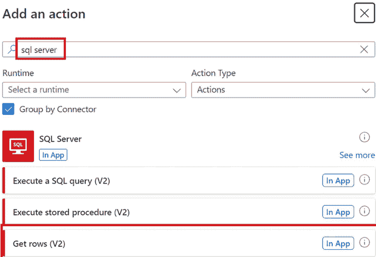

图12.21：Power Automate 中的“获取行”SQL Server 操作

+   22. 单击 **“获取数据”**，然后选择“Power BI 语义模型”。
+   23. 选择“Customer Survey Response”语义模型，并单击 **“创建”** 按钮。
+   24. 创建一个对语义模型中的行进行计数的简单视觉对象。

在生产场景中，需要修改此配方，以使 Power Automate 流的每次运行不会重复 Power BI 语义模型中已有的行。

务必记住从本配方中删除或禁用你的 Power Automate 流！

## 工作原理

当在 Power BI 服务中为流式语义模型启用历史数据分析时，所创建的语义模型既是流式语义模型，也是推送语义模型。作为推送语义模型，会在 Power BI 服务中为该语义模型创建数据库和表，从而允许基于此表创建 Power BI 报表视觉对象和功能。如果不启用历史数据分析（默认情况），该语义模型只是一个流式语义模型。Power BI 会临时缓存数据，但没有底层语义模型，因此可视化这些数据的唯一方法是通过实时流式仪表板磁贴。

Power Automate 流在概念上类似于 **SQL Server Integration Services（SSIS）** 包的控制流界面。可以通过分支条件、作用域和循环结构向 Power Automate 工作流添加复杂逻辑。Power Automate 专为自助场景和业务高级用户而设计。Power Automate 利用 Azure 逻辑应用，这是一种基于云的集成服务，更面向开发人员和企业集成场景。

流的历史记录（包括成功和失败的执行）可通过单击 Power Automate 网站 **“我的流”** 区域中的流名称来获取。此外，针对特定流的 **“我的流”** 页面允许你添加所有者、查看连接、编辑流以及关闭流。

## 更多内容…

除了 Power Automate，Power Apps 也与 Power BI 集成。要了解此集成的工作原理，请执行以下步骤：

-   1. 登录 Microsoft 365 中的 Power Apps：https://make.powerapps.com。
-   2. 在左侧窗格中，选择 **“表”**。
-   3. 选择 **“导入”** 下拉菜单，并选择 **“导入数据”**：

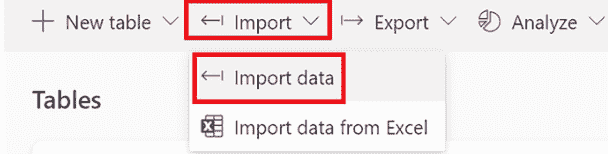

*图12.24：导入数据*

-   4. 选择“Power Platform 数据流”。
-   5. 对于连接，可以创建新连接，也可以使用现有连接。
-   6. 单击“下一步”按钮。
-   7. 从数据流中选择一个表（如 DimProduct），然后单击“下一步”：

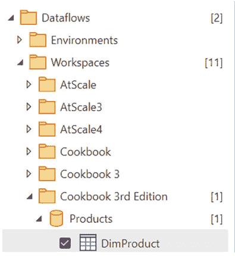

图12.25：选择数据流表

-   8. 单击“下一步”按钮。
-   9. 选择“加载到新表”，并单击“下一步”按钮。

## 映射表

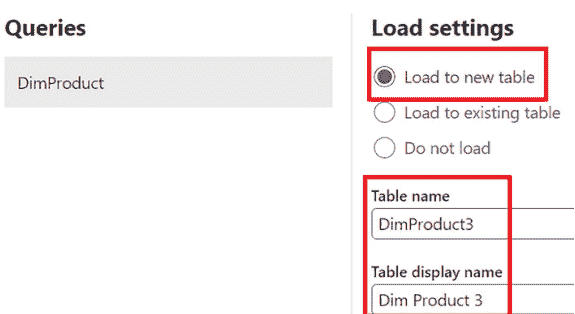

图12.26：作为新表加载

-   10. 选择手动或自动刷新，并单击“发布”按钮。
-   11. 返回“表”屏幕，在左侧导航窗格中，单击“创建”。

12. 在“从开始”下，选择“空白应用”，然后对“空白画布应用”单击“创建”按钮。

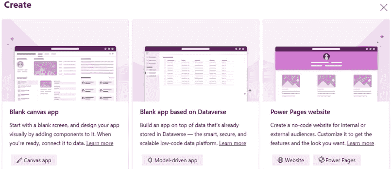

图12.27：创建 Power App

13. 提供应用名称，然后点击“创建”按钮。

14. 跳过任何提示。

15. 选择“插入”菜单选项，单击“图表”下拉菜单，并选择“Power BI 磁贴”：

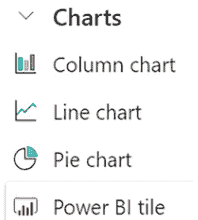

图12.28：插入 Power BI 磁贴

16. 从 Power BI 服务中选择一个工作区、仪表板和磁贴：

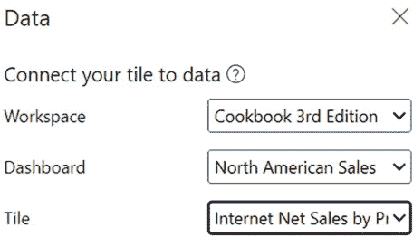

图12.29：选择仪表板磁贴

17. 从“插入”菜单的“布局”下，选择“垂直库”：

图12.30：选择垂直库控件

18. 在“选择数据源”对话框中，选择之前创建的表（本例中为 Dim Product 3s）：

图12.31：为垂直库添加数据源

19. 根据需要修改显示的字段并重新排列项目：

图12.32：修改显示字段

-   4. 在 **“新环境”** 窗格中，输入环境的 **“名称”**，选择 **“类型”**（可以是 **“生产”、“沙盒”或“试用”**），并选择 **“区域”**。此外，将 **“添加 Dataverse 数据存储”** 切换为 **“是”**，并单击窗格底部的 **“下一步”** 按钮。
-   5. 选择 **“语言”** 和 **“货币”**。如果需要，提供 **“URL”**。
-   6. 通过单击 **“选择”** 选择 **“安全组”**。你可以选择 **“无”** 作为安全组。
-   7. 将 **“启用 Dynamics 365 应用”** 切换为 **“是”**。
-   8. 单击 **“自动部署这些应用”** 下拉菜单，并勾选除 **“项目运营”** 和 **“指南”** 之外的所有复选框。

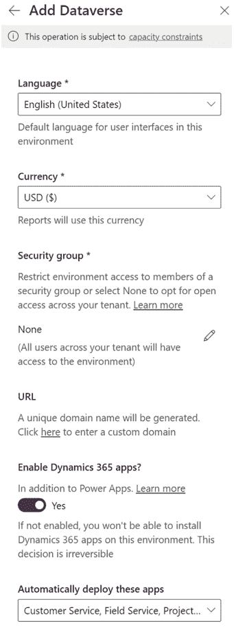

*图12.34：创建环境*

-   9. 单击窗格底部的 **“保存”** 按钮。
-   10. 环境就绪后，单击该环境并记下 **“环境 URL”**。

你现在可以完成此配方了。

## 如何利用 Dataverse 和 Dynamics 365

要实现此配方，请使用以下步骤：

-   1. 导航至 `https://make.powerapps.com`，并切换到在 *准备工作* 中创建的新环境。当前环境位于右上角。
-   2. 在左侧导航中，单击 **“连接”**（你可能需要先单击 **“更多”**）。
-   3. 按照 *与 Power Automate 和 Power Apps 集成* 配方的 *步骤7和8* 创建到你的 SQL Server 数据库的连接。
-   4. 在左侧导航中，单击 **“数据流”**。
-   5. 单击 **“新建数据流”** 按钮。
-   6. 为数据流提供 **“名称”**，例如 **“客户”**，并单击 **“创建”** 按钮。
-   7. 选择 **“SQL Server 数据库”** 作为数据源。
-   8. 输入你的本地 **AdventureWorksDW2022** 数据库的连接信息。
-   9. **“连接凭据”** 信息应自动填入在 *步骤3* 中创建的连接。单击 **“下一步”** 按钮。
-   10. 选择 **DimCustomer** 表，并单击 **“转换数据”** 按钮。
-   11. 展开 **DimGeography** 列的以下列，并取消选中 **“使用原始列名作为前缀”**：
    - `City`
    - `StateProvinceName`
    - `EnglishCountryRegionName`
    - `PostalCode`
-   12. 单击 **“下一步”** 按钮。
-   13. 选择 **“加载到现有表”**，并将 **“表显示名称”** 选择为 **“联系人”**。
-   14. 创建以下映射：
    - `City = Address1_City`
    - `EnglishCountryRegionName = Address1_Country`
    - `AddressLine1 = Address1_Line1`
    - `AddressLine2 = Address1_Line2`
    - `PostalCode = Address1_PostalCode`
    - `StateProvinceName = Address1_StateOrProvince`
    - `YearlyIncome = AnnualIncome`
    - `BirthDate = BirthDate`
    - `FirstName = FirstName`


需要指出的是，Power Apps 和 Power Automate 也可以原生访问 Dataverse 环境中存储的数据。这意味着业务线应用程序、业务流程工作流和报表都可以将 Dataverse 用作组织信息的中央运营存储。

### 还有更多...

除了 Dataverse 之外，Power BI 还与 Dynamics 365 应用程序具有原生集成，允许 Power BI 仪表板在 Dynamics 365 应用程序内显示。为了演示此功能，请执行以下操作：

1. 打开 Power Platform 管理中心：https://admin.powerplatform.microsoft.com。
2. 在左侧导航窗格中，单击 Environments。
3. 单击在此食谱中创建的环境。
4. 单击环境 URL 的链接以打开环境。
5. 选择右上角的齿轮图标并选择 Advanced Settings。
6. 从左上角的 Settings 下拉菜单中选择 Administration：

   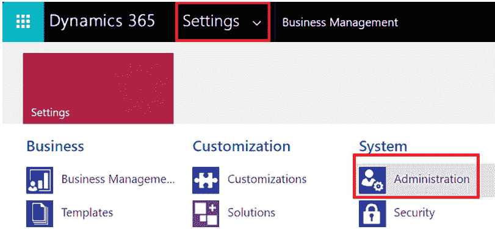

7. 选择 System Settings。

8. 单击 Reporting 选项卡并将 Allow Power BI visualization embedding 设置为 Yes：

   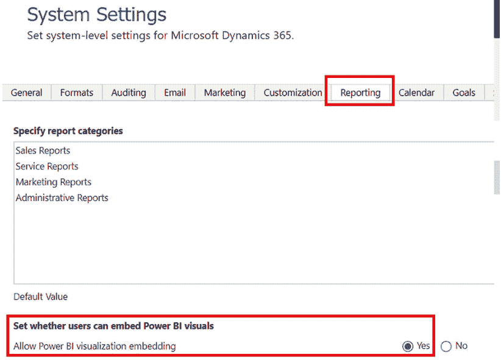

   Figure 12.37: Allow Power BI visualization embedding

9. 单击 OK 按钮。

10. 打开环境的 Sales Hub 应用并单击 Dashboards。

11. 选择 New 然后 Power BI Dashboard。

12. 如有必要，登录 Power BI。

13. 选择一个 Workspace 和一个 Dashboard 并单击 Save 按钮：

    Power BI Dashboard Properties

    Choose the Power BI Dashboard you want to add

    Workspace

    Cookbook 3rd Edition

    Dashboard

    North American Sales

    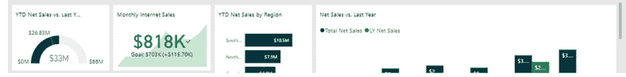

    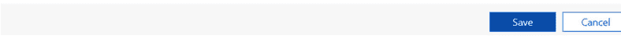

    Figure 12.38: Add a Power BI dashboard

14. 选择 New 然后 Dynamics 365 Dashboard。

15. 选择一个布局，然后单击 Create 按钮。

16. 单击 Add a Power BI tile to the dashboard 图标：

    

    Add a Power BI tile to the dashboard

    Figure 12.39: Add a Power BI tile to the dashboard icon in Dynamics 365

最后，Dynamics 365 Sales 和其他应用（不包括 Finance and Supply Chain Management）包括使用单个按钮可视化任何视图的能力：

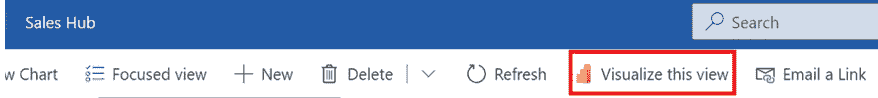

Figure 12.41: Visualize this view in Dynamics 365

单击 Visualize this view 按钮会自动创建 Power BI 报表，然后可以将其保存回 Power BI 服务。

### 另请参阅

- What is Microsoft Dataverse?: https://bit.ly/42Horr6
- Visualizing views in Dynamics 365 with Power BI is now generally available: https://bit.ly/3SyY95I
- Administer Power Platform: https://bit.ly/3bqaKTQ
- Create and use dataflows in Power Apps: https://bit.ly/3eP6tLL

## 连接 Dynamics 365 和 Power Platform

Power BI 是 Microsoft Power Platform 产品系列的一部分。Power Platform 包括 Power BI、Power Apps、Power Automate、Power Pages 和 Power Virtual Agents。然而，Power Platform 也是一个更大产品系列 Microsoft Business Applications 的一部分。Microsoft Business Applications 是一组围绕 Dynamics 365 for Sales、Dynamics 365 Business Central 和 Dynamics 365 Finance and Supply Chain Management（F&SCM）构建的应用程序。Microsoft 实际上将 Business Applications 细分为以下内容：

- Microsoft Power Platform
- Customer data platform
- Sales
- Service
- Marketing
- Commerce
- Supply chain
- Small and medium business
- HR
- Finance
- Project management

然而，需要注意的是，Customer Service、Field Service、Marketing、Commerce、Human Resources 和 Sales 都建立在 Microsoft 客户关系管理（CRM）系统之上，该系统以前称为 Microsoft CRM。可扩展的 Microsoft CRM 系统，有时称为 XRM，实际上是 Dataverse 的核心。企业资源规划（ERP）应用程序，即 Dynamics 365 F&SCM 或 Dynamics 365 Business Central（BC），并非原生构建在与 Dataverse 相同的平台上。需要注意的是，Dynamics 365 F&SCM 由 Dynamics AX（Axapta）构建，而 Dynamics 365 BC 由 Dynamics NAV（Navision）构建。Dynamics GP（Great Plains）并未过渡到云。

Power Platform 管理中心提供了一个中央位置，旨在集成 Microsoft Business Applications 组合中的各种产品。这还包括强大的数据集成功能，允许管理员将来自许多不同环境的数据集成到 Dataverse 环境中。与数据流类似，这些数据集成项目促进了数据管理策略的集中控制和业务信息的流动。

本食谱演示如何使用 Power Platform 管理中心创建数据集成项目，以同步 Dynamics 365 Finance and Operations 数据与 Dataverse 环境，随后从该数据构建 Power BI 报表。

### 准备工作

为准备本食谱，请执行以下步骤：

1. 如果尚未完成，请完成 Leveraging Dataverse and Dynamics 365 食谱的 Getting ready 步骤。
2. 您必须已部署 Dynamics 365 Finance and Supply Chain Management（D365 F&SCM）环境。
3. 单击 Environment URL 以打开环境。
4. 单击右上角的齿轮图标并选择 Advanced Settings。
5. 单击 Settings 然后 Security。
6. 选择 Teams。
7. 选中默认团队旁边的复选框并选择 MANAGE ROLES。

8. 选中 System Administrator 的复选框并单击 OK 按钮。

   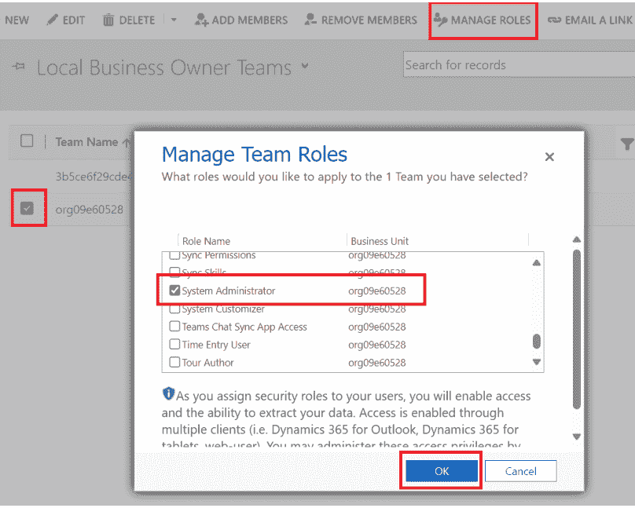

   Figure 12.42: Adding the System Administrator role

### 如何连接 Dynamics 365 和 Power Platform

要实现本食谱，请使用以下步骤：

1. 导航到 https://make.powerapps.com 并切换到在 Getting ready 中创建的新环境。当前环境位于右上角。
2. 从左侧导航窗格中选择 Connections（您可能需要先单击 More）。
3. 单击 New connection。
4. 搜索 Dynamics 并添加 Fin & Ops Apps（Dynamics 365）连接：

29. 将 PRIMARYADDRESSCITY 映射到之前创建的 City 列：

| Source column | Map type | Destination column |
|---|---|---|
| WAREHOUSEID [WAREHOUSEID] | = | msdyn_name [Name] |
| WAREHOUSENAME [WAREHOUSENAME] | = | msdyn_description [Description] |
| msdynce_ismaintainedexternally [msdynce_ismaintainedexternally] | = | {None} |
| PRIMARYADDRESSCITY [PRIMARYADDRESSCITY] | = | cr640_city [City] |

Figure 12.47: Warehouse sync sources and destinations

30. 单击 Save。

31. 在面包屑中单击项目名称。

32. 单击 Run project。

33. 单击 Execution history 选项卡并等待同步完成。应该有 35 次 Upserts。

34. 创建一个新的 Power BI Desktop 文件。

35. 选择 Get data 然后 Dataverse。

36. 输入您的凭据。

37. 展开在此食谱中创建的环境，在 Navigator 中选择 msdyn_warehouse 表并单击 Load 按钮。

38. 选择 Import 或 DirectQuery 并单击 OK 按钮。

39. 创建一个简单的报表可视化以显示加载到 Dataverse 环境中的仓库。

40. 保存并发布报表到 Power BI 服务。

41. 在 Power BI 服务中打开报表并将报表可视化固定到仪表板：

    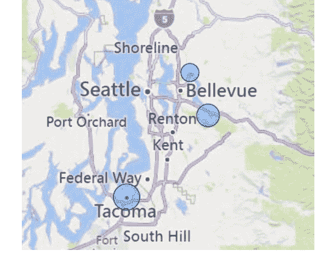

    Figure 12.48: Warehouses in the Dataverse environment

Figure 12.48 显示了从 Dynamics 365 Finance and Operations 加载到 Dataverse 的仓库位置。

### 工作原理

在配置环境时，您可以选择是否创建数据库。如果环境仅用于 Power Apps 和 Power Automate 开发，源数据来自 Dataverse 环境以外的其他地方，您可能会选择不创建数据库。通过创建带有数据库的 Dataverse 环境并将 Deploy Dynamics 365 apps 勾选为 Yes，会向环境添加额外的表以支持所选应用程序。

重要的是，您需要将默认团队的角色设置为 System Administrator 或 System Customizer。默认情况下，配置过程创建的团队在系统中没有任何权限，而创建环境的<|message|> 用户会被授予 System Administrator 等角色。然而，连接集、项目和任务执行的同步目前使用团队权限而不是用户权限来写入 Dataverse 环境。

创建数据集成项目包括三个任务，创建连接（步骤 1 到 5）、创建连接集（步骤 11 到 18），最后创建包含要执行任务的项目（步骤 19 到 30）。连接仅保存数据源的身份验证凭据，类似于在 Power BI 中定义数据源连接（数据源设置）。连接集仅定义源系统和目标系统。与 Power BI 不同，目标始终是 Power BI 语义模型，数据集成项目可以在任意两个源系统之间同步数据。最后，项目定义数据集成期间要执行的任务。任务保存源系统和目标系统之间列的映射。项目可以按定期间隔安排运行，以确保数据保持最新。


在 Power Platform 管理中心创建的数据集成项目利用了与 Power BI 和数据流相同的 Power Query 技术。可以通过选择本食谱中创建的数据集成项目中的任务，然后选择高级查询和筛选来看到这一点。熟悉的 Power Query 编辑器界面会显示出来，包括访问高级编辑器以直接插入 M 代码。此高级查询和筛选界面可用于进一步优化源数据查询，例如删除不必要的列，以提高数据源查询的整体效率或执行所需的转换。

## 还有更多…

使用数据集成项目只是将数据从 D365 F&SCM 环境提取到 Dataverse 或其他 Power BI 容易访问的环境的一种方式。使用生命周期服务，可以启用双写功能并导出到 Azure Data Lake：

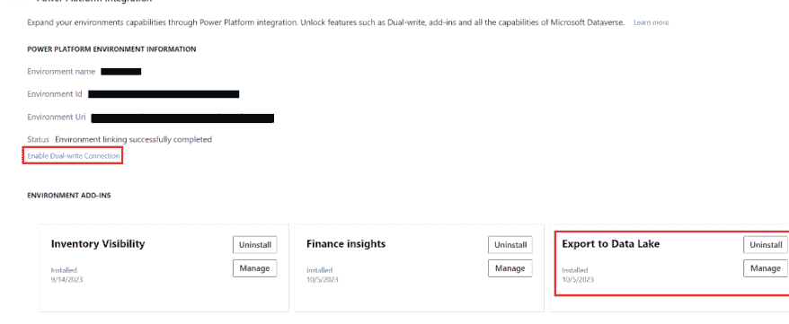

图 12.49：生命周期服务中的双写和导出到数据湖

双写技术可在 D365 F&SCM 应用与 Dataverse 之间实现近实时、双向集成。D365 F&SCM 应用中的数据更改会触发对 Dataverse 的写入操作，反之亦然。

导出到数据湖会将信息从 D365 F&SCM 表和实体复制到低成本的 Azure Data Lake Storage Gen2。随着 D365 F&SCM 中的数据发生变化，更改、删除和新增会在几分钟内处理。

此外，Power BI 瓦片、仪表板和报表可以在 D365 F&SCM 环境中进行一次性集成后，固定到应用程序工作区中。

最后，Power BI 报表可以通过生命周期服务部署。此方法利用了 Power BI 嵌入功能。

## 另请参阅

- *Administer Microsoft Power Platform:* https://bit.ly/3bqaKTQ
- *Integrate data into Microsoft Dataverse:* https://bit.ly/3bpQykV
- *Connect finance and operations apps with a new Microsoft Dataverse instance:* https://bit.ly/4bvTNox
- *Dual-write overview:* https://bit.ly/3I242mN
- *Configure PowerBI.com integration:* https://bit.ly/3wbukAH
- *Analytical Workspaces (using Power BI Embedded):* https://bit.ly/3SCAh0j

## 摘要

本章重点介绍了 Power BI、报表服务器、PowerPoint、Power Apps、Power Automate、Dataverse 和 Dynamics 365 之间强大的集成点。这包括利用 DAX 作为查询语言来支持 Excel 中的自定义报表，将报表服务视觉对象固定到 Power BI 仪表板，以及利用立方体公式构建模板或记分卡报表布局。此外，我们还提供了一个使用 Power Automate 设计的自动化工作流示例，用于将数据从关系数据库推送到 Power BI 服务中的流式语义模型，从而通过常见的 Power BI 可视化和数据警报功能实时显示源数据更改。最后，我们提供了演示如何将 Power BI 与 Dataverse 和 Dynamics 365 集成的食谱。

在本书的下一章也是最后一章中，我们将探讨利用 Microsoft Fabric（以前称为 Power BI Premium）独特功能的场景。

## 加入我们的 Discord 社区

加入我们社区的 Discord 空间，与作者和其他读者进行讨论：

https://discord.gg/ebXZqyrxJb


