# 13 使用 Premium 和 Microsoft Fabric

# 使用 Premium 和 Microsoft Fabric

Power BI 并不是微软拥有历史的数据分析平台。在持续投资 Power BI 的同时，微软还寻求提供一套整体且集成的功能，针对包括数据科学、数据工程以及多种数据湖、数据仓库和湖仓架构在内的现代用例。特别是，微软利用其在 SQL Server 方面的经验，开发了名为 Parallel Data Warehouse（PDW）的基于大规模并行处理（MPP）的本地设备。后来，该设备被重新命名为 Analytics Platform System（APS）。随着工作负载向云端迁移，微软于 2016 年基于相同技术创建了 Azure SQL Data Warehouse（SQL DW）。随着数据分析领域复杂性和竞争的增加，微软增加了更多功能并将整个平台重新命名为 Synapse Analytics。SQL DW 只是该新平台的一个小部分，因此被重新命名为专用 SQL 池。

在过去十年左右的时间里，Power BI 和现在称为 Azure Synapse Analytics 的两个平台之间只有最少的集成。这一切在 2023 年发生了变化，当时微软宣布了 Microsoft Fabric。Microsoft Fabric 基本上在 Power BI 服务中展示了 Azure Synapse Analytics 工作负载，通过有效地合并微软的两个数据分析平台，创建了一个单一的数据分析平台。Microsoft Fabric 现在是所有未来开发的单一统一平台，而 Power BI 只是该更大框架的一个组件。

随着向 Microsoft Fabric 的转变，微软创建了一种新的许可机制，即 Fabric 容量（F SKU）。与 Power BI Premium 不同，后者以单一月价包含容量、网络、Premium 功能和存储，F SKU 按使用小时计费，而存储和网络则单独计费。Power BI Premium 容量（P SKU）自动继承了所有 Microsoft Fabric 工作负载，其中 F64 SKU 等同于 P1 SKU。

本章中的食谱涵盖了特定于 Power BI Premium 容量和 Microsoft Fabric 的功能和功能，包括数据仓库、湖仓和机器学习：

- 创建数据仓库
- 使用湖仓进行数据工程
- 备份语义模型
- 利用 Direct Lake
- 应用数据科学

到本章结束时，您将对 Microsoft Fabric 和 Power BI Premium 的功能和特性有坚实的理解。

## 技术要求

完成本章食谱所需的条件如下：

- Power BI Desktop。
- Microsoft Fabric 或 Power BI Premium 容量或试用版。
- SQL Server 2022 或更新版本，并安装了 AdventureWorksDW2022 数据库。有关安装 SQL Server 和 AdventureWorks 数据库，请参阅第 1 章《安装和许可 Power BI 工具》中的《安装 SQL Server 和 AdventureWorks 数据库》食谱。
- 本章的文件可以从以下 GitHub 仓库下载：https://github.com/PacktPublishing/Power-BI-Cookbook-Third-Edition。

## 创建数据仓库

Gartner 对数据仓库的定义如下：

> “数据仓库是一种存储架构，旨在保存从交易系统、操作数据存储和外部来源提取的数据。然后仓库以聚合、汇总的形式组合这些数据，适合企业范围内的数据分析和报告，以满足预定义的业务需求。”

由于数据仓库能够为各种应用程序和用例提供集中且单一的事实来源，因此它们多年来一直是商业智能架构的主流。通过在强大的上游工具（如 Azure Data Factory 管道）中处理数据质量和集成需求，并通过熟悉的 SQL 查询和对历史跟踪的支持生成具有代理键用于关系/连接的合并维度和事实表，一个设计良好且管理的良好的数据仓库仍然是一项极具价值的资产。

无论数据仓库这一术语的具体历史如何，今天数据仓库都是当今企业业务系统的支柱，也是许多组织的商业智能和报告的核心组件。Microsoft Fabric 通过基于 SQL Server 引擎、分布式处理以及 OneLake 中的集中式存储的云端、湖中心技术提供数据仓库功能，OneLake 是 Fabric 的逻辑集中式数据湖。

本食谱提供了如何在 Microsoft Fabric 中创建和使用数据仓库的指导。


## 准备工作

要准备本方案，请执行以下步骤：

- 1. 确保已预配 Power BI Premium 容量（P SKU）或 Microsoft Fabric 容量（F SKU）。
- 2. 完成第 1 章“安装和授权 Power BI 工具”中的“安装 SQL Server 和 AdventureWorks 数据库”方案。
- 3. 确保已安装数据网关，并已将网关连接配置到你的 SQL Server 数据库。参见第 1 章中的“创建本地数据网关”方案，以及第 11 章中的“配置本地网关数据连接”。

现在，你已准备好完成本方案的步骤。

## 如何创建数据仓库

要实现本方案，请执行以下操作：

- 1. 登录 Power BI 服务 (https://app.powerbi.com)。
- 2. 确保你处于已启用 Fabric 工作负载的工作区中。
- 3. 在左下角，单击 Power BI 图标，然后选择“数据仓库”：

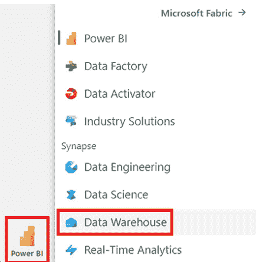

图 13.1：Microsoft Fabric 中的其他工作负载

- 4. 在“新建”标题下，选择“仓库”。
- 5. 为你的仓库提供“名称”，并单击“创建”按钮。

- 6. 在“构建仓库”下选择“新建 Dataflow Gen2”，或在右上角选择“获取数据”，然后选择“新建 Dataflow Gen2”：

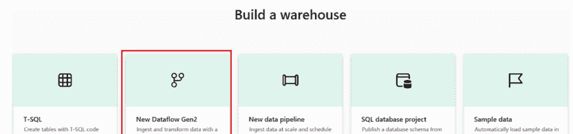

图 13.2：构建数据仓库

- 7. 在右上角，选择“获取数据”，然后选择“SQL Server 数据库”。

- 8. 输入 SQL Server 的连接设置，连接凭据应会自动更新为你预先配置的数据网关连接。

- 9. 在“选择数据”对话框中，选择 DimCustomer、DimDate、DimProduct、DimReseller、DimSalesTerritory、FactInternetSales 和 FactResellerSales 表，并单击“创建”按钮。

- 10. 呈现的界面与 Power BI Desktop 中的 Power Query 编辑器基本相同。将查询分别重命名为 Customers、Dates、Products、Resellers、Sales Territories、Internet Sales 和 Reseller Sales。

- 11. 将 Internet Sales 和 Reseller Sales 查询移动到一个名为 Facts 的组，并将其余查询移动到一个名为 Dimensions 的组。

- 12. 选择 Customers 查询，展开 DimGeography 列，选中 City、StateProvinceName 和 EnglishCountryRegionName 列。

- 13. 对 Sales Territories 查询重复步骤 12。

- 14. 选择 Products 查询，展开 DimProductSubcategory 列，以获取 EnglishProductSubcategoryName 和 DimProductCategory 列。

- 15. 展开 DimProductCategory 列，以获取 EnglishProductCategoryName 列。

- 16. 单击右上角的数据流名称，并提供一个描述性的“名称”值：

图 13.3：构建数据仓库

- 17. 单击右下角的“发布”按钮。

- 18. 等待 Dataflow Gen2 刷新完成。

现在，你已成功创建数据仓库。

## 工作原理

Microsoft Fabric 提供两种数据仓库体验：本方案介绍的 Synapse Warehouse，以及湖仓的 SQL 分析终结点（参见本章中的“使用 Lakehouse 进行数据工程”方案）。后者仅支持只读查询，以及创建视图和表值函数（TVF），而前者支持完整的事务性数据定义语言（DDL），例如 CREATE、DROP 和 ALTER 命令，以及数据操作语言（DML），包括 INSERT、UPDATE 和 DELETE 等命令。

在 Fabric 中填充仓库有两种方法：数据管道和 Dataflow Gen2 查询。数据管道是 Azure Data Factory 的演变，后者是 SQL Server Integration Services (SSIS) 的云继承者。实际上，Data Factory 能够预配 SSIS 运行时，以存储和执行 SSIS 包。数据管道和数据流之间的关键区别在于：数据管道是一种编排机制，不转换数据，而数据流旨在转换数据。Dataflow Gen2 是原始 Power BI 数据流（现称为 Dataflow Gen 1）的演变，数据流实际上可以作为活动包含在数据管道中。

创建仓库实际上会创建两个项目：仓库本身以及关联的语义模型。创建 Dataflow Gen2 会创建数据流本身以及另外四个项目：SQL 分析终结点及其关联的语义模型，以及暂存仓库及其关联的语义模型。这四个对象通常会在创建 Gen2 数据流后立即出现，如图 13.4 所示，但随后会被隐藏，因为它们是 Gen2 数据流运行方式的后端组件。

| 名称 | 类型 |
|---|---|
| Cookbook 3 | 仓库 |
| Cookbook 3 | 语义模型（默认） |
| Dataflow 1 | Dataflow Gen2 |
| DataflowsStagingLakehouse | SQL 分析终结点 |
| DataflowsStagingLakehouse | 语义模型（默认） |
| DataflowsStagingWarehouse | 仓库 |
| DataflowsStagingWarehouse | 语义模型（默认） |

图 13.4：创建并填充数据仓库时创建的项目

创建并填充仓库后，可以在 Fabric 中像传统使用 SQL Server Management Studio (SSMS) 那样管理和操作仓库：

- 6. 在“将数据获取到湖仓”下选择“新建数据管道”，或在右上角选择“获取数据”，然后选择“新建数据管道”：

## 在湖仓中获取数据

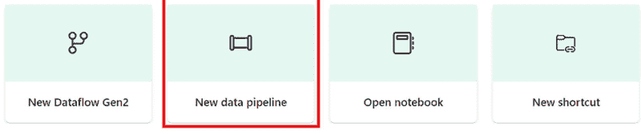

图 13.7：将数据获取到湖仓

- 7. 为你的管道提供“名称”，并单击“创建”按钮。

- 8. 单击“选择数据源”对话框右上角的 X 图标，然后单击“是，取消”按钮。

- 9. 在管道的功能区中，单击“数据流”：

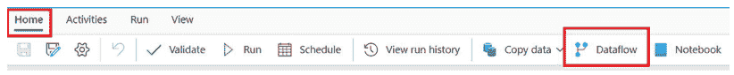

图 13.8：向管道添加数据流

- 10. 如果需要，为活动提供一个友好名称，例如 PBI Cookbook，然后配置设置以指向本方案“入门”部分中创建的数据流。

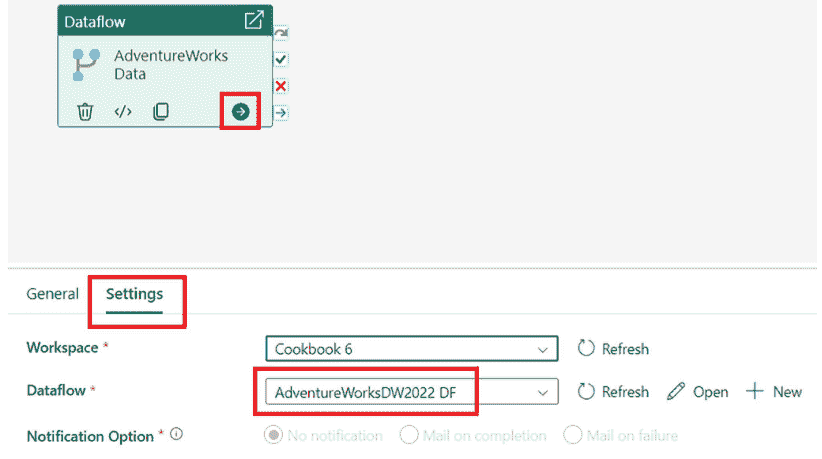

图 13.9：管道中的数据流活动

- 11. 在“数据流”活动框中，单击图 13.9 中突出显示的箭头图标（添加活动），然后单击“复制数据”。

- 12. 如图 13.10 所示，为你的“复制数据”活动提供源信息。使用“工作区”作为数据存储类型、“湖仓”作为工作区数据存储类型，选择 Dataflows-StagingLakehouse 作为湖仓，并选择一个表，在本例中为与 DimCustomer 对应的表。

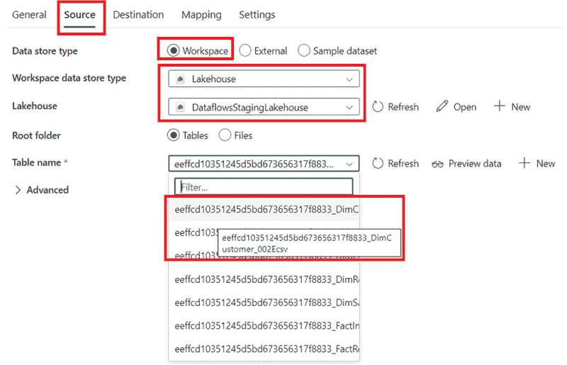

图 13.10：“复制数据”活动的源配置

- 13. 选择“目标”选项卡，并将目标配置为本方案之前创建的湖仓，在本例中为 Cookbook3LH。对于“表名称”，单击“新建”按钮以创建新表，在本例中为 Customers。

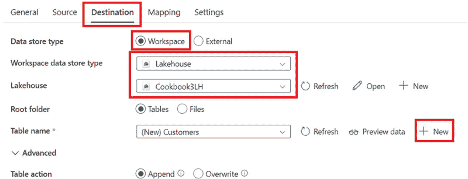

图 13.11：“复制数据”活动的目标配置

- 14. 如果需要，重复步骤 11、12 和 13，向湖仓添加更多表。

- 15. 在功能区中，单击“运行”，并在提示时单击“保存并运行”按钮。

- 16. 验证管道是否成功运行：

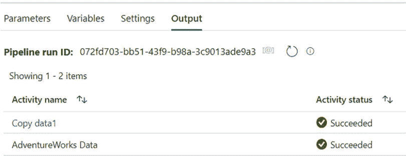

图 13.12：成功运行的管道

- 17. 切换到你的湖仓，验证你的表是否存在且包含数据。

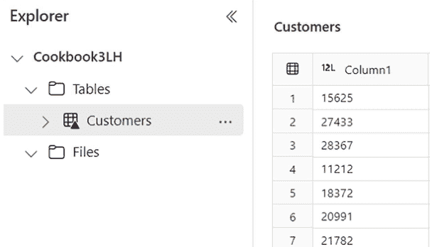

图 13.13：成功运行的管道

至此，湖仓创建完成。

## 更多内容……

单击 SQL 分析终结点会打开一个与 Fabric 仓库界面相似的界面，但功能较为有限。

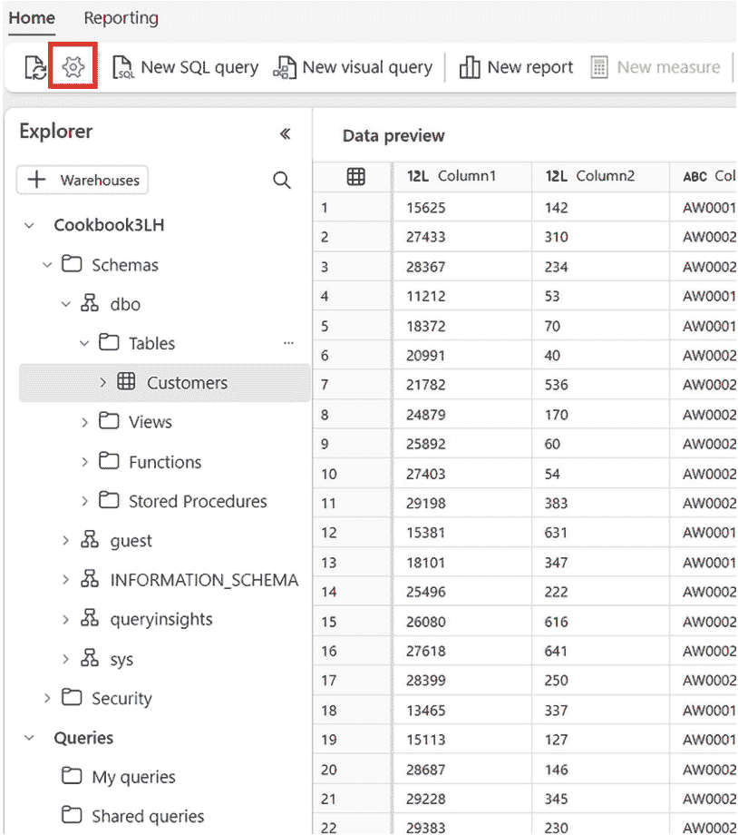

图 13.15：Fabric 中的 SQL 分析终结点


## 开始准备

要准备本配方，请执行以下步骤：

- 1. 确保在您的 Azure 租户中已配置 Azure Data Lake Storage Gen2 帐户。
- 2. 确保已配置 Power BI Premium 容量（P SKU）、Power BI Premium Per User（PPU）许可证、Microsoft Fabric 容量（F SKU）或 Power BI Embedded 容量（A SKU）。
- 3. 在 Power BI 服务中，打开管理门户（请参阅第 14 章中的 Accessing the Admin Portal 配方）。
- 4. 对于 Premium、Embedded 和 Fabric 容量，从管理门户的左侧导航窗格中选择容量设置。
- 5. 选择 Power BI Premium、Power BI Embedded 或 Fabric 容量，然后展开工作负载部分并确保 XMLA 端点设置设置为读取写入。 此更改生效可能需要等待长达 10 分钟。

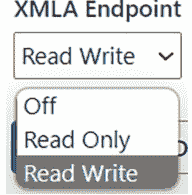

图 13.17：XMLA 端点设置

- 6. 如果使用 PPU 许可证，从管理门户的左侧导航窗格中选择 Premium Per User，并在数据集工作负载设置或语义模型工作负载设置下，确保 XMLA 端点设置为读取写入。
- 7. 导航到服务中的工作区并选择工作区设置。 在工作区设置对话框的 Premium 选项卡上，确保许可证模式为 Premium 容量、Premium per user、Fabric 容量或 Embedded。
- 8. 在工作区设置对话框的 Premium 选项卡底部，复制工作区连接字符串：

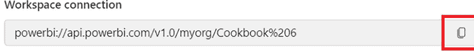

图 13.18：工作区 XMLA 端点

- 9. 单击工作区设置对话框的 Azure 连接选项卡，配置连接 Azure Data Lake Gen2 存储帐户设置，然后单击连接 Azure 按钮。 工作区中不得包含任何数据流，否则连接将失败。

工作区设置

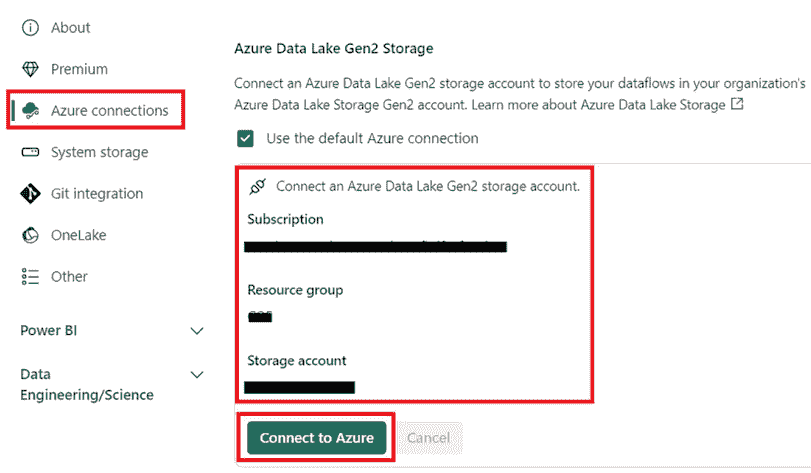

图 13.19：将工作区连接到 Azure Data Lake Gen2 存储帐户

- 10. 退出工作区设置对话框并将 Power BI Desktop 文件发布到工作区，或在工作区内创建语义模型。

您现在可以完成本配方。

## 如何备份语义模型

要实现本配方，请执行以下操作：

- 1. 打开 SQL Server Management Studio（SSMS）。
- 2. 在连接到服务器对话框中，将服务器类型选择为 Analysis Services，将服务器名称粘贴为在开始步骤 8 中复制的工作区 XMLA 端点，并选择 Microsoft Entra MFA 作为身份验证。
- 5. 查看备份数据库对话框中的选项，然后单击确定按钮：

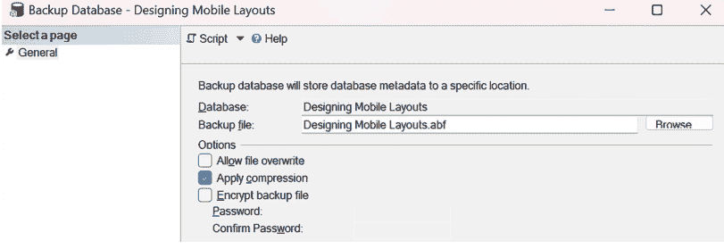

图 13.22：SSMS 中的备份数据库选项

这完成了语义模型的备份。

## 其工作原理

将工作区连接到 Azure Data Lake Gen2 存储帐户并正确配置工作区的 XMLA 端点为读取写入。 备份语义模型需要 XMLA 端点配置为读写访问似乎很奇怪，因为备份通常只需要读取访问。 然而，请考虑备份文件（.abf）是通过 XMLA 端点备份到 Azure Data Lake Gen2 存储帐户，因此 XMLA 端点需要写入访问。

## 还有更多...

除了通过 SSMS 用户界面备份语义模型外，还可以通过运行查询来执行备份。 下面查询可用于通过 XMLA 端点备份连接的 Power BI 工作区的语义模型：

```
{
  "backup": {
    "database": "Designing Mobile Layouts",
    "file": "Designing Mobile Layouts.abf",
    "allowOverwrite": true,
    "applyCompression": true
  }
}
```

最后，您可以通过 Azure Storage Explorer 确认备份文件是否已创建。 Azure Storage Explorer 可在此处下载：https://azure.microsoft.com/en-us/products/storage/storage-explorer/。

在 Azure Storage Explorer 中，导航到本配方 *开始* 部分中配置的存储帐户。 在存储帐户下方的左侧导航中展开 **Blob Containers** 部分。 在 **Blob Containers** 下将有一个名为 **power-bi-backup** 的容器。 在该 blob 中有一个与工作区同名的文件夹。

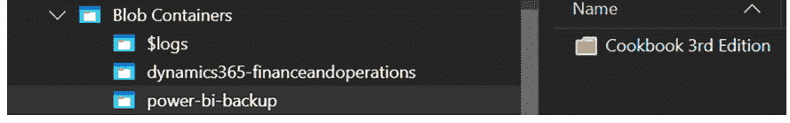

*图 13.23：Azure Storage Explorer*

备份文件（.abf）位于工作区的文件夹中。

## 另请参阅

- *使用 XMLA 端点的语义模型连接：* https://bit.ly/3SXSO Gh

## 利用 Direct Lake

历史上，Power BI 有两种语义模型模式，**导入**和**DirectQuery**。 使用导入模式，数据从源系统摄取到 Analysis Services 语义模型中的表。 使用 DirectQuery，语义模型在需要时动态查询源系统以获取数据。 许多人还将实时连接作为第三种语义模型模式。 然而，这在技术上是不正确的，因为实时连接只是创建报表与现有语义模型之间的连接，因此本身并不是语义模型模式。 Microsoft 后来引入了复合语义模型模式，该模式允许在单个语义模型中组合导入模式和 DirectQuery 模式。

除了语义模型模式外，Power BI 还具有语义模型中表的存储模式。 自然地，导入模式语义模型使用导入的表存储模式，而 DirectQuery 语义模型使用 DirectQuery 的表存储模式。 当引入复合语义模型时，Microsoft 添加了另一种表存储模式，称为 **双存储模式**，它使表能够以缓存模式（导入）或直接查询数据源（DirectQuery）运行。 Microsoft 还引入了混合表的概念，表包含多个分区，至少一个分区处于导入存储模式，另一个分区处于 DirectQuery 存储模式。

当 Microsoft 发布 Fabric 时，引入了第三种表存储模式 Direct Lake。 本配方演示如何创建具有 Direct Lake 存储模式表的语义模型。

## 开始准备

要准备本配方，请执行以下步骤：

- 1. 确保已配置 Power BI Premium 容量（P SKU）或 Microsoft Fabric 容量（F SKU）。
- 2. 完成第 1 章 Installing and Licensing Power BI Tools 中的 Installing SQL Server and the AdventureWorks Database 配方。
- 3. 确保已安装数据网关并配置了到 SQL Server 数据库的网关连接。 请参阅第 1 章中的 Creating an On-Premises Data Gateway 配方和第 11 章中的 Configuring On-Premises Gateway Data Connections。
- 4. 创建新的工作区并将工作区分配给 Premium 或 Fabric 容量。
- 5. 导航到工作区并在右上角选择 New，然后选择 More options。
- 6. 在数据工程下，选择 Lakehouse，为您的湖仓提供名称，然后单击创建按钮。
- 7. 使用新的 Dataflow Gen2 数据流填充您的湖仓。
- 8. 使用您的 SQL Server 上的 AdventureWorks 数据库作为数据源，选择各种维度和事实表，如 DimCustomer、DimDate、DimProduct、DimReseller、DimSalesTerritory、FactInternetSales 和 FactResellerSales。
- 9. 允许数据流完成其初始刷新。
- 10. 打开湖仓并验证表是否已加载到湖仓中。

您现在可以完成本配方。

## 如何利用 Direct Lake

要实现本配方，请执行以下操作：

- 1. 在湖仓打开时，从功能区中选择新建语义模型：

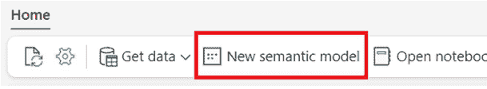

图 13.24：为湖仓创建新的语义模型


4. 为语义模型中的表创建关系。提示：要使关系正确创建，一侧为维度表，多侧为事实表，请将列从事实表拖到维度表。

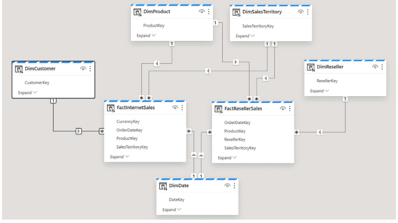

图 13.27：在服务中创建语义模型表关系

5. 使用“数据”和“属性”窗格，将 DimSalesTerritory 表中 SalesTerritoryCountry 列的数据类别设置为 国家/地区，并将 FactInternetSales 表中 SalesAmount 列的格式设置为 货币，0 位小数。

6. 在“开始”选项卡的功能区中，单击“新建报表”：

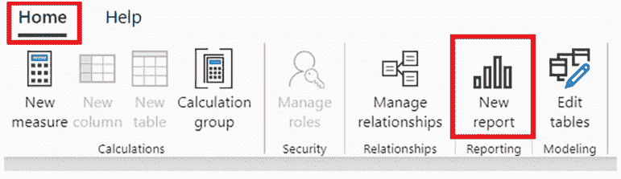

图 13.28：基于 Direct Lake 语义模型创建新报表

7. 创建一个简单的地图视觉对象，按 SalesTerritoryCountry 显示 SalesAmount 的总和。

8. 从 DimDate 表添加 CalendarYear 的切片器：

按 SalesTerritoryCountry 的 SalesAmount 总和

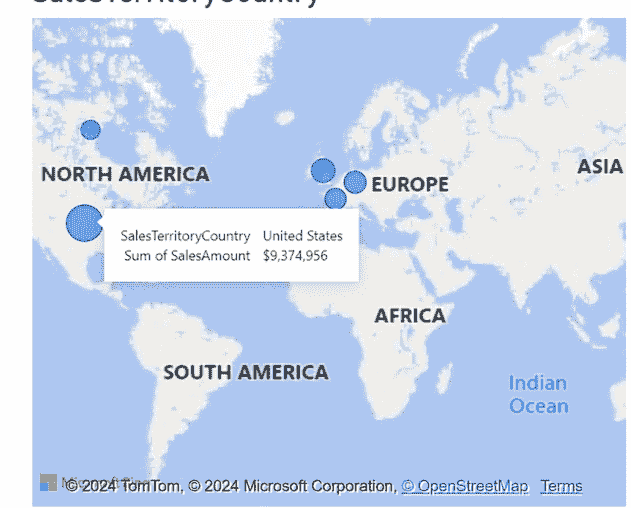

CalendarYear

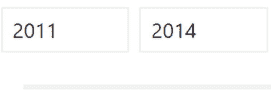

图 13.29：从 Direct Lake 语义模型创建的简单报表

9. 在功能区中选择“文件”，然后选择“保存”以保存报表。
10. 为报表输入名称，然后单击“保存”按钮。

请注意，在切片器中选择日历年份时，地图视觉对象会快速更新。

## 如何工作

导入模式语义模型使用一种专有文件格式，即 IDF 来存储 VertiPaq 数据。VertiPaq 是 Analysis Services Tabular 实例的内存列式压缩存储引擎。Fabric 引擎加载以 Parquet 文件格式存储在湖仓中的增量表，而不是 IDF，并将此数据转换为兼容的 Analysis Services 数据结构。此外，v-order 算法以与原生 VertiPaq 引擎类似的方式对数据进行排序，以提高压缩和查询性能。总体效果是查询时间优于 DirectQuery，并且大致与导入模式语义模型的速度相当。

具有在线分析处理系统历史知识的人可能会在导入、DirectQuery 和 Direct Lake 存储模式之间识别出相似之处。**关系型在线分析处理（ROLAP）**系统与 DirectQuery 类似，其中数据保留在关系数据库系统中，无需预先汇总的立方体。同样，导入模式与**多维在线分析处理（MOLAP）**系统类似，其中数据汇总到多维立方体中。

Direct Lake 完成了类比，本质上等同于**混合在线分析处理（HOLAP）**系统，该系统混合了 ROLAP 和 MOLAP 服务模式。在 HOLAP 中，数据请求通过 MOLAP 处理，直到查询的具体需求迫使引擎通过 ROLAP 为查询提供服务。Direct Lake 的结构也类似，Fabric 引擎首先尝试通过处理的 Parquet 文件为查询提供服务，但对于无法通过 Fabric 引擎创建的分析存储区处理的查询，则回退到 DirectQuery。

## 还有更多...

在服务中查看本配方构建的报表时，可以选择功能区中的“文件”，然后选择**下载此文件**。将呈现两个选项，如下图所示：

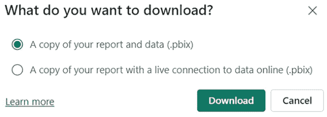

图 13.30：报表的下载选项

虽然你可以使用标记为**报表及其数据副本（.pbix）**的单选按钮下载 `.pbix` 文件，但截至本书出版日期，如果尝试在 Power BI Desktop 中打开该文件，将收到错误：

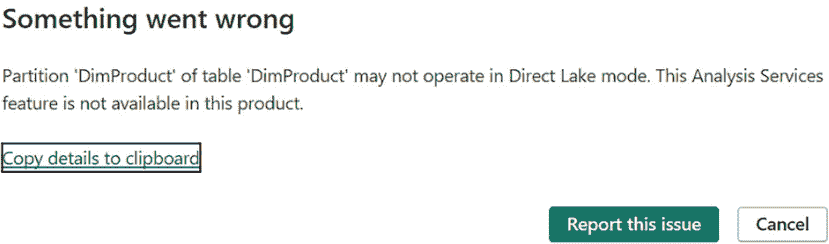

图 13.31：在 Power BI Desktop 中打开 .pbix 文件时出错

选择 .pbix 文件具有与在线语义模型的实时连接的替代选项，允许你成功打开报表，尽管会发出警告：

**报表布局可能存在差异**

此 Power BI 报表文件可能包含一些功能，这些功能在 Power BI Desktop 的下一个版本中不可用。

如果你需要查看在网页（app.powerbi.com）上工作的最新版本，请在那里查看报表。对此造成的不便，我们深表歉意。

图 13.32：报表布局可能存在差异

预计这些问题将随着 Power BI Desktop 的未来更新而得到解决。

## 另请参阅

- 为 Direct Lake 创建湖仓：https://bit.ly/48xUKtX
- Direct Lake：https://bit.ly/48i0NT1
- 分析 Direct Lake 语义模型的查询处理：https://bit.ly/3wimJAc
- 在 Power BI Desktop 中管理存储模式：https://bit.ly/3SZEugv
- Power BI 服务中的语义模型模式：https://bit.ly/30Hnc5a
- 实时连接和 DirectQuery 比较：https://bit.ly/3vHnc5a

## 应用数据科学

虽然生成式人工智能（AI）最近很流行，但它只是被称为数据科学的更大技术领域的组成部分，数据科学融合了统计学、机器学习、AI、编程和分析。一般来说，数据科学利用机器学习算法识别数据中的复杂模式以进行预测。总体而言，这些预测通常分为分类（这是 A、B 还是 C？）、异常检测（这很奇怪吗？）、回归（有多少？多少个？）、聚类（这是如何组织的？）和强化学习（下一步该做什么？）等类别。生成式 AI 也使用机器学习算法，但不同之处在于它专注于创建新数据而不是做出预测。虽然生成式 AI 新颖且令人兴奋，但经典的机器学习和数据科学仍然解决了大量实际的现实世界问题。

本配方演示了如何在 Fabric 中使用数据科学。

4. 在“使用示例”对话框中，在“端到端工作流（Python）”或“端到端工作流（R）”下，选择一个场景，例如“销售预测”。

使用示例

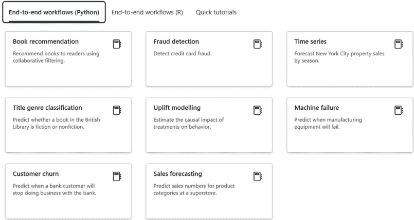

图 13.34：Python 数据科学示例

5. 在“资源管理器”窗格中，单击“湖仓”，然后单击“添加”按钮以向笔记本添加湖仓。

6. 在“添加湖仓”对话框中，选择“新建湖仓”，然后单击“添加”按钮。

7. 为你的湖仓提供一个名称，其中不含空格或除下划线字符之外的特殊字符，然后单击“创建”按钮。

8. 在“开始”选项卡下的主区域中，单击“运行全部”按钮。

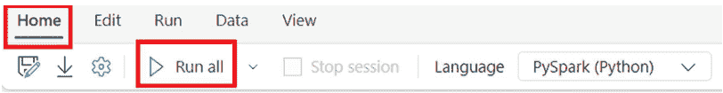

图 13.35：在笔记本中运行所有代码

14. 通过单击“文件”，然后单击“保存”来保存报表。
15. 为报表提供名称并单击“保存”按钮。

你现在已完成将数据科学应用于你的数据。

### 如何工作

图 13.38 显示了本配方创建的工件：

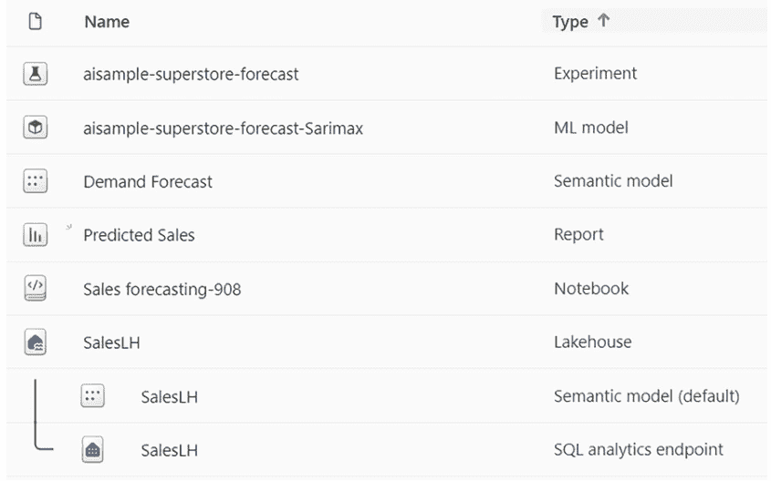

图 13.38：本配方创建的工件

创建的第一个工件是笔记本类型。笔记本由数据科学家用于存储信息性叙述、代码和视觉对象。基本上，笔记本是一种同时对数据进行实验并记录该实验的方式。在 Synapse 数据科学中，笔记本可以包含 Python 代码或 R 代码。单击笔记本的“运行全部”按钮会按顺序运行所有代码块。

接下来，我们添加了一个湖仓并将此湖仓与笔记本关联。这允许笔记本将湖仓用作文件和数据的存储库。笔记本中的第二个 Python 代码块将 Superstore.xlsx 文件加载到湖仓中。你可以在湖仓下的“文件”中看到已上传的文件。

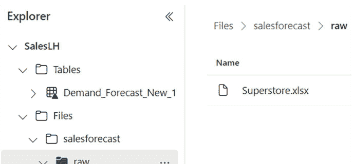

*图 13.39：与笔记本关联的湖仓中的 Superstore.xlsx 文件*

笔记本的下一步是创建**实验**。实验是数据被清理、准备和分析、选择机器学习算法，然后在数据上训练该算法以创建机器学习模型所在的容器。在笔记本中，**步骤 2：探索性数据分析**包括原始数据的清理、准备和分析。

在笔记本中，**步骤 3：模型训练和跟踪**是选择和训练算法的位置，这会创建**ML 模型**。在销售预测示例的情况下，所选算法是**带外生回归量的季节性自回归综合移动平均模型（SARIMAX）**算法。**自回归综合移动平均模型（ARIMA）**是预测数据的一种常见方法。**季节性自回归综合移动平均模型（SARIMA）**考虑了时间序列数据中的季节性（例如美国感恩节和圣诞节的假日销售），其中销售额受假日日历日期的影响。SARIMAX 在此基础上更进一步，还考虑了外部因素（X）。

总体而言，算法通常在数据的子集上进行训练。非训练集中的数据然后用作评分集。基本上，使用训练好的算法预测评分集中的值，然后将该预测与实际值进行比较，以确定预测值的准确性和精确度。笔记本的**步骤 4：对模型进行评分并保存预测**是模型被评分并将预测保存回湖仓的位置。

实际值和预测值加载到湖仓后，我们就可以从湖仓中的数据创建 Direct Lake 存储模式语义模型。此外，我们创建了一个简单的报表来查看实际销售和预测销售。


## 还有更多...

除了使用数据科学方法分析历史数据并做出预测外，Fabric 还包括通过实时分析分析实时数据的能力。与 Fabric 中的数据科学类似，实时分析包括示例，可快速实验和学习：

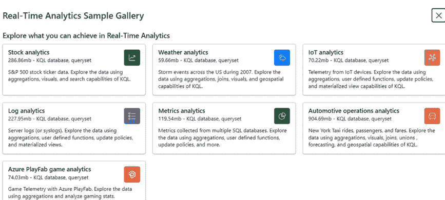

图 13.40：实时分析示例库

从库中选择一个示例，例如天气分析，会创建 KQL 数据库和 KQL 查询集：

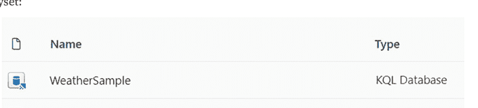

图 13.41：从实时分析示例创建的工件

Fabric 中的实时分析利用 Kusto 查询语言（KQL）。KQL，或简称为 Kusto，是一种由 Azure Data Explorer 以及 Fabric 使用的查询语言。Kusto 针对结构化、半结构化和非结构化数据的海量数据集的查询进行了优化，具有模式识别、异常检测和统计建模的分析能力。此外，Kusto 包含使其非常适合查询遥测数据和日志的功能，包括地理空间功能、时间序列函数和运算符、文本和向量相似性搜索等。


packt.com

订阅我们的在线数字图书馆，即可完全访问超过 7,000 本书籍和视频，以及行业领先的工具，帮助您规划个人发展并提升职业生涯。如需更多信息，请访问我们的网站。

## 为什么订阅？

- 花更少的时间学习，花更多的时间编码，使用来自 4,000 多名行业专业人士的实用电子书和视频
- 使用专为您打造的技能计划提升学习效果
- 每月免费获得一本电子书或视频
- 完全可搜索，便于快速访问重要信息
- 复制、粘贴、打印和书签收藏内容

在 www.packt.com，您还可以阅读大量免费技术文章，订阅多种免费新闻通讯，并获得 Packt 书籍和电子书的独家折扣和优惠。

## 市场趋势分析报告

本报告旨在分析当前市场的主要趋势和未来发展预测。

- 数字化转型加速
- 人工智能应用扩展
- 可持续发展成为核心

| 指标 | 数值 |
|------|------|
| 增长率 | 15% |
| 市场份额 | 30% |

> 创新是推动市场发展的关键因素。
