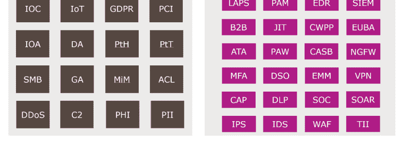
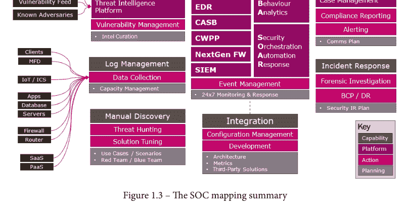
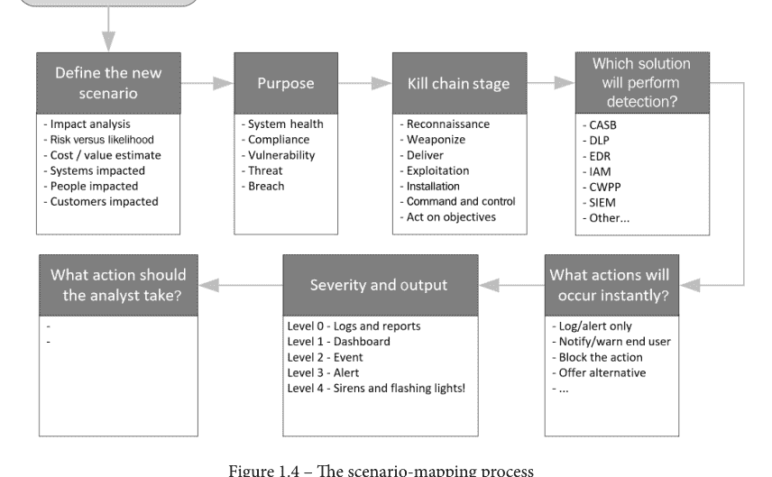

# 第 1 部分：
设计和
实施

在本节中，你将对 Microsoft Sentinel 有一个概述，包括当前的云环境、云安全参考框架、安全运营中心 (SOC) 平台组件以及如何映射架构。你还将了解 Azure Monitor Log Analytics 资源，包括规划你的 Log Analytics 实例、如何创建新实例以及将其附加到 Microsoft Sentinel。

本节包含以下章节：

- 第 1 章，开始使用 Microsoft Sentinel
- 第 2 章，Azure Monitor – Log Analytics 简介

- Microsoft Sentinel 的服务定价
- 场景映射

## 当前的云安全环境

要了解你的安全架构需求，你必须首先确保对你试图保护的 IT 环境有扎实的理解。在部署任何新的安全解决方案之前，需要绘制出当前部署的解决方案以及它们如何保护 IT 环境的各个区域。以下列表提供了任何现代 IT 环境的主要组件：

- 不利于安全工作的终端用户习惯
- 用于身份验证和授权系统访问的身份
- 用于访问内部资源和互联网的网络
- 用于内部应用程序和敏感信息的数据中心中的存储和计算
- 终端用户设备及其用于与数据交互的应用程序
- 在某些环境中，你还可以包括工业控制系统 (ICS) 和物联网 (IoT)

当我们开始查看这些组件的威胁和漏洞时，我们很快就会发现自己深陷于问题和解决方案的字母汤中。

## 网络安全的字母汤

7. **物联网和工业控制系统：** ICS 通常在与企业环境隔离的情况下运行和维护，被称为 **信息技术/运营技术 (IT/OT)** 分隔。这些是高度定制的系统，可能存在数十年且不易更新或更换。网络和设备可能对任何延迟或扫描尝试高度敏感；推荐的方法是被动监控网络流量。

对物联网的引用是不同的，但相似；在这些系统中，将会有大量小型设备收集数据并控制关键业务功能，而无需在同一网络上工作。其中一些设备可以智能化以实现自动化；其他则是单用途的（振动或温度传感器）。从这些系统收集的数据量和速度可能非常高。如果可以从数据中获得有用信息，则考虑在将其摄取到 Microsoft Sentinel 进行分析和短期或长期保留之前先过滤信息。

8. **私有云基础设施：** 这可能托管在本地服务器机房、专门设计的数据中心或第三方提供商处。该组件涉及的技术包括存储、网络、内部防火墙以及物理和虚拟服务器。数据中心是许多公司过去 2-3 十年的支柱，但大多数现在正在转变为混合解决方案，结合云（公共）和本地（私有）解决方案的优点。这里的关键考虑是你可以收集多少日志数据并传输到云中以供 Microsoft Sentinel 摄取。我们将在 *第 3 章，管理和收集数据* 中更详细地介绍数据连接器。

Active Directory 是应包含在此组件中的关键解决方案。它将被扩展到公共云基础设施（组件 09）并在 *特权访问管理* 部分（组件 10）中进行处理。保护 Azure Active Directory 的最佳防御是部署 Microsoft Defender for Identity 解决方案，微软专门为保护 Active Directory 域控制器而开发。

9. **公共云基础设施：** 这些解决方案现在是大多数现代 IT 环境的主流，最初可能是现有本地虚拟化服务器工作负载的扩展、灾难恢复解决方案或由开发人员创建和维护的隔离环境。成熟的公共云部署将在创建和运营的整个生命周期中嵌入多层治理和安全。此组件可能包括 **基础设施即服务 (IaaS)、平台即服务 (PaaS) 和软件即服务 (SaaS)** 服务；每个公共云服务提供商都提供可集成到 Microsoft Sentinel 的自身安全保护。

SOC 的核心组件包括日志管理与 SIEM、SOAR、漏洞管理、威胁情报和事件响应。所有这些组件都由 Microsoft Sentinel 的部署来解决。还需要集成其他解决方案，以提供其他 SOC 平台功能，例如入侵预防/检测、文件完整性监控和灾难恢复。

使用 Microsoft Sentinel 的 SOC 部署包含以下组件：

- **Azure Monitor** 为数据收集和分析创建 Log Analytics 工作区。这些最初是为确保云规模的日志管理解决方案而创建的，适用于基于云的工作负载和基于物理数据中心的工作负载。一旦数据被收集，就可应用一系列解决方案来分析数据的健康、性能和安全状况。部分解决方案由 Microsoft 创建，其他则由合作伙伴创建。

- **Microsoft Sentinel** 是为解决对云原生解决方案的需求而开发的，作为现有基于服务器的 SIEM 解决方案的替代方案，后者已成为过去十年安全和合规的主流。Microsoft Sentinel 建立在 Azure Monitor 和 Log Analytics 的现有服务之上。它还与 Logic Apps 和 Azure Data Explorer 等其他服务集成。

云服务的普及提供了一些关键优势，包括降低存储成本、快速扩展计算、自动化服务维护，以及随着 Microsoft 根据客户和合作伙伴反馈创建新功能而实现持续改进。

部署 Microsoft Sentinel 的即时好处之一是无需在支持基础设施（如服务器、存储和复杂许可）上进行昂贵投资即可快速启用。Microsoft Sentinel 服务按数据消耗计费，每月每千兆字节计费。这允许初始部署从小规模开始，并在需要时增长，直到实现全面部署和成熟度。

持续维护也变得更加简单，因为无需维护服务器或续订许可证。您需要确保通过审查数据的摄取和保留的相关性和适用性来定期优化解决方案。这将保持成本合理并提高用于威胁狩猎的数据质量。

- **Logic Apps** 可与大量企业解决方案集成，确保工作流在多个云平台之间以及与现有本地解决方案之间保持连接。这是平台集成和自动化（SOAR）能力的重要组成部分。

Logic Apps 是一种基于标准的解决方案，提供强大的功能集。如果您已投资其中一个平台，也可以使用第三方 SOAR 解决方案。

SOC 平台组件是一个起点，但在 SOC 实施中您可能还希望部署其他多个服务。在下一节中，我们将研究一种映射 SOC 架构当前状态和需求的方法。

## 映射 SOC 架构

为了为您的 SOC 平台实施一个连贯的技术解决方案，您需要确保以下组件得到审查并彻底实施。这最好定期进行，并通过渗透测试专家定期测试每个能力的强度，他们将提供反馈和指导以帮助改进任何弱点。

## 日志管理与数据源

SOC 平台的第一个组件是从 IT 环境中多样化的系统和服务收集和存储日志数据。这需要仔细规划，以确保您收集和保留最合适的数据。我们可以从其他完善的大数据指导中借鉴的一些关键考虑因素如下：

- **Variety**：您需要确保从多个来源获取数据馈送，以在整个组织中硬件和软件解决方案的光谱范围内获得可见性。
- **Volume**：体积过大可能会导致高昂的摄取和存储费用；过小可能会错过一些可能导致无法完全分析入侵的重要事件。
- **Velocity**：收集实时数据对于减少响应时间至关重要，但同样重要的是数据也必须实时处理和分析。
- **Value/veracity**：数据质量对于理解含义很重要；过多的噪音会阻碍调查。
- **Validity**：准确性和完整性必须得到验证，以确保可以做出正确的决策。
- **Volatility**：数据有多长时间有用？并非所有数据都需要长期保留；在分析后，部分数据可以快速丢弃。
- **Vulnerability**：某些数据比其他数据更敏感，当在同一位置收集并关联在一起时，可能成为潜在攻击者极其宝贵的数据来源。
- **Visualization**：人类对数据的解释需要一定程度的可视化。了解如何向相关受众展示这些信息是报告的关键要求。

Microsoft Sentinel 提供一系列数据连接器，以确保所有类型的数据都可以被摄取和分析。Azure Monitor 的保护将在 *第 2 章，Azure Monitor – Log Analytics 简介* 中介绍，连接器详细信息将在 *第 3 章，管理和收集数据* 中提供。

## 运营平台

传统上，SIEM 用于查看所有日志数据并对其进行推理，寻找跨多样化技术范围的任何潜在威胁。如今，有多个平台可用于执行自我监控和警报功能，就像 SIEM 的工作方式一样，只是它们是针对特定专业领域而设计的。每个平台可能会自行进行日志收集和分析，提供特定的威胁情报和漏洞扫描，并使用机器学习算法检测用户和系统行为模式的变化。如果它们是高级系统，它们还将提供对检测到的威胁做出反应的自动化响应级别。

以下每个解决方案都内置了一系列功能，用于收集和分析日志、执行即时补救措施，并将发现报告给 SIEM 以供进一步调查和交叉分析：

- **身份和访问管理 (IAM)**：IAM 解决方案可能由多个解决方案组成，结合起来以确保从创建到销毁的身份全生命周期管理。IAM 系统应包括治理操作，例如审批、证明以及组成员资格和权限管理的自动化清理。IAM 还涵盖实施多因素身份验证的能力：一种挑战登录过程的方法，以提供超出简单用户 ID 和密码组合的验证。管理员执行的所有操作和用户驱动的活动都应记录并报告给 SIEM 以提供上下文和终端用户行为分析。

CASB 将附带许多连接器，可深度集成到云服务中，并连接到 IAM 系统以帮助管理对其他云服务的访问（通过单点登录（SSO）），充当反向代理并强制执行基于会话的控制。CASB 还将提供许多检测规则模板以立即部署，并提供定义适用于您组织独特且几乎无限用例的自定义规则的能力。CASB 的响应能力取决于您与相关云服务的特定集成；这些可以包括限制或撤销对云服务的访问、防止文档的上传或下载，或将特定文档从他人的视野中隐藏。

- **云工作负载保护平台 (CWPP)**：CWPP 也可能被称为 **云安全态势管理 (CSPM)** 解决方案。两者都将提供扫描和持续监控系统的独特能力，以确保它们符合合规性和治理要求。该解决方案为漏洞扫描和在多个云服务（例如 **Amazon Web Services (AWS)** 和 **Microsoft Azure**）中进行持续审计提供集中方法，同时集中策略和补救措施。这些服务中的资源可以通过实施策略和技术（包括 **即时 (JIT)** 访问和 **攻击面减少 (ASR)**）来保护。

当这些解决方案部署时，我们就少了一个 SIEM 需要提供的功能；相反，它可以从服务获取信息以了解潜在风险，并为补救措施提供集成点。

- **下一代防火墙 (NGFW)**：防火墙自 1980 年代以来一直是网络安全的支柱，仍然是内部网络分段和隔离的核心组件，也是许多面向互联网服务的入口。随着 NGFW，您不仅可以获得以前防火墙技术的全部好处，还可以对应用层安全进行深度数据包检查并集成入侵检测/预防系统。部署 NGFW 解决方案还将有助于检测和补救网络上的恶意软件和高级威胁，防止其传播到更多主机和基于网络的系统。

从这些示例可以看出，需要部署 SIEM 来完成集中收集和分析日志的所有工作的做法已成为过去。随着这些针对各自专业领域进行管理的先进解决方案的部署，SIEM 的重点转变为在各解决方案之间查找常见模式，以及监控这些单独解决方案未覆盖的系统。以 Microsoft Sentinel 作为 SIEM，它还将充当 SOAR，实现对每个单独解决方案中威胁的协调响应，避免每次警报、报告和响应需求发生变化时都需要重新设计它们。

## 威胁情报和威胁狩猎

威胁情报为收集到的日志数据提供了额外的上下文。知道在日志中寻找什么以及如何识别严重事件，需要威胁狩猎技能与来自深耕网络犯罪研究领域的各类专家持续的情报源相结合。其中许多工作都通过人工智能（AI）平台得到增强；然而，人类的参与始终是必需的，以增加那种直觉元素，许多侦探和警察会告诉你，他们在执法调查中工作时会产生这种感觉。

## SOC 映射总结

下图提供了构成 SOC 架构的多个组件的汇总，并对实施每个组件提出了一些额外建议：

该解决方案在有丰富的日志数据流向日志管理解决方案时效果最佳，并与来自威胁情报和漏洞扫描及数据库的数据源相连。这些信息用于发现和威胁狩猎，并可能表明配置漂移的任何问题。SOC 运营的核心解决方案包括 SIEM、CASB 和 EDR 等，每个解决方案都有其自己的 **End User Behavior Analytics (EUBA)** 和 SOAR 能力。集成这些解决方案是减少噪音并提高响应速度的关键步骤。结果应能够准确报告当前风险状况、合规状态，并在需要立即响应和准确数据的情况下清晰沟通。

## 安全解决方案集成

Microsoft Sentinel 设计为可与多个安全解决方案协同工作，而不仅仅是微软开发的解决方案。

在最基本层面，任何可以通过 Syslog 收集器传输日志的系统都可实现日志收集和分析。支持 CEF 编码 Syslog 端点并共享 Windows 事件日志的系统可提供更详细的日志。然而，首选方法是直接通过 API 集成，以实现双向通信并帮助管理集成解决方案。有关这些选项的更多详细信息包含在 *Chapter 3, Managing and Collecting Data.* 中。

> **Common Event Format (CEF)**
> 
> CEF 是一种应用于 Syslog 消息的行业标准格式，被大多数安全厂商采用以确保平台间的通用性。Microsoft Sentinel 提供集成以便轻松对 CEF 数据运行分析和查询。有关 Microsoft Sentinel CEF 源配置的完整列表，请查看 https://aka.ms/SentinelGrandlist 上的文章。

## 与 Amazon Web Services (AWS) 集成

**AWS** 为平台上的大多数功能提供 API 访问，这使得 Microsoft Sentinel 成为丰富的集成解决方案。以下列表提供了如果在 AWS 账户中启用，应与 Microsoft Sentinel 集成的一些常见资源：

- AWS CloudTrail 日志提供 AWS 用户活动的洞察，包括失败的登录尝试、IP地址、区域、用户代理和身份类型，以及使用假设角色的潜在恶意用户活动。
- AWS CloudTrail 日志还提供与网络相关资源的活动，包括安全组、网络 **access control lists (ACLs)** 和路由、网关、弹性负载均衡器、 **Virtual Private Cloud (VPC)**、子网和网络接口的创建、更新和删除。

部署在 AWS 账户中的某些资源可以配置为直接将日志发送到 Microsoft Sentinel（如 Windows 事件日志）。您还可以在 AWS 账户中部署日志收集器（Syslog、CEF 或 Logstash）以集中日志收集，就像您为私有数据中心所做的那样。

## 与 Google Cloud Platform (GCP) 集成

Google 为 **GCP** 和 G Suite 解决方案的大多数功能提供 API 访问。G Suite Connector 目前正在开发中。如果您管理 G Suite 或 **GCP** 实例并希望使用 Microsoft Sentinel 来保护它们，您应考虑以下选项（直到完全支持的连接器可用）：

- REST API——该功能仍在开发中；发布后，您将能够创建自己的调查查询。
- 部署 CASB 解决方案，该解决方案可以与 GCP 日志交互、控制会话访问并将相关信息转发到 Microsoft Sentinel。
- 部署 Syslog、CEF 或 Logstash 等日志收集器。确保所有部署的资源可以通过日志收集器将日志转发到 Microsoft Sentinel。

## 与 Microsoft Azure 集成

**Microsoft Azure** 平台可与许多 Microsoft 安全解决方案直接集成，且每月都在增加：

- Azure Active Directory，用于收集审计和登录日志，以获取有关应用使用、条件访问策略、旧版身份验证、自助密码重置使用情况以及用户、组、角色和应用管理的洞察。
- Azure Active Directory Identity Protection，提供用户和登录风险事件和漏洞，并能够立即缓解这些风险。
- Azure Activity，提供有关订阅级事件的洞察，例如 Azure Resource Manager、服务运行状况、资源上的写入操作以及在 Azure 中执行活动的状态。
- Azure DDoS Protection，用于保护可能通过 **DDoS** 攻击的 Web 服务。
- Microsoft Defender，用于跨 Azure、AWS、GCP 和混合部署进行安全管理的集成 CWPP。
- Microsoft Defender for IoT，提供物联网和 OT 网络的洞察，并根据风险严重程度提供建议。
- Azure Firewall，受管理的基于云的网络安全服务，用于保护 Azure 虚拟网络。
- Microsoft Information Protection，用于分类并选择性地保护敏感信息。
- Azure Key Vault，用于安全存储和访问密钥，包括 API 密钥、密码、证书或加密密钥。
- **Azure Kubernetes Service (AKS)**，一种开源、完全托管的容器编排服务，用于管理和部署 Docker 容器。
- Azure SQL Database，一种完全托管的 PaaS 数据库引擎。此连接器可让您将审计和诊断日志流式传输到 Microsoft Sentinel。
- Azure 存储账户，用于现代数据存储场景的云解决方案。
- DNS，用于改进对尝试解析恶意域名、话痨 DNS 客户端和其他 DNS 健康相关事件的客户端的调查。
- Dynamics 365，提供有关该平台上管理员、用户和支持活动的洞察。

Azure Monitor 和 Microsoft Sentinel 的成本由消耗的数据量计算得出，这直接受连接器影响：您连接的信息类型以及每个节点产生的数据量。这可能在整个月内每天有所变化，因为您的基础设施和云服务中的活动发生变化。一些客户注意到基于客户销售波动或在遭受 DDoS 攻击时发生了变化。

定价还受数据在 Microsoft Sentinel 中保留时间的影响。默认值为 90 天，但可延长至最长 2 年。大多数安全运营需要 6 至 12 个月的热数据保留。在设定的保留期后，使用 Azure Data Explorer (ADX) 保留数据所需的时间（最长 99 年）。

初始定价选项是按使用付费（PAYG）。使用此选项，您按每千兆字节（GB）摄取的固定价格付费，按每日计费。微软已提供承诺不同用量层级的选项，以换取基于更大数据量的折扣。

值得注意的是，微软已提供一些不产生数据摄取成本的连接器。这些连接器的数据可能占您总数据摄取量的 10-20%，从而降低总体成本。目前，以下数据连接器不收取摄取费用（通常免费摄取仅限于警报；某些连接器确实提供完整的数据摄取）。详情请参见：https://azure.microsoft.com/en-us/pricing/details/azure-sentinel/#faq。

- Azure Activity（Azure 操作的活动日志）
- Azure Active Directory Identity Protection（适用于具有 Azure Active Directory P2 许可证的租户）
- Microsoft Information Protection
- Microsoft Defender
- Azure Security Center
- Microsoft 365 Defender
- Microsoft Defender for Cloud Apps
- Microsoft Defender for Endpoint
- Microsoft Defender for Office 365
- Microsoft Defender for Identity
- Office 365 audit logs（所有 Teams、Exchange 管理员和 SharePoint 活动日志）

定价按每日即用即付（PAYG）方式计费，基于实际数据消耗量。当定期引入的数据量达到预留限制时，可使用容量承诺层级获得折扣定价：

- 100 GB
- 200 GB
- 300 GB
- 400 GB
- 500 GB
- 1,000 GB (1 TB)
- 2,000 GB (2 TB)
- 5,000 GB (5 TB)

使用容量预留时，每日在该层级为数据支付固定价格，超出该层级的部分按每GB的PAYG价格计费。PAYG定价设置为与承诺层级折扣价格相同的金额。当你计算定价层级时，当预留费用低于按PAYG定价支付的费用时（通常在50%到80%之间），升级到下一层级在经济上是合理的。

例如，如果平均每天引入130 GB数据，你将按每GB固定价格支付前100 GB，然后为额外30 GB按每GB的PAYG价格付费（例如每天=296美元）。现在，如果将每日使用量增加到185 GB，将计划升级到200 GB选项（例如每天=276美元）并为额外容量付费，而不是支付100 GB（固定）+85 GB（PAYG）（每天总计=384.80美元），这样会更省钱。

当你查看正在使用的数据量时，可能会发现随着解决方案扩展以覆盖更多安全领域，每月消耗的数据量呈增长趋势。当你接近下一个层级时，应考虑更改定价模式；你可以每30天更改一次。

接下来要考虑的成本管理领域是Microsoft Sentinel数据的保留和长期存储。默认情况下，上述定价包含90天的保留期。对于某些公司来说，这足以确保对其环境中过去3个月活动的可见性；而对于其他公司，则需要更长时间保留这些数据，有时根据所在国家或行业的监管要求需要保留2到7年。有两种主要的长期数据保留方式，应根据价格和技术要求综合考虑并选择：

- **Azure Monitor**：这是Microsoft Sentinel的原生存储，提供默认90天的热存储选项，可升级为将热数据存储长达2年。

  **优点**：数据在Azure Monitor中在线可用，可使用KQL搜索直接查询，并且可以筛选数据，仅保留必要信息。

  **缺点**：与其他选项相比，这可能是最昂贵的每GB选项。

- **Azure Data Explorer (ADX)**：此解决方案可以无限期保留数据；定价基于数据量和执行搜索所需的计算量组合。通常，长期存储的成本约为Microsoft Sentinel的十分之一。

  **优点**：数据在Azure中在线可用，可使用KQL搜索直接查询。数据可被筛选以仅保留必要信息。

  **缺点**：这是一项独立服务，对于不支持的表需要一些初始配置和集成工作。

- **其他存储选项**：可以使用基于云或基于物理的存储解决方案来无限期存储数据，通常通过*事件中心*或*Azure存储*发送数据来实现。

  **优点**：可从各种合作伙伴处获得更便宜的选项。

  **缺点**：如果将数据发送到Azure之外，将产生额外费用，且Microsoft Sentinel无法查询这些数据。使用这些数据需要实施另一个解决方案，以便在需要时查询数据。

这些组件在不同部署中差异很大，因此你需要在设计中开展此项研究。此外，还要研究最新的区域可用性，并确认Microsoft Sentinel是否在各种政府云（例如中国）中得到支持。

## 情景映射

在本章的最后一节，我们将探讨SOC开发的一个重要部分：情景映射。该过程定期执行，以确保工具和流程针对有效分析进行调整，并具有正确的数据流，以及响应得到良好定义，确保在检测到潜在和实际威胁时采取适当行动。为了使这项演练有效，我们建议让一系列具备不同技能和观点的人员参与，包括技术与非技术人员。你还可以邀请在威胁狩猎、防御和攻击技术方面具有特定技能和经验的外部顾问参与。

以下流程作为起点提供。我们鼓励你定义自己的情景映射方法，并在每次演练后不断改进。

### 第1步 – 定义新情景

在第一步中，我们一次阐述一个情景；你可能需要使用电子表格或其他文档方法来确保信息被收集、审查并根据需要更新：

- **影响分析**：这是基于后续组件的完整分析摘要。你可能需要提供一个评分系统，以确保根据潜在影响的严重程度，按优先级顺序处理安全控制的实施。

- **风险与可能性**：虽然某些情景一旦发生会带来很高的灾难风险，但我们也必须将该风险与其发生的可能性进行权衡。风险计算有助于证明缓解风险所需的预算和控制措施是合理的，但请记住，你不太可能实现完全缓解，并且始终需要优先安排你所拥有的资源来实施控制措施。

- **成本与价值评估**：评估资源对你组织的价值以及保护它的成本。这可以是货币价值或IT安全预算的百分比，也可以是其他可定义的指标，例如时间和精力。如果成本超过价值，你可能需要找到更经济实惠的方式来保护该资源。

### 第5步 – 哪些操作会立即发生？

由于我们的目标是最大限度地实现检测和响应的自动化，请考虑应立即执行哪些操作，然后专注于实现这些操作的自动化。

操作可能包括：

- 记录日志和发出警报
- 通知/警告最终用户
- 阻止该操作
- 提供替代选项/操作
- 触发工作流

### 第6步 – 严重级别和输出

在此步骤中，你应该能够根据前几个步骤中的影响分析，分配一个数字来关联严重级别。对于每个严重级别，定义所需的适当输出：

- **级别0** – 日志和报告
- **级别1** – 仪表板通知
- **级别2** – 在工单系统中生成事件
- **级别3** – 向群组/个人发送警报
- **级别4** – 自动升级到高级管理团队（警笛和闪光灯是可选的！）

### 第7步 – 分析师应采取什么行动？

而*第5步 – 哪些操作会立即发生？*部分是自动化操作，此步骤则定义了安全分析师应该做什么。对于每个情景，定义应采取哪些行动，以确保适当的响应、修复和恢复。

下图是一个简单参考图表，可在情景映射演练中使用：

图1.4 – 情景映射过程

通过遵循这个七步流程，你的团队可以为任何可能性做好更好的准备。通过遵循可重复的流程，并每次改进该流程，你的团队可以相互分享知识，并进行测试，以确保防护和检测高效且有效，同时识别解决方案中必须优先处理的新差距。

你应该承诺离开电脑，抽出时间定期开展此类桌面演练。有些组织每年仅进行一次，而其他组织则根据其系统和公司文化中看到的需求，每周进行一次或按需进行。

