## 2 Azure Monitor – Log Analytics 简介

在本章中，我们将探索 Azure Monitor Log Analytics 平台，该平台用于存储将由 Microsoft Sentinel 分析的所有日志数据。这是实施 Microsoft Sentinel 时需要设计和配置的第一个组件，并且需要一些持续的维护来配置数据存储选项并控制与解决方案相关的成本。

本章还将解释如何使用 Azure 门户、PowerShell 和 CLI 创建新的 Log Analytics 工作区。创建工作区后，我们将学习如何将各种资源附加到工作区，以便收集信息，并将探索其他导航菜单选项。

我们将在本章中涵盖以下主题：

- Azure Monitor Log Analytics 简介
- 使用门户创建工作区
- 使用 PowerShell 或 CLI 创建工作区

一旦创建，工作区可用于从许多不同来源收集信息，包括以下来源：

- 同一订阅中的 Azure 资源
- 不同订阅中的 Azure 资源
- 来自其他云服务的数据（例如**Amazon Web Services**和**Google Cloud Platform**）
- 来自您的私有数据中心的数据（本地或第三方托管）
- 来自本地资源的数据（通过安全的互联网连接）
- 来自物联网和工业控制系统的数据

为了保护收集的数据，该解决方案内置了安全和治理控制；Log Analytics 服务在安全的云数据存储库中管理您的数据，并确保数据通过多层保护得到保障，包括以下内容：

- 数据隔离和隔离，具有地理主权
- 按数据源类型的数据保留和删除策略
- 继承自 Azure 订阅（商业和政府）的物理安全国际认证标准
- Microsoft 管理的突发事件处理流程
- 对多种合规性和监管标准的认证符合性
- 用于将数据发送到 Log Analytics 的安全通道；通过端口443使用基于证书的身份验证进行SSL加密
- 由客户管理的工作区和基于角色的访问权限；本章稍后将提供更多详细信息

有关数据安全方式的更多信息，我们建议阅读微软官方文档：https://docs.microsoft.com/en-us/azure/azure-monitor/logs/data-security。

## 规划工作区

虽然直接去创建工作区很容易，但最好事先规划好工作区配置，以避免之后返工。需要考虑的一些方面包括：

- **工作区的名称**：在整个 Azure 中必须是唯一的。名称应具有足够的描述性，以便仅通过查看名称就能了解该工作区提供的服务。建议在名称中包含您的公司名称和`Sentinel`一词。

如果担心这个名称会使它成为恶意行为者更大的目标，请使用任何有意义的并符合公司标准的命名约定。有关 Azure 命名最佳实践的详细信息，请使用此链接：https://docs.microsoft.com/en-us/azure/cloud-adoption-framework/ready/azure-best-practices/naming-and-tagging。

- **工作区所属的订阅**：建议仅为 Microsoft Sentinel 使用创建一个单独的订阅，以限制对其的访问。如果这不可行，请选择一个合适的订阅来使用。

- **工作区的位置**：工作区应与其提供数据的资源位于同一位置，以防止将数据从一个位置发送到另一个位置时会产生出口费用。大公司很可能在许多不同位置都有资源，在这种情况下，使用资源最多且工作区价格最低的位置是合理的。请记住，可能有一些法律规定了数据必须驻留的位置。

有关 Log Analytics 定价的更多信息，请参阅 https://azure.microsoft.com/en-us/pricing/details/monitor。

- **工作区将位于哪个资源组**：建议所有 Microsoft Sentinel 资源都位于同一资源组中，尽管这不是硬性规定。如果将所有工作区放在一个资源组、Microsoft Sentinel 放在另一个资源组、工作簿放在第三个资源组中更有意义，那么就这样做。这完全不会影响 Microsoft Sentinel 的性能。

- **使用哪个定价层**：如果用于容纳工作区的订阅在2018年4月2日之前创建过工作区，或者该订阅是2019年2月1日之前生效的 Microsoft 企业协议的一部分，您将继续访问旧版定价层。否则，只会显示**Per GB (2018)**，并且按 GB 对数据摄取和保留收费。旧版选项如下：

- **免费**：摄取的数据不收费，但每日限制为500 MB，数据仅保留7天。这仅可用于实验室和研究目的。
- **独立（按 GB）**：与**Per GB (2018)**相同。
- **按节点 (OMS)**：如果已购买**OMS E1 套件**、**OMS E2 套件**或**适用于 System Center 的 OMS 附加组件**，则使用此选项，以使用这些购买带来的授权。

在创建工作区之前对其进行规划非常重要。确保选择一个唯一且有意义的名称、合适的位置以避免出口费用、正确的资源组，并在部署前做出其他决定，这将使您免于沮丧或以后的完全返工。Tiander Turpijn 写了一篇关于这个主题的非常好的文章：https://techcommunity.microsoft.com/t5/azure-sentinel/best-practices-for-designing-an-azure-sentinel-or-azure-security/ba-p/832574。

## 使用门户创建工作区

本节将描述如何使用 Azure 门户创建 Log Analytics 工作区。这是稍后讨论的 PowerShell 和 CLI 命令的图形化表示，因此可能是开始使用工作区的最简单方式：

1. 在 Azure 门户中，在屏幕顶部的搜索栏中输入`Log Analytics workspaces`。这将显示与输入的搜索词相关的服务列表。找到并单击**Log Analytics workspaces**链接。
2. 单击**添加**按钮以创建工作区：

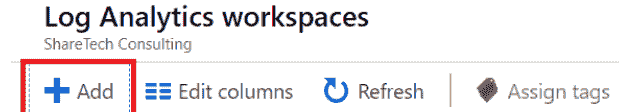

图 2.2 – 创建新的 Log Analytics 工作区

3. 在新的边栏选项卡中输入所需的值：

- A. 输入工作区的名称。
- B. 选择此工作区将驻留的**订阅**。
- C. 为此工作区选择**资源组**。
- D. 选择此工作区将驻留的**位置**。
- E. 对于**定价层**选项，将自动选择**Per GB (2018)**。

边栏选项卡将如下所示：

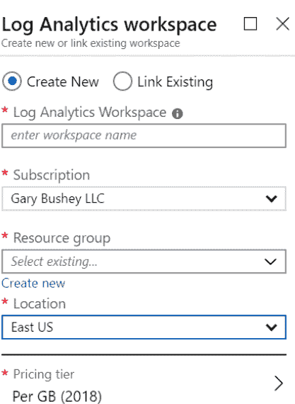

图 2.3 – Log Analytics 工作区选项

4. 当所有值都填写完毕后，单击屏幕底部的**确定**按钮以继续。即使按钮会变为**正在验证**，它也会在后台创建工作区。

5. 创建工作区后，您将返回所有工作区的列表。您可能需要刷新此列表以查看新的工作区。

这就是使用 Azure 门户创建 workspace 的全部内容。虽然这非常容易，但有时您可能希望使用命令行操作来执行相同的操作，这将在接下来描述。

## 使用 PowerShell 或 CLI 创建工作区

有时您需要能够一致地重新创建 Azure Sentinel 环境。也许您只是在测试各种配置选项，为一家国际公司的许多不同订阅创建环境，或者为客户创建实例。无论原因如何，如果您需要创建许多相同的 Microsoft Sentinel 环境，使用 PowerShell 或**命令行界面 (CLI)** 比在 Azure 门户中操作更好。

### 创建 Azure 资源管理模板

在本实验中使用 PowerShell 创建新的 Log Analytics 工作区时，您将使用**Azure 资源管理 (ARM)** 模板来执行实际配置。虽然您可以直接使用这两种技术中的任何一种来创建工作区，但使用 ARM 模板提供了额外的好处，包括能够轻松地重新创建工作区、在 DevOps 工作流中使用 ARM 模板，或在 Azure Blueprints 中使用它。

> **注意**
> 
> 对 ARM 模板的完整讨论超出了本实验的范围，但简而言之，ARM 模板是一个描述需要在 Azure 中创建什么的 JSON 文件。它包含参数，即用户将提供的用于确定名称、位置和定价层等项的值。它还可以有变量，即可用于确定其他值的内部值。它还将有一个或多个资源的列表，即要创建的 Azure 资源。

转到 `https://docs.microsoft.com/en-us/azure/azure-monitor/platform/template-workspace-configuration` 并复制 JSON 文本。您将把它粘贴到稍后创建的文件中。

在此示例中，系统将提示您输入工作区名称和位置，但由于存在`defaultValue`条目，定价层将默认为`pergb2018`。如果您不希望使用这些默认值，您可以更改显示的值，或删除整个`defaultValue`行（包括末尾的逗号），在这种情况下，执行命令时将提示您输入这些值。


> Note
> 如果你想在自己的电脑上而不是通过 Azure 门户运行，请访问 https://docs.microsoft.com/en-us/powershell/azure/install-az-ps 以了解如何安装 Azure PowerShell 模块，或访问 https://docs.microsoft.com/en-us/cli/azure/install-azure-cli?view=azure-cli-latest 安装 Azure CLI 模块。

Cloud Shell 加载完成后，输入以下内容：

```
code deployworkspacetemplate.json
```

这将启动可在 Cloud Shell 中使用的 Visual Studio Code 版本。输入前述代码段中的代码。在屏幕右侧，点击上下文菜单并点击保存。然后你可以点击 X 关闭编辑器，或点击上下文菜单并点击关闭编辑器：

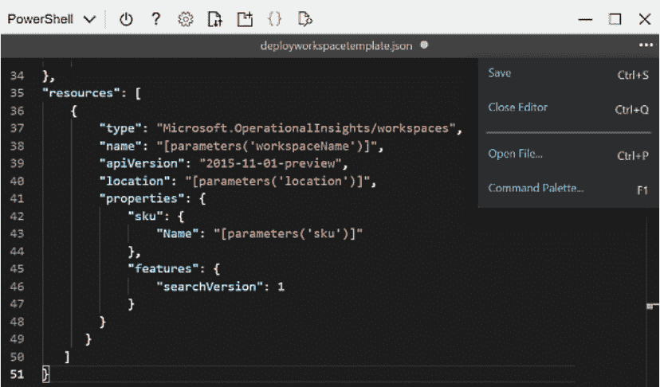

图 2.6 – 使用 JSON 模板进行 PowerShell 部署

这就是如何使用 CLI 创建新的 Log Analytics ARM 模板的方法。这是我们在以下各节中用于创建新工作区的外部文件。

## 使用 PowerShell

PowerShell 是一种脚本语言，可在各种机器上使用，包括 Windows 和 Linux 计算机，并建立在 .NET 之上。正因如此，它可以接受 .NET 对象，使其功能强大无比。PowerShell 拥有许多不同的命令，其中一些专门用于与 Azure 协作，我们将在此处使用它们。

按照以下步骤使用 PowerShell 创建新的工作区：

- 1. 确定工作区将驻留在哪个资源组中。如果已有资源组，请跳至步骤 3。
- 2. 要创建新的资源组，运行此命令：
- 3. 输入以下命令：
- 4. 你将被提示输入 Log Analytics 工作区名称。输入有效名称并按 Enter 继续。
- 5. 命令运行完成后，将显示成功屏幕，其中包含所使用值的摘要，如下所示：

```
New-AzResourceGroup -Name <resource-group-name> -Location <location>
```

将 <resource-group-name> 替换为新资源组的名称，将 <location> 替换为资源组所在的位置，例如 EastUS 或 WestUS。如果不知道位置应使用什么，运行此命令：

```
Get-AzLocation
```

找到所需的位置并使用 Location 下列出的值。

```
New-AzResourceGroupDeployment -Name <deployment-name> -ResourceGroupName <resource-group-name> -TemplateFile $HOME/deployworkspacetemplate.json
```

将 <deployment-name> 替换为此部署的名称。你可以使用类似 <labworkspace> 的名称。输入什么并不重要，因为这只是一个占位符名称，以便你在查看资源组时可以区分各种部署。将 <resource-group-name> 替换为工作区将驻留的资源组的名称。

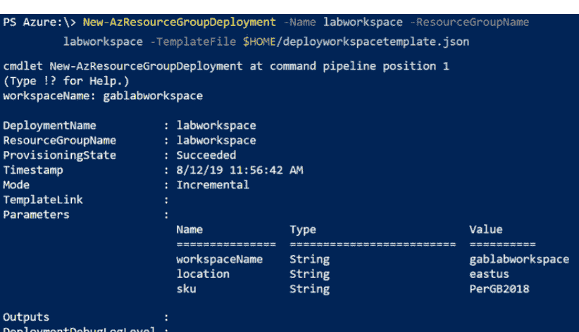

图 2.7 – 在 PowerShell 中运行 New-AzResourceGroupDeployment

如果出现错误屏幕，请务必阅读消息，因为消息通常会非常具体地说明错误原因。

- 6. 关闭 Cloud Shell 会话。

这就是如何使用 ARM 模板和 PowerShell 创建新的 Log Analytics 工作区。与使用 Azure 门户相比，这种方法更具可重复性。接下来，我们将查看如何使用 Azure CLI 并了解如何在不使用 ARM 模板的情况下创建新的工作区。

## 使用 CLI

Azure CLI 也是微软开发的跨平台脚本工具。最初，它是唯一跨平台的工具，因此如果你在非 Windows 计算机上工作，它是你的唯一选择。PowerShell 现在也是跨平台的，因此两者之间的主要区别在于 Azure CLI 可以直接创建 Azure 资源，而无需使用 ARM 模板。

3. 从页面顶部的 Essentials 列表开始，我们可以查看以下项目：

- A. **资源组**：工作区所在资源组。
- 选择 [change] 将允许你移动到另一个资源组。
- B. **状态**：工作区状态应显示为 **Active**。
- C. **位置**：工作区所在的 Azure 位置。
- D. **订阅名称**：此资源关联的订阅。
- 选择 [change] 将允许你移动到另一个订阅。
- E. **订阅 ID**：前述订阅的唯一 GUID，在致电微软寻求技术支持时很有用。
- F. **工作区名称**：Log Analytics 工作区的名称。
- G. **工作区 ID**：工作区的 GUID，在致电微软寻求技术支持时也很方便。
- H. **定价层**：工作区的定价层。
- I. **管理服务**：查看工作区的活动日志。
- J. **访问控制模式**：这决定了用户如何获得访问此工作区中信息的权限。有关更多信息，请参阅以下部分。

前面的部分描述了使用 Microsoft Sentinel 创建新的 Log Analytics 工作区的各种方法。这可以通过 Azure 门户完成，也可以通过 PowerShell 或 CLI 命令以编程方式完成。工作区创建后，我们接下来需要确保访问仅限于需要访问它的用户。

## 管理工作区的权限

在我们连接并将数据存储到工作区并启用 Microsoft Sentinel 对数据进行分析之前，让我们回顾一下保护此新资源访问的选项。
Azure 提供对资源的三个主要访问级别：

- - **所有者**：对资源具有最高级别的访问权限
- - **参与者**：可以创建和修改资源，但不能授予或撤销访问权限
- - **读取者**：可以查看所有资源

如果需要额外的权限，请坚持提供最小权限的原则，并仅应用所需的特定资源。可能需要一些反复试验才能获得正确的结果，但这比提供广泛且过度的权限更安全。如需进一步信息，请查看以下文章：

```
https://docs.microsoft.com/en-us/azure/azure-monitor/logs/manage-access
```

现在我们已经了解了权限管理，让我们继续启用 Microsoft Sentinel。

## 启用 Microsoft Sentinel

一旦你创建了要与 Microsoft Sentinel 一起使用的 Log Analytics 工作区，将其附加到 Microsoft Sentinel 非常容易：

- 1. 如果你的租户尚未启用 Microsoft Sentinel，请登录 Azure 门户，在搜索框中输入 Microsoft Sentinel，并选择 Microsoft Sentinel 选项，如下所示：

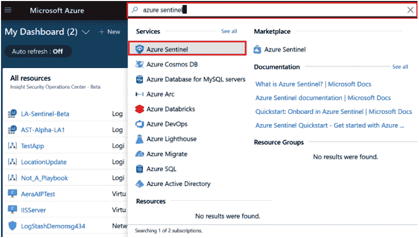

2. 点击 Add 按钮将工作区添加到 Microsoft Sentinel：

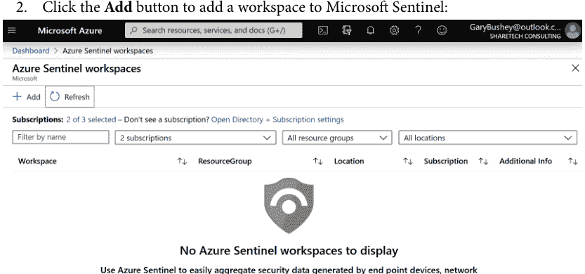

图 2.11 – 将工作区添加到 Microsoft Sentinel

3. 从提供的列表中选择工作区，或点击 Create a new workspace 使用 Creating a workspace using the portal 部分中列出的说明添加新工作区，然后选择它。然后，点击屏幕底部的 Add Microsoft Sentinel 按钮继续：

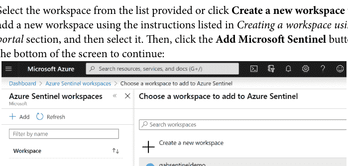

图 2.12 – 选择工作区

4. 工作区创建后，你将被带到 Microsoft Sentinel 的概览页面。此页面将显示事件、警报和事件的摘要。有关更多信息，请参阅以下屏幕截图：

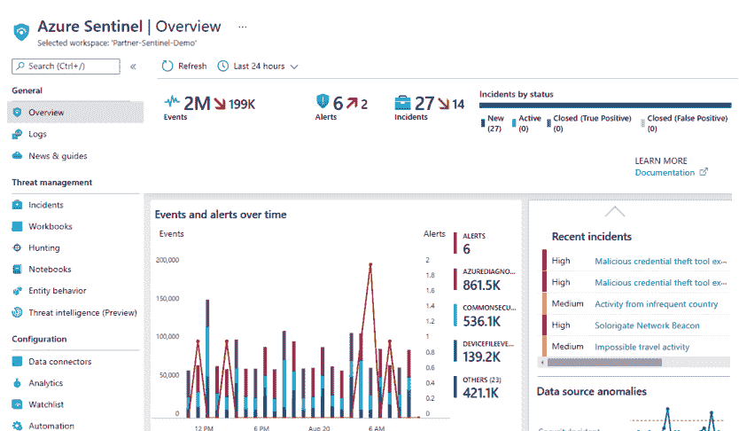

图 2.13 – Microsoft Sentinel 概览页面

恭喜！你现在已创建 Microsoft Sentinel 环境并准备就绪。News & guides 页面是在将 Log Analytics 工作区附加到 Microsoft Sentinel 后你会自动前往的页面。如果你离开 Microsoft Sentinel 并返回，你将自动进入 Microsoft Sentinel 概览页面，接下来将对此进行描述。


## 探索 Microsoft Sentinel 概览页面

Microsoft Sentinel 概览页面是你在将 Log Analytics 工作区与其关联后进入 Microsoft Sentinel 时自动访问的页面。此页面提供 Microsoft Sentinel 环境中信息的总体概览，外观如下图所示。当然，实际显示的数字和数据会因环境而异：

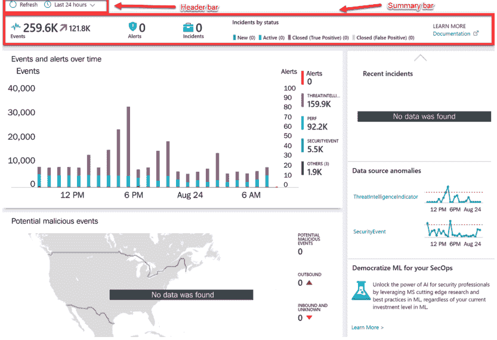

图 2.14 – Microsoft Sentinel 概览页面

上图中显示的页面可以分为多个部分，后续章节将对每个部分进行说明。

## 标题栏

标题栏允许你刷新屏幕以查看任何更新，还可以选择回看数据的时间范围。你可以选择类似时钟的图标来更改你想回看的时间范围。

以上就是 Microsoft Sentinel **概览**页面。它是了解 Microsoft Sentinel 环境中动态的好去处，也是 Microsoft Sentinel 的登录页面。虽然*图 2.14* 显示了大量数据，但当你首次创建 Log Analytics 工作区时，它将是空的。下一节将说明如何开始将数据导入工作区。

## 连接第一个数据源

在深入探讨 Microsoft Sentinel 数据连接器的细节之前（参见*第 3 章，管理和收集数据*），我们将回顾 Log Analytics 如何实现与一系列不同源的连接，以接收数据供存储和分析。一些数据源选项包括：

- 应用程序和操作系统诊断
- 虚拟机日志数据
- Azure 存储帐户日志
- Azure 活动日志
- 其他 Azure 资源

在本节中，我们将向你展示如何启用来自 Azure 虚拟机的日志收集。

## 从 Azure 虚拟机获取信息

要让**虚拟机**（VM）填充 Log Analytics 工作区，它们需要连接到工作区。这可以通过 Log Analytics 工作区的**概览**页面完成。

有两种不同的方式可以到达此页面。首先，你可以在 Azure 门户导航菜单中选择 **Log Analytics**，然后选择相应的工作区。第二种（也许更简单）方式是从 Microsoft Sentinel 导航菜单中选择 **设置**，然后从页面顶部的选项中选择 **工作区设置**，如下图所示：

## Log Analytics 的高级设置

Log Analytics 的高级设置允许你执行各种操作，例如连接本地和其他非 Azure 的 Windows 和 Linux 服务器、Azure 存储以及 System Center 管理组。你还可以设置从 Windows 和 Linux 服务器导入哪些信息，导入 IIS 日志和 Syslog 事件，并添加自定义日志和字段。最后，你还可以创建计算机组，或使用已在 Active Directory、Windows Server Update Service（WSUS）和 SCCM 中创建的组，这些组可以在你的查询中使用。

要进入“高级设置”页面，请按照上一节中的说明进入 Log Analytics 概览页面，但不要选择 Azure 虚拟机（VM），而是选择“代理管理”。这将打开一个新页面，如下图所示：

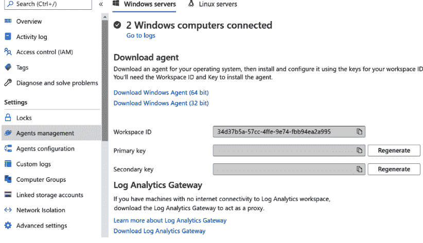

图 2.19 – Microsoft Sentinel 代理管理

如你所见，有两个选项卡分别用于连接 Windows 和 Linux 服务器以摄取数据。下一节将分别讨论它们。

## 代理管理

此区域允许你附加非 Azure 的 Windows 和 Linux 服务器：

- **Windows 服务器：** 你可以将基于非 Azure Windows 的 VM 附加到工作区，以收集 Windows 事件日志和性能计数器。单击 **下载 Windows 代理（64 位）** 或 **下载 Windows 代理（32 位）** 以匹配你正在使用的 Windows 版本，并在服务器上运行该程序。复制 **工作区 ID** 以及 **主键** 或 **辅助键** 详细信息，并在系统要求时填写。

- **Linux 服务器：** 其工作方式与 Windows 服务器相同 – 单击 **下载 Linux 代理** 链接并阅读文档以获取安装说明。

> **注意**
> 虽然这可用于连接 Azure VM，但使用上一节中的步骤要容易得多。

接下来，我们将查看 **代理配置** 页面，它提供了从代理摄取数据的选项。

- **Windows 性能计数器：** 这将显示默认包含的所有性能计数器及其轮询间隔的列表。在这里，你可以更改间隔或完全删除计数器。你还可以添加其他要监视的计数器。

- **Linux 性能计数器：** 这将显示默认包含的所有 Linux 性能计数器以及使用轮询间隔的计数器的轮询间隔列表。在这里，你可以更改间隔或完全删除计数器。你还可以添加其他要监视的计数器。

- **Syslog：** 此部分启用从 Syslog 服务器收集数据。为每个设施选择严重性以确保收集消息，所有其他消息将被排除。有关更多详细信息，请查看此页面：https://docs.microsoft.com/en-us/azure/azure-monitor/agents/data-sources-syslog。

- **IIS 日志：** 这决定是否将从 Windows Web 服务器摄取 W3C 格式的 IIS 日志文件。例如，来自基于 Linux 的 Web 服务器的 Web 日志。

如你所见，配置要导入的数据有很多方式。在所需或想要的数据与摄取和存储数据的成本之间，始终存在权衡。在下一节中，我们将了解 **计算机组**，它可以帮助你进行查询。

## 计算机组

此部分将显示所有已创建的自定义计算机组，并提供创建自己的计算机组的方法。然后，这些组可以用于查询。你可以使用这些组创建引用特定服务器集的查询，并且无需更改查询本身即可轻松更改这些服务器集。

有多种创建计算机组的方法可以帮助你进行查询。以下各节将更详细地讨论每种方法。

## 通过查询添加计算机组

使用查询添加计算机组涉及运行一个将返回计算机列表的查询，然后将该信息保存为计算机组：

1. 在 **计算机组** 下的 **已保存组** 部分中，单击 **转到日志** 链接以进入 **日志** 页面。输入任何将生成计算机列表的查询。下面是一个示例：

```
Heartbeat
| where TimeGenerated > ago(30m)
| distinct Computer
```

不必担心此查询的含义，它将在*第 5 章，使用 Kusto 查询语言*中解释。目前，它将返回在过去 30 分钟内已向工作区发送心跳的所有计算机的列表。请注意，你需要有一台连接到 Azure 的服务器（参见*从 Azure 虚拟机获取信息和连接源*部分）才能从该查询中获取任何信息。

2. 单击 **运行** 按钮以获取计算机列表。如果没有返回计算机，请将 30 改为更大的值，直到返回一些计算机。

3. 获得列表后，单击 **保存** 按钮以保存此查询：

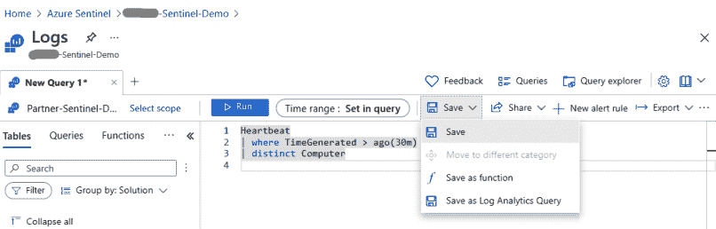

图 2.22 – 计算机心跳查询

4. 选择 **另存为函数** 选项，然后为函数提供名称。

5. 确保勾选 **将此查询保存为计算机组** 选项，否则它将仅保存为查询，该查询可以与名称相同。


+   6. 最后，添加一个 **Legacy 类别**，它仅用于将计算机组组合在一起。

+   7. 点击 **Save** 按钮，如以下屏幕截图所示：

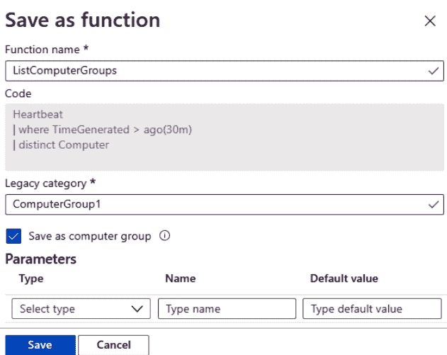

Figure 2.23 – Save query options

当你返回到 **Saved Groups** 页面时，你会看到你的已保存组，其外观如下图所示：

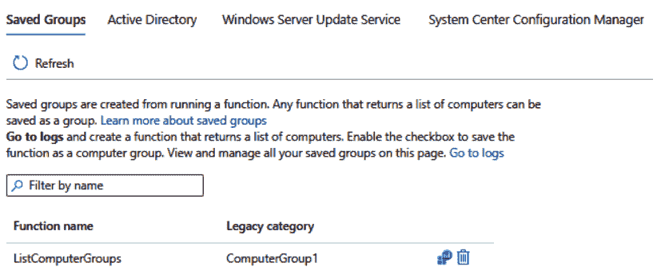

Figure 2.24 – Saved Groups

要使用已保存的组，输入如下查询：

```
Perf
| where Computer in (ListComputerGroups)
```

将 ListComputerGroups 替换为你刚刚创建的查询的名称。同样，不必担心此查询的含义；它只是使用已保存组的示例。在阅读第 5 章《使用 Kusto 查询语言》后会更容易理解。

## Summary

在本章中，我们探讨了 Azure Monitor Log Analytics 解决方案，包括如何使用 Azure 门户、PowerShell 或 CLI 创建新的工作区，以及如何配置安全选项以确保每个用户具有适当的访问级别。我们还查看了如何连接数据源并配置一些高级设置。这些信息在你需要首次配置 Microsoft Sentinel 时非常有用，并且在未来如果需要对支持你运营和业务需求的 Log Analytics 平台进行任何更改时也很有用。

在下一章中，我们将研究如何选择最适合安全威胁狩猎的数据、用于从任何系统收集数据的连接器，以及在控制成本的同时实现长期数据保留的可用选项。

## Questions

回答以下问题以测试你对本章的了解：

+   1. Azure Monitor Log Analytics 中使用的查询语言的名称是什么？
+   2. Azure Lighthouse 的目的是什么？
+   3. 你能列出 Log Analytics 中保护数据的三种方式吗？
+   4. 创建新的 Log Analytics 工作区的三种方法是什么？
+   5. 工程师角色的推荐权限是什么？
