# 第 3 章 数据连接与摄取
Managing and Collecting Data

安全信息和事件管理（SIEM）解决方案的主要目的之一是在提供组织 IT 基础设施保护的各种产品中集中存储和分析安全事件。为此，该解决方案需要连接到这些数据源，将数据拉取到中央存储库中，并管理该数据的生命周期，以确保其可用于分析和持续调查。

在本章中，我们将回顾对安全运营最有趣和最有用的数据类型，然后探索可用于连接到多个数据源并将该数据摄取到 Microsoft Sentinel 中并将其存储在 Log Analytics 工作区中的功能。一旦数据被摄取，我们需要确保适当的数据保留配置，以最大化搜寻事件和其他安全信息的能力，同时确保解决方案的成本保持在合理水平。

我们将涵盖以下与数据收集相关的领域：

+   - 选择重要的数据
+   - 了解连接器
+   - 配置 Microsoft Sentinel 连接器

每个解决方案都已从各自的数据源收集了大量数据；在某些情况下，你可能希望将这些产品的原始日志收集到 SIEM 中以进行跨多个数据源的相关性分析。然而，你应逐案考虑以证明成本合理。作为替代方案，而不是收集原始数据，这些解决方案可以配置为仅发送警报或可操作信息的具体事件。这可以使 SIEM 成为分析、警报和工单的中央通信点。净结果是减少重复并降低整体解决方案成本。这一想法在以下图表中进行了总结：

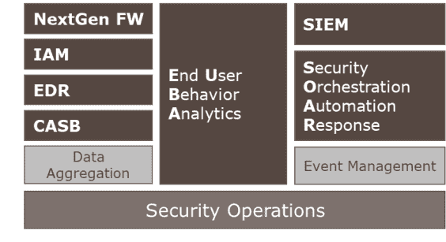

Figure 3.1 – Data for security operations

在处理大量数据时，我们可以使用大数据七要素来指导我们根据分配的优先级决定收集哪些合适的数据：

+   - **Volume:** 这直接影响移动和存储数据的成本。
+   - **Velocity:** 这影响对事件的响应时间。
+   - **Variety:** 我们是否包含了应用程序和基础设施的各个方面？
+   - **Variability:** 信息是否易于理解和采取行动？
+   - **Veracity:** 我们是否信任数据源和数据的准确性？
+   - **Visualization:** 我们能否使用此数据创建可视化和比较？
+   - **Value:** 持续审查数据的价值，减少浪费并保留价值。

以下是如何使用每个要素来优先考虑数据并为摄取提供一些理由的示例。不要专注于总数据量，而应考虑数据质量和多样性的需求，以在多个系统之间提供准确且可操作的信息。

本主题的摘要如下图所示：

| 7 Vs of Big Data |
|---|---|
| Volume | How much is enough, or too much? |
| Velocity | How fast can we gather and analyze? |
| Variety | Can we see all points of view? |
| Variability | Standardized or requires formatting? |
| Veracity | How accurate and verified is the data? |
| Visualization | Can the data show trend analysis? |
| Value | Is there value in retaining old data? |

Figure 3.2 – The seven Vs of big data

你可以使用此图表来指导你对需要摄取到 Microsoft Sentinel 中的数据类型以及可以排除的类型进行初步评估。作为示例：如果你实施了 EDR 解决方案，该解决方案将摄取、分析和警报许多客户端数据源，你真的需要将完整的遥测数据摄取到 SIEM 中，还是只需使用警报？EDR 遥测数据确实需要保留更长时间，但 SIEM 可能不是放置它的合适位置。相反，考虑使用 Azure Data Explorer 等数据湖。

一个可以立即改进的领域是删除任何非安全目的的数据，例如应用程序的性能指标和统计数据。这些可以重定向到存储在另一个未启用 Microsoft Sentinel 的 Log Analytics 工作区中。我们建议你定期审查数据管道，以确保你维护着健康的数据集，通过添加更多数据源或通过调整不再满足要求但有存储和处理成本的数据来实现。

在下一节中，我们将查看 Microsoft Sentinel 中可用的不同类型的连接器。

## Native connections – service to service

Microsoft Sentinel 已开发为可直接与 Microsoft 解决方案中的多个资源集成，包括（但不限于）以下内容：

+   - **Azure Active Directory**（Azure AD），包括 Azure AD 高级身份保护解决方案
+   - **Office 365**，包括 Exchange Online、Teams、SharePoint Online 和 OneDrive for Business
+   - **Microsoft Defender 365**，包括 Microsoft Defender for Endpoint、Microsoft Defender for Identity、Microsoft Defender for Office 365 和 Microsoft Cloud App Security
+   - **Azure Security Center**，包括 Azure Defender
+   - **Microsoft Defender for Identity**

如果有此选项可用，这是连接资源的首选方法。让我们来看一下直接连接。

## Direct connections – service to service

Microsoft Sentinel 中一些连接器需要在源位置进行配置。连接器通常会提供所需的信息以及指向适当位置的链接。数据可能通过事件中心发送，也可能直接发送到 Log Analytics 工作区。这些连接器的示例包括以下内容：

+   - **Amazon Web Services**（AWS），用于 AWS CloudTrail
+   - Azure Firewall
+   - Azure Front Door
+   - Azure **Network Security Groups**（NSGs）；流日志和规则激活
+   - Microsoft Intune；审计日志和操作日志

现在，让我们来看一下 API 连接。


## Syslog 服务器

这是一种传输机制，通过在一台 Linux 主机上部署代理（agent）来实现，该主机可以作为许多来源的日志集中器，这些日志随后被转发到 Log Analytics 进行集中存储。有关实现 Syslog 连接器的详细指导，请参阅此文章：https://docs.microsoft.com/en-us/azure/sentinel/connect-syslog。支持此方法的第三方解决方案示例包括（但不限于）以下：

- Carbon Black
- Cisco（IronPort Web 安全、Meraki 等）
- Citrix
- F5 BIG-IP
- NetApp
- Palo Alto Cortex
- Trend Micro

虽然这些选项为收集数据源提供了广泛的选择，但还有另一种方法，如果服务提供商支持的话，可以提供更丰富的数据集。接下来，让我们看看通用事件格式（CEF）选项。

## 使用 CEF 的 Syslog 服务器

这与前面提到的 Syslog 服务器部署非常相似。有关更详细的信息，请参阅此文章：https://docs.microsoft.com/en-us/learn/modules/connect-common-event-format-logs-to-azure-sentinel/。CEF 日志格式是可扩展的，并且被希望在生成的日志中提供更多细节的多个产品供应商所采用。支持此方法的解决方案示例包括：

- Cisco（Umbrella、云安全网关等）
- CyberArk
- F5 防火墙
- McAfee Web 网关
- Palo Alto Networks 防火墙
- Varonis
- Zscaler

有了这一系列可用的连接器，您可以从所有操作环境中的多个资源中连接并收集信息，包括本地环境、托管服务、公有云，甚至工业运营环境或物联网（IoT）。

接下来，我们将逐步介绍 Microsoft Sentinel 中连接器的配置。

## 配置 Microsoft Sentinel 连接器

Microsoft Sentinel 数据连接器页面显示连接器总数、当前已连接的数量以及正在开发中的数量（通过预览状态标识）。以下截图显示了数据连接器页面的示例：

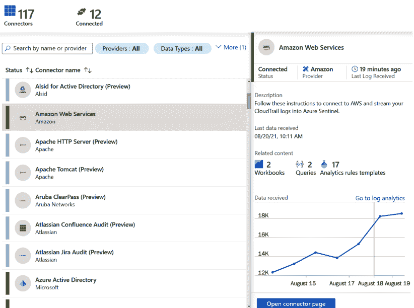

图 3.4 – Microsoft Sentinel 数据连接器页面

如上面的截图所示，在此 Microsoft Sentinel 实例中有超过 100 个可用的连接器可供实施。随着更多解决方案被原生集成，该列表将继续增长，这就是为什么您可以看到可以筛选列表并搜索特定数据连接器的原因。通过选择左侧的连接器，我们可以在右侧查看连接器详细信息。在此示例中，我们将使用 AWS 的数据连接器，如下面的截图所示：

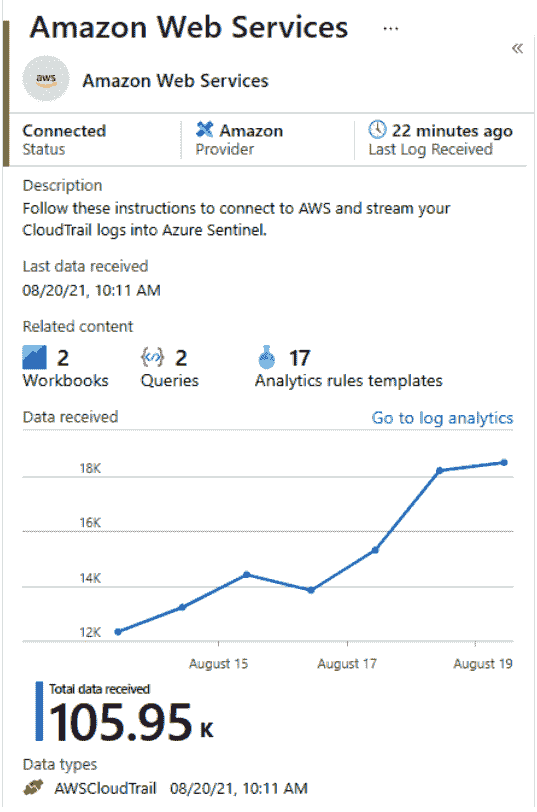

图 3.5 – 数据连接器详细信息

在上一个截图中的页面顶部，我们可以看到连接器的状态（已连接）、提供商（Amazon）以及最后收到日志的日期/时间戳（应在 1 小时内）。

下一部分提供有关连接器的描述和更多详细信息，包括一个图表，该图表将显示最近 7 天的活跃日志引入速率（连接时）。

在页面底部，我们可以看到此连接器中包含的数据类型。在本例中，启用后，我们预计会检索 AWS CloudTrail 日志。

单击“打开连接器页面”按钮以转到下一个屏幕并开始配置过程，如下面的截图所示：

### 说明

### 先决条件

要集成 Amazon Web Services，请确保您拥有：

- 工作区：需要写入权限。

### 配置

将 AWS CloudTrail 与 Azure Sentinel 连接

该连接需要授予 Microsoft 访问您的 AWS 账户的权限。要启用此功能，请按照“将 AWS 连接到 Azure Sentinel”下的说明进行操作，并在提示时使用以下参数：

来自所有区域的数据都将发送到并存储在工作区的区域中。

连接将数据流式传输到工作区大约需要 5 分钟。

Microsoft 账户 ID

```
197857026523
```

外部 ID（工作区 ID）

```
fe31239b-bdfe-46a2-ba05-7928abc68709
```

要添加的角色

在此处放置您的 AWS 角色 ARN

| 角色 ARN | 最后收到的事件 |
|---|---|
| arn:aws:iam::881823274746:role/AzureSentinel | 05/16/21, 05:19 PM |

图 3.6 – 数据连接器配置说明

如上面的截图所示，AWS 连接器具有以下两个关联的工作簿：

- AWS 网络活动
- AWS 用户活动

这些工作簿中的每一个都是根据 AWS CloudTrail 日志中可用的信息配置的。该页面还提供了示例查询，您可以使用这些查询开始根据您自己的需求检查日志。有关如何使用工作簿的更多信息，请参阅第 8 章“创建和使用工作簿”。

最后，每个连接器可能会提供一个或多个分析模板，您应该启用这些模板以确保正在分析引入的数据。您可以在下面的截图中看到这些规则的示例：

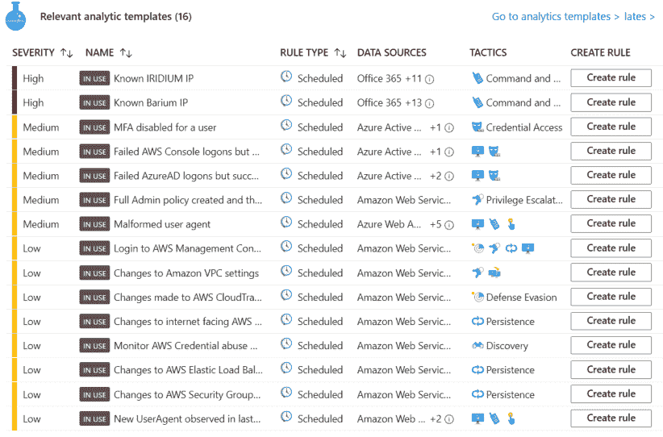

图 3.8 – AWS 分析模板

我们可以在“**相关分析模板**”部分看到目前有 16 个可用模板。每个模板都需要启用，以确保数据正在被分析。选择第一个分析模板，然后逐步完成配置步骤，如下面的截图所示：

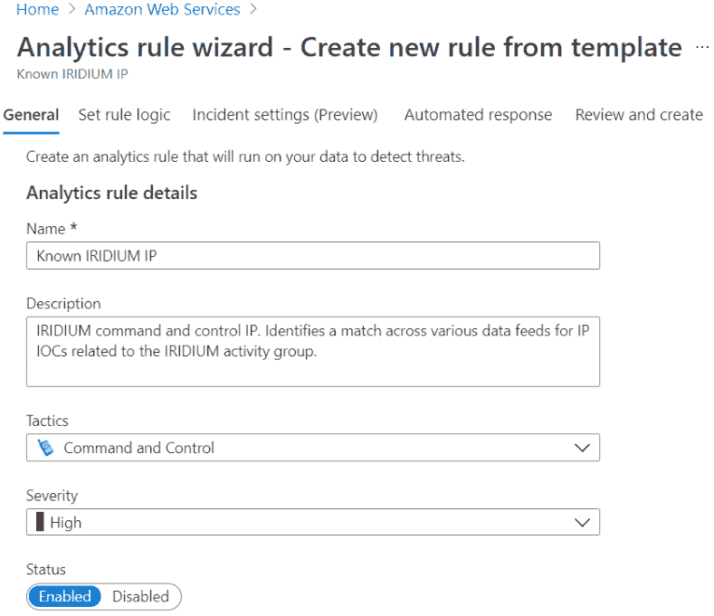

图 3.9 – 针对已知 IRIDIUM IP 的 AWS 分析规则

根据您所需的配置要求配置向导的每个页面，然后完成向导，并观察对引发的事件数产生的影响。如果数量过高，请重新配置规则以减少生成警报的频率，或者启用将警报分组到单个实例的功能。请注意不要将警报过度调整到不产生任何事件的程度，因为这可能会隐藏需要调查的合法警报。

在下一节中，我们将配置 Log Analytics 可用的存储选项。

## 配置 Log Analytics 存储选项

完成几个数据连接器的配置后，您将开始看到每天将引入并存储到 Log Analytics 中的数据量。您存储和保留的数据量直接影响其相关成本（有关详细信息，请参阅第 1 章“Microsoft Sentinel 入门”）。您可以通过导航到 Log Analytics 工作区，然后从“常规”菜单中选择“使用情况和估计成本”来查看当前的使用情况和成本，如下面的截图所示：

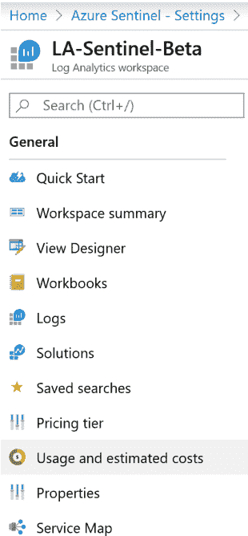

图 3.10 – Log Analytics 导航菜单

选择该选项后，系统会向您显示一个信息仪表板，该仪表板将在左侧显示定价层和当前成本，在右侧显示图表，以显示最近 31 天的每日消耗变化。第二个图表显示每个解决方案的保留数据总大小。以下截图显示了仪表板的示例：

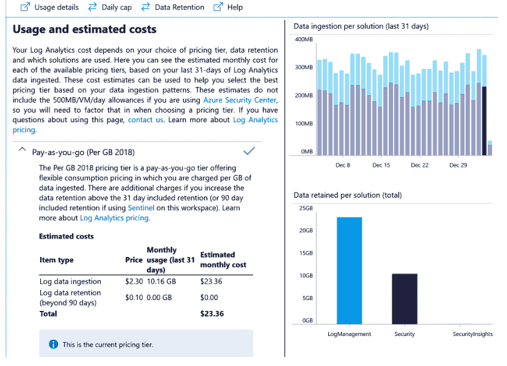

图 3.11 – Log Analytics 使用情况和成本仪表板

在此页面上，可以了解顶部菜单栏中可用的两个选项：

- **每日上限：** 通过此选项，您可以启用或禁用每天限制 Log Analytics 工作区中引入数据量的功能。虽然这是限制成本的有效控制手段，但存在一种风险：封顶的数据可能会导致丢失对检测环境中威胁有价值的安全信息。我们建议仅将此项用于非生产环境。


- **数据保留：** 此选项允许您配置日志分析工作区中应保留数据的天数。Log Analytics 的默认天数为 31 天；然而，当在 Log Analytics 工作区中启用 Microsoft Sentinel 时，默认免费额度为 90 天。如果您选择将保留期增加到 90 天以上，您将按每 **千兆字节 (GB)** 每月收取固定费用。

在下一节中，我们将了解如何计算 Microsoft Sentinel 和 Log Analytics 的数据摄取和保留成本。

## 计算数据摄取和保留的成本

许多组织需要将安全日志数据保留超过 90 天，并为其预算，以确保根据业务需求拥有足够的容量。例如，如果我们考虑将数据保留 2 年的需求，日均摄取量为 10 GB，那么我们可以计算初始摄取和分析的成本，然后将其与保留成本进行比较。这将为这两个方面提供年度成本估算。

下表显示了将数据摄取到 Log Analytics 并在 Microsoft Sentinel 中分析该数据的成本。此价格包含 90 天的免费保留：

| | 每日 | 每月 | 每年总计 | 2 年总计 |
|---|---|---|---|---|
| Azure Sentinel | $20 | $600 | $7,200 | $14,600 |
| Log Analytics | $23 | $690 | $8,280 | $16,790 |
| 总计 | $43 | $1,290 | $15,480 | $30,960 |

图 3.12 – Microsoft Sentinel 示例定价表

下表显示了在摄取 10 GB/天的条件下，超出前述定价中包含的免费 90 天后被保留的数据量：

| | 第 91 天 | 第 120 天 | 第 270 天 | 第 330 天 | 第 365 天 | 第 730 天 |
|---|---|---|---|---|---|---|
| 总数据大小 (GB) | 910 | 1,200 | 2,700 | 3,300 | 3,650 | 7,300 |
| 保留成本（每月） | $91 | $120 | $270 | $330 | $365 | $730 |

图 3.13 – 保留成本示例定价表

现在，如果我们将这些加在一起，就可以看到 12 个月期间解决方案的总成本，如下表所示：

|  | 数据大小 (GB) | Log Analytics | Azure Sentinel | 数据保留 | 总成本（每月） |
|---|---|---|---|---|---|
| 第 1 个月 | 300 | $690 | $600 | $0 | $1,290 |
| 第 2 个月 | 600 | $690 | $600 | $0 | $1,290 |
| 第 3 个月 | 900 | $690 | $600 | $0 | $1,290 |
| 第 4 个月 | 1,200 | $690 | $600 | $120 | $1,410 |
| 第 5 个月 | 1,500 | $690 | $600 | $150 | $1,440 |
| 第 6 个月 | 1,800 | $690 | $600 | $180 | $1,470 |
| 第 7 个月 | 2,100 | $690 | $600 | $210 | $1,500 |
| 第 8 个月 | 2,400 | $690 | $600 | $240 | $1,530 |
| 第 9 个月 | 2,700 | $690 | $600 | $270 | $1,560 |
| 第 10 个月 | 3,000 | $690 | $600 | $300 | $1,590 |
| 第 11 个月 | 3,300 | $690 | $600 | $330 | $1,620 |
| 第 12 个月 | 3,600 | $690 | $600 | $360 | $1,650 |
| 年度总计 | 3.6 TB | $8,280 | $7,200 | $2,160 | $17,645 |
| 2 年总计 | 7.2 TB | $16,560 | $14,400 | $8,820 | $39,780 |

图 3.14 – 比较容量选项的示例定价表

根据这些示例，运行 Microsoft Sentinel、每天摄取 10 GB 并将数据保留 2 年的总成本为 $39,780。数据保留占成本的 22%。

> 注意
> 这些价格基于适用于美国东部 Azure 区域的当前费率，数字已四舍五入以简化。实际数据使用量每月可能有所波动。

您可以使用 Azure 定价计算器进行自己的计算，它将考虑承诺层级、保留期，并为 Log Analytics 和 Microsoft Sentinel 提供合并成本。访问此 URL 并修改设置以查看不同的定价：https://azure.microsoft.com/en-us/pricing/calculator/。

以下解决方案可作为 Log Analytics 之外的长期存储替代方案考虑：

- **Azure Blob Storage**：您可以在 Azure Monitor 中创建查询，选择要从 Log Analytics 工作区移动的数据，并将其指向适当的 Azure 存储帐户。这允许按类型过滤信息（或选择全部），并且仅移动即将达到其生命周期结束的数据，即您为 Log Analytics 工作区中数据保留设定的限制。一旦查询定义完成，您可以使用 **Azure Automation** 运行 PowerShell 并将结果作为 CSV 文件加载，然后复制到 **Azure Blob Storage**。使用此解决方案，数据可存储长达 400 年！有关更多信息，请参阅本文：https://docs.microsoft.com/en-us/azure/azure-monitor//powershell-samples。
- **Azure Data Explorer (ADX)**：使用扩展存储和归档额外安全数据的最常见方法是 Azure Data Explorer，它可实现长达 100 年的扩展存储。使用此解决方案，您可以对摄取、编目、分析和呈现信息所需的存储和计算进行极大优化，同时全部使用您在 Microsoft Sentinel 中使用的相同 **Kusto 查询语言 (KQL)** 查询。在配置此服务时，您可以根据执行调查的安全团队的需求在存储优化和计算优化实现之间进行选择。在安静时期，您可以优化存储保留，然后在需要进行深入调查时按需增加计算容量，以确保搜索查询的响应性。将此数据存储在 Microsoft Sentinel 中的平均成本节省约为十分之一。您可以使用在线计算器进行自己的价值计算：https://dataexplorer.azure.com/AzureDataExplorerCostEstimator.html。

正如您所见，有多种选项可将数据存储在替代位置，既用于扩展归档/保留，也用于使用替代工具进行额外分析。我们预计 Microsoft 将增加可用选项的数量。

本章将涵盖以下主题：

- TI 简介
- 了解 STIX 和 TAXII
- 为您的需求选择合适的情报源
- 实现 TI 连接器

## TI 简介

由于网络安全性质复杂且现代攻击日益 sophisticated，任何组织都很难跟踪漏洞以及攻击者可能入侵系统的多种方式，尤其是当网络安全不是组织的重点时。了解要寻找什么以及在发现系统异常或其他潜在威胁时该做什么，是一项复杂且耗时的任务。这就是 TI 大显身手的地方。

TI 在对抗对手的斗争中至关重要，现已集成到大多数安全产品中；它提供了设置检测和阻止恶意活动的指标列表的能力。您可以订阅 TI 源，从行业其他安全专业人员那里获取知识，并创建特定于您所处环境的指标。

如果您是该主题的新手，有一些新的关键词和缩写需要学习：

- **威胁指标**：这是一份可疑或已知恶意实体的列表，例如 IP 地址、URL 和文件。它们用于在环境中发现内部文件或地址的可疑使用时发出警报。
- **入侵指标 (IoCs)**：这表明已知且独特的可能表明恶意意图或实际入侵的行为和活动。这些指标有开源和付费服务。
- **警报定义**：通过组合多个威胁指标和 IoCs，您可以构建一个仅在正确上下文中触发的警报定义。这将减少因向 SOC 发送过多误报而导致的警报疲劳。
- **恶意软件信息共享项目 (MISP)**：这是一个开源 **威胁情报平台 (TIP)** 和威胁信息共享的开放标准集。MISP 涵盖恶意软件指标、欺诈和漏洞信息。阅读更多信息：https://www.misp-project.org/。


## 理解 STIX 和 TAXII

MITRE 公司是一家非营利性公司，提供框架和标准形式的指导，以协助开发更强大的网络安全控制措施；STIX 语言和 TAXII 协议就是这一开发工作的一些例子。

这两个标准由一个开放的社区共同开发，由美国国土安全部（DHS）赞助，与 MITRE 公司合作。这些不是软件产品，而是产品可以使用的标准，以实现在与您的安全社区和业务合作伙伴共享 TI 信息时实现自动化和兼容性。

根据 MITRE 提供的描述：*STIX 是一个协作的社区驱动的努力，旨在定义和开发一种标准化的语言来表示结构化的网络威胁信息。* STIX 语言的开发是为了确保威胁信息能够以一致的方式共享、存储和使用，以促进自动化和人工辅助分析。您可以在此处阅读有关 STIX 标准的更多信息：https://stixproject.github.io/。

TAXII 协议的开发是为了支持来自开源情报（OSINT）和 TIP 的 TI 源，这些源支持该标准协议和 STIX 数据格式。您可以在此处阅读有关 TAXII 协议的更多详细信息：https://www.mitre.org/sites/default/files/publications/taxii.pdf。

Microsoft 已开发了一个连接器，以实现与使用 TAXII 协议的服务的集成，从而能够摄取 STIX 2.0 威胁指标供 Microsoft Sentinel 使用。

> **公开预览**
> 
> 由于敏捷开发的性质和常青云环境，Microsoft 首先通过私人预览向少数精选评审员提供新功能，然后发布到公开预览，以允许更广泛的受众参与反馈。您的组织需要确定是否可以接受在生产租户中使用预览功能，或将其访问限制为仅开发/测试环境。截至撰写本文时，TAXII 数据连接器处于公开预览中。您可以在 Microsoft Sentinel 租户中查看可用数据连接器的列表，以查看它是否当前可用。

在下一章中，我们将回顾情报源的选项，并选择最适合您组织需求的选项。

## 为您的需求选择合适的情报源

借助 Microsoft Sentinel，您可以从多个来源导入 TI，以提高安全分析师识别和优先处理已知威胁和 IoC 的能力。配置后，以下 Microsoft Sentinel 工具中将提供多个可选功能：

- **分析**：提供包含 ThreatIntelligenceIndicator 字段的能力，以确保分析规则可以将日志事件与已识别的域、电子邮件帐户、文件哈希、IP地址或 URL 匹配。
- **工作簿**：创建了一个新的工作簿，用于显示摄取到 Microsoft Sentinel 中的 TI 的数量、类型和置信度，以及有多少警报是由匹配威胁指标的分析规则生成的。
- **狩猎**：与分析规则类似，启用 TI 为狩猎查询提供将日志事件与 TI 信息进行比较的能力，使安全调查人员在狩猎场景中具有更大的能力。
- **笔记本**：笔记本可用于集成 TI 的指导狩猎，这使分析师和安全调查人员能够寻找异常并搜寻恶意行为。

有几种可用的选项可以获取 TI 源，您也可以根据通过内部 IT 调查收集的特定信息生成自己的指标；这使您可以开发一个已知特定于您组织的指标的独特列表。根据您的行业和地区，您可以选择与合作伙伴组织和社区共享这些信息，以获取与医疗保健、政府、能源等相关的特定信息。

您可以选择利用与 **Microsoft Graph Security tiIndicator** API 的直接集成，其中包含 Microsoft 自己的 TI，收集自其庞大的互联网服务环境（例如 Azure、Office 365、Xbox 和 Outlook）。

为了实现最广泛的情报范围，建议您还从开源平台获取 TI 源，例如以下内容：

- MISP 开源 TIP
- Palo Alto Networks 的 MineMeld
- 任何基于 MITRE STIX/TAXII 标准的内容

- 概述
- 开始使用
- 预览功能
- 诊断和解决问题

## 管理

- 用户
- 组
- 外部身份
- 角色和管理员
- 管理单元
- 企业应用程序
- 设备
- 应用注册
- 身份治理
- 应用程序代理
- 许可证

图 4.3 – Azure AD 应用注册

2. 在工具栏中，选择 + New registration，如以下屏幕截图所示：

- + New registration
- Endpoints
- Troubleshooting
- Download
- Preview features

图 4.4 – 创建新的应用注册

当您配置集成的 TIP 产品时，您将需要参考这些 ID 值。

5. 接下来，我们将为我们注册的应用程序配置 API 权限。为此，请转到左侧菜单并选择 **API permissions**，如以下屏幕截图所示：

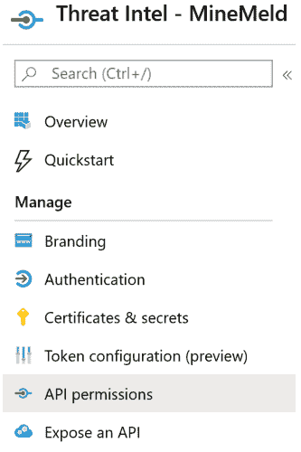

图 4.7 – API 权限菜单选项

6. 创建时，将有默认权限 **User.Read**。选择 **+ Add a permission**。

现在应用已在 Azure AD 中注册，我们可以在 TI 服务器/服务的注册过程中使用它来运行并向 Microsoft Sentinel 发送信息。

接下来，我们可以开始配置 MineMeld 服务器，这涉及设置新的 **虚拟机（VM）** 来收集和转发 TI 源。

## 配置 MineMeld TI 源

完成之前的步骤后，您就可以配置将 TI 数据发送到 Microsoft Sentinel 的服务。本节将指导您完成 MineMeld TI 共享解决方案的配置。

> **注意**
> 如果 MineMeld TI 服务器尚未在您的环境中运行，您将需要配置该产品；此指导仅适用于 Microsoft Sentinel 连接器。

此过程包含三个步骤：

- 1. 构建 VM 并安装 MineMeld
- 2. 在 MineMeld 中安装 Microsoft Graph Security API 扩展
- 3. 配置扩展以通过 Security API 连接到 Microsoft Graph

要执行此操作，您需要对 Azure 租户和 MineMeld 服务具有管理员访问权限。

## 构建 VM 并安装 MineMeld

> **注意**
> 在测试时，有必要确保仅使用 Ubuntu 版本 16.04；其他版本可能不兼容。

理想情况下，您已在环境中配置并运行 MineMeld VM；但是，如果没有，您可以通过 Palo Alto Networks 官方网站在线找到配置说明：https://live.paloaltonetworks.com/t5/MineMeld-Articles/Manually-Install-MineMeld-on-Ubuntu-16-04/ta-p/253336。

## 在 MineMeld 中安装 Microsoft Graph Security API 扩展

以下是安装 API 扩展的步骤：

- 1. 登录 MineMeld Web 门户，然后转到 **SYSTEM** 然后 **EXTENSIONS**。
- 2. 单击 Git 图标并输入以下地址：`https://github.com/PaloAltoNetworks/minemeld-msgraph-secapi.git.`
- 3. 单击 **RETRIEVE**，然后从下拉列表中选择 master 并单击 **INSTALL**，如以下屏幕截图所示：

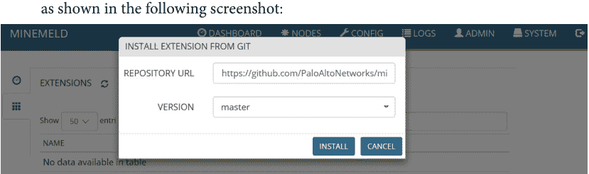

图 4.12 – 从 Git 安装扩展

4. 确认安装已完成，然后选择十字旁边的 **Activate** 按钮。为了确认激活，API 扩展应显示白色背景而不是灰色哈希背景，如以下屏幕截图所示：

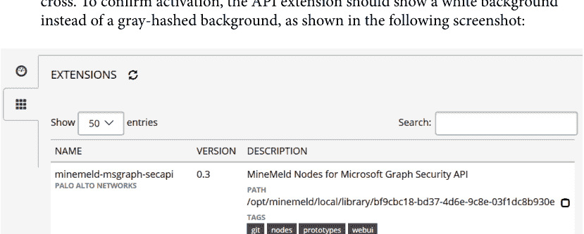

图 4.13 – 确认 API 扩展的安装


现在 Microsoft Graph Security API 扩展已在 MineMeld 服务器上设置完成，我们可以配置 Microsoft Sentinel 连接器。

## 配置 Microsoft Sentinel 连接器

以下是配置 API 扩展的步骤：

- 1. 登录 MineMeld Web 门户。转到 CONFIG，然后选择页面底部的原型图标，即三条水平线（即汉堡菜单），如下图所示：

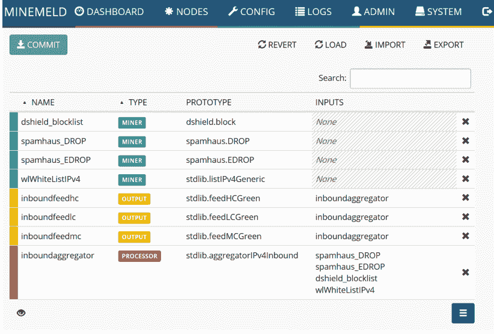

图 4.14 – MineMeld 配置页面

2. 如你所见，有很多选项可供选择。查看列表以了解可能想要实现的额外 TI 源，然后搜索 Microsoft 并查看结果。选择名为 microsoft_graph_secapi.output 的原型：

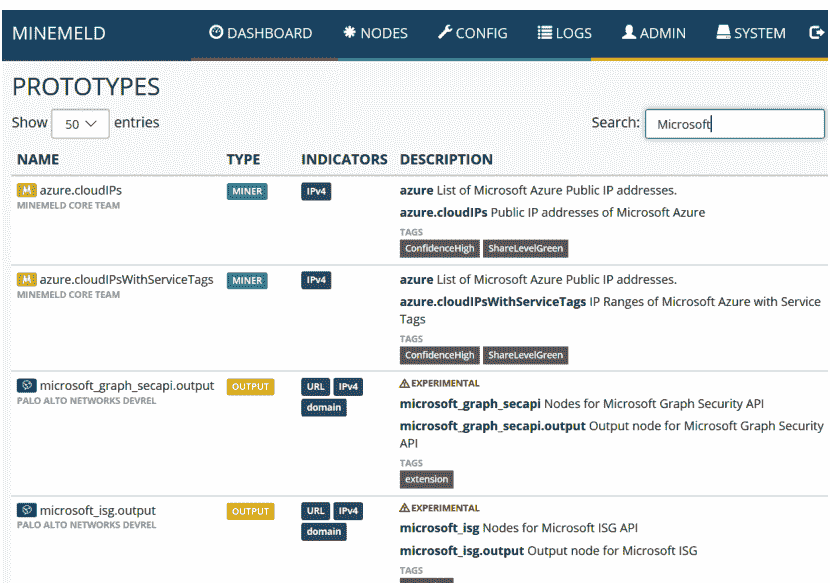

图 4.15 – Microsoft 原型

4. 在下一页，提供节点的名称，然后为 INPUTS 字段选择 inboundaggregator：

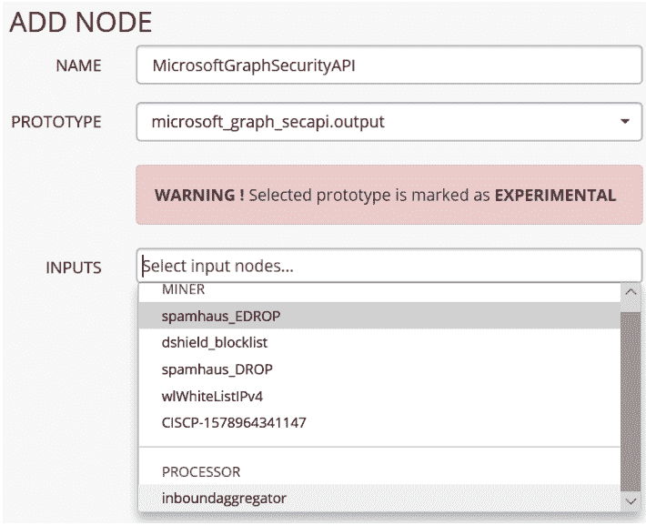

图 4.17 – 配置新节点

5. 通过查看节点列表确认新节点处于活动状态，如以下屏幕截图所示。选择页面顶部的 COMMIT 按钮。这将保存更改并重启流程以启用新功能：

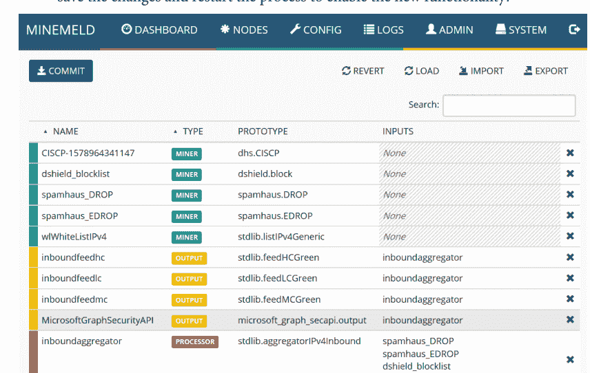

图 4.18 – 确认新节点已添加

6. 现在转到 NODES 选项卡并选择新的 API 扩展，然后输入来自 Azure AD 中之前注册的应用程序的相关详细信息（见图 4.6）：

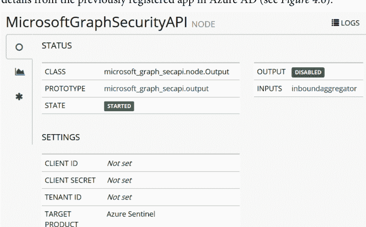

图 4.19 – 为 Microsoft Sentinel 配置 API 扩展

7. 对于 **CLIENT SECRET** 字段，你需要在 Azure AD 应用中生成一个新的密钥。转到之前创建的 Azure AD 应用并选择 **Certificates & secrets**，然后选择 **+ New client secret** 并按照出现的步骤创建新的密钥（确保复制详细信息，因为你只有一次机会；否则，你需要再次生成新的客户端密钥）：

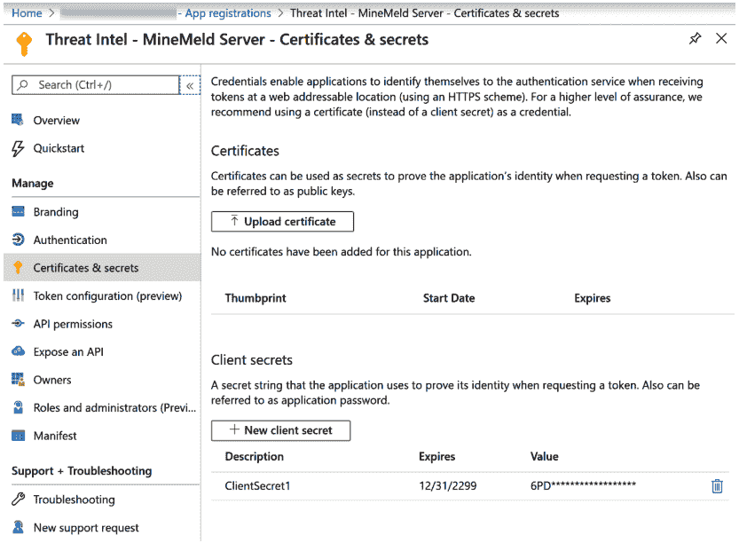

图 4.20 – 创建新的客户端密钥

8. 将此新密钥添加到设置后，你应该会看到以下完成的屏幕：

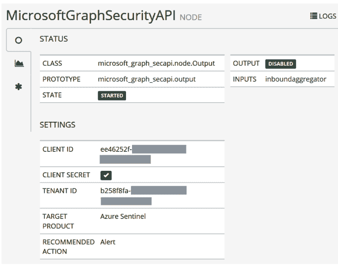

图 4.21 – 完成配置

至此，MineMeld 服务的配置要求已完成。TI 源现在应发送到你的 Microsoft Sentinel 实例。

## 确认数据正在被 Microsoft Sentinel 接收使用

要确认数据正在发送到 Microsoft Sentinel，请按照以下步骤操作：

- 1. 转到 Azure 门户，然后 Microsoft Sentinel。
- 2. 选择 Logs。
- 3. 在命令窗口中输入以下命令并选择 Run：

```
ThreatIntelligenceIndicator
| take 100
```

4. 你应该会看到以下显示结果的屏幕：

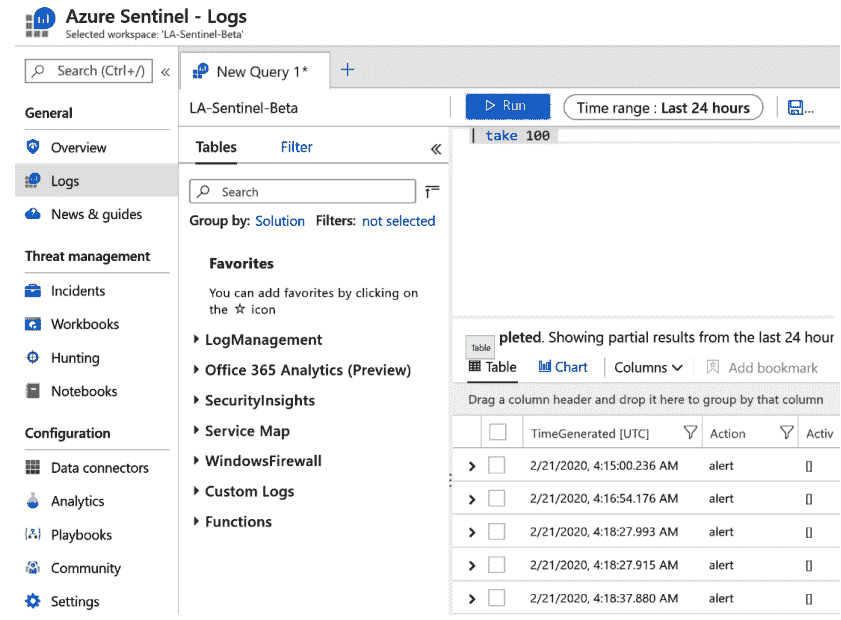

图 4.22 – 检查 TI 源活动

5. 以下屏幕截图显示了其中一个事件的详细信息示例：

Completed. Showing partial results from the last 24 hours.

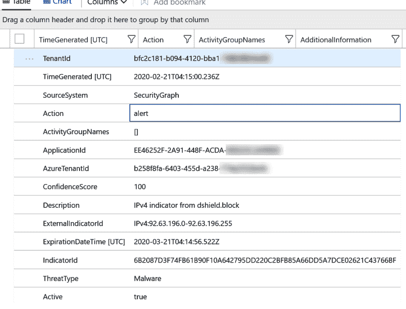

图 4.23 – TI 数据源详细信息

你现在已将 MineMeld 服务器配置并连接到你的 Microsoft Sentinel 工作区，并且可以看到 TI 数据源出现在日志中。你现在可以使用此信息来帮助在 Microsoft Sentinel 中创建新的分析和狩猎查询、笔记本和工作簿。

我们建议定期审查以确保此信息既相关又经常更新。新的 TI 源会定期提供，你不想错过这些有用的信息，如果它可以帮助你找到新的和高级威胁。

## 总结

在本章中，我们探讨了 TI 的概念、新术语和解决方案选项，以及作为社区协作创建和共享 TI 源的概念。有多个选项可用于向 Microsoft Sentinel 添加 TI 源，我们知道 Microsoft 正在努力进一步开发此功能。TI 源将协助分析和检测不受欢迎的行为和潜在的恶意活动。选择范围很广，为组织选择合适的源是配置 Microsoft Sentinel 的重要部分。

下一章将介绍 Kusto 查询语言（KQL），这是一种强大的手段，可搜索为 Microsoft Sentinel 收集的所有数据，包括我们刚刚添加的 TI 数据。

## 问题

- 1. 命名三种威胁指标类型示例。
- 2. ATT&CK 框架的全称是什么？
- 3. 哪些 Microsoft Sentinel 组件可以利用 TI 源？
- 4. 谁开发了 STIX 语言和 TAXII 协议？

## 进一步阅读

以下资源可用于进一步探索本章涵盖的一些主题：

- - Malware Information Sharing Project: https://www.misp-project.org/
- - Mitre ATT&CK framework: https://attack.mitre.org/
- - Microsoft Security Graph API: https://github.com/microsoftgraph/security-api-solutions/tree/master/QuickStarts
- - STIX standard: https://stixproject.github.io/
- - TAXII protocol: https://www.mitre.org/sites/default/files/publications/taxii.pdf
- - Build a MineMeld server: https://live.paloaltonetworks.com/t5/general-articles/manually-install-minemeld-on-ubuntu-16-04/ta-p/253336
- - The Microsoft Graph Security API extension in MineMeld: https://github.com/PaloAltoNetworks/minemeld-msgraph-secapi
