# 5 使用 Kusto 查询语言（KQL）

Kusto 查询语言（KQL）是一种纯文本、只读语言，用于查询存储在 Azure Log Analytics 工作区中的数据。与 SQL 类似，它使用从数据库开始，然后是表，最后是列的实体层次结构。在本章中，我们只关注表和列级别。

在本章中，你将学习可以使用来查询日志的众多 KQL 命令中的一些。

在本章中，你将学习以下内容：

- - 如何测试你的 KQL 查询
- - 如何查询表
- - 如何限制返回的行数
- - 如何限制返回的列数
- - 如何在多个表上执行查询
- - 如何以图形方式查看结果

本章涵盖以下主要主题：

- - 运行 KQL 查询
- - KQL 命令简介
- - 查询语句
- - 标量函数

## 运行 KQL 查询

在本章中，我们将使用 **Azure Data Explorer (ADX)** 中可用的示例数据。这是一个非常有用的工具，可以尝试简单的 KQL 命令。随意使用它来尝试本章中的各种命令。查询中使用的所有信息均来自 https://dataexplorer.azure.com/clusters/help/databases/Samples 提供的示例数据。

如果提示，请使用登录 Azure 门户时使用的登录凭据。首次登录时，你将看到以下屏幕。请注意，你的登录名可能会显示在页眉的右侧：

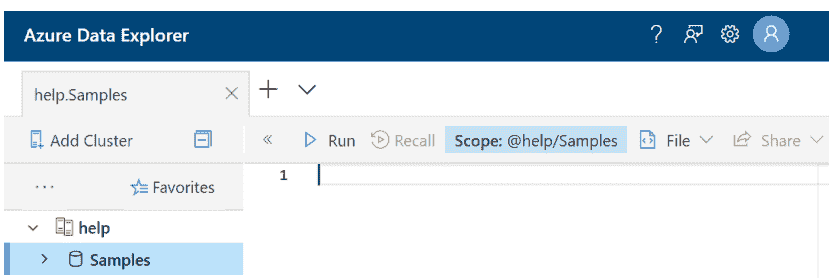

要运行本章的示例，你需要展开屏幕左侧的 Samples 日志，然后选择 StormEvents。你可以展开 StormEvents 以查看字段列表，如果这样做，你的屏幕应如下所示：

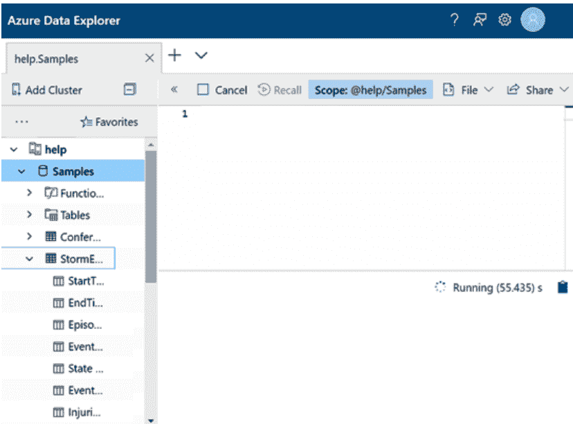

图 5.2 – StormEvents

要运行查询，请在页面顶部的查询窗口中输入或粘贴命令，即前一屏幕截图中编号为 1 的行右侧。输入查询后，单击 Run 按钮运行查询。输出将在页面底部的结果窗口中显示。

在以下屏幕截图中，输入并运行了一个简单查询。查询已输入查询窗口，你可以看到结果显示在其下方：

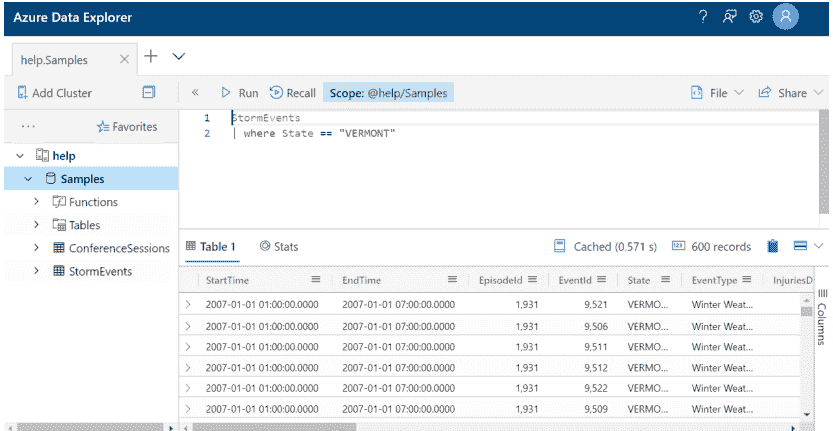

图 5.3 – 已执行查询

你可以用 ADX 做更多事情，所以随意尝试。现在你了解了如何运行查询和查看结果，让我们看看 KQL 提供的各种命令。

## KQL 命令简介

与 SQL 不同，查询从数据源开始，数据源可以是表或生成表的运算符，然后是转换数据的命令以满足需要。每个命令的输出可以通过使用管道（ | ）分隔符传递到下一个命令。

这是什么意思？如果你熟悉 SQL，你会编写类似 Select * from table 的语句来获取表中的值。相同的查询在 KQL 中只是 table，其中 table 指日志的名称。隐含的是你想要所有列和行。稍后，我们将讨论如何最小化返回的信息。

我们在这里只触及 KQL 功能的表面，但足以让你开始编写自己的查询，以便为 Microsoft Sentinel 开发查询。


以下表格提供了本章剩余部分将要介绍的命令、函数和运算符的概览：

| Type | Name | Description |
|---|---|---|
| Tabular Operators | print | 打印查询的结果 |
|  | search | 在日志中搜索特定数据 |
|  | where | 将表过滤为满足比较的子集行 |
|  | take/limit | 返回最多指定数量的行 |
|  | count () | 返回输入记录集中的记录数 |
|  | summarize | 生成一个汇总所选列内容的表 |
|  | extend | 创建计算列并将其附加到结果集 |
|  | project | 选择要包含的列 |
|  | distinct | 生成一个表，其中包含输入表中提供的列的不同的组合 |
|  | sort/order | 按一个或多个列对输入表的行进行排序 |
|  | join | 通过匹配每个表中指定的列的值，将两个表的行合并形成新表 |
|  | union | 取两个或多个表并返回它们的所有行 |
|  | render | 在图表中显示输出，包括饼图、条形图和线形图等 |
| Query Statements | let | 创建变量 |
| Scalar Functions | ago() | 从当前 UTC 时钟时间减去给定的时间跨度 |
| String Operators | operators | 不是命令，而是关于与 where 命令一起使用的运算符的讨论 |

再次说明，这只是使用 KQL 时可用的命令的简要概览。您可以使用更多命令，包括一些为查询添加机器学习功能 的命令。

> **Note**
> 要获取所有 KQL 命令的完整列表以及更多示例，请访问 https://docs.microsoft.com/en-us/azure/kusto/query/index。

让我们在以下各节中更详细地查看各种命令。

## Tabular operators

KQL 中的表格运算符是可以以表格和行的混合形式生成数据的运算符。每个表格运算符都可以使用管道分隔符将结果从一个命令传递到另一个命令。您将在本章中看到很多这样的例子。

### The print command

print 命令将打印简单查询的结果。您不会在 KQL 查询中使用它，但它对于尝试了解命令的工作原理和预期输出很有用。

像 print "test" 这样的简单 print 命令将返回一行，其中包含文本 test。

### The search command

正如我们之前所说，要使用 KQL 进行搜索，您只需在编辑器中输入表名，而不是在 SQL 中使用 select 命令。这将返回表的全部列和全部行，直到应用程序返回的最大值。

因此，在 ADX 中，如果您在搜索窗口中输入 StormEvents 并单击 Run，您将看到如下图所示的窗口。请注意，还有更多行可用；以下屏幕截图仅显示了少量样本：

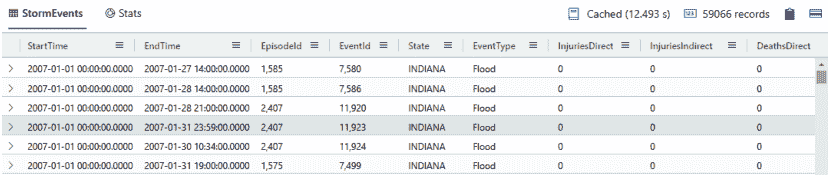

Figure 5.4 – Sampling the rows of StormEvents

如果您需要在工作区中所有日志的所有列中搜索特定术语，search 命令会为您完成此操作。

如果您需要查找所有 York 的出现情况，可以使用以下命令：

```
search "York"
```

这将返回如下图所示的结果。请注意，我隐藏了一些列，以便更容易看出 York 显示在 State 以外的更多列中：

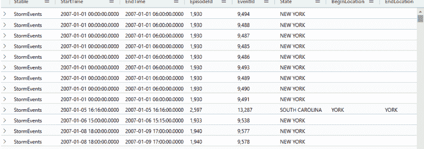

Figure 5.5 – The search command

请注意，使用 search 命令执行查询可能需要花费大量时间。

## 信息抽取（IE）

信息抽取是知识工程中的一个重要子领域，其核心目标是从非结构化或半结构化文本中自动提取结构化信息，例如实体、关系、事件等。该领域广泛应用于自然语言处理、问答系统、搜索引擎和知识图谱构建等场景。近年来，随着深度学习技术的发展，信息抽取的性能和泛化能力得到了显著提升。

+   1. **任务定义**：明确抽取的目标，如命名实体识别、关系抽取、事件抽取等。
+   2. **标准模型**：基于统计或深度学习的序列标注/分类模型。
+   3. **模型扩展**：引入注意力机制、预训练语言模型或多任务学习框架。

标准模型将信息抽取视为序列标注问题，给定输入序列 \(x_1, x_2, \ldots, x_n\)，模型预测每个词的标签分布，常用的模型包括隐马尔可夫模型（HMM）、条件随机场（CRF）以及基于双向长短期记忆网络（BiLSTM）的编码器。

> 公式：
> $$p(x_i | x_1, \ldots, x_{i-1}, \theta) = \text{softmax}(W h_i + b)$$

| 阶段 | 输入 | 输出 |
|---|---|---|
| 预处理 | 原始文本 | 分词语料 |
| 编码 | 分词序列 | 上下文向量序列 |
| 解码 | 上下文向量序列 | 标签序列 |
| 后处理 | 标签序列 | 结构化知识三元组 |

```
```python
from transformers import AutoTokenizer, AutoModelForTokenClassification

tokenizer = AutoTokenizer.from_pretrained("bert-base-uncased")
model = AutoModelForTokenClassification.from_pretrained("bert-base-uncased", num_labels=10)
inputs = tokenizer(text, return_tensors="pt")
outputs = model(**inputs).logits
predictions = outputs.argmax(dim=-1)
```
```

This will return values like the ones shown in the following screenshot:

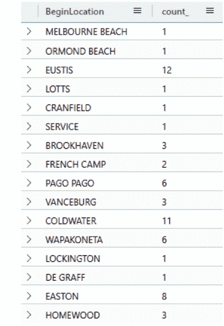

Figure 5.6 – Summarize by BeginLocation

Note that this screenshot is only showing a partial listing of the results.

You may have noticed that count, in this case, has parentheses after it. That is because count, as used here, is a function rather than an operator and, as a function, requires parentheses after the name. For a complete list of aggregate functions that can be used, go to https://docs.microsoft.com/en-us/azure/kusto/query/summarizeoperator#list-of-aggregation-functions.

The by keyword is telling the command that everything that follows are the columns that are being used in the query to perform the summary.

You can also list multiple columns if you want to have more detailed information. For instance, the following command will summarize StormEvents by State and then BeginLocation:

```
StormEvents
| summarize count() by State, BeginLocation
```

If there is more than one BeginLocation in a state, the state will be listed multiple times, as shown in the following screenshot:

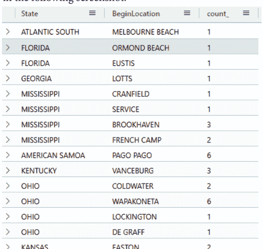

Figure 5.7 – Summarize by State and BeginLocation

Again, this screenshot is only showing a partial list of the results.

### The extend command

有时您可能需要表未提供但可以从提供的数据生成的 信息。例如，StormEvents 表提供了事件的开始时间和结束时间，但未提供事件的实际持续时间。我们知道可以通过从结束时间减去开始时间来获得持续时间，但如何告诉 KQL 执行此操作？

extend 命令执行此操作。它允许您从现有列或其他数据（例如硬编码值）创建新列。以下命令将创建一个名为 Duration 的新列，然后该列将被 StormEvents 表中每一行的 EndTime 与 StartTime 之间的差值填充：

```
StormEvents
| extend Duration = EndTime - StartTime
```

以下屏幕截图显示了输出的示例。从此屏幕截图可能并不明显，但需要注意的是，使用 extend 创建的任何列始终显示为列表中的最后一列，除非另有明确说明（稍后会详细介绍）：

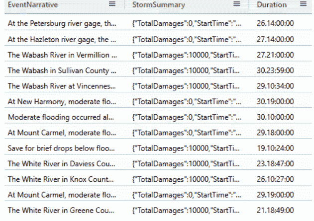

Figure 5.8 – The extend command

正如我们之前所说，extend 命令不需要使用其他列，因为它也可以使用硬编码值，因此以下命令完全有效：

```
StormEvents
| extend Test = strcat("KQL", " rocks")
```

请注意，strcat 函数将两个或多个字符串连接成一个。输出将如下图所示。由于我们没有通过列引用从行中获取任何值，因此该值始终相同，在本例中为 KQL rocks：

| EventNarrative | StormSummary | Test |
|---|---|---|
| At the Petersburg river gage, th... | {"TotalDamages":0,"StartTime":... | KQL rocks |
| At the Hazleton river gage, the ... | {"TotalDamages":0,"StartTime":... | KQL rocks |
| The Wabash River in Vermillion ... | {"TotalDamages":10000,"StartTi... | KQL rocks |
| The Wabash in Sullivan County ... | {"TotalDamages":10000,"StartTi... | KQL rocks |
| The Wabash River at Vincennes... | {"TotalDamages":10000,"StartTi... | KQL rocks |
| At New Harmony, moderate flo... | {"TotalDamages":0,"StartTime":... | KQL rocks |
| Moderate flooding occurred al... | {"TotalDamages":0,"StartTime":... | KQL rocks |
| At Mount Carmel, moderate flo... | {"TotalDamages":0,"StartTime":... | KQL rocks |
| Save for brief drops below floo... | {"TotalDamages":10000,"StartTi... | KQL rocks |
| The White River in Daviess Cou... | {"TotalDamages":10000,"StartTi... | KQL rocks |
| The White River in Knox Count... | {"TotalDamages":10000,"StartTi... | KQL rocks |

Figure 5.9 – The extend command with hardcoded values

当输出可能存在于多个列中的信息，但您希望将其显示在单个列中时，此命令将非常有用。

### The project command

如果您不需要查看查询通常会显示的所有列，则使用 project 来确定要显示哪些列。在以下查询中，仅会显示 StartTime、EndTime 和 EventId：

```
StormEvents
| project StartTime, EndTime, EventId
```


输出显示在以下截图中。有趣的是，查询的运行时间比显示所有列时显著减少：

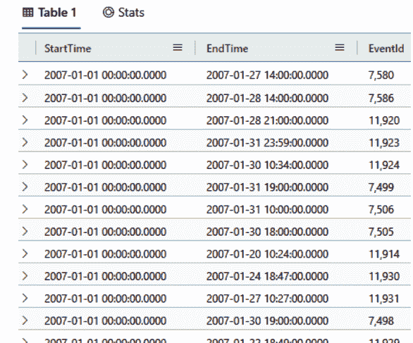

图 5.10 – The project command

project 命令与 extend 类似，它们都可以创建新列。主要区别在于 extend 命令在结果集末尾创建新列，而 project 命令在变量列表中的任何位置创建该列。对于除最简单计算之外的任何情况，最好使用 extend 命令以使查询更易于阅读。有两个命令会产生相同的结果。第一个命令如下：

```
StormEvents
| extend Duration = EndTime - StartTime
| project StartTime, EndTime, EventId, Duration
```

另一个命令如下：

```
StormEvents
| project StartTime, EndTime, EventId, Duration = EndTime - StartTime
```

在这里，你可以看到 project 命令对于通过删除不关心的列来清理结果非常有用。

## The distinct command

有时你会得到同一值的多个实例，但你只需要看到其中一个。这时 distinct 就派上用场了。它只返回指定列的一组值的第一个实例，并忽略其余所有实例。

如果我运行以下命令，我将为全部 59,066 行获取值，并且其中包含许多重复项：

```
StormEvents
| project State
```

输出显示在以下截图中。请注意 FLORIDA、MISSISSIPPI 和 OHIO 的多次出现：

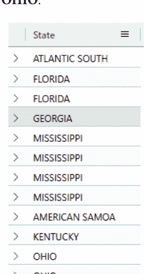

图 5.11 – Rows with multiple states

如果我们只需要看到每个州的一个实例，我们可以使用以下命令，只返回 67 行：

```
StormEvents
| distinct State
```

以下命令将按 State 列对输出进行排序：

```
StormEvents
| distinct State
| sort by State
```

输出的示例如下：

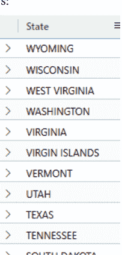

图 5.13 – The sort command showing states listed in descending alphabetical order

请注意，输出按字母顺序排列，但默认是降序。虽然这可能是你想要的，但如果你想先看到以 A 开头的州，你需要指定按升序排序。以下命令展示了如何做到这一点：

```
StormEvents
| distinct State
| sort by State asc
```

在以下输出中，你可以看到以 A 开头的州现在显示在最前面：

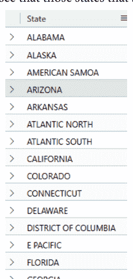

图 5.14 – The sort command showing states listed in ascending alphabetical order

请注意，order 也可以代替 sort 使用，因此以下命令将执行与我们刚才看到相同的操作：

```
StormEvents
| distinct State
| order by State asc
```

正如你所见，sort 命令在需要按特定顺序查看输出时非常有用，这可能是在大多数情况下。

## The join command

join 操作符将两个表的行合并形成一个新表，通过匹配来自每个表的指定列的值。在以下人为示例中，StormEvents 中所有 State 等于 North Carolina 的行将与 FLEvents 中具有匹配 EventType 列的行合并：

```
let FLEvents = StormEvents
| where State == "FLORIDA";
FLEvents
```

如果我们运行上述代码并向下滚动一点，我们将看到以下截图中显示的输出。正如你所见，State 等于 North Carolina 的大部分字段都是空的，因为我们使用 let 命令创建的表只包含 State 和 duration 字段：

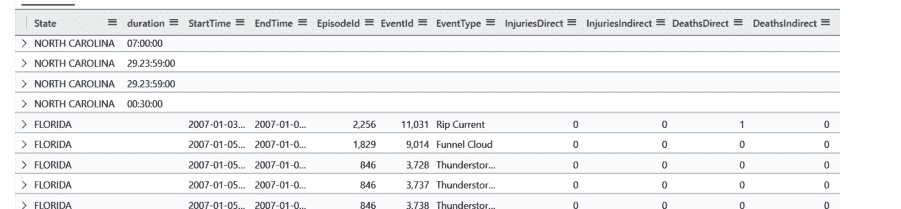

图 5.15 – Output of the union command

当你需要查看所选表的所有列时，即使其中一些列在其中一个表中为空，也应使用 union 命令。

## The render command

render 操作符与其他命令和函数不同之处在于它不会以任何方式操作数据，只会影响其呈现方式。render 命令用于以图形而非表格格式显示输出。

有时，通过查看时间图或条形图而不是字符串和数字列表，更容易判断是否提出了某些问题。通过使用 render，你可以以图形格式显示数据，使查看结果更轻松。

如果我们运行以下命令，我们将获得数据的表格视图。虽然这很有用，但它并不能显示任何异常值：

```
StormEvents
| project State, EndTime, DamageProperty
| where State =="CALIFORNIA"
```

部分输出如下：

| State | EndTime | DamageProperty |
| --- | --- | --- |
| CALIFORNIA | 2007-01-01 04:35:00.0000 | 0 |
| CALIFORNIA | 2007-01-01 04:37:00.0000 | 0 |
| CALIFORNIA | 2007-01-01 11:35:00.0000 | 0 |
| CALIFORNIA | 2007-01-02 03:36:00.0000 | 0 |
| CALIFORNIA | 2007-01-02 06:30:00.0000 | 0 |
| CALIFORNIA | 2007-01-02 11:00:00.0000 | 0 |
| CALIFORNIA | 2007-01-02 11:00:00.0000 | 0 |
| CALIFORNIA | 2007-01-02 11:00:00.0000 | 0 |
| CALIFORNIA | 2007-01-02 11:00:00.0000 | 0 |
| CALIFORNIA | 2007-01-04 19:14:00.0000 | 0 |
| CALIFORNIA | 2007-01-05 03:36:00.0000 | 0 |
| CALIFORNIA | 2007-01-05 04:36:00.0000 | 0 |
| CALIFORNIA | 2007-01-05 04:57:00.0000 | 350,000 |

图 5.16 – Results shown in tabular format

虽然它显示了 2007 年 1 月 5 日发生了一次造成大量损失的风暴事件，但它是造成损失最多的那一次吗？我们可以查看行并查看每行的 DamageProperty 列来找出答案，但有更简单的方法。

如果我们运行以下命令，将生成折线图，以图形视图显示相同数据：

```
StormEvents
| project State, EndTime, DamageProperty
| where State =="CALIFORNIA"
| render linechart
```

该命令的输出显示在以下截图中。可以立即看出，虽然我们在 1 月份看到的风暴造成了大量损失，但与 6 月 30 日的风暴造成的损失相比相差甚远：

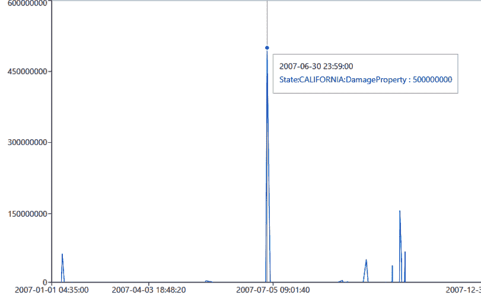

图 5.17 – Viewing storm damage as a graph

如前面的图表所示，有时数据的图形表示比仅查看文本输出更有价值。

> Note
> 这里的 x 轴标签有点误导，但正如你所见，当你将鼠标悬停在数据上时，风暴确实发生在 6 月 30 日。

可以渲染的其他图表包括饼图、面积图和时间图，每种图表可能需要不同数量的列来呈现数据。

## Scalar functions

标量函数接收一个值并对其进行某种操作以返回不同的值。它们对于在数据类型之间进行转换、查看变量的一部分以及执行数学计算非常有用。

### The ago() function

ago() 函数用于从当前 UTC 时间中减去特定时间跨度。请记住，Log Analytics 日志中存储的所有时间均基于 UTC 时间，除非它们是专门设计为不基于 UTC 的自定义日志中的时间。一般来说，可以安全地假设存储的时间基于 UTC 时间。

如果我想查找 StormEvents 中结束时间在不到一小时前的事件，我将使用以下命令。请注意，此命令不返回任何值，因为存储的时间来自 2007 年：

```
StormEvents
| where EndTime > ago(1h)
```

除了使用 h 表示小时外，你还可以使用 d 表示天数等。

## String operators

字符串和数字运算符用于 where 子句中的比较。我们已经看到 ==，它是一个字符串相等运算符。正如我们之前所说，这是一个区分大小写的运算符，这意味着 ABC == ABC 为真，但 ABC == abc 为假。

> Note
> 你可能需要使用 =~ 进行不区分大小写的比较。在这种情况下，ABC =~ abc 返回 true。虽然有命令可以将文本更改为大写或小写，但最好不要仅为比较而这样做，而是进行不区分大小写的比较。

以下是可使用的其他字符串运算符：


| Operator | 描述 | 区分大小写 | 示例（返回 True） | 示例（返回 False） |
|---|---|---|---|---|
| == | 等于 | 是 | "One" == "One" | "One" == "ONE" |
| =~ | 等于 | 否 | "one" =~ "ONE" | "one" =~ "two" |
| contains_cs | 右侧字符串在左侧字符串中 | 是 | "ONEtwo" contains_cs "ONE" | "ONEtwo" contains_cs "one" |
| contains | 右侧字符串在左侧字符串中 | 否 | "ONEtwo" contains "one" | "ONEtwo" contains "three" |
| startswith_cs | 右侧字符串位于左侧字符串开头 | 是 | "ONEtwo" startswith_cs "ONE" | "ONEtwo" startswith_cs "one" |
| startswith | 右侧字符串位于左侧字符串开头 | 否 | "ONEtwo" startswith "one" | "ONEtwo" startswith "two" |
| endswith_cs | 右侧字符串位于左侧字符串结尾 | 是 | "oneTWO" endswith_cs "TWO" | "oneTWO" endswith_cs "two" |
| endswith | 右侧字符串位于左侧字符串结尾 | 否 | "oneTWO" endswith "two" | "oneTWO" endswith "one" |
| in | 左侧字符串在右侧字符串列表中的一个 | 是 | "one" in ("alpha", "beta", "one") | "ONE" in ("alpha", "beta", "one") |
| in~ | 左侧字符串在右侧字符串列表中的一个 | 否 | "ONE" in ("alpha", "beta", "one") | "TWO" in ("alpha", "beta", "one") |

**表 5.2**

此外，通过在任何命令前放置 !，该命令将被否定。例如，!contains 表示不包含，!in 表示不在。

有关运算符的完整列表，请访问 https://docs.microsoft.com/en-us/azure/data-explorer/kusto/query/datatypes-string-operators。
