# 6 Microsoft Sentinel 日志和编写查询

在上一章中，我们介绍了 Kusto 查询语言（KQL），并简要介绍了如何使用它。在本章中，我们将了解 Microsoft Sentinel 日志页面。Microsoft Sentinel 日志页面是您可以查看工作区中各种日志、确定构成日志的数据类型、创建将在分析规则和威胁狩猎中使用的查询，以及保存这些查询以供以后使用的地方。这将有助于您创建规则，并且是调查事件不可或缺的一部分。

作为本章的一部分，我们将提供 Microsoft Sentinel 日志页面的概述，了解各个部分，并查看如何使用 KQL 编写查询。我们将回顾 Microsoft Sentinel 中的日志屏幕，并展示如何查看构成表的列，使用 UI 和 KQL。我们还将查看可以帮助您开发查询的步骤。

简而言之，以下主题将被涵盖：

- Microsoft Sentinel 日志页面的介绍
- 在日志页面中导航
- 编写查询

### Microsoft Sentinel 日志页面的介绍

**Log Analytics** 工作区遵循关于如何组织其信息的分层模式。最顶层是 Log Analytics 工作区。这是您 Microsoft Sentinel 实例所有单个表的容器。这相当于 **SQL** 中的数据库。

在每个工作区内都是单个表。这些相当于 SQL 中的表，是保存数据的实体。它们有一组列和零个或多个数据行。

在每个表中都是保存数据的列。列可以保存不同数据类型，包括文本、日期/时间、整数等。

> **注意**
> 您阅读的大量文档会互换使用 *table* 和 *log* 这两个术语。我们选择使用 *table* 这个术语，因为这是 **Microsoft** 在日志页面内部以及大多数文档中使用的术语，即使该页面本身称为 **Logs**。

### 在日志页面中导航

**Logs** 页面是您可以查看属于您工作区的所有表的列表、查看一些现有查询、编写自己的查询、查看结果等等的地方。让我们探索此页面。

要进入 **Logs** 页面，请从 Microsoft Sentinel 导航部分选择 **Logs**。这将打开以下页面：

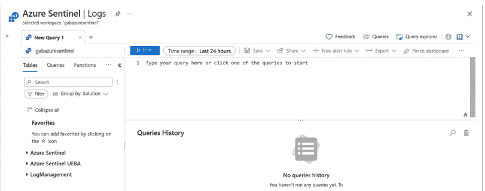

图 6.1 – Microsoft Sentinel 日志页面

该页面分为不同的部分，例如以下内容：

- 页面标题
- 表/查询/函数/更多工具窗格
- KQL 代码窗口
- 示例查询/结果窗口

这些部分可以在以下屏幕截图中看到：

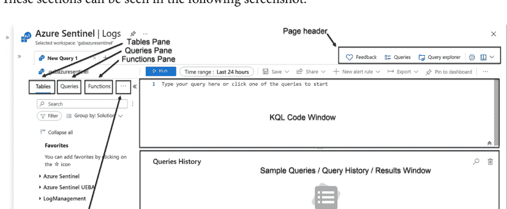

图 6.2 – Microsoft Sentinel 日志页面各部分

让我们更详细地描述每个部分。

#### 页面标题

页面标题位于页面顶部，包含有用的链接，例如反馈、示例查询、查询资源管理器、设置和帮助，如以下屏幕截图所示：

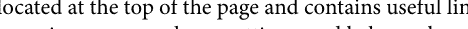

图 6.3 – 日志页面标题

您不需要使用这些链接来创建新查询，尽管它们可以帮助一些预定义代码，如您将阅读的那样。我们将从左侧开始查看每个单独的按钮。

#### 反馈

此功能允许您向 Microsoft 发送有关日志页面的反馈。如果点击此项，您可以选择您正在做什么、是否喜欢它、提供描述，并选择是否可以让 Microsoft 联系您。

这是一个很好的方式来提供反馈，说明您认为某个功能的工作效果如何，或请求新功能。

#### 查询

Microsoft Sentinel 提供了一些示例查询，以帮助您开始查看表。请按照以下步骤使用它们：

1. 点击查询按钮。这将打开一个新窗口并显示一些示例查询如下：

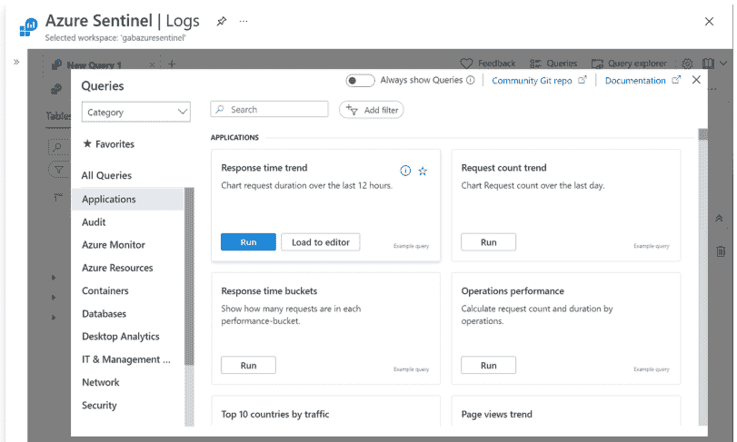

图 6.4 – 日志页面示例查询

> **注意**
> 您可能在第一次进入日志页面时看到过此页面。如果您注意到屏幕顶部有一个名为始终显示查询的滑块。如果启用此选项，每次进入日志页面时此页面都会显示。禁用后，页面不会自动显示。

此外，**应用程序** 选项卡默认会显示。所有查询都与显示 Log Analytics 工作区中正在记录数据的各种应用程序的信息相关。

如果将鼠标悬停在其中一个查询上，它将看起来像 *图 6.4* 中显示的 **响应时间趋势** 查询。您可以运行查询、在不运行的情况下将查询的 KQL 代码加载到编辑器中、获取有关查询的更多信息（即看起来像圆圈内字母 i 的图标），或将其标记为收藏，即看起来像星星的图标，在这种情况下，此查询将在您点击菜单中的 **收藏** 链接时显示。

您可以滚动浏览整个查询列表，也可以选择导航菜单中的一个条目，即 **应用程序**、**审核**、**Azure Monitor** 等，以跳转到该部分。

2. 点击任何条目的 **运行** 按钮以加载查询并运行它。在以下屏幕截图中，**Azure Monitor** 部分下的 **每台计算机的最后一次心跳** 查询已运行。您的结果将根据报告的计算机数量而有所不同。如果您看不到任何结果，可能意味着您没有设置正确的数据连接器——在这种情况下，您需要至少有一台计算机与此 Log Analytics 工作区相关联。有关复习，请参阅 *第 3 章，管理和收集数据*，了解如何设置数据连接器，以及 *第 2 章，Azure Monitor – Log Analytics 简介*，了解如何将计算机附加到 Log Analytics 工作区。

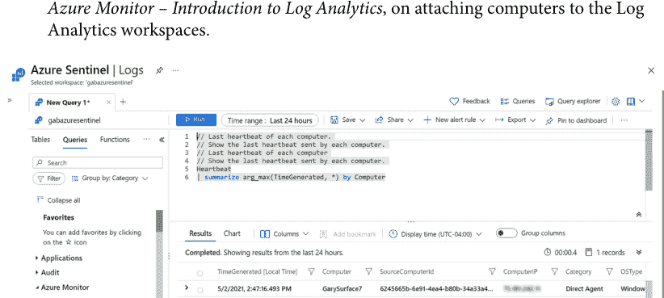

图 6.5 – 示例查询结果

查看其他查询部分，看看还有哪些可用查询。

> **注意**
> 您也可以通过转到 *图 6.2* 中指出的 **查询** 选项卡来访问这些相同的查询。

#### 查询资源管理器

**查询资源管理器** 按钮与 **查询** 按钮类似，只是您可以将自己的查询添加到此列表中，这将在后面讨论。如果您将任何查询标记为收藏或自己保存了任何查询，这些将在此窗口中显示：

1. 点击 **查询资源管理器** 按钮。这将打开 **查询资源管理器** 刀片如下：

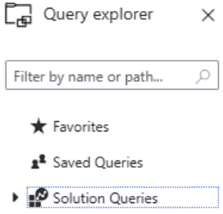


2. 展开 **Solution Queries** 树；你会看到下面还有其他分组。让我们试试。展开 **Log Management** 条目即可看到与日志管理相关的查询列表，如下图所示：

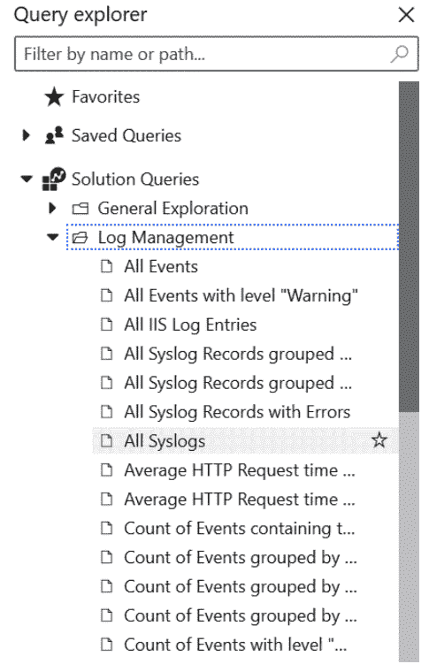

图 6.7 – 查询资源管理器示例查询

3. 如前一屏幕截图所示，**All Syslogs** 查询已被选中。如果名称右侧的星号被选中，则该查询将被保存为收藏。条目将列在 **Favorites** 部分下，且星号会变黑，如下图所示：

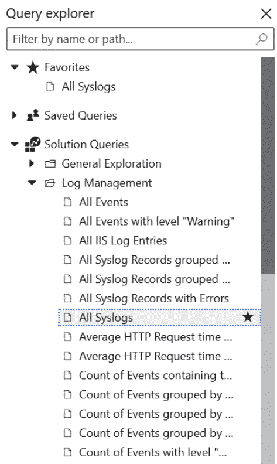

图 6.8 – 查询资源管理器收藏查询

4. 点击任何条目也会将该查询加载到 KQL 窗口中。在以下屏幕截图中，All Syslogs 查询已被点击但尚未运行。请注意，KQL 代码窗口的标题已更改为与所选查询的名称相匹配：

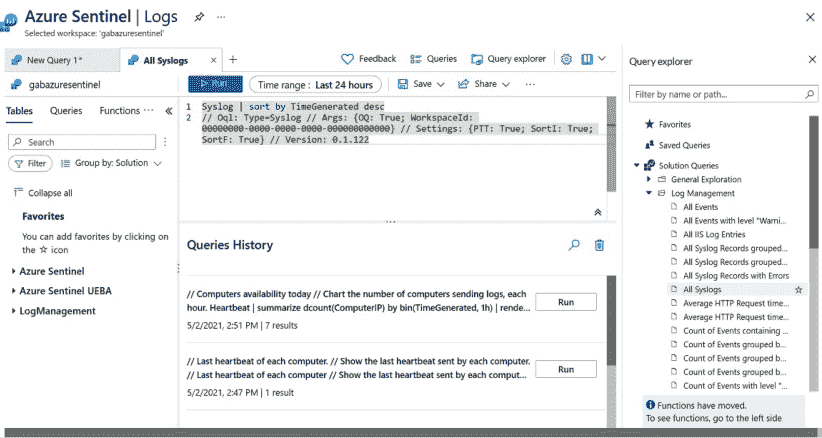

图 6.9 – 来自查询资源管理器的所选查询

## Important Note

应注意的是，当你点击查询时，会打开一个新的查询选项卡。但是，如果你再次点击同一个查询，则不会为该查询再次打开新选项卡。它会切换回保存该查询的原始选项卡。

## Settings (the gear icon)

Microsoft Sentinel Logs 页面有一些可以修改的设置。

点击设置按钮。这将打开设置刀片，如下所示：

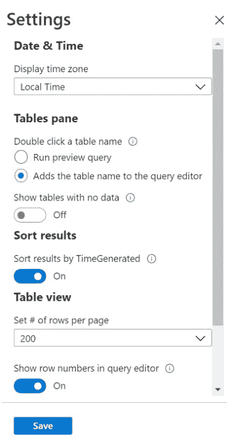

图 6.10 – 日志页面设置窗格

在这里你可以从以下选项中进行选择：

- **Date & Time**：选择在显示日期和时间时使用的时区。这将改变任何日期和时间字段，例如 **TimeGenerated** 的显示方式。默认情况下，字段将使用 **Universal Time Coordinated (UTC)** 显示，也称为 **Greenwich Mean Time (GMT)** 或 **Zulu (Z)**。使用下拉菜单将其更改为你想要的时区。你也可以使用 **Local Time** 条目，使日期和时间以你计算机所使用的本地时区显示。

> Tip
> 在此处更改日期和时间字段将改变在结果中显示时间字段时日期和时间的显示方式。你也可以在结果部分的标题中逐个结果更改用于显示时间的时区。有关更多信息，请参阅 The results window 部分。

- **Tables pane**：选择在 **Tables** 窗格中双击表时发生的情况。如果选择 **Run preview query**，KQL 查询窗格将包含表名，后跟：
  
  ```
  | where TimeGenerated > ago(24h)
  | limit 10
  ```
  
  如果选择 **Adds the table name to the query editor**，则只有表名会被放置到 KQL 查询窗格中，而不会包含任何代码。
  
  你还可以确定是否希望空表显示。如果启用名为 **Show tables with no data** 的滑块，则工作区中的任何表，即使没有数据，也会显示。
  
  如果你需要查看可供查询的表，这可能很有用，但如果你期望所有表都有数据，这可能会令人沮丧。

```
| where TimeGenerated > ago(24h)
| limit 10
```

- **Sort results**：选择是否使用 **TimeGenerated** 字段自动对结果进行排序。如果设置为 **On**（默认值），则每当显示结果时，它们都将使用 **TimeGenerated** 字段进行排序。如果设置为 **Off**，结果将按其存储的顺序显示。请注意，查询中执行的任何排序都会覆盖此选择。

- **Table view**：每页显示多少行。下拉菜单允许你选择 **50**，这是默认值，以及 **100**、**150** 和 **200**。选择更高的值将允许在单页上显示更多行。

- **History Queries**（屏幕截图中未显示）：这里没有可修改的内容；它只是告诉你查询历史记录保存多长时间以及如何清除查询历史记录。

让我们接下来看看书本图标。

## Help (the book icon)

此图标未分配名称，但它是页眉最右侧看起来像一本书的图标。

点击它即可找到其他可以帮助你了解更多关于日志页面和一般编写查询的选项：

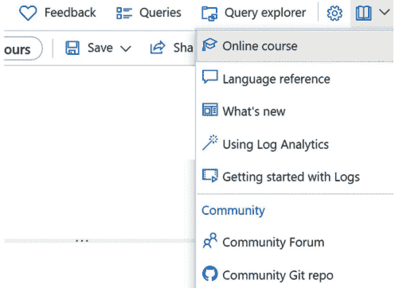

图 6.11 – 日志页面帮助

在这里你有以下选项：

- **Online course** 将打开一个新标签页，并带你到 **Pluralsight** 的页面，在那里你可以观看免费的 *Kusto Query Language (KQL) from Scratch* 课程。
- **Language reference** 将在新标签页中打开 **KQL reference** 页面。
- **What's new** 将在新标签页中打开 Azure Log Analytics 更新页面。
- **Using Log Analytics** 将打开 Log Analytics 教程页面。
- **Getting started with Logs** 将打开有关如何使用 Azure Monitor Log Analytics 的视频。
- **Community Forum** 将打开 Microsoft Sentinel 技术社区页面，在那里你可以询问有关 Azure Monitor 的问题。
- **Community Git repo** 将打开 Microsoft Sentinel GitHub 仓库页面。

Tip
请注意，所有这些条目也在页面的右侧，在 **Learn more** 标题下重复出现。

到此为止就是日志页面的页眉部分。接下来，我们将查看页面的左侧，Tables 窗格。

## The Tables pane

Tables 窗格将列出 Log Analytics 工作区中的所有表，并使用预定义的组进行分组。

点击 Tables，查看图 6.12，你会看到一些日志列在名为 Microsoft Sentinel 的组下。还可以有 Office365、SecurityInsights、WindowsFirewall 等组。

> **Tip**
> 如果你看到的组比此处显示的更多或更少，请不要担心。组只有在其中有日志时才会显示，而日志只有在它们是 Microsoft Sentinel 的一部分或有连接器用于填充它们时才会显示。例如，Office365 组只有在底层 OfficeActivity 日志存在时才会显示，而这只有在 Office365 连接器已启用并接收到数据时才会显示。

展开一个组将显示该组下的所有表。在以下屏幕截图中，Microsoft Sentinel 组已展开，显示其下的所有日志：

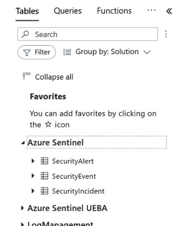

图 6.12 – Tables 窗格

如果你将鼠标悬停在任何表中，将弹出一个新窗口显示有关该表的一些信息，如图 6.13 所示。

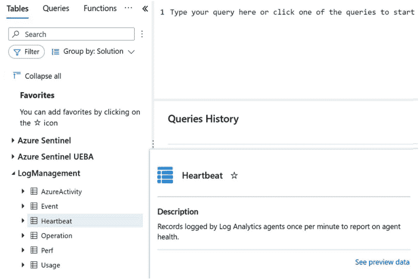

点击星号图标将保存此条目为收藏。它将显示在列表顶部 Favorites 部分下。这将是相同的条目，以便你可以展开它以查看其列并将鼠标悬停在其上以查看接下来描述的眼形图标。

点击 See preview data 链接将展开弹出窗口并显示该表的前 10 行，如图 6.14 所示。请注意，还添加了两个新链接。

窗口顶部的 Use in editor 按钮将把表名放置到 KQL 查询窗格中。表名，在 Useful links 标题下，将带你到一个页面，其中包含有关该表的详细信息，包括字段和描述。

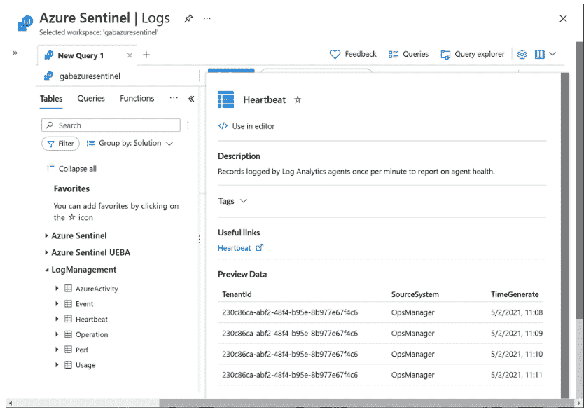

图 6.14 – 日志的示例记录

Note
一些表的页面在提供的信息方面比其他表更完整。

还有一个名为 Tags 的部分，展开后会显示用于对表进行分组的标签。当前条目为 Solution 和 Category。如果你看到相同类型的多个标签，这意味着该表将在多个解决方案或类别下显示。


你还可以展开单个表，查看构成该表的所有列以及列的数据类型。在下面的截图中，**Event**日志被展开。你可以看到构成日志的各个列，在名称左侧有一个图标显示数据类型：斜体的t表示文本，井号#表示数字。还有时钟表示日期/时间，B表示布尔值，{}表示动态类型：

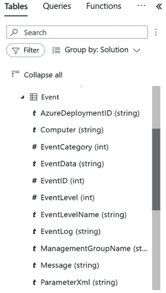

接下来，让我们转到**查询**窗格。

## 查询窗格

选择“查询”窗格将显示与您点击页面标题中的“查询”条目相同的信息。唯一的区别是，您只以树状视图格式看到标题。如果您点击标题，查询将被放入KQL查询窗口，如下面的截图所示：

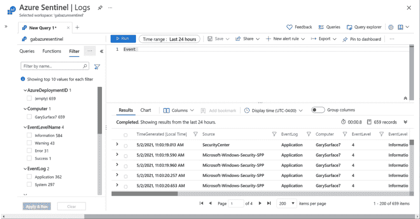

图6.16 – 查询窗格

这与之前在图6.5中选择的查询相同。值得注意的是，要查看描述，您必须将鼠标悬停在查询名称上，就像上一节讨论的将鼠标悬停在表名称上一样。

我们已经了解了如何查看已保存的查询。现在，让我们看看可用的函数。

## 函数窗格

函数是您保存的代码，以便可以轻松重用它们。选择“函数”窗格将显示所有已创建的函数，并按其标记分组。与表类似，您可以更改分组选择。但是，对于函数，还有一个额外的“旧版类别”选项，在创建自己的函数时可以输入，这将在后面讨论。

在下面的截图中，_GetWatchlist函数被双击，以将查询添加到KQL查询窗格中，然后悬停以显示描述弹出窗口。

如果您注意到弹出窗口中，除了函数的名称和描述外，还会显示函数所需的任何参数。您还可以看到KQL查询窗口的帮助选项显示了所需的变量。它还显示了另一个名称相似的函数，以确保您确实点击了正确的函数。

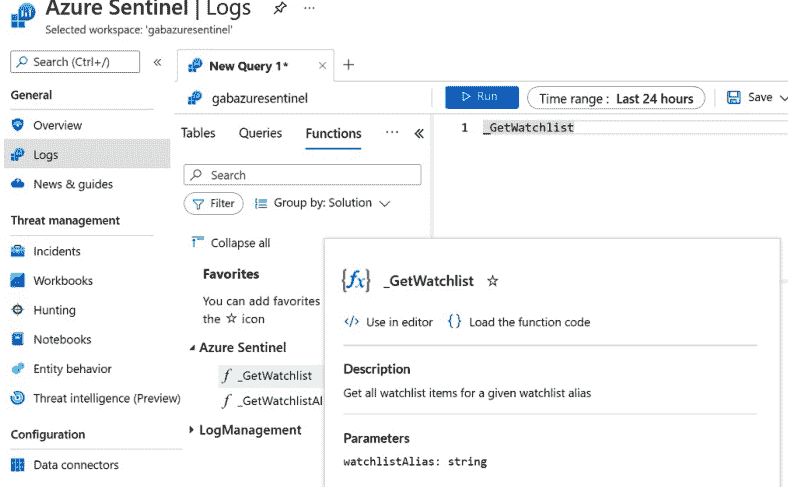

图6.17 – 函数页

我们需要查看的最后一个窗格是“筛选”窗格，我们接下来讨论它。

## 筛选窗格

您可能已经注意到，图6.2中没有显示“筛选”窗格。这是因为选项卡比分配给窗格的空间所能显示的要多。如果看不到“筛选”窗格，请选择上下文菜单（窗格右侧的三个点），未显示的窗格将列在那里。您可以从该列表中选择“筛选”窗格。

如果有其他您想要筛选的列未列出，请点击漏斗图标添加它们。这将打开一个新的弹出窗口，其中显示查询返回的所有列，如下面的截图所示。当前在使用的所有列都将被选中。选择您想要添加的其他列，然后点击“更新”。新列现在将显示为可用筛选器：

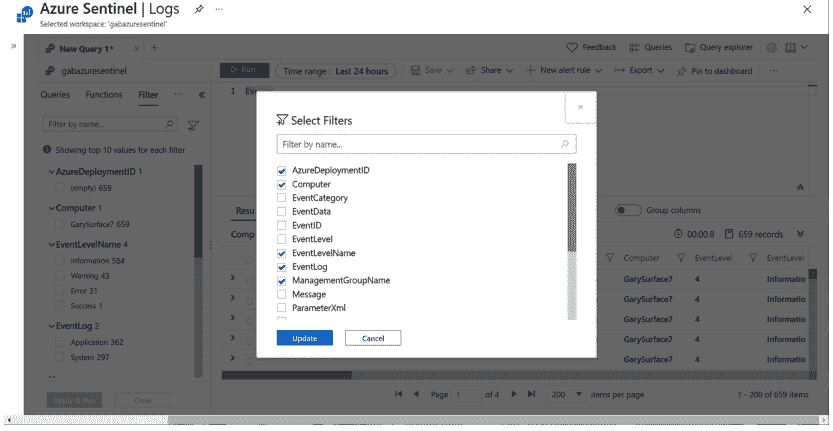

图6.19 – 筛选弹出窗口

**提示**

在“筛选”窗格中选择要显示的新列时要小心。通常有充分的理由说明为什么最初没有选择它们，包括条目太多，或者只有一个条目。

要使用筛选器，请选中名称旁边的复选框。您可以在任意数量的列下选择任意数量的条目来执行筛选。您选择的每个条目在查询中都将被视为“与”，因此如果您选择一个名为Alpha的条目和一个名为Beta的条目，则结果集中要显示的行必须同时包含Alpha和Beta。

选择所有需要的筛选器后，点击“应用并运行”按钮以应用新的筛选器。您也可以点击“清除”按钮以移除所有选定的筛选器。

在下面的截图中，选择了Application的EventLog和Microsoft-Windows-Security-SPP的Source，并点击了“应用并运行”按钮。它显示了新的查询和更新的结果。请注意，由于新的结果，筛选值已更改：

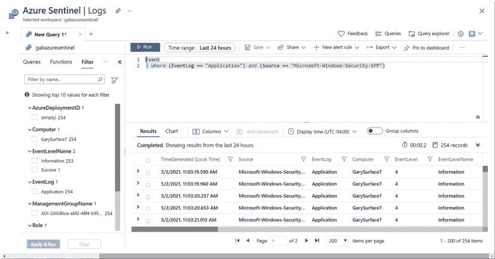

图6.20 – 更新的结果筛选窗格

接下来，让我们探索KQL代码窗口。

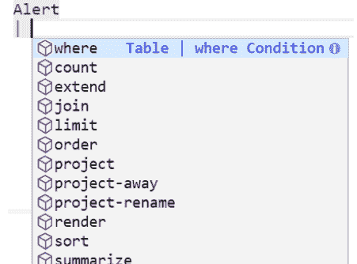

图6.22 – 查询IntelliSense

与页面标题一样，KQL代码窗口也有自己的标题。让我们探索它。

## KQL代码窗口标题

KQL代码窗口有自己的标题，由按钮组成，这些按钮允许您对查询执行操作，包括运行、保存、复制和导出，如下面的截图所示：

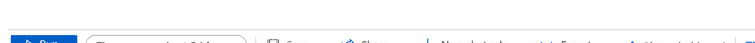

图6.23 – KQL代码窗口标题

将从左到右讨论每个按钮。

### 运行

点击“运行”按钮以执行窗口中的任何KQL代码。在点击此按钮之前，请确保已选中查询，以确保您的查询被运行。

值得注意的是，您可以选择查询的一部分，然后点击“运行”按钮时，只有选中的行会运行。同样，您可以在同一窗口中有多个查询，至少用一行空行分隔它们，只有选中的查询会被运行。如果您发现自己需要多次运行不同的查询，这可以节省时间。

### 时间范围

这将决定您的查询将回溯多远，除非您的KQL代码中有一个语句明确说明了回溯多远。这与所有其他“时间范围”按钮的工作方式相同，此处不再详细讨论。

### 保存

这将允许您保存查询以供将来使用。点击此按钮将打开“保存”窗格，如下所示：

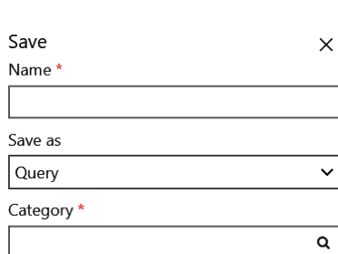

图6.24 – 保存窗格

按如下方式填写必填字段：

- **名称**：为此查询提供有用的名称，以便可以轻松确定此查询的作用。
- **保存为**：选择**查询**或**函数**。如果选择了**函数**，将要求您提供**函数名称**，它是一个较短的标识符，以便在查询中可以轻松引用该函数；一个可用于分组的**旧版类别**；还有一个复选框，询问是否将其保存为计算机组。有关计算机组的复习，请参阅*第2章，Azure Monitor – Log Analytics 简介*。您还可以输入函数所需的任何参数。
- **类别**：输入将用于将查询分组在一起的类别名称。您可以使用查找图标来查找已经使用过的类别。

点击**保存**按钮以保存您的查询或函数。

### 共享链接

这将允许您将链接、查询或结果复制到剪贴板。
其下的选项如下：

- **复制查询链接**：这将把此特定查询的URL复制到剪贴板。如果您想与他人共享查询，这会很有用。
- **复制查询文本**：这将把查询文本复制到剪贴板。如果您需要将KQL查询保存到其他地方，这会很有用。
- **复制结果**：这将把结果的URL（与查询的URL基本相同）复制到剪贴板。
- **分享到社区**：这将打开一封发送到 Microsoft Sentinel 社区电子邮件地址的邮件，并将包含您的查询，供提交到 Azure Monitor GitHub 存储库。

让我们看看**新建警报规则**按钮。

### 新建警报规则

其下有一个条目称为**创建 Microsoft Sentinel 警报**，一旦点击，它将带您到新的**分析规则**页面，您可以在那里创建一条已填写查询的新的计划规则。有关更多信息，请参阅*第7章，创建分析规则*。

### 导出

这将为您提供三个选项：

- **导出到 CSV – 所有列**：这将把所有列（可见和隐藏）导出到一个CSV文件中。点击时，将创建并下载一个名为`query_data.csv`的文件，实际步骤由您的浏览器设置决定。
- **导出到 CSV – 显示的列**：这将与第一个要点相同，不同之处在于只保存结果窗口中显示的列。请参阅*结果窗口*部分，了解如何隐藏/显示列。
- **导出到 Power BI（M 查询）**：这将创建并下载一个名为`PowerBIQuery.txt`的文件，并为您提供如何将此查询加载到**Microsoft PowerBI**应用程序中的说明。

让我们看看**固定到仪表板**选项。


## 固定到仪表板

这将允许你将此查询固定到 Azure 门户仪表板，以便你可以轻松查看查询结果。仪表板的创建和使用超出了本章的范围。但是，你可以前往 https://docs.microsoft.com/en-us/azure/azure-portal/azure-portal-dashboards 获取更多信息。

## 格式化查询

这将重新格式化 KQL 代码以使其更易于阅读。它有内部规则来确定什么更易于阅读，因此你可能同意或不同意它如何重新格式化代码。

## 运行查询

一旦你对查询满意，点击 Run 按钮查看结果。如前所述，请确保在点击 Run 按钮之前选择你想要运行的查询中的所有代码。如果你想运行查询中的所有行，只需确保光标位于查询中，UI 将为你选择整个查询。

结果将在结果窗口中显示，接下来将对其进行描述。

## 结果窗口

查询窗口正下方是结果窗口。顾名思义，这里是你将查看查询结果的地方。你还可以执行隐藏或显示列、过滤结果以及更改结果外观等任务：

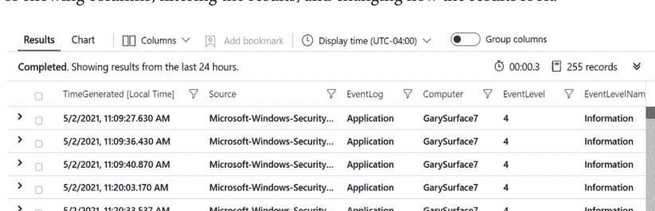

图 6.25 – 查询结果

> Note
> 如果你尚未运行任何查询，这将显示历史记录选项卡，其中将显示你之前运行的查询（如果有），以及各种类别的示例查询的选项卡。

## 结果窗口标题

此窗口的最顶部是一个标题，提供有关结果的信息。左侧有一条消息，告诉你有关查询的信息。在图 6.20 中，消息指出查询已完成，并且显示了过去 24 小时的部分列表。在这种情况下，它只显示部分结果的原因是，可以显示的最大结果数为 10,000，而行数超过了查询可以返回的数量。此消息会根据查询结果而变化，并提供有关查询结果的宝贵信息。

> Important Note
> 在日志页面中运行查询时返回的记录最大数量为 30,000。

其右侧是一个秒表图标和查询运行所需的时间，在前面的屏幕截图中略高于 0.3 秒。这是一个有价值的工具，可帮助确定你的查询是否运行效率低下。在查询运行时，此值会定期更新，以便你可以查看它是否仍在运行。

最右侧是返回的总记录数。这可以是 0 到 30,000 之间的任何数字，让你知道是否需要进一步细化查询。

如果你点击总返回数右侧的双向下箭头图标，你将看到有关查询运行所需时间（以毫秒为单位）以及其他信息的附加信息。有关这些值的更多信息以及如何使用它们来帮助优化查询，请参阅进一步阅读部分中的 Optimizing log queries in Azure Monitor 链接。

## 结果选项卡

页面左侧有两个选项卡，可帮助你定义和过滤查询。最左侧是一个选项卡，显示默认的结果视图，该视图以列/行格式显示结果。旁边是图表选项卡，如果可能，它将尝试以图表形式显示结果。

根据选择了哪个选项卡，右侧将显示不同的信息。以下屏幕截图显示了选择 **Results** 选项卡时的外观：

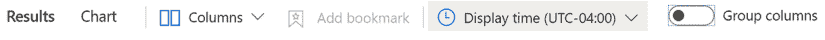

图 6.26 – 表格结果

**Columns** 下拉菜单将允许你选择要显示或隐藏哪些列。

**Columns** 下拉菜单右侧是 **Add bookmark** 链接。这允许你从选定的结果项创建书签。有关书签的更多信息，请参阅 *第 11 章，Microsoft Sentinel 中的威胁狩猎*。

无论你选择 **Table** 还是 **Chart** 选项卡，以下两项始终会显示：

- **Display time：** 这显示用于在 **Results** 窗口中显示时间的时区。使用下拉菜单更改时区。有关如何更改所有结果窗口的设置，请参阅 **Settings** 部分。
- 还有一个名为 **Group columns** 的滑块，提供基于列对结果进行分组的选项。

如果启用此功能，则在 **Results** 选项卡下方会看到一个灰色区域，你可以在其中拖动列以按该列对其进行分类。以下屏幕截图显示了按 **Source** 分组的结果。将其与 *图 6.25* 中显示的结果进行比较：

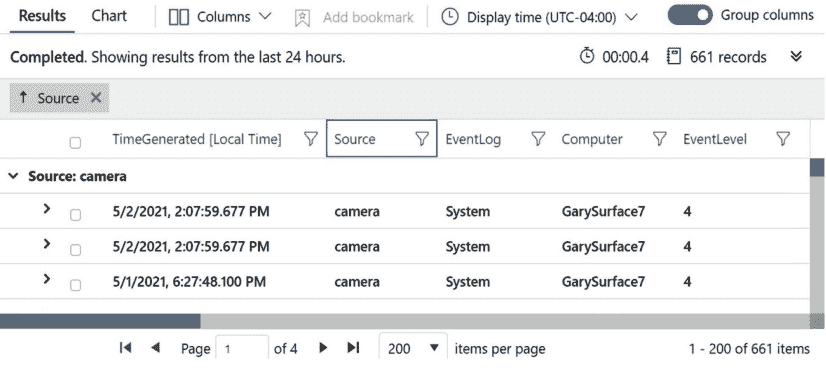

图 6.27 – 分组的查询结果

在分组区域下方，如果启用，则是已选择显示的结果列的列表。点击列名可使用该列对结果进行排序。第一次点击列时，它将按升序排序。再次点击将按降序排序。

每个列名在其名称右侧都有一个漏斗图标。点击漏斗图标可在列上执行过滤，如以下屏幕截图所示：

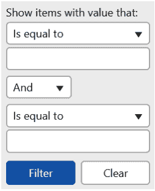

图 6.28 – 列过滤器

这与使用 Filter 窗格进行过滤不同。如果你使用 Filter 窗格选择一个值来过滤列，查询本身就会发生变化，并且需要重新运行查询才能看到更改。如果你只是在结果窗口中输入一个值来过滤列，查询本身不会改变；只有显示的行会立即更改以匹配过滤器。请注意，这不会是你可以过滤的可能值的列表。

你还可以将比较运算符从 Is equal to 更改为其他选项，包括 Not equal to、Contains、Has value、Has no value 等。这可以比使用 Filter 窗格提供更精确的过滤体验，尽管设置过滤器需要做更多的工作，因为你必须知道过滤值。

每一行左侧都有一个大于号按钮（>）。点击它可展开结果行，以行而不是列的形式显示其中的所有数据。如果任何列包含复合数据，例如 JSON，它将具有另一个大于号按钮，点击后将展开该行以显示其中的数据（如以下屏幕截图所示）。这对于查看行包含的所有数据非常有用，无论该列是否设置为在 Table 视图中可见：

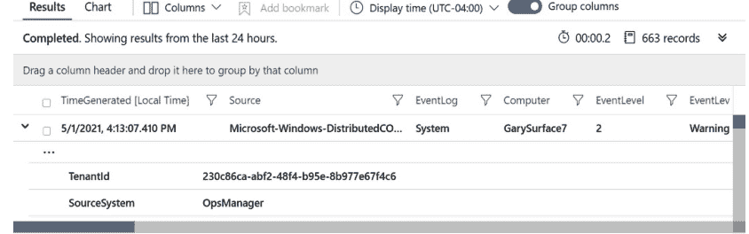

图 6.29 – 结果行已展开

虽然能够以表格视图查看结果非常有用，但在某些情况下，以某种图形视图（如线图或饼图）查看结果会容易得多。让我们看看接下来如何做到这一点。

## 结果页脚

当你使用 Table 选项卡查看结果时，屏幕底部是结果页脚，如下所示：

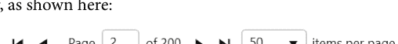

图 6.30 – 结果页脚

点击图表类型下拉菜单。你将看到可用图表的图形表示，如以下屏幕截图所示。请记住，并非所有图表都适合你选择的数据。此外，请记住该按钮将代表当前选择的图形选项，在本例中为饼图：

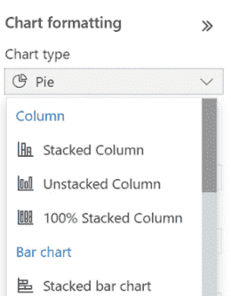

图 6.32 – 图形视图选项

你可以使用图表类型下拉菜单更改显示的图表类型，或使用其他下拉菜单更改用于显示数据的列，尽管对于此查询，没有其他列可用。

**Important Note**
虽然在运行查询时你仅限于 Microsoft Sentinel 中可用的图表类型，但你可以使用 Jupyter Notebooks 或 Grafana 等第三方图表工具访问相同的数据并使用第三方图表工具获得不同类型的图表。有关更多信息，请参阅第 11 章，Microsoft Sentinel 中的威胁狩猎。

现在你已经学会了如何使用预建查询（或使用自己的查询）生成结果。你可以操作这些结果以执行操作，包括限制显示的列或展开单结果行以查看其包含的所有列。你还学会了如何将结果视图从纯文本视图更改为图形表示，例如饼图。


## 了解更多

本节包含与页面头部书本图标相同的所有链接。如需复习，请参阅*帮助*（书本图标）部分。

此处重复这些信息是为了方便您首次进入**日志**页面时参考这些链接。一旦运行查询，结果窗口将展开并覆盖此区域，因此您需要使用书本图标才能访问这些链接。

您已经了解了 Microsoft Sentinel **日志**页面的不少内容，以及如何选择和运行内置查询来获取结果。您还学习了如何进一步操作这些结果，以及如何更改它们的显示方式。

现在是时候开始学习如何编写自己的查询了。您已经从*第5章，使用 Kusto 查询语言*掌握了 KQL 的基础知识，那么现在让我们来看看编写查询时需要考虑的步骤。

## 编写查询

既然您已经了解了如何在 Microsoft Sentinel 中使用**日志**页面，那么是时候运用您的新技能来编写自己的查询了。无论查询是什么，创建查询都需要几个基本步骤：

1. 明确您要查找的信息。您是否需要知道当前哪些计算机处于活动状态？用户在 SharePoint 中执行了哪些操作？引入了哪些数据？这将让您了解需要查看哪些日志。有关跟踪这些数据的一种方法，请参阅*第11章，Microsoft Sentinel 中的威胁搜寻*。
2. 一旦您确定了要查看哪个表，下一步就是查看该表中的少量行，以更好地了解其中存储的数据。

   最简单的方法之一是在**表**窗格中找到该表，将鼠标悬停在它上面，然后在弹出窗口中点击**查看预览数据**链接。这将显示所选日志中最多 10 行数据。查看其中一些行。这些是所需的部分信息，还是可能是全部信息？
3. 如果是，现在您就可以使用该表并应用可能需要的任何筛选来创建查询。
4. 最后，确定这些结果的最佳显示方式。如果您在分析查询中使用这些结果，则必须以表格视图返回。但是，如果这是用于威胁搜寻或在工作簿中使用，那么图形视图可能更好。

既然您已经了解了如何编写自己的查询，下面提供一些不属于 Microsoft Sentinel 但可能对您有用的查询。在阅读这些查询时，请在脑海中记住开发这些查询需要哪些步骤。需要哪个表？需要从表中获取哪些信息？如何筛选？如何显示？

## 引入的可计费数据

您已经看到了基于所引入数据量获取饼图的查询。虽然这很有用，但它只显示占总量的百分比；并不会显示所引入数据的大小。

如果您想查看过去 31 天内引入了多少可计费数据，请使用以下查询：

```
Usage
| where TimeGenerated > startofday(ago(31d))
| where IsBillable == true
| summarize TotalVolumeGB = sum(Quantity) / 1024 by
bin(TimeGenerated, 1d), Solution
| render barchart
```

这将查看 Usage 日志，该日志保存了过去 31 天内有关日志引入的所有信息，并检查 IsBillable 列以确保引入的数据是可计费的。如果您想查看所有数据（无论是否可计费），请删除以下行：

```
| where IsBillable == true
```

然后，它按吉字节（Quantity 字段以兆字节存储信息，因此除以 1024）、数据引入的日期以及数据来源的解决方案来汇总数据。最后，它以堆叠柱状图的形式生成这些数据，以便于查看。

如果您想查看来自单个解决方案的数据量，可以在其他以 where 开头的行之后添加以下行，将 Security 替换为您想查看的任何解决方案：

```
| where Solution == "Security"
```

此查询对于确保您引入了计划引入的数据量非常有用。

## 登录的地图视图

另一个与工作簿中的地图可视化结合使用时很有用的查询（有关更多信息，请参阅第8章，创建和使用工作簿）是查看所有 Azure 登录并获取纬度和经度以便在地图上映射位置的查询。此查询将查看所有登录，并在地图上显示用户登录位置的摘要：

```
SigninLogs
| extend latitude = toint(LocationDetails.geoCoordinates.latitude), longitude = toint(LocationDetails.geoCoordinates.longitude)
| extend country = strcat(tostring(LocationDetails.countryOrRegion)," - ",tostring(LocationDetails.state))
| summarize count() by latitude, longitude, country
```

此查询将查看 SigninLogs 日志中的所有条目，该日志保存了所有登录信息。由于代码中没有应用时间限制，它将使用基于“时间范围”下拉菜单的默认时间限制。

无需传入长字符串来获取纬度和经度，它为纬度和经度创建了新变量。使用 toint() 函数将 LocationDetails.geoCoordinates.latitude 从动态数据类型转换为整数数据类型，以便它们可以在末尾的 summarize 命令中使用：

```
| extend latitude = tostring(LocationDetails.geoCoordinates.latitude)
```

经度变量将进行相同的转换。

这里展示了 KQL 的一个新特性：使用句点访问存储在动态类型中的信息。就纬度值而言，它是 geoCoordinates 值的一部分，而 geoCoordinates 值又是 LocationDetails 值的一部分，因此需要使用句点沿变量链向下遍历以获取所需的值。

## 问题

1. 查看开箱即用查询的两种方式是什么？
2. 如果我正在查看查询结果，该结果显示网络上所有计算机的列表，如何在不更改查询的情况下筛选结果以仅显示特定计算机？
3. 查看表条目预览的最简单方法是什么？
4. 在查看所有结果页面时，在一页上显示最多 200 个结果的最简单方法是什么？
5. 在查看单个结果页面时，如何在一页上显示最多 200 个结果？

## 延伸阅读

- Azure Monitor 中的日志查询概述：
  
  `https://docs.microsoft.com/en-us/azure/azure-monitor/logs/log-query-overview`

- Azure Monitor 中的日志查询入门：
  
  `https://docs.microsoft.com/en-us/azure/azure-monitor/logs/get-started-queries`

- Azure Monitor 中的日志：
  
  `https://docs.microsoft.com/en-us/azure/azure-monitor/logs/data-platform-logs`

- 优化 Azure Monitor 中的日志查询：
  
  `https://docs.microsoft.com/en-us/azure/azure-monitor/logs/query-optimization`
