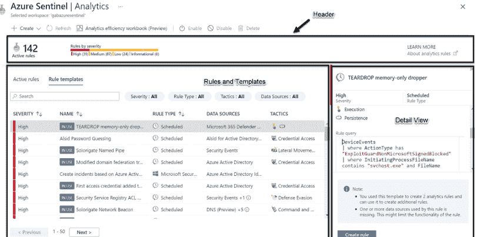
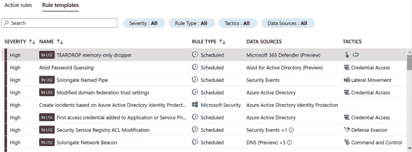
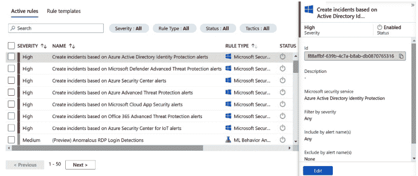
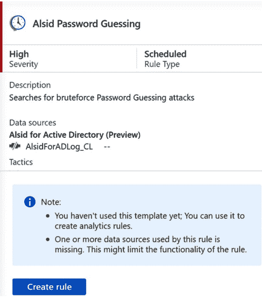
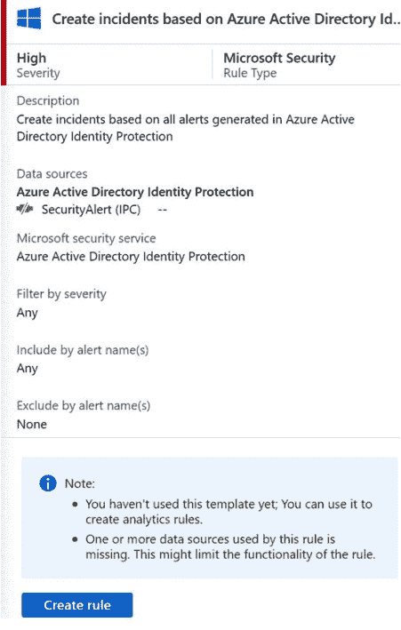
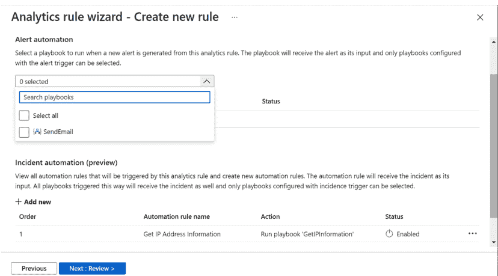
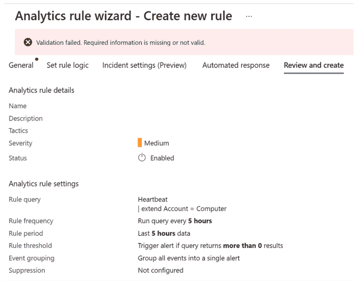
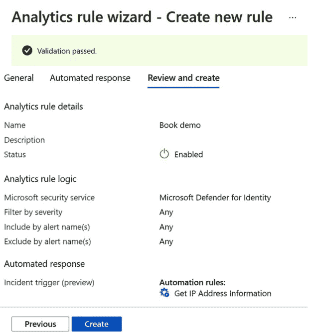
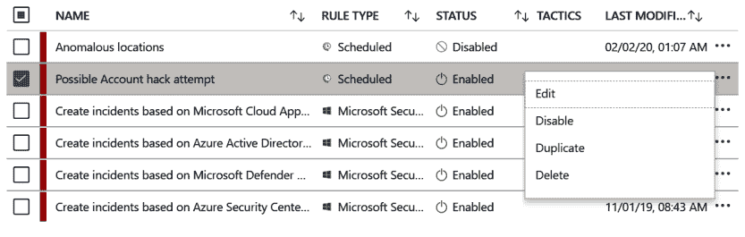

# 第3部分：安全威胁搜寻

在本部分中，您将学习如何使用可用工具创建分析、搜寻威胁并响应安全事件。

本部分包含以下章节：

- 第7章，创建分析规则
- 第8章，创建和使用工作簿
- 第9章，事件管理
- 第10章，配置和使用实体行为
- 第11章，Microsoft Sentinel 中的威胁搜寻

## 分析规则的类型

目前有五种类型的规则：**计划、Microsoft 安全、机器学习、Fusion 和异常。**每种类型的规则都有其特定的用途。让我们逐一探讨。

### 计划

顾名思义，这些规则按设定的计划运行以检测可疑事件。例如，您可以让规则每隔几分钟、每小时、每天或按其他间隔运行一次。这些规则的查询将使用 KQL 来定义它们要查找的内容。这些规则将在您的分析规则中占很大比例，如果您使用过其他**安全信息和事件管理 (SIEM)**系统，这些可能是您最熟悉的规则。

### Microsoft 安全

Microsoft 安全规则用于根据其他 Microsoft 安全解决方案生成的警报创建 Microsoft Sentinel 事件。

> **注意**
>
> Microsoft 最近对其部分 Azure 安全产品进行了更名。虽然大多数文档已更新为使用新名称，但 Microsoft Sentinel 规则模板尚未更新。在以下列表中，规则模板的实际名称会与产品新名称（括号中）一起注明。建议您在根据模板创建警报规则时，将其重命名为使用新名称以避免混淆。

在撰写本文时，以下安全解决方案的警报可以通过以下方式传递：

- **Microsoft Defender for Cloud Apps**
- **Microsoft Defender for Cloud**
- **Microsoft Defender for Identities**
- **Microsoft Defender for Endpoint**
- **Microsoft Defender for Office 365**
- **Microsoft Defender for IoT**


这种规则类型的另一个区别是能够设置其**模式**。模式可以是**试验（Flighting）**或**生产（Production）**。生产模式表示规则正在生产环境中运行，而试验模式表示你正在测试所做的更改，以查看这些更改是否按你期望的方式工作。虽然你可以拥有某个特定规则的多个不同副本，但同一时间只能将其中一个副本设置为在生产模式下运行。如果你将某个副本设置为生产模式，那么之前以生产模式运行的副本将自动切换为试验模式。

以上就是可用的各种分析规则类型。如你所见，它们涵盖了广泛的使用场景，从全自动机器学习到你自行创建的计划规则。在下一节中，我们将介绍**Analytics**主页。

## 浏览 Analytics 主页

**Analytics** 主页是你可以查看、创建和管理各种警报的地方。让我们浏览一下这个页面。

要访问 **Analytics** 主页，请从左侧导航栏中选择 **Analytics**。此时将打开以下屏幕：



图 7.1 – Analytics 主页

你会注意到主页分为三个主要部分：

- 标题栏
- 规则和模板列表
- 详细信息部分

这些部分将在以下各节中进一步详细描述。

## 标题栏

下面的截图显示了标题栏。请仔细查看。左侧是**活动规则**的数量；这是当前正在使用的规则数量。其右侧是按这些规则将生成的警报严重性分类的列表。最右侧是一个链接，它将打开一个新选项卡，你可以在其中了解有关分析规则的更多信息。


图 7.2 – Analytics 标题栏

在标题栏下方是一个选择器，用于选择**活动规则**或**规则模板**。每个选项卡都有不同的信息。现在让我们来看一看。

## 规则和模板列表

点击**规则模板**。这将显示微软从 Microsoft Sentinel 的 GitHub 仓库中预加载的所有规则模板，供你使用。请注意，这些只是模板——你必须从它们创建规则才能使用。稍后将对此进行更多介绍。



图 7.3 – 活动规则/规则模板

如果你观察上面的截图，列表中的第一个规则模板显示为**正在使用（IN USE）**。这意味着已从该模板创建了一条规则。某些规则模板，主要是任何机器学习行为分析或 Fusion 规则，只允许你从该模板创建一条规则，因此如果你在这些规则类型上看到此消息，你就知道无法再从该模板创建另一条规则。其他规则类型没有此类限制，因此该消息更像是一个通知，表示至少有一条规则是从该模板创建的。更多信息请参阅*从规则模板创建规则*一节。

你可能还会在一些规则模板上看到**新（NEW）**指示器。这意味着该规则模板是最近添加的，你可能应该查看它是否是一条你可以使用的规则。

对于每条规则，将显示名称、规则类型、所需数据源和策略（请参阅后面的 **MITRE ATT&CK®** 标注）。你可以对名称和规则类型字段进行排序，但不能对所需数据源或策略字段进行排序，因为它们可能有多个值。

现在，点击**活动规则**，你将看到那些你自行创建或使用规则模板创建的规则。下面的截图显示了这一视图的示例。我们将在本章后面更详细地介绍此视图。



图 7.4 – 活动规则

在这些选项卡正下方是一个搜索框和过滤器，如下面的截图所示。你正在查看的选项卡将决定搜索和过滤器的查找位置。如果你正在查看“规则模板”选项卡，则过滤器和搜索将只查找匹配的规则模板。同样，如果你正在查看“活动规则”选项卡，则搜索和过滤器将只查找匹配的活动规则。

使用搜索框搜索你至少知道部分标题的规则模板或活动规则。过滤器允许你根据严重性、规则类型、策略和/或数据源来过滤视图。如果你在“活动规则”选项卡中查看，“数据源”过滤器已被“状态”替代。点击过滤器可查看所有可用选项的下拉列表。


图 7.5 – 活动规则搜索框和过滤器

在过滤器下方是一个规则模板或活动规则的列表，具体取决于你所在的选项卡。接下来让我们探索这些。

现在，将注意力集中到两个选项卡（“活动规则”和“规则模板”）中“名称”字段的左侧。有一个颜色编码列。这显示了将生成的警报的严重性。红色表示高，橙色表示中，黄色表示低，灰色表示信息。该字段用作行的默认排序依据。

## 详细信息窗格

点击任意行（在下面的截图中，我们从规则模板中点击了 Alsid Password Guessing 模板）。这将在列表右侧显示详细信息窗格，如下面的截图所示。在该窗格中，你可以看到完整名称中能容纳下的部分，前面有一个与规则类型匹配的图标。

在名称下方是严重性和规则类型。



图 7.6 – 规则详细信息窗格

当前有五个图标，它们代表前面“分析规则类型”一节中讨论的规则类型。图标如下：

| 图标 | 描述 |
| --- | --- |
|  | 计划 |
|  | Microsoft 安全 |
|  | 机器学习行为分析 |
|  | Fusion |
|  | 异常 |

图 7.7 – 每种规则类型的图标

## Alsid 密码猜测

| 高严重性 | 计划规则类型 |

规则查询

```
afad_parser
| where MessageType == 2 and Codename == "Password Guessing"
```

规则频率
每 2 小时运行一次查询

规则周期
最近 2 小时的数据

规则阈值
如果查询返回超过 0 条结果，则触发警报

事件分组
将所有事件分组到单个警报中

抑制
未配置

注意：
- 你尚未使用此模板；你可以使用它来创建分析规则。
- 此规则使用的一个或多个数据源缺失。这可能会限制规则的功能。

创建规则

图 7.9 – 规则详细信息窗格（续）

在规则查询下方还有一些其他详细信息：

- **规则频率**：这决定了查询运行的频率。
- **规则周期**：这是查询将在过去的多久时间内查找数据。在此示例中，它将查看在最近一天内引入的数据。
- **规则阈值**：这决定了需要查询找到结果多少次才会生成警报。
- **事件分组**：这决定了所有事件是进入单个警报，还是每个事件进入自己的警报。
- **抑制**：这将说明分析规则是否已被抑制，以及如果被抑制，持续多长时间。这将在首次触发后生效。如果你正在测试新规则，这会很有用。在它首次触发后，你会需要时间来调查事件，以确保分析规则在再次触发之前正常工作，否则你可能会得到多个误报事件。

如果规则是 Microsoft 安全规则，那么除了前面讨论的字段外，**按 Microsoft 安全服务过滤**字段将说明正在使用哪个其他 Microsoft 服务来生成警报，如下面的截图所示：



图 7.10 – Microsoft 安全详细信息窗格


## 分析规则向导 - 创建新规则

常规  设置规则逻辑  事件设置（预览）  自动响应  查看并创建

创建将在你的数据上运行以检测威胁的分析规则。

### 分析规则详细信息

名称 *

描述

战术

严重性

状态

启用 禁用

下一步：设置规则逻辑 >

图 7.12 – 创建新规则，常规页面

填写每个字段的详细信息。下表提供更多详细信息以帮助你：

| 字段名称 | 说明 |
|---|---|
| 名称 | 这是规则的名称。尽可能使其具有描述性。用户应能轻松判断该规则试图发现哪类活动。例如，“安全事件日志已清除”清楚地告诉你，它正在检查安全事件日志是否已被清除。 |
| 描述 | 这是规则的说明。添加足够的信息，以便阅读该说明的任何人都知道此规则的作用。 |
| 战术 | 这些是此规则使用的 MITRE 战术。前往 https://attack.mitre.org/tactics/ 了解更多信息。 |

## 随机事件及其概率

随机事件：在一定的条件下，并不总是出现相同的结果的现象称为随机现象。在随机现象中，可能出现各种各样的结果，把随机现象的结果称为随机事件，简称事件。

例：抛掷一枚均匀的硬币，结果可能正面朝上，也可能反面朝上；转动一个均匀的转盘，结果可能停在红色区域，也可能停在白色区域。

必然事件：在一定条件下，必然会发生的事件称为必然事件。

不可能事件：在一定条件下，一定不会发生的事件称为不可能事件。

## 概率的定义

在大量重复试验中，事件A发生的频率稳定在某个常数附近，这个常数就叫作事件A的概率。记作P(A)。

一般地，在大量重复试验中，随机事件A发生的频率m/n会稳定在某个常数p附近，那么事件A的概率P(A)=p，其中0≤P(A)≤1。

> 注意：概率是频率的稳定值，频率是概率的近似值。

以下截图显示了一个已填充的实体。它还显示了一个名为**自定义详细信息**的部分，你可以在其中添加自己的自定义实体。但是，在撰写本章时，这个自定义实体不会显示在任何地方。

要添加自定义实体，只需为**键**字段添加名称，并从**值**下拉列表中选择一个值。

## 分析规则向导 - 创建新规则 ...

### 实体映射

从查询结果中可用的相应字段中，最多映射 Azure Sentinel 可识别的五个实体。这使 Azure Sentinel 能够识别并分类这些字段中的数据以进行进一步分析。对于每个实体，你可以定义最多三个标识符，这些标识符是实体的属性，有助于将实体识别为唯一。了解更多 >

与旧版实体映射不同，下面定义的映射**不会**出现在查询代码中。你下面定义的任何映射将**不仅**替换查询代码中与之对应的旧映射，还会替换查询代码中定义的**任何**映射——尽管它们仍然存在，但在查询运行时会忽略它们。了解更多 >

帐户

全名
帐户

+ 添加标识符

+ 添加新实体

### 自定义详细信息

在这里，你可以通过添加下面的键值对，在包含这些事件的警报中呈现特定的事件参数及其值。在“键”字段中，输入你选择的名称，该名称将作为警报中的字段名显示。在“值”字段中，从下拉列表中选择你希望在警报中呈现的事件参数。了解更多 >

键
值

+ 添加新项

上一步
下一步：事件设置（预览）>

图 7.16 – 创建新规则，实体映射和自定义详细信息页面

现在，向下滚动页面，你会看到更多与**查询计划**和**警报阈值**相关的字段，如下所示：

### 查询计划

运行查询频率 *

查找最近时间范围内的数据 *

### 警报阈值

当查询结果数量*时生成警报

### 事件分组

配置规则查询结果如何分组到警报中

将所有事件分组到一个警报中

为每个事件触发一个警报（预览）

### 抑制

生成警报后停止运行查询

图 7.17 – 创建新规则，设置规则逻辑页面（续）

下表提供了每个条目的更多详细信息：

| 字段名称 | 说明 |
|---|---|
| 运行查询频率 | 选择数值和时间跨度（分钟、小时或天）以确定查询运行的频率。虽然频繁运行查询不会产生额外费用，但请考虑可疑活动的发生频率以及你多快需要获知它。尽可能快地运行每个查询很诱人，但这可能导致警报过载。你是否需要尽快获知有人在 10 分钟内输入错误密码 5 次的低严重性事件？<br>这是当在“概述”页面上查看规则时的规则频率。 |
| **查找最近时间范围内的数据** | 选择数值和时间跨度（分钟、小时或天）以确定向后查找数据的时间范围。通常，这应与规则频率相同。<br>这是在**概述**页面上查看规则时的规则周期。 |
| **生成警报后停止运行查询** | 此选项决定生成警报后是否暂停规则。可以设置为“启用”或“禁用”。如果启用，请选择数值和时间跨度（分钟或小时）以确定规则在重新激活前暂停多长时间。这在测试新查询时非常有用。你希望能够在继续之前验证它是否正常工作，以及生成的警报（可能还有事件）是否准确。因此，通过设置此选项，你可以获得一个新事件，以便调查并确保查询是准确的。 |
| **警报阈值** | 此选项决定规则在生成警报之前必须找到多少次正结果。可设置为**大于**、**小于**、**等于**或**不等于**某个数值。这可用于限制生成的事件数量，以避免过载。例如，你可以将生成事件之前允许的失败登录次数设置得远高于新帐户被授予管理员权限等操作的设置值。<br>这是在**概述**页面上查看规则时的警报阈值。 |
| **事件分组** | 默认情况下，此规则查询运行时发现的每个事件都会被放入同一个警报中。有时你可能希望每个事件拥有自己的警报（例如，以保持各个实体分离）。如果是这种情况，请选择**为每个事件触发一个警报（预览）**单选按钮。应注意，只有前 20 个事件会获得自己的警报，第 21 个警报将包含所有事件。 |
| **抑制** | 如果希望在分析规则创建警报后停止运行它，请启用此选项。这对于测试目的特别有用，可以在其运行并可能产生误报之前确保所有数据都是正确的。 |

5. 填写完所有字段后，单击“下一步：事件设置（预览）>”继续。如果任何时候需要更改上一屏幕中的某些值，请单击“上一步”按钮。

“事件设置（预览）”页面允许你确定是否希望此警报创建事件，以及是否希望此警报将事件分组在一起。如下所示：

## 分析规则向导 - 创建新规则 ...

常规   设置规则逻辑   事件设置（预览）   自动响应   查看并创建

### 事件设置

Azure Sentinel 警报可以分组为一个需要调查的事件。你可以设置此分析规则触发的警报是否应生成事件。

从此分析规则触发的警报创建事件
启用 禁用

### 警报分组

设置此分析规则触发的警报如何分组为事件。将警报分组为事件可提供你响应所需的上下文，并减少单个警报带来的干扰。

将此分析规则触发的相关警报分组为事件
启用 禁用

将分组限制为在所选时间范围内创建的警报
5 小时

将触发此分析规则的警报分组到单个事件，依据

- 如果所有实体都匹配，则将警报分组到单个事件（推荐）
- 将触发此规则的所有警报分组到单个事件
- 如果所选实体匹配，则将警报分组到单个事件：
  - 选择实体

⚠ 基于实体的警报分组只能使用新版映射的实体（如果存在）。旧版映射的实体（出现在查询代码中）仅在没有使用新版定义映射时才可用于分组。

重新打开已关闭的匹配事件
启用 禁用

上一步   下一步：自动响应 >

图 7.18 – 创建新规则，事件设置页面


| 字段名称 | 描述 |
|---|---|
| 重新打开已关闭的匹配事件 | 如果您希望在匹配到新的警报时重新打开之前已关闭的事件，请启用此选项。如果您认为与之前已关闭事件匹配的额外警报值得对之前已关闭的事件进行进一步调查，则可能需要这样做。 |

表 7.4

6. 当您填写完所有字段后，点击 Next: Automated response > 继续。如果您需要在任何时候更改上一屏幕上的某些值，请点击 Previous 按钮。

Automated response 页面允许您选择在生成警报时自动运行哪些 playbook 和/或自动化，如下所示：



图 7.19 – 创建新规则，自动化响应

在前面的屏幕截图中，有多个可供选择的 playbook。如果没有列出任何 Playbooks，则表示您尚未创建任何以 When a response to an Microsoft Sentinel alert is triggered (Preview) 作为触发器类型的 playbook。有关创建 Microsoft Sentinel Playbooks 的更多信息，请参阅第 12 章，创建 Playbooks 和自动化。

7. 当您填写完所有字段后，点击 **Next: Review** > 继续。如果您需要更改上一屏幕上的某些值，请点击 **Previous** 按钮。

**Review and create** 屏幕将向您展示您所有选择的回顾并验证您的条目以确保其有效。如果存在问题，您将看到如下所示的屏幕：



图 7.21 – 创建新规则，Review and create 页面出现错误

下表提供了每个条目的进一步详细信息：

| 名称 | 描述 |
|---|---|
| Microsoft security service | 使用下拉列表选择要从中摄取警报的 Azure 资源。这包括 Microsoft Cloud App Security、Azure Security Center、Azure Advanced Threat Protection 等。 |
| 按严重性筛选 | 这可以是 Any 或，如果您选择 Custom，则可以从 High、Medium、Low 或 Informational 中选择一个或多个。这将筛选这些警报，仅允许所选严重性通过。 |
| 包含特定警报 | 如果选中，则只有您选择的那些警报会触发此规则。在弹出窗口中打开的文本框中输入特定的警报规则名称。可以选择多个特定规则。 |
| 排除特定警报 | 如果选中，则所有警报都会触发此规则，除了您选择的那些。在弹出窗口中打开的文本框中输入特定的警报规则名称。可以选择多个特定规则。 |

表 7.6

3. 当您填写完所有字段后，点击 Next: Automated response > 按钮继续。Automated response 屏幕将打开，如以下屏幕截图所示，您可以在其中查看和添加新的事件自动化规则。

您可以看到一条错误消息，提示存在验证失败，并且在出现错误的页面名称旁边有一个红点。在本例中，是 General 页面，如选项卡名称旁边的红点所示。如果没有错误，您将看到如下所示的页面：



图 7.27 – 创建 Microsoft 事件规则，Review and create 页面无错误

6. 最后，点击 Create 按钮创建您的规则。

我们已经介绍了创建新分析规则的三种不同方法：使用模板、从头创建新的计划规则，以及从头创建新的 Microsoft 事件规则。这三种方法各有用途，在为环境设置 Azure 时您很可能会全部使用。接下来，我们将了解如何管理现有的分析规则。

## 管理分析规则

规则创建后，您需要持续管理它们以确保它们保持有用。您可能需要调整规则以获得更好的结果，更改分配给计划规则的 Playbooks，禁用规则，甚至删除不再需要的规则。

您只能管理 Active rules 选项卡中列出的规则。因此，请按照以下两个简单步骤操作：

- 1. 首先，点击 Active rules 链接。
- 2. 在规则列表中，在 LAST MODIFIED 列的右侧是上下文菜单，以及每个规则的一行三个句点。点击它，您将看到如下所示的下拉列表：



图 7.28 – 分析规则上下文相关菜单

让我们看看如何使用这些选项：

- - Edit: 此条目将允许您编辑规则，以便根据需要修改任何字段。您也可以通过点击详细信息刀片上的 Edit 按钮来编辑规则。编辑规则将带您通过与创建规则相同的页面，所有保存的参数都已填入。进行必要的更改并保存它们。
- - Disable: 此条目将允许您禁用规则。如果规则被禁用，则此条目将标记为 Enable，并且将允许您启用规则。如果您认为规则不再需要而在删除之前，或如果您将执行已知会不必要地触发规则的操作，则可以禁用规则。只需记住完成后重新启用它！

## 问题

- 1. 五种不同的规则类型是什么？
- 2. 如果我希望规则按设定的间隔运行，应该使用哪种规则类型？
- 3. 您能否让来自其他 Azure 安全系统的警报在 Microsoft Sentinel 中创建事件？
- 4. 要使 Playbook 在计划警报触发时自动运行，您需要做什么？
- 5. 删除不再需要的规则的两种方法是什么？

## 进一步阅读

您可以参考以下链接获取更多详细信息：

- - *Creating custom analytic rules to detect suspicious threats:*
  https://docs.microsoft.com/en-us/azure/sentinel/tutorial-detect-threats-custom
- - *Microsoft Sentinel correlation rules: Active List out; make_list() in, the AAD/AWS correlation example:*
  https://techcommunity.microsoft.com/t5/azure-sentinel/azure-sentinel-correlation-rules-active-lists-out-make-list-in/ba-p/1029225
- - *Microsoft's Microsoft Sentinel Query Style Guide:*
  https://github.com/Azure/Azure-Sentinel/wiki/Query-Style-Guide#severity
- - *Microsoft Sentinel entity types reference:*
  https://docs.microsoft.com/en-us/azure/sentinel/entities-reference
