# 第 8 章 创建和使用工作簿

# 创建和使用工作簿

Microsoft Sentinel 工作簿是一种创建和显示可自定义和交互式报告的方式，可以显示图表、图表和表格。信息可以使用您已经熟悉的相同的 **Kusto Query Language (KQL)** 查询从 Log Analytics 工作区呈现。这些工作簿基于已与 Azure Monitor 和 Log Analytics 工作区等其他 Azure 资源一起使用的 workbook 技术。

Microsoft Sentinel 提供了多个可直接使用的模板。您可以使用这些模板创建自己的工作簿，然后根据需要进行修改。大多数用于摄取数据的连接器都附带自己的工作簿，以便您更好地了解使用表格和可视化效果（包括条形图和饼图）摄取的数据。您也可以根据需要从头创建自己的工作簿。

在本章中，您将学习以下主题：

- - Workbooks 页面概述
- - 浏览现有工作簿
- - 创建工作簿
- - 编辑工作簿

- - 管理工作簿
- - 工作簿步骤类型

## Workbooks 页面概述

要转到 Workbooks 页面，请从 Microsoft Sentinel 导航刀片中选择 Workbooks。会出现一个新屏幕，其外观如下所示的屏幕截图：

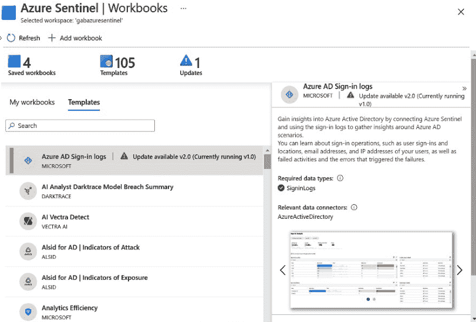

图 8.1 – Microsoft Sentinel Workbooks 页面

前述屏幕截图中页面顶部的标题显示了 Refresh 和 Add workbook 按钮。添加新工作簿将在 添加新工作簿从头开始 部分中讨论。

让我们在以下各节中详细讨论工作簿页面的不同组件。

## 工作簿标题

在刷新和添加工作簿按钮下方是已保存的工作簿总数。以下屏幕截图中的数字 9 包括我们在实例上保存的所有工作簿：

图 8.2 – 工作簿标题

其右侧是可用的模板总数。随着新的工作簿模板被添加，该数字可能会发生变化。

最右侧是可更新的模板总数。如图 8.1 所示，Azure AD 登录日志工作簿有更新可用。如果选择该工作簿，详细信息窗格底部会出现一个按钮，上面写着更新。点击它即可更新工作簿。

> 注意
> 请注意，这将更新模板以及此模板的已保存版本（如果存在）。这将覆盖对已保存版本所做的任何更改。为避免这种情况，建议的最佳做法是更改从模板保存的工作簿的名称，以便不会被覆盖。

让我们来看一下模板视图。

## 模板视图

工作簿标题下方有两个选项卡，分别是我的工作簿和模板，如以下屏幕截图所示。我的工作簿选项卡将显示用户有权访问的所有工作簿。模板选项卡显示所有可用的模板：

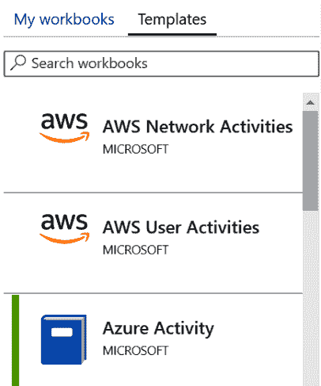

图 8.3 – 模板视图

无论选择哪个选项卡，每个模板或报表都将显示在一行上。每个模板的最左侧可能会看到一条垂直的绿色条，表示该模板之前已保存，可以在我的工作簿下查看，或黄色条表示该模板有更新等待中。如果您查看的是我的工作簿选项卡，则每个报表都将具有绿色条，因为每个报表都可供查看，或者如果模板有更新可用，则可能为橙色条。颜色条右侧是创建模板的公司的图标，其后是模板名称，其下是公司的名称。

查看前述屏幕截图中列出的第一个模板，您可以看到亚马逊网络服务（AWS）的图标。其后是模板名称 AWS 网络活动，创建它的公司 MICROSOFT 在模板名称下方。

图 8.7 – 已保存模板按钮

让我们详细讨论这些按钮：

- 如果您已将模板保存为工作簿，显示的第一个按钮将是 **查看已保存工作簿**。这将允许您查看从模板创建的工作簿，包括您对其所做的任何更改。此活动将在本章后面的 *创建工作簿* 部分中讨论。如果您尚未将模板保存为工作簿，则将显示 **保存** 按钮，如 *图 8.6* 所示。点击它将允许您从模板创建新的工作簿。有关更多信息，请参阅 *使用模板创建工作簿* 部分。
- 下一个按钮是 **查看模板**。这将显示您是否已将模板保存为工作簿，如 *图 8.6* 和 *8.7* 所示。这将允许您查看模板。这是对模板的完全交互式视图，虽然您可以执行的操作仅限于刷新模板。您将无法从此视图保存或修改模板。
- 下一个按钮将取决于您是否已将模板保存为工作簿。如果您已保存模板，则将显示 **删除** 按钮，如 *图 8.7* 所示。点击它将导致出现验证弹出窗口。如果您确认删除，已保存的工作簿，包括您所做的任何更改，将被删除。

**我的工作簿** 选项卡将显示与 **模板** 选项卡相同的信息，只是它只显示从模板保存或从头创建的工作簿。此外，在详细描述窗口底部，按钮已更改。

如果您是从头创建的工作簿，而没有从现有模板创建，则按钮将显示如下屏幕截图所示。由于没有模板可查看，**查看模板** 按钮将不会显示：

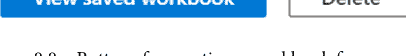

图 8.8 – 从头创建工作簿的按钮

其下是查询部分的第一个示例。这使用 KQL 查询获取数据，然后以不同方式显示。在这种情况下，信息显示为平铺；每列返回一个平铺。

其下是另一个查询部分的示例。在这种情况下，信息显示为表格，但各个列已修改以显示图形信息，而其他列则显示为纯文本。如果您查看从左数起的第二列，它会显示热图以及文本值。第三列，称为趋势，则显示迷你图而不是文本值。

关于这些查询部分还有一个有趣的点需要注意，它们是并排显示的。通常，当向工作簿页面添加新查询时，它将被设置为占据页面的整个宽度。这可以修改，以便各个查询占据所需的多或少的宽度。如果另一个查询可以与第一个查询并排放置，它就会这样做。

请记住，工作簿是交互式的，这意味着它们可以以这样的方式定义，如果您点击一个值，其他值可能会发生变化。在此工作簿中，如果您从前述屏幕截图中显示的按位置登录查询中选择一行，位置登录详细信息将被过滤，仅显示属于所选位置的用户。

工作簿其余部分的部分与已讨论的大致相同。这应该让您了解您可以用工作簿做什么来显示相关信息。

继续查看一些其他可用的工作簿模板，看看还能做什么。记住：您可以直接点击模板并查看提供的报表，以了解工作簿的外观。您会看到可以显示条形图、饼图、面积图等。

现在您知道如何查看现有工作簿以了解其工作原理，让我们来看一下如何创建自己的工作簿。

## 创建工作簿

现在您对工作簿可以做什么有了一些了解，是时候看看如何创建自己的工作簿了。有两种方法可以做到这一点：

- 使用工作簿模板
- 从头创建

无论哪种方式，我们都会得到一个可用的工作簿；然而，您可能会发现一开始从模板创建工作簿更容易，以便更好地了解工作簿的功能以及您可以做的事情。您完全可以使用从模板创建的工作簿中的查询作为起点来创建自己的工作簿，原因无他。

要能够创建新工作簿，您需要拥有适当的权限。请参阅 https://docs.microsoft.com/en-us/azure/sentinel/roles#roles-and-allowed-actions 以查看创建和编辑工作簿所需的权限。

### 使用模板创建工作簿

以下步骤展示了如何使用模板创建工作簿。这使得创建新工作簿变得更容易，因为它为您提供了一个起点：

1. 在查看模板的详细信息页面时，点击保存按钮。
2. 一个弹出窗口，如以下屏幕截图所示，将询问您要使用哪个位置来保存新工作簿。选择适当的位置。这应与您的 Log Analytics 工作区所在位置相同，以避免出口费用：

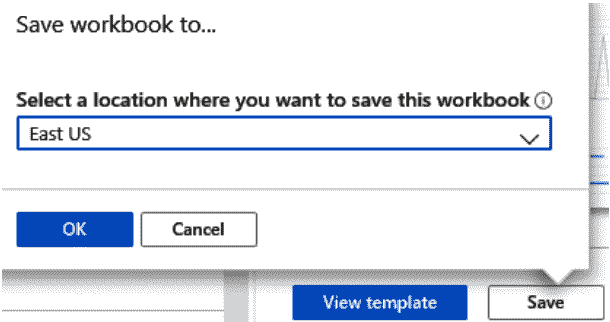

图 8.10 – 选择工作簿位置

3. 点击确定。这将在我的工作簿下创建一个新的工作簿，其名称与模板相同。

您现在知道如何使用模板作为基线创建工作簿。这是一种非常简单的方法，可以创建一个工作簿，然后根据需要进行修改。接下来，我们将讨论如何从头创建工作簿，而不使用模板作为基线。

| Name | Description |
|---|---|
| Title | 工作簿的名称。应描述得足够清晰，以便用户能够轻松判断将显示何种信息。 |
| Subscription | 选择此工作簿所在的订阅。它应与您的 Log Analytics 工作区相同。 |
| Resource group | 选择此工作簿所在的资源组。它是否与您的 Log Analytics 工作区位于同一资源组并不重要。例如，您可以为 Microsoft Sentinel 实例的所有资源创建一个资源组，或仅为工作簿创建一个资源组，或两者结合。如果适用，请遵循贵公司关于放置项目的标准。 |
| Location | 选择工作簿所在的区域。您希望将其与 Log Analytics 工作区设为同一区域，以避免产生出站费用。 |

Table 8.1

下面有一个复选框，标签为 Save content to an Azure Storage Account。如果您需要保护工作簿中存储的信息，可以通过将工作簿内容保存到 Azure 存储帐户来保护它。请参阅本章末尾的 Further reading 部分，其中包含有关如何执行此操作的链接。

- 4. 点击 **Save** 保存工作簿。

**Note**

实际上，您在编辑新工作簿之前并不一定需要保存它。通常建议您这样做，以确保您拥有可恢复的已保存副本，以防编辑未按预期工作。

就这样。现在，您需要编辑工作簿，以便可以编辑或删除现有步骤，或添加自己的新步骤。请参阅下一节，我们将在其中介绍可以对工作簿进行修改的更多详细信息。

## Editing a workbook

您有时需要编辑工作簿。正如您在上一节中看到的，您需要编辑从头创建的工作簿以添加所需内容。您也可以编辑从模板创建的工作簿以使其符合您的需求。

如果您尚未查看工作簿，则首先需要查看它。如果您已在查看工作簿，则可以跳过下一步，直接进入编辑部分。

要编辑工作簿，请执行以下步骤：

- 1. 转到 **My workbooks** 或 **Templates** 选项卡。
- 2. 选择相关的工作簿。
- 3. 然后，在工作簿的详细信息窗格中选择 **View saved workbook** 按钮。

> **Note**
> 您不能直接编辑工作簿模板。必须先保存它，然后才能编辑已保存的工作簿。如果您是从头创建的工作簿，则必须转到 **My workbooks** 选项卡，因为这些工作簿不是从模板创建的，仅会显示在那里。

页面顶部有一个包含按钮的标题，如下所示。我们在本节中关心的按钮是左侧第一个，名为 Edit：

Figure 8.13 – Saved workbook header bar

下表简要描述了每个按钮：

| Icon | Name | Description |
|---|---|---|
|  | Done Editing | 此按钮将从编辑模式切换到查看模式。所有单独的编辑按钮将消失。 |
|  | Open | 打开另一个仪表板。请参阅 *Managing workbooks* 部分了解更多信息。 |
|  | Save | 保存对该工作簿所做的所有更改。 |
|  | Save as | 使用另一个名称保存此工作簿。 |
|  | Settings | 允许您更改此工作簿的一些高级设置，包括资源、样式、标签和受信任主机。这些主题的讨论超出了本章的范围。 |
|  | Revert changes | 丢弃任何更改并恢复到上次保存的版本。 |
|  | Refresh | 刷新页面。这将重新计算页面上的任何查询。 |
|  | Share | 允许您直接与他人共享此工作簿。这将打开一个窗格，其中包含 URL，您可以复制并发送给他人。请注意，工作簿必须属于 Shared Workbooks 组后才能共享它。如果工作簿未共享，则在共享之前会提示您将其移至 Shared Workbooks。 |
|  | Show pin options | 这将打开固定选项，您可以在其中将整个工作簿固定到仪表板，或将每个可固定的部分固定到仪表板。 |
|  | Advanced editor | 切换屏幕以显示自动生成的 JSON 或 Azure Resource Manager (ARM) 代码。请参阅 *Advanced editing* 部分了解更多信息。 |
|  | Feedback | 这允许您向 Microsoft 提供有关工作簿的反馈。这与在 Azure 门户其余部分的工作方式相同。 |
| ? Help | Help | 在另一个选项卡中打开 Microsoft 工作簿文档页面。 |

Table 8.2

如果您查看正在编辑的工作簿的底部，您将看到与以下屏幕截图相匹配的链接列表。这就是您添加新步骤的方式，每个步骤将在 *Workbook step types* 部分中单独描述：

Add text | Add query | Add metric | Add parameters | Add links/tabs

Figure 8.16 – Edit mode add links

完成所有更改后，点击标题栏中的 **Done Editing** 按钮以恢复到查看模式。所有单独的编辑按钮将消失，已设置为隐藏的任何步骤、参数或列也将消失。

查看您的工作簿，确保刚刚所做的编辑按预期工作。一旦对更改感到满意，请点击 **Save** 按钮保存更改。

## Advanced editing

虽然工作簿的编辑 **graphical user interface (GUI)** 允许您完全创建和编辑 Microsoft Sentinel 工作簿，但有时您可能需要直接在代码中调整设置。您可能还希望获取 ARM 模板，这将允许您在其他位置轻松复制此工作簿或将其作为 DevOps 流程的一部分存储。

在任何一种情况下，点击 **Advanced Editor** 按钮都允许您执行此操作。点击该按钮后，您将被带到高级编辑器的 **Gallery Template** 视图，如以下屏幕截图所示。此视图允许您直接修改 JSON 代码。完成更改后，点击 **Apply** 按钮应用更改，或点击 **Cancel** 按钮返回 GUI 而不保存更改：

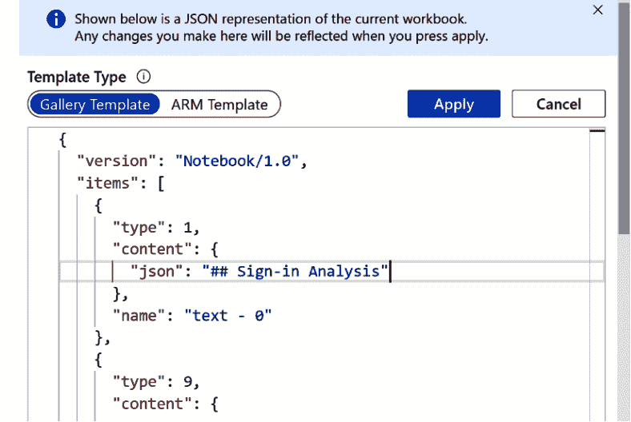

Figure 8.17 – Advanced Editor – Gallery Template view

下面是所有工作簿的列表。点击任何工作簿将更改您正在查看的工作簿。

每个工作簿将显示在单独的行中。它将显示名称，然后是一个图标，显示工作簿是否已从模板创建，然后是一个上下文相关菜单。点击上下文相关菜单图标将显示如图 8.20 所示的菜单。

此菜单允许您删除此工作簿，重命名它，将其移至 **Shared reports**（或如果此工作簿已共享，则允许您将其移至 **My reports**），与他人共享它（或如果它不是 **shared report**，则在共享之前会要求您使其成为 **shared report**），并将其固定到仪表板，这提供了直接访问此工作簿的快捷方式。所有这些都可以在以下屏幕截图中看到：

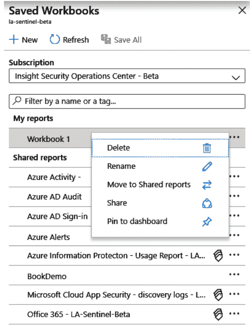

Figure 8.20 – Managing the workbook context menu

我们已经完成了对如何管理现有工作簿的介绍。您已了解 Saved Workbooks 窗格，以及上下文相关菜单，该菜单允许您对工作簿执行各种管理任务。现在，是时候查看构成工作簿的各个部分以及如何使用它们了。

## Workbook step types

每个工作簿由一个或多个步骤组成。如前所述，工作簿由称为步骤的小节组成。每个步骤都有一个唯一名称，可以是几乎任何内容，并且该名称可以在其他步骤中引用。每个步骤都可以独立运行，尽管有些可能需要参数，无论是从参数步骤还是从其他步骤获取。

共有六种不同类型的步骤：text、query、metric、parameters、links/tabs 和 groups。每种类型的步骤将在以下各节中更详细地讨论。

要在编辑工作簿时添加新步骤，屏幕底部是 +Add 按钮，点击后将显示步骤类型的列表，如以下屏幕截图所示。点击您希望添加的步骤类型的相应选项：

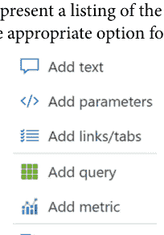

Figure 8.21 – Edit mode Add option

无论点击哪个链接，步骤底部都将有一系列选项，如以下屏幕截图所示：

Figure 8.22 – Edit mode add options after adding a step

点击 Done Editing 按钮将所选步骤更改为查看模式，以便您可以查看更改的外观。

点击 Add 按钮添加新步骤。

**时间范围**下拉框如下所示：

- 在查询中设置
- 最近30分钟
- 最近1小时
- 最近4小时
- 最近12小时
- 最近24小时
- 最近48小时
- 最近3天
- 最近7天
- 最近30天
- 自定义
- Time Range Pa...
- TimeRange

图8.25 – 时间范围下拉框

- **可视化**下拉框决定输出的显示方式。这些值之前已经讨论过，但另一个可用的选项是**在查询中设置**。如果选择了此值，则意味着代码本身已通过`render`命令决定了如何可视化数据。
- **大小**下拉框用于确定步骤将占用的垂直空间大小，其值显示在以下截图中。选择最适合你的值，并注意实际空间大小可能因所选可视化类型的不同而有所变化：

- 极小
- 小
- 中
- 大
- 全尺寸

图8.26 – 可用大小

另一个有用的选项是**隐藏**。选择此项将导致该列不显示在网格中。有时你可能需要保留该列，但不想显示它。将列的渲染器设置为**隐藏**即可实现这一点。详细说明如何使用这些不同的渲染器超出了本书的范围，但可以查看**Azure AD登录日志**工作簿来了解如何使用**热图**和**迷你趋势线**。

在标题栏下方是**Log Analytics工作区日志查询**区域。你可以在此处输入要运行的 KQL 查询。在此屏幕的右侧有三个图标，如下所示：

查询帮助

图8.27 – 查询步骤结果按钮

以上按钮列表的说明如下：

- **查询帮助**图标将打开一个新标签页，并带你进入一个讨论如何编写 KQL 查询的页面。
- 它旁边的图标将在同一标签页中打开**日志**页面，并加载你在**Log Analytics工作区日志查询**区域中的查询。如果你在使用查询时遇到问题并需要找出问题所在，这将会很有用。
- 最后一个图标只会在你运行查询后出现。它允许你将结果导出到 Excel 以进行进一步处理。

直接位于**Log Analytics工作区日志查询**区域下方的区域是结果显示的位置。它们将根据在**可视化**下拉框中选择的值进行显示。运行我们之前使用的 Heartbeat 查询，然后更改**可视化**下拉框中的值，看看该区域如何变化。

## 指标

指标步骤允许你查看不同 Azure 资源上的指标。这种步骤类型在 Microsoft Sentinel 中不太常用，因此本章不讨论它。有关如何使用指标步骤的更多信息，请参阅 https://docs.microsoft.com/en-us/azure/azure-monitor/app/usage-workbooks#adding-metrics-sections。

## 参数

尽管查询步骤是 Microsoft Sentinel 工作簿的中坚力量，但如果没有参数，工作簿也不会如此有用。一个无法更改任何输入的工作簿还不如一张图片，而非一个你可以通过操作以不同方式查询结果的交互式工作簿。

参数有两种类型：一种是在参数步骤中设置的参数，我们将在本节讨论；另一种是在查询步骤中选择某个项目时填充的参数，将在本章后面的“高级设置”部分讨论。

当你单击“添加参数”链接时，将看到以下屏幕。请注意，截图中已删除大量空白区域，以便显示全部内容：

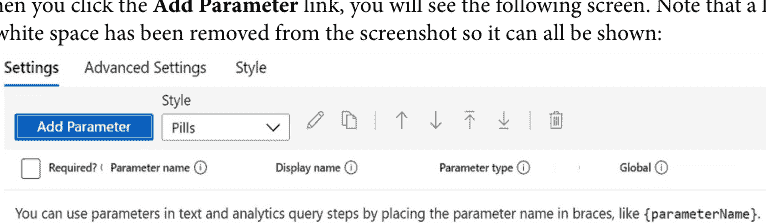

图8.28 – 新建参数步骤

输入参数后，它们将显示在表格中，每行一个参数，如下面的截图所示。你可以选中单个复选框来编辑单个参数的所有设置。你也可以直接在此屏幕上更改“必需？”、“参数名称”和“显示名称”字段。屏幕会显示“参数类型”和“说明”字段，但你不能在此屏幕上编辑这些字段。有关这些字段的说明，请参阅“添加新参数”部分：

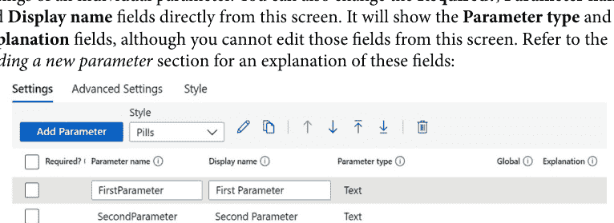

图8.29 – 带示例参数的参数步骤

## 参数类型

共有七种不同的参数类型：

- 文本
- 下拉列表
- 时间范围选择器
- 资源选择器
- 订阅选择器
- 资源类型选择器
- 位置选择器

每种类型的工作方式都不同，并且选择后可能会在“新建参数”窗格中显示额外字段。例如，“文本”类型非常基础，将显示一个用于输入的文本框；而“下拉列表”类型将显示 KQL 窗口，以便通过查询填充其值；还会出现一个新字段，询问是否允许进行多项选择。具体讨论如下：

- 文本：这是基本的参数类型。它允许你输入文本——例如电子邮件地址——然后可用于过滤其他查询。
- 下拉列表：下拉列表类型允许你输入 KQL 查询或 JSON 字符串，为下拉框提供选项。此类型还有五个附加字段：

| 名称 | 描述 |
|---|---|
| 允许多选 | 如果选中，用户可以从下拉框中选择多个条目。 |
| 限制多选 | 如果选中，这将设置用户可以从下拉框中选择条目的上限数量。将出现另一个字段，用于输入上限数值。 |
| 分隔符 | 如果允许多选，这是用于区分一个条目与另一个条目的分隔符。 |
| 引用符号 | 如果允许多选，这是包裹每个条目开头和结尾的字符。 |
| 包含在下拉框中 | 如果选中“任意一个”复选框，则此参数将不会用于过滤。 |

## 预览部分

“新建参数”面板的第二部分位于屏幕底部，显示变量的显示方式以及在代码中使用变量的预览。以下截图显示了一个未填写任何值的参数：

预览
编辑时，你的参数将如下所示：
<unnamed>：输入值
不编辑时，你的参数将如下所示：
<unnamed>：<unset>
在查询或文本项中替换时，{<unnamed>}将变为：
{<unnamed>} ==> `
{<unnamed>:label} ==> <unset>
{<unnamed>:value} ==> "

图8.34 – 新建参数屏幕 – 预览部分

最后一部分非常重要，因为它展示了如何在代码中使用该变量。这是参数名称（而非显示名称），用花括号 { } 括起来。

## 链接/选项卡

链接/选项卡步骤允许你以不同格式或选项卡形式显示链接。这允许你打开新网站以显示更多信息、显示所选单元格的详细信息，或显示不同的选项卡。

当你单击“添加链接/选项卡”按钮时，将添加一个新步骤，如下所示：

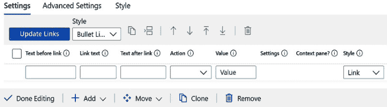

图8.35 – 新建链接/选项卡步骤

此屏幕允许你添加、编辑、删除或更改已添加链接的顺序。请记住，就工作簿而言，选项卡是以不同方式显示的链接。

**更新链接**按钮将使用编辑过程中所做的任何修改来更新链接。**样式**下拉框将更改链接在列表中的显示方式。下表显示了不同样式如何影响链接的显示：

| 显示名称 | 示例 |
|---|---|
| 项目符号列表 | • 第一个链接
• 第二个链接
• 第三个链接 |
| 列表 | 第一个链接
第二个链接
第三个链接 |
| 段落 | 第一个链接 第二个链接 第三个链接 |
| 导航 | 第一个链接 \| 第二个链接 \| 第三个链接 |
| 选项卡 | 第一个链接 第二个链接 第三个链接 |

表8.5

其余标题按钮如下所示：

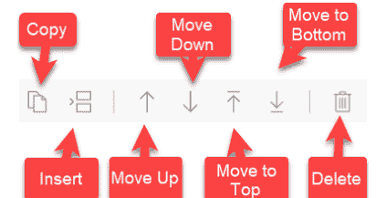

图8.36 – 链接/选项卡步骤标题按钮

头部按钮按从左到右的顺序说明如下：

- **复制**按钮将创建所选链接的副本。
- **插入**按钮将在所选行上方插入一个空行，以便创建新链接。
- **上移**和**下移**按钮分别允许将链接在列表中向上和向下移动。
- **移至顶部**和**移至底部**按钮分别将链接移至列表顶部或底部。
- **删除**按钮将删除链接。

我们来看看如何添加新链接。

## 添加新链接

要添加新链接，请在列表中显示的空行中输入信息。
各个字段说明如下：

- **链接前文本**：在**链接前文本**文本框中输入的信息将显示在实际链接之前。如果所选**样式**为**选项卡**，则此字段不显示。
- **链接文本**：**链接文本**是将要显示的URL的实际文本。
- **链接后文本**：在**链接后文本**文本框中输入的信息将显示在实际链接之后。如果所选**样式**为**选项卡**，则此字段不显示。
- **操作**：这是选择链接时将执行的操作。有许多不同的条目可供选择，但本章我们只介绍**Url**、**设置参数值**和**滚动到步骤**。根据选择的值不同，**设置**字段上可能会显示一个按钮或文本框以提供更多信息，但这些字段的简要说明见下表：

## 组

组允许将多个控件视为一个单元。当需要对多个步骤执行相同任务（例如，设置条件可见性设置）时，这将使操作更加容易。

当您单击“添加组”按钮时，将添加一个新窗口，如以下屏幕截图所示：

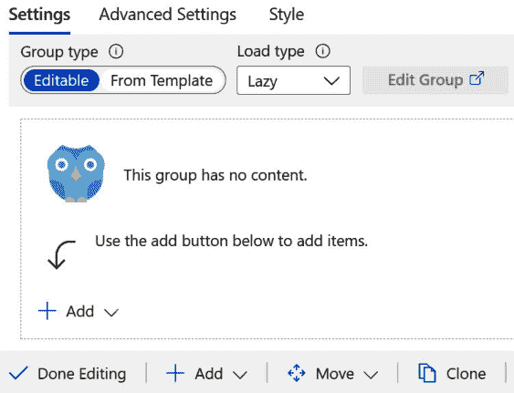

图8.38 – 新组

有两种不同的组类型：**可编辑**和**来自模板**。**可编辑**组类型是默认类型，允许您在此工作簿中对组进行所有更改。

如果选择**来自模板**，则会要求您提供模板ID，即工作簿的资源ID。您可以通过转到工作簿的资源组，选择相关工作簿，然后选择“概述”页面中显示的资源ID来获取此ID。

如果您有多个工作簿可能使用相同的步骤分组，则可以使用此设置，以避免每次都要创建这些步骤。请记住，如果您想对模板进行更改，则必须转到模板进行实际更改，并且这将影响所有使用此模板的工作簿。

**加载**类型将确定何时加载该组。有关这些值，请参阅下表：

| 名称 | 描述 |
|------|-------------|
| 延迟 | 该组仅在屏幕上可见时才会加载。这可以加快初始加载速度，但在首次显示该组时会有延迟。 |
| 显式 | 将出现一个**加载更多**按钮，并且在该按钮被点击之前，该组不会加载。这使您可以更好地控制组何时加载，但需要手动执行加载该组的步骤。 |
| 始终 | 该组将在工作簿打开时加载。这与**延迟**选项相反，它可能会减慢工作簿的初始加载速度，但显示该组时不会有延迟。 |

表8.7

还有一个名为**编辑组**的链接，允许您在另一个窗口中打开该组以进行编辑。如果您有很多步骤，这很有用，可以更轻松地仅查看属于该组的那些步骤。完成编辑后，您可以关闭窗口返回主编辑屏幕。请注意，仅当组内至少有一个步骤时，此按钮才会变为活动状态。

值得注意的是，如果删除一个组，您也会删除该组内的所有步骤。

现在，让我们在下一节中看看如何添加新选项卡。

## 添加新选项卡

添加新选项卡时，需要将标题中的**样式**字段设置为**选项卡**。将仅显示**选项卡名称**、**操作**、**值**、**设置**和**上下文窗格**字段。您不能设置任何文本在选项卡之前或之后显示。

> **注意**
> 
> 您完全可以使用其他任何样式来实现与**选项卡**条目相同的效果。**选项卡**样式旨在最大限度地减少创建选项卡界面所需的工作量，包括隐藏不需要的字段，以及更改链接的显示方式，使其看起来像传统的选项卡式界面。

- **选中项目时导出参数**：如果选中此项，则在此步骤中选中某个项目时，参数将设置为相应的值。这可以实现诸如根据状态过滤用户列表等功能。如果选中此项，其下方将显示一个新按钮，称为**添加参数**。点击该按钮将打开一个新窗口，您可以在其中设置参数，如以下屏幕截图所示：

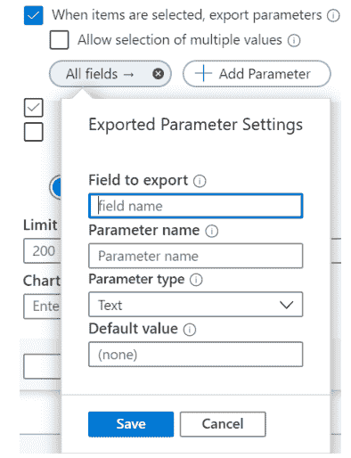

图8.41 – 高级设置 – 添加要导出的新参数

**要导出的字段**用于指定查询中用于填充参数值的字段名称。**参数名称**用于指定参数的名称，**参数类型**用于指定参数的类型。在本书中，我们将始终使用文本、整数、日期/时间和布尔值。

您可以同时导出多个参数。请记住在查询中使用该参数时，用括号{ }将参数名括起来。

- **不编辑时显示查询**：如果选中此项，KQL查询将始终显示。这通常不是一个好主意，因为它可能会让普通用户感到困惑。

以上我们讨论完了步骤的高级设置。如您所见，这些设置允许您执行许多操作，包括指定步骤何时可见、导出工作簿中其他步骤可以使用的变量，以及确定步骤将占据页面宽度的多少。

## 总结

在本章中，您了解了Microsoft Sentinel工作簿，以及如何使用其交互式显示向用户展示信息。工作簿可用于帮助确定您的环境中是否有需要调查的内容。

您学习了如何使用提供的各种步骤类型创建和编辑新工作簿。您学习了如何使用新步骤定义参数，以及如何从查询中获取参数，并如何使用这些参数进一步过滤查询。

它们可以显示文本、各种图表、指标和链接（包括选项卡）的组合。使用参数，我们可以更改工作簿中呈现的信息，以帮助确定是否存在需要调查的事件。

最后，您学习了如何更改步骤的高级设置以修改其操作方式和外观。您学习了如何让多个步骤在图表中显示在同一行，以及一个图表如何通过参数与另一个图表通信。

在下一章中，您将了解Microsoft Sentinel事件（由警报和其他查询生成），以及如何管理和调查这些事件。

## 问题

- 1. 创建新工作簿的两种方法是什么？
- 2. 如果我想向用户展示如何使用工作簿的说明，应该使用哪种最佳步骤类型？
- 3. 如果我想允许工作簿的用户更改工作簿中每个查询回顾的时间范围，我需要采取哪两个操作？（提示：第二个操作需要在每个查询步骤上执行。）
- 4. 是否可以让工作簿步骤仅在满足某些条件时显示？
- 5. 如何让同一工作簿中的两个步骤并排显示？

