# 9 事件管理

在第 7 章《创建分析规则》中，你学习了分析规则如何在分析中创建事件。这些事件可能代表环境中潜在的问题，需要查看以确定它们是否确实是问题。它们是误报、与环境无关，还是实际问题？确定方法是通过事件管理。

事件管理没有一成不变的规则，除了查看事件并确定它们是否是实际问题之外。实现这一点的方法有很多，本章将介绍 Microsoft Sentinel 提供的用于执行这些调查的选项，包括事件的图形表示、查看事件的完整详细信息以及运行其他查询以获取更多信息。

在本章中，我们将涵盖以下主题：

- 使用 Microsoft Sentinel 事件页面
- 探索完整详细信息页面
- 调查事件

### 使用 Microsoft Sentinel 事件页面

要查看 Microsoft Sentinel 事件页面，请单击左侧导航面板中的事件链接。这将带你进入事件页面，如以下屏幕截图所示。实际数字和列出的事件当然可能不同：

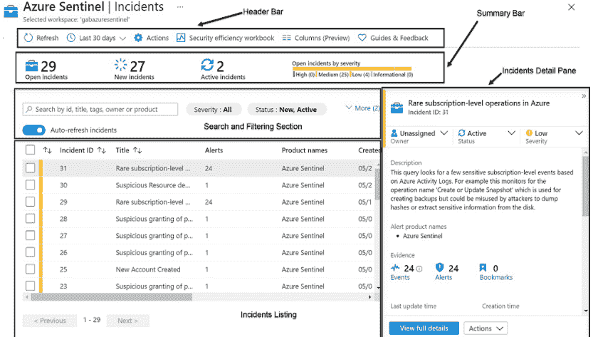

图 9.1 – Microsoft Sentinel 事件页面

页面已被划分为标题栏、摘要栏、搜索和筛选部分、事件列表以及事件详细信息窗格。这些部分将在后面详细介绍。

### 标题栏

页面顶部如以下屏幕截图所示的标题栏，具有通常的刷新按钮和时间跨度下拉选项。还有一个名为操作 的按钮：


图 9.2 – 事件页面的标题栏

**操作** 按钮将允许你对多个事件同时执行操作，包括更改严重性、分配所有者、更改状态和添加标签。有关更多信息，请参阅 *使用操作按钮* 部分。

右侧是 **安全效率工作簿** 按钮。单击它将带你进入安全运营效率工作簿，它将为你提供事件的总体概述，包括它们创建的时间线、事件的关闭分类（如有）、按严重性、所有者、状态等的细分，以及更多信息。

**列（预览）** 链接将允许你选择在视图中显示哪些列。这将允许你自定义事件页面的视图，并且更改将保留。有关所有列的列表，请参阅本章的 *事件列表* 部分。

最右侧是 **指南和反馈** 按钮。单击它将打开一个窗格，其中包含有关事件的一些指南，并允许你与 Microsoft 共享有关 **事件** 页面的反馈。

### 摘要栏

标题栏下方是如以下屏幕截图所示的摘要栏。这显示了未解决事件的总数、新事件的数量以及正在进行的事件的数量：


图 9.3 – 事件页面的摘要栏

摘要栏右侧是按严重性划分的未解决事件列表。通过查看事件的两种不同摘要，你可以了解事件的分布情况。

### 搜索和筛选部分

摘要栏下方是搜索和筛选部分。在这里，你可以筛选在所有事件列表中看到的结果：


图 9.4 – 事件页面的筛选部分

让我们查看搜索和筛选部分下的所有参数：

- **按 ID、标题、标签、所有者或产品搜索：** 此筛选器允许你输入搜索词以查找特定事件。这可以是事件标题中出现的文本或事件 ID 号码。

> **重要说明**
>
> 如果按 ID 号码搜索，输入的值必须与事件的 ID 号码完全匹配。

你还可以按构成事件显示的各个字段进行筛选，如下所述。如你所见，你可以按 **严重性、状态、产品** 名称（哪个产品生成了事件）和/或 **所有者**（分配给事件的人员）进行筛选。

- **严重性：** 此筛选器允许你选择一个或多个 **全选**、**信息**、**低**、**中**、**高** 和/或 **严重**。默认情况下选择 **全选**，在摘要栏中显示为仅 **全部**，如前面的屏幕截图所示。
- **状态：** 此筛选器允许你选择一个或多个 **全选**、**新建**、**进行中** 或 **已关闭**。默认情况下仅选择 **新建** 和 **进行中** 值。
- **产品名称：** 此筛选器允许你选择一个或多个 **全选**、**Defender for Cloud Apps**、**Microsoft Defender**、**Defender for Identities**、**Microsoft Information Protection**、**Defender for Endpoint**、**Defender for IoT**、**Defender for Office 365**、**Microsoft 365 Defender** 和/或 **Microsoft Sentinel**。默认情况下选择 **全选**，在摘要栏中显示为仅 **全部**，如前面的屏幕截图所示。

> **其他产品**
>
> 随着 Microsoft 将更多安全相关产品添加到 Azure，并且在 Microsoft Sentinel 中添加基于这些产品创建警报规则的能力，预计此列表将扩展以包含它们。

- **所有者：** 此筛选器允许你选择一个或多个人员进行筛选。由于任何人都可以成为事件的所有者，实际列表太长，这里不会列出值。请注意，有一些特殊条目，包括 **所有用户** 和 **分配给我**。**所有用户** 将显示分配给任何人的事件，包括未分配的事件。**分配给我** 将仅显示分配给当前登录用户的事件。

### 全选 / 所有用户

筛选器部分中的 **全选 / 所有用户** 条目是一个快捷方式，允许你一次选择列表中的所有条目，而无需逐一选择。取消选择它将取消选择所有单个条目，然后可以逐个选择。

搜索和筛选部分对于查找特定事件非常有用。你可以使用这些功能帮助你快速定位事件，尤其是在列表很长时，特别是如果你只需要查看分配给你的事件。接下来，我们将讨论当你找到想要的事件时该怎么做。

### 事件列表

搜索和筛选部分下方是每个事件的列表，每行一个，如以下屏幕截图所示。在这里，你可以看到事件的摘要，包括事件 ID、标题、构成事件的警报数量、创建事件的产品名称、创建日期和时间、所有者和状态：

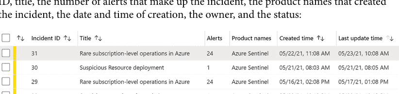

图 9.5 – 事件列表

最左侧是一个复选框。此复选框用于表示你想要对该事件执行操作。有关更多信息，请参阅使用操作按钮部分。你也可以选中此部分顶部的全选复选框以一次选择所有事件。

之后是一个彩色条。彩色条表示事件的严重性：高为红色，中为橙色，低为黄色，信息为灰色。

其余字段在下表中描述：

| 名称 | 描述 |
| --- | --- |
| 事件 ID | 这是公开显示的事件的 ID 号码。 |
| 标题 | 事件的标题。这将与生成它的警报规则的名称相匹配。 |
| 警报 | 创建此事件的警报数量。 |
| 产品名称 | 生成此事件的产品名称。 |
| 创建时间 | 此事件创建的时间。 |
| 最后更新时间 | 此事件最后更新的时间。 |
| 所有者 | 拥有此事件的人员姓名。 |
| 状态 | 事件的状态。 |
| 标签 | 与事件关联的任何标签。 |
| 战术 | 与此事件关联的任何 MITRE ATT&CK 战术。 |
| 关闭原因 | 如果此事件已关闭，关闭原因将显示在此处。 |
| 分析规则名称 | 创建此事件的分析规则的名称。 |
| 事件团队 | 已创建用于调查此事件的 Microsoft Teams 团队的名称。 |

表 9.1

你可以按事件 ID、标题、创建时间、最后更新时间、所有者和状态字段进行排序。单击任何这些字段将按升序对列表进行排序。再次单击将更改排序为降序。

每个事件在列表中都有自己的行及其自己的属性，正如我们刚才看到的那样。你可以使用其中大多数属性对行进行排序，以帮助你找到想要的事件。接下来，我们将查看事件详细信息窗格，它将提供有关所选事件的更多信息。


## 事件详细信息窗格

当你从列表中选择任何事件时，事件详细信息窗格将打开，其中显示有关所选事件的更多信息。当然，显示的信息会因你选择的事件而不同：

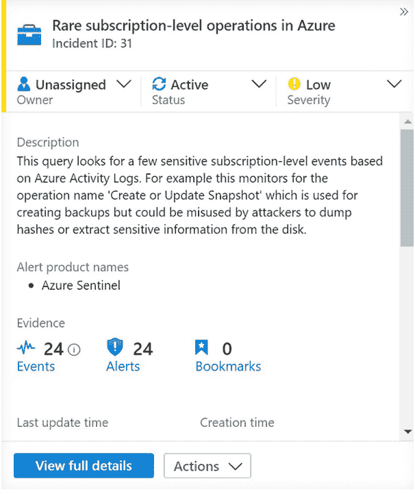

图 9.6 – 事件详细信息页

页面顶部是标题，事件编号直接显示在其下方。标题左侧有一条彩色条带，表示事件的严重程度：红色表示高，橙色表示中，黄色表示低，灰色表示信息。

在这几个下拉菜单下方是事件的描述。这提供了有关事件的更多详细信息，可能包括事件正在查找的内容、如何确定事件，甚至外部链接以获取更多信息。

在其下方是创建此事件的产品名称，位于 Alert product names 标题下。此信息很有用，因为它可以帮助你判断 Microsoft Sentinel 中是否存储了更多信息。如果此事件来自另一个 Azure 安全产品，那么在 Microsoft Sentinel 中可能不会有太多额外信息，甚至没有。

其下是 Evidence 部分。在这里你会找到此事件中的事件数、警报数和书签数。如图 9.6 所示，所查看的事件有 24 个事件、24 个警报和 0 个书签。点击其中任何一项即可获取更多信息。

向下滚动详细信息窗格，我们会找到 最后更新时间、创建时间、实体、策略、事件工作簿链接、分析规则链接 和 标签，如以下屏幕截图所示：

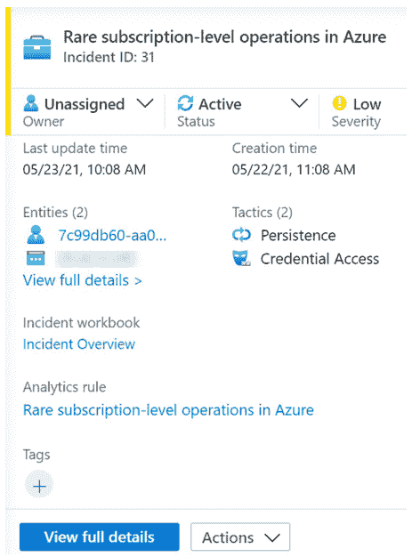

图 9.10 – 事件详细信息页续

正如你所期望的，**创建时间** 和 **最后更新时间** 字段显示事件的创建时间以及最后更新时间。

**实体** 部分显示与此事件关联的一些实体。请记住，在创建分析规则时它们需要被映射，并且至少要填入一个，以便 **调查** 链接启用，该链接在下图中描述。点击 **查看完整详细信息** 链接即可查看有关事件的所有信息。有关更多信息，请参阅以下 *实体选项卡* 部分。

**策略** 部分显示与此事件关联的 MITRE ATT&CK 策略。图标和文本均用于描述各种策略。

**事件工作簿** 链接将带你进入事件概览工作簿，在那里你可以获取有关事件的额外信息，包括关闭类似事件的原因、此事件发生的所有活动日志以及所有评论。

**分析规则** 链接将带你进入创建此事件的分析规则。这将允许你查看分析规则中使用的查询和其他参数。

**标签** 部分将显示与此事件关联的所有标签（如果有）。点击 + 按钮即可添加新标签。

再次向下滚动，我们会找到 **事件链接** 和 **最后评论**，如以下屏幕截图所示：

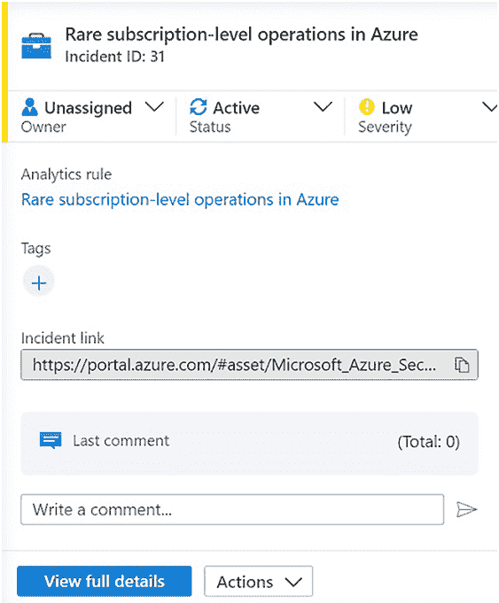

图 9.11 – 事件详细信息页续

**事件链接** 字段提供了一个 URL，你可以将其提供给他人，该链接将直接带他们进入事件的完整详细信息页，见 *探索完整详细信息页* 部分。这使得访问事件变得更容易，因为该人员无需遍历 Azure 门户的菜单然后再搜索它。

页面底部是已添加到事件的最后一条评论。**最后评论** 字段右侧是与此事件关联的评论总数。点击该数字将带你进入完整详细信息页中的 **评论** 选项卡，见 *评论选项卡* 部分的更详细说明。要添加新评论，请在 **写评论** 文本框中输入文本，然后点击右侧的 **提交** 按钮。它看起来像一个指向右侧的箭头。

**查看完整详细信息** 按钮将打开完整详细信息页，将在 *探索完整详细信息页* 部分中讨论。

**操作** 按钮（不要与页眉中的 **操作** 按钮混淆）将显示以下操作：

| 名称 | 描述 |
|---|---|
| 调查 | 这将打开图形化事件调查页面。有关更多信息，请参阅以下 *调查事件* 部分。 |
| 创建自动化规则 | 这将允许你为此事件类型创建特定的自动化规则。有关更多详细信息，请参阅 *第 11 章，创建剧本和自动化*。 |
| 创建团队 | 这将允许你创建 Microsoft Teams 团队以促进此事件的调查。此功能的使用超出了本书的范围。 |

表 9.2

现在你已经了解了如何查看和更新单个事件，让我们看看如何同时更新多个事件。这是通过使用页面页眉中的 **操作** 按钮完成的。

## 使用操作按钮

你刚刚学习了如何更改单个事件。如果需要同时更改多个事件怎么办？页眉栏中的 **操作** 按钮将允许你这样做。

**操作** 按钮将允许你同时对多个事件进行更改。回顾 *图 9.2* 中的页眉，你会看到 **操作** 按钮。此按钮将允许你在多个选定的事件上执行相同的操作。

首先，在所有事件的列表中，选择要在其上执行操作的事件左侧的复选框。你也可以选择 **全选** 复选框以选择列表中显示的所有事件。

## 探索完整详细信息页

完整详细信息页显示有关事件的更多信息，远不止事件列表和事件详细信息窗格中显示的信息。附加信息包括构成事件的警报的详细信息、与此事件关联的任何书签、此实体中任何实体的详细信息以及添加到此事件的任何评论。

点击事件详细信息窗格中的 查看完整详细信息 按钮将带你进入事件的完整详细信息页，如以下屏幕截图所示：

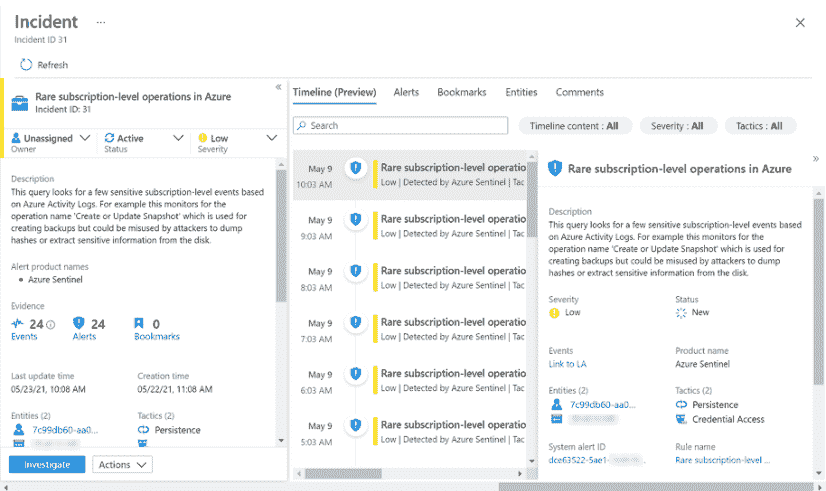

图 9.13 – 事件完整详细信息页

页面的左侧将显示我们在 事件详细信息窗格 部分中看到的相同信息。事实上，页面的左侧与事件详细信息窗格相同。页面的右侧分为选项卡，显示有关警报本身的的信息、此事件的任何书签、此事件的实体以及所有评论的列表。每个选项卡在以下各节中进一步详细描述。

## 警报选项卡

此选项卡将显示构成此事件的一个或多个警报。以下屏幕截图显示了它的外观，其后是字段的描述：

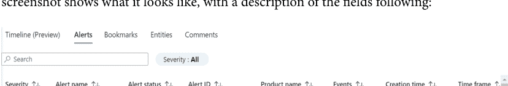

图 9.15 – 事件警报选项卡

首先是一条彩色条带。彩色条带表示警报的严重程度：红色表示高，橙色表示中，黄色表示低，灰色表示信息。

其余字段在下表中描述：

| 名称 | 描述 |
|---|---|
| 警报名称 | 生成此事件的警报的名称。 |
| 警报状态 | 警报的状态。 |
| 警报 ID | 警报的内部 ID。点击它将带你进入日志页面，在那里将自动生成并运行查询以向你显示有关此警报的更多信息。 |
| 产品名称 | 用于在警报规则中生成此事件的产品名称。 |
| 事件 | 分析规则在生成此警报时找到的事件数。点击该数字将带你进入日志页面，在那里将自动生成并运行查询以向你显示有关事件的更多信息。 |
| 创建时间 | 生成此事件的警报的创建时间。 |
| 时间范围 | 这将显示警报在生成此事件时查看的开始和结束日期。 |

表 9.3


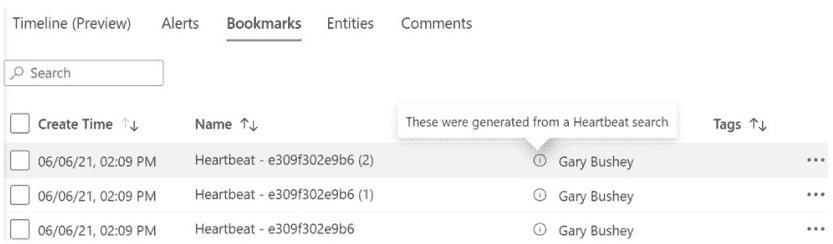

图 9.17 – 事件书签标签页

你可以使用搜索文本框搜索特定的书签。对于每个书签，将显示创建时间、名称、创建者以及标签字段。每条列表的最右侧是一个上下文菜单，其中唯一选项是“从事件中移除”。

请注意，在每行 Created By 条目右侧的信息图标。鼠标悬停在此图标上会显示该书签创建时关联的备注。如果没有备注，则不会显示此图标。

点击上下文菜单会自动选择该书签，点击“从事件中移除”条目会提示你确认是否确实要移除该书签。选择“是”将从此事件中移除该书签。请注意，如果你选择了多个书签，该条目将更改为“从事件中移除 X 个书签”，其中 X 为所选书签的数量。

## 实体标签页

此标签页将显示与此事件关联的所有实体，如以下屏幕截图所示。每个与事件关联的实体将有一行：

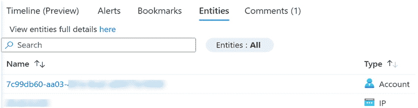

图 9.18 – 事件实体标签页

你可以使用 **Search** 文本框搜索特定实体。**Entities** 过滤器允许你选择一个或多个 **All**、**Account**、**Host**、**IP** 和/或 **URL**。默认情况下选择 **All**。

每个实体将列在单独的行中。实体的名称（也是其值）和类型将被显示。如果实体显示为 URL，你可以点击它以转到 **User Entity Behavior Analytics (UEBA)** 页面以获取有关此实体的更多信息。有关更多信息，请参阅 *第 10 章，配置和使用实体行为*。

实体是在开始调查时非常有用的信息片段。它们提供了分析规则公开的基本信息，让你可以看到事件涉及的内容。

## 评论标签页

此标签页将显示与事件关联的所有评论。请注意，链接还将显示评论总数——在本例中为 1。你也可以使用此页面添加新评论（如有需要）：

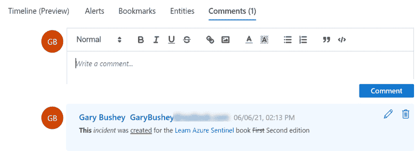

图 9.19 – 事件评论标签页

如前图所示，在创建评论时你可以使用一些有限的格式功能。已添加的评论使用了粗体、下划线和删除线文本修改，并添加了一个链接。

在执行调查时添加评论将有助于你记住自己在做什么。它也有助于可能稍后需要查看同一事件或调查类似事件的其他人员。接下来，我们将介绍如何进行事件调查。

标题栏提供了有关事件的一般信息，包括标题、严重程度、状态、所有者和最后更新时间。

屏幕右侧有两个按钮列。左侧列包含屏幕控制按钮。顶部按钮将图表适配到屏幕上。如果放大或缩小过度，这很有用。其下是放大按钮，底部是缩小按钮。如果你有鼠标中键，也可以使用鼠标中键进行缩放。页面最右侧是与事件本身相关的按钮，并在以下各节中详细介绍。

这是一个交互式 UI，因此你可以根据需要移动屏幕上显示的各种对象以及整个图像。这可以在放大时更轻松地查看你感兴趣的部分。

虽然能够以图形方式查看事件很好，但真正的益处在于查看相关警报以获得事件的整体视图。

## 显示相关警报

如果将鼠标悬停在实体上，将显示一个弹出窗口，其中包含更多选项。这会根据你选择的实体类型略有不同，但它们都会显示相关警报操作，如以下屏幕截图所示：

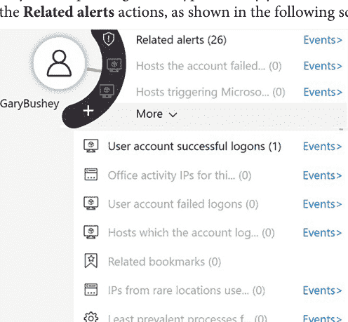

图 9.21 – 相关警报

选择此项将调出与该实体相关的所有警报。在以下屏幕截图中，显示了用户实体的相关警报：

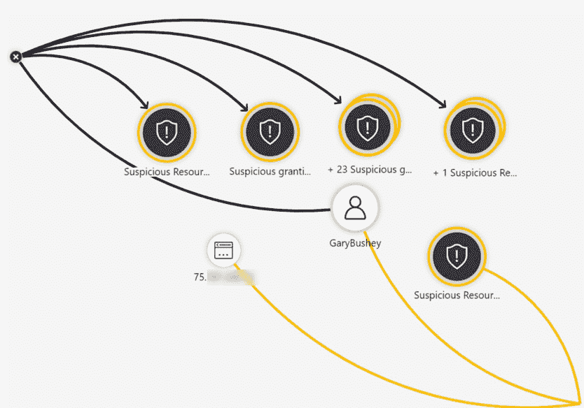

图 9.22 – 与所选用户实体相关的警报

这将帮助你确定与此实体相关的其他发生情况。通过查看与此用户相关的其他警报，在本例中，你可以看到他们还做了什么。我们可以看到用户实体也是其他警报中的实体，因此我们可以查看它们以获取更多信息。

虽然它被称为 **related entities**，由于你正在查看警报而不是实体，你可以执行我们刚刚讨论的操作。在以下屏幕截图中，**Suspicious granting of rights** 已展开。这显示警报使用与我们正在调查的事件相同的实体：

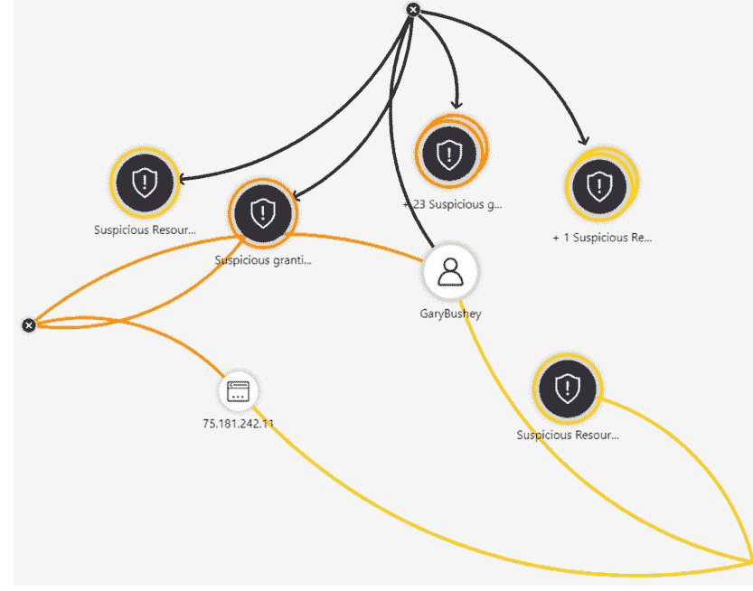

图 9.23 – 调查用户活动

当将鼠标移过实体时可用的其他操作，称为 **exploration queries**，其工作原理与 **Related alerts** 操作类似。回顾 *图 9.21*，你可以看到有名为 **User account successful logons** 等条目。在本例中，该条目有一个结果，由其名称后的 **(1)** 值表示，而所有其他条目在其名称后都有 **(0)**，表示查询未找到任何结果。如果其中任何条目有一个或多个结果，选择它以查看结果作为调查的一部分是值得的。

现在我们知道了如何查看事件、其相关事件以及其探索查询，让我们详细讨论屏幕最右侧的事件按钮。

## 时间线按钮

时间线按钮显示屏幕上显示的所有事件的时间线。如果此事件刚刚打开，则可能只显示一个事件，但如果你显示大量相关警报，则时间线将显示警报发生的时间历史，如以下屏幕截图所示：

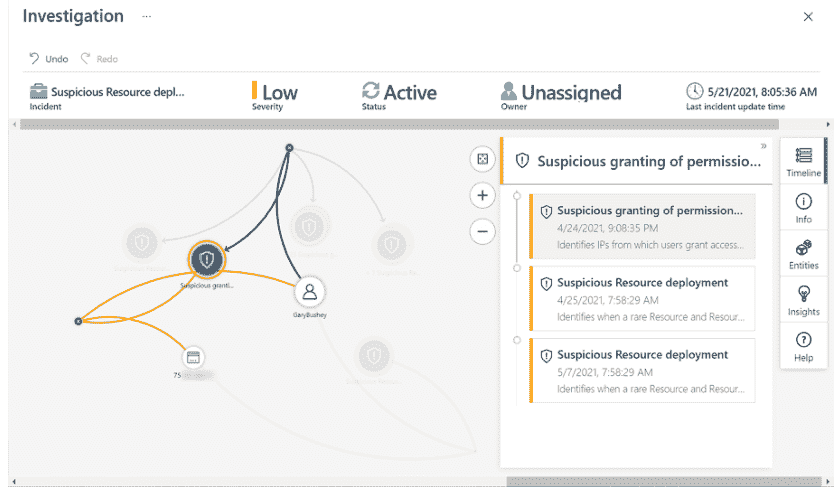

图 9.24 – 调查时间线

在前面的屏幕截图中，请注意时间线列表中已选择 Suspicious granting of permissions 事件。当你选择单个事件时，只有与该事件相关的实体会在视图中突出显示；其余将被灰显，如图所示。这使得很容易在时间线上推进并查看哪些实体与哪些事件相关。

## 信息按钮

**Info** 按钮将显示你所选实体的信息。对于 IP、主机和帐户，这将显示 **Address**、**Hostname** 或 **AccountName**，具体取决于你选择的的类型，如以下屏幕截图所示：

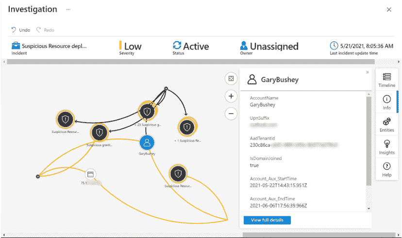

图 9.25 – 实体信息

请注意，刀片底部有 **View full details** 按钮。对于 IP 地址、主机和帐户条目，此按钮将显示。这会带你到 **Entity Behavior** 屏幕，在那里你可以获取有关所选实体的更多信息。有关更多信息，请参阅 *第 10 章，配置和使用实体行为*。

## 实体按钮

**Entities** 按钮将显示与屏幕上显示的所有信息相关的所有实体、警报和书签的列表。如果你刚开始调查此事件，则这很可能只是你的事件的信息。但是，如果你正在查看大量相关警报，这也将显示这些警报的所有信息：


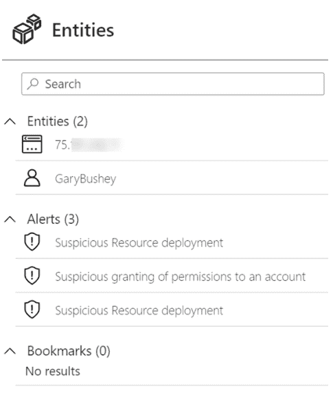

图9.26 – 相关实体列表

如果将鼠标悬停在列表中的任何项目上，界面会高亮显示与该项目相关的实体，就像时间线中的操作一样。

## 见解按钮

见解按钮会显示有关所选实体的一些额外信息（如果有）。这些信息会因所选实体类型而异，并将在第10章“配置和使用实体行为”中进一步介绍。

## 帮助按钮

帮助按钮显示此屏幕的常规帮助。此页面的主屏幕显示实体及其相互关系。这是一个完全交互式的屏幕，这意味着您可以移动对象以获得更好的视图，也可以放大和缩小。

以上介绍了如何在 Microsoft Sentinel 中开始对事件进行调查。进行调查还有更多内容，进一步阅读部分中的链接应该会有所帮助。

单击 **配置 UEBA** 按钮以激活和配置实体行为。执行此操作后，您将进入 **实体行为配置** 页面，如以下截图所示。首先，您必须启用实体行为：

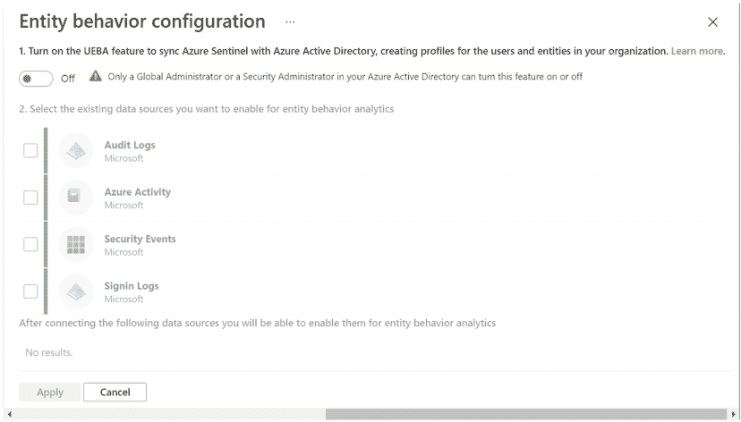

图10.2 – 实体行为配置

要启用实体行为，请将 *步骤1* 下的滑块移动到 **开启** 位置。完成此操作后，*步骤2* 下的数据源将被启用。

选择任何要与实体行为一起使用的数据源。建议您全部选择，以便获得最佳结果。

如果在 **连接以下数据源后，您将能够为实体行为分析启用它们** 部分下列出了某些数据源，这意味着数据连接器尚未启用以摄取该类型的数据。如果可能，请启用数据连接器，然后返回此屏幕选择这些数据源。

> **注意**
> 当您启用这些数据源时，它们可能会为您提供直接在 **数据连接器** 页面中为实体行为启用它们的选项。

选择所有数据源后，单击 **应用** 按钮开始在实体行为中使用这些数据源。

现在，您的数据已流入实体行为。接下来，我们将了解如何在调查中使用这些数据。

## 实体行为页面概述

有几种方法可以进入实体行为页面：

- 在事件的“查看完整详细信息”页面的“实体”选项卡中查看时
- 在事件图形调查屏幕上查看特定实体信息，然后单击“查看完整详细信息”按钮时
- 通过 Microsoft Sentinel 导航菜单选择“实体行为”链接

这三种方式的主要区别在于，前两种会直接将您带到实体的详细信息页面，而第三种会带您到实体行为的主屏幕，如以下截图所示。请注意，屏幕上的一些空白区域已被移除：

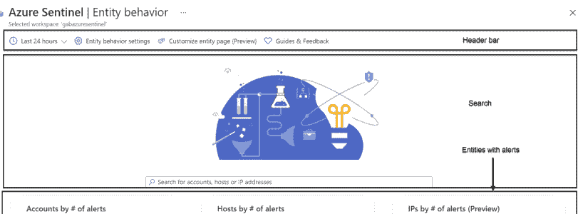

图10.3 – 实体行为主屏幕

> **注意**
> 在撰写本文时，只能在实体行为屏幕上查看“帐户”、“主机”和“IP 地址”实体类型。将来可能会添加其他类型。

让我们更详细地了解每个部分。

## 标题栏

标题栏位于页面顶部，包含有用的链接，例如查找数据的时间范围、配置实体行为、自定义实体页面以及提供反馈，如以下截图所示：

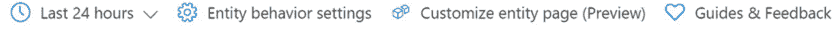

图10.4 – 实体行为标题栏

用于确定数据回溯时间范围的下拉框，您应该已经很熟悉了，因为它在 Microsoft Sentinel 中几乎随处可见。使用此下拉框来确定要查找的数据的时间范围，请记住，回溯得越远，数据显示所需的时间就越长。

“实体行为设置”链接将带您到一个页面，您可以在其中找到要摄取的数据源，如上一节所述。

“自定义实体页面（预览）”链接将带您到一个页面，您可以在其中添加针对实体运行的查询，以及查看开箱即用的查询。有关更多信息，请参阅本章的“创建实体行为查询”部分。

“指南和反馈”链接将打开一个新窗格，其中包含关于实体行为的更多信息，并允许您向 Microsoft 发送反馈。

## 搜索部分

搜索部分允许您搜索实体。这是您可以找到与事件无关的那些项目信息的地方。

如果您开始在搜索文本框中输入内容，下方会开始显示建议，如以下截图所示。您可以选择任何建议来查看相关信息。如您所见，在您搜索时，它会建议任何实体类型：


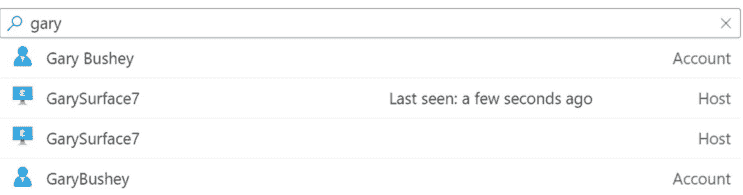

图10.5 – 实体行为搜索

单击列出的任何条目将带您到实体详细信息页面，该页面在本章的“实体行为详细信息页面概述”部分中进行了描述。

## 具有警报的实体

屏幕底部是拥有最多警报的实体。它显示每个实体有多少警报，如以下截图所示。您可以单击任何实体以转到该实体的详细信息页面：

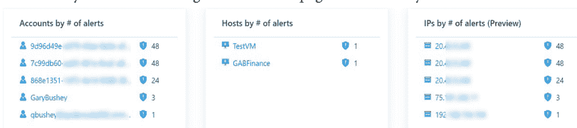

图10.6 – 具有警报的实体

如果实体类型是帐户，则会有来自 Azure Active Directory 的信息，包括其电子邮件地址和联系信息。IP 地址将显示信息，包括地理定位数据、日志活动以及此 IP 地址连接到了哪些主机。

无论显示的是哪种类型的实体，它们都会有一个“实体”链接，该链接直接提供到已选择该实体的此页面的链接，以及一个“调查”按钮，该按钮将带您进入用于事件的图形调查部分。但是，不是显示事件及其所有实体，而是显示实体及其所有警报：

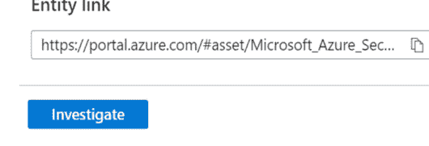

图10.8 – 实体链接和调查按钮

如您所见，此部分将提供大量关于实体身份的信息。使用此部分来确保您正在查看的实体是您想要调查的实体。如果您从任何事件屏幕进入，也可以使用它来确定您正在查看的是哪个实体。

## 值得注意的事件

此部分是实体信息的重要组成部分。它不仅会显示与此事件关联的警报，还会显示其他活动。如下一节“创建实体行为查询”中所述，您甚至可以添加自定义活动查询。

虽然显示的实际信息将取决于正在查看的实体类型，但信息的格式将是相同的。以下截图显示了此部分的详细视图：

## 概述

搜索

时间范围：6/12/2021, 4:33:49 PM - 6/13/2021, 4:33:49 PM

时间线内容：全部

警报：检测到异常活动

活动：显示计算机 IP

警报严重性：全部

桶大小：6

## 随时间变化的事件和警报

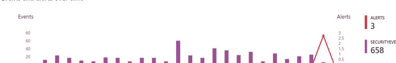

## 警报和活动时间线

检测到异常活动
由 Azure Sentinel 检测到 6/13/2021, 4:30:10 PM
检测到异常活动
相关事件：61

显示计算机 IP
6/13/2021, 12:34:04 PM
此计算机已出现在 Heartbeat 中，IP 地址为 75.181.242.11，来自美国

显示计算机 IP
6/13/2021, 8:34:01 AM
此计算机已出现在 Heartbeat 中，IP 地址为 75.181.242.11，来自美国

图10.9 – 值得注意的事件

如您所见，此部分分为三个主要子部分：搜索和筛选区域、随时间变化的事件和警报，以及警报和活动时间线子部分。每个子部分将在以下部分中更详细地描述。


## 搜索和筛选子部分

此区域允许你搜索特定的警报或操作。此外，你可以使用下表中描述的各类筛选器来筛选显示的信息：

| 筛选器名称 | 描述 |
|---|---|
| 时间范围 | 用于指定要使用的时间范围。单击它时，将显示一个弹出窗口，允许你选择要使用的时间范围。此处可以选择与主页面上选择的时间范围不同的范围。 |
| 时间线内容 | 用于选择要在时间线上显示的项目。选项包括安全警报、书签、活动和全选。 |
| 警报 | 选择此选项可以筛选要显示的警报。你可以选择单个警报名称进行显示，或选择“全选”以查看所有警报。请注意，如果此实体没有任何警报，则此筛选器将被禁用。 |
| 操作 | 选择此选项可以筛选要显示的操作。你可以选择单个操作名称进行显示，或选择“全选”以查看所有操作。请注意，如果此实体没有任何操作，则此筛选器将被禁用。 |
| 警报严重性 | 选择此选项可以筛选要显示的警报严重性。你可以选择单个严重性名称进行显示，或选择“全选”以查看所有严重性。请注意，如果此实体没有任何警报，则此筛选器将被禁用。 |
| 桶大小 | 选择此选项可以更改用于对活动进行分组的桶大小。这将决定各项内容如何分组。 |

表 10.1

现在我们来讨论其他子部分。

## 随时间变化的事件和警报子部分

此部分提供一个时间线，显示该实体在选定时间范围内于某些表上的活动量。其工作方式与 Microsoft Sentinel 概述页面上显示的“随时间变化的事件和警报”类似，但此处仅显示所选实体的信息。

实际显示的表将取决于正在查看的实体以及启用的数据连接器。

在“**实体行为**”主页面上单击“**自定义实体页面**”按钮，将转到“**实体设置**”页面，如以下屏幕截图所示：

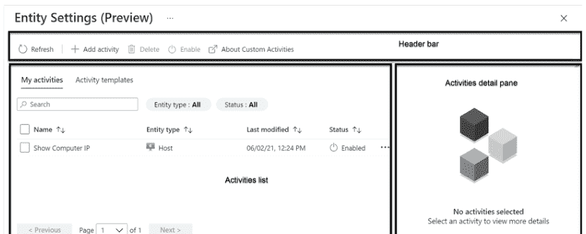

图 10.10 – 实体设置页面

该页面分为三个部分：标题栏、活动列表和活动详细信息窗格。以下各节将对每个部分进行描述。

## 标题栏

标题栏允许你刷新页面、添加新活动、删除活动、禁用/启用活动以及了解有关自定义活动的更多信息，如以下屏幕截图所示：


图 10.11 – 实体设置标题栏

“**刷新**”按钮允许你刷新页面。

“**添加活动**”按钮将启动新建活动向导。有关详细信息，请参阅“*添加新活动*”部分。

“**删除**”按钮将删除所选的一项或多项活动。如果未选择任何项目，此按钮将被禁用。

“**启用/禁用**”按钮将启用已禁用的活动或禁用已启用的活动。

“**关于自定义活动**”按钮将在浏览器中打开一个新选项卡，并显示一个页面，其中提供了有关如何添加自定义活动的更多信息。

## 活动详细信息窗格

此窗格将显示有关活动的信息，并允许你编辑自定义活动，或基于开箱即用的活动创建自定义活动。下面的屏幕截图显示了查看自定义活动（左侧）与开箱即用活动（右侧）时窗格的外观：

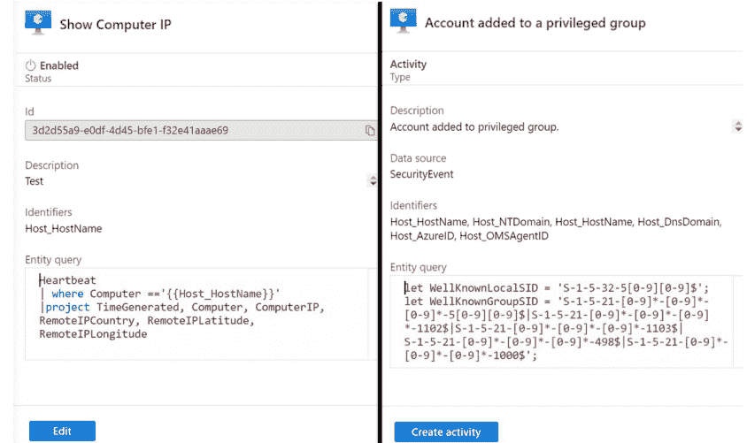

图 10.13 – 活动详细信息窗格

两者都显示许多相同的信息，包括名称、描述、标识符（稍后会详细介绍）以及正在使用的查询。但是，自定义活动还会显示 Id 属性，而开箱即用的活动则显示数据源属性。

你可以通过单击“编辑”按钮修改现有活动。如果你正在查看开箱即用的活动，可以单击“创建活动”按钮创建自定义活动，该按钮将启动“活动向导”窗口，并预填许多字段。有关详细信息，请参阅“添加新活动”部分。

在这里，你将看到“实体设置”页面的概览。它提供了大量信息，不仅涉及开箱即用的活动，还涉及你创建的活动。

接下来，我们来看看如何创建自定义活动。

这是向导的第一个选项卡。它提供了一些有关向导用途的基本信息。你还必须填写以下字段：

- “**名称**”字段用于输入自定义活动的名称。请确保名称具有足够的描述性，以便让人很好地了解此活动的作用。
- “**描述**”字段可以包含此活动的更详细描述。
- “**实体类型**”下拉列表列出了编写自定义活动时可以使用的所有不同实体。目前，只有“**账户**”和“**主机**”可用。
- “**按参数筛选**”下拉列表允许你通过附加参数筛选实体。可用的参数列表会根据所选实体类型而变化。如果选择了某个参数，则“**参数值**”下拉列表将激活，并列出可用选项。
- “**状态**”字段允许你选择操作是“**已启用**”还是“**已禁用**”。

填写完所有这些值后，单击“**下一步：活动配置**”按钮进入向导的下一页。

## 活动配置

此页面允许你输入活动的查询和其他信息，如以下屏幕截图所示：

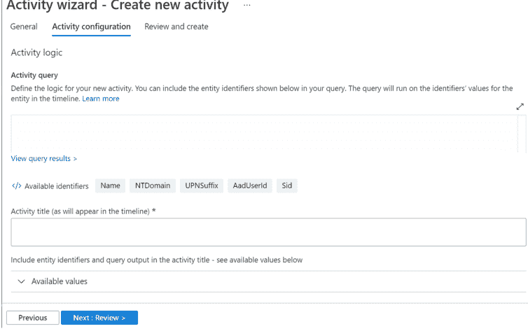

图 10.15 – 活动向导 – 活动配置选项卡

每个字段的描述如下。

“**活动查询**”是你为此活动输入 KQL 查询的位置。此文本框会提供有关你输入的 KQL 的信息，就像你在 Microsoft Sentinel 的“**日志**”页面中操作时一样。请注意文本框右上角有一个看起来像双向箭头的图标。单击该图标可以展开或收起此文本框，以便更轻松地查看所有代码。

你将使用传递给查询的变量来针对特定实体进行操作。例如，如果我要编写一个针对主机实体类型的操作，我可以这样编写我的查询：

```
Heartbeat
| where Computer == '{{Host_HostName}}'
```

这会调查 Heartbeat 表，并按当前主机实体进行筛选。请注意，该变量由 {{ 和 }} 包围。这用于指定变量的名称。你不限于只使用一个变量，在很多情况下，你的查询中会有许多不同的变量。

请注意，如果使用此查询，将显示一条错误消息和一条警告消息。错误消息会告诉你，只允许从查询中返回最多 10 列，因此你应使用 project 命令来筛选结果。

> **注意**
> 虽然错误消息会说只能返回 10 列，但 **TimeGenerated** 必须是其中之一，因此从技术上来说，只有九列可以选择返回。

警告会说明你选择的标识符很弱，应考虑使用其他标识符以确保结果的可靠性。如果你愿意，可以仅使用所选标识符来运行查询，但结果可能不准确。


如果在 **Activity query** 文本框下方，你会看到一行列出可用标识符的文本。根据你在上一屏幕中选择的实体类型，该列表会有所不同。

由于在本示例中选择了 Host 实体类型，可用值是 **Name**、**NTDomain**、**UPNSuffix**、**AadUserId** 和 **Sid**。点击其中任何一个条目都会将适当的代码添加到 **Activity query** 文本框中，从而使创建查询变得更加容易。

在 **Activity query** 文本框正下方是 **View query results** 链接。点击它会带你到 **Logs** 页面，查询已填入并自动运行。这对于测试查询很有用，但请记住变量不会被填充，因此按原样运行查询时不会返回数据。

**Activity title** 允许你输入要在时间线中显示的标题。此功能的一个优点是，你可以在标题中使用从查询中返回的变量。请记住，你最多只能返回 10 列（根据我们之前讨论的错误消息），因此在编写查询时要确定要在标题中使用的列。

在 **Activity title** 下方，可以展开或折叠，有一个名为 **Available values** 的子部分。点击它会显示你可以使用字段，如以下屏幕截图所示。这些字段将取自你输入的查询，因此实际条目会有所不同。还将提供其他变量，包括可在查询中使用的标识符、一些不同的时间字段以及结果数量的计数。你可以点击每个值右侧的 **Copy to clipboard** 图标（看起来像两张纸），然后将其粘贴到 **Activity title** 文本框中。当活动在时间线中显示时，变量的实际值将被填入：

在此选项卡上，所有你输入的值都将被审核，以确保没有错误。如果没有错误，你将看到如下屏幕。在这种情况下，一切都已正确输入，因此屏幕顶部的消息会通知你这一事实，并且 Create 按钮将被激活：

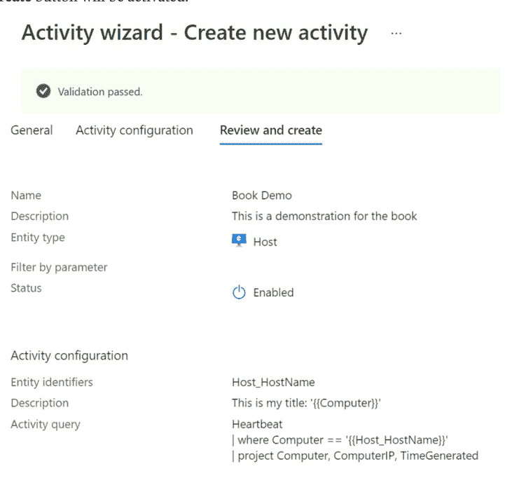

图 10.17 – Activity wizard – Review and create – good entries

如果有任何错误，屏幕顶部的消息将说明存在错误，并且 **Create** 按钮将被禁用。你需要返回并检查你的条目，看看错误可能发生在哪里。很可能是在查询本身，如以下屏幕截图所示。请注意，没有 `project` 命令来限制返回的列数：

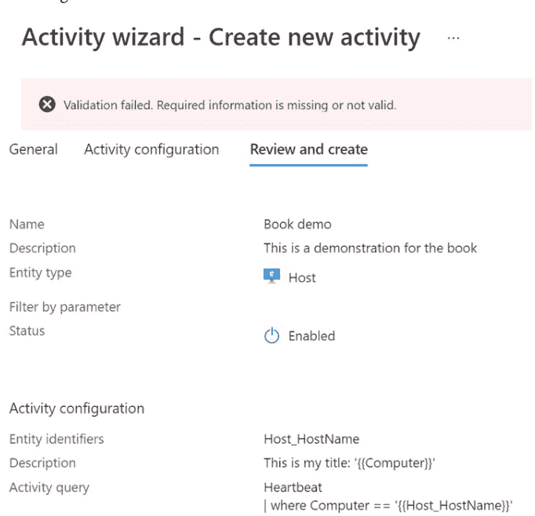

图 10.18 – Activity wizard – Review and create – bad entries

一切就绪后，点击 **Create** 按钮创建你的新活动。再次说明，从头创建新活动与从现有的开箱即用模板创建的区别仅在于，从模板创建时，字段会为你预先填好。

至此，你已了解有关 Microsoft Sentinel 的实体行为的所有内容以及如何使用它。这将使你未来的调查变得更加容易。

## Summary

在本章中，你学习了如何激活和配置 Microsoft Sentinel 的实体行为功能。你学习了在查看实体时查看信息的方法以及查找要查看实体的不同方式。你还学习了如何编写用于调查的活动。

通过你所学到的知识，你现在可以快速轻松地使用实体进行调查。你可以使用开箱即用的活动，以及你编写的活动，以获取有关实体的详细信息。

在下一章中，你将学习为使 Microsoft Sentinel 实例平稳运行而必须执行的运营任务。

## Questions

回答以下问题以测试你对本章的了解：

- 1. 在 Entity behavior 中可以查看哪三种类型的实体？
- 2. 实体的时间线中可以呈现哪三种类型的信息？
- 3. 如果我正在查看一个实体，并且只想查看其活动，我该怎么做？
- 4. 我可以通过哪两种方式创建自定义活动？
- 5. 可以用于创建自定义活动的两种实体类型是什么？

## Further reading

请参阅以下链接，了解本章所涵盖主题的更多信息：

- - Enable User and Entity Behavior Analytics (UEBA) in Microsoft Sentinel: https://docs.microsoft.com/en-us/azure/sentinel/identify-threats-with-entity-behavior-analytics
- - Microsoft Sentinel UEBA enrichments reference: https://docs.microsoft.com/en-us/azure/sentinel/ueba-enrichments
- - Customize activities on entity page timelines: https://docs.microsoft.com/en-us/azure/sentinel/customize-entity-activities
- - Microsoft Sentinel entity types reference: https://docs.microsoft.com/en-us/azure/sentinel/entities-reference

在本章中，我们将涵盖以下主题：

- - Introducing the Microsoft Sentinel Hunting page
- - Working with Microsoft Sentinel hunting queries
- - Working with livestream
- - Working with bookmarks
- - Using Microsoft Sentinel notebooks
- - Performing a hunt

## Introducing the Microsoft Sentinel Hunting page

要访问 Microsoft Sentinel | Hunting 页面，请在 Microsoft Sentinel 导航菜单中选择 Hunting 链接。这将显示 Microsoft Sentinel | Hunting 页面，其外观如下所示：

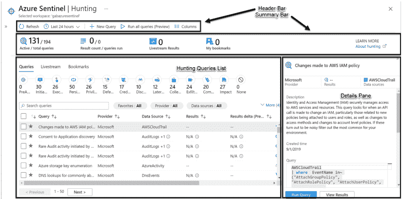

图 11.1 – Hunting page overview

这些部分将在以下各节中详细介绍。

## The header bar

页面的顶部是标题栏，其中有通常的 **Refresh** 按钮和时间跨度下拉菜单。还有一个 **New Query** 按钮，允许你创建新查询（请参阅 *Adding a new query* 部分了解更多信息）。标题栏如下图所示：

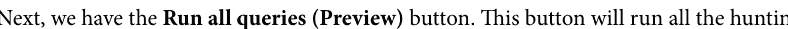

图 11.2 – Hunting page's header bar

接下来，我们有 **Run all queries (Preview)** 按钮。此按钮将在后台运行所有狩猎查询，然后用找到的结果数量更新狩猎查询列表部分。这比一个接一个地运行每个查询更容易。你也可以选择要运行的查询；在这种情况下，按钮将被重新标记为 **Run selected queries (Preview)**，并且只运行你选择的查询。

> **Important Note**
> 如果你读过本书的第一版，你可能会注意到这个按钮以前叫做 **Run all queries**。之所以现在称为预览功能，是因为在第一版发布和本版撰写之间，这个按钮被更改为仅运行页面上显示的查询，因此如果你想运行第 51 个查询，你必须转到下一页。由于客户需求强烈，最近已将其改回运行所有查询。你也可以只选择要运行的查询。

还有 **Columns** 按钮，允许你选择或取消选择要查看的列。请记住，根据你选择的列数，你可能需要向右滚动才能看到它们。

可用的选择如下：

| Name | Description |
|---|---|
| Favorites | 星形图标决定这是否是收藏，如果是，则会填满，否则只显示轮廓。收藏也会在查询列表中首先出现。 |
| Query | 这是查询的标题，而不是 KQL 查询。 |
| Provider | 这是提供查询的来源。这通常是 Microsoft 或 Custom Queries。 |
| Created By | 这是编写查询的人。它将包含创建自定义威胁狩猎查询的人员的名称（或电子邮件），如果是由 Microsoft 提供，则为空。 |
| Created Time | 查询创建的日期和时间。 |
| Entities | 这将显示查询将提供的实体。 |
| Data Source | 这将列出此查询所需的数据源。如果需要多个数据源，将列出第一个数据源，并附带一个数字，告诉你还有多少个其他数据源。你可以鼠标悬停在信息图标上，该图标看起来像一个圆圈中的 i，以查看其他数据源。 |
| Results | 如果查询尚未运行，这将显示两个破折号以表示该情况。如果已运行，它将显示返回的结果数量，或在由于缺少数据源而无法运行的情况下显示 N/A。 |
| Results delta (preview) | 这将显示查询当前运行结果与上次运行结果之间的差异。 |
| Tactics | 这将显示此查询使用的 MITRE ATT&CK® 战术。 |
| Techniques (preview) | 这将显示此查询使用的 MITRE 技术。请注意，这些只会显示在 Microsoft 提供的查询中，因为在创建自己的查询时无法选择这些。 |


标题栏显示启动查询所需的链接。它还可以通过显示或隐藏特定列来更改威胁搜寻屏幕显示的信息。

## 摘要栏

摘要栏显示处于活动状态的查询总数、可运行的查询数量、有结果的查询总数、已运行的查询总数、实时流结果的总数（有关更多信息，请参阅“使用实时流”部分）、您拥有的书签总数（有关更多信息，请参阅“使用书签”部分），以及最右侧的一个用于了解有关威胁搜寻的更多信息的链接，如下面的截图所示：

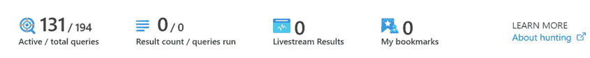

图 11.3 – 搜寻页面的摘要栏

您可能已经注意到，在上面的截图中，虽然总共有 194 个查询，但只有 131 个被列为活动状态。这是因为截图所在的 Microsoft Sentinel 环境并未包含运行这些查询所需的全部表。

## 搜寻查询列表

标题下方是所有搜寻查询的列表。列表顶部是 MITRE ATT&CK® 分解图。在 MITRE ATT&CK® 分解图中单击任意图标，将只显示与该特定攻击类型关联的查询。因此，如果您单击“初始访问”图标（看起来像显示器的第一个图标），则只会显示那些在“策略”字段中将“初始访问”作为其条目之一的搜寻查询。

摘要栏让您很好地了解搜寻查询的分布情况。这样可以更轻松地找到调查中所需的查询。

> **重要说明**
> 您可以访问 https://attack.mitre.org/tactics/enterprise/ 以了解有关 MITRE ATT&CK® 的更多信息。

其下方是搜索和筛选部分。它的工作方式与其他页面的搜索和筛选部分相同，因此此处不再赘述。如需复习其工作原理，请参阅第 9 章“事件管理”中的“搜索和筛选”部分。

每一行都会显示一个星形图标，表示它是否为收藏项。如果是收藏查询，星形图标将被选中；否则不会。将查询设为收藏的另一个好处是，每次访问“搜寻”页面时，收藏查询都会自动运行。

每一行还会列出查询的名称、来源、所需的第一个数据源（请注意，在下面的截图中，鼠标悬停在“更多信息”图标上以显示如果存在多个所需数据源时工具提示的外观）、查询获得的结果数、结果增量、为此查询选择的任何 MITRE ATT&CK® 策略，然后是 MITRE 技术，如下所示：

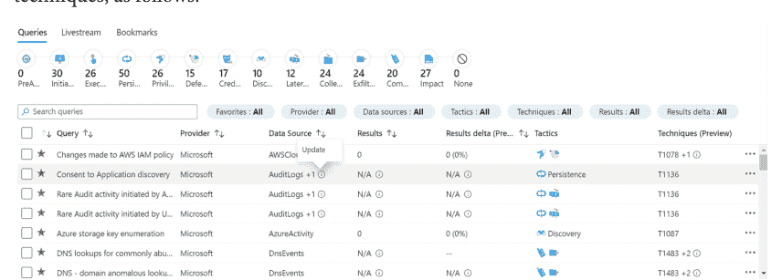

图 11.4 – 搜寻查询列表

您可以查看上方“标题栏”部分中的表格，了解可能显示的其他列及其用途。

最右侧是上下文相关菜单，您可以在此运行查询、在“收藏”列表中添加/移除查询、编辑查询（如果是您创建的）、克隆查询（以便编辑）、删除查询（同样，如果是您创建的）、将查询添加到实时流，以及从查询创建分析规则。有关更多信息，请参阅“使用 Microsoft Sentinel 搜寻查询”部分。

这涵盖了 Microsoft Sentinel | 搜寻页面的所有字段。如您所见，您可以从此处了解有关每个搜寻查询的很多信息。但是，还有更多与查询相关的信息，您将在下一节中读到。

## 搜寻查询详细信息窗格

当您从列表中选择任意查询时，搜寻查询详细信息窗格将打开该查询并显示有关它的更多信息。当然，显示的信息将取决于所选的查询。下面的截图中可以看到一个示例：

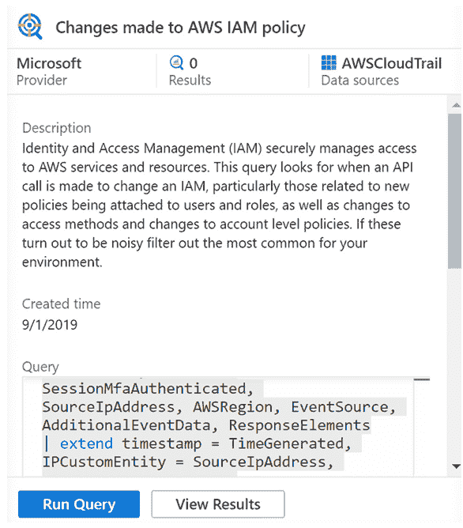

## 图 11.5 – 搜寻查询详细信息窗格

页面顶部是查询的标题。紧接着是查询编写者的名称。在本例中是 Microsoft，但如果是您创建的查询，则显示“自定义查询”。其旁边是此查询的结果数。其右侧是此查询使用的第一个数据源。如果此查询有多个数据源，则需要将鼠标悬停在“更多信息”图标上才能看到它们，如图 11.4 所示。其下方是查询的描述。这将为您提供有关查询如何工作及其所查找内容的信息。

在“描述”字段下方是“创建时间”字段，它会告诉您此查询的创建时间。对于 Microsoft Sentinel 随附的任何查询，此时间将是创建此 Microsoft Sentinel 实例的时间。

滚动后，您会发现更多字段，如上面的截图所示。其中有一个 **实体** 列表，将在运行此查询时填充。

> **重要说明**
> 如果没有实体，此部分将完全不会出现。

其下方是 **策略** 部分，该部分将提供与此查询关联的每个策略的更多详细信息，以及获取有关这些策略的更多信息的链接。如果没有策略，此部分将完全不会出现。

最后，还有一个与此查询关联的 **技术** 部分。单击其中一项技术将打开一个新页面，其中包含相关技术的描述。

在详细信息页面底部是 **运行查询** 和 **查看结果** 按钮。**运行查询** 按钮将在后台运行查询，并在 **搜寻查询列表** 部分中显示结果数。**查看结果** 按钮的工作方式与前面描述的 **查看查询结果** 链接相同。

现在您已经了解了 **搜寻** 页面的各个部分，接下来让我们看看可以运行哪些搜寻查询来开始调查。

## 使用 Microsoft Sentinel 搜寻查询

虽然已有大量查询，而且还在不断添加更多查询，但有时您可能需要添加自己的查询或修改现有查询，以更好地满足您的需求。

## 添加新查询

要添加新查询，请单击“搜寻”页面顶部的“新建查询”按钮。这将打开“创建自定义查询”页面，如下面的截图所示。这与第 7 章“创建分析规则”中讨论的创建新的计划查询非常相似，因此您可以阅读“使用向导创建新规则”部分作为复习：

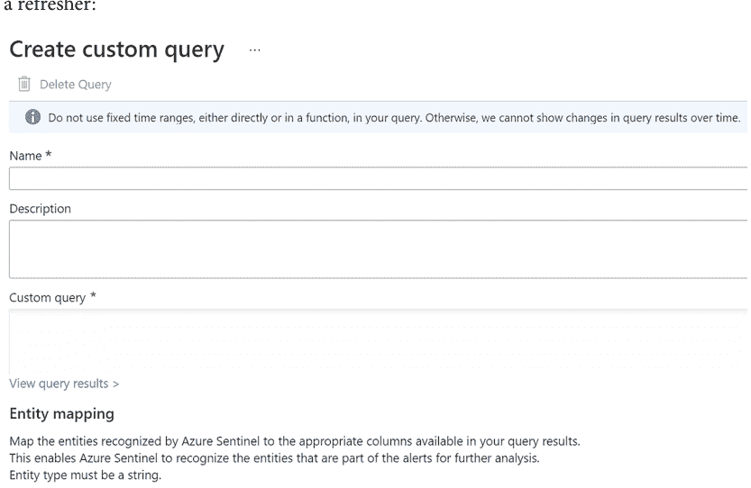

图 11.7 – 添加新查询

填写“名称”、“描述”和“自定义查询”字段。如果您的查询包含任何实体，请使用“实体映射”部分将实体映射添加到查询中。请记住要逐个添加。最后，选择此查询使用的一个或多个策略（截图中未显示）。

> 重要说明
> 在撰写本章时，还没有地方可以输入或选择 MITRE 技术。这些技术仅在开箱即用的搜寻查询中提供。

填写完所有信息后，单击“创建”按钮以创建新查询。

既然您已添加了新查询，如果需要对其进行更改该怎么办？下一节将讨论编辑查询，并回答这个问题。

## 编辑查询

如果查询的运行方式不太符合您的预期，或者您想更新有关查询的信息，可以编辑它以进行必要的更改。

要编辑查询，请在查询列表中查询名称右侧的上下文相关菜单（由行最右侧的三个点表示）上单击，然后选择“编辑查询”，如下面的截图所示：

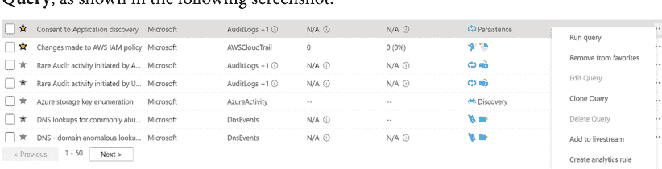

这将打开与之前讨论添加查询时图 11.7 中显示的页面相同的页面。进行必要的更改，然后单击“保存”以保存更改。

您随时可以单击窗口右上角的 X 来关闭窗口而不保存任何更改。如果您进行了任何更改，系统将提示您确认是否要在不保存更改的情况下关闭窗口。

现在您知道了如何按需更改查询。如果您想创建一个新查询并更改这个新查询，该怎么办？您可以克隆查询，如下一节所述。

## 克隆查询

您可能已经注意到，您无法编辑已有的查询。如果需要修改已有查询，您需要先克隆它来创建自定义查询，然后再更改这个新的自定义查询。

要克隆查询，请按上一节所示单击上下文相关菜单，然后单击“克隆查询”。这将打开与添加新查询时相同的窗口，并且除了“名称”字段外，所有字段都将填充与原始查询相同的信息。


回顾图 11.8，上下文菜单中的最后一项称为 Add to livestream。选择它会将查询添加到 Livestream 窗口，如下所示：

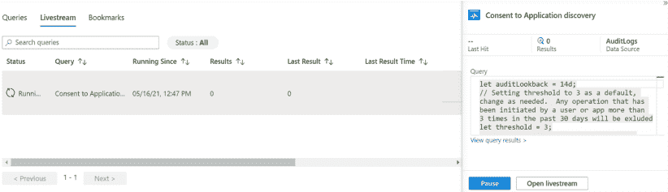

图 11.9 – 将查询添加到 Livestream

对于每个已添加的实时流，你可以看到其状态、查询名称、运行时间、找到的结果数量、最后一个结果、最后一个结果发生的时间，以及一条显示结果随时间线找到数量的微型折线图（未显示）。

点击每个实时流会显示详细信息窗格，其中包含有关查询的信息，包括完整的 KQL 代码，以及查看查询结果的能力，就像你从 Queries 选项卡运行它一样。此窗格底部是 Pause 按钮，可暂停正在运行的实时流，或在已暂停时播放实时流，以及 Open livestream 按钮。

点击 Open livestream 按钮会打开 Livestream 窗口。在这里，你可以启动或停止查询，将其提升为警报规则，修改查询，并查看结果，如以下屏幕截图所示：

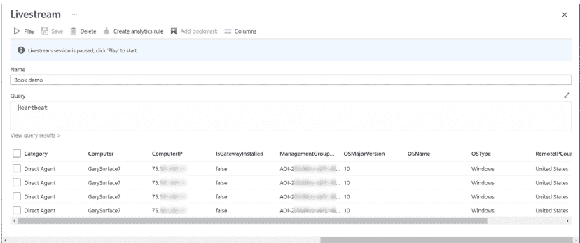

图 11.10 – Livestream 页面

屏幕顶部是标题栏，在此执行针对实时流的操作。你可以播放或暂停实时流，保存实时流，删除它，从实时流创建分析，将任何选定的结果保存为书签，并显示或隐藏查询返回的列。

屏幕底部是查询开始运行以来添加的所有结果。显示的列将取决于正在运行的查询。

将查询添加到 **Livestream** 并启用它会导致该查询每分钟运行一次。如果查询运行且显示递增，则意味着存在潜在威胁处于活动状态。此外，你可以离开 **Livestream** 选项卡，它仍会继续运行。当 **Livestream** 会话期间有新的工件递增时，你将通过 Azure 控制台通知系统收到通知。你还可以选择结果的各个行并将它们添加为书签，这将在下一节中描述。

将查询添加到 **Livestream** 可以成为一个非常有用的工具，用于几乎实时地观察环境中正在发生的事情。通过监视一个或多个查询，你将看到结果在发生时出现。

在下一节中，我们将讨论书签，它允许你保存查询结果并将其与事件关联，以进一步协助你的调查。

## Working with bookmarks

在进行调查时，可能需要跟踪之前运行查询的结果。也许你需要处理另一个项目并稍后返回此调查，或者另一位用户将接管调查。你可能还需要将某些结果保留为事件的证据。无论如何，使用书签将允许你将此信息保存以供以后使用。

### Creating a bookmark

要创建新的书签，你必须从 Logs 页面运行查询 – 参阅第 6 章 Microsoft Sentinel Logs and Writing Queries，或，正如我们刚才看到的那样，从实时流的结果中运行。在 Hunting 页面上，点击查询详细信息窗格中的 Viewing Results 按钮将打开 Logs 页面，显示你的结果，如下所示：

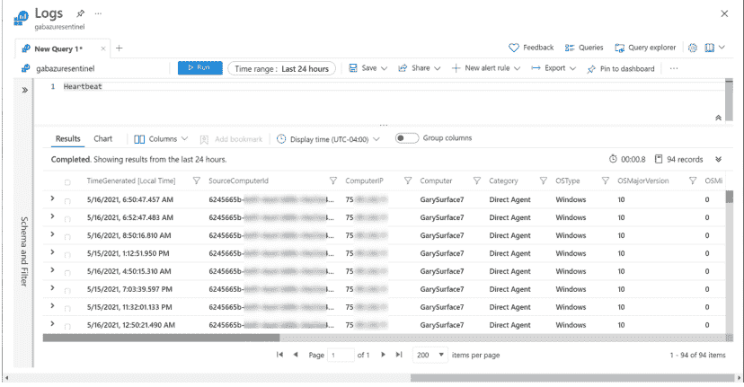

图 11.11 – 查看查询结果

你可能已经注意到每个结果左侧都有复选框。要创建新的书签，请选择一个或多个复选框。当至少选择了一个复选框时，结果的标题栏中的 Add bookmark 链接将被启用。

当你点击 **Add bookmark** 时，将打开一个新的刀片，如以下屏幕截图所示（如果选择一个复选框而不是多个复选框，刀片的实际标题会有所不同）：

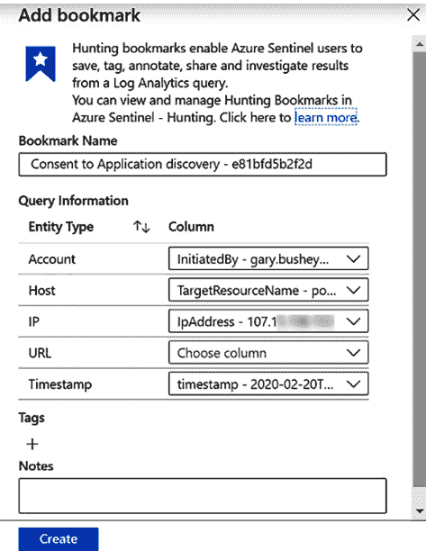

图 11.12 – 添加书签刀片

**Bookmark Name** 将用查询的名称填充，后跟一个随机的 12 位十六进制数字，以便如果你从同一查询创建多个书签，它们每个都有唯一的名称。下方是所有可用实体的列表。如果查询与任何实体相关联，它们将被填入。当然，你可以手动填写任何实体。

添加所需的任何 **Tags** 和 **Notes**。添加 **Notes** 时，请确保它们提供足够的信息，以便当你或他人返回此书签时，很容易理解发生了什么。输入任何在需要时用于过滤查找各种书签的有用的 **Tags**。

当所有字段都已填写后，点击 **Create** 创建书签。

### Important Note

如果你在创建书签时选择多个复选框，第一个创建的书签将遵循前面所述的命名约定。对于其余的，每个选定的结果将创建一个新的书签，并且 **Name** 将附加 (x)，其中 x 是书签的副本编号。例如，如果选择了四个复选框并且书签名称设置为 Test Bookmark - 123456789012，则第一个书签将具有该名称；第二个将命名为 Test Bookmark - 123456789012 (1)，第三个将命名为 Test Bookmark - 123456789012 (2)，第四个将命名为 Test Bookmark-123456789012 (3)。这样，你可以轻松地分辨出哪些书签是同时创建的。

在执行查询时添加书签非常容易。在下一节中，我们将讨论如何使用它们。

### Viewing bookmarks

如果返回到 **Hunting** 主页面，你会看到在所有查询列表上方有一个 **Bookmarks** 选项卡。点击它将更改页面以显示 **Bookmarks** 选项卡，如以下屏幕截图所示：

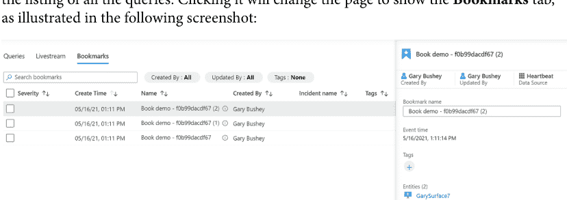

图 11.13 – Bookmarks 选项卡

当选择一个书签时，详细信息窗格将在右侧打开，显示有关书签的更多信息，如以下屏幕截图所示：

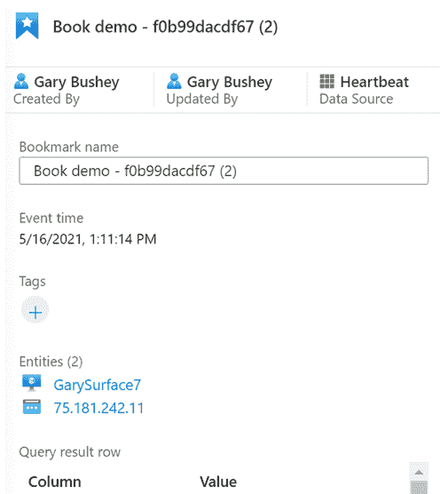

图 11.14 – 书签详细信息窗格

页面顶部是书签的名称，其下是创建者、最后更新者和查询创建书签时使用的数据源，或如果有多个数据源则为第一个数据源。

下方是另一个包含书签名称的字段。此字段可编辑，因此如果你想更改书签的名称，可以在此处进行更改。一旦离开该字段，新更改将自动应用，或按 Enter 键保存数据而不离开该字段。

其下是结果创建的时间、与书签关联的任何标签，以及与此书签关联的实体。你可以点击主机、IP 或帐户实体以获取有关它们的更多信息。有关更多信息，请参阅第 10 章 Configuring and Using Entity Behavior。

**Important Note**
你可能会看到一条消息，说明 **Investigation cannot be used to investigate this bookmark because some of the data related to this bookmark is no longer stored.** 如果存储在书签中的结果由于你的数据保留策略而被删除，则可能发生这种情况。有关设置数据保留策略的信息，请参阅 *第 2 章 Azure Monitor – Introduction to Log Analytics*。

屏幕底部是 **Investigate** 按钮，只有当至少有一个实体具有值时才会被启用。点击该按钮将打开调查屏幕，该屏幕已在 *第 9 章 Incident Management* 中详细描述。

**Investigate** 屏幕有一个更改；由于你正在处理书签而不是事件，主图标将如下所示：

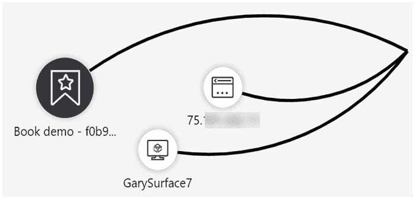

图 11.16 – 书签调查

你现在知道如何查看已创建的书签。你可以获取有关它们的更多详细信息，并了解如何使用 **Investigate** 按钮查看信息。接下来，我们将学习如何将书签与事件关联。


现在，我们来详细了解上下文菜单下的各个字段：

- 如果选择**新建事件**，将打开新建事件边窗，如下所示。
- 这将允许你基于所选书签创建新事件：

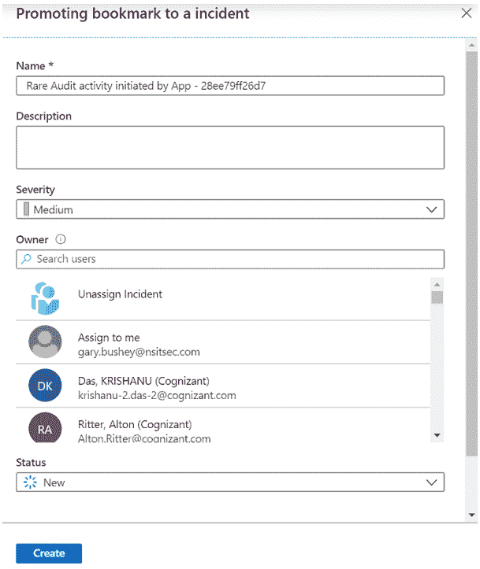

图 11.18 – 从书签创建事件

这些字段与任何其他事件相同，因此此处不再赘述。有关事件的更多信息，请参阅第 9 章“事件管理”。单击“创建”即可从该书签创建新事件。

- 单击**添加到现有事件**将打开一个新的边窗，你可以从中选择一个或多个事件来关联此书签，如下面的屏幕截图所示。选择要与此书签关联的事件，然后单击“添加”：

## 使用 Microsoft Sentinel 笔记本

有时，仅使用 KQL 查询日志不足以帮助正确执行搜寻活动。在这种情况下，你可以使用托管在 Microsoft Azure 机器学习 (AML) 服务中的 Jupyter notebook 来执行其他工作。Jupyter Notebook 将文本与代码相结合，以提供威胁搜寻活动的整体视图。代码可以用 Python、PowerShell 和其他语言编写，因此威胁搜寻者可以使用他们很可能已经熟悉的语言进行工作。

> **重要说明**
> Jupyter Notebook 的全部功能不在本书的讨论范围之内。有关详细信息，请访问 https://jupyter.org/。

单击 Microsoft Sentinel 导航区域中的“笔记本”，进入“笔记本”页面，该页面如下图所示：

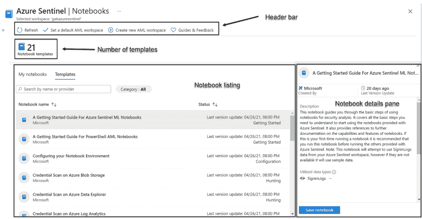

图 11.20 – 笔记本页面概览

本页中的每个区域将在以下各节中更详细地介绍。

## 标题栏

标题栏允许你使用笔记本，如下面的屏幕截图所示：

对于每个笔记本，会显示笔记本名称，其下方是创建公司。右侧会显示上次更新时间，其下方是笔记本类型。目前类型有四种不同选项：入门、配置、搜寻和调查。以后可能会添加更多类型。

## 笔记本详细信息窗格

选择笔记本将显示笔记本详细信息边窗，如下面的屏幕截图所示。页面顶部会显示笔记本名称，其下方是创建者的名称和最后更新时间。

其下方是笔记本的说明，它会告诉你笔记本要查找什么。再往下是“所需数据类型”字段，它指的是笔记本将查询的 Microsoft Sentinel 日志。再往下是用于填充数据类型的数据源列表（未显示），最后是与笔记本相关的一幅或多幅图像：

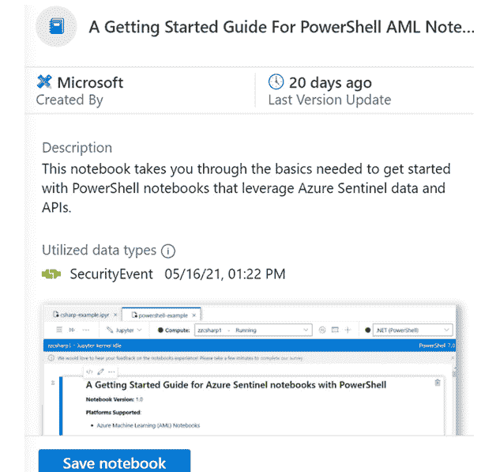

图 11.23 – 笔记本详细信息窗格

此边窗底部是**保存笔记本**按钮。该按钮用于保存所选笔记本。如果你已经保存过此模板，则可以选择覆盖现有笔记本。如果你不选择覆盖现有笔记本，并且已存在一个笔记本，则不会发生任何操作。

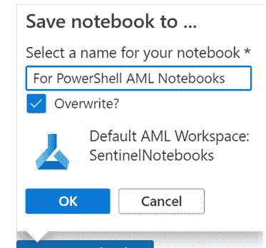

图 11.24 – 保存笔记本模板

单击**保存笔记本**按钮后，除非你取消该操作，否则按钮将变为**启动笔记本**。如果此时单击该按钮，笔记本将在 AML 工作区中打开。如果你选择另一个笔记本，然后返回此笔记本，按钮将恢复为**保存笔记本**。

> **重要说明**
> 
> 如果你尚未创建 Azure 机器学习工作区，当你尝试保存笔记本时，系统将显示一条消息，提示你需要先创建工作区。有关详细信息，请参阅后面的*创建工作区*一节。

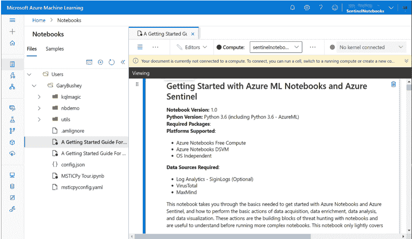

图 11.26 – Microsoft Azure 机器学习页面

在此处，你可以选择笔记本并开始使用。笔记本的实际用法不在本书的讨论范围之内。

Azure 笔记本允许你在 Microsoft Sentinel 外部执行查询。它们可以包含文本和代码，也可以包含 Microsoft Sentinel 内部和外部的数据。它们还可以利用 Microsoft Sentinel 不可用的图形包来创建在 Microsoft Sentinel 中无法创建的图表。

接下来，我们将介绍如何执行威胁搜寻的机制。本节将重点介绍你将执行的任务，而不是如何在 Microsoft Sentinel 中执行这些任务。

如前面的图所示，执行调查涉及多个步骤。下面将更详细地介绍每个步骤。

## 制定前提

在此步骤中，你需要确定你试图发现或证明什么。你想找出什么？是确定你的环境中是否发现恶意 IP 地址？新用户账户是否执行了其不应执行的操作？是否有外部实体的人试图访问你的系统？

在制定前提时，你是在明确你要查找的内容。可能是有人告诉你你要找什么，也可能你是在寻找你认为可能已经发生的事情。利用威胁情报源等工具作为前提，开始你的威胁搜寻。

请记住，威胁搜寻是一种弥补空白的措施，用于在分析规则可用之前确保覆盖新报告的威胁。

## 确定数据

在此步骤中，你将确定开始调查所需的数据。你需要查看哪些数据来验证你的假设？这些数据全部在 Log Analytics 中，还是会在其他地方找到？你已经了解环境中的哪些情况，还需要了解什么？

在调查过程中，你可能会确定需要其他信息，因此不要觉得你只能使用此步骤中获取的数据。

你还可能会发现，你没有处理前提所需的所有数据。也许你需要的数据没有被记录下来，在这种情况下，你需要看看是否可以开始收集这些信息。无论如何，如果你无法获得所需的数据，你可能需要返回并修改你的前提。

一旦你开始在拥有的各种日志中发现特定类型的活动，就有必要记录这些活动，以便将来更容易找到数据。下面的屏幕截图展示了一种跟踪信息的方法的开头：使用 Microsoft Excel 来跟踪日志名称、所查询的数据类型以及日志中是否找到该数据。如果找到该数据，则输入保存该数据的列的名称：

## 执行调查

在此步骤中，你将执行上一步中获得的查询，无论这些查询是你自己编写的，还是你找到的现成可用的查询。你可以在 Microsoft Sentinel 中执行查询，也可以在笔记本中执行查询，或者两者均可。

无论你在何处运行查询，一旦开始查看结果，你可能会发现需要修改前提，或者确定需要更多数据，因此你可能需要返回到前面的某个步骤（请参阅图 10.24）。

## 响应

既然你已经掌握了所需的信息，就可以对调查结果做出响应。你可能只需弥补你发现的安全漏洞，也可能需要上报给另一个团队并展示你的发现。受众可能只是你的团队，而在发生重大违规事件时，可能是首席信息安全官 (CISO)、首席信息官 (CIO)，甚至董事会。

如果响应很简单，例如在防火墙中阻止某个端口或阻止某个 IP 地址范围，那么很可能只需要通知相关人员、更新工单，然后继续前进即可。

然而，很可能在某些情况下，你需要对你的发现做完整的演示。听众可能只是你的团队，但也可能是其他受众。演示的方式取决于你的公司及其企业文化；在工作中要时刻思考“这些信息在演示中是否有用？”，并考虑你会如何呈现它。向团队演示时，信息表格可能就足够了，但其他不熟悉数据的人可能需要图形和图表。

至少，如果这是新信息，你应该在团队内展示你的发现以及你是如何得到这些结果的，以便每个人都了解最新发现并采取最适当的行动。

## 监控

如果可能，请开发新的分析查询；否则，继续定期运行调查以验证发现。有关创建分析查询的复习，请参阅第 7 章“创建分析规则”。


在本步骤中，你将确定如何执行持续监控，以帮助防范你正在调查的情况，或提高下次再次调查的能力。你能否在日志中添加更多信息？是否可以对操作流程进行更改，以帮助避免未来出现这种情况？是否可以对网络进行更改？

最好的结果之一是创建分析查询，以便可以自动发现这种情况，并可能通过剧本进行处理。有关创建剧本的更多信息，请参阅第 12 章《创建剧本和自动化》。

## 改进

根据调查中获得的任何经验教训，在可能的情况下改进调查代码和技术。

在本步骤中，你——以及很可能还有其他人——将努力确定如何改进本次狩猎中使用的查询，以及如何避免未来再次需要进行此项狩猎。可能你的查询可以重写以提高效率，可以对操作流程进行更改以完全避免这种情况，或者可以根据团队、合作伙伴和领域专家技能和经验提出其他建议。

这些是可以采取的步骤来开始你的威胁狩猎调查。再次强调，这些都不是一成不变的，这些步骤仅供指导。你可能会发现你的公司有自己的步骤，或者你想要添加自己的步骤。真正的收获是，你应该有一个可重复的过程，并且不断改进，使你能够至少与同事分享你的结果，如果可以的话，还能与更广泛的威胁狩猎社区分享。

## 总结

现在，你已经了解了如何在 Microsoft Sentinel 中开始进行威胁狩猎。你了解了狩猎页面、带有 Jupyter 笔记本的笔记本页面，并对如何执行威胁狩猎调查进行了简要介绍。

我们查看了 Microsoft Sentinel 提供的用于协助威胁狩猎的工具。这包括仅定期运行的查询，要么是因为需要查找特定信息，要么是因为它们返回的结果太多，在定期运行的基础上没有用处。

- *Create and manage Azure Machine Learning workspaces* (https://docs.microsoft.com/en-us/azure/machine-learning/how-to-manage-workspace?tabs=azure-portal#create-a-workspace)
- *Azure Machine Learning documentation* (https://docs.microsoft.com/en-us/azure/machine-learning/)
- *Microsoft Sentinel Notebook Ninja series* (https://techcommunity.microsoft.com/t5/azure-sentinel/becoming-an-azure-sentinel-notebooks-ninja-the-series/ba-p/2693491)
