# 第 12 章 创建剧本

## 创建剧本
和自动化

在前几章中，你了解了 Microsoft Sentinel 的 **Security Information and Event Management (SIEM)** 方面。现在，是时候了解其 **Security Orchestration, Automation, and Response (SOAR)** 能力了。

Microsoft Sentinel 的 SOAR 功能允许针对警报和事件创建自动或半自动响应。这使你能够开发可以执行诸如阻止 IP 地址通过防火墙、阻止可疑用户名，或发送电子邮件给安全团队通知生成了新的高严重性警报等简单任务的工作流。当你将 Microsoft Sentinel 提供的自动化功能与部署的众多其他安全产品的保护功能相结合时，一切皆有可能！

在本章中，你将了解 Microsoft Sentinel 剧本，包括如何编写和编辑它们、配置其工作流以及管理它们。你还将了解 Microsoft Sentinel 的 Automation 功能，该功能允许你在不使用剧本的情况下执行某些操作。

在本章结束时，我们将逐步介绍创建简单剧本的过程。到本章结束时，你应该能够舒适地编写剧本。

本章将涵盖以下主题：

- Microsoft Sentinel 剧本简介
- Microsoft Sentinel Automation 简介
- 添加新的 Automation 规则
- 剧本定价
- 剧本类型
- Microsoft Sentinel 连接器概述
- 探索剧本选项卡
- Logic Apps 设置页面
- 创建新的剧本
- 使用 Logic Apps Designer 页面
- 创建简单的 Microsoft Sentinel 剧本

## 介绍 Microsoft Sentinel 剧本

Microsoft Sentinel 使用 Azure Logic Apps 进行工作流自动化。Microsoft Sentinel 剧本是一个使用 Microsoft Sentinel 连接器触发工作流的逻辑应用。随着我们阅读本章，我们将看到的许多屏幕截图将是逻辑应用页面，这强化了这一概念。Logic Apps 的全部使用方法超出了本书的范围，因此我们将只介绍 Microsoft Sentinel 连接器，其中包含用于 Microsoft Sentinel 的逻辑应用触发器和操作。

> Note
> 在本章中，术语剧本和逻辑应用将互换使用。
> 有关 Azure Logic Apps 的更多信息，请访问 https://azure.microsoft.com/en-us/services/logic-apps/。

逻辑应用使用连接器（不要与 Microsoft Sentinel 数据连接器混淆）和操作来执行工作流的活动。逻辑应用连接器提供对事件和数据的访问。操作将执行特定任务，例如发送电子邮件、在 Microsoft Teams 上发布消息、提取 JavaScript Object Notation (JSON) 对象等等。

通过使用 Azure Logic Apps 作为后端技术，Microsoft Sentinel 剧本已经拥有丰富的连接器和操作生态系统，可以调用以执行其活动。让我们看一下其中一种使用方式。

## 介绍 Microsoft Sentinel Automation

当 Microsoft Sentinel 首次发布时，每个剧本都必须单独分配给每个分析规则，并且所有操作都需要使用剧本。Microsoft Sentinel Automation 被引入以使使用剧本变得更加容易，同时允许用户在无需编写剧本的情况下执行操作，包括更改事件的严重性。

> Note
> 当本章撰写时，Automation 功能处于预览状态，因此某些功能可能已更改。

让我们先来看一下 Automation 页面。要访问此页面，请从 Microsoft Sentinel 导航窗格中选择 Automation 导航菜单项。Automation 屏幕将显示，如以下屏幕截图所示：

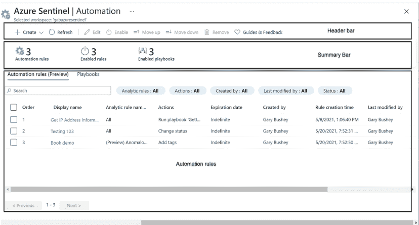

图 12.1 – Microsoft Sentinel Automation 主屏幕

我们将在以下各节中查看此页面的每个部分。

## 标题栏

标题栏，如以下屏幕截图所示，包含各种按钮：

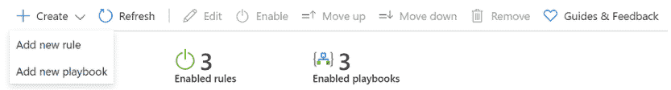

图 12.2 – Microsoft Sentinel Automation 页面标题栏

让我们详细讨论每个字段：

- **+Create** 按钮允许你添加新的自动化规则（称为 **Add new rule**）或新的剧本（在 *Adding a new playbook* 部分中描述）。
- **Refresh** 按钮将刷新显示。
- **Edit** 按钮将允许你编辑现有的自动化规则。请注意，必须先选择单个自动化规则，然后才能启用此功能。
- **Enable** 和 **Disable** 按钮仅在选择一个或多个规则时可用，将启用已禁用的规则或禁用已启用的规则。
- **Move up** 和 **Move Down** 按钮仅在选择一个或多个规则时可用，将使自动化规则在运行顺序中上移或下移。有关更多详细信息，请参阅本章的 *Adding a new automation rule* 部分。
- **Remove** 按钮将删除所选的自动化规则。
- **Guides & Feedback** 按钮将打开一个新窗格，并为你提供有关 Microsoft Sentinel Automation 的更多信息，以及允许你向 Microsoft 提供反馈。

标题栏可用于创建新的自动化规则和剧本，以及更改顺序、状态，并为你提供有关如何使用自动化规则的更多文档。

## 摘要栏

标题下方是状态栏，如以下屏幕截图所示：

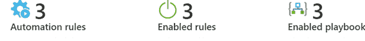

图 12.3 – Microsoft Sentinel 自动化页面摘要栏

此处呈现的所有信息显示可用的自动化规则和 playbook 数量：

- 左侧是自动化规则数量。这显示了自动化规则的总数量，以及它们是否已启用。
- 其右侧是已启用的规则，即已启用的自动化规则总数。
- 之后是已启用的 playbook，显示可在自动化规则中使用的 playbook 数量。

让我们来看一下自动化规则列表。

## 自动化规则列表

摘要栏下方是所有自动化规则的列表，如以下屏幕截图所示。请注意，有一个 Automation rules（预览）选项卡和一个 Playbooks 选项卡。Playbooks 部分将在本章后面的 Exploring the Playbooks tab 部分中介绍：

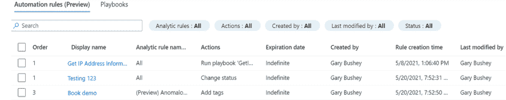

图 12.4 – 自动化规则列表

对于列出的每个自动化规则，都有一个选择复选框，后跟以下字段：

| 字段名称 | 描述 |
|---|---|
| Order | 这是自动化规则运行的顺序。如果与某个分析规则关联的自动化规则不止一个，则编号最低的规则会先运行。 |
| Display Name | 规则的名称。单击规则即可编辑它。 |
| Analytic rule names | 如果此规则要应用于每个分析规则，则会显示 All，或列出此规则将应用于的各个分析规则。 |
| Actions | 显示此规则激活时将运行的操作。 |
| Expiration Date | 显示此规则到期的日期。如果显示 **Indefinite**，则规则不会过期。 |
| Created by | 创建规则的人员姓名。 |
| Rule creation time | 规则的创建日期和时间。 |
| Last modified by | 最后修改此规则的人员姓名。 |
| Rule last modified | 规则最后修改的日期和时间（未在前面的屏幕截图中显示）。 |
| Status | 显示规则的状态，为 **Enabled** 或 **Disabled**（未在前面的屏幕截图中显示）。 |

表 12.1

现在，我们将学习如何创建这些规则。

## 添加新的自动化规则

如前所述，要创建新的自动化规则，请单击标题中的 +Create 按钮并选择 **Add new rule**。

这将打开 **Create new automation rule** 面板，如以下屏幕截图所示：

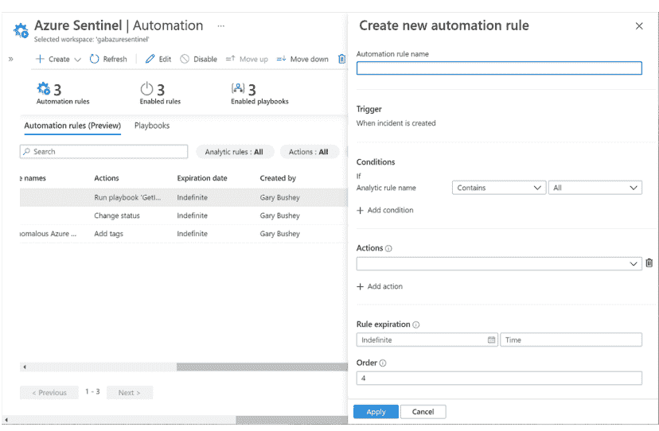

图 12.5 – 创建新的自动化规则

在 **Automation rule name** 文本框中输入规则的名称。您希望此规则的名称足够描述性，以便有人通过阅读标题就能理解它将做什么。例如，`Get IP Address information` 告诉用户规则将获取一些 IP 地址信息，而 `Testing 123` 则什么也没告诉用户，而且没人会给规则起这样的名字。

名称下方，请注意 **Trigger** 已自动设置为 **When incident is created**。有关此内容的更多信息，请参阅本章中的 *Types of playbooks* 部分。

如果单击 + Add condition 链接，您可以添加更多筛选规则。每次单击此链接时，都会出现另一个筛选下拉菜单，如以下屏幕截图所示。这将允许您根据事件的属性添加筛选器，包括标题、描述、严重性、状态等。此外，还可以筛选其他字段，包括事件提供程序、Azure 资源 ID、主机名等。

如以下屏幕截图所示，您还可以选择比较的条件并输入用于比较的字符串。如果您希望能够筛选多个字符串值，请单击字符串右侧的图标。这将添加另一个文本框，您可以在其中输入另一个字符串值。请注意，在这种情况下，它将执行 OR 搜索。

您还可以单击垃圾桶图标根据需要删除整个规则或其中一个附加文本框：

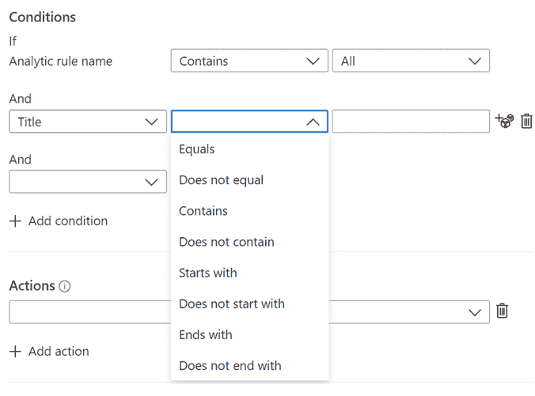

一旦确定哪些分析规则将触发此自动化规则，就需要确定此规则将做什么。这可以通过设置 Actions 来完成。

如以下屏幕截图所示，您可以执行不同的操作：

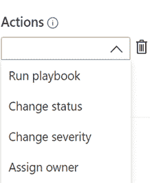

图 12.8 – 自动化规则操作

每个可用操作在下表中进行了描述：

| Action | Description |
|---|---|
| Run playbook | 这将允许您选择可以运行的 playbook。仅显示使用事件触发器的 playbook。有关更多信息，请参阅本章中的 Types of playbooks 部分。 |
| Change status | 这将自动更改事件的状态。如果选择，则会显示另一个下拉菜单，您可以在其中选择其状态。 |
| Change severity | 这将自动更改事件的严重性。如果选择，则会显示另一个下拉菜单，您可以在其中选择其严重性。 |
| Assign owner | 这将自动更改事件的所有者。如果选择，则会显示另一个下拉菜单，您可以在其中选择所有者。 |
| Add tags | 这将自动向事件添加标签。如果选择，将显示一个新部分，可在其中输入标签。 |

表 12.2

同一个规则中可以有多个操作。如果有多个操作，则第一个操作会运行，然后第二个操作在第一个操作之后开始，以此类推。

Rule expiration 字段允许您选择此规则保持活动状态的时间。默认情况下，它将为 Indefinite，在这种情况下，规则永远不会停止活动。您可以选择规则到期的日期和时间，在这种情况下，规则在达到该日期和时间时将被停用。

**Order** 决定此规则应用的顺序。回顾 *Figure 12.5*，您可以看到此规则的顺序默认为 4，因为已经有另外三个规则先运行，顺序为第一、第二和第三。您可以在此处更改数字以更改规则的运行顺序。

如果有两个规则具有相同的顺序号，您将无法确定哪一个会先运行，因此最好确保规则具有唯一的顺序号，以便在顺序很重要时始终知道顺序。不管顺序如何，所有条件与新事件匹配的规则都将运行。

填写所有字段后，单击 **Apply** 按钮创建新规则。

现在，让我们来看一下使用 playbook 时的定价考虑因素。

## Playbook 定价

如 *Chapter 1, Getting Started with Microsoft Sentinel* 中所述，运行 Microsoft Sentinel playbook 不包含在 Microsoft Sentinel 或 Log Analytics 的摄取成本中。它有单独的费用，虽然可能被认为很小，但会迅速累积。

例如，在美国东部区域，每次运行的每个逻辑应用操作（这包括查找信息、提取 JSON 和发送电子邮件等操作）每次使用将花费 $0.000025。每个标准连接器还有额外的 $0.000125 费用。 granted，这看起来很小，但如果您编写了一个包含 100 个操作和 1 个连接器的逻辑应用，并且每天每秒运行一次，持续一个月，那么这一个逻辑应用每月将花费 $3,564！

> **Note**
> 
> 有关 Azure Logic Apps 定价的更多信息，请访问 https://azure.microsoft.com/en-us/pricing/details/logic-apps/。

现在，这是一个极端的例子，但它提醒您在设计 playbook 时，需要让它们尽可能简单，并且不要做太多多余的工作。接下来，我们将讨论 Microsoft Sentinel 连接器，您需要在所有 Microsoft Sentinel playbook 中使用它。

## 剧本的类型

目前，有两种类型的剧本：一种使用 **当 Microsoft Sentinel 警报的响应被触发时** 逻辑应用触发器，另一种使用 **当 Microsoft Sentinel 事件创建规则被触发时** 逻辑应用触发器。每种类型都有其用途，如下文所述。

对于使用 **当 Microsoft Sentinel 警报的响应被触发时** 触发器的剧本，以下称为 **警报剧本**，它们仅对警报生效。这很有用，因为在撰写本文时，它们是唯一可以手动运行的剧本，这意味着当你在事件的“查看完整详细信息”页面中查看警报时，这些是唯一可以通过单击“剧本”链接来运行的剧本。但是，要在分析规则中使用这些剧本，必须将它们应用到每条规则上。

使用 **当 Microsoft Sentinel 事件创建规则被触发时** 触发器的剧本，以下称为 **事件剧本**，是唯一可以与自动化规则一起使用的剧本。但是，由于它们目前无法手动执行，因此除了通过自动化规则之外，它们不能对事件运行。

何时应使用哪种？这取决于用例。

如前所述，只有警报剧本可以手动执行，因此如果你需要在警报创建后对其运行，它们非常合适。但是，要在分析规则中使用它们，你需要进入每条分析规则并指定使用此剧本。

事件剧本是唯一可以在自动化规则中使用的剧本，因此如果你想在事件创建时运行剧本，就应该使用这些剧本。请记住，它们无法手动运行。

总的来说，你可能会混合使用这些不同类型的剧本以满足不同需求。现在，让我们看看用于创建剧本的逻辑应用连接器。

## Microsoft Sentinel 连接器概述

虽然逻辑应用连接器有很多，而且还在不断增加，但我们关注的是 Microsoft Sentinel 连接器。它为我们提供了可以启动剧本的触发器。它还包含各种操作，可以执行诸如获取特定事件的信息、获取与警报关联的实体的信息、更新事件等任务。

> **注意**
> 在撰写本文时，Microsoft Sentinel 连接器的所有功能都处于预览阶段，因此它们可能与这里显示和讨论的有所不同。

如前一节所述，该连接器目前有两个触发器，分别名为 **当 Microsoft Sentinel 警报的响应被触发时** 和 **当 Microsoft Sentinel 事件创建规则被触发时**。这意味着无论何时创建警报或事件，所选的那个触发器都会被触发。

值得注意的是，虽然警报触发器返回大量信息，但它不会返回实际创建的事件——如果确实创建了事件的话。要获取事件的信息，你需要使用 *表 12.3* 中给出的操作之一。

下表列出了 Microsoft Sentinel 连接器的所有当前操作：

| 名称 | 描述 |
|---|---|
| 向事件添加评论 | 向所选事件添加评论。 |
| 向事件添加标签（即将弃用） | 向所选事件添加标签。请注意，建议今后使用“更新事件”。 |
| 更改事件描述（即将弃用） | 更改所选事件的描述。请注意，建议今后使用“更新事件”。 |
| 更改事件严重性（即将弃用） | 更改所选事件的严重性。请注意，建议今后使用“更新事件”。 |
| 更改事件状态（即将弃用） | 更改所选事件的状态。请注意，建议今后使用“更新事件”。 |
| 更改事件标题（即将弃用） | 更改所选事件的标题。请注意，建议今后使用“更新事件”。 |
| 实体 – 获取账户 | 获取所有账户实体的列表。 |
| 实体 – 获取文件哈希 | 获取所有文件哈希实体的列表。 |
| 实体 – 获取主机 | 获取所有主机实体的列表。 |
| 实体 – 获取 IP 地址 | 获取所有 IP 地址实体的列表。 |
| 实体 – 获取 URL | 获取所有 URL 实体的列表。 |
| 警报 – 获取事件 | 返回与所选警报关联的事件。 |
| 从事件中删除标签（即将弃用） | 从所选事件中删除标签。请注意，建议今后使用“更新事件”。 |
| 更新事件 | 这允许你设置事件的各种属性，包括标记、所有者、严重性、状态、标题和描述。它还允许你移除标记。 |
| 监视列表 – 添加新的监视列表项 | 允许你向现有监视列表添加新条目或创建新监视列表。 |
| 监视列表 – 更新现有监视列表项 | 允许你更新现有监视列表中的条目。 |

表 12.3

由于页眉和摘要栏与前面讨论自动化规则时介绍的相同，这里不再赘述。如有需要，请参阅相关章节以了解更多信息。

## 逻辑应用列表

在摘要栏下方是所有逻辑应用的列表，如下面的屏幕截图所示。对于列出的每个逻辑应用，都有一个选择复选框，后面是以下字段：

| 字段名称 | 描述 |
|---|---|
| 名称 | 规则的名称。单击规则以转到其逻辑应用页面。 |
| 状态 | 显示逻辑应用的状态，即 **已启用** 或 **已禁用**。 |
| 触发器类型 | 显示此逻辑应用使用的触发器。在本章中，我们只关心包含 Azure Sentinel 的触发器。 |
| 订阅 | 显示此逻辑应用所属的 Azure 订阅。 |
| 位置 | 显示此逻辑应用所在的位置。 |

表 12.4

以上就是剧本概述页面的构成。接下来，我们将使用逻辑应用设置页面来查看特定剧本。

## 逻辑应用设置页面

你已经看到了概述部分。但如果想查看特定项目呢？我们现在就来讨论。

单击图 11.9 中所示的逻辑应用的名称，将进入逻辑应用设置页面。在这里，你可以创建、编辑或删除单个逻辑应用，查看有关逻辑应用的更多信息，以及查看逻辑应用运行历史记录，如下面的屏幕截图所示：

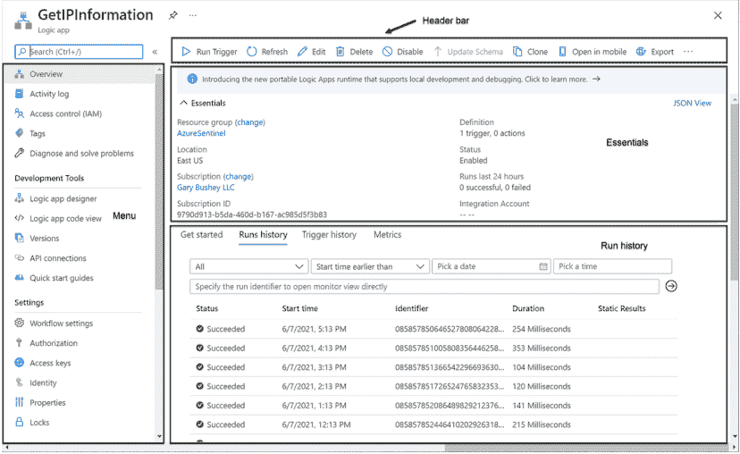

图 12.10 – 逻辑应用概述页面

让我们更详细地讨论每个部分。

### 菜单栏

在这里，你可以对此逻辑应用执行更多操作。我们不会讨论左侧导航菜单中的所有选项，因为它们超出了本书的范围。但我们鼓励你花些时间研究逻辑应用的全部功能。

### 标题栏

标题栏包含以下按钮，可用于快速管理逻辑应用：

图 12.11 – 逻辑应用概述页面标题栏

每个字段如下：

-   **运行触发器** 按钮将使逻辑应用运行。这对大多数剧本来说并不是很有用，因为它们需要警报触发器的信息才能运行。
-   **刷新** 按钮将刷新页面。当你运行剧本时，这很有用，可以告诉你何时运行完成，因为运行结果将显示在 **运行历史记录** 部分中。
-   **编辑** 按钮将允许你编辑逻辑应用的工作流。有关更多信息，请参阅 *使用逻辑应用设计器页面* 部分。
-   **删除** 按钮将允许你在确认要删除后删除此逻辑应用。
-   **禁用** 按钮将禁用逻辑应用，以便即使连接器被触发，它也不会运行。如果逻辑应用被禁用，则此按钮将变为 **启用**。
-   **更新架构** 按钮很少会启用，只有在逻辑应用发生更改而需要更新底层架构时才会启用。
-   **克隆** 按钮将允许你复制此逻辑应用。如果你想尝试一些更改而不丢失原始应用，这将很有用。
-   **导出** 按钮将允许你将逻辑应用导出到 Power Automate 和 Power Apps。由于剧本无法导出，因此此处不介绍此功能。

让我们看看下一部分。

### 基本信息部分

此部分显示逻辑应用的最基本信息。大多数字段与其他所有类型的 Azure 资源一同显示，并且不言自明，因此这里不再介绍，但有两个例外：

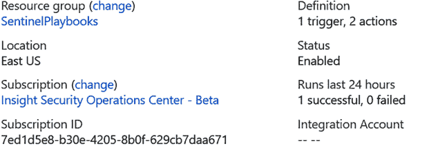

图 12.12 – 逻辑应用概述页面的基本信息部分

本页我们将重点关注两个主要项目：页眉中的“编辑”按钮，用于修改 playbook；以及页面底部的“运行历史记录”，用于了解逻辑应用的哪个实例成功或失败，以及失败的原因。

> 提示
> 有关调试逻辑应用的详细信息，请访问 https://docs.microsoft.com/en-us/azure/logic-apps/logic-apps-diagnosing-failures。

现在你已经了解如何查看现有 playbook，接下来该如何添加一个 playbook 呢？下一节将介绍如何添加新的 playbook。

## 创建新的 playbook

你将需要创建 playbook，因此现在正是学习如何创建它们的时候。

在 Microsoft Sentinel 自动化页面（参见图 11.1）中，单击页眉中的“添加 Playbook”链接。这将在浏览器中打开一个新选项卡，并转到“逻辑应用”屏幕，如下面的屏幕截图所示：

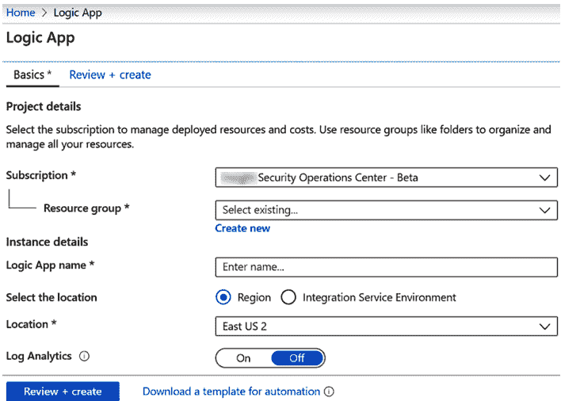

图 12.14 – 添加新的 playbook

下面介绍不同的字段：

- 在**逻辑应用名称**字段中输入描述性名称。不允许使用空格，但可以使用下划线。名称应足够具有描述性，以便其他用户了解该 playbook 的用途。
- 从**订阅**下拉列表中选择适当的订阅。该订阅应与 Log Analytics（以及 Microsoft Sentinel）工作区所在的订阅相同。
- 在**资源组**字段中选择现有资源组，或创建新的资源组。playbook 是否与 Log Analytics 工作区位于同一个资源组并不重要。不过，如果组织制定了 Azure 架构设计策略，则应遵循这些策略。
- 从**位置**下拉列表中选择适当的位置。该位置应与 Log Analytics 工作区所在的位置相同，以避免产生出口费用。
- 在**Log Analytics**字段中，如果希望将此 playbook 的运行时事件信息存储在 Log Analytics 中，请启用此选项。如果需要允许其他系统（例如 Microsoft Sentinel）对这些信息执行查询，此选项将非常有用。

填写完这些信息后，单击**查看 + 创建**按钮。系统将验证你输入的信息是否正确；如果正确，则允许你创建逻辑应用。如果不正确，系统会告知你存在的问题，并允许你返回主页进行修复。

逻辑应用可能需要一些时间才能创建完成。在此期间，你将返回 playbook 主页。

这样，你就创建了 playbook 的基础。目前它还不能执行任何操作，因为其中没有工作流步骤。接下来，我们将了解如何添加工作流组件，使 playbook 发挥作用。

## 使用 Logic Apps Designer 页面

创建 playbook 后，你将进入**Logic Apps Designer**页面。该页面有两种不同的视图。

单击此按钮后，将显示第二种视图，其外观如下方屏幕截图所示。根据你最近使用的连接器和操作，工作流编辑器部分中“最近使用”下的列表会有所不同，也可能为空：

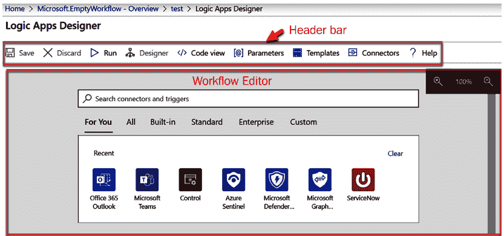

图 12.16 – Logic Apps Designer 第二种视图

下一节将更详细地介绍此页面的各个部分。

## Logic Apps Designer 页眉栏

如下方屏幕截图所示，页眉栏包含用于处理此工作流的所有按钮。在这里，你可以保存或放弃更改、在 GUI 视图和代码视图之间切换、添加参数等：

图 12.17 – Logic Apps Designer 页面页眉栏

各个按钮的功能如下：

- “保存”按钮用于保存更改。只有在对工作流进行了更改后，该按钮才会处于活动状态。
- “放弃”按钮将放弃你所做的所有更改，并将工作流还原到上次保存的状态。只有在对工作流进行了更改后，该按钮才会处于活动状态。
- **运行**按钮将运行当前正在查看的工作流。
- **设计器**和**代码视图**按钮配合使用，用于显示设计器视图或代码视图。单击**代码视图**按钮后，将显示构成此 playbook 的 JSON 代码。单击**设计器**按钮后，将进入 GUI 视图。你可以在任一视图中工作；但是，两个按钮中一次只能有一个处于活动状态。如果当前处于**设计器**模式，则**代码视图**按钮将处于活动状态。同样，如果当前处于**代码视图**模式，则**设计器**按钮将处于活动状态。
- **参数**按钮将打开**参数**窗格，用于添加、编辑或删除此 playbook 的参数。参数是一种向逻辑应用传递信息的方式，主要用于自动化部署。

> **注意**
> 请访问 https://docs.microsoft.com/en-us/azure/logic-apps/logic-apps-azure-resource-manager-templates-overview，了解有关在逻辑应用部署中使用参数的更多信息。

- **模板**将打开一个预置模板列表，你可以据此创建 playbook。请注意，单击此按钮并从列表中选择模板后，现有 playbook 的设计将被模板覆盖。
- **连接器**按钮将打开一个新页面，介绍逻辑应用连接器，并提供现有的非预览版连接器和操作列表。如果需要了解连接器的相关信息，这是一个很好的起点。

> **注意**
> 请访问 https://docs.microsoft.com/en-us/connectors/connector-reference/，在*连接器参考*部分查看所有可用连接器。

现在，让我们讨论工作流编辑器部分。

10. 完成后，你的警报应如下所示：

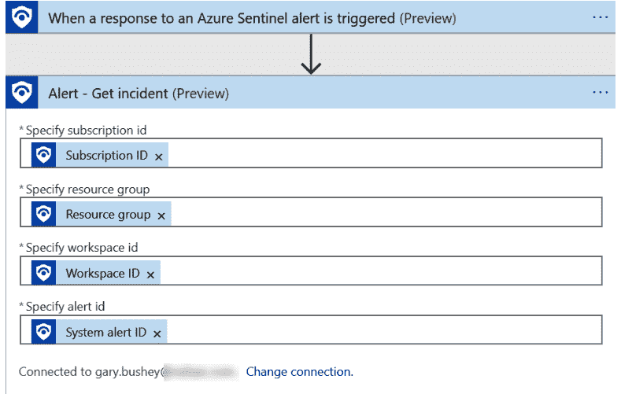

图 12.22 – 警报 – 获取事件完成

现在我们已经获得了事件的信息，接下来该如何处理呢？场景要求：如果引发高严重性警报，则需要通知分析师。“警报 – 获取事件”操作会返回所有事件，因此我们需要仅筛选出高严重性的事件：

- 1. 单击“新建步骤”链接，然后搜索 Condition。
- 2. 当 Control 连接器出现时，选择它。我们将使用 If 语句，但所有控制类型的语句都归属于这一个连接器。
- 3. 选择 Condition 操作，该操作将被添加，如下面的屏幕截图所示。请注意，它由三部分组成：顶部用于输入实际条件；左下部分用于指定测试结果为 true 时要执行的操作；右下部分用于指定测试结果为 false 时要执行的操作：

图 12.23 – Condition 步骤选项

4. 根据本节所学内容设置条件，检查 Severity 是否等于 High。

提示

Microsoft Sentinel 连接器的触发器和“警报 – 获取事件”操作都会返回严重性，因此选择其中任意一个都可以。

下面的屏幕截图显示了应有的效果：

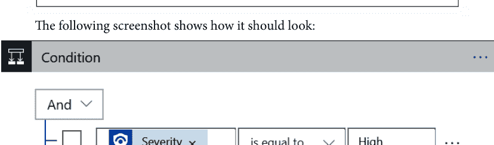

图 12.24 – Condition 步骤选项已完成

如果将来需要，你可以轻松添加更多条件。

6. 为此，我们将混合使用普通文本和动态内容字段。首先，添加刚刚列出的硬编码文本。然后，使用动态内容变量列表弹出窗口，选择 Number 变量。你可能需要在此弹出窗口中展开“警报 – 获取事件”列表，才能看到所有可用变量。

7. 完成后，你应看到如下内容：

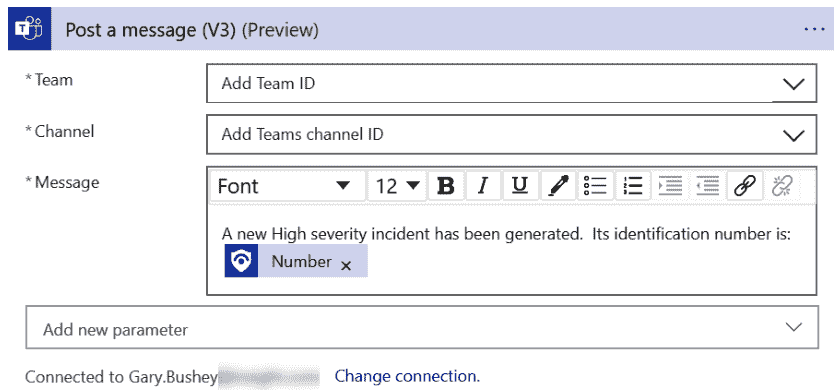

图 12.26 – 发布消息已完成

8. 全部完成后，单击 Logic Apps Designer 页眉中的“保存”按钮，保存此 playbook。如果存在任何错误，系统会通知你；如果没有错误，playbook 将被保存。你会注意到，在进行新的更改之前，页眉中的“保存”按钮会显示为灰色。

9. 最后一步是将此 playbook 附加到警报，以验证代码是否按设计运行。有关如何执行此操作的说明，请参阅第 7 章“创建分析规则”。

现在，你已经拥有了一个功能完整且极其有用的 Microsoft Sentinel playbook，而且无需编写代码。你只需要确定每个字段应在何处使用。这只是一个非常简单的示例，但希望它能让你了解 playbook 的用途。

## Summary

在本章中，你学习了如何创建一个可以在分析查询规则中使用的工作簿，以执行 SOAR 操作。Playbooks 基于 Azure Logic Apps构建，唯一的区别是，只有使用 Microsoft Sentinel 连接器，Logic App 才能成为 playbook。

通过你所学到的知识，你现在可以创建 playbooks 来自动化许多以前必须手动执行的操作。你阅读了其中一个示例，但你可以做的事情没有限制！

在下一章中，我们将使用本章学到的知识构建一个 playbook，该 playbook 将创建一个新的 ServiceNow 工单并使用工单号更新事件。

## Questions

回答以下问题以测试你对本章的了解：

- 1. 在 logic app 能够用作 Microsoft Sentinel playbook 之前需要做什么？
- 2. 如何判断某个特定的 playbook 上次运行是否成功？
- 3. 在 playbook 的工作流中，我如何获取有关事件的信息？
- 4. 什么是动态内容？
- 5. 我可以在一个字段中组合动态内容和静态内容吗？

## Further reading

请参考以下链接以获取有关本章所涵盖主题的更多信息：

- Logic Apps overview: https://docs.microsoft.com/en-us/azure/logic-apps/logic-apps-overview
- Connectors for Azure Logic Apps: https://docs.microsoft.com/en-us/azure/connectors/apis-list
- Sample Azure logic apps: https://docs.microsoft.com/en-us/samples/browse/?products=azure-logic-apps
- Sample Microsoft Sentinel playbooks: https://github.com/Azure/Azure-Sentinel/tree/master/Playbooks
- Testing logic apps with mock data but setting up static results: https://docs.microsoft.com/en-us/azure/logic-apps/test-logic-apps-mock-data-static-results

让我们来看下一个方法。

## Integrating Azure security alert sources (not just Sentinel) with ServiceNow Security Incident Response via the Microsoft Graph Security API

自本书第一版发布以来，Microsoft 和 ServiceNow 已合作通过 Microsoft Graph Security API 实现 Microsoft Sentinel 和 ServiceNow Security Incident Response 集成。

Microsoft Graph Security API 是“一个中间服务（或代理），它提供单一的编程接口来连接多个 Microsoft Graph Security 提供商（也称为安全提供商或提供商）。对 Microsoft Graph Security API 的请求会被分发到所有适用的安全提供商。结果会被聚合并以通用模式返回给请求的应用。” – https://docs.microsoft.com/en-us/graph/security-concept-overview

使用 Microsoft Graph Security API 将 Microsoft Sentinel 与 ServiceNow 集成的一个关键优势是：它不需要将 Azure 中的所有安全警报都流经 Sentinel。它甚至不需要你使用 Sentinel。这些是较少见的用例。大多数组织都会使用 Sentinel，并使用 Sentinel 聚合和关联其所有 Azure 安全警报。

使用 Microsoft Graph Security API 将 Microsoft Sentinel 与 ServiceNow 集成存在一些限制，包括以下内容：

- Microsoft Graph Security API 不支持将数据从 ServiceNow 发送回 Sentinel。例如，当 ServiceNow 中的安全事件关闭时，组织通常希望 Sentinel 中对应的警报自动关闭。
- ServiceNow 为 Microsoft Graph Security API 提供的集成插件不支持在将多个 Sentinel 警报聚合到同一个 ServiceNow 安全事件时使用复杂条件。例如，基于两个字段的聚合将要求两个字段都匹配；没有一个字段或另一个字段匹配的选项。

> Note
> 有办法绕过这个问题，但需要将创建的集成配置文件数量加倍，增加很多复杂性。但可以做到。

## Figure 13.5 – Add a client secret pane

输入密钥的描述，并使用 Expires 下拉菜单确定你希望此密钥存在多长时间。你需要在密钥存在的时间长度与你需要进入、创建新密钥并使用此新信息更新插件的频率之间取得平衡。

5. 点击 **Add** 按钮添加新密钥。完成后，窗格将关闭，你将被带回 **Certificates & secrets** 页面，如下所示：

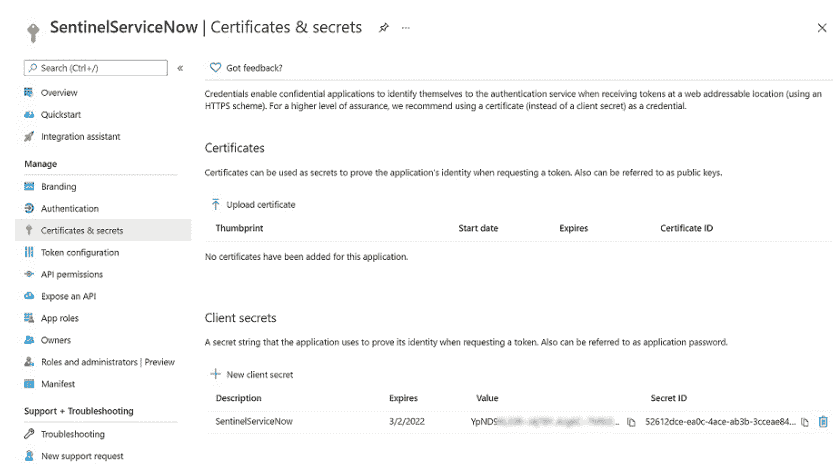

Figure 13.6 – New secret created

从此页面，你需要复制密钥的 **Value** 字段。这就是我们需要提供给插件的 **client secret key**。再次提醒，请将此文本保密并考虑将其存储在安全保管库中并以编程方式检索和轮换密钥。将它视为用户的密码一样对待。

我们现在已经获得了提供给插件所需的六个信息中的三个：Client ID、Tenant ID 和 client secret。要获取 Subscription ID、Resource Group 名称和 Workspace 名称，我们需要进入 Microsoft Sentinel。

## Installing the Microsoft Sentinel integration plugin in ServiceNow

此插件可在 ServiceNow 商店中使用。确保阅读发行说明以确认你满足所有要求，例如 ServiceNow 实例版本。

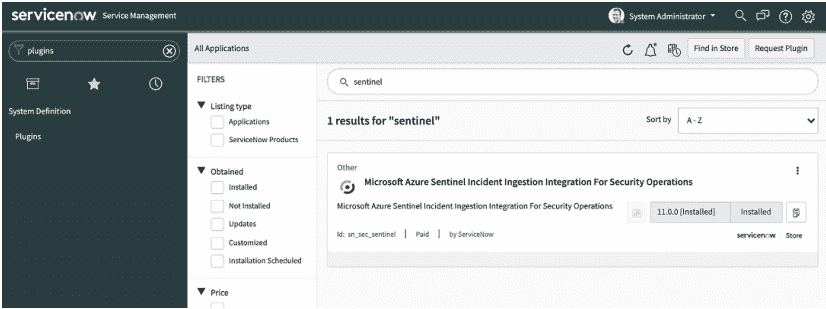

Figure 13.8 – ServiceNow Sentinel plugin

建议在开发时使用插件的最新版本，并在生产环境中始终使用开发时所使用的相同版本。

## Configuring the ServiceNow Sentinel plugin to authenticate to Microsoft Sentinel

这是你将输入在 Configuring the Microsoft Azure portal 部分收集的变量的步骤。请记住，不要向第三方服务提供商提供你的 client secret。相反，使用屏幕共享和桌面控制解决方案，在他们进行到此步骤时自行输入。

此步骤的一个陷阱是，点击提交后会有轻微延迟，并且不会告诉你是否成功。它会告诉你是否有错误。如果窗口在没有错误的情况下关闭，则表示你已成功将 ServiceNow 实例认证到 Microsoft Sentinel 实例。如果出现错误，通常是由 Configuring the Microsoft Azure portal 部分遗漏步骤或表单数据中的拼写错误引起的（如果复制/粘贴，请注意前导或尾随空格）。请耐心等待——大约需要 20 秒来判断是否成功：

- **Retrieve recent Microsoft Sentinel incidents**：这将从 Sentinel 导入最近的示例事件。由于你之前更改了此设置，你应该获得 20 个。这取决于 Sentinel 实例是否有可用的事件：

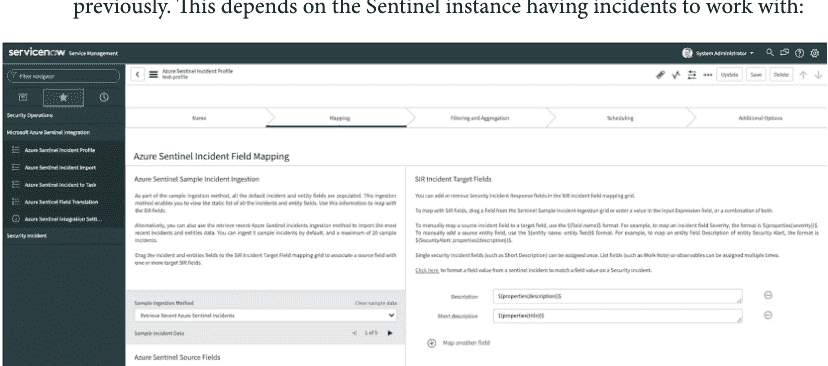

Figure 13.12 – Mapping form

将下拉菜单设置为 **Retrieve recent Microsoft Sentinel incidents** 后，点击 **Import Sample Data** 按钮。这需要几分钟时间，正如表单上消息所指示的那样。我们看到它可能不到一分钟，但也可能需要几分钟，达到你可能想去喝杯咖啡或散步然后再回来查看的程度。一旦示例记录出现，你可以点击查看它们是由哪些产品生成的。我们在这里使用术语 *catching samples*，因为你正在尝试捕获产品类型的示例记录，以便你可以为该产品类型创建特定的配置文件。从样本中首先出现的产品开始。然后，继续处理示例记录，直到无法捕获任何新产品为止。可能需要多次导入尝试和特定的时间来捕获不常见产品的示例事件。

## 其他选项

配置文件最后部分用于 Sentinel 与 ServiceNow 之间的双向字段映射。例如，ServiceNow 可以在 ServiceNow 中对应的安全事件关闭时，通知 Sentinel 关闭相应的 Sentinel 警报。本节中有多个选项，功能丰富。我们建议充分利用它们。但是，请注意，如果你的 ServiceNow 处于开发环境，而你正与生产环境的 Sentinel 集成，请不要启用它们。这会让你的实验室活动弄乱 Sentinel 生产记录：

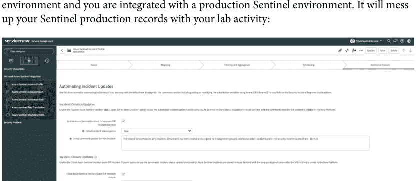

图 13.15 – 其他选项

你的 Sentinel 到 ServiceNow 集成（如果启用了这些选项，可能也是反向）现在已配置完成。导航到 ServiceNow 中的 Microsoft Azure Sentinel Integration | Azure Sentinel Incident to Task 路径，等待记录开始填充。

当你处于 ServiceNow 的该区域时，尝试按任务列进行分组。这将显示聚合发生的位置。任何具有多条记录的组都代表一次聚合。

你也可以导航到安全事件记录（在任务列中）以查看你配置的字段映射结果。

## 总结

本章向你展示了如何创建一个与解决方案的集成——在我们的示例中是 ServiceNow——以提供处理安全事件的单一位置。无论安全事件源自何种警报源，或由谁处理，都无关紧要。实现这一结果的方法不计其数。本章仅涵盖了一种更常见的方法。

发挥创意，注重简化和许可成本降低。例如，如果 Sentinel 未对来自警报源的警报进行关联，因为该警报源具有非常高的保真度，那么请考虑将这些警报直接摄取到 ServiceNow 中并绕过 Sentinel，以节省许可成本并降低架构复杂性。

我们也只是触及了在 ServiceNow Security Incident Response 中自动创建安全事件后可以执行的操作的表面。ServiceNow 不仅仅是一个具有花哨表单和仪表板的流程和案例管理解决方案。ServiceNow Security Incident Response 是一个行业领先的安全编排、自动化和响应（SOAR）平台，能够简化并自动化大部分安全事件检测和响应流程。在下一章中，我们将讨论可以执行的一些运营任务，以在 Microsoft Sentinel 中保持最佳运营效率。
