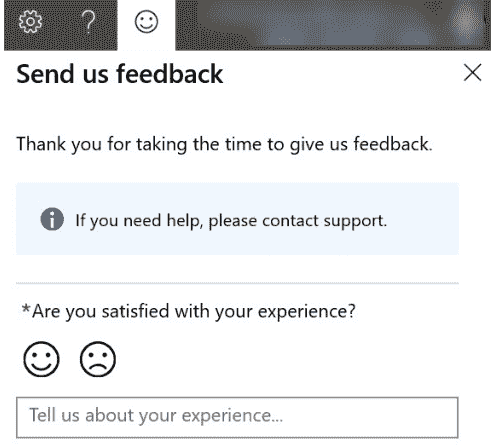
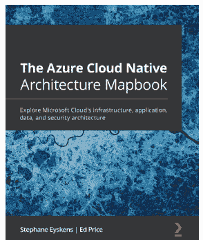

# 第 15 章 附录
持续学习与社区贡献

感谢您抽出时间阅读本书，并全面了解这一新解决方案。在本章最后，我们将提供一些实用资源，帮助您继续学习，并参与基于社区的知识分享活动。您还可以找到直接向 Microsoft 提供反馈的资源，从而确保这一解决方案得到持续改进。

本章将介绍 Microsoft 提供的官方资源、安全运营中心（SOC）运营的其他资源，以及 GitHub 提供的其他资源。

本章将涵盖以下主题：

- Microsoft 官方资源
- SOC 运营资源
- 使用 GitHub
- 特定组件和支持技术

### 功能请求

如果您有改进 Microsoft Sentinel 的好想法，或者发现 Microsoft 安全解决方案中存在需要解决的空白，可以通过 Azure 门户中的反馈选项提交您的想法。反馈选项位于屏幕右上角，其外观如下方屏幕截图所示。您可以选择笑脸来提供积极反馈，也可以选择哭脸来说明您在使用相关功能时遇到的问题，如下方屏幕截图所示：



图 15.1 – Azure 反馈选项

虽然博客和论坛是开展研究及提问的良好资源，但对于正在产生即时影响、且可能需要特定技术专长才能解决的问题，不应依赖这些渠道。如果您需要立即获得 Microsoft Sentinel 实施方面的帮助，应通过官方渠道之一联系 Microsoft 支持。

如果您没有支持计划，可以在此处注册：https://azure.microsoft.com/en-us/support/plans。

如果您签订了 Microsoft Premier 支持协议，Microsoft 将向您提供专属支持团队的直接联系方式。

### Jupyter Notebook

Jupyter Notebook 是一种开源应用程序，可用于创建和共享包含笔记、可视化内容、实时代码及其他资源的文档。SOC 分析师之间可以共享这些文档，以提升威胁搜寻和响应能力。

您可以通过以下链接查找更多 Jupyter Notebook 资源：https://jupyter.org/。

### 使用 Fusion 进行机器学习

Microsoft 使用机器学习算法帮助 Microsoft Sentinel 检测多阶段攻击，这项功能称为 Microsoft Fusion。该技术通过组合两个或更多警报活动来运行，例如异常行为和可疑活动，而这些活动可能原本只是低级别警报。随后，Microsoft Sentinel 可以生成准确且高保真的事件，减少误报，并检测出原本可能被忽略的攻击。要成功实现这一点，您必须确保已启用适当的数据连接器，并且至少拥有 30 天的历史数据，以便训练机器学习算法。

此功能默认处于启用状态，目前支持多种场景，包括以下场景：

- 监视触发不可能旅行警报的用户，随后检测到异常的 Office 365 活动
- 用户从不熟悉的位置执行登录活动，随后检测到异常的 Office 365 活动
- 用户从受感染的设备执行登录活动，随后检测到异常的 Office 365 活动
- 用户从匿名 IP 地址执行登录活动，随后检测到异常的 Office 365 活动
- 使用已泄露凭据的用户执行登录活动，随后检测到异常的 Office 365 活动

若要详细了解此技术并掌握最新进展，请访问以下网站：https://docs.microsoft.com/en-us/azure/sentinel/fusion。

### Azure Logic Apps

Azure Logic Apps 可用于执行各种自动化任务，包括以下任务：

- **基于计划的工作流**：创建任务，以便按照固定频率自动执行操作，例如收集数据，然后将该值与上次收集的值进行比较，并在该值超过阈值时发出警报。
- **基于审批的工作流**：创建任务来监视指定的触发器，然后发送审批请求（例如电子邮件），并在收到批准后继续执行请求的操作。
- **Azure Functions**：可以将其与 Azure Logic Apps 集成，以执行其他任务和集成，例如：
  A. 根据 HTTP 请求运行代码
  B. 安排代码在预定义的时间运行
  C. 处理新增和修改的 Azure Cosmos DB 文档
  D. 处理新增和修改的 Azure Storage Blob
  E. 响应 Azure Storage 队列消息
  F. 通过订阅和筛选器响应 Azure Event Grid 事件
  G. 响应大量 Azure Event Hubs 事件
  H. 通过响应 Service Bus 队列或主题消息，连接到其他 Azure、本地或其他云服务
- **存储工作流**：支持与 Azure Storage 集成，以实现数据的自动收集和检索。

为了启用此自动化功能，Azure Logic Apps 可以使用连接器，快速访问其他应用、服务、系统、协议和平台中的事件、数据与操作。此集成适用于本地工作负载、Azure 以及其他云平台。有关连接器的详细信息，请访问以下链接：https://docs.microsoft.com/en-us/connectors/。

我们建议您进一步研究这些功能，以确保在 Microsoft Sentinel 中引发警报和事件时能够自动触发操作，相关信息请访问：https://docs.microsoft.com/en-us/azure/logic-apps/logic-apps-overview。

### 总结

如您所见，这里有许多机会可以继续学习，并贡献自己的专业知识来帮助他人。随着 Microsoft 为 Microsoft Sentinel 添加新功能，请通过其博客和官方文档了解改进内容，然后将最适合的更改应用到您自己的实施中。

我们鼓励您积极参与，并将自己的经验和专业知识传授给他人。正如我们在撰写本书的过程中所认识到的，只有分享自己的知识并听取他人的反馈，您才能真正掌握这一主题，并体会到还有多少内容值得学习！

## 评估

### 第 1 章

- 1. 用于协助发现和映射当前的安全解决方案，并规划未来状态。
- 2. 三个主要组件是 Azure Monitor、Microsoft Sentinel 和 Logic Apps。
- 3. 主要平台包括身份和访问管理（IAM）、终结点检测和响应（EDR）、云访问安全代理（CASB）、云工作负载保护平台（CWPP）以及下一代防火墙（NGFW）。
- 4. 第三方解决方案提供商包括 AWS、Cisco、Palo Alto Networks、Fortinet 和 Symantec。
- 5. 场景映射练习包含七个步骤。

### 第 2 章

- 1. 查询语言的名称是 Kusto 查询语言（KQL）。
- 2. Azure Lighthouse 支持集中管理多个 Azure 租户，通常由托管服务提供商进行部署，但也可用于复杂环境。
- 3. Log Analytics 中保护数据的一些方式包括由 Microsoft 管理的事件管理流程、数据保留和删除策略、按数据源类型进行管理，以及通过地理主权实现的数据分隔和隔离。
- 4. 可以通过 Web 门户、PowerShell 和命令行界面创建 Log Analytics 工作区。
- 5. 应向工程师分配 Microsoft Sentinel 参与者和 Log Analytics 读取者角色。


2. 这需要查看 StormEvents 表并获取每个州的一个实例。对此使用 distinct 操作符：

```
StormEvents
| distinct State
```

3. 你需要查看 StormEvents 表中的 DamageProperty 字段，并确保该字段大于 10,000 且小于 15,000：

```
StormEvents
| where DamageProperty >10000 and DamageProperty <15000
```

4. StormEvents 表中已有四个列中的三个。第四列，即总损害金额，可以通过将 DamageProperty 列和 DamageCrop 属性相加来创建。在以下答案中，它被称为 TotalDamage，但实际上你怎么称呼它并不重要，只要在 extend 和 project 命令中使用相同的名称即可。如果将 extend 和 project 合并为一个则可获得额外分数。虽然这在 KQL 中完全合法，但如果你想再次使用该变量，则需要 extend，因为 project 只是输出结果：

```
StormEvents
| extend TotalDamage = DamageCrops + DamageProperty
| project State, DamageProperty, DamageCrops, TotalDamage
```

## 第 6 章

- 1. 你可以通过使用示例查询和查询资源管理器来查看预先制作的查询。
- 2. 使用结果窗格顶部的筛选图标来显示特定计算结果，而无需更改查询。
- 3. 要预览日志条目，请转到表窗格，将鼠标悬停在所需日志上，然后单击眼睛图标。
- 4. 要更改查看所有结果页面时每页的结果数，请转到页面设置，并将“每页行数”下拉菜单更改为 200。
- 5. 要更改查看单个结果页面时每页的结果数，请转到结果页脚，并将“每页项目数”下拉菜单更改为 200。

- 4. 要获取警报的完整详细信息，请按照以下步骤操作：
- 5. 在事件列表中找到事件。
- 6. 单击“查看完整详细信息”链接。
- 7. 在“警报”选项卡中，单击警报的 ID。
- 8. 查看事件的详细信息窗格，在“分析规则”条目下将有一个指向创建此事件的分析规则的链接。单击该链接即可进入分析规则的配置。

## 第 10 章

- 1. 可以在实体行为中查看的三种实体类型是帐户、主机和 IP 地址。
- 2. 可以在实体时间线中呈现的三种信息类型是警报、书签和活动。
- 3. 使用时间线内容筛选器并将其设置为仅显示活动。
- 4. 可以通过以下方式创建自定义活动：
  - 在实体设置页面单击“添加活动”链接。
  - 或者，选择即用型模板并在详细信息窗格中单击“创建活动”按钮。
- 5. 可以用于创建自定义活动的两种实体类型是主机和帐户。

## 第 11 章

- 1. 要运行单个狩猎查询，请选择查询，并在详细信息窗格中单击“运行查询”按钮。
- 2. 要运行所有狩猎查询，请单击狩猎页面标题中的“运行所有查询”按钮。
- 3. 要查看单个狩猎查询的结果，请选择查询并在详细信息窗格中单击“查看查询结果”链接。
- 4. 要创建新书签，请在日志页面上运行查询，选择要添加到书签的结果，然后单击“添加书签”按钮。

5. 要将书签与事件关联，可以使用两种方法之一：

- 从书签创建新事件。
- 或者，将书签添加到现有事件。

## 第 12 章

- 1. 要将逻辑应用用作 Microsoft Sentinel 剧本，它必须使用 **Microsoft Sentinel 连接器**。
- 2. 要判断剧本是否成功运行，请从 **剧本** 页面选择剧本，然后查看 **运行历史记录** 部分。
- 3. 使用剧本的工作流获取事件信息时，使用 **Alert | Get Incident** 操作并传入必要的参数。
- 4. 动态内容是连接器或操作提供的、每次剧本实例运行时可能发生变化的信息 - 例如，在 *创建简单的 Microsoft Sentinel 剧本* 部分中用于获取事件的 **系统警报 ID** 字段。
- 5. 是的，你可以在一个字段中组合动态内容和静态内容。

## 第 14 章

- 1. 两个角色是 SOC 工程师和 SOC 分析师。
- 2. 两个角色都需要参与场景映射练习的执行。
- 3. SOC 工程师应至少每月检查一次日志摄取速率和定价层。
- 4. SOC 分析师应每天检查 **事件** 页面。
- 5. 你应该在实例创建的第一时间就开始查看日志摄取。这将提供最大程度的安全事件可见性。



## 《Azure 云原生架构地图集》

Stéphane Eyskens, Ed Price

ISBN: 9781800562325

- 掌握 Microsoft Azure 云平台的整体架构知识
- 通过考虑不同的架构视角，探索构建完整 Azure 解决方案的可能性
- 实施架构和部署 Azure 基础设施的最佳实践
- 审查使用生态系统框架和解决方案构建分布式应用程序的不同模式
- 使用容器化工作负载掌握云原生概念

使用 AKS（Azure Kubernetes Service）并将其与服务网格技术结合使用，以设计微服务托管平台

## Packt 正在寻找像你这样的作者

如果你有兴趣成为 Packt 的作者，请访问 authors.packtpub.com 并立即申请。我们已与成千上万的开发人员和技术专业人士合作，帮助他们与全球技术社区分享自己的见解。你可以进行一般申请、申请我们正在招聘作者的特定热门主题，或提交自己的想法。

## 分享你的想法

现在你已经读完了 *Microsoft Sentinel in Action*，我们很想听听你的想法！如果你从亚马逊购买了本书，请点击此处直接前往本书在亚马逊的评论页面并分享你的反馈，或在你购买的网站上留下评论。

你的评论对我们和技术社区非常重要，将帮助我们确保提供优质内容。

## 索引

### 符号

.NET 42

### A

- 访问控制列表 (ACLs)  17
- Active Directory (AD)  96
- Adversarial Tactics, Techniques, and Common Knowledge (ATT&CK)  93
- 基于代理的连接器  75
- 聚合函数
  - 参考链接  126
- 聚合  412
- 聚合，特性
  - 空字段值聚合  412
  - 基于时间的聚合  412
- ago() 函数  140
- 警报定义  92
- Alert playbooks  370
- 警报触发器  284
- 替代存储选项
  - 审查  88
- Amazon Web Services (AWS)  13, 17, 74, 224

- 分析规则
  - 创建  197
  - 从规则模板创建  197
  - 使用向导创建  198
  - 管理  218, 219
- 分析规则，类型
  - 关于  186
  - 异常  187, 188
  - Fusion  187
  - 机器学习，行为分析  187
  - Microsoft Security  186, 187
  - 计划  186
- Anomali ThreatStream  93
- 异常检测  187
- API 连接  75
- 基于审批的工作流  436
- 人工智能 (AI)  14
- 攻击面减少 (ASR)  13
- 自动化规则
  - 关于  363, 364
  - 添加  364-368
- Azure Active Directory (Azure AD)
  - 关于  74, 228, 420-422
  - 参考链接  428

- Azure Active Directory 标识符 202
- Azure Automation 88
- Azure Blob Storage 88
- Azure CLI
  - 参考链接 44
- Azure Data Explorer (ADX)
  - 关于 21, 23, 72, 88, 118
  - 缺点 23
  - 优点 23
  - 参考链接 118
- Azure Functions 436
- Azure Lighthouse 33
- Azure Logic Apps
  - 关于 436
  - 参考链接 360
  - 定价参考链接 369
- Azure Monitor
  - 关于 23, 32
  - 缺点 23
  - 优点 23
  - 参考链接 48, 428
- Azure Monitor 代理
  - 关于 75
  - 参考链接 75
- Azure Monitor Logs 数据安全
  - 参考链接 35
- Azure Monitor PowerShell 示例
  - 参考链接 88
- Azure 命名最佳实践
  - 参考链接 36
- Azure 门户
  - 用于创建 Log Analytics 工作区 37, 38
- Azure 资源管理模板
  - 创建 39-41
- Azure 安全警报源
  - 与 ServiceNow Security Incident Response 集成 via Microsoft Graph Security API 395, 396
- Azure Security Center 74
- Azure Sentinel
  - 关于 394
  - 启用 49-51
  - 与 ServiceNow 集成 396
  - 与 ServiceNow ITSM 集成使用 Azure Sentinel Logic Apps 394
  - 与 ServiceNow Security Incident Response 集成 via API 直接到 Azure Sentinel 396
  - 参考链接 428
  - 安全解决方案集成 15, 16
- ServiceNow Sentinel 插件配置以进行身份验证 404, 405
- 服务定价 20-24
- Azure Sentinel 代理
  - 配置 60, 61
  - 管理 59
- Azure Sentinel Analytics 185
- Azure Sentinel Analytics，首页
  - 详细信息窗格 191-197
  - 标题栏 189
  - 导航 188
  - 部分 189
  - 规则和模板列表 189-191
- Azure Sentinel Automation
  - 关于 361
  - 自动化规则 363, 364
  - 标题栏 362
  - 摘要栏 363
- Azure Sentinel 连接器
  - 配置 77-82
  - 概述 370-372


- Info 按钮 292
- Insights 按钮 293
- investigating 287, 288
- Related alerts 操作，显示 288-291
- Timeline 按钮 291
- Incident playbooks 370
- incident trigger 284
- 威胁指标 (Indicators of Compromise, IoCs) 92
- 工业控制系统 (Industrial Control Systems, ICS) 4, 7
- 信息安全 8
- 信息技术/运营技术 (Information Technology/Operational Technology, IT/OT) 7
- 基础设施即服务 (Infrastructure-as-a-Service, IaaS) 7
- 综合网络防御交换 (Integrated Cyber Defense Exchange, ICDx) 75
- intel feeds
  - selecting 95
- Intellisense 164
- 物联网 (Internet of Things, IoT) 4, 77
- J
- JavaScript 对象表示法 (JavaScript Object Notation, JSON) 172, 360
- join 命令 134
- Jupyter Notebook 175, 435
- 即时 (Just In Time, JIT) 13
- K
- KCL 文档
  - reference link 434
- kill chain 25
- KQL 代码窗口
  - about 164
  - advantages 164
  - Export 167
  - Format query 168
  - header 165
  - New alert rule 167
  - Pin to dashboard 168
  - Run 165
  - Save 166
  - Share link 167
  - Time range 166
- KQL 命令
  - about 120
  - reference link 122
- KQL 查询
  - running 118-120
- Kusto 查询语言 (Kusto Query Language, KQL) 32, 88, 326, 433, 434
- L
- let 语句 139
- livestream
  - working with 330-332
- Log Analytics
  - about 32, 144
  - advanced settings 58
  - data, managing 35
  - reference link, for pricing 36
  - storage options, configuring 83-85
- Log Analytics 工作区
  - about 33, 34
  - creating, with Azure portal 37, 38
  - creating, with CLI 43-45
  - creating, with PowerShell 42, 43
  - overview page, exploring 46, 47
  - planning 36
  - using 35
- Logic App 列表 373
- Logic Apps 调试
  - reference link 377
