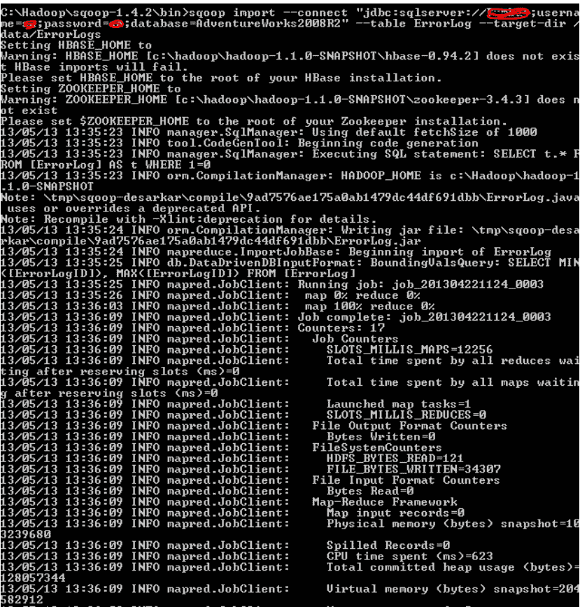
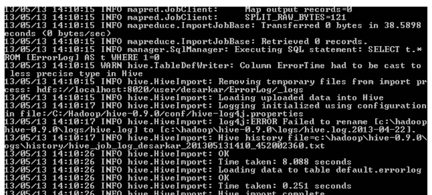
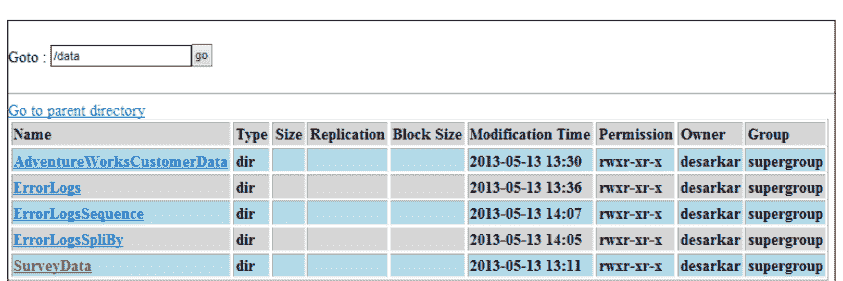

# 2. 使用 Sqoop – SQL Server Hadoop 连接器

# 使用 Sqoop – SQL Server Hadoop 连接器

**Sqoop** 是一个开源 Apache 项目，可促进 Hadoop 与任何传统 **关系数据库管理系统（RDBMS）** 之间的数据交换。它在内部使用 MapReduce 框架执行导入/导出操作，并且通常是集成关系和非关系数据存储的常见选择。

Microsoft SQL Server Connector for Apache Hadoop（SQL Server-Hadoop 连接器）是一个基于 Sqoop 的连接器，专门为 SQL Server 与 Hadoop 之间高效的数据传输而设计。该连接器针对双向批量数据传输进行了优化，不支持在导入或导出时对数据进行广泛的格式化或转换。阅读本章后，你将能够：

- 安装和配置 Sqoop 连接器
- 从 SQL Server 导入数据到 Hadoop
- 从 Hadoop 导出数据到 SQL Server


## SQL Server-Hadoop 连接器

Sqoop 基于 JDBC 实现，因此也遵循标准 JDBC 特性。数据的模式（schema）或结构由数据源提供，Sqoop 使用 JDBC 生成并执行 SQL 语句。下表汇总了 SQL Server 连接器可用的几个重要命令及其功能：

| 命令 | 功能 |
|---|---|
| `sqoop import` | 导入命令可将 SQL Server 数据导入 HDFS。您可以选择使用 `--table` 开关导入整个表，或使用 `--query` 开关根据条件导入选定的记录。导入到 Hadoop 文件系统后，数据会以分隔文本文件或 SequenceFile 的形式存储，以供后续处理。您还可以使用 import 命令将 SQL Server 数据移动到 Hive 表中，Hive 表类似于 HDFS 之上的逻辑模式。 |
| `sqoop export` | 您可以使用 export 命令将数据从 HDFS 移动到 SQL Server 表中。与 import 命令类似，export 命令支持将分隔文本文件、SequenceFile 和 Hive 表中的数据导出到 SQL Server。export 命令支持向目标 SQL Server 表插入新行、根据更新键列更新现有行，以及调用存储过程执行。 |
| `sqoop job` | job 命令使您能够将导入/导出命令保存为作业，以便将来复用。保存的作业会记住执行期间指定的参数，特别适用于需要定期重复运行导入/导出命令的场景。 |
| `sqoop version` | 要快速检查您所使用的 Sqoop 版本，可以运行 sqoop version 命令，在控制台中打印已安装版本的详细信息。 |

Hadoop 中的 SequenceFile 是二进制内容，包含序列化数据，与分隔文本文件不同。有关 SequenceFile 结构的详细了解，请参阅 Hadoop 页面 http://hadoop.apache.org/docs/current/api/org/apache/hadoop/io/SequenceFile.html 。此外，我们将在本章后续部分介绍几个带有不同参数的示例导入/导出命令。有关 Sqoop 命令及其开关的完整参考，请参阅 Apache Sqoop 用户指南 http://sqoop.apache.org/docs/1.4.2/SqoopUserGuide.html 。

> Hive 是构建在 Hadoop 之上的数据仓库基础设施，将在下一章中讨论。

## 安装前提条件

本章假定您拥有一个已配置 Hadoop 和 Hive 的 Linux 集群，以及一个运行 SQL Server 2012 的 Windows 系统。使用 SQL Server-Hadoop 连接器并运行本章中的示例命令，需要这两种环境。

### Linux 上的 Hadoop 集群

第一步是让 Hadoop 集群在 Linux 上运行起来。我们将使用该集群的 HDFS 从 SQL Server 导入数据以及向 SQL Server 导出数据。本章中的示例命令假定它们运行在 Hadoop 1.1.0 版本、Hive 0.9.0 版本、Red Hat Enterprise Linux 5.8 上。

> 确保 HADOOP_HOME 环境变量设置为 Hadoop 安装目录的父目录。

### 安装和配置 Sqoop

下一步是在 Hadoop 集群的 NameNode 上安装和配置 Sqoop 连接器（如果尚未安装的话）。我推荐从 Apache 网站下载并安装 Sqoop 1.4.2，本章中的示例命令使用的就是该版本。

安装完成后，必须验证 Sqoop 环境变量是否已设置为正确的值。它们应设置为指向下表中描述的路径，以便 SQL Server-Hadoop 连接器正常工作。这也可以避免您每次执行各种 Sqoop 命令行工具时都需要输入完整路径。

下表描述了 Sqoop 环境变量：

| 环境变量 | 要赋的值 |
|---|---|
| SQOOP_HOME | 您安装 Sqoop 的绝对路径。 |
| SQOOP_CONF_DIR | $SQOOP_HOME/conf，前提是 SQOOP_HOME 已设置了正确的值。 |

### 设置 Microsoft JDBC 驱动程序

Sqoop 和 SQL Server-Hadoop 连接器使用 Java 数据库连接（JDBC）技术来建立与远程 RDBMS 服务器的连接，因此需要 SQL Server 的 JDBC 驱动程序。本章假定您使用 SQL Server JDBC 驱动程序 3.0 版（sqljdbc_3.0）。要在您刚刚安装 Sqoop 的 Linux NameNode 上安装此驱动程序，请执行以下步骤：

- 1. 访问 http://www.microsoft.com/en-us/download/details.aspx?displaylang=en&id=21599 并将 sqljdbc_3.0_enu.tar.gz 下载到集群的 NameNode。
- 2. 使用以下命令解压下载的文件：tar -zxvf sqljdbc_3.0_enu.tar.gz。这将在当前目录中创建一个 sqljdbc_3.0 目录。
- 3. 将驱动程序 jar（sqljdbc_3.0/enu/sqljdbc4.jar）文件复制到 NameNode 上的 $SQOOP_HOME/lib 目录中。

### 下载 SQL Server-Hadoop 连接器

如果您已经到了这一步，那么终于可以准备在集群的 NameNode 上下载、安装和配置 SQL Server-Hadoop 连接器了。

用于 Hadoop 的 Microsoft SQL Server SQOOP 连接器现在已成为 Apache SQOOP 1.4.x 系列项目的一部分，Microsoft 不再从其网站提供单独的下载。该连接器现在可从 Apache 网站下载：http://sqoop.apache.org/

下表汇总了下载连接器后部署到 NameNode 的不同文件。该表包含 SQL Server-Hadoop 连接器安装程序归档：

| 文件/目录 | 说明 |
|---|---|
| install.sh | 这是一个 Shell 脚本，包含用于复制 SQL Server-Hadoop 连接器所需文件和目录结构的命令。 |
| Microsoft SQL Server-Hadoop Connector User Guide.pdf | 用于部署和执行 SQL Server-Hadoop 连接器命令的用户指南。 |
| lib/ | 该目录包含 `sqoop-sqlserver-1.0.jar` 文件。该归档包含大部分 Sqoop 命令定义。 |
| conf/ | 该目录包含 SQL Server-Hadoop 连接器的配置文件。 |
| THIRDPARTYNOTICES FOR HADOOP-BASED CONNECTORS.txt | 本文档包含第三方声明。 |
| SQL Server Connector for Apache Hadoop MSLT.pdf | 用于 Apache Hadoop 的 SQL Server 连接器的最终用户许可协议。 |

### 安装 SQL Server-Hadoop 连接器

要安装 SQL Server-Hadoop 连接器，需要执行以下步骤：

- 1. 使用具有安装文件权限的用户凭据登录集群的 NameNode。
- 2. 使用命令 `tar -zxvf sqoop-sqlserver-1.0.tar.gz` 解压归档。这将在当前工作目录中创建 `sqoop-sqlserver-1.0` 目录。
- 3. 确保 `MSSQL_CONNECTOR_HOME` 环境变量设置为 `sqoop-sqlserver-1.0` 目录的绝对路径。
- 4. 将目录（cd）切换到 `sqoop-sqlserver-1.0`，并在不带任何附加参数的情况下运行 Shell 脚本 `install.sh`。
- 5. 安装程序会将连接器 jar 和配置文件复制到现有的 Sqoop 安装目录下。

### Sqoop 导入工具

现在您已经可以使用 SQL Server-Hadoop 连接器，将数据从 SQL Server 2012 导入 HDFS。导入过程的输入是一个 SQL Server 表，Sqoop 会将其逐行读取到 HDFS 中。此导入过程的输出是一组包含所导入表副本的文件。由于导入过程是并行执行的，输出将分布在多个文件中。

使用 sqoop import 命令时，必须指定以下必需参数：

- `--connect` 参数，指定与 SQL Server 数据库的连接字符串
- `--username` 和 `--password` 参数，提供连接 SQL Server 数据库的有效凭据
- `--table` 或 `--query` 参数，用于导入整个表或自定义查询执行的结果

以下命令将数据从 SQL Server Adventureworks2012 数据库的 ErrorLog 表导入到 HDFS 上 /data/ErrorLogs 目录中的分隔文本文件。

> Sqoop 1.4.2 无法识别不属于默认 dbo 模式的 SQL Server 表。这一问题已通过添加 `--schema` 开关得到解决，您可以在 Sqoop 1.4.3 中指定非默认模式名称。

以下命令描述了如何从 SQL Server 表将数据导入 HDFS：

```
$bin/ sqoop import --connect "jdbc:sqlserver://<YourServerName>;username=<user>;password=<pwd>;database=Adventureworks2012" --table ErrorLog --target-dir /data/ErrorLogs --as-textfile
```

> 您也可以使用 `--as-avrodatafile` 或 `--as-sequencefile` 分别将数据导入为 Avro 文件和 SequenceFile，而不是使用上一个示例命令中 `--as-textfile` 所对应的纯文本格式。


成功执行前面的代码将把 SQL 表的所有记录传输到一个以逗号分隔的 HDFS 文件中，输出应类似于以下截图：



你可以在 sqoop import 命令中指定一个 --split-by 参数，并指定一列来确定数据如何在 mappers 之间分割。如果未指定 split-by 列，则默认使用主键列。以下命令指定了一个 split-by 列来为 mappers 计算分割：

```
$ bin/sqoop import --connect
"jdbc:sqlserver://<YourServerName>;username=<user>;password=<pwd>;database=AdventureWorks2012" --table ErrorLog --target-dir /data/ErrorLogsSplitBy --split-by ErrorLogID -m 3
```

## 在 Hive 中导入表

Sqoop 提供了 -hive-import 参数，可将 SQL Server 表直接导入到 Hive 表中。以下命令展示了如何将 SQL Server 数据导入 Hive：

```
$ bin/sqoop import --connect
"jdbc:sqlserver://<YourServerName>;username=<user>;password=<pwd>;database=AdventureWorks2012" --table ErrorLog -hive-import
```

请注意命令行输出最后一部分的差异，它确认了在 Hive 中的操作，如以下截图所示：



> 使用 Hive 导入命令时，请确保已安装 Hive 且 HIVE_HOME 设置为 Hive 安装的父目录。

运行导入命令后，你可以在 Hadoop NameNode 管理门户中验证创建的输出文件夹，如以下截图所示：



## Sqoop export 工具

如前所述，Sqoop 是一个双向连接器。Sqoop 的导出过程将并行读取 HDFS 中的一组分隔文本文件，将其解析为记录，并将它们作为新行插入到目标数据库表中。以下示例将数据从 HDFS 和 Hive 导出到 SQL Server。假设你从 Hadoop 集群的主节点上的 $SQOOP_HOME 目录运行命令，该节点已安装 Sqoop。

使用 sqoop export 命令时，必须指定以下强制参数：

- `--connect` 参数指定到 SQL Server 数据库的连接字符串
- `--username` 和 `--password` 参数提供有效凭据以连接到 SQL Server 数据库
- `--table` 或 `--call` 参数将数据导出到 SQL 表或调用存储过程
- `--export-dir` 参数指定要导出的 HDFS 目录

以下命令将 /data/ErrorLogs 上的分隔文本文件中的数据从 HDFS 导出回 AdventureWorks2012 数据库中 SQL Server 的 ErrorLog 表：

```
$ bin/sqoop export --connect "jdbc:sqlserver://<YourServerName>;username=<user>;password=<pwd>;database=AdventureWorks2012" --table ErrorLog --export-dir /data/ErrorLogs
```

你可以在执行导出命令时指定 mappers 的数量。

以下命令使用用户定义数量的 map 任务将数据从 HDFS 上的分隔文本文件导出：

```
$ bin/sqoop export --connect
"jdbc:sqlserver://<YourServerName>;username=<user>;password=<pwd>;database=AdventureWorks2012" --table ErrorLog --export-dir /data/ErrorLogs -m 3
```

通常的做法是使用 Sqoop 将数据托管在中间暂存表中，以便在最终将数据加载到仓库之前应用一些转换和业务逻辑。以下命令使用暂存表并指定在开始导出前先清空暂存表：

```
$ bin/sqoop export --connect
"jdbc:sqlserver://<YourServerName>;username=<user>;password=<pwd>;database=AdventureWorks2012" --table ErrorLog
--export-dir /data/ErrorLogs --staging-table ErrorLog_stage --clear-staging-table
```

> 对于当前版本，使用 --direct 选项与导入/导出流程的执行无关。

## 数据类型

下表总结了此版本 SQL Server-Hadoop Connector 支持的数据类型。你应参考本指南以避免在数据迁移期间或之后出现任何类型的兼容性问题。表中未提及的所有其他原生 SQL Server 类型，例如 XML、geography、geometry、sql_variant 等，目前均不支持：

| 数据类型类别 | SQL Server 数据类型 | SQL Server 数据类型范围 | Sqoop 数据类型 | Sqoop 数据类型范围 |
|---|---|---|---|---|
| 精确数值 | bigint | -2^63 到 2^63-1 | Long | Max_value: 2^63-1 (9223372036854775807) Min_value: -2^63 (9223372036854775808) |
|  | bit | 0 或 1 | Boolean | 1-bit |
|  | `int` | -2^31 到 2^31-1 | `Integer` | Max_value: 2^31-1 (2147483647)<br>Min_value: -2^31 (-2147483648) |
| 近似数值 | `float` | -1.79E+308 到 -2.23E-308, 0 和 2.23E-308 到 1.79E+308 | `Double` | Max_value: (2-2^52) 2^1023 或 (1.7976931348623157E308d)<br>Min_value: 2^-1074 或 (4.9E-324d) |
| 日期和时间 | `date` | 公元 1 年 1 月 1 日 至 公元 9999 年 12 月 31 日 | `java.sql.Date` | int year, int month, int date:<br>year: 年份减去 1900。必须为 0 到 8099（注意 8099 为 9999 减去 1900）<br>month: 0 到 11<br>day: 1 到 31 |
|  | `datetime` | 日期范围：1753 年 1 月 1 日 至 9999 年 12 月 31 日<br>时间范围：00:00:00 至 23:59:59.997 | `java.sql.Timestamp` | int year, int month, int date, int hour, int minute, int second, int nano:<br>year: 年份减去 1900<br>month: 0 到 11<br>date: 1 到 31<br>hour: 0 到 23<br>minute: 0 到 59<br>second: 0 到 59<br>nano: 0 到 999,999,999 |
| 字符字符串 | `char` | 固定长度、非 Unicode 字符数据<br>长度为 n 字节。n 必须为 1 到 8,000 之间的值。 | `String` | 最多 8,000 个字符 |
|  | `varchar` | 变长、非 Unicode 字符数据。<br>n 可以为 1 到 8,000 之间的值。<br>varchar(max) 不支持。 | `String` | 最多 8,000 个字符 |
| Unicode 字符字符串 | `nchar` | 固定长度 Unicode 字符数据，共 n 个字符。n 必须为 1 到 4,000 之间的值。 | `String` | 最多 4,000 个 Unicode 字符 |
|  | `nvarchar` | 变长 Unicode 字符数据，n 可以为 1 到 4,000 之间的值。<br>nvarchar(max) 不支持。 | `String` | 最多 4,000 个 Unicode 字符 |
| 二进制字符串 | `binary` | 固定长度二进制数据，长度为 n 字节，其中 n 为 1 到 8,000 之间的值。 | `BytesWritable` | 最多 8,000 字节 |
|  | `varbinary` | 变长二进制数据。n 可以为 1 到 8,000 之间的值。<br>varbinary(max) 不支持。 | `BytesWritable` | 最多 8,000 字节 |

有关完整支持的数据类型列表，请参阅 SQL Server-Hadoop Connector 参考 `http://www.microsoft.com/en-us/download/confirmation.aspx?id=27584`。

## 总结

Sqoop 是一种基于 JDBC 的技术，用于在 Hadoop 与任何 RDBMS 解决方案之间进行双向数据传输。这使得合并结构化和非结构化数据成为可能，并对整体数据提供强大的分析。SQL Server-Hadoop Connector 是一个专门为 SQL Server 与 Hadoop 之间的数据传输而设计的 Sqoop 实现。本章介绍了如何在 Hadoop NameNode 上配置和安装 Sqoop，并执行示例 `import/export` 命令以在 SQL Server 与 Hadoop 之间移动数据。在下一章中，你将学习通过另一个 Apache 支持项目 Hive 来消费 Hadoop 数据。你还将学习如何使用客户端 Hive ODBC 驱动程序从商业智能工具，例如 SQL Server Integration Services 消费 Hive 数据。


