# 3. 使用 Hive ODBC 驱动程序
使用 Hive ODBC 驱动程序

Hive 是构建在核心 Hadoop 之上的框架。它作为 HDFS 之上的数据仓库系统，为底层 HDFS 数据提供简便的查询机制。编写 MapReduce 作业可能很繁琐，并且需要投入自己的开发、测试和维护成本。Hive 查询，即 Hive 查询语言（HQL），在内部被分解为 MapReduce 作业，对用户而言是完全抽象的，并为 Hadoop 数据提供基于查询的访问机制。Hive 查询的简洁性和“SQL”特性使其成为流行且首选的方案，尤其对于熟悉传统 SQL 技能的人来说，上手时间要短得多。以下图表给出了 Hive 架构的概览：

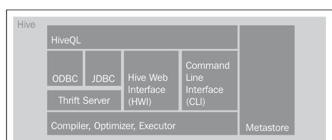

驱动程序有两种版本，64 位和 32 位，因此请确保根据客户端应用程序的位数配置下载并安装合适的驱动程序。在我的例子中，由于我将从 32 位应用程序 Visual Studio 中使用驱动程序，所以我使用了 32 位版本的驱动程序。安装驱动程序完成后，您可以通过检查 ODBC 数据源管理员的驱动程序列表中是否存在 Hive ODBC 驱动程序来确认安装状态，如以下屏幕截图所示：

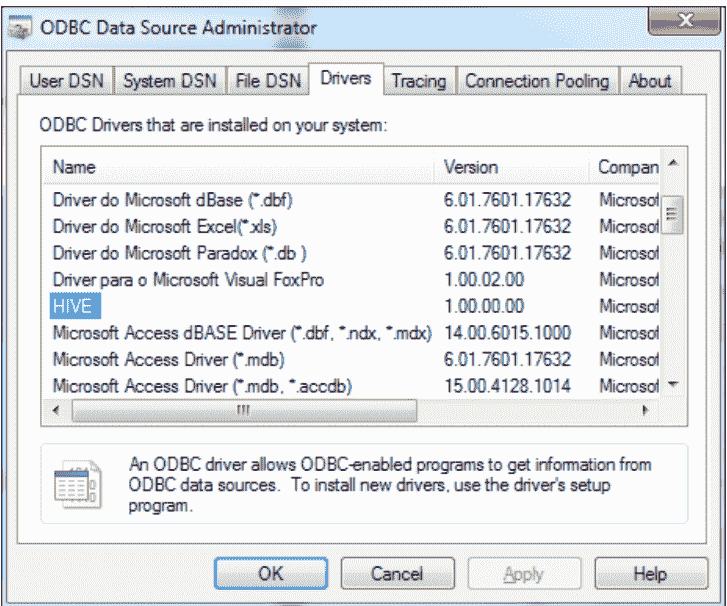

如果您使用的是 64 位 Windows 且使用的是 32 位 ODBC 驱动程序，则必须从 C:\Windows\SysWow64\odbcad32.exe 启动 ODBC 数据源管理员。

# 使用 Hive ODBC 驱动程序

驱动程序安装成功后，请执行以下步骤以确保您能够成功连接到 Hive：

- 1. 首先，创建一个系统 DSN。在 ODBC 数据源管理员中，切换到系统 DSN 选项卡并点击添加按钮，如以下屏幕截图所示：

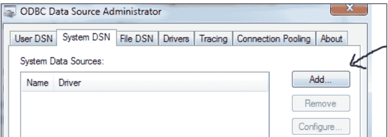

- 2. 在创建新数据源向导的下一屏幕中，选择 HIVE 驱动程序，如以下屏幕截图所示：

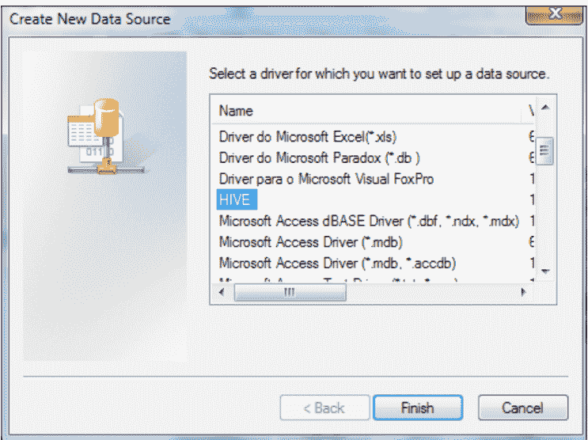

3. 点击 **Finish** 后，您会看到最终的 **ODBC Hive Setup** 屏幕。输入 Hadoop 集群的详细信息以及用于连接集群的凭据。在本示例中，我使用的是部署在 Linux 上的 Hadoop 集群，RH2754741 是我的 NameNode：

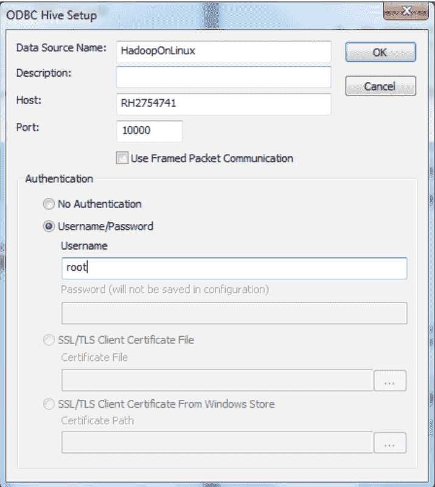

4. 创建完成后，列表中应出现一个新的系统 DSN，如以下屏幕截图所示。在本例中，我将我的 DSN 命名为 HadoopOnLinux。

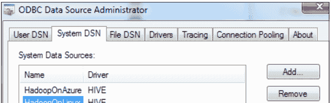

5. 现在，我们需要使用 DSN HadoopOnLinux 测试到 Hive 的连接。最快捷的测试方法是使用 .udl（通用数据链接）文件进行测试。为此，创建一个空的 .txt 文件并将文件扩展名更改为 .udl。然后双击打开 .udl 文件，默认情况下它应使用 Microsoft OLE DB 核心组件打开，并应如下图所示：

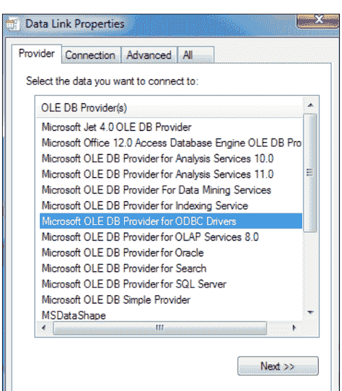

6. 选择 **Microsoft OLE DB Provider for ODBC Drivers** 并点击 **Next**。

7. 选择在前几步中创建的 DSN **HadoopOnLinux**。提供您的 Hadoop 集群的 **User name** 和 **Password**，然后点击 **Test Connection** 按钮。成功的测试连接将确认 Hive ODBC 驱动程序已正确设置，如以下屏幕截图所示，我们就可以开始了！

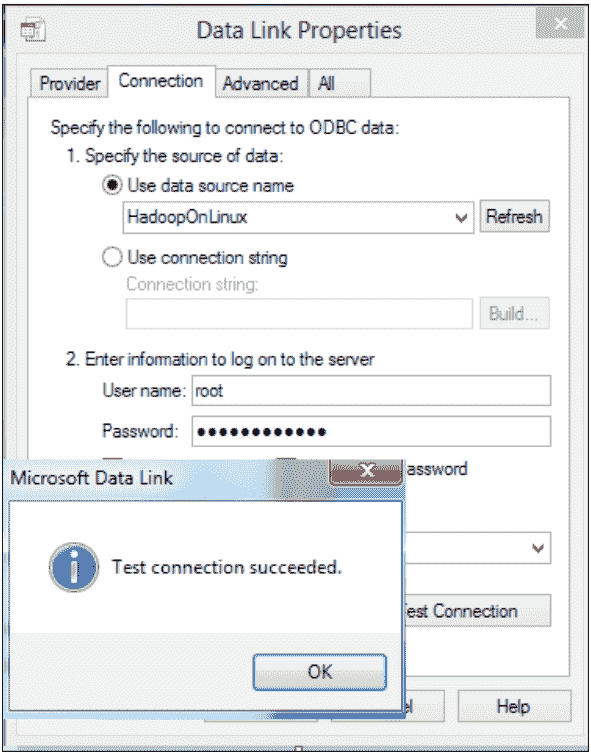

## SQL Server Integration Services (SSIS)

Microsoft SQL Server 是一套完整的工具，其中包括 RDBMS 系统、多维 OLAP 和表格数据库引擎，以及其他服务，例如代理服务、调度服务（SQL Agent）等。如第 1 章《大数据和 Hadoop 简介》所述，如今在不同数据源之间集成数据变得极其重要。SQL Server 还提供强大的商业智能堆栈，为数据挖掘和交互式报表提供丰富功能。其中一个 BI 组件是名为 SQL Server Integration Services (SSIS) 的提取、转换和加载（ETL）工具。SSIS 能够通过将 Hive 数据导入 SQL Server 并对集成数据应用强大的分析，从而合并结构化和非结构化数据。在本章的其余部分，我们将对 SSIS 的工作原理有一个基本了解，并创建一个简单的 SSIS 包以将数据从 Hive 导入 SQL Server。

### SSIS 作为 ETL – 提取、转换和加载工具

ETL 工具的主要目标是能够从异构数据源导入和导出数据。这包括连接到外部系统的能力，以及在数据在外部系统和数据库之间移动时转换或清理数据的能力。SSIS 可用于向 SQL Server 导入和导出数据。甚至可以在不需要 SQL Server 作为源或目标的情况下在外部非 SQL 系统之间移动数据。例如，SSIS 可用于将数据从 FTP 服务器移动到本地平面文件。

SSIS 还为 ETL 作业中执行的各种任务（例如数据流、任务执行等）的自动化提供了一个工作流引擎。SSIS 包的执行本身可以是 SQL Agent 作业的一部分，而 SQL Agent 可以独立运行多个作业。

SSIS 解决方案由一个或多个包组成，每个包包含一个控制流以执行一系列任务。控制流中的任务可以包括调用 Web 服务、FTP 操作、文件系统任务、命令行命令的自动化等。特别是，控制流通常包含一个或多个数据流任务，这些任务封装了从源到目标的基于内存的缓冲数据管道，并在数据流经管道时对其应用转换。SSIS 包有一个控制流，以及所需的任意多个数据流。数据流的执行由控制流的内容决定。

对 SSIS 及其组件的详细讨论超出了本书的范围，并且假设您熟悉使用 Business Intelligence Development Studio（SQL Server 2005/2008/2008 R2）或 SQL Server Data Tools（SQL Server 2012）进行基本的 SSIS 包开发。如果您是 SSIS 初学者，强烈建议先阅读一些优秀的 SSIS 书籍作为先决条件。在本章的其余部分，我们将重点介绍如何使用 Hive ODBC 驱动程序从 SSIS 消费 Hive 数据。

开发本章中所示的包的先决条件是 SQL Server Data Tools（作为 SQL Server 2012 客户端工具和组件的一部分提供），以及已安装的 32 位 Hive ODBC 驱动程序。您还需要您的 Hadoop 集群处于运行状态，并且 Hive 在其上运行。

### 开发包

SQL Server Data Tools (SSDT) 是 Microsoft 提供的集成开发环境，用于设计、部署和开发 SSIS 包。SSDT 在您从 SQL Server 安装介质中选择安装 SQL Server 客户端工具和工作站组件时安装。SSDT 支持创建集成服务、分析服务和报表服务项目。在这里，我们将重点关注集成服务项目类型。

### 创建项目

执行以下步骤创建新项目。

- 1. 从 SQL Server 2012 程序文件夹中启动 SQL Server Data Tools，如以下屏幕截图所示：

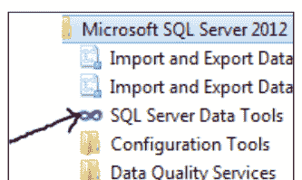

## 使用 Hive ODBC 驱动程序

2. 创建新项目并在 **New Project** 对话框中选择 **Integration Services Project**，如以下屏幕截图所示：

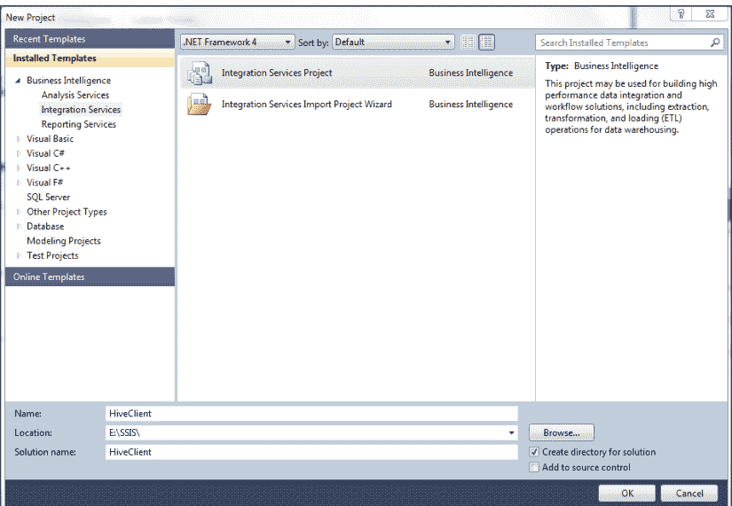

3. 这将在项目中创建 SSIS 项目，并在项目的 **Solution Explorer** 窗口中可以看到其中的空白 `Package.dtsx`，如以下屏幕截图所示：

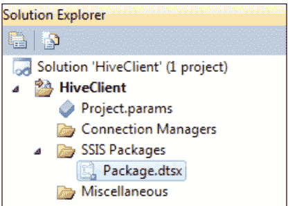

## 创建数据流

数据流是 SSIS 包组件，由提取和加载数据的源和目标、修改和扩展数据的转换，以及连接源、转换和目标的路径组成。在向包中添加数据流之前，包的控制流必须包含一个数据流任务。数据流任务是 SSIS 包中的可执行项，用于创建、排序和运行数据流。每个数据流任务在包中都会打开一个单独的数据流引擎实例。要创建数据流任务，请执行以下步骤：

- 1. 在左侧工具箱中双击（或拖放）数据流任务。这将在包的控制流画布中放置一个数据流任务，如以下屏幕截图所示：

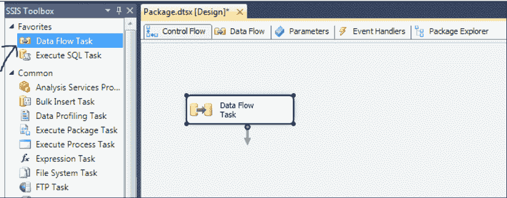

- 2. 双击数据流任务或在 SSDT 中单击数据流选项卡以编辑任务并设计源和目标组件，如以下屏幕截图所示：

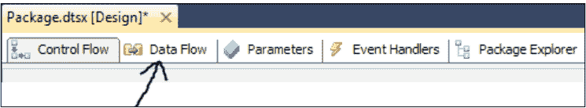

## 创建源 Hive 连接

我们需要做的第一件事是创建一个连接管理器，该管理器将连接到托管在 Hadoop 集群中的 Hive 数据表。我们将使用 ADO.NET 连接，它将使用我们之前创建的 DSN HadoopOnLinux 连接到 Hive。要创建连接，请执行以下步骤：

## 使用 Hive ODBC 驱动程序

- 1. 在项目中右键单击 **Connection Managers** 部分并单击 **New ADO.Net Connection...**，如以下屏幕截图所示：

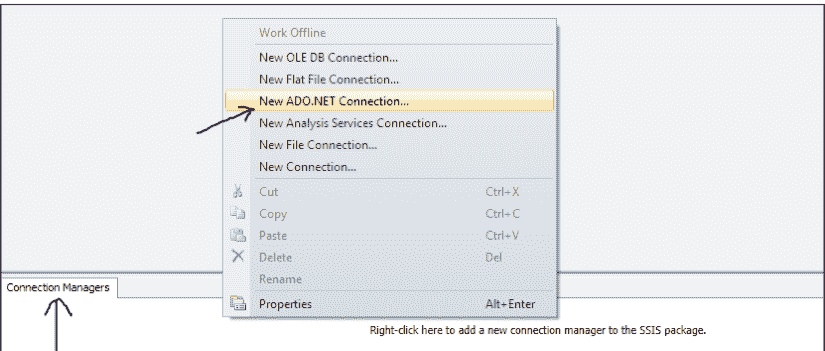

- 2. 从提供程序列表中，导航到 **.Net Providers | ODBC Data Provider** 并在 **Connection Manager** 窗口中单击 **OK**，如以下屏幕截图所示：

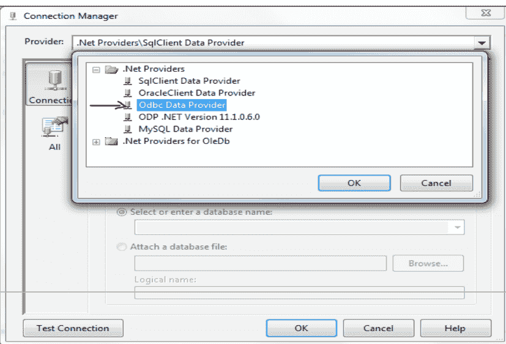

- 3. 从数据源列表中选择 HadoopOnLinux DSN。提供 Hadoop 集群凭据，测试连接应成功，如以下屏幕截图所示：

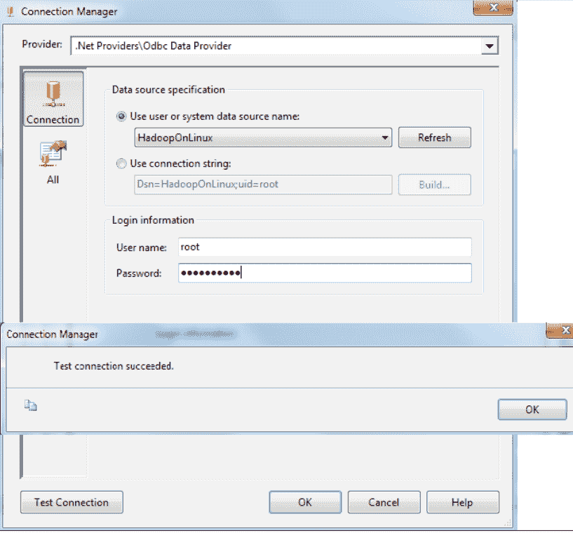

## 创建目标 SQL 连接

我们需要配置一个连接以指向 SQL Server 实例和数据库表，我们将从 Hive 导入数据到该表。为此，我们需要为目标 SQL 创建一个连接管理器，就像我们为源 Hive 所做的那样：

- 1. 再次右键单击项目的 **Connection Manager** 部分，这次选择 **New OLE DB Connection...**，如以下屏幕截图所示：

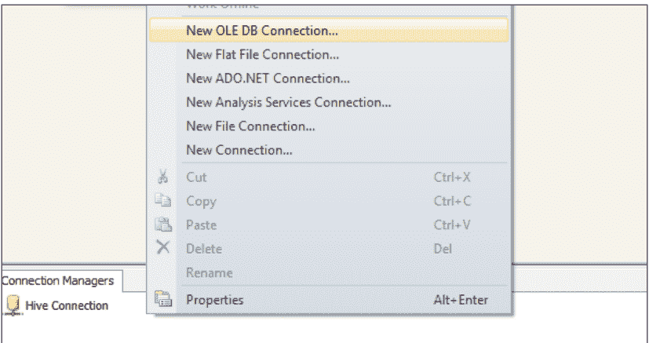

- 2. 从提供程序列表中选择 **Native OLE DB | SQL Server Native Client 11.0**。输入目标 SQL Server 名称并选择目标表所在的数据库。测试连接应成功，确认目标连接管理器的有效性，如以下屏幕截图所示：

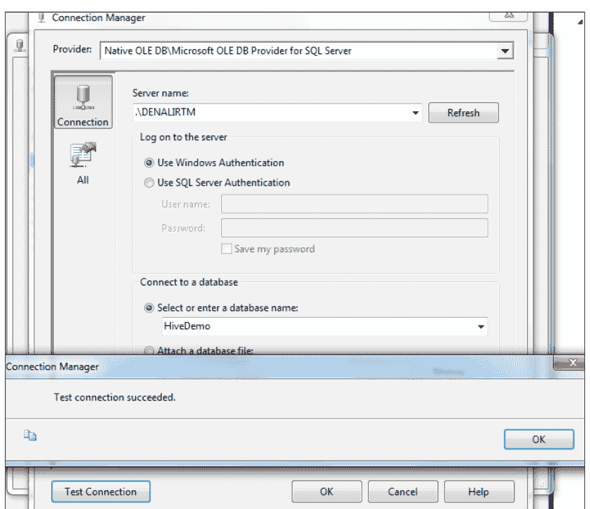

在此示例中，我选择 OLE DB 连接到 SQL。您也可以选择使用 ADO.NET 或 ODBC 连接来实现相同的目的。

## 创建 Hive 源组件

接下来，我们需要配置一个源组件，该组件将连接到 Hive 并获取数据。连接成功创建后，双击在数据流画布上放置一个 ADO NET Source，如以下屏幕截图所示：

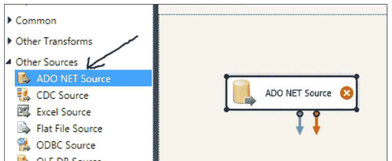

> 使用 SSIS 2012，ODBC Source 和 ODBC Destination 是一对包含在产品中的数据流组件。尽管 ODBC Source 组件支持大量 ODBC 兼容的数据源，但截至本文撰写时，该组件不支持 Hive ODBC 驱动程序。今天，从 SSIS 使用 Hive ODBC 驱动程序的唯一选项是通过 ADO.Net 组件。

右键单击 ADO NET Source 并单击 Edit 以配置源以使用刚创建的连接连接到 Hive 表。选择连接管理器（我将其命名为 Hive Connection）和 Hive 表（在我的例子中是 facebookinsights 表）。您可以预览数据以确保源可以无问题地获取数据。此外，请确保导航到 Columns 选项卡并确认可以看到表中的所有列。单击 OK 完成配置，如以下屏幕截图所示：

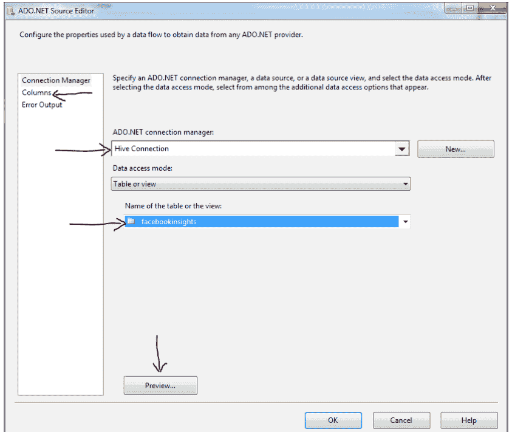

您也可以在配置源组件时通过单击 ADO.NET 连接管理器旁边的 New 按钮即时创建连接管理器。

## 创建 SQL 目标组件

源配置完成后，我们需要配置要导入 Hive 数据的目标。在此示例中，我将使用 SQL Server 作为目标。为此，双击并在数据流画布中放置一个 **OLE DB Destination** 组件。确保通过在源和目标之间拖动箭头连接 **ADO NET Source** 和 **OLE DB Destination** 组件。这是 SSIS 根据源架构结构自动生成元数据和列映射所必需的。包应如下面的屏幕截图所示：

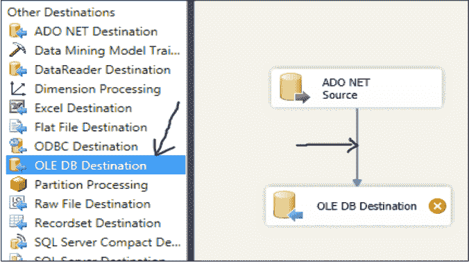

> 在此示例中，我使用了 OLE DB Destination 组件来绑定到目标 SQL Server 表。但是，您也可以为相同目的使用 ADO .NET Destination 或 SQL Server Destination 组件。
> 
> SQL Server Destination 仅在包在 SQL Server 所在的同一系统上本地运行时才有效。

现在是配置 **OLE DB Destination** 以指向正确的 SQL 连接和数据库表的时候了。为此，右键单击 **OLE DB Destination** 组件并单击 **Edit**。选择我们刚刚创建的指向 SQL 的 **OLE DB connection manager** 和目标表。在本例中，我将连接命名为 **SQL Connection**，并且我在 SQL 数据库中已预先创建了一个名为 `facebookinsights` 的表。如果您没有预先创建表，您可以选择通过单击 **Name of the table or the view** 下拉菜单旁边的 **New** 按钮即时创建目标表。这在以下屏幕截图中有所说明：

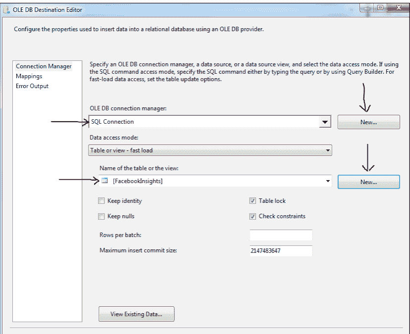

> 您也可以在配置目标组件时通过单击上一个屏幕截图中所示的相应 **New** 按钮即时创建连接管理器和数据库表。

## 映射列

完成此操作后，请确保导航到 Mappings 选项卡以确保源和目标之间的列映射正确，如以下屏幕截图所示。单击 OK 完成配置。

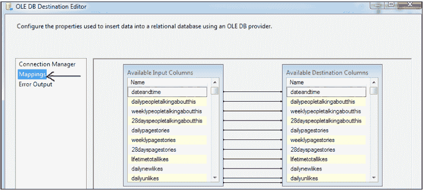

> 如果您选择自己创建目标表并指定与源不同的列名，则必须手动映射这些源和目标列。SSIS 的内置列映射智能基于相同的列名，因此如果它们不同，请确保正确设置列映射。

## 使用 Hive ODBC 驱动程序

如果您在 64 位 Windows 操作系统上运行此包，您将需要将 Run64BitRuntime 属性从 Project Properties | Configuration Properties | Debugging 选项卡更改为 False 以执行包，因为它使用 32 位 Hive ODBC 驱动程序，如以下屏幕截图所示：

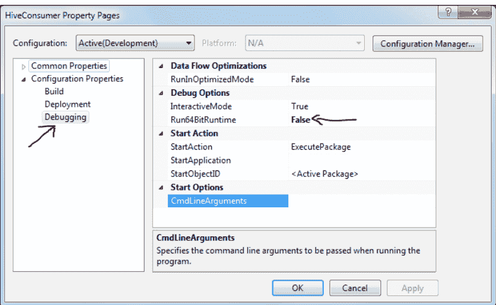

您现在可以按计划将此包作为 SQL Server 作业运行并定期运行数据加载。您可能还希望在数据加载到目标 SQL 数据仓库之前应用一些转换以清理数据或使用内置 SSIS 数据流转换组件应用必要的业务逻辑。

## Summary

在本章中，我们深入探讨了 Hadoop 支持项目 Hive。Hive 作为 HDFS 之上的数据仓库，提供易于使用且熟悉的类 SQL 查询结构 HQL 来获取底层数据。HQL 在内部被分解为 MapReduce 代码，从而免除了终端用户编写复杂的 MapReduce 代码。我们还了解了 Hive ODBC 驱动程序，它充当客户端消费者与 Hadoop 之间的接口；如何安装驱动程序以及如何测试驱动程序是否成功连接到 Hive。本章中我们也简要介绍了 SQL Server 及其商业智能组件。我们开发了一个示例包，该包使用 Hive ODBC 驱动程序连接到 Hive，并将 Hive 表 `facebookinsights` 中的数据导入到 SQL Server。一旦数据进入 SQL Server，我们就可以利用仓库解决方案例如 **SQL Server Analysis Services (SSAS)** 对数据进行切片和切分，以及使用 **SQL Server Reporting Services (SSRS)** 对数据进行强大的报告。这也使我们能够将非关系型数据集成并与传统 RDBMS 数据合并，并作为一个整体从中提取信息。在下一章中，您将看到如何使用 Hive ODBC 驱动程序在 SQL 中创建链接服务器。您还将学习如何使用链接服务器查询从 Hive 导入数据，并在 SSAS 中创建多维模型以进行进一步处理。
