# 4. 配置到 Hive 的 SQL 链接服务器
使用 SQL Server
Analysis Services
创建数据模型

Apache Hadoop 带来的灵活性和扩展性是传统基于 RDBMS 的数据仓库系统例如 SQL Server 所无法实现的。在核心 Hadoop 之上，Hive 作为数据仓库提供对 HDFS 数据的逻辑模式，这允许即席查询机制处理大型数据集。然而，查询执行、性能和周转时间通常是大多数常见 BI 实施场景的决定性因素。来自 Hadoop 和 Hive 的查询响应主要是批处理操作，其设计和预期是耗时且远非实时的。但也有业务需求的场景，他们需要对查询进行实时响应。

您可以通过使用 Hive 查询语言 (HQL) 将数据从 Hadoop 导入到 SQL Server Analysis Services (SSAS)。Analysis Services 随后可以接手并提供实时洞察和对数据的强大报告。完成本章后，您应该能够：

- 创建到 Hive 的 SQL 链接服务器
- 查询 SQL 链接服务器以从 Hive 获取数据
- 从 Hive 创建 Analysis Services 多维数据模型

## 配置到 Hive 的 SQL 链接服务器

由于 Hive 表仅通过 ODBC 暴露，因此没有直接的方式将 Analysis Services 数据库连接到 Hadoop，因为 Analysis Services 只能连接到 OLE DB 兼容的数据源。为了解决这个问题，唯一的方法是在 SQL Server 实例中使用 Hive ODBC 驱动程序创建链接服务器，并通过 OLE DB for ODBC 使用它。我们将重用我们在早期章节中创建的 DSN HadoopOnLinux 来连接到 Hive。

要创建链接服务器，请执行以下步骤：

- 1. 使用 SQL Server Management Studio 连接到 SQL Server 实例并展开 Server Objects，如以下屏幕截图所示：

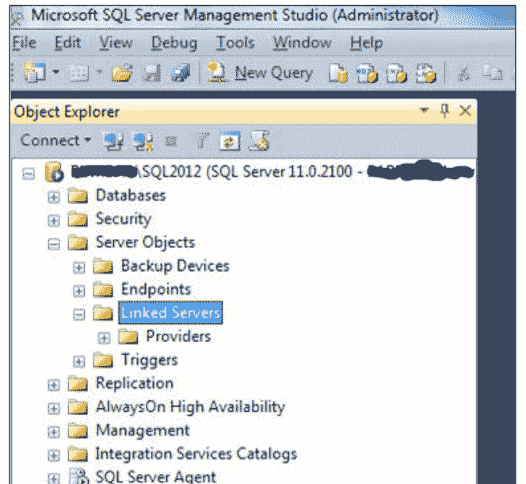

- 2. 右键单击 **Linked Servers** 并选择 **New Linked Server**。这应会弹出 **New Linked Server** 窗口，如以下屏幕截图所示：

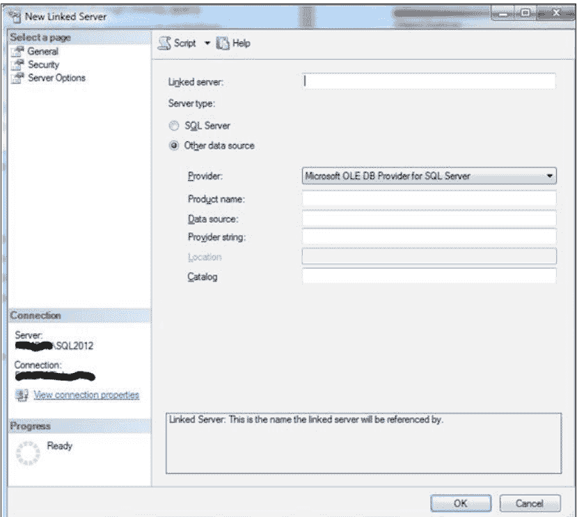

## 使用 SQL Server Analysis Services 创建数据模型

- 3. 您必须填写要连接的 Hive 数据源的详细信息。在本例中，我将链接服务器命名为 LINKTOHIVE。您必须从提供程序列表中选择 Microsoft OLE DB Provider for ODBC Drivers。您还必须使用名为 HadoopOnLinux 的 DSN 填写数据源属性，以便我们具有合适的提供程序字符串，如以下屏幕截图所示：

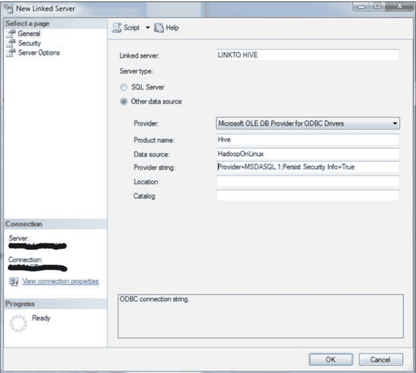

- 5. 单击 OK，这将在 **SQL Server Linked Servers** 下创建一个名为 **LINKTOHIVE** 的新链接服务器，如以下屏幕截图所示。您可以右键单击 **Linked Server** 并测试连接以确认一切设置正确。

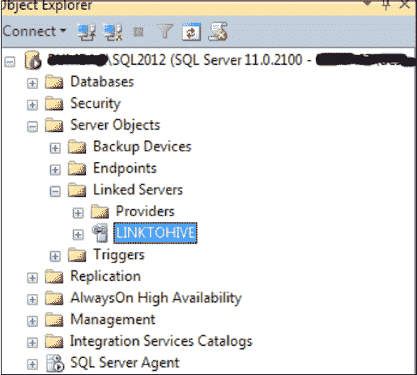

如果您喜欢基于脚本的数据库对象创建，您也可以使用以下脚本创建链接服务器：

### 链接服务器脚本

您可以通过从 SQL Server Management Studio 执行以下 Transact-SQL 脚本来设置到 Hive 的链接服务器：

```
EXEC master.dbo.sp_addlinkedserver @server=
    N'LINKTOHIVE',@srvproduct=N'Hive',@provider=N'MSDASQL',
    @datasrc=N'HadoopOnLinux',@provstr=N'Provider=MSDASQL.1;
    Persist Security Info=True'
/* For security reasons the linked server remote logins password is
changed with ######## */
EXEC master.dbo.sp_addlinkedsrvlogin @rmtsrvname=N'LINKTOHIVE',
    @useself=N'False',@locallogin=NULL,@rmtuser=N'debarchans',
    @rmtpassword='########'
```

> 💡 请确保将 rmtuser 和 rmtpassword 值替换为您自己的。

您可以使用 OpenQuery Transact-SQL 命令连接到数据源，在 Hadoop 集群上运行查询并将结果返回到 SQL Server。

## 使用 OpenQuery

以下 Transact-SQL 脚本说明了如何使用 SQL 链接服务器查询我们之前创建的 `facebooksights` Hive 表：

```
SELECT * FROM OpenQuery([LINKTOHIVE], 'SELECT * FROM facebooksights;')
```

从查询分析器执行此查询应显示来自 Hive 表的记录，如以下屏幕截图所示：

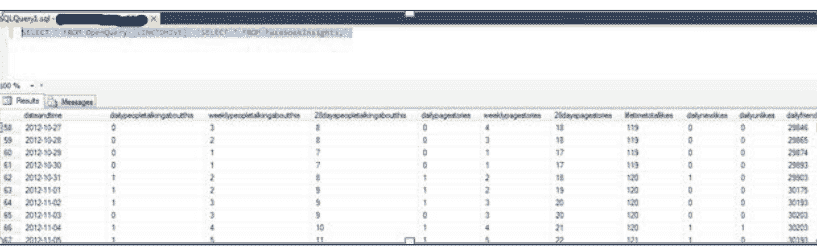

本章的下一节讨论如何从链接服务器查询导入的数据创建 **多维联机分析处理** 数据模型 (MOLAP)。然而，多维项目仅支持 SQL 表或视图作为其数据源。因此，在进入商业智能项目之前，我们将基于链接服务器查询在 SQL 数据库中创建一个视图。

### 创建视图

以下 Transact-SQL 从我们之前使用的 `OpenQuery` 语句创建视图：

```
Create View KeyMetrics AS  SELECT * FROM OpenQuery([LINKTOHIVE], 'SELECT * FROM facebooksights;')
```

Analysis Services Tabular Project 支持直接 SQL 查询来创建数据模型。

## 创建 SSAS 数据模型

一旦在运行 SQL Server 的计算机上创建了链接服务器，就可以在 SQL Server Data Tools 中非常简单地将 Analysis Services 连接到 Hive。本章的其余部分将描述如何通过按照上一节中提到的步骤创建的视图，使用链接服务器将数据从 Hive 表导入到 SSAS 多维和数据挖掘项目中的方法。

执行以下步骤创建 SSAS 数据模型：

- 1. 在 **SQL Server Data Tools** 中，在 File 菜单上单击 **New**，然后单击 **Project**。在 **New Project** 对话框中，在 **Installed Templates** 下，导航到 **Business Intelligence | Analysis Services**，然后选择 **Analysis Services Multidimensional and Data Mining Project**，如以下屏幕截图所示：

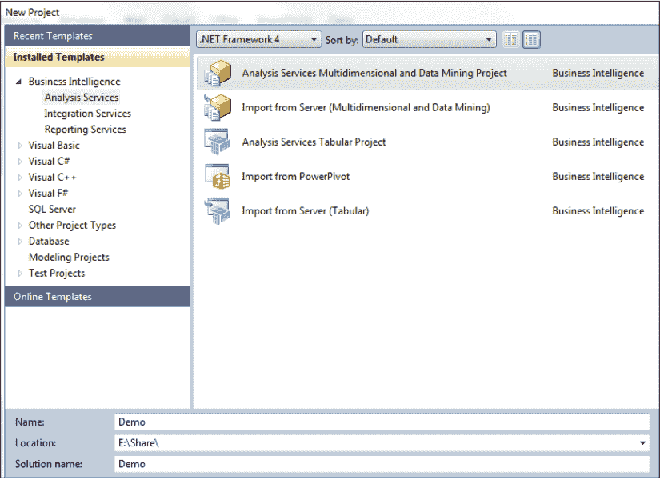

- 2. 在这里，您需要指定项目的 **Name** 和 **Location**。默认情况下，**Solution name** 与项目名称相同；但是，如果您愿意，您可以输入不同的 **Solution name**。我将我的项目命名为 **Demo**。单击 **OK** 继续并创建项目。

- 5. 接下来，您必须定义到创建了链接服务器和视图的数据库的连接。您可以在数据来源向导中选择连接，如果它已预先填充，否则，您可以单击 New 按钮来设置连接，如以下屏幕截图所示：

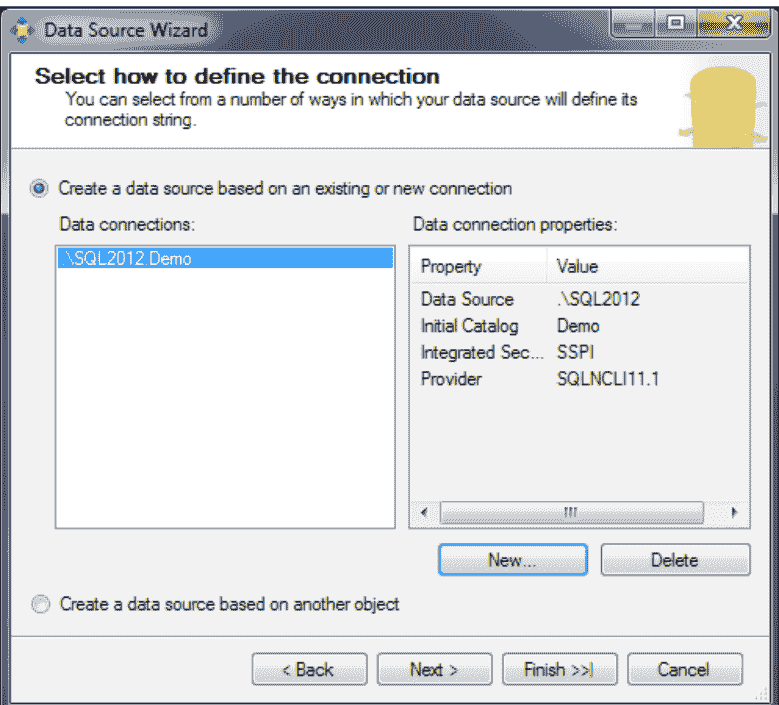


6. 接下来，在 **Impersonation Information** 页面，确保选择了 **Use the credentials of the current user**，如下图所示：

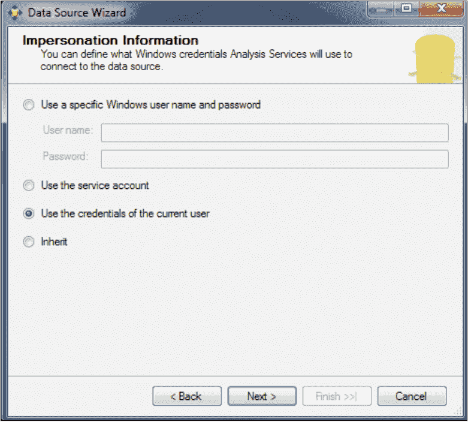

7. 点击 Next，你可以为你的连接选择一个数据源名称，如下图所示：

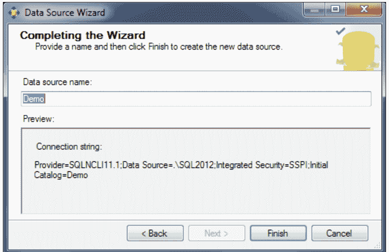

8. 点击 Finish，数据源将被成功创建并在 Solution Explorer 窗口中显示，如下图所示：

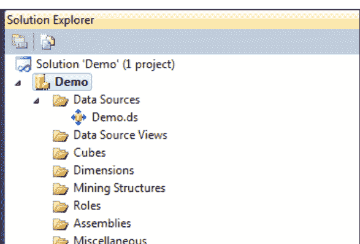

9. 数据源创建完成后，你需要定义数据源视图。这些视图将实际作为在解决方案中基于需求进一步创建关系、立方体和维度的模型。要创建视图，右键单击 Data Source Views 并选择 New 以启动 Data Source View Wizard，如下图所示：

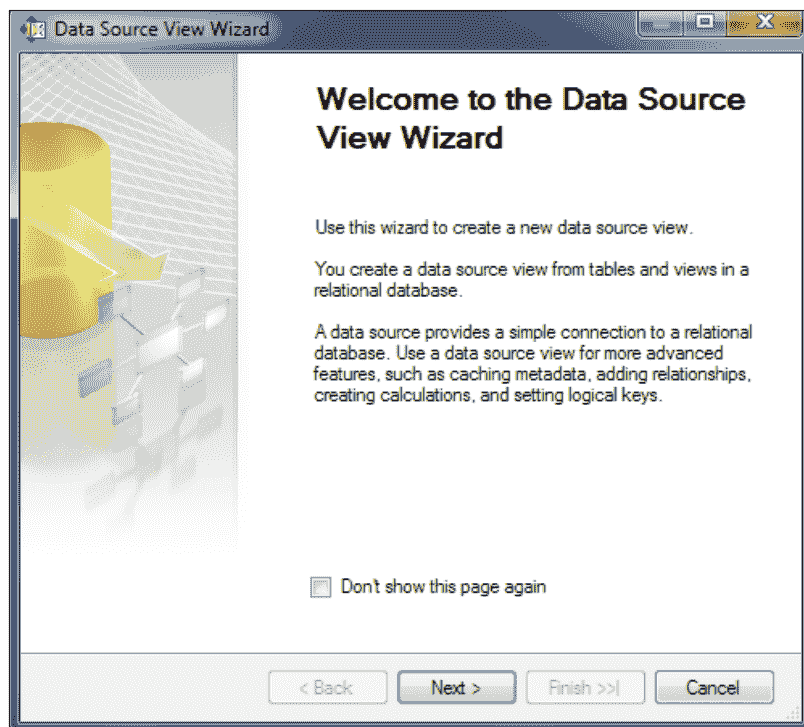

10. 点击 Next 并选择之前创建的数据源 Demo，如下图所示：

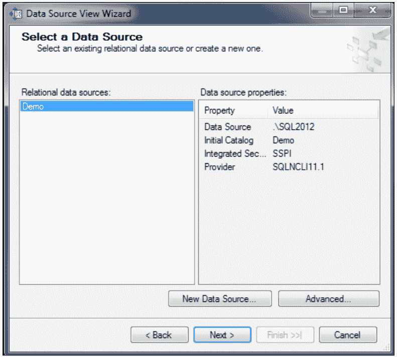

11. 点击 **Next**，你应该能在 **Available objects** 列表下看到我们在上一节中创建的 **KeyMetrics** 视图。点击右箭头将其移至 **Included objects** 列表下，如下图所示：

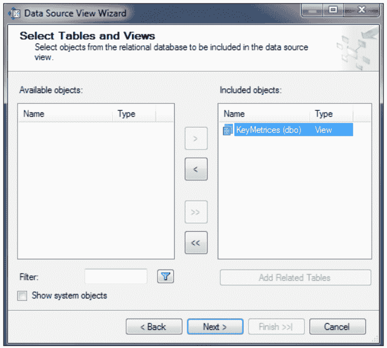

12. 助手的最后一屏是你为数据源视图提供名称并通过点击 Finish 完成向导的位置，如下图所示：

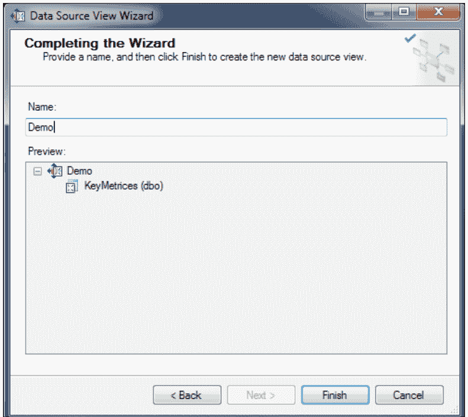

13. 点击 **Finish** 将创建视图并从 **Key metrics$** 视图中获取列，如下图所示：

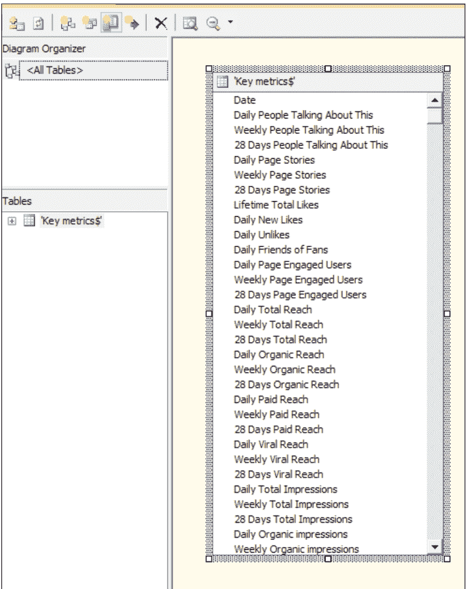
