# 5. 使用 Microsoft 的自助式商业智能工具

商业智能的重点是让业务用户能够获得比从运营系统获得的更准确、更可靠、更好的信息。传统的 BI 解决方案一直依赖于用户可以通过标准化报表和偶尔的临时查询工具访问的集中式、清洗和转换后的数据存储。报表由 BI 专家开发，最低要求是聘请一组专业人员来运行和维护基础设施和解决方案。

部署此类系统后，针对特定需求的定制数据源请求或新数据源请求可能需要数天才能得到满足，因为它必须经过定义的变更管理请求。由于只有少数资源接受过足够培训来处理这些请求，变更甚至可能需要数周才能实施。

## 使用 Microsoft 的自助式商业智能工具

许多高管已经意识到，当前的 BI 方法无法跟上动态商业环境中数据的流入速度。现在数据无处不在，并且呈指数级增长。过分依赖大预算的 BI 团队处理一切已不再可接受。这导致了一种名为自助式 BI 的新技术诞生。自助式 BI 目前是热门话题。它允许你无需聘请昂贵的 BI 基础设施或一支熟练的团队即可快速高效地执行专业级别的数据分析。Microsoft 提供了一套丰富的自助式 BI 工具，可以连接各种数据源，包括 SQL Server 2012 和 Hadoop，并快速提供数据的洞察。它结合了强大的报表功能，并在底层数据上生成无缝的交互式可视化。这通常位于管理金字塔的顶端，业务高管在此审查这些报表并做出决策以改善业务并更有效地利用资源。本章你将学习以下内容：

- Microsoft 自助式 BI 工具
- 使用 PowerPivot 生成数据模型
- 使用 Power View 在数据模型上创建交互式报表

### PowerPivot 增强功能

SQL Server 2012 为 PowerPivot 客户端即 Excel 加载项以及 SharePoint 中的 PowerPivot 服务器端组件带来了增强的数据分析功能。这使得 Microsoft Office 用户只需几次点击即可拥有自助式商业智能功能，这是以前从未有过的。用户现在能够更轻松地从异构源集成数据，并使用 Excel 和 SharePoint 等熟悉的工具对数据提供强大的可视化，从而使企业能够做出正确的决策。

PowerPivot 作为 Excel 2010 的加载项提供，允许从任何来源进行数据集成和分发，包括 **Open Data Protocol (ODATA)** 订阅源、RDBMS 源、Hadoop 等。使用 PowerPivot，你可以从前面提到的任何多样化数据源创建自己的数据模型，并直接将大量数据导入 Excel。如果需要将这些数据模型作为共享存储库，可以将其发布到 SharePoint 服务器并非常轻松地在整个企业中共享。PowerPivot 模型还可以作为市场上其他商业智能工具的数据源，包括本章后面讨论的 Power View，以生成用于趋势分析、预测分析等的直观且交互式报表。

以下部分解释了如何基于使用 Hive ODBC 驱动程序创建的 facebookinsights Hive 表生成 PowerPivot 数据模型。我们在演示中使用了 Excel 2013。请确保打开 Excel 所需的加载项，如下图所示，以构建本章中使用的示例：

1. 导航到 **File | Options | Add-ins**。在 **Manage** 下拉列表中，选择 **COM Add-ins** 并点击 **Go**，并启用以下加载项：

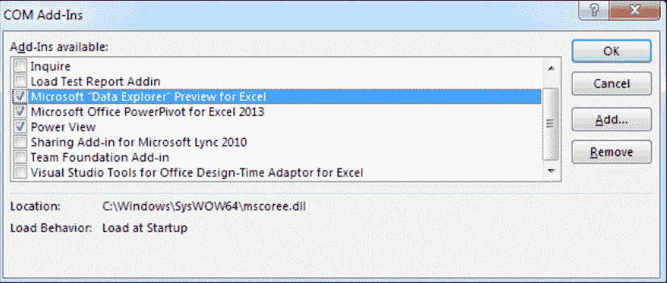

> PowerPivot 也支持 Excel 2010。Power View 和 Data Explorer 仅在 Excel 2013 中可用。

Using Microsoft's Self-Service Business Intelligence Tools

2. 要创建 PowerPivot 模型，请打开 Excel，导航到 **PowerPivot** 功能区并点击 **Manage**，如下图所示：

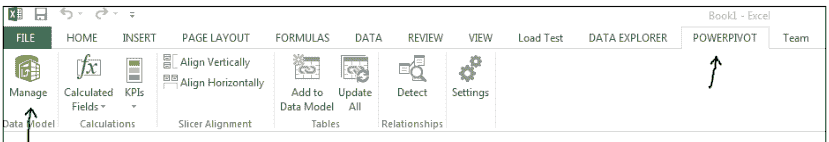

这将打开 PowerPivot for Excel 窗口，我们需要在其中配置到 Hive 的连接。

3. 点击 **Get External Data** 并选择 **From other Sources**，如下图所示：

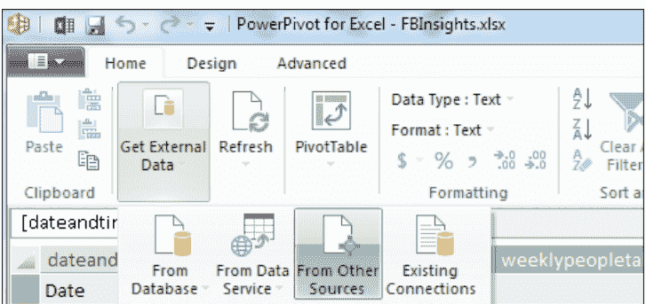

4. 由于我们将使用 Hive ODBC 提供程序，请选择 Others (OLEDB/ ODBC) 并在 Table Import Wizard 上点击 Next，如下图所示：

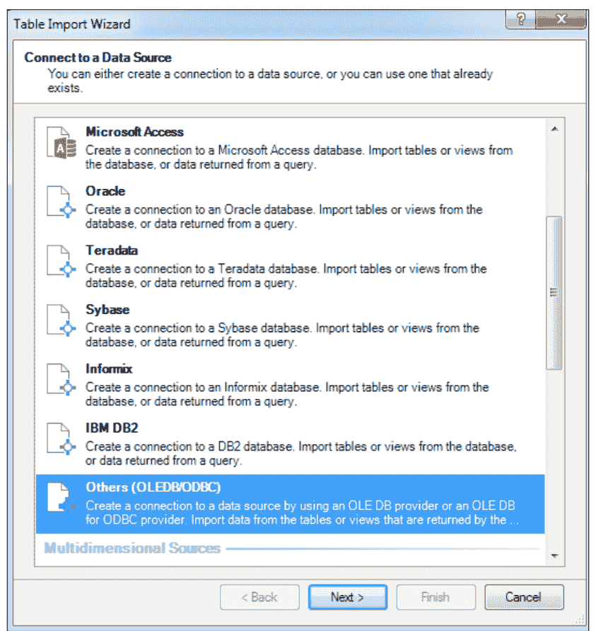

5. 向导中的下一屏接受我们数据源的连接字符串。手动编写连接字符串更容易通过构建它来完成。因此，点击 Build 按钮以调出 Data Link 窗口，在其中你可以选择我们之前创建的 HadoopOnLinux DSN，并提供访问 Hadoop 集群的正确凭据。请确保选中 Allow saving password，以便密码保留在底层的 PowerPivot Table Import Wizard 中。同时验证测试连接成功，如下图所示：

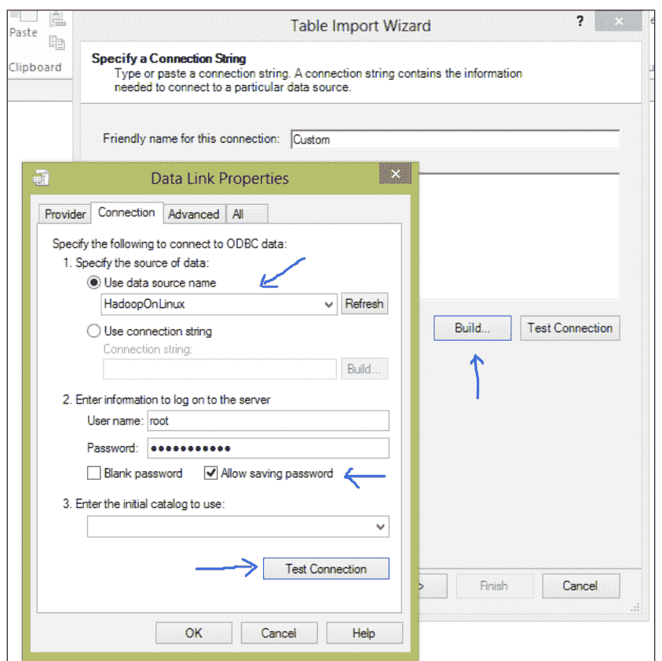

6. Table Import Wizard 对话框现在应已填充适当的连接字符串，如下图所示：

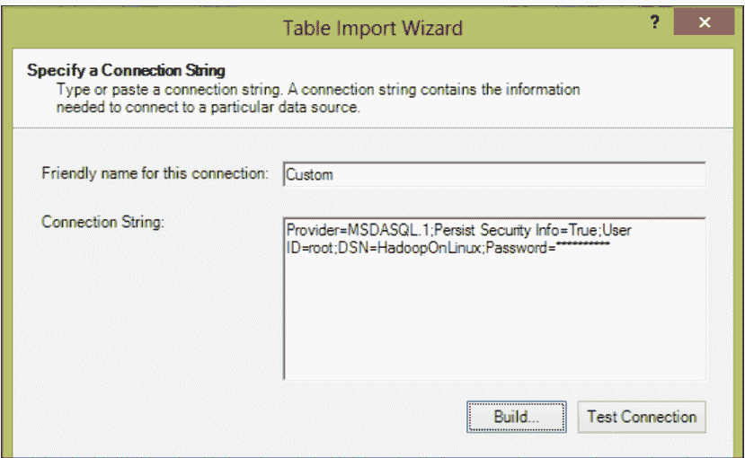

7. 接下来，我们将直接选择 Hive 表，但我们也可以编写查询（HiveQL）来获取数据，如下图所示：

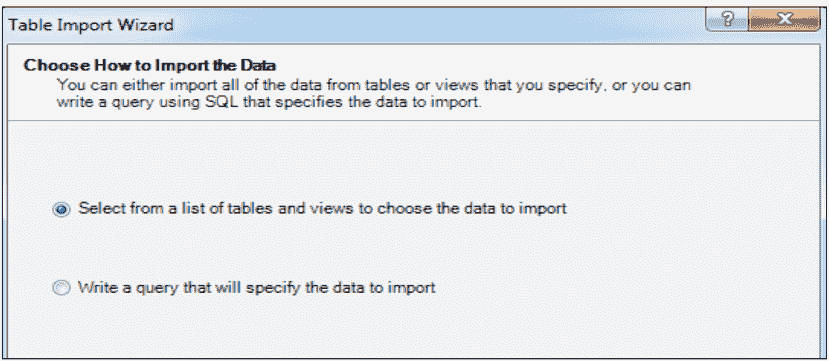

8. 选择 `facebookinsights` 表并点击 **Finish** 以完成配置，如以下屏幕截图所示：

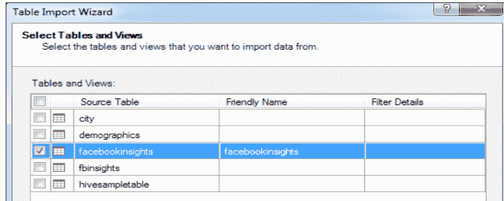

9. 带有所有行的 Hive 表应已成功加载到 PowerPivot 模型中，如以下屏幕截图所示：

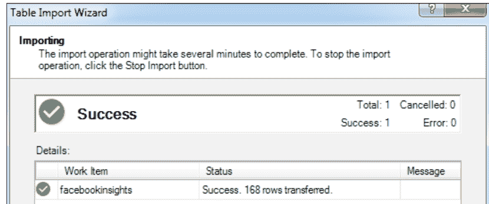

10. 关闭 Table Import Wizard。

数据已添加到模型中，因此我们也可以继续关闭 PowerPivot 窗口。这将带我们返回到 Excel 工作表，该工作表现在已在内存中包含数据模型。在下一节中，我们将看到如何使用 Power View 来使用 PowerPivot 数据模型并快速创建智能和交互式报表。

## Power View for Excel

Microsoft Excel 2013 引入了一种全新的自助式 BI 工具，称为 Power View。这也是 Microsoft SharePoint 2013 的一部分，随 SQL Server 2012 Reporting Services Service Pack 1 Add-in for Microsoft SharePoint Server 2013 Enterprise Edition 提供。Power View 的客户端（Excel）和服务器端（SharePoint）实现都提供了一种交互式方式来探索和可视化您的数据，以及在底层数据之上生成交互式报表。

本章的其余部分展示了一个基于 facebookinsights 表数据的示例 Power View 报表，以便让您从表面层面快速了解强大的报表功能。关于“如何设计 Power View 报表”以及 Power View 与 SharePoint 集成的细节超出了本书的范围，不会深入讨论。

> Power View 仅支持 Excel 2013。您需要为 Excel 安装 Power View 加载项。

要基于之前创建的 PowerPivot 数据模型创建 Power View 报表，请在 Excel 中点击 **Insert** 功能区并点击 **Power View**，如以下屏幕截图所示：

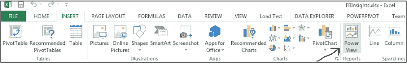

这应启动一个新的 Power View 窗口，其中 PowerPivot 模型已可用，如以下屏幕截图所示：

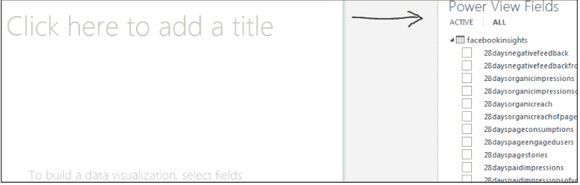

我们可以选择所需的字段并在报表中显示。您可以选择不同类型的图表、表格和矩阵报表。作为示例，我创建了一个报表，显示了我 Facebook 页面在一段时间内点赞数和粉丝数的变化，如以下屏幕截图所示：

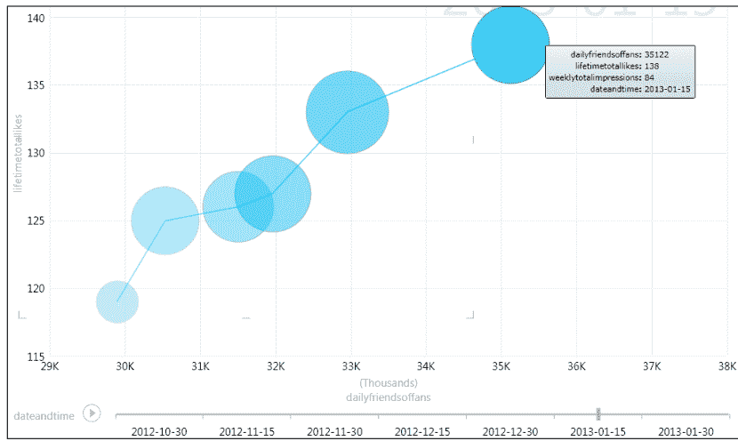

Power View 设计器为您提供不同类型的图表、轴和时间线布局，这使得生成简单的可视化变得非常容易。然而，这些自助式工具不应被视为我们现有 BI 解决方案的替代品。它不是标准参数化报表的替代品，而是一种增强功能，使关键职能和领导者能够利用自己的分析，而无需给稀缺的 IT 资源带来压力。

## Summary

在本章中，我们学习了如何将 Microsoft 自助式 BI 工具与 Hadoop 和 Hive 集成，以使用数据并在数据上生成强大的可视化。随着技术范式的转变，行业正朝着信息技术成为消费品的时代发展。个人应该能够从像 Power View 这样的客户端加载项中按需可视化所需的见解。这些自助式 BI 工具提供了无缝连接和访问各种数据源的能力，并创建内存中数据模型，将来自这些不同来源的数据结合起来以实现强大的报表。
