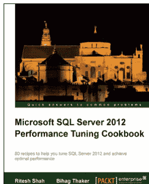
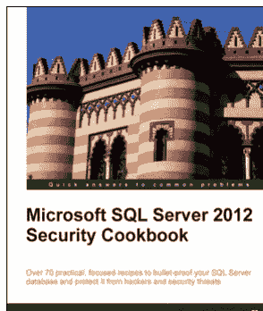
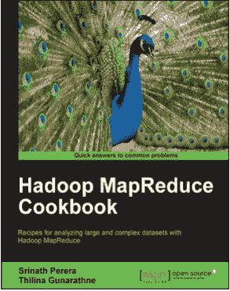
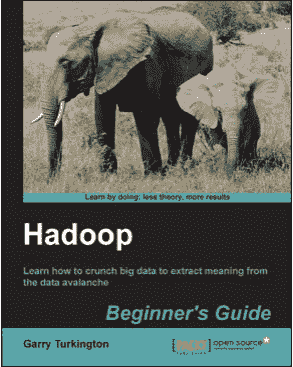

## Index

### Symbols

- .udl (Universal Data Link) file 34

### A

- Apache Hadoop framework
    - about 9
    - Flume 12
    - HBase 12
    - HDFS 10
    - Hive 12
    - Mahout 13
    - MapReduce 10
    - Oozie 12
    - Pig 12
    - Sqoop 12

### B

- Big Data
    - about 5-8
    - community data 7
    - organizational data 7
    - personal data 7
    - variety 6
    - velocity 6
    - volume 6
    - world data 7
- Business Intelligence (BI) 7, 71

### C

- community data 7

### D

- Data Flow
    - about 39
    - creating 39
- DataNode 10
- Data Source View Wizard 65
- data type categories
    - Approximate numeric 25
    - Binary strings 26
    - Character strings 26
    - Date and time 25
    - Unicode character strings 26
- destination SQL connection
    - creating 42, 43

### E

- ETL tool, SSIS 36
- Excel 30
- export command 16
- Extract, Transform, and Load (ETL) tool 8

### F

- Flume 12

### H

- HBase 12
- Hive 12
    - about 29
    - advantages 30
    - architecture overview 29
    - SQL Linked Server, configuring to 54-58
    - tables, picking 22
- Hive ODBC Driver
    - about 30
    - connection, to Hive 32-35
    - downloading 30
    - installing 31
- **Hive Query Language (HQL) 29**
- **Hive source component**
    - creating 44, 45

### I

- **Impersonation Information page 63**
- **installation prerequisites**
    - Hadoop cluster, on Linux 17
    - Microsoft JDBC driver, setting up 18
    - Sqoop, configuring 17
    - Sqoop, installing 17

### J

- job command 16
- **JobTracker 11**

### K

- **KeyMetrics view 69**

### L

- Linux
    - Hadoop cluster 17

### M

- **Mahout 13**
- **MapReduce**
    - about 10
    - DataNode 10
    - JobTracker 11
    - NameNode 10
    - Secondary NameNode 10
    - TaskTracker 11
- **Microsoft JDBC driver**
    - setting up 18

### N

- NameNode 10
- **New Linked Server window 55**

### O

- ODBC Data Sources (DSN) 30
- **Oozie 12**
- Open Data Protocol (OData) 72
- organizational data 7

### P

- personal data 7
- **Pig 12**
- **PowerPivot**
    - enhancements 72-78

### R

- Relational Database Management System (RDBMS) 15

### S

- Secondary NameNode 10
- **Solution Explorer window 64**
- source Hive connection
    - creating 39, 41
- **SQL destination component**
    - creating 46, 47
- **SQL Linked Server configuration, to Hive**
    - Linked Server script 58
    - OpenQuery, using 59
    - performing 54-58
    - View, creating 59
- **SQL Server Data Tools. See SSDT**
- **SQL Server-Hadoop Connector**
    - about 16
    - downloading 18, 19
    - installation prerequisites 17
    - installing 19
    - Sqoop import tool 19-22
- **SQL Server Integration Services. See SSIS**
- **SQL Server Reporting Services. See SSRS**
- **Sqoop 12**
    - configuring 17
    - installing 17
- **sqoop export command 16**
- **sqoop import command 16**
- Sqoop import tool
    - about 19, 23, 24
    - data types 24, 26
    - tables, importing in Hive 22
- sqoop job command 16
- sqoop version command 16
- SSAS data model
    - creating 60-70
- SSDT 37
- SSIS
    - about 36
    - as ETL tool 36
- SSIS packages
    - developing 37
    - running 49, 50
- SSIS packages development
    - columns, mapping 48, 49
    - Data Flow, creating 39
    - destination SQL connection, creating 42, 43
    - Hive source component, creating 44, 45
    - project, creating 37, 38
    - source Hive connection, creating 39, 41
    - SQL destination component, creating 46, 47
- SSRS 30

### T

- Table Import Wizard 76
- TaskTracker 11, 12

### W

- world data 7

## Microsoft SQL Server 2012 Performance Tuning Cookbook

ISBN: 978-1-84968-574-0 Paperback: 478 pages

80 recipes to help you tune SQL Server 2012 and achieve optimal performance

- 1. Learn about the performance tuning needs for SQL Server 2012 with this book and ebook
- 2. Diagnose problems when they arise and employ tricks to prevent them
- 3. Explore various aspects that affect performance by following the clear recipes

## Microsoft SQL Server 2012 Security Cookbook

ISBN: 978-1-84968-588-7 Paperback: 322 pages

Over 70 practical, focused recipes to bullet-proof your SQL Server database and protect it from hackers and security threats

- 1. Practical, focused recipes for securing your SQL Server database
- 2. Master the latest techniques for data and code encryption, user authentication and authorization, protection against brute force attacks, denial-of-service attacks, and SQL Injection, and more
- 3. A learn-by-example recipe-based approach that focuses on key concepts to provide the foundation to solve real world problems

Please check www.PacktPub.com for information on our titles

## Hadoop MapReduce 实战手册

ISBN: 978-1-84951-728-7　　 平装：300页

使用 Hadoop MapReduce 分析大型复杂数据集的实战技巧

- 1. 学会处理大型复杂数据集，从简单开始，然后深入探究
- 2. 解决复杂的大数据问题，如分类、关系发现、在线营销和推荐
- 3. 超过50个Hadoop MapReduce实战技巧，以简单直接的方式呈现，包含分步说明和真实案例

## Hadoop 初学者指南

ISBN: 978-1-84951-730-0　　 平装：398页

学习如何分析大数据，从数据洪流中提取有价值的信息

- 1. 学习让你欣然面对而非恐惧大数据的工具和技术
- 2. 展示如何构建完整的基础设施，以满足数据增长带来的需求
- 3. 每章中的动手示例既提供全局视野，又带来直接实践经验

