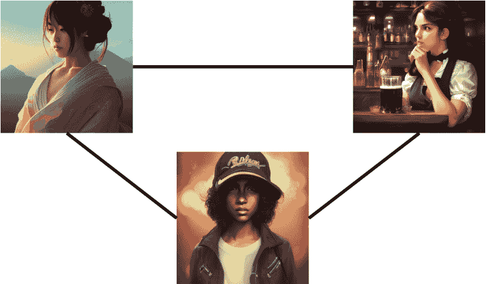
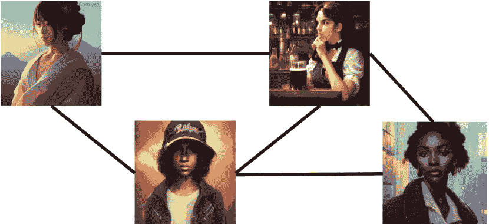
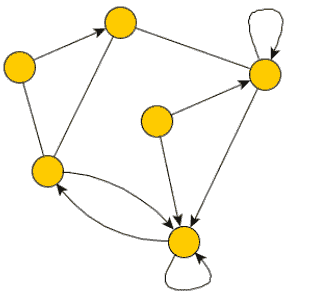
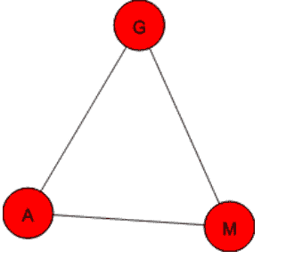
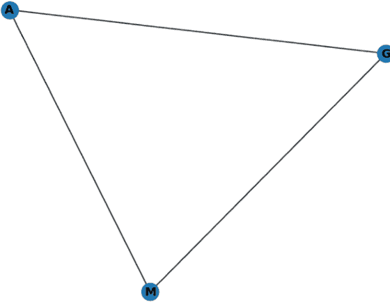
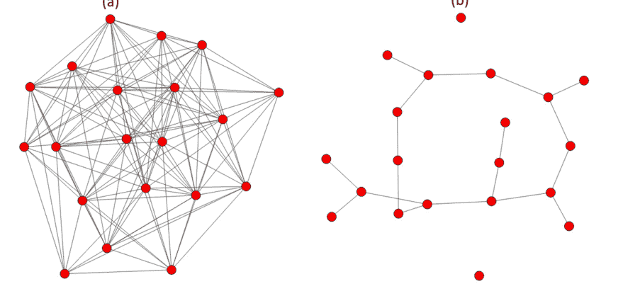
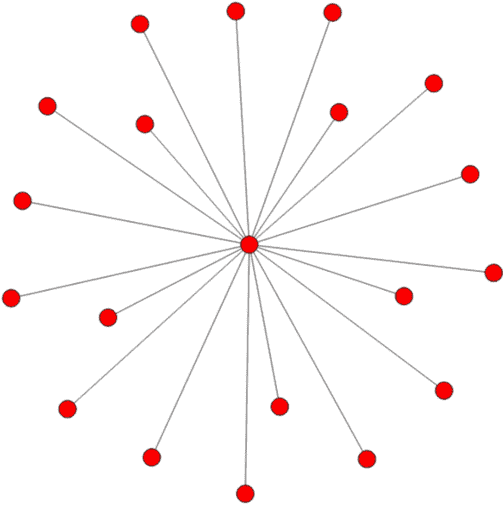
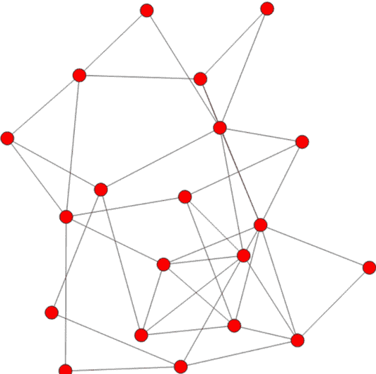
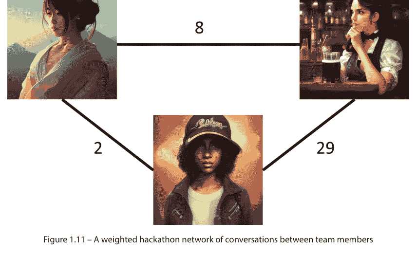

# 什么是网络？

本章介绍了图论的基础知识及其在网络科学中的应用。网络科学并不是数据科学中常见的教学领域，但许多问题可以通过网络科学视角来构建。基于网络的算法通常比其他机器学习算法扩展性更好，使其非常适合分析具有大量变量的数据集、探索具有大量位置表示的空间数据集，或在高维时间序列数据中发现趋势。后面的章节将通过实践示例更深入地探讨这些主题。

在本章中，我们将定义贯穿全书使用的术语，探索网络科学在分析社会关系数据中的一些常见用途，并介绍后续章节中将使用的两个 Python 包。完成本章后，您将开始识别可表述为网络科学问题的数据科学问题，以及如何在 Python 中对其进行可视化表示。

正式地，我们将涵盖以下主题：

+   - 图论和网络简介
+   - 真实世界社交网络的示例
+   - 其他类型的网络

## 技术要求

本章的技术要求或假设非常少。如果您尚未安装 Python，建议您这样做，因为我们将定期使用 Python——具体来说，是随 Anaconda 版本的 Python 安装一起安装的 Jupyter Notebook。如果您在安装方面遇到困难，可以在 Stack Overflow 上找到支持。每个章节的代码都可以在此 GitHub 链接下找到：https://github.com/PacktPublishing/Modern-Graph-Theory-Algorithms-with-Python。


## 图论与网络简介

社会联系是社会的基础，包括家庭纽带、社区中的共同角色、贸易关系等等。社交网络——从 MySpace 到 Twitter 再到 TikTok——在过去几十年里在营销、求职和信息共享中扮演着越来越重要的角色。软件系统甚至可能由散布在全球各地的工程师在 GitHub 或 Slack 等平台上协作构建，以协调肯尼亚、印度和澳大利亚团队的努力，而这些团队从未谋面。

数据科学的一个分支称为 **网络科学**，它使用源自数学领域 **图论** 的算法和统计方法来研究社交网络中个人、群体甚至社会之间的这些关系。图论研究对象之间的成对关系。图对象（包括人、城镇、思想、时间点以及许多其他类型的研究对象）在网络科学中表示为网络中的顶点或点；请注意，一些学科可能会使用“节点”一词代替“顶点”。对象之间的关系（例如人与人之间的相互合作、连接不同岛屿的桥梁或时间点之间的统计联系）表示为网络中的边，并连接共享关系的顶点对。

为了让这一点更具体一些，让我们考虑三位年轻女性：南非的 Ayanda、日本的 Machiko 和比利时的 Greta：


图 1.1 – Ayanda、Machiko 和 Greta

也许 Ayanda、Machiko 和 Greta 参加了一场旨在可持续能源解决方案的在线女性编程黑客松。通过黑客松，她们相识并组成了一个团队，共同为农村村庄开发太阳能解决方案。她们形成了专业网络，三位女性之间存在相互关系，如图 1.2 所示：



图 1.2 – Ayanda、Machiko 和 Greta 的网络表示，显示女性之间的成对连接

随着这些女性在黑客松项目上工作，Ayanda 可能会邀请其社交网络中的同事加入团队，并随着时间的推移为 Machiko 和 Greta 创造新的联系。也许 Amara，Ayanda 来自肯尼亚的同事，与 Greta 而非 Machiko 联系，为他们的项目编写后端，从而为网络增加另一名成员：



图 1.3 – 增加 Amara 后的社交网络

## 什么是网络？

网络随时间演变是当今网络科学中的一个关键问题，因为我们通常对超出我们明确观察到的关系数据不完整，并且希望预测未来现象，例如预测下一次选举中两党虚假新闻传播的潜力，或根据当前存在的联系预测新成员何时可能加入犯罪组织。我们将在 *第 8 章* 中处理一些与动态社交网络及其应用相关的问题，在那里我们分析疾病随时间传播的情况，因为社交网络在演变。

在深入研究 Python 中的现实世界问题及其解决方案之前，了解网络科学的基础知识很重要。让我们深入探讨图论和网络的术语和惯例。

### 形式定义

现实世界的网络通常使用图论的工具进行形式化和研究。正如我们提到的，图论以顶点的形式定义对象之间的关系，以及连接相关顶点的边。让我们稍微形式化一下并探索图论中网络科学的基础。图被定义为一组顶点和一组线，即连接顶点对的边（Berge, 2001）。因此，图很好地表示了网络的结构。回到我们的黑客松社交网络，我们将同事表示为顶点，如果他们合作则用边连接。

图可以表示不同类型的关系。顶点的自关系可以用连接顶点自身的环来表示。例如，在写电子邮件时，有人可能会抄送自己或给自己发送电子邮件作为提醒。另一种关系类型是方向性。例如，转发内容通常是一种单向交互，但加好友是一种双向交互，双方相互连接。单向关系在图中用有向边表示，通常在图的视觉化中用箭头表示。双向关系具有无向边，表示为没有箭头的线。*图 1.4* 显示了一个包含环、有向边和无向边的图：



图 1.4 — 包含环、有向边和无向边的图

在科学文献中，网络和图这两个术语可以互换使用，边和顶点的术语也是如此。表 1.1 显示了一些常见的术语：

| 网络科学 | 图论 |
|---|---|
| Network | Graph |
| Node | Vertex |
| Link | Edge |
| Collection | Set |
| Relationship | Function |
| Directed graph | Digraph |

表 1.1 – 网络科学与图论之间的术语比较

在实践中，这些区别很少被做出，因此这两种术语通常是彼此的同义词。在本书中，我们将坚持使用边和顶点作为我们的图组件，并将网络作为我们从现实世界数据创建的顶点和边集合的首选术语。

图论中存在许多类型的图，它们在现实世界数据中得以实现。让我们简要定义一些存在的图类型：

- 一个有向图包含一个或多个具有方向的边（到或来自另一个顶点，称为弧）
- 一个无向图只有边，这些边没有起点或终点顶点

“一个图如果没有多重线（通常用于表示存在的多个关系或表示关系的强度）则是简单的。”一个简单的无向图不包含环，但一个简单的有向图可以包含环。让我们可视化这些图在实践中是什么样子的：

- 2. 我们将导入 igraph 及其 Graph 模块：

```
```python
#import igraph
import igraph as ig
from igraph import Graph
```
```

- 3. 接下来，我们将使用 Graph 模块创建一个具有三个顶点的图，并用无向边连接每个顶点与剩余顶点：

```
```python
#create hackathon network
g_colleagues=ig.Graph(
    edges=[(0,1),(0,2),(1,2)],n=3,directed=False)
```
```

- 4. 现在，我们可以使用 plot 函数可视化我们的黑客松网络。igraph 提供了许多自定义选项，包括顶点颜色、顶点大小、边颜色、边大小、顶点标签以及绘图大小（等等）。对于此绘图，我们将限制图像大小并创建足够大的顶点以用黑客松网络成员的姓名首字母进行标记：

```
```python
#plot the hackathon network
ig.plot(g_colleagues,bbox= (200,200), vertex_size=40,
    vertex_label=["M","A","G"])
```
```

这应该会给你一个看起来像 *图 1.6* 的绘图，显示 *Machiko*、*Greta* 和 *Ayanda* 的黑客松网络：



图 1.6 – igraph 中黑客松网络的绘图

现在让我们在 NetworkX 中重复我们的网络创建。NetworkX 包含 igraph 的大部分功能，但提供了与其他网络科学工具和平台更轻松的集成，以及在网络上探索微分方程的简单方法：

- 1. 让我们先安装 NetworkX：

```
```bash
#install NetworkX
!pip install NetworkX
```
```


## 什么是网络？

+   2. 现在，让我们导入 NetworkX：

```
```python
#import NetworkX
import networkx as nx
```
```

+   3. NetworkX 在构建网络的方式上与 igraph 有些不同。我们首先定义一个空图，填充顶点，然后定义存在哪些边。

```
```python
#create hackathon network
G = nx.Graph()
G.add_nodes_from([1, 3])
G.add_edges_from([(1, 2), (1, 3), (2, 3)])
```
```

+   4. 我们需要添加属性（我们的网络成员姓名首字母），导入 matplotlib，然后绘制我们的图：

```
```python
#plot the hackathon network
import matplotlib.pyplot as plt
G.nodes[1]['initial'] = 'M'
G.nodes[2]['initial'] = 'A'
G.nodes[3]['initial'] = 'G'
labels = nx.get_node_attributes(G, 'initial')
nx.draw(G, labels=labels, font_weight='bold')
```
```

这应该显示一个结构与我们在 igraph 中构建的相似但风格略有不同的图：



图 1.7 – 我们黑客松网络的 NetworkX 绘图

在接下来的章节中，我们将同时使用 igraph 和 NetworkX 来展示两个包中的示例。对于某些问题，igraph 会具有更好的功能；对于其他问题，NetworkX 更为可取。在实践中，当你在现实世界问题上实现网络科学时，你会遇到两者。在下一节中，我们将概述不同类型的网络和问题，为我们未来的章节奠定基础。

## 随机图

随着网络科学开始处理越来越多的现实世界问题，理解网络增长过程成为研究的一个方向：

*边构建是纯粹随机的吗？*

*给定顶点数量，任何顶点培养的边数是否存在限制？*

*拥有许多边的顶点是否倾向于在与某个高度连接的顶点共享一条边的未连接顶点之间鼓励边的形成？*

*顶点和边是否会分离成与其它组连接不好的高度连接的组？*

一些增长过程模型产生了在网络科学研究中有用的常见增长模式。其中一些，例如 **Erdős-Renyi 网络**，可作为与现实世界网络中有组织的开发进行比较的参照。Erdős-Renyi 网络是随机网络，其中顶点之间的边以概率方式在任意一对顶点之间创建。例如，为了创建一个具有许多边的网络，我们可能会将顶点对连接的概率设置为 70%。为了创建一个具有较少边的网络，我们可能会将顶点对连接的概率设置为 10%。图 1.8 (a) 显示了边连接概率为 70% 的 Erdős-Renyi 网络；图 1.8 (b) 显示了边连接概率为 10% 的 Erdős-Renyi 网络：



图 1.8 – 边概率为 (a) 70% 和 (b) 10% 的 Erdős-Renyi 网络

## 什么是网络？

在现实世界中，优先连接，即某些顶点吸引与其他顶点的连接，是描述顶点之间如何添加边的更现实的模型。优先连接最著名的例子之一是 **Barabasi-Albert 模型**，其中网络在某些顶点周围形成更多连接。

在优先连接的一个现实世界例子中，让我们考虑一名前端工程师在社交媒体上搜索潜在合作的后端工程师。因此，前端工程师的连接不会是随机的。它们将根据工程师的具体需求以及对后端工程师的搜索结果来培养。**无标度网络** 是对这种在现实世界网络形成过程中经常发生的连接偏好的模型。*图 1.9* 显示了前端工程师在添加所需连接后的社交网络，这些连接对象在与前端工程师连接之前可能彼此不认识：



图 1.9 – 由前端工程师在社交媒体上的搜索培养的工程连接的无标度网络

对无标度网络形成模型的主要批评之一是缺乏枢纽，即顶点集合之间连接性高且与其他顶点集合连接相对较少的区域。**Watts-Strogatz 模型** 考虑了形成更密集连接区域的这种倾向。作为一个例子，基因网络通常形成相互功能影响的相关基因簇；一些基因簇也会影响其他基因簇，形成偶尔的基因集合之间高连接性的连接，如 *图 1.10* 所示：



最近的研究表明，没有一种随机网络模型能够捕捉到现实网络所具有的所有细微差别。许多现实网络具有优先连接的方面和密集聚类的方面，以及一些在已知网络情况下不会预期的随机连接。朋友的朋友经常会相识。个人通过搜索社交网络或连接到朋友的其他社交群体来寻找与他们有共同兴趣的人。一些友谊在随机情况下开始，例如个人被困在电梯或渡轮上。

现在我们已经探讨了如何在 Python 中创建网络，让我们回到一些现实世界网络的例子，包括有向和无向网络以及随时间结构发生变化的网络。

## 现实世界社交网络的例子

现实世界网络往往比我们考虑过的例子更复杂。让我们考虑社交媒体网络中的一些细微差别。在最简单的形式中，社交网络包含在某一时间点上朋友之间的相互连接。然而，一些朋友可能在社交媒体平台上互动更频繁；他们可能会评论帖子、重新分享内容并频繁地相互发送消息。加权网络根据关系强度或互动频率的某种度量为网络中的边分配数值。

让我们回到我们的黑客松网络，并根据黑客松期间不同团队成员之间平均每天的对话次数来加权我们的边。也许 Machiko 正在协调该技术的商业用例，与后端工程师 Ayanda 互动不多，但需要确保前端直观易用（Greta 的团队职位）。然而，我们预计 Ayanda 和 Greta 会更频繁地一起工作，因为他们正在集成产品的后端和前端。也许我们有一个如图 1.11 所示的加权网络：



图 1.11 – 团队成员之间对话的加权黑客松网络

除了加权之外，关系可以是无向或有向的。到目前为止，我们考虑的是无向网络，其中关系是相互的。友谊、Zoom 通话、共享课程、团队成员资格以及许多其他现实世界网络都涉及相互关系。然而，消息是一方互动，在发送者和接收者之间。社交媒体内容的转发也是一方关系。基因调控、人口迁移、航空航班和货物运输也涉及单向互动。有向图允许我们在图中捕捉方向信息，并且与无向图一样，有向图可以是加权或未加权的。

让我们考虑一场足球比赛，球员在 5 分钟内相互传球。也许一名前锋带球一段时间然后传给另一名前锋，后者迅速传给空位的中央前锋。图 1.12 显示了这段时间内队友之间传球的加权网络：

图 1.12 – 足球队友在 5 分钟内相互传球的网络

网络很少是静态的。考虑一群朋友从大学毕业。有些人会在未来几年保持联系；有些人会失去联系。持久友谊的强度也可能发生变化。那些留在上大学的地区的人可能会在进入职场时加强友谊。那些搬走的人可能会与新地点的人建立联系并开始与其它地区的朋友失去联系。让我们考虑四位在开普敦大学毕业后前往不同城市追求不同职业的亲密朋友：

图 1.13 – 大学毕业生搬到不同城市并追求不同职业的友谊网络


十年后，其中一些大学朋友已不再联系彼此，形成了截然不同的友谊网络，如图 1.14 所示：


图 1.14 – 毕业十年后大学友谊网络

图 1.14 显示，一位朋友（右上角）已与除一位关系密切的大学朋友之外的所有人失去了联系。另一位朋友（左下角）保持了她所有的密切大学友谊。这种变化似乎相当微不足道，因为所有朋友都至少保留了原群组中的一位朋友。然而，就网络中的信息交换而言，原来的友谊网络更有利于右上角的朋友向网络中的其他人进行信息交换。她可以直接与每个朋友沟通。

然而，经过十年友谊的疏远，右上角朋友的信息交换必须通过左下角的朋友才能到达网络的其余部分。重要新闻（也许是关于重聚或婚礼）到达整个网络所需的时间，在图 1.14 的网络中会比在图 1.13 中更长。

在本节中，我们介绍了几种类型的社会网络。我们看到了关系可以是相互的，也可以是单方面的。我们看到了网络如何随时间变化，以及这如何影响网络上的信息交换。我们将在第 2、3、8 和 9 章中重访社会关系。现在，让我们探索一些可以表述为网络的其他类型问题。

## 其他类型的网络

到目前为止，我们主要考虑的是社会网络。然而，对象及其关系可以定义在更广泛的问题范围内。网络科学为理解空间数据提供了有用的工具。例如，考虑一个由一系列桥梁连接的几个小岛镇组成的地区，这些桥梁允许货物和人员在地区之间旅行。在流行病期间，了解关闭哪些路线以最大程度地减少疾病从一个城镇到另一个城镇的传播可能很有用。然而，完全切断路线会使一些地区无法获得必要的物资，例如食物或药品。我们将在后面章节中考虑的工具可以帮助地区规划货物运输的最佳路线，并最大程度地减少流行病传播的潜在风险。

我们也可以考虑一家商店的地图，每家商店的柑橘类水果销售额各不相同。商店可以根据商店之间的共同管理、柑橘类水果销售模式的相似性或地理位置（例如在同一县或国家内）连接成网络。我们如何定义网络将影响我们对区域柑橘类水果销售及其可能影响这些销售模式的因素的洞察力。我们将在第 4 章中更深入地探讨这种用例。

同样，我们可以将时间序列数据整理成网络，并使用网络科学工具来深入了解随时间变化的模式。例如，考虑科技、农业和制造业部门的每日金融数据。我们可以考虑部门之间的每周相关性，并构建一个加权网络，其边由相关值定义，并跟踪我们数据中存在的周期间的网络属性，以确定可能预示即将到来的市场崩盘的变化。股票和金融部门之间的相关网络已被广泛研究，我们将在第 6 章重返此示例。

有时，我们拥有时空数据，我们的数据具有空间和时间序列成分。考虑一个国家几个城市市场中的粮食价格。价格会在市场之间有所不同，受当地供求、该国某些地区法规以及当地工资水平等影响，这些都可能影响特定市场的粮食价格。与其他市场的邻近性和随时间的影响（例如乌克兰冲突限制了全球粮食供应）也会影响价格。通过创建基于地理、时间段以及上述一些其他因素的一系列网络，我们可以了解哪些市场在粮食价格方面往往表现相似，哪些地区可能最容易受到价格上涨的影响，哪些地区可能最容易受到供应链问题的困扰。这可以使援助组织更快地将粮食援助转向人们可能无法负担未来粮食价格或可能完全失去粮食获取的地区。我们将在第 7 章解决这个问题。

现在我们已经看到了空间和时间数据中的一些用例，让我们转向一些可以用网络科学表述的数据科学中的更高级问题，包括神经网络架构和语言本体。

## 网络科学的高级用例

网络科学的工具超出了社会网络、空间数据和时间数据。深度学习模型在当今数据科学中无处不在，解决计算机视觉、自然语言处理、时间序列预测和生成式人工智能方面的问题。**大型语言模型 (LLMs)** 和文本到图像生成器依赖于一种称为 Transformer 模型的深度学习架构，前馈神经网络通过嵌入输入数据、调整注意力权重并根据结果解码数据来寻找数据中的模式。这些模型在许多连接的层中可能有数十亿甚至数万亿个参数需要调整。当与预训练的 **对比语言-图像预训练 (CLIP)** 模型结合时，Transformer 模型如 DALL-E 甚至可以根据文本输入生成逼真的图像。例如，将 *hyperdetailed photorealistic king cobra, background desert market* 输入到 NightCafe 的 DALL-E 算法中，产生了图 1.15 中的图像：


图 1.15 – NightCafe 的 DALL-E 对提示 “hyperdetailed photorealistic king cobra, background desert market.” 的输出图像

然而，鉴于深度学习模型（如 Transformer 模型或常用于图像分类的卷积神经网络）的规模，了解层之间的连接对于构建不需要太多调整的良好初始模型至关重要，并且有助于根据网络属性调整架构。

此外，网络本身可以通过一类特殊的深度学习算法建模，即图神经网络，该算法将网络作为输入数据，并基于某些输出构建回归或分类模型。例如，假设我们想了解哪些网络最容易受到假新闻传播的影响；在 2014 年和 2018 年埃博拉疫情期间，关于公共卫生措施和病毒来源的假新闻阻碍了公共卫生工作，导致更多人员死亡，并导致对治疗中心的暴力袭击。我们可能研究了几百个网络，并根据网络属性和这些网络上假新闻传播的模拟将其分类为高、中或低风险，但我们希望评估从世界各地社交媒体网站收集的数十万个真实网络。我们可以在分类数据上训练图神经网络，并将其应用于更广泛的抓取网络集合，以对其假新闻风险进行分类。

除了神经网络之外，网络还有许多其他高级用途，包括本体映射。本体组织对象之间的关系，例如单词之间的语义关系、基因之间的监管关系或疾病之间共享的症状。通常存在多个本体，例如连锁店中消费品的组织。将一个本体映射到另一个本体提供了一种将每个本体中的信息组合成单一实体的方法。鉴于每个本体都存在为其自身网络映射到其他本体的问题，可以简化为网络映射。我们将在本书后面更深入地探讨这一点。

## 总结

在本章中，我们探索了不同类型的网络，介绍了 Python 中的两个网络包，检查了网络增长的不同理论模型及其局限性，并考虑了几个不基于社会关系的网络示例。我们还涉及了网络科学中一些更高级的主题，包括网络在深度学习中的应用、网络分类和本体映射。在下一章中，我们将通过实际网络示例更深入地研究 igraph 和 NetworkX。

## 参考文献

- Aganze, E., Kusinza, R., & Bukavu, D. R. (2020). The current state of fake news in the DR Congo and social impacts. *Global Journal of Computer Science and Technology.*
- Aric A. Hagberg, Daniel A. Schult and Pieter J. Swart “Exploring network structure, dynamics, and function using NetworkX”. In Proceedings of the 7th Python in Science Conference (SciPy2008), Gaël Varoquaux, Travis Vaught, and Jarrod Millman (Eds), (Pasadena, CA USA), pp. 11–15, Aug. 2008
- Berge, C. (2001, January 1). The Theory of Graphs. Courier Corporation.
- BRANDES, U., ROBINS, G., McCRANIE, A., & WASSERMAN, S. (2013, April). What is network science? *Network Science, 1*(1), 1–15.


Csárdi G., Nepusz T. The igraph software package for complex network research. *InterJournal Complex Systems*, 1695, 2006.

Ducruet, C., & Beauguitte, L. (2014). Spatial science and network science: review and outcomes of a complex relationship. Networks and Spatial Economics, 14(3-4), 297-316.

Estrada E. *The Structure of Complex Networks: Theory and Applications*. OUP Oxford, 2012.

Fung, I. C. H., Fu, K. W., Chan, C. H., Chan, B. S. B., Cheung, C. N., Abraham, T., & Tse, Z. T. H. (2016). Social media’s initial reaction to information and misinformation on Ebola, August 2014: facts and rumors. Public health reports, 131(3), 461-473.

Hagberg, A., & Conway, D. (2020). NetworkX: Network analysis with Python. https://github.com/networkx.

Kim, M., & Sayama, H. (2017). Predicting stock market movements using network science: An information theoretic approach. Applied network science, 2(1), 1-14.

Kiss, I. Z., Miller, J. C., & Simon, P. L. (2017). Mathematics of epidemics on networks. Cham: Springer, 598, 31.

Mehler, A., Lücking, A., Banisch, S., Blanchard, P., & Job, B. (Eds.). (2016). Towards a theoretical framework for analyzing complex linguistic networks (pp. 3-26). Berlin: Springer.

Mocanu, D. C., Mocanu, E., Stone, P., Nguyen, P. H., Gibescu, M., & Liotta, A. (2018). Scalable training of artificial neural networks with adaptive sparse connectivity inspired by network science. Nature communications, 9(1), 2383.

Valente, T. W. (2005). Network models and methods for studying the diffusion of innovations. Models and methods in social network analysis, 28, 98-116.
