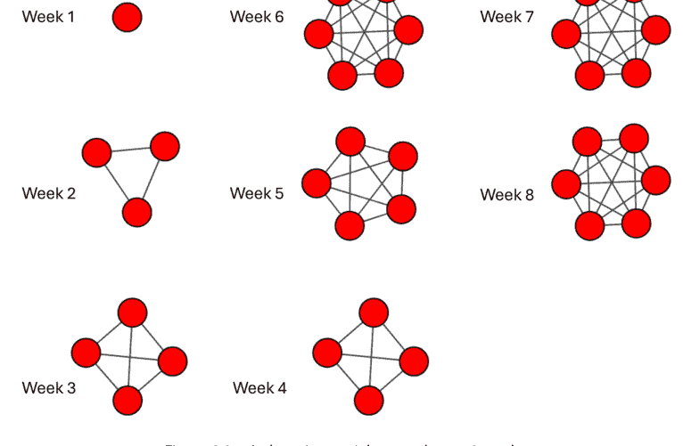
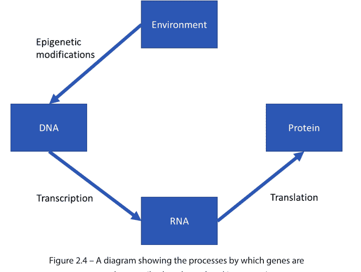
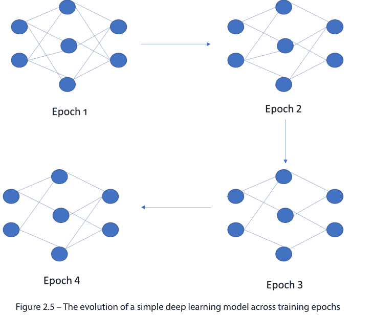
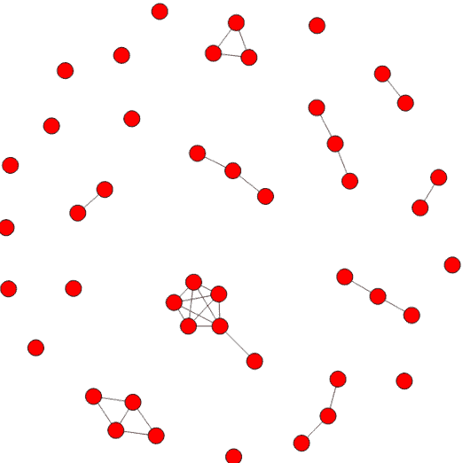
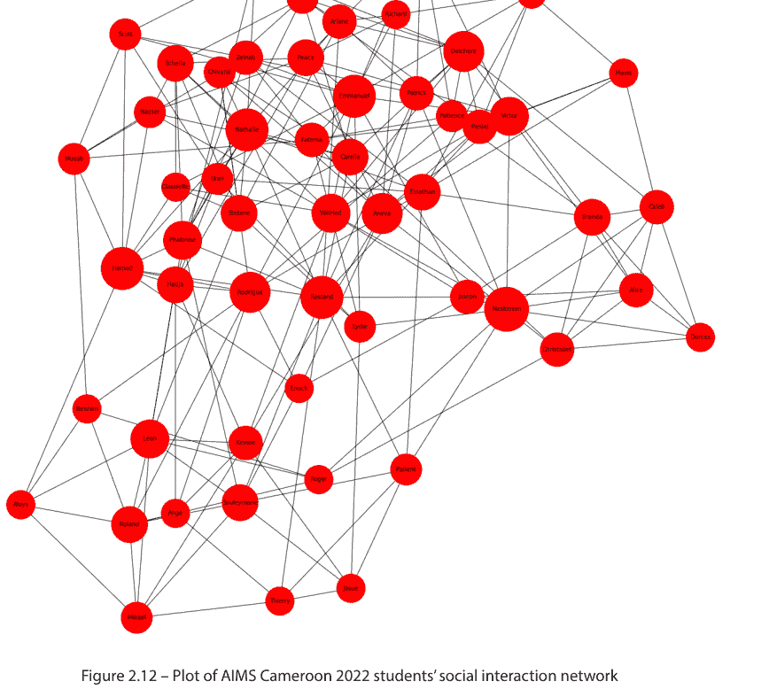

# 使用 NetworkX 和 igraph 将数据整理为网络

在本章中，我们将介绍分析项目中常见的许多类型的数据，包括 **空间数据**、**时间数据** 和 **时空数据**。由于这些数据结构并不以网络形式存在，因此必须对其进行预处理以形成网络，以便进行进一步分析。在未来的章节中，我们将详细介绍最佳预处理策略，但本章的目标是熟悉基础知识以及 NetworkX 和 igraph 包中的预处理方法。

在本章及后续章节中，我们将考虑许多现实世界问题，以建立围绕可重新格式化并作为网络科学问题进行分析的数据的直觉。网络算法的计算成本通常低于为时间序列分析或空间数据设计的算法。到本章结束时，你将能够识别许多适合网络分析的问题类型，并为深入研究后续章节中的问题做好准备。

具体来说，本章将涵盖以下主题：

- 不同数据源的介绍
- 使用 igraph 将数据整理为网络
- 使用 NetworkX 的社交网络示例

## 技术要求

要运行本章中的实践示例，你需要熟悉 Python 编程，并必须安装 igraph 和 NetworkX Python 包。

本章的代码可在以下位置获取：https://github.com/PacktPublishing/Modern-Graph-Theory-Algorithms-with-Python

## 不同数据源的介绍

在实践中，我们很少从头创建网络或遇到自然以网络形式存在的数据源。我们通常必须从不同的数据源创建网络，包括调查或传感器数据、地理数据、时间序列数据、人口统计数据，甚至机器学习模型的输出数据。在本节中，我们将在深入介绍使用 igraph 和 NetworkX 进行数据整理的两个实践示例之前，先概述一些常见的数据源。让我们深入了解我们第一个数据源——社交互动数据。

## 社交互动数据

网络科学的很大一部分起源于社交网络，后者捕捉个人之间的关系或互动。营销活动通常会招募在目标人口群体内部与其他人有许多联系的个人，以及其联系人也在该人口群体内部有许多联系的个人。例如，一家玩具制造商可能有一款将在圣诞节推出的新玩具，也许是一款 *蒸汽朋克胡桃夹子芭蕾老鼠王娃娃*（如图 *2.1* 所示），他们希望根据市场研究关于哪些年龄和性别群体最有可能观看《胡桃夹子》芭蕾舞而将其营销给 5 至 11 岁的欧洲女孩：


图 2.1 – 圣诞节首发的全新老鼠王娃娃的营销广告

玩具制造商可能会寻找社交媒体影响者（在 YouTube 上拥有大量订阅者或在 TikTok 上拥有大量粉丝的个人），其观众网络主要由 5 至 11 岁的女孩组成，这些女孩从欧洲观看影响者的内容。有时，这些数据可以通过抓取影响者的内容 readily 获得。其他时候，这些数据需要分块收集并先进行分析，以便通过内容策划和相关内容指标的抓取，在感兴趣的人口群体中缩小影响者的范围。

构建社交网络的另一个常见数据源是 **调查数据**，其中个人对社交群体中其他人的友谊或互动模式进行排名。例如，学生可能会指出他们一起学习、社交或上课的其他学生。与彼此在许多环境中互动的学生共享更强的社交互动，而互动不频繁或仅在某些环境中互动的学生共享较弱的社交互动。加权社交网络不仅可以可视化存在的互动，还可以可视化其强度。在社会科学环境中，更强的联系在信息传播或产品或行为的采纳中通常发挥着重要作用。例如，当一名青少年开始吸烟或饮酒时，与该个体有强联系的个体开始这些行为的风险更高。在高度连接的青少年群体中，当一个个体采纳一种冒险行为时，该行为在群体中传播的风险很高。

较弱的社交联系可能与强社交联系一样重要（甚至更重要！），并且在社会学领域，这些联系构成了个人社会资本的基础。社会资本衡量个人在需要时可以从其所联系的人或其联系人的联系人那里获得的资源。在求职的背景下，求职者最强且最持久的联系可能并不是找到新工作所需的。然而，很可能朋友的朋友和熟人构成了更大的社交网络，这些联系可能会为求职者提供新的就业机会。通过口碑或社交媒体上的工作广告，朋友的朋友和熟人的更大网络通常能提供更多找到下一份工作的机会。

我们将在本章的 *使用 igraph 将数据整理为网络* 部分返回到基于调查的社交网络数据，在那里我们根据社交环境中的认可互动构建学生网络。

## 空间数据

另一个常见的网络数据源是来自地理信息系统收集或按地理组织的数据。**空间数据分析** 是数据科学的一个分支，分析基于地理的数据；然而，当数据覆盖大地理区域或涉及复杂的统计计算时，以网络科学的形式表述数据和问题可能更容易。网络算法通常比空间数据算法更快，并且可以轻松地将大型网络存储在 Neo4j 等图数据库中。

## 时间数据

网络很少是静态的。随着联系的建立和断裂，社交网络会随时间演变。随着新商品的加入、特定商品需求随季节变化，或经济变化引发消费者行为变化，销售模式也会发生变化。股票市场交易量和行业/区域相关性会随着政治和商业环境的改变而随时间变化。

所有这些变化都涉及数据中的时间成分。网络中建模时间趋势有几种方法，我们将从两个用例开始，并在本书的第 3 部分中构建更多用途。

首先，让我们回到求职者利用其社交网络寻找新工作的例子。随着个人开始求职，他们可能会在 LinkedIn 上添加建议的专业联系人、参加当地的社交活动，或与几位招聘人员建立联系；所有这些行动都会增加其社交网络的联系（并增加找到新工作的可能性）。图 2.3 显示了女性在社交活动上会面，在求职中建立新的专业联系：



图 2.3 – 8 周内不断变化的社交网络




图2.4 – 展示基因表达、转录和翻译为蛋白质过程的示意图

让我们考虑一个具体的例子。眼镜蛇是毒蛇，它们的DNA编码了与产毒相关的基因。这些基因的转录发生在毒腺中，毒腺产生毒液并将其储存，直到蛇攻击目标。编码这些基因的DNA被转录成RNA，然后被翻译成蛋白质。

一起转录的基因集被称为共表达；共表达网络有助于理解遗传因素与疾病或身体特征之间的关系。在我们的蛇毒例子中，编码毒液的基因会在毒腺中共表达，因为所有毒液都是在蛇身体的该部分产生的。环境因素可以通过修改DNA结构来上调或下调转录，从而间接影响基因的表达模式。例如，当我们的蛇出于自卫而咬人时，它可能会在咬合时完全排空毒腺。这将导致与毒液基因相关的DNA被上调，从而产生更多毒液来补充蛇的储备，使其能够进食和自卫。

表观遗传学领域研究这些基因与环境的相互作用，特别是在癌症或精神健康障碍等复杂疾病的发展过程中。通常，组织内部或跨组织的基因表达是通过某种微阵列芯片测量蛋白质与目标基因的结合来进行的。许多人类疾病涉及环境和基因之间比蛇毒腺中毒液水平调节更复杂的相互作用；其中一些疾病涉及身体的许多部位。

例如，一些人由于遗传风险因素的聚集而面临更高的酒精使用障碍风险；当有酒精使用障碍风险的人开始饮酒时，酒精会穿过血脑屏障，并在基因表达中产生表观遗传变化，包括改变使该人面临障碍风险的基因的表达。

微阵列通过实验测量基因表达水平。对酒精使用障碍患者和非患者基因共表达的微阵列研究，为遗传风险以及因饮酒而产生的表观遗传差异提供了见解。

网络提供了一种便捷的方式来概括表达相似性关系，并可从中挖掘与执行类似任务的相关基因模块相关的子网络（例如产生与突触处血清素或多巴胺结合相关的神经递质结合位点）。

遗传研究中一个相关现象同样是基因表达的调控，通常通过表观遗传途径实现。正如我们已讨论的，外部环境因素可以影响基因表达；通常，由基因转录和翻译产生的蛋白质会调节自身的转录，根据现有蛋白质的水平上调或下调表达。

例如，额叶皮层中与血清素受体相关的基因调控紊乱被认为是重度抑郁障碍的基础，而细胞生长基因下调的紊乱被认为是许多常见癌症通路的基础，导致不受控制的生长和有丝分裂（肿瘤）。

有向网络为概括基因调控通路提供了一种理想方式。不同的生物和环境机制会上调或下调目标基因。在研究机制（蛋白质表达、环境中的外部暴露……）内，基因可能聚集为相似的调控模式。这有助于深入了解特定的目标病理学或压力等环境因素的影响。

基因组研究有时利用网络科学将基因本体（概括单个基因或遗传模块层次关系的网络）映射到疾病本体（概括疾病类别的网络）。我们将在第11章更深入探讨本体研究，但这里先回顾一些基础知识。本体之间的映射使研究人员能够基于基因与相似疾病之间的已知联系，就未知的基因与疾病关联提出假设。

回到物质滥用障碍，许多遗传风险因素已知并且在各种成瘾中共享；较新的行为成瘾（如电子游戏成瘾）很可能与其他成瘾障碍至少共享其中一些遗传因素。基因与疾病之间的本体映射为研究这些新障碍提供了一个起点。

基因组学只是众多数据类型中的一种，在这些类型中，网络解决方案并非解决数据问题的显而易见工具集。让我们看看其他一些例子，在这些例子中，网络科学提供了其他分析工具无法提供的见解。

## 其他类型的数据

还存在许多其他数据源，其中大部分可以被整理成网络形式。让我们回到关于深度学习的讨论。在深度学习训练过程中，神经网络每一层的节点会根据每次训练迭代的拟合指标，与其他层的节点建立和断开连接。让我们考虑一个训练过程，它包含四个训练轮次，使用一个非常小的前馈神经网络，该网络有一个包含两个节点的输入层、一个包含三个节点的隐藏层和一个包含两个节点的输出层；该网络起初是全连接网络，经过两个轮次的剪枝，然后在隐藏层和输出层之间重新加入一个被剪掉的连接，如图2.5所示：



图2.5 – 一个简单深度学习模型在训练轮次中的演变

在*图2.5*中，我们可以看到每个训练轮次在深度学习模型中都有不同的网络结构。通常，我们会为每个轮次计算拟合统计量，并且我们可能感兴趣的是深度学习网络结构的属性如何影响各轮次在训练集和测试集上的训练准确率。

虽然这个模型相当简单，但实际的深度学习模型可能有多层、顶点（深度学习术语中的节点）之间的有向边，以及许多训练轮次。这在训练过程中产生了丰富的网络和网络度量，可以与模型准确率相关联，在调整模型或更改初始参数时（也许是在微调预训练Transformer模型时调整剪枝参数）可能会派上用场。

微调预训练模型是*计算机视觉*和*大语言建模*中的常见方法。可能会添加新的训练数据以涵盖特定领域的用例，并且需要调整模型参数，以便将新的训练数据整合到完整模型中。例如，托管在HuggingFace上的大型语言模型可能很擅长嵌入大多数科学论文以进行聚类分析，但当等离子体物理论文被包含在科学样本中时，它需要微调才能良好工作

## 使用igraph将数据整理成网络

理解商品定价趋势在许多应用中至关重要。例如，一家连锁加油站可能希望了解其各个站点之间的定价差异。通常，地方法律要求一定距离内的加油站之间的定价必须保持在一定范围内，从而在连锁品牌之间和内部形成局部的定价分布。理解这一点有助于在给定每个区域约束条件的情况下进行区域定价优化，或将数据与区域销售数据关联起来，以了解价格分布如何影响销售。

消费者也能从跨地理区域的商品定价分析中受益。考虑发展中国家的当地食品市场。在一个国家或地区内，价格很少是固定的。价格由供应、需求以及销售商品的商家成本决定。谷物可能需要从其他国家进口，其价格会随经济和气候条件波动。水果价格可能随季节和当地种植条件而变化。随着当地染料日益稀缺，服装价格可能会上涨。例如，考虑一个如图2.7所示的杂货店，它有供应商合同和母公司连锁的财务支持。它可能会经历商品供应或价格的波动，但很可能以不会大幅波动的价格提供相同的商品：


图2.7 – 一家属于更大连锁店一部分的杂货店示意图


让我们深入研究我们的示例数据集，该数据集源自世界粮食计划署价格数据库中的人道主义数据交换的布基纳法索——粮食价格数据集（https://data.humdata.org/dataset/wfp-food-prices-for-burkina-faso; 访问日期 2022 年 7 月 15 日）。在此数据集中，我们预先选择了布基纳法索 45 个省市场的小米价格，并按季度汇总数据，从 2015 年第 2 季度开始，到 2022 年第 2 季度结束。此期间涵盖了 COVID-19 大流行和乌克兰战争的开始，这两者都影响了供应链。鉴于邻近省份的市场可能受到相同的当地因素和供应链的影响，我们创建了一个由 1 和 0 组成的空间权重矩阵，分别代表相邻省份和非相邻省份。

要运行所有代码，可能需要安装 igraph 或 NetworkX 的依赖包，例如用于可视化的 pycairo。每个机器的功能可能不同，或者如果您使用云平台，可能已安装其他包；如果遇到任何困难，请参阅 igraph 或 NetworkX 帮助指南中有关在您的操作系统上运行包的建议。

让我们首先导入使用脚本 2.1 在 igraph 中构建网络所需的包：

```
```python
#import packages
import igraph as ig
from igraph import Graph
import numpy as np
import pandas as pd
import os
```
```

导入数据时，您需要在下载数据集后指定自己的文件路径。我们通过将以下内容添加到脚本 2.1 来从本地机器导入定价数据和权重矩阵：

```
```python
#import Burkina Faso market millet prices from the csv file
File="C:/users/njfar/OneDrive/Desktop/BF_Millet.csv"
pwd=os.getcwd()
os.chdir(os.path.dirname(File))
mydata = pd.read_csv(os.path.basename(File),encoding='latin1')

#import weight matrix of Burkina Faso markets
File="C:/users/njfar/OneDrive/Desktop/weights_bk.csv"
pwd=os.getcwd()
os.chdir(os.path.dirname(File))
weights = pd.read_csv(os.path.basename(File),encoding='latin1')
```
```

现在我们已经导入了数据，可以通过计算市场之间的相关系数（忽略时间指示列）并将结果乘以权重矩阵来构建我们的局部 Moran 统计量：

```
#define the metric between markets and construct the local Moran
#statistic
#here, correlation coefficient
data=mydata.iloc[:,1:46]
weights_total=weights.iloc[:,1:46]
cor=np.corrcoef(data.transpose())
cor[cor>0]=1
cor_weighted=np.multiply(cor,weights_total)
```

现在我们已经将局部 Moran 统计量构建为 cor_weighted，可以使用 igraph 将数据转换为网络。我们的图没有关系的方向性，因此我们可以将模式设置为无向。然而，由于我们的相关性包括单个市场内的自相关，我们需要从网络中删除环。我们将通过定义可能的自环并将其从边列表中删除来实现：

```
# create market graph and get rid of loops created from the correlation
bf_market_w=Graph.Adjacency(cor_weighted,mode="undirected")
edge_list=bf_market_w.get_edgelist()
self_loop=[]
for i in range(0,46):
    self=(i,i)
    self_loop.append(self)
to_remove=[]
for i in edge_list:
    for j in self_loop:
        if i==j:
            to_remove.append(i)
bf_market_w.delete_edges(to_remove)
```

现在，我们可以通过绘制结果来可视化我们的网络，看看哪些市场被孤立了：

```
#create plot
ig.plot(bf_market_w)
```

## 第四章 系统权限那些事儿

权限对于 Linux 系统来说，是控制用户能否对文件或目录进行操作的依据。每个文件或目录都涉及三类权限：属主权限、属组权限和其他用户权限。可以使用 `ls -l` 查看文件详细信息，第一列就是文件的类型和权限信息。

```
```bash
$ ls -l
total 0
-rw-r--r-- 1 root root 0 Apr 10 10:30 file1
```
```

第一列由 10 个字符组成，第一个字符表示文件类型，后面的 9 个字符分为三组，分别对应属主权限、属组权限和其他用户权限。`r` 表示可读，`w` 表示可写，`x` 表示可执行，`-` 表示没有对应权限。

- 文件类型：`-` 表示普通文件，`d` 表示目录，`l` 表示符号链接
- **r**：可读权限，例如可以查看文件内容
- **w**：可写权限，例如可以修改文件内容
- **x**：可执行权限，例如可以运行该文件

可以使用 `chmod` 命令修改文件或目录的权限。权限的表示有符号模式（如 `u+x`）和数字模式（如 `755`）两种。下面是一些常见的示例：

```
```bash
$ chmod u+x file.sh    # 给属主添加执行权限
$ chmod g-w file.txt   # 去掉属组的写权限
$ chmod o=r file.txt   # 其他用户权限设置为只读
$ chmod 755 script.sh  # 属主rwx，属组r-x，其他r-x
```
```

除了权限管理，还可以使用 `chown` 命令修改文件的所有者，使用 `chgrp` 命令修改文件的所属组。日常运维中，合理地设置文件和目录的权限，是保障系统安全的重要一环。

| 命令 | 作用 |
| --- | --- |
| `chmod` | 修改文件权限 |
| `chown` | 修改文件属主 |
| `chgrp` | 修改文件所属组 |
| `umask` | 设置默认权限掩码 |

> > 提示：使用 `su` 或 `sudo` 切换用户身份时，要仔细确认操作对象，避免因为权限误操作导致系统文件损坏。

本节介绍了 Linux 系统权限的基本概念和常用命令。下一节将介绍用户与用户组的管理，帮助大家更全面地理解多用户环境下的权限控制方式。

```
```python
# create market graph and get rid of loops created from the
#correlation
bf_market_w=Graph.Adjacency(cor_weighted,mode="undirected")
edge_list=bf_market_w.get_edgelist()
self_loop=[]
for i in range(0,46):
    self=(i,i)
    self_loop.append(self)
to_remove=[]
for i in edge_list:
    for j in self_loop:
        if i==j:
            to_remove.append(i)
bf_market_w.delete_edges(to_remove)

#create plot
ig.plot(bf_market_w)
```
```

这应该会产生更多在我们的时间段内不相关的孤立市场：



图 2.10 – 布基纳法索市场通过局部 Moran 统计量在选定阈值 0.9 下连接的图

图 2.10 显示了一个更稀疏的网络，其中许多市场是孤立的。一些区域连接的市场仍然显示出市场之间的连接；然而，许多市场不再相互连接。有趣的是，我们的六个区域市场群体在阈值处理后仍然保持连接，大多数连接完好无损。事实上，在该区域中只有一个市场相对于我们未阈值化的版本显示出连通性的差异。

虽然此示例考虑了整个时间段内的相关性，但可以将时空数据切片为重叠的时间切片，创建像局部 Moran 统计量这样的时间感知度量（有或没有阈值处理），并通过绘制由这些时间切片及其网络定义度量创建的一系列网络来可视化度量随时间的变化。我们将在第 7 章进一步探讨这一概念，当时我们将布基纳法索小米数据集分解为时间切片，以分析图度量随时间和空间的变化。

现在我们知道了如何将数据整理成 igraph 网络，让我们看看如何在 NetworkX 中使用另一个示例来完成此操作。

## 使用 NetworkX 的社交网络示例

在这里，我们将考虑来自 2022 年喀麦隆一届的非洲数学科学研究所（AIMS）学生的社交网络。这些学生住在同一栋楼里，上课时互动，一起吃饭，一起学习。然而，来自同一国家、来自同一所本科大学并且说同一种语言的学生往往比来自不同背景的学生互动更频繁。图 2.11 中显示的此类互动因此要么是有机地作为背景的函数，要么是通过共享的项目和生活安排人为产生的：


图 2.11 – 一个教室设置的插图，学生在一个项目内共享课程

为了了解我们学生群体内的这些互动，我们对学生在各种环境中与其他学生的互动进行了问卷调查。数据收集于 2022 年 11 月至 12 月之间。以下是一些示例问题：

- 你喜欢在午餐或晚餐时和谁坐在一起？
- 当你对某个科目或课程有困难时，你喜欢向谁提问？

从这些问题中，学生的网络感知可以被检查以查看他们在多大程度上达成一致。在查看数据后，我们意识到大多数互动都是相互的。如果学生 A 认可了与学生 B 的亲近度调查项目，学生 B 也很可能会认可这些项目。因此，数据形成了一个相互互动的无向网络。

我们将使用的包含多个字段。第一列是我们调查的学生姓名。在接下来的四个字段中，我们有人口统计因素（我们将在后面的章节中返回），包括原籍国、年龄、学习领域和本科背景。在剩余的五列中，我们有学生最强烈认可的五个朋友。

让我们首先导入我们将需要将此数据集整理成网络的包，使用脚本 2.2：

```
#import needed packages
import pandas as pd
import networkx as nx
import matplotlib.pyplot as plt
import numpy as np
import math
```

现在，让我们导入数据集：

```
#reading the dataset
fichier = pd.read_csv("C:/users/njfar/OneDrive/Desktop/AIMS_data.csv")
data = pd.DataFrame(fichier)
```


要将此数据转换为使用 NetworkX 的社交网络，我们需要通过循环填充网络的顶点和边。我们首先添加包含元数据的顶点，包括学生的姓名和人口统计特征。然后，我们将添加边，根据调查中某位学生认可的五种最密切的关系连接顶点，通过向脚本 2.2 添加以下内容：

```
#initializing the social network
aimsNetwork = nx.Graph()
#populating the network with nodes and edges
for i in range(len(data["Name"])):
    aimsNetwork.add_node(data["Name"][i],
        Age = data["Age"][i], country=data["Country"][i],
        Field=data["Field"][i],
        background=data["Background"][i])
    for j in range(len(data["Name"])):
        aimsNetwork.add_edge(data["Name"][j], data["Friend 1"][j])
        aimsNetwork.add_edge(data["Name"][j], data["Friend 2"][j])
        aimsNetwork.add_edge(data["Name"][j], data["Friend 3"][j])
        aimsNetwork.add_edge(data["Name"][j], data["Friend 4"][j])
        aimsNetwork.add_edge(data["Name"][j], data["Friend 5"][j])
```

这为我们提供了 AIMS 学生及其在项目内的最亲密朋友的初始网络。让我们绘制此数据以可视化我们的 AIMS 学生社交网络。由于我们希望在绘图中显示学生的姓名，我们将首先计算每个顶点的度，这是一个中心性指标，我们将在后面的章节中重新讨论。在这里，足以显示不同学生对网络的重要性，并使顶点足够大以可视化学生的姓名。让我们通过向脚本 2.2 添加以下内容来实现：

```
#plot AIMS student social network
Degree=aimsNetwork.degree()
var = [500*k[1] for k in list(Degree)]
plt.figure(figsize=(20,20))
nx.draw_spring(aimsNetwork, font_size=10, node_size = var,
    with_labels=True, node_color="red")
plt.show()
```

该脚本应显示类似于图 2.12 的图像，该图像绘制了 AIMS 学生之间的社会联系：



图 2.12 – AIMS 喀麦隆 2022 学生社交互动网络图

*图 2.12* 显示了我们从调查数据中创建的 AIMS 学生网络。请注意，一些学生仅将五位最亲密的朋友作为联系，而其他人则有更多亲密朋友。这在社交网络中很典型，即使是由调查数据创建的网络也是如此。一些个体比其他个体拥有更多的联系。一些个体连接网络的不同部分，将分离的社区联系起来。一些高度连接的个体连接其他高度连接的个体，在更大的网络内形成密集区域。这些属性在网络分析中发挥着重要作用，我们将在后面的章节中更深入地探讨其含义和计算方法。

## 摘要

在本章中，我们更深入地探讨了网络的用例，将空间市场数据集整理成基于区域连通性和小米价格相关性的 igraph 网络，并在 NetworkX 中构建了基于调查的社交网络。现在我们有了从真实数据源在 Python 中构建网络所需的基本工具，在下一章中，我们可以将注意力转向网络科学的一些现实应用，在那里我们不仅构建网络，还对其进行分析以获得见解，从而解决当今科学中的重要问题。

## 参考文献

- Berger, S. L., Kouzarides, T., Shiekhattar, R., & Shilatifard, A. (2009). An Operational Definition Of Epigenetics. *Genes & development, 23*(7), 781-783.
- Caballero, J. (2015). Banking crises and financial integration: Insights from network science. Journal of International Financial Markets, Institutions and Money, 34, 127-146.
- Christakis, N. A., & Fowler, J. H. (2013). Social contagion theory: examining dynamic social networks and human behavior. Statistics in medicine, 32(4), 556-577.
- Dubos, R. (2017). Social capital: Theory and research. Routledge.
- Ducruet, C., & Beauguitte, L. (2014). Spatial science and network science: review and outcomes of a complex relationship. Networks and Spatial Economics, 14(3-4), 297-316.
- Kiss, I. Z., Miller, J. C., & Simon, P. L. (2017). Mathematics of epidemics on networks. Cham: Springer, 598, 31.
- Krishnan, H. R., Sakharkar, A. J., Teppen, T. L., Berkel, T. D., & Pandey, S. C. (2014). The epigenetic landscape of alcoholism. International Review of Neurobiology, 115, 75-116.
- Moyano, L. G. (2017). Learning network representations. The European Physical Journal Special Topics, 226(3), 499-518.
- Sharma, S., Kelly, T. K., & Jones, P. A. (2010). Epigenetics in cancer. Carcinogenesis, 31(1), 27-36.
- Sorrells, T. R., & Johnson, A. D. (2015). Making sense of transcription networks. Cell, 161(4), 714-723.
