# 第 2 部分：空间数据应用

第 2 部分在第 1 部分的基础上引入了空间数据应用，包括跨非洲国家的趋势传播、跨学生网络的流行病传播、涉及道路和兴趣地点的交通物流问题、国家公园区域的蛇类保护以及基于文本的城市公园评估聚类的示例。本部分介绍了流行病（以及更一般的微分方程）模型、最短路径算法、旅行商问题解决方案、最小割/最大流算法、谱图算法和预训练 Transformer 模型。

第 2 部分包含以下章节：

- 第 3 章，人口统计数据
- 第 4 章，交通数据
- 第 5 章，生态数据

## 成就证书

特此证明

Darrell Diamond

因卓越表现获得

年度工程师 - 2016

签名

2016 年 10 月 20 日

## 人口学导论

**人口学**，最初被表述为对人口生命统计的研究，衡量感兴趣的人口中的个体特征。关于人口的生命记录对于公共政策制定、流行病追踪、城市规划以及许多其他对基础设施和增长至关重要的政府任务非常重要。约翰·斯诺在 1854 年伦敦霍乱爆发期间开创了人口学领域，绘制了地理数据和感染个体的共同特征，以确定霍乱爆发的来源（一个水泵）。此后，人口学在医学研究、政策规划、教育改革以及社会科学对社会需求的其他应用中发挥了重要作用。

在本章中，我们将介绍人口学研究的一些重要方面，以及如何利用共同的人口统计和地理因素通过基于共同地理和人口统计因素的边连接顶点来创建网络。

### 人口统计因素

人口学为我们提供了许多潜在的测量方法来研究人口及其子群体，从而让我们推断这些人口和子群体中个体之间可能的社会联系。例如，我们可能希望了解城市如卢旺达基加利、印度班加罗尔或中国西安在城市增长期间一段时间内性别、教育程度、宗教、社会经济地位或原籍国在城市中的分布情况。通常，我们将结果绘制成简单的图表以显示随时间的变化，如 *图 3.1* 所示，该图描绘了卢旺达宗教构成的 30 年变化：

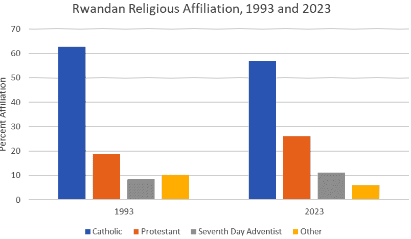

图 3.1 – 比较 1993 年与 2023 年卢旺达宗教归属的图表

### 地理因素

地理在决定社会联系的形成和可能性方面也发挥着重要作用。同一地区的个体更有可能在同一餐厅共进晚餐、在同一地区徒步旅行并加入基于地区的兴趣团体。例如，考虑三个区域——拥有更大房屋和茂盛院子的郊区、人口稠密的城市以及房屋稀少的非常农村社区（如图 3.3 所示）：


图 3.3 – 三个不同地理区域的插图

也许图 3.3 中显示的区域都位于比利时，使它们具有共同的国家文化。虽然我们预计图 3.3 中每个地理区域内个体的社会联系形成可能性高于跨区域，但比利时这些地区之间的社会联系形成可能性高于与内罗毕或德黑兰的个体形成，如图 3.4 所示：


图 3.4 – 分别在内罗毕和德黑兰的女性的插图


生活在同一地理区域的人们，无论在国家、城市还是社区层面，都更可能通过地区性互动相互认识。然而，布鲁塞尔的研究人员可能会通过学术会议或**ResearchGate**、**LinkedIn**等专业社交媒体平台结识内罗毕或德黑兰的研究人员。全球经济和全球社交媒体平台的兴起削弱了地理因素对社会关系的影响，但同一地理区域的人们仍然更有可能形成社会联系，尤其是当他们具有相似的人口统计特征时。

然而，全球化，尤其是对于受过教育的专业人士而言，已经改变了社会联系的形成过程。对于研究专业人士社交网络的人来说，明智的做法是考虑与该职业相关的其他人口统计因素，而不仅仅是地理因素。COVID-19疫情以及随后线上/混合办公、会议和社交活动的兴起，使许多专业人士的社交网络超出了本地地理范围。尽管如此，那些在地理上拥有共同背景的人往往拥有共同的文化，因此即使疫情以来相关人员的地理位置发生了变化，这些联系也更有可能存在。

## 网络中的同质性

正如我们所见，人口统计和地理因素驱动着人口中个体之间的联系。自知识经济出现以来，大多数地理区域都集中在某些人口统计因素上，因为人们选择与和自己相似的人生活在一起：在相同地区工作、财富水平相近、教育背景相似。相似的人更有可能相遇、更有可能结婚，也更有可能属于相同的群体。

让我们看一下日本津和野的三位年轻女性（真理子、玲和凉子），她们年龄相仿，教育水平相近，且都来自传统背景，如图3.5所示：


图3.5 – 日本津和野外的真理子、玲和凉子

基于地理和共同的人口统计因素，我们可以预期真理子、玲和凉子如果见面会形成社会联系；考虑到她们所在城镇的规模，她们很可能已经见过面了。在网络科学中，顶点与其他具有重要特征（如人口统计或地理因素）的顶点形成边的倾向被称为**同质性**。

同质性在社交网络中的链接预测中扮演着重要角色，它基于共同的人口统计/地理因素以及共同的联系人，为个体提供潜在联系。例如，考虑路易斯和让之间建立联系的可能性：他们是巴黎的两位数据科学家，未发现彼此有职业联系，但共享二十位共同同事和许多人口统计因素：年龄段、教育背景、居住和工作的街区以及职业。如果他们在一个专业活动中相遇，他们很可能会建立职业联系，而且他们可能已经认识，但尚未在社交媒体平台上建立连接。与帕特里克相比，路易斯认识让的可能性要大得多；帕特里克是一位年长得多的房地产专业人士，住在另一个街区，从未上过研究生院，也从不参加科技会议。

除了链接预测，同质性在网络聚类中也非常有用。我们可以不通过网络特定的聚类方法（将在后续章节详述）先基于网络连接性对顶点进行聚类，而是使用k-means或基于密度的聚类方法，根据我们收集的人口统计和地理因素对顶点进行聚类。虽然这在社交网络中更常见，但这种聚类也可以应用于基因网络、基于地理的销售网络或任何其他类型的网络。

让我们通过两个例子来观察同质性的实际作用：第一个例子突出同质性如何影响非洲法语国家音乐潮流的传播，第二个例子展示流行病如何基于学生的研究领域和祖国的社会互动，在我们的AIMS学生网络中传播。

## 非洲法语国家的音乐传播

使用同一种语言的国家往往共享相近的音乐品味、文学和其他文化标志，同时也进行贸易合作、提供跨境就业机会并建立经济联系。在非洲，许多国家的历史都包含殖民时期，它们当时受英国或法国控制；许多国家仍将英语或法语作为行政通用语言。为了理解音乐在法语国家间的传播，我们将构建一个网络，将法语人口超过10%且共享边界的国家连接起来。虽然毛里求斯或马达加斯加等其他国家也有大量法语人口，但它们在地理上与其他法语非洲地区隔绝。音乐或文学潮流可能会通过在线渠道或广播电台从其他法语国家传播过来；然而，区域演唱会和文化活动可能不会像在共享边界的国家之间那样容易促进传播。

## 语音，在未来一年左右，将变成人机交互的最主流方式

GPT-5 也许不会来，但更好的东西已经在路上了。这期来说几个山姆奥特曼最近在访谈里放出的重要信息，很多都跟之前我们做过的预测对上了。

我看了IGN 本月早些时候发布的对奥特曼的独家专访，以及红点设计奖对他的采访，在其中奥特曼回应了几个大家非常关心的话题，信息量很大。

### 首要目标：让 GPT-4o 更快 更可靠 更普及

奥特曼首先直言了现阶段的首要目标和 OpenAI 目前的重心，就是让 GPT-4o 变得更快、更可靠、更普及，而不是去开发新的 GPT-5，这跟我们的预测完全一致。

结合前一段时间Ilya 离职时 OpenAI 内部传出的一些小道新闻，我们有理由相信，GPT-5 的技术路线在 OpenAI 内部可能发生了变化，而且这个变化非常之大，大到 Ilya 这样的首席科学家都无法接受。

另外，奥特曼还说几个月之后还会有更聪明的新模型，但不是 GPT-5。到底会叫什么名字，就不得而知了。

### OpenAI 的下一步：视频版 ChatGPT

视频版 ChatGPT 的 demo 在年初放出，通过对话的方式，实时生成一段短视频，引发热议。在我们之前的视频里面也介绍过。

但奥特曼表示，目前这还只是一个研究预览，不是产品，未来除了文生视频，还会有图生视频，以及视频生视频，他明确说，这些现在都还没有确定的具体时间表。

不过呢，奥特曼确认了语音是 OpenAI 未来的一个大方向。

在红点设计奖的采访中，他提出了一个观点，说语音，在未来一年左右，将变成人机交互的最主流方式，会超越触摸。

> 语音将在一年内成为人机交互的主流方式——山姆·奥特曼

这意味着 GPT-4o 的实时语音交互能力，将会在更多场景中应用，包括AI助手、智能家居等，这也是多模态AI发展的重要方向。

加上GPT-4o 在文本、语音、图像上的多模态融合能力，未来一年，我们大概率会看到 OpenAI 在语音交互体验上的更多创新和打磨。


```
G.nodes[21]['country'] = 'Guinea'
G.nodes[22]['country'] = 'Guinea_Bissau'
G.nodes[23]['country'] = 'Tunisia'
labels = nx.get_node_attributes(G, 'country')
nx.draw(G, labels=labels, font_weight='bold')
```

图3.6显示了我们的法语国家网络及其通过共享边界的链接：

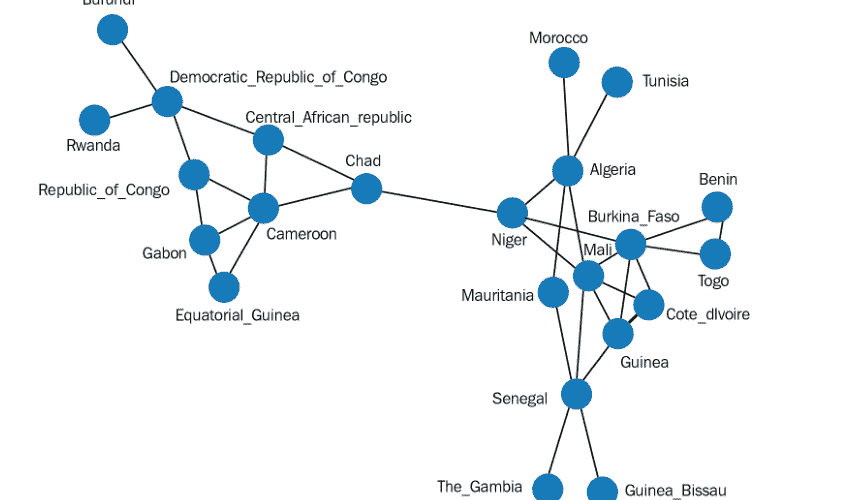

图3.6 – 法语国家网络的可视化

## 注意

处理长标签时，带有标签的图形会包含重叠或截断的标签。然而，图3.6展示了我们网络的一些重要属性：即我们有两个国家（乍得和尼日尔）连接着两个独立的网络（加蓬或布隆迪等中部非洲法语国家，以及塞内加尔或摩洛哥等西非/北非法语国家）。正如我们稍后在创建音乐潮流传播模型时所看到的，连接网络不同部分的桥梁（例如法语国家网络中的乍得和尼日尔）控制着从一个子网络到另一个子网络的传播过程。

为了模拟潮流的传播——或思想的扩散或疾病的传播——我们求助于一个名为微分方程的数学领域。**微分方程**描述了一个感兴趣系统中函数及其随时间的变化（导数）之间的关系。例如，微分方程可以模拟热量在机械部件上的流动、人群中观点的变化、重力对运动物体的影响、声音在房间中的传播，或历史上的天气模式（以及其他许多应用！）。

微分方程可以包括一阶导数（即感兴趣函数斜率的变化）、与函数曲率相关的二阶导数，甚至更高阶的导数。对于网络上的传播过程，我们将把讨论限制在一阶导数的微分方程上。然而，任何类型的微分方程都可以使用我们将用于NetworkX网络的软件来定义和运行。

有时，微分方程在感兴趣的函数中包含多个变量；这些方程被称为**偏微分方程**。许多现实世界的过程，包括流行病传播模型，都用偏微分方程建模。此外，许多现实世界的过程具有随机性，或依赖于过程在物体或网络上开始的位置。在网络中，通常会在过程的起点相同或变化的情况下多次运行偏微分方程。这允许产生一系列可能的结果。

现在我们了解了微分方程的基础知识，让我们深入探讨用于行为、思想和流行病传播的感兴趣模型：**易感-感染-抵抗（SIR）**模型。SIR模型最初（1927年）是为了研究流行病而开发的，其组成部分涉及人群中的易感个体（尚未感染但可能被感染）、感染个体（当前患有该疾病的人）以及康复或抵抗个体（曾经感染过或具有免疫力且不会被感染的人）。

当个体在人群中混合时，感染个体可以以一定概率将感染传给易感个体。对于我们的模型，感染易感个体的概率由参数*β*给出。在实践中，这个值要么通过文献中关于行为或疾病传播概率的估计得知，要么在最佳猜测范围内进行估计，模型在那些最佳猜测之间运行，以估计在该可能性范围内的潜在传播。一旦个体被感染，该个体就有恢复的概率，由参数*γ*给出。一旦康复，我们的模型确实允许再次感染。然而，在**易感-感染-康复-易感（SIRS）**模型中，康复的个体在一段时间后可以被再次感染。在**易感-感染-易感（SIS）**模型中，恢复被立即再次感染的机会所取代，而不是恢复。

流行病传播的一个重要特性是所谓的**基本再生数（R₀）**，即一个感染者引起的继发感染人数。我们可以用β参数值除以γ参数值来计算R₀。如果R₀大于1，则预期疫情在初始阶段会在人群中传播，这标志着可能发生大规模流行病。许多传染病疫情都有大于1的R₀值，包括最近的埃博拉疫情（R₀~1.5）、20世纪60年代加纳的麻疹疫情（R~14）以及1918年西班牙流感（初始R₀~1.5，后期~3.5


waves). COVID-19 的 R₀ 值在不同变异株和国家之间差异巨大，使得难以获得标准的 R₀。然而，非洲范围内的一个估计显示，COVID-19 在大多数国家的估计 R₀ 为 2.0-9.7。

SIR 模型在网络上工作方式略有不同。感染顶点通常只感染网络中的邻居，从而产生邻近效应。在我们的网络中，桥接特性限制了从一个子网络向另一个子网络传播的机会，因为桥接顶点及其相邻顶点的感染率低于通过相互连接顶点的枢纽传播。一般来说，桥梁在网络中对于信息、思想或流行病传播而言是重要顶点，并且通常是干预目标。在疾病流行期间的疫苗接种活动以限制传播、在营销活动中针对性投放以提高产品采用率，以及在犯罪通信网络中进行抓捕，都是现实世界中针对桥梁以影响网络传播动态的例子。

让我们更深入地探讨网络的几何结构，包括枢纽和桥梁。枢纽是连接性高的区域，许多顶点连接到许多其他顶点。几何上，密集连接的区域如枢纽具有高曲率，并为网络上的传播过程或随机游走提供许多可能路径。在我们的法语非洲网络中，喀麦隆、塞内加尔和马里都表现出枢纽特性。

然而请注意，塞内加尔与许多其他顶点有大量边连接，而这些顶点本身并没有大量边。虽然塞内加尔由于其连接性而充当枢纽，但它并不是理想的传播目标，因为该过程会在其周围相当孤立的顶点中消亡。喀麦隆和马里则是与充当枢纽或桥梁的其他顶点相连的枢纽，从而使过程有很大概率继续传播。中心性指标衡量顶点在网络中的中心程度，创建不同类型的网络枢纽测量，可以找到在网络中发挥马里/喀麦隆或塞内加尔作用的顶点。我们将在后面的章节中重新审视这些中心性测量，在那里我们将使用 igraph 评估网络属性。

桥梁的工作方式略有不同，但也为网络贡献了重要的几何特征。尼日尔和乍得在我们的法语非洲网络中充当桥梁，连接彼此之间没有其他边连接的枢纽。技术上，一种称为中介中心性的中心性类型通过计算每对顶点之间的最短路径（代表最直接的通信路线）并计算包含给定顶点的最短路径数量来衡量这种桥接特性。那些有大量最短路径经过的顶点充当网络不同部分之间的桥梁。几何上，桥梁充当网络中流动从一个部分到另一个部分的交叉点。我们的音乐从加蓬传播到西非如果没有乍得和尼日尔等桥梁连接北非和西非与中非就不可能，因为趋势必须通过这些国家传播才能离开中非。

对于我们在法语非洲的音乐传播，让我们考虑一个 SIR 模型，该模型以 5% 的国家收听新 Rumba 艺术家的音乐开始。我们说我们的音乐趋势有 25% 的机会传播到邻国（我们的 beta 参数）以及 10% 的机会作为趋势消退（我们的 gamma 参数）。这给我们 R₀~2.5，这意味着我们的音乐趋势最初应该传播良好。

```python
viz = DiffusionTrend(model, trends)
p = viz.plot(width=500, height=400)
show(p)
```

这应该会给出与图 3.7 相似的图，该图显示了我们音乐趋势流行病中易感、感染和恢复/移除国家的比例。请注意，我们受此新 Rumba 艺术家影响的国家预期峰值数量约为我们国家的三分之一，而此新艺术家的影响持续了超过半年的时间。这对于我们的新艺术家来说是一个相当成功的结局：

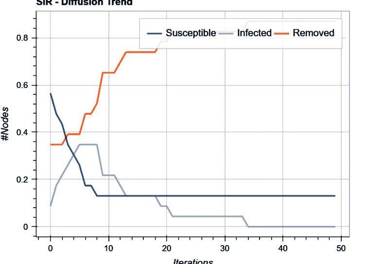

图 3.7 – 音乐趋势在法语国家网络中的传播

现在，让我们将我们的 gamma 参数修改为 0.3，给出小于 1 的 R₀。我们预计在这种动态下我们的趋势会很快消退。在这种新情景下修改脚本 3.1 会产生截然不同的动态（图 3.8）：

```python
# Model Configuration
import ndlib.models.ModelConfig as mc

config = mc.Configuration()
config.add_model_parameter('beta', 0.25)
config.add_model_parameter('gamma', 0.3)
config.add_model_parameter("fraction_infected", 0.05)
model.set_initial_status(config)

# Simulation
iterations = model.iteration_bunch(50)
trends = model.build_trends(iterations)

#visualize spread dynamics
from bokeh.io import output_notebook, show
from ndlib.viz.bokeh.DiffusionTrend import DiffusionTrend

viz = DiffusionTrend(model, trends)
p = viz.plot(width=500, height=400)
show(p)
```

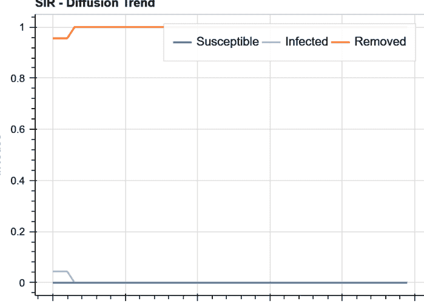

beta: 0.25, gamma: 0.3, fraction infected: 0.05, tp rate: 1

图 3.8 – 在新的 gamma 参数下，音乐在法语国家网络中的传播

*图 3.8* 表明，新 Rumba 艺术家的音乐并没有在很大程度上传播到邻国，并在专辑发行后不久就消退了。艺术家不太可能在自己的家乡以外的地方为人所知，而听过专辑的人也会很快忘记歌曲。这与原始情景相比，对我们艺术家来说是一个截然不同的结果。

## AIMS 喀麦隆学生网络流行病模型

为了了解流感如何在社交网络中传播，让我们回到我们的 AIMS 喀麦隆学生网络。回想一下，我们使用关于互动的调查数据在学生之间创建了连接。这使我们能够连接定期互动的学生。然而，考虑调查数据不存在的情况。如何推断学生之间可能的连接？

我们拥有诸如原籍国、专业领域和学生年龄等信息。来自同一国家的学生可能共享共同文化——也许是相同的当地语言、相同的最爱安慰食物，或相同的最爱音乐人。

同样，同一专业领域的学生很可能在课堂内外一起度过时间，因为他们有共同的课程和职业兴趣。学习小组、小组项目以及他们领域的专业活动很可能定期将学生聚集在一起。如果在这些聚会中发生流感或 COVID-19 等传染性爆发，它很可能在专业领域内传播。

让我们通过连接来自同一国家或共享专业领域的学生来创建一个新的 AIMS 喀麦隆学生网络。我们将使用 `Script 3.2` 加载数据集：

```python
#import needed packages
import pandas as pd
import networkx as nx
import matplotlib.pyplot as plt
import numpy as np
import math

#reading the dataset
fichier = pd.read_csv("C:/users/njfar/OneDrive/Desktop/AIMS_data.csv")
data = pd.DataFrame(fichier)
```

现在，让我们设置我们的网络以及一些初步向量和数量，以帮助我们生成学生之间的连接，包括学生数量及其属性，通过向 `Script 3.2` 添加内容：

```python
#initializing the social network
aimsNetwork = nx.Graph()

#populating the network with nodes and edges
for i in range(len(data["Name"])):
    aimsNetwork.add_node(
        data["Name"][i], Age=data["Age"][i],
        country=data["Country"][i], Field=data["Field"][i],
        background=data["Background"][i])

#define length
N = len(aimsNetwork.nodes())

# one can build the adjacency matrix
AIMS_by_Country_or_Field = nx.Graph()

#define objects
AIMS = aimsNetwork
students = list(AIMS.nodes())
```

现在，我们可以根据共享的祖籍国或专业领域连接学生，通过循环遍历我们的属性在 NetworkX 中构建图，通过向脚本 3.2 添加内容：

```python
#create edges
for i in range(N-1):
    for j in range(i+1,N):
        sti = students[i]
        stj = students[j]
        if (AIMS.nodes[sti]['Field'] == AIMS.nodes[stj]['Field'] or
            AIMS.nodes[sti]['country'] == AIMS.nodes[stj]['country']):
            AIMS_by_Country_or_Field.add_edge(sti,stj)
```

现在我们有了网络，让我们可视化 AIMS 学生之间的连接：

```python
#create plot
Degree=AIMS_by_Country_or_Field.degree()
var = [10*k[1] for k in list(Degree)]
plt.figure(figsize=(20,20))
nx.draw_random(AIMS_by_Country_or_Field, font_size=10,
    node_size = var, with_labels=True, node_color="red")
plt.show()
```


这应该会给出一个高度互联的学生网络的图示，显示在 *图 3.9：*

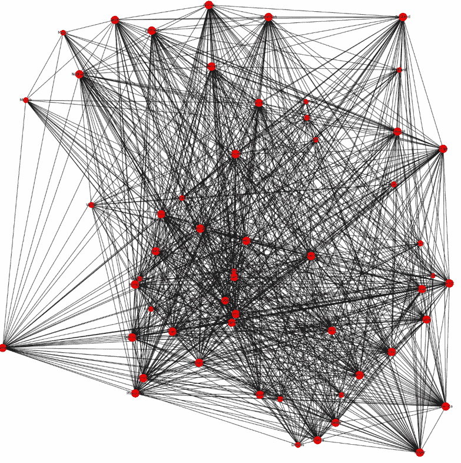

图 3.9 – 按原籍国和专业领域连接的 AIMS 喀麦隆学生网络

图 3.9 显示了一个密集连接的网络，表明许多学生很可能与许多其他学生互动。该网络没有很多桥梁，但大多数顶点似乎是枢纽。在非常密集的网络中，传播过程往往移动得更快。该网络中顶点之间的最短路径与法语非洲网络中的相比会相对较短，因为大多数顶点彼此连接或几乎连接。网络的直径，即最长最短路径，表示信息或疾病在两个顶点之间传播的最大最短旅行路线。小的网络直径（或小的平均最短路径长度）表明传播过程的效率，例如信息、趋势或疾病。因此，我们预计我们的 AIMS 喀麦隆学生网络比我们的法语非洲网络更容易受到传播过程的影响。从技术上讲，直径为定义在网络上的传播过程等微分方程提供了界限。

在这个网络上 R₀ 超过 1 的流行病很可能会迅速传播并感染网络的大部分。让我们在 AIMS 喀麦隆学生网络上运行一个与我们在法语网络上相同的 beta 和 gamma 参数的流行病，并绘制结果，以了解类似于西班牙流感的流行病可能如何通过我们的学生群体传播，通过向脚本 3.2 添加内容：

```
#Run the simulated epidemic on the AIMS Cameroon student network
model = ep.SIRModel(G)
config = mc.Configuration()
config.add_model_parameter('beta', 0.25)
config.add_model_parameter('gamma', 0.1)
config.add_model_parameter("fraction_infected", 0.05)
model.set_initial_status(config)
iterations = model.iteration_bunch(50)
trends = model.build_trends(iterations)
viz = DiffusionTrend(model, trends)
p = viz.plot(width=500, height=400)
show(p)
```

图 3.10 显示了流行病的动态，包括在流行病高峰时有许多感染的学生，并且到第 32 周流行病减弱时几乎整个网络都被感染：

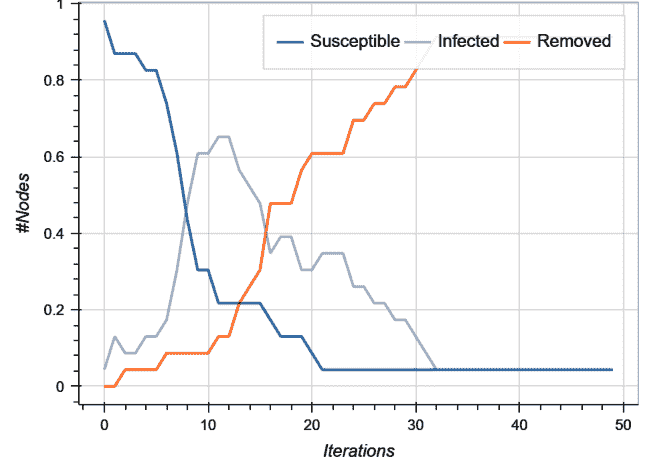

图 3.10 – beta = 0.25 且 gamma = 0.1 的流行病在 AIMS 喀麦隆学生网络中传播

图 3.10 显示了一个非常严重的流行病，很可能需要关闭课程并隔离感染的学生。在第 8 章中，我们将考虑您可以利用的具体策略，以降低在人口层面流行病的影响，包括移除连接人群或形成枢纽的关键顶点。现在，让我们修改脚本 3.2 以运行第二种类型的流行病，其中 R₀ 小于 1（beta = 0.25 且 gamma = 0.3）：

```
#Run the simulated epidemic on the AIMS Cameroon student network
model = ep.SIRModel(G)
config = mc.Configuration()
config.add_model_parameter('beta', 0.25)
config.add_model_parameter('gamma', 0.3)
config.add_model_parameter("fraction_infected", 0.05)
model.set_initial_status(config)
iterations = model.iteration_bunch(50)
trends = model.build_trends(iterations)
viz = DiffusionTrend(model, trends)
```

```
```python
p = viz.plot(width=500, height=400)
show(p)
```
```

*图 3.11* 显示了一种非常不同类型的流行病，它并没有开始感染大量学生并迅速消退：

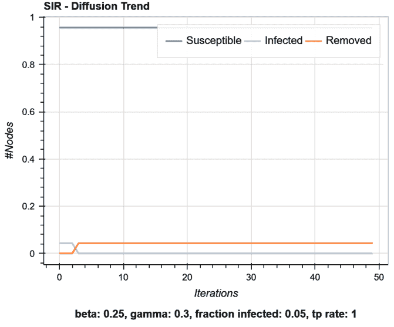

图 3.11 – beta = 0.25 且 gamma = 0.3 的流行病在 AIMS 喀麦隆学生网络中传播

正如我们从 *图 3.11* 中看到的，即使是密集连接的网络也并非对某些类型的流行病构成威胁。如果没有通过网络结构或通过影响传播潜力的疾病特征来有效传播的正确条件，流行病会在人群中消退。然而，一种病毒有可能从 *图 3.11* 所示的初始动态突变为更具传染性的东西。

如本章前面所述，1918 年西班牙流感毒株从一种传染病突变为一种高度传染性疾病，使 R₀ 从刚好超过 1（允许传播）变为 3.5，预示着一场全球灾难。实际上，在模拟通过感兴趣网络传播的流行病时，考虑各种现实的参数值很重要，因为参数的微小差异可能导致非常不同的结果；流行病规划在模拟各种场景时效果最好。

## 总结

在本章中，我们介绍了人口统计因素以及它们如何通过同质性影响网络发展。我们还介绍了枢纽和桥梁的概念。然后我们转向 SIR 模型，以显示基于微分方程模型中传播因素的社会网络中的趋势和疾病传播。我们考虑了两个网络：邻近法语国家的地理网络和基于人口统计因素推断边的 AIMS 喀麦隆学生网络。然后我们通过改变流行病参数模拟流行病，检查了 R₀ 在两个网络上的作用；这证明了趋势或疾病在网络中传播需要特定的条件。我们将在第 8 章再次重温这些想法和影响传播行为的策略，当我们更详细地深入研究中心性度量时，关于动态网络指标如何随着个人随着时间的推移改变与其他人的联系而随时间变化。

在下一章中，我们将考虑网络在运输物流中的作用以及如何将运输路线数据表示为网络。

## 参考文献

Aiello, L. M., Barrat, A., Schifanella, R., Cattuto, C., Markines, B., & Menczer, F. (2012). Friendship prediction and homophily in social media. ACM Transactions on the Web (TWEB), 6(2), 1-33.

Cooper, I., Mondal, A., & Antonopoulos, C. G. (2020). A SIR model assumption for the spread of COVID-19 in different communities. Chaos, Solitons & Fractals, 139, 110057.

Das, K., Samanta, S., & Pal, M. (2018). Study on centrality measures in social networks: a survey. Social network analysis and mining, 8, 1-11.

Estrada, E., Kalala-Mutombo, F., & Valverde-Colmeiro, A. (2011). Epidemic spreading in networks with nonrandom long-range interactions. Physical Review E, 84(3), 036110.

Iyaniwura, S. A., Rabiu, M., David, J. F., & Kong, J. D. (2022). The basic reproduction number of COVID-19 across Africa. Plos one, 17(2), e0264455.

McPherson, M., Smith-Lovin, L., & Cook, J. M. (2001). Birds of a feather: Homophily in social networks. Annual review of sociology, 27(1), 415-444.

Rodrigues, F. A. (2019). Network centrality: an introduction. A mathematical modeling approach from nonlinear dynamics to complex systems, 177-196.

Smith, H. L. (2003). Some thoughts on causation as it relates to demography and population studies. Population and Development Review, 29(3), 459-469.

Weiss, H. H. (2013). The SIR model and the foundations of public health. Materials mathematics, 0001-17.

*图 4.1* 的都市区显示了一些附近的商店（右下角）和一些彼此相距较远的商店（例如左边的那些）。也许我们正从附近的农场向其中五家商店运输新鲜水果和蔬菜。在不考虑街道、加油站或其他考虑因素的情况下（我们将在本章后面讨论这些），似乎商店之间的路线很容易定义。*图 4.2* 显示了这样一条路径：

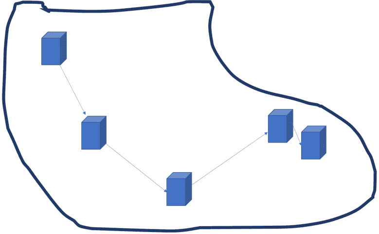

*图 4.2* — 向假设郊区各家杂货店运送水果和蔬菜的路线规划

与 *图 4.2* 相反，在实际情况中，卡车在商店之间可能有许多路线可走。可能存在替代街道和路线组合。卡车可能需要在商店之间加油，加油站的位置可能会影响理想路线的选择。道路可能因施工而封闭。下午的雷暴可能会淹没一些好路上的街道，造成卡车需要避免的危险。一些商店可能缺橙子和葡萄柚，这使得它们需要优先进行早期送货，以便顾客可以购买这些水果。


在更长的距离上，交通方式的选择也成为一个问题。如果需要补货的商店之间存在海洋或山脉等障碍，通过海运或空运运输货物可能是更优的选择。自世界全球化以来，货物跨洲和跨洋运输已变得司空见惯（运输情况如图 4.3 所示）：


图 4.3 – 一艘货轮离港的插图

美国和欧洲使用的许多产品或产品部件来自中国、日本或印度。海运可以为陆运或空运提供更便宜、更快捷的替代方案。供应链物流中的一个关键问题是如何在成本效益、交货时间（TTD）和大宗货物运输需求之间取得平衡。让我们更详细地探讨其中一些考虑因素。

## 燃油成本

当今物流中迫切需要解决的问题之一是根据交付成本优化路线。客户不希望为交付支付高价，也不希望长时间等待货物到达。自 COVID-19 停摆和乌克兰战争以来，燃油价格上涨，一些货物运输路线已不再可用。这推高了制造商、需要将货物运送到实体地点的企业以及从企业购买商品的消费者的成本。地面运输路线，特别是与电动配送车辆（见*图 4.4(a)*）结合使用时，可以为在本地运营的公司提供一个不错的选择。然而，许多供应链依赖海外零件或货物，诸如运输（见*图 4.4(b)*）或空运等选择是必要的：


图 4.4 – 插图说明：（a）用于国内运输货物的半挂卡车和（b）用于海外运输货物的运输选项

然而，燃油成本很少是唯一的考虑因素，因为对于可能变质的货物而言时间至关重要，而且与货物损失相关的安全问题在实际问题中往往优先于燃油成本。让我们考虑一些 TTD 在用于安排交付时间、路线和最佳运输方式的优化算法中成为重要考虑因素的场景。

## 货物交付时间

交付时间的首要考虑因素涉及紧迫性。货物可能在一定时间内变质（如农产品或疫苗），这通常超过成本考虑，因为货物在必要的使用时间之外将无法使用。销售窗口也值得考虑，因为圣诞节或斋月商品在节假日过后需求不会那么大。这会导致企业利润损失。

让我们考虑两个旅游咖啡馆，一个位于苏里南的帕拉马里博市，另一个位于苏里南乡村靠近自然探险营地。城市位置（见图 4.5 (a)）可以利用冰箱储存用于其冰沙的水果；乡村位置（见图 4.5 (b)）没有冰箱。从当地农场运送新鲜水果的运输优先权可能会优先考虑乡村位置，因为水果在那里变质更快：


图 4.5 – 插图说明：（a）苏里南帕拉马里博的一家咖啡馆和（b）苏里南乡村靠近旅游营地的一家咖啡馆

除了变质货物和错过促销期的问题外，时间因素还可能包括交付障碍，例如路线上的施工或收费公路。此外，不同国家在海关停留的时间可能差异很大，避免途经特定国家而选择更长的驾驶路线可能是有利的。

通常，有必要在数学上对路线进行加权，不仅按物理距离，还按旅行时间，包括海关或施工可能性等因素。

## 导航危害

导航问题不仅包括人为的交付障碍，还包括自然障碍。飓风会延误通过繁忙港口（如迈阿密港）的运输。阿尔卑斯山的雪崩是选择铁路运输的公司需要考虑的导航因素。航运业平均每年因恶劣海况和 rogue 波浪损失 10 艘船。一些航线，例如南非东南海岸附近的航线，以产生高浪而闻名（通常是由于洋流与来自不同方向的各种海浪混合）。

在处理最佳旅行路线和确定哪种运输方式最具成本效益和便利性时，对路径进行危害加权是明智的。世界大多数地区都提供开放源代码的危害数据和材料，以确定存在哪些危害以及遇到它们的可能性。例如，世界银行提供了 **气候变化知识门户（CCKP）**，其中包含不同时期的自然灾害风险数据，并可下载数据。

现在我们了解了一些路线规划的考虑因素，让我们深入研究一个简单的例子，包括迈阿密一个本地化区域的五家商店需要通过卡车配送农产品，并且已定义为排除当前施工区域，且一年中的这个时段该地区不会发生洪水或飓风。首先，我们需要了解如何在网络中计算顶点之间的最短路径，这在图论中有着深厚的根源。

## 最短路径应用

地点和地点集合之间的最短路径在图论中已有悠久历史。最初，这个问题源于关于穿越德国柯尼斯堡七座桥的问题。1736 年，莱昂哈德·欧拉提出了一条路线，该路线恰好一次穿越每座桥到桥旁区域的路线不存在。确实如此。如果桥梁数量为奇数，且区域数量比桥梁数量多一个，则可以在不重复穿越桥梁的情况下完成一次旅行。请注意，此证明超出了本书的范围；如果您感兴趣，可以在网上搜索柯尼斯堡桥问题的证明，找到许多证明。

然而，这类问题在运输行业中经常出现，**全球定位系统（GPS）** 路由解决方案和算法会计算最短路径，无论是否有柯尼斯堡桥问题等特定约束，这些算法在当今的路由问题中很常见。我们通常希望在穿越最少的道路、桥梁或障碍物的情况下访问多个地点，我们可以以欧拉提出其桥问题的方式来表述这个问题。然而，我们通常有许多不同的可能路线和地点，这使得证明变得更加困难，因为存在替代路线。

**迪杰斯特拉算法** 计算网络上顶点之间的最短路径。正如我们之前所见，网络可以是无权重的（在邻接矩阵中用 0 或 1 表示顶点之间边的存在）或加权（其中存在的边具有不局限于 1 的数字，表示它们的存在和它们之间的某些属性）。在地理数据中最短路径计算的背景下，这些权重通常代表地点之间的距离。

顶点之间可能存在许多路径。例如，考虑一个具有七个顶点的网络。在顶点一和顶点六之间，存在许多可能的路径，包括图 4.6 中所示的路径。然而，最短路径始终存在，最小化网络中任意两个顶点之间的距离（物理或其他，取决于从数据集分配的边权重）。当网络未连接时，这可能未定义或设为无限距离：

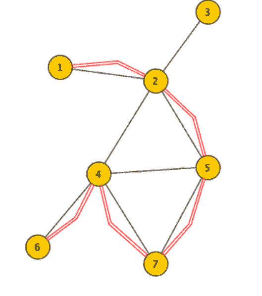

图 4.6 – 一个具有七个顶点且从第一个顶点到第六个顶点的路径的网络

有时，顶点之间的最短路径（例如，我们图 4.6 网络中顶点一和顶点七之间）可能不是唯一的。可能存在长度相同的多条路径，例如顶点一和顶点七之间的两条最短路径（见图 4.7）：

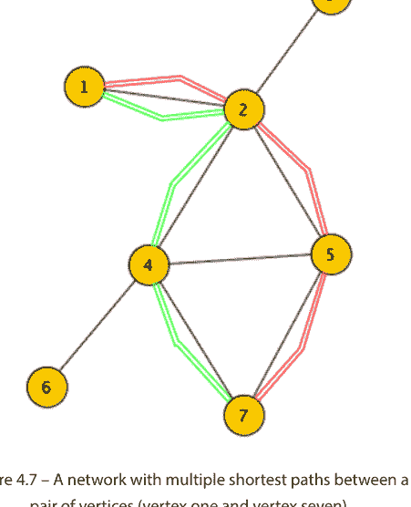

图 4.7 – 一对顶点（顶点一和顶点七）之间存在多条最短路径的网络

在无向网络中，找到顶点之间的最短路径时可以考虑所有顶点之间的边。如前所述，如果网络未连接，则可能存在无限路径长度。对于无向且无权重的网络，最短路径将穿越最少的边（如果没有边路径连接两个顶点，则可能存在无限值）。图 4.8 显示了一个未连接的网络：


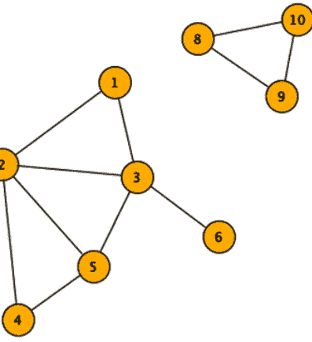

顶点八和顶点九之间的最短路径就是连接顶点八到顶点九的边。假设该网络未加权，则该路径的最短距离为一。顶点一和顶点六之间的最短路径由连接顶点六到顶点三以及顶点三到顶点一的边给出。因此，顶点六和三之间的最短距离为二。然而，顶点八和顶点六之间的最短路径不存在，将被指定为无穷大距离。

Dijkstra 算法从一对顶点中的一个开始，并探索与该顶点相连的顶点。然后记录该初始顶点与其邻居顶点之间的最短路径，减去初始顶点本身（因为它已在我们的路径集合中）。然后探索与最短距离邻居顶点相连的下一组顶点，以找到存在的下一个最短路径。这种迭代探索会一直持续，直到找到另一对顶点。

让我们考虑 Dijkstra 算法如何帮助我们找到商店之间的最短路线。考虑郊区同一家连锁超市的五家商店，可能需要由母公司供应商补货。*表 4.1* 给出了这五家商店之间距离的汇总，单位为英里：

| | Store 1 | Store 2 | Store 3 | Store 4 | Store 5 |
|---|---|---|---|---|---|
| Store 1 | 0 | 2 | 2.4 | 3 | 3 |
| Store 2 | 2 | 0 | 3.7 | 1.4 | 4.3 |
| Store 3 | 2.4 | 3.7 | 0 | 4.9 | 0.9 |
| Store 4 | 3 | 1.4 | 4.9 | 0 | 5.4 |
| Store 5 | 3 | 4.3 | 0.9 | 5.4 | 0 |

表 4.1 – 郊区一家连锁商店之间的英里距离表

我们可以通过脚本 4.1 在 NetworkX 中创建这个商店网络：

```
#import packages
import networkx as nx

#create the Stores network
STRS = nx.Graph()
STRS.add_nodes_from(["store1","store2","store3","store4","store5"])

#define weighted ebunches, which represent lists of edges
e1 = [["store1","store2",2),(("store1","store3",2.4),
(("store1","store4",3),("store1","store5",3)]
e2 = [["store2","store3",3.7),(("store2","store4",1.4),
(("store2","store5",4.3)]
e3 = [["store3","store4",4.9),(("store3","store5",0.9),
(("store4","store5",5.4)]

#add edges
STRS.add_weighted_edges_from(e1)
STRS.add_weighted_edges_from(e2)
STRS.add_weighted_edges_from(e3)

#plot
weight_labels=nx.get_edge_attributes(STRS,'weight')
pos = nx.spring_layout(STRS)
nx.draw(STRS,pos,with_labels=True,)
nx.draw_networkx_edge_labels(STRS, pos,edge_labels=weight_labels)
```

脚本 4.1 为我们提供了五家商店的网络，并附有漂亮的绘图摘要，显示商店之间的距离，如图 4.9 所示：

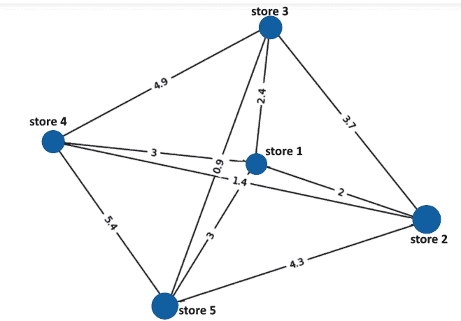

图 4.9 – 我们五家商店及其之间距离的绘图

现在我们可以在脚本 4.1 的基础上创建基于网络的邻接矩阵并找到位置之间的最短路径。让我们计算商店 1 与我们连锁店其他各店之间的最短距离：

```
#create adjacency matrix
adj1 = nx.adjacency_matrix(STRS)
adj1.todense()

#find all shortest paths starting at Store 1
length1, path1 = nx.single_source_dijkstra(STRS,"store1")
length1
```

通过此计算，我们得出了商店 1 与所有其他商店之间的最短距离（length1）以及一般的最短路线（path1）。我们可以看到商店 1 与其他商店之间的最短距离来自 length1。前往商店 2 的最短路线为两英里，而前往商店 4 或商店 5 的最短路线为三英里。商店 3 距离商店 1 为 2.4 英里。

使用 Dijkstra 算法的主要缺点之一是它是一种盲目搜索算法，需要遍历所有可能的选择才能找到路径上每对可能顶点之间的最短路径。对于大型网络来说，这需要很长时间，实际上需要对 Dijkstra 算法进行修改以减少搜索时间。

**A* 算法**（发音为 A-star）通过使用启发式函数来指导搜索来修改 Dijkstra 算法（与 Dijkstra 算法中访问每个顶点不同）。启发式函数在搜索任务中很常见，因为它们加快了过程，并且可以在算法失败时修改搜索。A* 算法中使用的启发式函数结合了从起始顶点到路径的成本以及到达最终顶点的剩余成本的估计，以优先考虑最接近最终顶点的顶点。A* 算法的主要用途之一是为 GPS 用户提供方向以找到前往目的地的最佳路线。

总体而言，A* 算法能有效地找到最短路径候选，特别是在大型或密集的网络中。然而，其性能取决于用于估计遍历网络到达给定目的地的成本的启发式方法。虽然 Dijkstra 算法保证能找到最短路径，但 A* 算法不能保证找到最短路径。然而，在大型密集网络上，运行 Dijkstra 算法是不切实际的，因此必须使用 A*。

*表 4.2* 总结了 Dijkstra 算法和 A* 算法之间的差异，以指导您在最短路径计算中如何以及何时使用每种算法：

| Shortest path algorithm | Type of search | Result guarantees | Computational speed |
|---|---|---|---|
| Dijkstra’s algorithm | Blind search of all vertices | Always finds the shortest path | Slow enough to limit use on dense or large networks |
| A* algorithm | Heuristic function guiding search | No guarantees to finding the shortest path | Fast enough for most problems |

表 4.2 – Dijkstra 算法与 A* 算法的差异

让我们考虑一个不同的商店网络，其中并非每家商店之间都存在路线，通过 `Script 4.2` 在 NetworkX 中创建一个二级商店网络：

```
```python
#create a different Stores network
STRS2 = nx.Graph()
STRS2.add_nodes_from(["store1","store2","store3","store4","store5"])

#define weighted ebunch
e12 = [("store1","store2",2),("store1","store4",3)]
e22 = [("store2","store3",3.7),("store2","store4",1.4)]
```
```

让我们考虑从商店 2 到商店 5 的路线。存在几种可能的路线（商店 2 到商店 3 到商店 4 到商店 5，商店 2 到商店 1 到商店 4 到商店 5，以及商店 2 到商店 4 到商店 5）。如果所有距离都相对较短，最短的可能路线可能不是停靠次数最少的路线。在这种情况下，我们只需查看我们的网络即可发现商店 2 到商店 4 到商店 5 是最短路线。然而，在非常大的网络中，这将花费大量时间，并且可能涉及更长的路径。

我们可以通过在脚本 4.2 中添加以下内容，使用 NetworkX 中的 A* 算法找到最短路线：

```
#find shortest path from Store 2 to Store 5
nx.astar_path(STRS2,"store2","store5", weight='weight')
```

正如预期的那样，A* 算法找到了从商店 2 到商店 4 到商店 5 的最短路径。同样，对于更大的网络，我们需要像 A* 算法这样的算法来快速找到最短路线。即使是 20 家商店且商店之间有若干连接的网络，从网络可视化中手工计算也会有问题。我们已经看到算法如何帮助我们找到两个特定目的地之间的最短路径。现在让我们来看看包含多个不同顶点停靠的最短路径。这种类型的解决方案对于许多最优路由问题至关重要，并且建立在我们寻找两个不同目的地之间最短路径的问题之上。

## 旅行商问题

最短路径的自然扩展是停靠每个地点的最短可能路线。例如，考虑一辆需要为我们五家商店全部补货的蔬菜卡车。停靠我们五家商店的最短路线可以为司机节省时间和燃料，并使蔬菜在最短时间内到达每家商店。

旅行商问题旨在找到停靠每个地点的最短路线，或停靠任意数量可能地点的最短路线。在图论中，该问题（以及欧拉问题）与图的循环有关，循环定义为从同一顶点开始和结束的非空路径。

在实践中，需要算法来找到最短路径，对于大型问题，计算时间和收敛到解决方案可能会限制大多数算法的使用。NetworkX 提供了 Christofides 算法作为求解器，它找到最短生成树（结构类似于树且无环的网络），然后匹配树的顶点以找到最小距离。

让我们使用脚本 4.3 为我们原始的五家商店网络找到旅行商问题的解决方案：

```
#define traveling salesman algorithm and apply it to the stores's
#networks
tsp = nx.approximation.traveling_salesman_problem
tsp(STRS)
```


这条路径从**商店1**出发，依次经过**商店3**（2.4英里）、**商店5**（0.9英里）、**商店4**（5.4英里）、**商店2**（1.4英里），最后返回**商店1**（2英里）。

让我们在次要门店网络上进一步了解这一点，将以下代码添加到`Script 4.3`中：

```
```python
#apply TSP algorithm to the second stores's networks
tsp(STRS2)
```
```

在这种情况下，我们需要多次访问某些商店才能访问每家商店。我们的算法给出的解决方案从**商店1**出发，然后到**商店4**（3英里），再到**商店5**（5.4英里），然后再次经过**商店4**（5.4英里），接着到**商店2**（1.4英里），再到**商店3**（3.7英里），然后返回**商店2**（3.7英里），最后回到**商店1**（2英里）。这比我们在原始门店网络中需要的路线长得多（12.1英里对比22.6英里），原因是许多商店之间的路径不是直达的。

在本节中，我们回顾了旅行商问题的一个解决方案，其中我们有一组需要访问的顶点，并希望找到访问所有这些顶点的最有效方式。在下一节中，我们将从研究最短路径问题转向划分顶点，以最大化每个集合中顶点之间的通行量（例如，在关闭几条路线进行维护时，最大化高峰时段的交通流量）。

## 最大流最小割算法

除了最短路径和路线之外，交通物流有时还涉及城市规划，例如规划道路施工，以尽量减少对交通模式或供应链的中断。目标是在尽量减少被切断的路线数量的同时，最大化通过兴趣点（例如主要交叉路口或每天有大量访客/工作人员的建筑）的交通流量。

在图论中，最大流最小割算法旨在对网络进行划分，以最大化信息在社交网络中的流动、交通在运输网络中的流动，或物质在电力或水管网络中的流动等。通常，关于流量存在一个起始顶点和一个终止顶点，尽管也可以在所有可能的组合上运行该算法并汇总结果，以最大化整个网络的流量。

让我们考虑一个交通流量的例子：从城市外密集的住宅区到大多数人的工作地点——市中心。我们想规划在全市关键交叉路口更换交通信号灯的工作，这些交叉路口被运河分隔。城市中一些道路比其他的拥有更多车道，允许更多车辆使用这些路线。我们希望尽量减少工作日对通勤者的干扰。

我们可以为这种情况创建一个网络，将住宅区指定为顶点“a”，将市中心指定为顶点“g”。我们将使用容量参数来指定路线所能承受的交通量。让我们用`Script 4.4`在NetworkX中构建一个示例网络：

```
```python
#build the city intersection network
G1=nx.DiGraph()
```
```

```
G1.add_edge("a", "b", capacity=2.0)
G1.add_edge("a", "d", capacity=0.5)
G1.add_edge("b", "d", capacity=3.0)
G1.add_edge("c", "d", capacity=2.5)
G1.add_edge("c", "e", capacity=1.0)
G1.add_edge("e", "f", capacity=4.0)
G1.add_edge("f", "g", capacity=1.0)

#plot network
capacity_labels=nx.get_edge_attributes(G1,'capacity')
pos = nx.spring_layout(G1)
nx.draw(G1,pos,with_labels=True,)
nx.draw_networkx_edge_labels(G1,pos,edge_labels=capacity_labels)
```

这个脚本应该生成一个类似于图4.11中的网络：

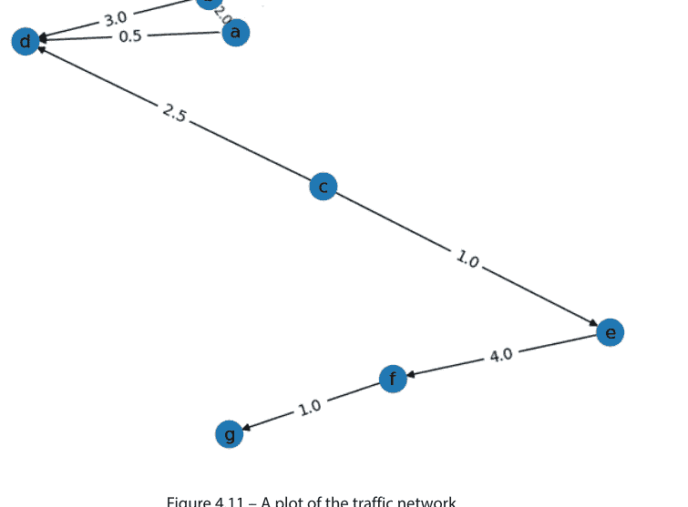

图4.11 – 交通网络图

现在我们已经有了网络，让我们应用最大流最小割算法，通过向Script 4.4添加代码来找到我们可以更换第一个交通信号灯的位置：

```
#find cut-points
partition = nx.minimum_cut(G1, "a", "g")
print(partition)
```

我们的划分结果表明，最佳方案是切断交叉路口“c”和“d”之间的连接。一些通勤者可能会受到影响，但这保证了总体上最多通勤者的通行。

## 总结

在本章中，我们探讨了交通问题和路径规划问题，这些问题在现实世界的行业中经常出现。我们在两个示例门店网络上使用Dijkstra和A*算法找到了商店之间的最短路径。然后，我们考虑了旅行商问题以在两个门店网络上进行最优路线规划，观察连通性如何影响路线长度。最后，我们考虑了在小型城市网络上最大化流量的最优割集。在下一章中，我们将通过检查生态数据来处理网络上的聚类问题。

## 参考文献

Chen, L., Kyng, R., Liu, Y. P., Peng, R., Gutenberg, M. P., & Sachdeva, S. (2022, October). Maximum flow and minimum-cost flow in almost linear time. In 2022 IEEE 63rd Annual Symposium on Foundations of Computer Science (FOCS) (pp. 612-623). IEEE.

Johnson, D. B. (1973). A note on Dijkstra’s shortest path algorithm. Journal of the ACM (JACM), 20(3), 385-388.

Kang, N. K., Son, H. J., & Lee, S. H. (2018). Modified A-star algorithm for modular plant land transportation. Journal of Mechanical Science and Technology, 32, 5563-5571.

Little, J. D., Murty, K. G., Sweeney, D. W., & Karel, C. (1963). An algorithm for the traveling salesman problem. Operations research, 11(6), 972-989.

Liu, S., Münch, F., & Peyerimhoff, N. (2018). Bakry-Émery curvature and diameter bounds on graphs. Calculus of Variations and Partial Differential Equations, 57, 1-9.

Rondinelli, D., & Berry, M. (2000). Multimodal transportation, logistics, and the environment: managing interactions in a global economy. European Management Journal, 18(4), 398-410.

Rosenthal, W., & Lehner, S. (2008). Rogue waves: Results of the MaxWave project.
