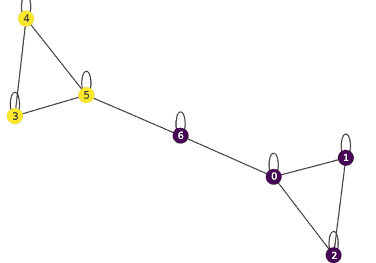
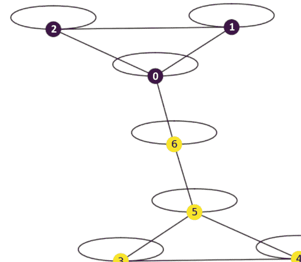

# 生态数据

在本章中，我们将介绍一些生态数据收集中常用的方法，然后探索图论聚类方法，这些方法可以解析受监测地理区域内的动物种群。这是生态研究中一个非常常见的问题，因为动物种群会迁移并与其他动物种群重叠。此外，解析健康和亚健康生态系统是保护和城市规划中的常见调查任务。我们将使用**谱聚类**分析两类生态数据，以在蛇类捕获计数和生态调查文本数据中寻找群体。

到本章结束时，你将理解如何应用谱聚类在网络中寻找群体。你还将看到谱聚类的不同实现方式，其中一些算法比其他算法更适合扩展到大型网络。

具体来说，我们将涵盖以下主题：

- 生态数据简介
- 谱图工具

让我们从生态问题的一些背景开始。

## 技术要求

你需要Jupyter Notebook来运行本章中的实践示例。

本章的代码可在此处获取：https://github.com/PacktPublishing/Modern-Graph-Theory-Algorithms-with-Python

## 生态数据简介

环境研究在保护策略、气候变化监测和农业实践中发挥着重要作用。收集的数据可能包括植物类型分布和密度、动物迁徙模式或疾病程度的数据。例如，农民可能希望跟踪大型农场中的作物病害，以监测各种作物对年产量构成的潜在威胁。保护主义者可能希望跟踪濒危动物种群在国家公园中的迁徙，以便将反盗猎资源部署到拥有大量本地或迁徙种群区域。让我们首先探索一些数据收集方法。

## 探索跨地理区域追踪动物种群的方法

动物种群经常移动，季节变化、天气事件和人类互动促使动物从一个地理区域迁移到另一个地理区域。东非草原上发生着最大规模的动物迁徙之一，每年随着雨季来来去去，数以百万计的群居动物（如角马和斑马）从塞伦盖蒂迁徙到马赛马拉，再返回塞伦盖蒂（图5.1）。盗猎不仅伤害动物种群，还常常助长其他非法活动，在当地和国际上造成问题；了解保护区边界上的迁徙模式可以合理配置资源以阻止盗猎：


图5.1 – 雨季开始时斑马群的插图


有许多方法可以监测种群在地理上的移动。一种方法是为动物佩戴卫星追踪标签，这些标签会上传每只被标记动物的位置数据。这使研究人员能够为每只动物构建路径，并汇总标记种群的统计结果（可能只包含一个物种或几个目标物种）。例如，在斑马群中，也许一个保护团队在雨季前给 10 只斑马佩戴了标签，这些标签将在数周内每小时记录斑马的位置。虽然我们预期所有 10 只动物都会沿着同一条大致路径从一个公园迁移到另一个公园，但个体迁移的速度可能不同，可能会选择略有差异的路线，或在不同地点停下来觅食和饮水。这些数据使研究人员能够识别出种群中行为偏离群体主流行为的亚种群。

另一种跨地域追踪动物种群的常用方法是使用隐蔽在目标物种可能经常出没地点的触发相机（如水坑、森林空地或健康的珊瑚礁）。例如，假设公共卫生官员注意到孟加拉国阿特拉河附近村庄的眼镜王蛇咬伤事件有所增加（图 5.2），并希望了解当地眼镜王蛇种群的情况，以制定政策防止人类与眼镜王蛇接触。

也许可以调整工作时间，让农业工人在一天中的某些时段或季节避开眼镜王蛇经常出没的地区。官员们可以在咬伤事件更常见的地方设置触发相机，在所用胶片的整个寿命期内拍摄眼镜王蛇的图像。根据咬伤密度在相关区域安装多台相机，按照时间、物种以及每台相机识别出的个体蛇数量对毒蛇（包括眼镜王蛇）进行追踪。随后，这些数据为关于种群移动和蛇类控制策略的政策提供信息，以减轻对公共安全的威胁。


图 5.2 — 孟加拉国乡村眼镜王蛇示意图

## 探索采集植物分布与病害的方法

植物分布和病害的数据采集需要采用不同的方法，因为植物通常不会在地理上移动。人工数据采集需要人眼分辨植物种类和病害，这可能不可靠，而且需要长时间才能收集到有意义的数据。然而，自主车辆和无人机提供了一种在广阔地理区域采集植物图像和视频的方法，这些图像和视频可以通过在研究区域本地物种的植物图像数据上训练出的**卷积神经网络**（CNNs）进行处理。例如，哥伦比亚的农民可能希望尽早识别出咖啡锈病以避免作物损失，他们可以在区域农场每周采集的无人机或无人车数据上运行咖啡锈病分类器 CNN（示例见图 5.3）。显示潜在咖啡锈病的图像可以触发系统警报，向农民提供农场地理位置或植物识别编号。


图 5.3 – 用于扫描哥伦比亚农场咖啡锈病的咖啡植株图像示意图

然而，在可能通过野外工作识别新植物物种的地区研究中，人工记录植物可能是一种有用的工具。刚果盆地和亚马逊盆地的大部分地区相对而言尚未得到充分勘探，识别潜在的新植物物种可能有助于深入了解生态系统的重要组成部分、发现可能治疗人类疾病的药物，或识别入侵物种带来的威胁。

入侵植物可能威胁生态系统。新物种可能预示着新化合物的发现。让我们设想一位在亚马逊进行野外工作的植物学家，她遇到了一种以前从未见过的新蘑菇（图 5.4）。为了确认这是一种新蘑菇物种，我们的植物学家会拍摄照片、采集样本用于基因分析，并记录她发现这种蘑菇的生态系统。


图 5.4 – 一种潜在新蘑菇物种的示意图

所有这些数据采集方法都会产生空间数据，其中一些区域在空间上可能相邻，也可能不相邻。在一组相距很远的地理区域中发现的物种，很可能对应于不同的种群，这些种群会受到不同的人为和环境因素影响。将这些数据视为空间数据，并应用图论中的一些工具，有助于在生态数据分析中解析出感兴趣的亚种群。

在许多情况下，采集植物生物样本或为动物佩戴追踪标签并不可行。然而，无人机和其他自主车辆可以拍摄一个地区的动植物照片（图 5.5），使研究人员能够通过一种特殊类型的深度学习算法从图像中识别物种，并根据深度学习结果构建一个网络。


图 5.5 – 森林溪流示意图，可通过深度学习算法从中识别植物群

现在我们知道了如何采集生态数据，接下来让我们探索图论中的一些工具，这些工具将帮助我们分析在不同地理区域采集到的生态数据。

## 谱图工具

**邻接矩阵**以及矩阵中**顶点的度**包含网络中顶点连通性的信息。对于无向网络，网络的**拉普拉斯矩阵**可通过从度矩阵中减去邻接矩阵得到（即 \(L = D - A\)，其中 \(D\) 是度矩阵，\(A\) 是邻接矩阵）。该矩阵包含关于网络许多重要性质的信息，包括连通分量的数量、能将网络分割成不同分量的最稀疏切割，以及网络整体的连接强度。

**连通性**是图论中的一个重要概念。**连通网络**是指任意两个顶点之间都存在路径的网络；**非连通网络**是指某些顶点与所有其他顶点之间没有路径的网络。连通网络可以通过切割边来分离；**最小割集**是断开一个连通网络所需移除的最少边的集合。这些值不仅与图论中关于传播过程和其他定义在网络上的微分方程的理论结果相关，而且还能告诉我们如何在该网络上分离群体。

为了获得这些信息，我们需要对拉普拉斯矩阵进行分解，以得到特征向量和特征值（网络谱）。有时，我们会先对拉普拉斯矩阵进行归一化；在谱聚类中，与从谱中计算特定图论值时相比，这种归一化并非那么必要。然后，我们求出拉普拉斯矩阵的特征值和特征向量。在实践中，这一步通常通过算法完成，而非直接进行线性代数运算。

此过程获得的第二个特征值对应于**费德勒值**（也称为**代数连通度**）；该值计算网络中存在的连通分量数量，并与网络的鲁棒性相关。对应的特征向量将网络划分为独立的子网络，从而为在网络上划分群体提供一个两簇解。在谱聚类中，这种将网络划分为两个独立子网络的过程可以重复进行，直到达到预定义的停止点（如聚类总数）。

对由生态数据构建的空间网络进行谱聚类，使研究人员能够划分出动物迁移的区域，区分可能孤立的种群，并记录植被类型或作物病害的差异。让我们建立一个简单的例子，探索计算谱聚类的不同方法。

## 使用谱图工具对生态种群进行聚类

假设加蓬的一位研究人员希望了解卢安果国家公园保护区内加蓬蝰蛇种群之间的相互连通性（*图 5.6*）。在公园的七个区域（每个区域用一个顶点表示）内，蛇被贴上标签，标签会在接下来的一个月里记录它们的位置。如果蛇的栖息地与多个区域重叠，它们通常会在区域之间移动。可能存在多个蛇种群，不同蛇种群拥有不同的领地。如果两个区域共享一个区域种群，那么这两个区域对应的两个顶点之间将会有一条边。如果没有蛇在区域间迁移，则两个顶点之间不会有边，且很可能代表不同的种群。孤立的种群往往更容易受到气候变化、偷猎和栖息地丧失的影响；了解物种和个体种群的活动范围对于保护工作至关重要。


图 5.6 – 森林地面上加蓬蝰蛇的示意图

让我们用脚本 5.1 创建一些关于蛇群活动轨迹的数据：

```
#create snake area network adjacency matrix
import numpy as np
import networkx as nx
np.random.seed(0)

adj_mat = [[1,1,1,0,0,0,1],
           [1,1,1,0,0,0,0],
           [1,1,1,0,0,0,0],
           [0,0,0,1,1,1,0],
           [0,0,0,1,1,1,0],
           [0,0,0,1,1,1,1],
           [1,0,0,0,0,1,1]]

adj_mat = np.array(adj_mat)
```

在实践中，地理区域很少会与数据集中的所有其他区域接壤。**空间权重**用于编码**区域连通性**。地理上孤立的区域不太可能包含重叠的蛇群。然而，蛇有可能跨越地理上孤立的区域迁徙，因此空间权重在某些动物种群研究中可能并不适用；不过，洛安戈国家公园并不像某些山区或岛屿地理那样存在主要的迁徙屏障。这里，我们将在脚本 5.1 中为蛇类重叠邻接矩阵（adj_mat）添加空间权重分量（权重总和），以推导出加权邻接矩阵（adj_mat_w）：

```
#create spatial weight matrix
weights_total = [[1,1,1,0,0,0,1],
```

```
[1,1,1,0,0,0,0],
[1,1,1,0,0,0,0],
[0,0,0,1,1,1,1],
[0,0,0,1,1,1,1],
[0,0,0,1,1,1,1],
[1,0,0,1,1,1,1]

weights_total = np.array(weights_total)
adj_mat_w=np.multiply(adj_mat,weights_total)
```

我们可以创建并探索度矩阵，以及拉普拉斯矩阵（从度矩阵中减去邻接矩阵）。让我们将这些信息添加到脚本 5.1 中：

```
#explore degree and Laplacian matrices
degree_matrix=np.diag(adj_mat_w.sum(axis=1))
laplacian_matrix=degree_matrix-adj_mat_w
print(degree_matrix)
print(laplacian_matrix)
```

度矩阵编码了连接到给定顶点的顶点数量，并作为中心性的基本度量。枢纽节点具有高度数得分，而更孤立的区域可能度数为零或一。我们的蛇群重叠网络在整个网络中具有相似的度中心性度量：

```
[[4 0 0 0 0 0 0]
 [0 3 0 0 0 0 0]
 [0 0 3 0 0 0 0]
 [0 0 0 3 0 0 0]
 [0 0 0 0 3 0 0]
 [0 0 0 0 0 4 0]
 [0 0 0 0 0 0 3]]
```

现在让我们看看拉普拉斯矩阵，它编码了我们将用于谱分解和聚类的连通性信息：

```
[[ 3 -1 -1  0  0  0 -1]
 [-1  2 -1  0  0  0  0]
 [-1 -1  2  0  0  0  0]
 [ 0  0  0  2 -1 -1  0]
 [ 0  0  0 -1  2 -1  0]
 [ 0  0  0 -1 -1  3 -1]
 [-1  0  0  0  0 -1  2]]
```

有多种方法可以计算 Fiedler 向量以获得谱聚类结果。我们将介绍两种使用 Python 计算的方法。根据你的 NetworkX 版本，你可能需要将 `nx.from_numpy_matrix` 替换为 `nx.from_numpy_array`。根据问题规模的大小，使用类似于我们在脚本 5.1 中添加的线性代数求解器可能更容易：

```
#define Fiedler vector and obtain clustering
G = nx.from_numpy_matrix(adj_mat_w)
ev = nx.linalg.algebraicconnectivity.fiedler_vector(G)
labels = [0 if v < 0 else 1 for v in ev]
labels

nx.draw(G,with_labels=True, node_color=labels)
```

这显示了两个不同的蛇群汇聚到我们洛安戈国家公园采样区域的第六个区域（同时有蛇停留在完全相同的区域，由环表示），如图 5.7 所示：



图 5.7 – 蛇群谱聚类

Scikit-learn 提供了一个谱聚类包，我们将其作为替代计算方法添加到脚本 5.1 中。如果你在 Windows 上遇到警告消息，请不要担心；这不是错误。现在让我们将其添加到脚本 5.1 中：

```
#perform spectral clustering with sklearn
from sklearn.cluster import SpectralClustering
from sklearn import metrics
sc = SpectralClustering(2, affinity='precomputed', n_init=100)
sp_clust=sc.fit(adj_mat_w)
sc_labels=sp_clust.labels_
nx.draw(G,with_labels=True, node_color=sc_labels)
```

正如预期的那样，scikit-learn 包产生了与我们的线性代数方法相同的网络划分（图 5.8）：



图 5.8 – Scikit-learn 对蛇群进行的谱聚类

谱聚类不仅限于网络数据或生态数据。任何数值数据集都可以使用谱聚类进行聚类。在图像和文本分析中，我们通常没有大量预标注的数据实例，而手动标注数据非常耗时，并且如果数据集中某些重要类别没有出现在供人工评分的小样本中，可能会被遗漏。谱

聚类使我们能够通过这些领域的工具嵌入数据，基于最近邻创建网络，并应用谱聚类为数据集获取标签，然后可用这些标签来训练分类算法。这一过程被称为**半监督学习**，自然语言处理和图像分析中的现实世界数据科学通常依赖这种方法从数据集构建分类模型。让我们通过一个基于文本的生态数据集来看看它的实际应用。

## 对文本笔记进行谱聚类

让我们考虑一个生态笔记数据集，包括五个健康公园和五个不健康的本地公园。虽然这些笔记不如完整的生态调查详尽，但它们应该能够演示如何构建一个半监督学习流程来对生态系统健康进行分类。以下是笔记中健康生态系统的一个示例：

```
"Mangrove ecosystem. Numerous butterflies, lizards, and insects. Gumbolimbo trees. Soggy soil.", 'Tropical pines. Scat shows raccoon and coyote populations here. Recent controlled burn."
```

以下是数据集中不健康生态系统的一个示例：

```
"Small grass area. Some saplings. Gravel paths. Many cars parked in non-parking zones. Lots of run-off."
```

虽然我们可以自己标注这些笔记，但我们将使用谱聚类来了解半监督学习如何为更大的数据集生成训练数据标签，而这些数据集的标注可能不可行或不可靠。首先，我们将使用脚本 5.2 导入数据：

```
#set up needed packages
import pandas as pd
import numpy as np
import os
#you may need to install sentence_transformers
#if the package is not already in your environment
#!pip install sentence_transformers
from sentence_transformers import SentenceTransformer

#import first network's data
File ="C:/users/njfar/OneDrive/Desktop/SC_Notes.csv"
pwd = os.getcwd()
os.chdir(os.path.dirname(File))
mydata = pd.read_csv(os.path.basename(File),encoding='latin1')
```

为了嵌入数据，我们将使用一个**预训练变换器模型**——这是一种在大规模文本数据集上训练的深度学习算法，能够感知语言上下文，并将新的文本样本映射到学习到的嵌入空间中。虽然这种方法的细节超出了本书的范围，但感兴趣的读者可以自行探索 HuggingFace 模型和文献中的预训练变换器模型。这里，我们使用一个预训练的 HuggingFace 模型，一种来自变换器的双向编码器表示（BERT）模型。我们首先填充缺失数据，然后使用我们选择的 BERT 模型进行嵌入，将其添加到脚本 5.2 中：

```
#prepare data
mydata['Notes']=mydata['Notes'].fillna(value=".")

#strip to text for input into BERT model
text_list=list(mydata.Notes)

#get BERT--768 vectors;
#note: you will need enough memory to load the transformer model
sbert_model1 = SentenceTransformer('all-mpnet-base-v2')
#encode data with BERT
encoded_text1=sbert_model1.encode(text_list)
```

既然我们已经嵌入了数据，就可以创建最近邻图了。由于我们的样本量很小，我们将通过添加到脚本 5.2 来考虑一个点的三个最近邻：

```
#make nearest neighbors graph
from sklearn.neighbors import kneighbors_graph
n_adj = kneighbors_graph(encoded_text1, n_neighbors=3).toarray()
```

现在我们准备运行谱聚类，并检查我们的数据在该算法中是如何聚类的。让我们将其添加到脚本 5.2 中以查看实际效果：

```
#run spectral clustering
from sklearn.cluster import SpectralClustering
from sklearn import metrics
sc = SpectralClustering(2, affinity='precomputed', n_init=100)
sp_clust=sc.fit(n_adj)
sc_labels=sp_clust.labels_
print(sc_labels)
```

从打印的标签中，我们可以看到生态系统 3、7、8 和 10 形成一个簇，而生态系统 1、2、4、5、6、7 和 9 形成另一个簇。让我们查看我们的笔记样本，看看这种方法在发现语气或主题差异方面表现如何，通过添加到脚本 5.2：

```
#examine notes
print(text_list)
```

我们可以看到，与样本中的其余生态系统相比，笔记 3、4、7、8 和 10 是不健康的生态系统。谱聚类似乎并未发现所有这些差异，但另一种类型的文本嵌入可能比我们所选的嵌入更能区分语气。同样，更少的邻居数量或更大的样本量也可能提供更好的结果。然而，我们确实在五个不健康样本中找到了四个


通过我们的谱聚类算法识别不健康的生态系统。人工审阅结果的人无需更改太多标签（20%）即可为此数据生成正确的训练标签，以便用于训练分类模型。我们数据集的第二列包含正确的音调分类标签。让我们通过添加到脚本 5.2 将 BERT 嵌入转换为 DataFrame：

```
#create training dataset for supervised learning
#turn BERT embedding into array
BERT_array1=np.array([x for x in encoded_text1])

#convert to dataframes
BERT_df1=pd.DataFrame(BERT_array1)
```

现在，让我们将数据拆分为训练集和测试集（分别为 80% 和 20% 分割），创建一个 k-最近邻分类器（根据其两个最近邻居的标签对点进行分类，k = 2），并通过添加到脚本 5.2 来衡量测试集误差：

```
#create KNN classifier and test accuracy
from sklearn.neighbors import KNeighborsClassifier
from sklearn.model_selection import train_test_split

#get predictors and outcome
BERT_df1['Type']=mydata['Type']
df_train, df_test = train_test_split(BERT_df1,test_size=0.2, random_state=0)
X = df_train.iloc[:,0:767]
y = df_train.iloc[:,768]
X_test = df_test.iloc[:,0:767]
y_test = df_test.iloc[:,768]

#create KNN classifier and print accuracy
eu=KNeighborsClassifier(n_neighbors=2,metric='euclidean')
eu.fit(X,y)
print(eu.score(X_test,y_test))
```

我们的分割产生了 100% 的准确率，表明生态系统类型的误分类为零。你的结果可能会因种子和机器上的随机数生成器而有所不同。然而，这种方法对该数据集似乎效果很好。我们通过嵌入处理文本数据、通过谱聚类为标签创建提供良好起点，然后创建分类器模型的管道，为我们的数据集生成了一个高精度分类系统。

## 摘要

在本章中，我们学习了如何为各种数据科学问题收集生态数据。在简要介绍谱聚类理论后，我们展示了谱聚类如何通过我们的加蓬蝰蛇分布示例解析出不同的动物种群。最后，我们通过生态系统笔记数据示例探讨了可用于半监督学习管道的最近邻网络谱聚类。在第 6 章中，我们将介绍中心性度量并使用它们来寻找股票定价中的临界点。

## 参考文献

Angelici, F. M., Effah, C., Inyang, M. A., & Luiselli, L. (2000). A preliminary radiotracking study of movements, activity patterns and habitat use of free-ranging Gaboon vipers, Bitis gabonica. Revue d’Ecologie, Terre et Vie, 55(1), 45-55.

Corrales, D. C., Figueroa, A., Ledezma, A., & Corrales, J. C. (2015). An empirical multi-classifier for coffee rust detection in Colombian crops. In Computational Science and Its Applications--ICCSA 2015: 15th International Conference, Banff, AB, Canada, June 22-25, 2015, Proceedings, Part I 15 (pp. 60-74). Springer International Publishing.

Froese, G. Z., Ebang Mbélé, A., Beirne, C., Atsame, L., Bayossa, C., Bazza, B., ... & Poulsen, J. R. (2022). Coupling paraecology and hunter GPS self-follows to quantify village bushmeat hunting dynamics across the landscape scale. African Journal of Ecology, 60 (2), 229-249.

Mutombo, F. K. (2012). Long-range interactions in complex networks.

Ng, A., Jordan, M., & Weiss, Y. (2001). On spectral clustering: Analysis and an algorithm. Advances in neural information processing systems, 14.

Nunez-Mir, G. C., Iannone III, B. V., Pijanowski, B. C., Kong, N., & Fei, S. (2016). Automated content analysis: addressing the big literature challenge in ecology and evolution. Methods in Ecology and Evolution, 7 (11), 1262-1272.

Qi, X., Fuller, E., Wu, Q., Wu, Y., & Zhang, C. Q. (2012). Laplacian centrality: A new centrality measure for weighted networks. Information Sciences, 194, 240-253.

Reimers, N., & Gurevych, I. (2019). Sentence-bert: Sentence embeddings using siamese bert-networks. arXiv preprint arXiv:1908.10084.

White, S., & Smyth, P. (2005, April). A spectral clustering approach to finding communities in graphs. In Proceedings of the 2005 SIAM international conference on data mining (pp. 274-285). Society for industrial and applied Mathematics.
