# 第 3 部分：
时间数据应用

第 3 部分介绍时间数据应用，包括与股票市场波动预测、商品价格和销售量的变化点分析以及通过动态动物交互网络的流行病传播相关的问题。在本部分中，我们将概述基于顶点和基于边的中心性度量、网络数据结构向单纯复形的扩展、三元闭合和动态流行病模型。

第 3 部分包含以下章节：

- 第 6 章，股票市场数据
- 第 7 章，商品价格/销售数据
- 第 8 章，动态社交网络

# 时间数据的介绍

在 *第 2 章* 中，我们简要介绍了时间数据或以时间序列或一组时间序列形式存在的数据。**时间序列数据**跟踪许多不同行业的重要指标：每日商店销售量、每周软件产品营销线索量、一种新兴疾病的每日发病率、人口中每年行为率（例如吸烟或蔬菜消费），或每小时股票价格跟踪市场趋势。许多相关因素会影响随时间的变化趋势，并且如果已知某些因素，一些模型会直接考虑这些因素。

然而，考虑一个新城市中一家新宝石店的销售趋势，其中宝石店是一种新现象，也许是在海法和特拉维夫之间某个偏远地区（*图 6.1*）。因此，几乎没有人知道可能影响销售的因素。了解时间序列数据中存在的趋势对于挖掘可能影响销售的因素至关重要。然而，时间序列数据集对许多监督学习方法提出了重大挑战，例如 **随机森林模型或线性回归**。在某一时间点，销售并非独立；它们依赖于影响前几天销售的因素，限制了监督学习和许多类型的 **无监督学习** 的使用。缺乏预测因子也带来了挑战。


图 6.1 – 以色列特拉维夫和海法之间的一家宝石店的插图

幸运的是，对于我们的宝石店，许多算法旨在处理时间序列数据，例如 **自回归积分移动平均模型（ARIMA 模型）**、**奇异谱分析（SSA）** 和 **Holt–Winters 模型**。然而，时间序列行为的变化（尖峰、崩盘和方差变化）对这些模型构成了挑战。如果您想创建预测模型或挖掘影响时间序列值的因素，捕捉和预测这些变化至关重要。在我们的宝石店示例中，旅游季节性、该地区的冲突以及假日旅行促销可能会影响我们商店所在路线上的客流量。

一个拥有丰富且非常复杂时间序列数据的行业是金融。许多社会和经济因素影响股票价格，解开股票价格波动中的关系和随机性是金融行业的核心。让我们来看看股票市场定价数据以及分析股票市场定价数据的常见任务。

## 股票市场应用

近年来，金融部门已从以专家驱动的股票市场洞察模式转变为更基于机器学习的方法。机器学习模型筛选出新兴趋势并捕捉人类在浏览数据时可能忽略的微妙趋势。这种策略还允许分析师处理比人类能够处理的数据收集大得多的量，包括许多不同的行业、国际证券交易所，甚至单个前沿市场。通过收集更多洞察，投资者和投资管理公司可以在没有太多这些市场专业知识的情况下投资于更广泛的各种市场。

股票市场分析涵盖了广泛的应用领域。投资可以在特定市场行业（例如技术或农业）内进行，也可以在不同市场之间进行。它们可以专注于短期收益（包括在几分钟或几小时内实现的收益）和长期收益（可能跨越数十年）。它们还可以专注于外国市场，其中股票价格可能受与影响本地市场价格的因素非常不同的因素影响。所有这些情况都指导了分析工作以及为分析收集数据的时标。

总体而言，分析股票市场数据涉及评估随时间变化的许多类型趋势。股票的价格可能随时间保持不变，经历逐渐的价格增长和下降，突然崩盘，或指数级增长。每一种都暗示着投资者在短期和长期内的不同买卖策略。图 6.2 显示了一个假设的股票，表现出这些模式中的许多：


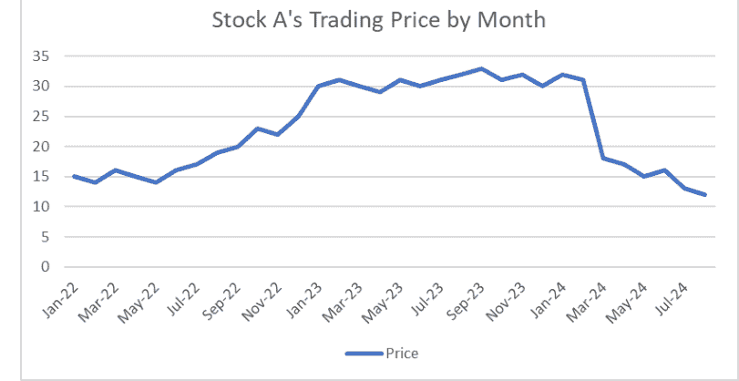

图6.2 – 股票数据趋势示例，包括停滞期、增长期、收缩期和崩盘

从图6.2中可以看出，股票A在2022年初价格平稳，之后在2022年7月左右进入增长阶段。这一增长阶段持续到2023年初，此时再次进入价格平稳阶段。随着2024年3月发生某事件，股票A的价格崩盘，然后进入价格下跌期，直到我们追踪的时间段结束。

通常，这些趋势并非孤立出现。共享供应链的公司股票可能表现出相似的趋势。同一行业的股票可能表现出相似或相反的趋势，具体取决于公司之间的关系或行业新闻。共享贸易或国防区域的股票也可能表现出相似趋势，考虑到国家及其市场之间的社会政治联系（例如大多数经济体遭遇的COVID崩盘）。

**临界点**，即趋势发生剧烈变化的时刻，在金融分析中备受关注。它们代表着在加速增长期之前进行投资的机会，或者在崩盘之前退出市场或特定投资的警告。然而，检测这些趋势对市场分析中许多常用工具构成了挑战。

幸运的是，包括一些源于网络科学的新工具，能够比传统方法更容易地识别临界点。许多工具依赖于市场、行业或股票之间的大规模耦合。随着越来越多的股票（或市场）表现出相似行为，系统变得容易受到外部影响，这些影响可能使其陷入崩盘（例如供应链问题、新立法或流行病）。仅仅计算市场中个股或行业之间的相关性可以提供一些洞察，但将（时间切片内的）相关性转换为网络，使我们能够利用许多网络科学工具，更深入地研究其相关性的本质及其随时间的变化。具体而言，中心性指标使我们能够量化和分类网络中存在的关系。让我们探讨其中的一些中心性指标。

## 中心性指标简介

我们在*第3章*中已经遇到了一些中心性指标，了解了桥梁和枢纽。许多基于顶点的中心性指标计算与枢纽相关的属性——顶点与其最近邻及其最近邻的连接。许多基于边的中心性指标计算桥接属性，其中顶点附近的边充当不同枢纽之间的连接器。

度是一种最简单的**基于顶点的中心性指标**，我们在*第5章*中已经遇到过。**度中心性**就是直接连接到目标顶点的顶点数量。许多基于拉普拉斯的指标或算法在算法计算中依赖于度矩阵。从表面上看，这一指标似乎能捕捉重要的枢纽属性；具有高度中心性的顶点将在网络内具有很大的影响力（因此可能成为良好的干预目标）。它也能很好地扩展到非常大的网络。然而，度中心性的一个局限性是它缺乏对顶点在直接邻居连接之外位置的感知；一个度中心性较低的顶点可能连接到许多度中心性较高的顶点，使其对网络行为和结构的影响力超过其度中心性所暗示的。

**特征向量中心性**及其变体（包括 **PageRank** 和 **Katz 中心性**）包含了对直接邻居之外连接性的感知，从而提供更全面的基于顶点的中心性指标。因此，**特征向量中心性**会为我们假设的连接到高度中心性顶点的低度中心性顶点打出高分，因为该顶点靠近连接非常紧密的顶点。从技术上讲，要找到网络中每个顶点的特征向量中心性，我们可以对邻接矩阵进行特征分解。由于邻接矩阵不包含负值，我们可以假设第一个特征值是最大的，其特征向量即为我们的顶点产生特征向量中心性得分。

PageRank中心性扩展了特征向量中心性，并通过用通过随机游走构建的调整邻接矩阵替换原始邻接矩阵来增加其灵活性，以确定邻接属性。此外，随机游走者属性（随机游走可以以低概率穿过图的未连接区域）创建了一个连通的调整邻接矩阵。然后，在调整后的邻接矩阵上执行特征分解之前对其进行缩放，以计算特征向量中心性得分。因此，PageRank中心性得分提供了灵活性。此外，使用调整后的邻接矩阵进行计算通常更容易、更快，使算法能够很好地扩展到甚至数亿个顶点的网络。

**基于边的中心性度量**捕捉对扩散过程和不同枢纽之间的连接性很重要的网络基础设施。**介数中心性**是最常见的基于边的中心性指标之一，它捕捉网络中所有最短路径中包含给定顶点的相对数量。考虑一个有10条最短路径的网络，其中8条经过某个特定顶点。如果没有这个顶点，许多最短路径将不存在，这将给网络在社交网络上的扩散过程或交通网络上的路线效率方面带来很大不便。然而，介数中心性不能很好地扩展，在没有某种并行化的情况下，不应将其用于大型网络。

一种近期的基于边的中心性网络已被证明是寻找股市临界点的有效工具。**Forman–Ricci 曲率**是一种基于几何的工具，将相邻边相对于目标边进行考虑。在无权网络上，Forman–Ricci 曲率通过2减去目标边所连接的两个顶点的度中心性来计算。常数2代表由目标边连接的两个顶点之间的连接。边连接的两个顶点的度中心性统计了目标边周围的相邻边数量（减去由该边连接的顶点，由此得到常数2）。在*图6–3*中，我们看到三个顶点：两个顶点与中间顶点各有一条边（两者的度中心性均为1），以及一个连接两个外侧顶点的中间顶点（度中心性为2）。因此，两条边的Forman–Ricci曲率均为-1，因为两条边的顶点度中心性之和为3（2 - 3 = -1）。

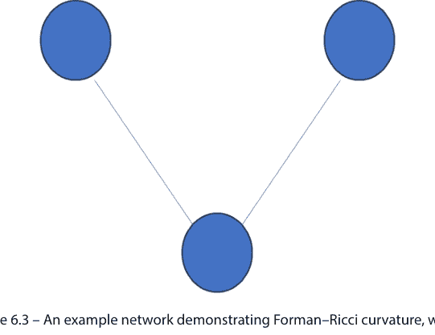

图6.3 – 一个示例网络，演示Forman–Ricci曲率，其中中间顶点同时被第一和第三个外侧顶点拉动

为了从这种边度量中获得顶点中心性指标，我们可以对每个顶点求和边度量来为顶点打分。在*图6.3*的示例中，外侧顶点的Forman–Ricci顶点中心性为-1，因为它们都只连接一条边。然而，中间顶点连接两条边，每条边的Forman–Ricci曲率为-1，使其Forman–Ricci顶点中心性为-2。由于这种中心性指标依赖于低成本计算，它能够很好地扩展到大型网络，并且当介数中心性不可行时，可以作为一种替代的基于边的中心性得分。

现在，让我们探索一些股市数据，看看网络科学如何帮助我们识别随时间变化的关键趋势。

## 中心性指标在时间切片中的应用

NASDAQ股市是位于纽约市的一个美国证券交易所，包括苹果、Alphabet、英伟达和微软等上市公司。Kaggle在公共许可下提供了NASDAQ股票价格的完整历史（https://www.kaggle.com/datasets/jacksoncrow/stock-market-dataset?resource=download），这可以为我们提供这四家科技公司在它们全部上市期间直至2020年4月1日的股票数据。我们已为您整理数据，仅包含这四只股票在2004年8月19日至2020年4月1日期间的数据。让我们看一看到底有哪些趋势（图6.4）：

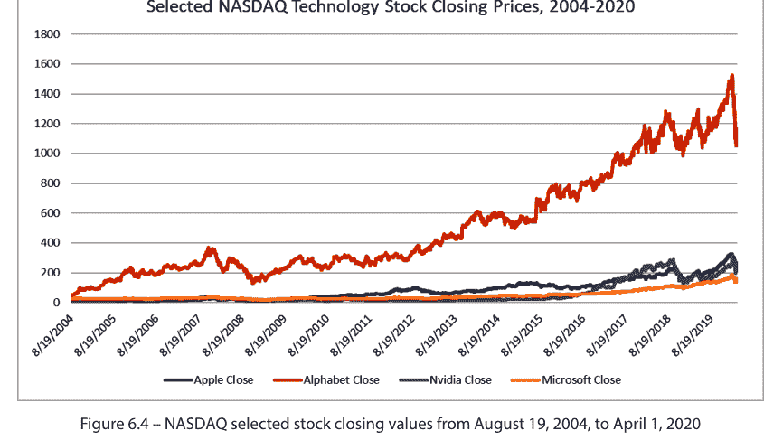

在图6.4中，我们可以看到Alphabet的价格始终较高，但所有股票在这段长期交易中都表现出典型的趋势：价格平稳、下跌、飙升以及向上或向下的趋势。值得注意的是2020年的趋势，股市经历了COVID-19崩盘。波动期包括2008-2009年和2016-2020年。

时间序列分析的重要方面之一是将时间序列数据分割成重叠的窗口。虽然可以通过网格搜索来优化窗口，但窗口选择往往更像是一门艺术而非科学。选择窗口会影响可以捕获趋势的时间长度。在我们的股市数据中，窗口长度限制了我们可以搜索趋势的时期，因此也限制了最后一个窗口之后可以预测市场行为的时间段。窗口过大可能会错过对短期市场行为产生重要影响的趋势。窗口过小则可能将预测限制在不久的将来。


我们将选择一个5个交易日的时间窗口，大约相当于一周的股票数据。这使我们能够捕捉与日内交易相关的趋势，在日内交易中，股票基于波动性被频繁交易。我们的网络指标应该能很好地适用于基于波动性的快速获利交易，因为它们能够捕捉两只股票之间日益增强的相关性。

对时间序列数据进行窗口化的另一个重要方面是重叠（overlap）的选择。在我们的示例中，我们将选择最大重叠（4天重叠），以最大化我们对日常趋势的敏感性。在其他应用中，为了研究更长的时间趋势，可能需要较少的重叠。请注意，我们的示例使用的是我们某台机器上的路径。你的文件路径会与我们的不同。

让我们使用脚本6.1导入我们的包并将数据加载到Python中，以便开始：

```
#import packages
import igraph as ig
from igraph import Graph
import numpy as np
import pandas as pd
import os
import matplotlib.pyplot as plt

#import stock data
File="C:/users/njfar/OneDrive/Desktop/AAPL_GOOGL_Stock_2004_2020.csv"
pwd=os.getcwd()
os.chdir(os.path.dirname(File))
mydata=pd.read_csv(os.path.basename(File),encoding='latin1')
```

现在我们已经导入了数据，我们可以添加一个循环，将我们的时间序列窗口化为5天周期，各切片之间重叠4天。这种窗口策略最有可能发现趋势中的日常变化。然后，我们将在该时间切片内创建四只股票之间的相关性，对这些相关性设置阈值，以将分析限制在高相关性上，根据这些阈值创建无权重网络，并分析跨时间切片的Pagerank中心性、度中心性、介数中心性和Forman-Ricci曲率中心性。我们还将保存每个无权重网络以备将来检索，以及网络指标及其在每个时间切片上的平均值。让我们将这些部分添加到脚本6.1中：

```
#script to create time slices, derive networks,
#and compute centrality metrics
stock_networks=[]
bet_t=[]
deg_t=[]
eig_t=[]
vcurv_t=[]
bet_ave=[]
deg_ave=[]
eig_ave=[]
vcurv_ave=[]

for Date in range(5,3932):
    #wrangle data into graph
    data=mydata.iloc[(Date-5):(Date),1:5]
    cor=np.corrcoef(data.transpose())
    cor[cor>=0.5]=1
    cor[cor<0.5]=0
    stock_data=Graph.Adjacency(cor)
    stock_networks.append(stock_data)
    #derive some centrality metrics
    d=Graph.degree(stock_data)
    deg_t.append(d)
    deg_ave.append(np.mean(d))
    b=Graph.betweenness(stock_data)
    bet_t.append(b)
    bet_ave.append(np.mean(b))
    e=Graph.pagerank(stock_data)
    eig_t.append(e)
    eig_ave.append(np.mean(e))
    #create Forman-Ricci curvature calculations
    ecurvw=[]

    for edge in stock_data.es:
        s=edge.source
        t=edge.target
        ecurvw.append(2-d[s]-d[t])
    vcurvw=[]

    for vertex in stock_data.vs:
        inc=Graph.incident(stock_data,vertex)
        inc_curv=[]
        for i in inc:
            inc_curv.append(ecurvw[i])
        vcurvw.append(sum(inc_curv))
    vcurv_t.append(vcurvw)
    vcurv_ave.append(np.mean(vcurvw))
```

该脚本应该能在你的机器上快速运行。如果你在分析中包含大量股票，你可能希望并行运行脚本以节省时间，或者排除介数中心性，因为随着顶点数量的增加，介数中心性的计算难以扩展。

现在我们已经计算了指标，让我们检查一系列时间序列窗口中各指标之间的相关性，以了解不同指标之间的相互关系。鉴于Forman-Ricci曲率依赖于度中心性指标，我们预计会看到强相关性。我们可以在脚本6.1中添加以下代码来获取这些相关性：

```
#examine correlations among metrics across the time series
print(np.corrcoef(deg_ave,eig_ave))
print(np.corrcoef(deg_ave,bet_ave))
print(np.corrcoef(deg_ave,vcurv_ave))
print(np.corrcoef(eig_ave,bet_ave))
print(np.corrcoef(eig_ave,vcurv_ave))
print(np.corrcoef(bet_ave,vcurv_ave))
```

你应该会看到度中心性与Forman–Ricci曲率中心性之间存在很强的相关性（在我们的分析中为-0.99），但其他中心性指标之间的相关性相当弱（度中心性与Pagerank中心性为-0.05，度中心性与介数中心性为0.01，Pagerank中心性与介数中心性为0.04，Pagerank中心性与Forman–Ricci曲率中心性为0.04，介数中心性与Forman–Ricci曲率中心性为0.05）。这表明在这些分析中，度中心性和Forman–Ricci曲率可能可以互换使用，尽管更复杂的Forman–Ricci曲率指标可能会捕获更多与某些趋势相关的信息。目前尚不清楚这些相关性是否适用于其他数据集，但鉴于Forman–Ricci曲率公式依赖于度中心性，在无权重网络上，度中心性和Forman–Ricci曲率必然会在一定程度上相关。

让我们将网络指标随时间的变化趋势可视化，看看是否有任何模式浮现或极端值突出，从而可能表明我们股票价格行为的改变。我们将向脚本6.1添加可视化代码来实现这一点：

```
#plot metric averages across time slices
time=range(0,3927)
plt.plot(time, deg_ave, label = "Degree Average")
plt.plot(time, eig_ave, label = "Pagerank Average")
plt.plot(time, bet_ave, label = "Betweenness Average")
plt.plot(time, vcurv_ave, label = "Forman-Ricci Curvature Average")
plt.legend()
plt.show()
```

这应该会给你一个类似于图6.5的图表：

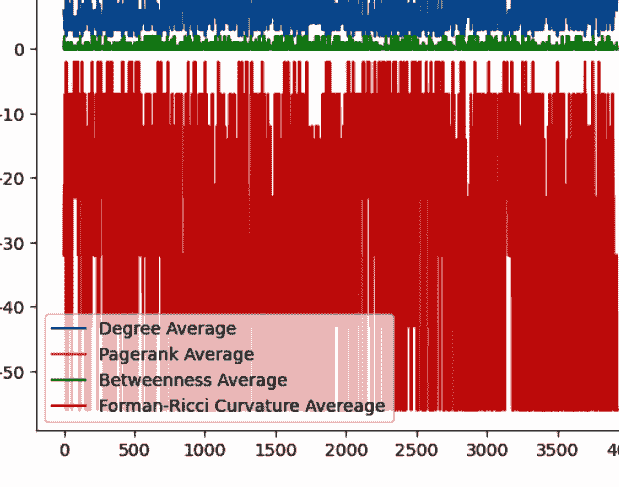

图6.5 – 我们股票市场数据中各时间切片中心性平均值的图表

请注意，Pagerank中心性没有出现在我们的图表中。Pagerank中心性和介数中心性填充了相似的值范围，导致Pagerank中心性在我们的图表中被掩盖。然而，我们确实看到平均中心性值的差异在我们的图表中规律性地出现，这表明我们的中心性值可能捕捉到了市场随时间变化的不同状态。

我们的Forman–Ricci曲率中心性平均值表明市场存在相对稳定的时期，这些时期的值接近零。两个显著的相对稳定期出现在我们时间序列的开始（大约2004–2006年）以及2010年代中后期。然而，随着我们接近2008年和2020年，两次重大市场崩盘之前，股票之间的相关性显著增加。

我们的阈值选择很可能影响结果。为了聚焦于股票行为紧密耦合的时期，让我们将阈值提高到0.9，并重新运行脚本6.1：

```
#script to create time slices, derive networks,
#and compute centrality metrics
stock_networks=[]
bet_t=[]
deg_t=[]
eig_t=[]
vcurv_t=[]
bet_ave=[]
deg_ave=[]
eig_ave=[]
vcurv_ave=[]

for Date in range(5,3932):
    #wrangle data into graph
    data=mydata.iloc[(Date-5):(Date),1:5]
    cor=np.corrcoef(data.transpose())
    cor[cor>=0.9]=1
    cor[cor<0.9]=0
    stock_data=Graph.Adjacency(cor)
    stock_networks.append(stock_data)
    #derive some centrality metrics
    d=Graph.degree(stock_data)
    deg_t.append(d)
    deg_ave.append(np.mean(d))
    b=Graph.betweenness(stock_data)
    bet_t.append(b)
    bet_ave.append(np.mean(b))
    e=Graph.pagerank(stock_data)
    eig_t.append(e)
    eig_ave.append(np.mean(e))

    #create Forman-Ricci curvature calculations
    ecurvw=[]
    for edge in stock_data.es:
        s=edge.source
        t=edge.target
        ecurvw.append(2-d[s]-d[t])
    vcurvw=[]

    for vertex in stock_data.vs:
        inc=Graph.incident(stock_data,vertex)
        inc_curv=[]
        for i in inc:
            inc_curv.append(ecurvw[i])
        vcurvw.append(sum(inc_curv))
    vcurv_t.append(vcurvw)
    vcurv_ave.append(np.mean(vcurvw))
```

这应该会产生一个与图6.5截然不同的图表。在图6.6中，我们可以比图6.5更清楚地看到波动期：

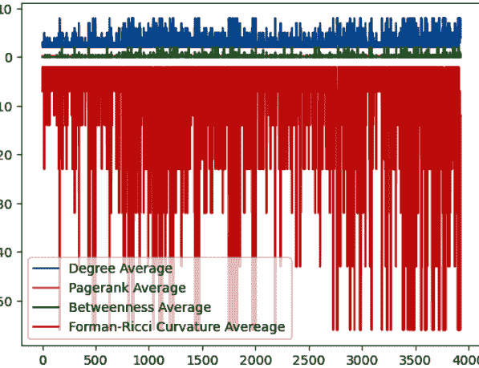

图6.6 – 阈值为0.9时各时间切片的网络中心性指标图表

图6.6显示了更多接近0的Forman–Ricci曲率值，这表明在这些时间段内市场波动较小。我们以图表中凹陷的形式看到几个波动加剧（Forman–Ricci曲率值更极端）的时期。那些剧烈波动和紧密耦合的时期出现在2008年和2020年的崩盘之前，以及崩盘后的快速重建期。这些时期是投资者感兴趣的时期，因为在这些时期，大量资金要么损失要么获利。

总的来说，网络指标似乎能很好地捕捉市场波动，特别是在对数据应用高阈值时。这表明了近期文献中所述的观点：网络指标是识别崩盘和指数增长之前市场波动的有用工具。事实上，这些工具在2020年COVID崩盘之前很久就捕捉到了不断增长的市场波动，如果投资者听从了波动警告并在麻烦冲击市场之前退出，本可以在2020年之前的几个月保住收益。鉴于波动性和长期陡峭增长，很可能任何数量的因素都会导致重大崩盘。一场大规模或不当的地区冲突、供应链的中断，或科技行业的政策变化，都可能引发重大崩盘。


回到*图6.7*，我们观察到2008年崩盘前与2020年崩盘前的趋势截然不同。2020年之前是长期增长且近期有几次小幅崩盘，而2008年之前则是相对稳定和缓慢增长。鉴于这四只纳斯达克股票的波动性增加和股价加速上涨，这些趋势使得市场未来更容易发生大幅崩盘；如果这些趋势在其他纳斯达克板块也成立，那么在不远的将来，我们预计不确定性会降低，而大幅盈利和亏损的机会会增加。

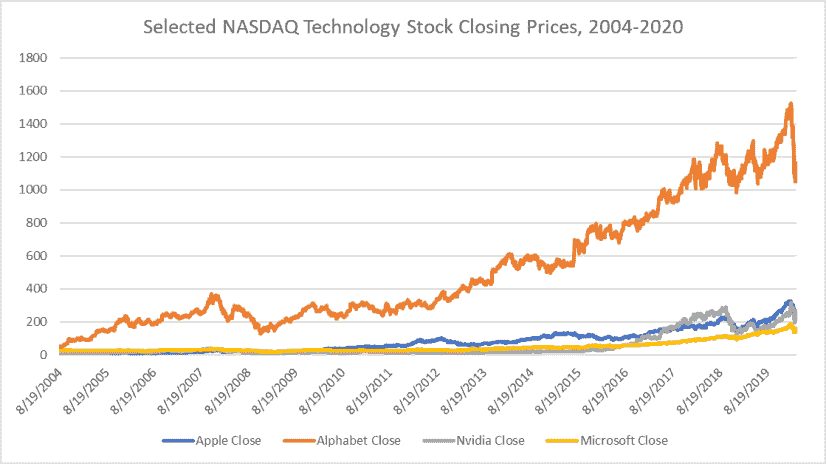

图6.7 – 回顾股票数据图

鉴于市场的这些趋势，网络科学工具有望在股市分析中发挥关键作用。目前，将这些工具应用于股市数据或更一般的时间序列数据的研究相对较少，也很少有中心性指标被系统地研究过。现有关于应用中心性指标来理解股市随时间变化趋势的研究，大多涉及网络的扩展，以纳入多向关系。现在让我们把注意力转向网络在多于两个实体之间关系上的扩展应用。

## 扩展用于时间序列分析的网络指标

由于网络是拓扑对象，且我们的相关矩阵可以使用任意值的阈值，因此可以将网络指标扩展到拓扑数据分析领域。网络捕获的是实体之间的两两关系。然而，三向、四向甚至更多向的相互作用也可能存在。**单纯复形**扩展了网络的概念，用以捕获这些更高阶的相互作用。三向相互作用表示为由两两连线勾勒出的面（或三角形）。四向相互作用表示为四面体，由具有四向相互作用的三向面构成。这一过程可以继续到任意阶的相互作用，其中

低维相互作用构成了高维相互作用的边界。单纯复形将顶点之间存在的最高层相互作用收集到一个单一对象中。图6.8展示了一个由相互的两两相互作用界定的三向相互作用的示例：


图6.8 – 展示三向相互作用如何由相互的两两相互作用定义的示意图

正如网络可以有权重或无权重的，单纯复形也可以在复形内的n向相互作用上加权或不加权。此外，正如网络由邻接矩阵构建一样，单纯复形也是由每一层n向相互作用的邻接矩阵（严格来说是边界矩阵）创建的。正如我们通常需要构建邻接矩阵来从原始数据创建网络，我们也可以使用原始数据来定义该数据中存在的n向相互作用。

首先，必须为原始数据定义一种关系度量。在我们的股票数据集中，我们选择了相关度量。距离度量在构建网络和单纯复形时也经常使用，而且对于数据集上的连续或离散测量，可以定义非常多的距离度量。度量一旦确定，就会对度量矩阵应用一个阈值或一系列阈值，以定义彼此在给定半径（由阈值定义）内的关系。构建单纯复形及其关系主要有两种选择：

-   通过点的并集来定义n向关系，这些点的半径相互接触（称为Vietoris–Rips复形）
-   对连接点进行计数，涉及给定半径内点的相互重叠，其中所有连接点都必须处于彼此的半径之内（称为Čech复形）

单纯复形的过滤涉及通过不同的度量阈值来改变半径。还记得对股票市场数据集应用不同的相关阈值会产生不同的结果和见解吗？单纯复形的不同过滤级别可以在每个过滤级别生成不同的单纯复形，并具有不同的性质，这些性质可能包含对分析师而言重要的信息。

让我们使用脚本6.2创建一个函数，该函数为两两相互作用（对应于网络）定义Vietoris–Rips单纯复形：

```
#define Vietoris-Rips complex
from itertools import combinations
from numpy import linalg as LA
def graph_VR(points, eps):
    points=[np.array(x) for x in points]
    vr=[(x,y) for (x,y) in combinations(points, 2)
    if LA.norm(x - y) <= 2*eps]
    return np.array(vr)
```

现在，我们可以将其应用于股票市场时间序列数据的第一个切片。我们选择阈值1和10作为起点，以了解哪些顶点对将被包含在我们的单纯复形中（此处仅在两两相互作用层面）。让我们将其添加到脚本6.2中，以计算股票市场时间序列数据第一个切片的Vietoris–Rips单纯复形：

```
#apply Vietoris-Rips with multiple thresholds to a slice of our stock
#dataset
data=mydata.iloc[0:5,1:5]
vr1=graph_VR(data.transpose(),1)
vr2=graph_VR(data.transpose(),10)
```

我们可以通过将以下代码添加到脚本6.2中来检查每个过滤中包含的顶点对：

```
#print the results
print("Vietoris-Rips Complex, Threshold=1:")
print(vr1)
print("Vietoris-Rips Complex, Threshold=10:")
print(vr2)
```

这会为我们提供每个过滤的顶点对，结果应如下所示：

```
Vietoris-Rips Complex, Threshold=1:
[[0 1]
 [0 2]
 [1 2]
 [1 3]
 [2 3]
 [2 4]
 [3 4]]
Vietoris-Rips Complex, Threshold=10:
[[0 1]
 [0 2]
 [0 3]
[0 4]
[1 2]
[1 3]
[1 4]
[2 3]
[2 4]
[3 4]
```

我们可以通过将以下代码添加到脚本6.2中来可视化阈值为1时具有两两相互作用的复形：

```
edges1 = [(0,1),(0,2),(1,2),(1,3),(2,3),(2,4), (3,4)]
import networkx as nx
G1 = nx.Graph()
G1.add_edges_from(edges1)
nx.draw(G1,with_labels=True)
```

这将生成一个类似于图6.9的图，展示一组通过两两相互作用连接的三个三角形：

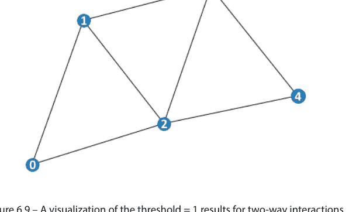

图6.9 – 阈值=1时两两相互作用结果的可视化

类似地，我们可以通过将以下代码添加到脚本6.2中来可视化阈值为10的结果：

```
edges10 = [(0,1),(0,2),(0,3),(0,4),(1,2),(1,3),(1,4),(2,3),(2,4),(3,4)]
import networkx as nx
G10 = nx.Graph()
G10.add_edges_from(edges10)
nx.draw(G10,with_labels=True)
```

这将给出一个类似于图6.10的图，显示比阈值=1结果更复杂的连通性：

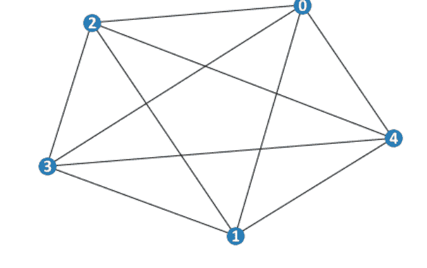

图6.10 – 阈值=10时两两相互作用结果的可视化

这些结果表明，不同的半径阈值会产生不同的网络，正如我们的相关阈值产生不同的网络一样。我们可以构建一个完整的过滤，从一条边首次出现一直到网络中所有可能的边都存在，从而根据点之间的距离来跟踪网络结构的变化。我们还可以在构建Vietoris–Rips复形时纳入三向和四向相互作用，将分析扩展到数据集中每个切片存在的完全单纯复形。

虽然单纯复形度量超出了本书的范围，但网络度量向单纯复形的许多扩展已经存在（例如Forman–Ricci曲率中心性），并且可能值得在时间序列数据分析中加以研究。目前，很少有工作阐明单纯复形度量或方法在股市变点检测中的应用。

如果你感兴趣，我们鼓励你扩展脚本6.1和6.2，以纳入通过单纯复形视角对完整时间序列的分析，并计算网络度量在单纯复形方面的扩展。本章的参考资料部分包含一些实验这些扩展的论文。


## 摘要

在本章中，我们介绍了时间序列数据的一些常见用途和时间序列分析，包括股票市场数据。我们探讨了网络分析中常见的几种基于顶点和基于边的中心性指标。然后，我们将网络指标应用于 2004 年至 2020 年纳斯达克股票数据的时间序列问题，以研究网络指标和时间序列阈值如何影响从时间序列数据中提取有用信息的能力，例如我们的股票数据。最后，我们研究了将网络扩展到单纯复形，并通过使用 Vietoris–Rips 方法和各种阈值构建两个单纯复形来构建网络。在第 7 章中，我们将研究销售和商品价格在时间和地理上的变化，以了解网络科学如何解决时空数据中的问题。

## 参考文献

De Floriani, L., & Hui, A. (2005, July). Data Structures for Simplicial Complexes: An Analysis And A Comparison. In Symposium on Geometry Processing (pp. 119-128).

Durbach, I., Katshunga, D., & Parker, H. (2013). Community structure and centrality effects in the South African company network. South African Journal of Business Management, 44(2), 35-43.

Estrada, E., & Ross, G. J. (2018). Centralities in simplicial complexes. Applications to protein interaction networks. Journal of theoretical biology, 438, 46-60.

Johansen, A., & Sornette, D. (1998). Stock market crashes are outliers. The European Physical Journal B-Condensed Matter and Complex Systems, 1, 141-143.

Rodrigues, F. A. (2019). Network centrality: an introduction. A mathematical modeling approach from nonlinear dynamics to complex systems, 177-196.

Salnikov, V., Cassese, D., & Lambiotte, R. (2018). Simplicial complexes and complex systems. European Journal of Physics, 40(1), 014001.

Samal, A., Pharasi, H. K., Ramaia, S. J., Kannan, H., Saucan, E., Jost, J., & Chakraborti, A. (2021). Network geometry and market instability. Royal Society open science, 8(2), 201734.

Valente, T. W., Coronges, K., Lakon, C., & Costenbader, E. (2008). How correlated are network centrality measures? Connections (Toronto, Ont.), 28(1), 16.

Xiong, J., & Xiao, W. (2021). Identification of key nodes in abnormal fund trading network based on improved pagerank algorithm. In Journal of Physics: Conference Series (Vol. 1774, No. 1, p. 012001). IOP Publishing.

# 时空数据简介

在第 2 章中，我们讨论了一些空间和时间数据的方面，这些方面使得使用统计和机器学习方法处理、分析和扩展此类数据变得困难。回想一下，这两种数据类型都不是独立的，数据集中存在跨越空间或时间的依赖关系。需要替代的预测方法，而将空间和时间数据表示为网络可以让分析人员利用网络科学的工具来寻找变化点、挖掘模式，甚至在时间数据的情况下预测未来系统行为。在之前的章节中，我们学习了如何使用网络科学工具（如中心性）分析空间和时间数据，以了解重要趋势。

现实世界中的许多分析任务都涉及时空数据——包括受当地政策影响的世界股票市场分析、跨地点的商店数据挖掘以寻找客户行为和收入趋势、在流行病期间辨别疾病来源和人口脆弱性、追踪人类行为（如犯罪、饮食习惯、物质使用、出生率或恐怖主义）在国家或特定国家地区间的变化，以及证明气候变化对脆弱国家的影响。

让我们熟悉一下我们的数据集和与时空数据的许多应用相关的两个问题。

## 布基纳法索市场数据集

在第 2 章中，我们介绍了布基纳法索市场数据集，该数据集记录了 2015 年第二季度至 2022 年第二季度布基纳法索全国市场的 millet 价格。在此期间，由于 COVID-19 供应链问题和乌克兰冲突限制了粮食分销和援助，世界粮食价格波动。粮食安全是世界许多地区的主要问题，了解可能导致价格飙升超出普通人或家庭承受范围的原因，对于满足世界粮食需求和避免饥荒至关重要。

一个国家的某些地区可能比其他地区更容易受到粮食短缺或商品成本飙升的影响，我们的数据集中的空间特征捕捉了布基纳法索市场的这些情况。我们可以想象，农村市场（如图 7.1 所示）面临的价格和供应不稳定程度会大于瓦加杜古等城市中心的市场。此外，某一时期内的某些事件可能比同一时期的其他事件导致更大的价格波动。捕捉时间序列趋势对于了解事件对该地区粮食价格的原因和潜在影响也很重要。因此，将数据作为时空数据捕获使我们能够分析跨地点和跨时间的趋势。


图 7.1 – 布基纳法索农村市场的插图

为了捕捉空间趋势，我们将回到第 2 章中介绍的权重矩阵，该矩阵连接了位于共享边界的省份中的市场。这大致捕捉了布基纳法索的地理情况，使共享许多边界的地区有潜力相互影响价格，并展示了与该国偏远地区相关的潜在供应链问题。

正如价格会随时间和地理而变化一样，销售量也会变化。让我们转向下一个例子，探索销售量如何因 COVID-19 工作政策的变化和人口在城市间的流动而在各商店之间发生变化。

## 商店销售数据

让我们考虑一个中等城市中当地的打印机耗材连锁店。随着商店位置附近的人口变化，可能需要调整商业策略：关闭挣扎的商店以最大限度地降低房地产成本，优先补货表现良好的商店，并在高销量销售区域开设新地点。也许 COVID-19 期间的居家办公举措导致某些城市地区有更多人居家办公，并且随着人们有自由选择居住地而不是住在办公室附近，更多人搬到某些地区。也许重返办公室的举措也会影响家庭办公用品的需求。所有这些因素都可能影响打印机耗材商店并迅速变化。

为了进一步探索，我们创建了一个模拟数据集，其中包含四个商店的销售数据，这些商店服务于单个大都市区，其模式模仿了 COVID-19 政策引发的人口流动趋势以及随后在重返办公室与远程工作政策上的摇摆。假设商店 1（图 7.2）服务的人口主要从事护理、超市管理以及其他不会长期远程的工作。该地区还发生了临时学校关闭。我们预计在 COVID-19 封锁期间销售会 initially 上升，但销售模式会迅速恢复正常：


图 7.2 – 打印机耗材商店的插图 – 商店 1

然而，商店 2 位于市中心附近，服务的人口主要是中层技术人员，他们一旦完全远程工作，就很大程度上不受重返工作政策的影响。因此，销售在最初的封锁期间激增并稳定到该城镇区域的新常态。

商店 3 服务于市中心附近一个非常理想的郊区，主要由高收入专业人士组成，他们在 COVID-19 之前要么在家工作，要么定期去办公室。通勤时间通常很长，但学区和社区安全都非常出色。在 COVID-19 期间，该郊区经历了房地产热潮，因为州内其他地方的家庭决定现在可以远程工作后定居在该地区。因此，到 2023 年，该地区将拥有大量需要打印机耗材的远程工作者人口。商店 3 到 2023 年可能需要更大的空间，如图 7.3 所示：


图7.3 – 打印机耗材仓库示意图

然而，4号仓库服务于市中心区域，而由于喜欢通勤便利的年轻家庭纷纷迁往郊区，该地区人口大幅流失。返岗政策并未吸引员工回到市中心的公寓，导致大多数建筑半空置或由季节性居民居住。理想情况下，我们希望避免出现供应品堆积却没有潜在客户的情况（如图7.4所示）：


图7.4 – 一家无人光顾的废弃打印机耗材店示意图

我们的目标是及时发现趋势，以便尽快调整业务战略，满足区域日益增长的耗材需求，并在都市区租金飙升的同时尽量减少房地产开支。鉴于这些仓库位于同一地理区域，我们将假设空间权重矩阵将四家仓库相互连接。在更大的连锁门店中，基于人口特征或与其他门店的距离来创建空间权重，可能会使分析更加精确。

现在，让我们将注意力转向代码，它将帮助我们深入分析布基纳法索的市场数据和COVID-19门店销售数据。

## 分析时空数据集

我们的布基纳法索市场数据集已按季度划分，为理解逐季变化，合理做法是将窗口大小设置为四个季度（一年），并重叠三个季度（以关注月度变化）。正如我们在第2章所做的那样，我们将通过权重矩阵和相关性指标计算局部莫兰统计量。让我们使用脚本7.1设置所需包，并导入布基纳法索市场数据集及其权重矩阵：

```
#import packages
import igraph as ig
from igraph import Graph
import numpy as np
import pandas as pd
import os
import matplotlib.pyplot as plt

#import Burkina Faso market millet prices
File="C:/users/njfar/OneDrive/Desktop/BF_Millet.csv"
pwd=os.getcwd()
os.chdir(os.path.dirname(File))
mydata=pd.read_csv(os.path.basename(File),encoding='latin1')

#import weight matrix of Burkina Faso markets
File="C:/users/njfar/OneDrive/Desktop/weights_bk.csv"
pwd=os.getcwd()
os.chdir(os.path.dirname(File))
weights=pd.read_csv(os.path.basename(File),encoding='latin1')
```

现在我们已经有了数据和包，让我们计算Forman-Ricci曲率和PageRank中心性，并通过在脚本7.1中添加相关阈值设为0.9的代码（以对重大变化保持最大敏感度），保存每个时间片的网络和整体指标：

```
#score in yearly sets with 3 quarter overlap
vcurv_t=[]
vcurv_ave=[]
```

```
eig_t=[]
eig_ave=[]
nets=[]

for Year in range(4,29):
    data=mydata.iloc[(Year-4):(Year),1:46]
    cor=np.corrcoef(data.transpose())
    weights_total=weights.iloc[:,1:46]
    cor[cor>=0.9]=1
    cor[cor<0.9]=0
    cor_weighted=np.multiply(cor,weights_total)
    bf_market_w=Graph.Adjacency(cor_weighted,diag=False)
    edge_list=bf_market_w.get_edgelist()
    self_loop=[]

    for i in range(0,46):
        self=(i,i)
        self_loop.append(self)
    to_remove=[]

    for i in edge_list:
        for j in self_loop:
            if i==j:
                to_remove.append(i)

    bf_market_w.delete_edges(to_remove)
    nets.append(bf_market_w)
    d=Graph.degree(bf_market_w)
    e=Graph.pagerank(bf_market_w)
    eig_t.append(e)
    eig_ave.append(np.mean(e))
    ecurvw=[]

    for edge in bf_market_w.es:
        s=edge.source
        t=edge.target
        ecurvw.append(2-d[s]-d[t])
    vcurvw=[]

    for vertex in bf_market_w.vs:
        inc=Graph.incident(bf_market_w,vertex)
        inc_curv=[]
        for I in inc:
```

```
inc_curv.append(ecurvw[i])
vcurvw.append(sum(inc_curv))
vcurv_t.append(vcurvw)
vcurv_ave.append(np.mean(vcurv_t))
```

既然我们已经计算出了指标，让我们通过向脚本7.1添加以下代码来绘制结果，以观察PageRank和Forman-Ricci曲率中心性如何随时间变化：

```
#plot metric averages across time slices
time=range(0,25)
plt.plot(time, eig_ave, label = "PageRank Average")
plt.plot(time, vcurv_ave, label = "Forman-Ricci Curvature Average")
plt.xlabel("Time Slice")
plt.ylabel("PageRank and Forman-Ricci Curvature Averages")
plt.legend()
plt.show()
```

这应会显示一个图表，其中PageRank中心性的变化很小，而Forman-Ricci曲率中心性则出现上升和周期性波动（如图7.5所示）。这表明，我们各市场的小米价格波动性有所增加，大约从2018-2019年间开始（波动性先是上升，然后下降，再次上升，最后在更高的波动水平上趋于平稳），并在COVID-19和乌克兰冲突期间略有恶化。

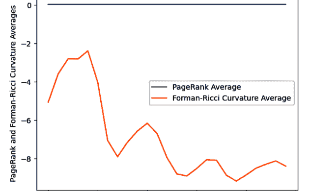

图7.5 – 2015-2022年布基纳法索市场小米价格的平均中心性指标图

现在我们有了显示波动性变化的图，我们可以考察不同时期的市场状况。你可能希望研究所有时期，但我们将比较两个时期——一个低波动期和一个高波动期——并在以下代码中展示。让我们绘制第4个时间段，根据Forman-Ricci曲率中心性，该时期波动性较低（数据集中有最高的中心性测量值），每个顶点的大小按该顶点的Forman-Ricci曲率加权，只需在脚本7.1中添加以下代码：

```
#examine different time points with Forman-Ricci
#curvature plots, fourth slice
ig.plot(nets[4],vertex_size=np.array(vcurv_t[4])*-0.5)
```

这应会生成类似图7.6的图，显示通过相关性和空间加权连接的市场很少，且顶点的Forman-Ricci曲率非常低（顶点尺寸非常小）：

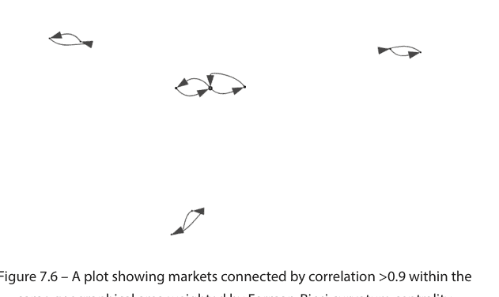

图7.6 – 显示同一地理区域内相关性 >0.9 且按Forman-Ricci曲率中心性加权的市场连接图

图7.6显示，大多数市场彼此并不相连，而那些彼此相连的市场之间的相互连接程度也往往很低，因此Forman-Ricci曲率中心性指标接近0。这意味着价格是独立的，表明市场网络具有稳健性，不太可能受到COVID-19或国际贸易变化等外部因素的严重影响。影响一两个市场的变化不太可能影响全国所有市场，受到局部问题（如干旱季度）影响的卖家和消费者可以在需要时从邻近地区寻求粮食。政府也可以通过简单地将粮食从供应充足的省份调往存在供应问题的省份来解决短缺问题。从政府的角度来看，解决局部供应问题不会花费太多时间和资金。

让我们考察一个高波动性时期（第19期），并通过向脚本7.1添加以下代码，看看连通性和Forman-Ricci曲率中心性与第4期相比如何：

```
```python
#examine different time points with Forman-Ricci
#curvature plots, 19th slice
ig.plot(nets[19],vertex_size=np.array(vcurv_t[19])*-0.5)
```
```

这应会生成类似图7.7的图，其中许多市场相互连接，使得Forman-Ricci曲率中心性指标远偏离零，表明全国大范围地区的供应链高度互联，容易受到可能导致该地区饥荒的严重短缺的影响。解决这些问题将使政府花费更多的时间和成本，使人们面临粮食短缺或价格飙升的风险，消费者可能买不起谷物。

> **注意**
> 
> 一些相连的市场共享许多相互连接，产生较强的曲率指标，而一些市场则仍未与其他任何市场相连。连接度较低的市场价格表明，某些地区不太容易受到可能导致饥荒的广泛粮食价格飙升或短缺的影响。

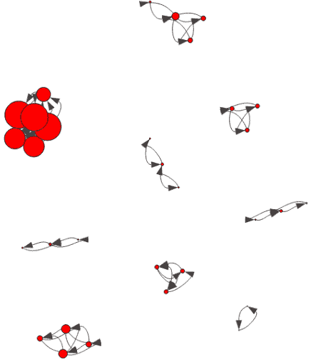

图7.7 – 布基纳法索市场小米价格网络中的第19个时间段


从我们的分析中，我们可以洞察到市场价格行为随时间变化的情况。在 2017 年之前，各市场的价格波动性较低。单个市场在价格方面并未紧密耦合，表明价格受当地影响。然而，随着市场在价格方面变得更依赖全球力量，市场变得更不稳定，更容易受到世界事件的影响，例如 COVID-19 和乌克兰冲突。事实上，在我们的原始数据集中，我们可以看到这些事件后价格飙升。这表明需要采取全国性的方法来应对食品价格上涨，而不是关注正在挣扎或容易受到当地生产或全球援助变化影响的当地市场。

通过美国国际开发署（USAID）数据库以及在 Google 上找到的文章回顾历史变化，我们看到 2010-2020 年是布基纳法索发展和国际粮食援助的时期，尽管该国许多人主要依靠自给自足的农业而不是在市场上购买的食物。鉴于价格上涨，自给自足的农业和粮食援助是必要的也就不足为奇了，因为谷物价格已达到危机水平。

现在我们已经了解了如何分析时空数据以可视化波动性趋势，让我们将注意力转向一个本地化城市中受居家办公和返岗政策影响的四家商店。我们将忽略权重，因为这些商店位于同一区域且仅包括四家商店。我们再次使用 0.9 的阈值，以最大化在数据中找到极端波动期的机会。让我们使用脚本 7.2 导入数据并开始：

```
#import store sales data
File="C:/users/njfar/OneDrive/Desktop/Store_Sales.csv"
pwd=os.getcwd()
os.chdir(os.path.dirname(File))
mydata=pd.read_csv(os.path.basename(File),encoding='latin1')
```

我们将通过添加到脚本 7.2 来计算该网络的 Forman-Ricci 曲率和 PageRank 中心性；如果遇到运行时警告，请不用担心，因为它可能出现在 Windows 机器上，但并不表示代码运行有问题：

```
#score in yearly sets with monthly overlap
vcurv_t=[]
vcurv_ave=[]
eig_t=[]
eig_ave=[]
nets=[]

for Month in range(2,54):
    data=mydata.iloc[(Month-2):(Month),1:6]
    cor=np.corrcoef(data.transpose())
    cor[cor>=0.9]=1
    cor[cor<0.9]=0
    stores=Graph.Adjacency(cor)
```

```
edge_list=stores.get_edgelist()
self_loop=[]

for i in range(0,52):
    self=(i,i)
    self_loop.append(self)
to_remove=[]

for i in edge_list:
    for j in self_loop:
        if i==j:
            to_remove.append(i)
stores.delete_edges(to_remove)
nets.append(stores)
d=Graph.degree(stores)
e=Graph.pagerank(stores)
eig_t.append(e)
eig_ave.append(np.mean(e))
ecurvw=[]

for edge in stores.es:
    s=edge.source
    t=edge.target
    ecurvw.append(2-d[s]-d[t])
vcurvw=[]

for vertex in stores.vs:
    inc=Graph.incident(stores,vertex)
    inc_curv=[]
    for i in inc:
        inc_curv.append(ecurvw[i])
    vcurvw.append(sum(inc_curv))
    vcurv_t.append(vcurvw)
    vcurv_ave.append(np.mean(vcurv_t))
```

再次，我们可以通过添加到脚本 7.2 来绘制 PageRank 和 Forman-Ricci 曲率中心性，以识别高波动和低波动时期：

```
#plot metric averages across time slices
time=range(0,52)
plt.plot(time, eig_ave, label = "PageRank Average")
plt.plot(time, vcurv_ave, label = "Forman-Ricci Curvature Average")
plt.xlabel("Time Slice")
plt.ylabel("PageRank and Forman-Ricci Curvature Averages")
```

```
plt.legend()
plt.show()
```

你应该会看到类似图 7.8 的图，其中在整个时间段内波动性总体上相当恒定，有几个波动性增加或减少的时期，标志着定价可能受到我们商店经理无法控制的外部因素影响的时期。

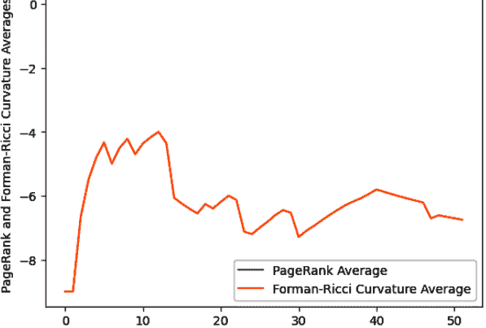

图 7.8 – PageRank 和 Forman-Ricci 曲率平均值的图

虽然我们不会期望每个时期的网络图中波动性从一个时期到另一个时期的重大变化会显示出来，但我们确实看到了一些值得调查的波动性差异。让我们再次选择两个时期进行调查（第 10 期和第 30 期）。我们将首先调查第 10 期，通过添加到脚本 7.2，按 Forman-Ricci 曲率加权我们的顶点以可视化销售额的互联性：

```
#examine different time points with
#Forman-Ricci curvature plots, tenth slice
ig.plot(nets[10],vertex_size=np.array(vcurv_t[10])*-0.5)
```

这应该会显示出类似图 7.9 的图，其中只有两家商店相互连接，表明相对稳定的时期，外部影响不应像在其他更不稳定的时期那样影响我们商店的销售额。

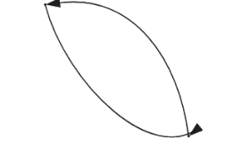

图 7.9 – 第 10 期的商店图

让我们通过添加到脚本 7.2 将此图与第 30 期的图进行比较：

```
#examine different time points with
#Forman-Ricci curvature plots, thirtieth slice
ig.plot(nets[30],vertex_size=np.array(vcurv_t[30])*-0.5)
```

此代码应生成类似图 7.10 的图，显示所有四家商店之间的连通性（最大可能的波动性），这使得商店容易受到可能影响所有四家商店的销售事件的影响，而不是仅影响一家本地商店：

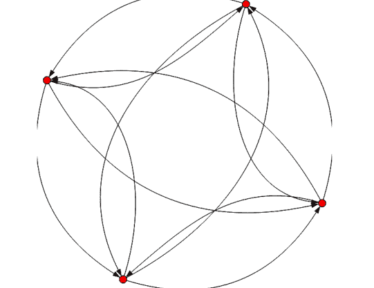

图 7.10 – 第 30 期商店数据的网络图，显示最大波动性

综合来看，我们的结果表明，在 COVID-19 之前几个月，我们商店的波动性相当恒定，并在居家办公强制令后增加，并在返岗政策期间或多或少持续。从我们的原始模拟数据来看，一些商店从这一变化中受益，而其他商店则遭受了相当大的损失。随着波动性的变化，商店经理需要专注于他们可以控制的与各自商店相关的因素，而负责该地区所有商店的经理可能需要制定策略，如何在考虑为 struggling 商店整合建筑物的同时，调整成长商店的供应和成长需求。

总体而言，这些分析提供了有关危机时期价格和销售脆弱性的一些见解，使决策者能够确定需要策略调整的时间。结合其他分析（例如通过多通道奇异谱分析进行时间序列预测，或有关人口统计或一天中不同时间购买行为差异的信息），这些类型的分析可提供有关需要关注的时间和特定地理位置的见解，以便在不断变化的时代继续蓬勃发展。

## 总结

在本章中，我们扩展了我们对时空数据的先前见解，以解决具有时空数据集的分析问题，包括商店销售数据集和布基纳法索市场小米价格数据集。我们按时间切片划分了两个数据集，计算了空间统计，并分析了网络中心性指标，以识别数据中的变化点和波动时期。波动时期对应于网络对价格、销售额和其他指标的崩盘和飙升的脆弱性，因为系统的互联性使得对网络一部分的影响会蔓延到网络的其他部分。我们在 COVID-19 和乌克兰冲突期间看到了布基纳法索市场的这一现象，以及 COVID-19 对销售数据的影响。在第 7 章中，我们将研究销售和商品价格在时间和地理上的变化，以了解网络科学如何解决时空数据中的问题。在第 8 章中，我们将考虑动态网络，其中连接甚至个体都可能随时间变化，并检查这些变化如何影响野生动物种群中的疾病传播。

## 参考文献

Han, X., Zhu, G., Zhao, L., Du, R., Wang, Y., Chen, Z., ... & He, S. (2023). Ollivier–Ricci Curvature Based Spatio-Temporal Graph Neural Networks for Traffic Flow Forecasting. Symmetry, 15 (5), 995.

Schlör, J., Strnad, F. M., Fröhlich, C., & Goswami, B. (2022, May). Identifying patterns of teleconnections, a curvature-based network analysis. In EGU General Assembly Conference Abstracts (pp. EGU22-7256).

Shekhar, S., Jiang, Z., Ali, R. Y., Eftelioglu, E., Tang, X., Gunturi, V. M., & Zhou, X. (2015). Spatiotemporal data mining: A computational perspective. ISPRS International Journal of Geo-Information, 4 (4), 2306-2338.

Wang, Y., Huang, Z., Yin, G., Li, H., Yang, L., Su, Y., ... & Shan, X. (2022). Applying Ollivier-Ricci curvature to indicate the mismatch of travel demand and supply in urban transit network. International Journal of Applied Earth Observation and Geoinformation, 106, 102666.


