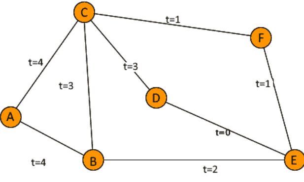
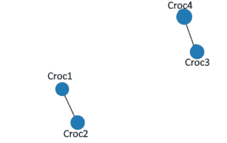
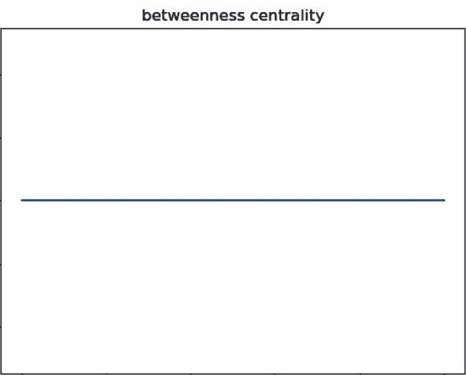
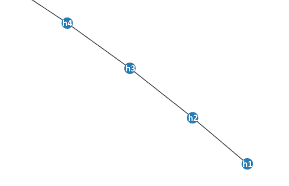
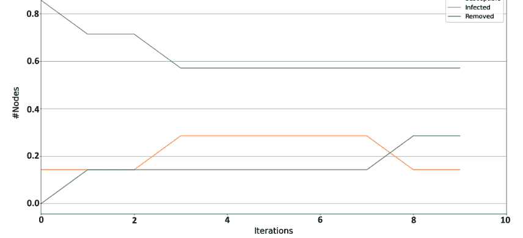
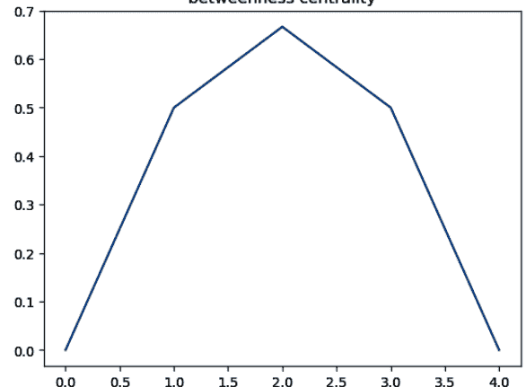
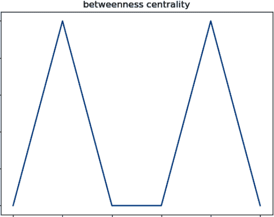

# 动态社交网络

在之前的章节中，我们考虑的网络是随时间不变的。它们的几何结构保持不变，在其上计算的传播过程和重要性指标也不会变化。然而，这并不是许多现实世界网络的情况，在这些网络中，新的连接会被建立，旧的连接会断裂。

在本章中，我们将考虑随时间变化的网络，以及这些变化如何影响网络结构和传播过程。例如，在社交网络中，用户可以加入或停用账户。他们与他人内容互动时，联系的强度可能会发生变化。所有这些行为都会推动网络随时间变化，从而影响诸如信息在网络中交换等过程的功能，因为枢纽出现和消失，或桥梁在不同枢纽之间形成。我们将考虑模拟数据和从野生动物观察以及分别在鳄鱼和蓝鹭种群中传播的假设性流行病中收集的试验数据。

在本章结束时，你将了解网络如何随时间变化，以及这些影响对传播过程和网络指标意味着什么。你还将知道如何将动态数据集整理成网络并分析时间切片。这些方法可扩展到更大的人口和更长的时间范围，因此到本章结束时，你将具备按规模处理人口模型的能力。

在本章中，我们将涵盖以下主题：
- 随时间变化的社交网络
- 对网络上传播的深入探讨
- 演化野生动物互动数据集的示例

## 技术要求

在本章中，我们将使用 Jupyter notebook 来运行我们的动态网络示例。你也可以在支持 Jupyter notebook 的云平台上运行此代码，例如 Amazon Web Services (AWS) 或 Google Cloud Platform (GCP)。我们将使用在笔记本电脑上运行的 Jupyter notebook，并且不需要云访问权限即可处理本章中的示例。

## 随时间变化的社交网络

考虑你最亲密的朋友群体。过去一年里，这个群体发生了怎样的变化？过去 5 年呢？过去 10 年呢？

许多可以用网络表示的社交关系和其他类型的数据会随时间演化。友谊会随着人们搬家、毕业、结婚、换工作、旅行或去世而疏远和建立。动物会随着季节变化、气候变化以及人类活动侵占放牧地而迁徙。商店的销售模式可能会因该地区的新店、人口流动以及 COVID-19 或乌克兰冲突等重大世界事件而中断。

在下一节中，我们将探索动态网络，其结构随时间变化。随着网络结构的变化，与信息/疾病流动和网络划分相关的许多重要属性也会随之变化。

### 友谊网络

许多社交网络平台允许友谊群体演化，甚至鼓励结构变化。考虑分享帖子或推文，在你的网络帖子/推文/图片中标记可能尚未认识你的朋友的其他人，并在分享的内容中添加可搜索的主题标签。每项活动都会为你在初始社交网络之外提供更多曝光度，让朋友的朋友、尚未在社交媒体平台上与你建立联系的熟人以及对你的主题帖感兴趣的个人找到你并建立联系。

假设有人在社交媒体平台上发布了一张超现实的捕梦网图像（图 8.1）：


图 8.1 – 使用人工智能（AI）创建的捕梦网图像发布到社交媒体平台

也许用户添加了 #AIArt 和 #Dreamcatcher，并标记了一位发布类似内容的朋友，如图 8.1 所示。其他平台用户可能会搜索使用 AI 艺术平台创建图像的其他人，并希望关注该用户或点赞/分享内容。这为用户提供了更多连接并扩展了其网络。

被标记的朋友也可能从这些新连接中受益，因为该用户的这些新连接会访问朋友的页面。此外，那位朋友的朋友如果尚未遇到该用户，也可能与该用户建立联系或点赞/分享其内容。这也扩展了用户的网络。

许多社交媒体平台还通过创建兴趣页面或群组来连接用户，在这些页面或群组中，具有相似兴趣的用户可以发布内容、建立联系并讨论主题。例如，许多社交媒体平台提供动物兴趣群组或页面，展示可爱的动物艺术或照片，如图 8.2 所示的动物艺术：


图 8.2 – 一只小象在茶杯中被玫瑰包围的 AI 艺术图像

这些兴趣群组鼓励用户之间的联系以及可搜索内容的分享以扩大群组成员（有时由广告优化算法或其他付费用户鼓励，包括某些情况下的群组本身）。热门内容往往会鼓励群组增长以及群组内用户之间的互动/联系。不受欢迎的内容往往会阻碍增长。

鼓励用户之间建立联系并优化内容传播的算法的阴暗面是阴谋论和错误信息传播的潜力，以及促进种族主义或歧视性群组之间的联系。在 2016 年和 2020 年美国总统选举期间（以及 COVID-19 大流行期间），错误信息在社交媒体平台上迅速传播。在大流行或国家危机期间，错误信息可能引发公众恐慌，增加资源压力或导致死亡率升高。在政治领域，错误信息可能左右选举结果或加剧不同政治群体之间的分歧。

鼓励社交网络演化以增加点赞数的算法，通过连接可能喜欢其他用户内容或相关广告浏览的用户，可能会无意中导致以下情况：
- 在可能喜欢或评论它的用户中推广错误信息的传播
- 鼓励分享错误信息或有害内容的用户之间的联系
- 在社交网络上形成 perpetuate 这一问题的反馈循环

这可能发生在社交媒体平台以及社区群组、互联网聊天室和其他论坛上。虽然推广更多猫咪表情包可能无害（除去浪费时间看猫咪表情包的可能性），但推广种族主义意识形态或煽动宗教暴力则非常有害。

### 三元闭合

大多数网络演化算法的影响源于一种网络属性，称为 **三元闭合**。社交网络上的三元闭合大致依赖于这样一个前提：用户朋友的朋友在现实生活中可能认识该用户，但尚未建立联系。这是在社交网络中基于直接连接的三元闭合实例。另一个与我们用户的许多朋友共享朋友群体的用户很可能认识该用户（或基于共享的社交网络，是该用户的良好联系）。此外，其他用户可能与该用户共享许多兴趣（许多好友推荐算法的前提）；这是基于元数据的三元闭合实例，其中连接形成取决于用户元数据的相似性而非共享连接。

考虑 Pieter、Kwame 和 Pablo。三人都喜欢足球、软件工程和徒步旅行。Pablo 和 Pieter 相识，Pieter 和 Kwame 也相识；然而，我们不知道 Kwame 和 Pablo 是否相识（图 8.3）：


图 8.3 – 我们三位足球迷之间已知关系的图示

鉴于已知的两个关系以及共享的兴趣元数据，很可能 Kwame 和 Pablo 也相互认识（或如果建立联系会相处融洽）。网络上开放三元组的百分比衡量了网络整体的三元开放性。开放三元组比例高的网络在随时间演化方面具有高潜力，因为朋友的朋友或具有相似兴趣的个人会通过共享内容或群组成员身份建立联系。现在我们对关系及其如何随时间演化有了更多的了解，让我们更深入地探讨演化网络上的传播过程。

## 对网络上传播的深入探讨

现在我们了解了网络如何随时间变化，让我们看看如何在 Python 中表示这些网络并计算随时间在动态网络上进行的传播过程，例如流行病模型。Python 提供了多个工具来帮助我们可视化和分析动态网络，正如我们在前几章中所做的那样。让我们开始吧。

## 动态网络介绍

我们可以通过在不同时间点跟踪连接来跟踪网络随时间的演变。让我们考虑一群狮子，其中个体在一天中定期互动。图 8.4 显示了此示例网络，并带有时间戳以跟踪边：




*Figure 8.4* 显示了一个具有随时间信息标记的演化边和顶点结构的动态狮子网络示例。Python 提供了一个便捷的包来创建此类网络。`NDLib` 包利用 `Dynetx` 来建模时变图，它利用了 `DyNetx` 中的几个关键原语来创建和分析动态网络。这为在现实世界中处理动态网络提供了一个强大的框架。这在流行病学、社会网络分析和交通系统等领域尤其有价值，因为理解时间动态至关重要。让我们通过使用 *Script 8.1* 创建 *Figure 8.4* 来探索这个包：

```
```python
#create Figure 8.4
#import packages
#install dynetx if needed
#!pip install dynetx
import dynetx as dn
import networkx as nx
import matplotlib.pyplot as plt
#create an empty graph
g = dn.DynGraph()
#add vertices and edges with time information added

#adding the edge ("D","E") at t=0 that vanishes at time e=2
g.add_interaction(u="D", v="E", t=0, e=2)

# adding some edges at time t=1
g.add_interactions_from([("C", "F"), ("F", "E")], t=1)
```
```

在每个时间点了解边结构对于评估网络结构和促进网络上流动的属性至关重要，例如枢纽和桥梁。可视化和边列表也为我们提供了一种汇总信息的方式，这可能会为例如小群体中的流行病提供额外的见解。离开我们的狮子示例，让我们考虑在新疾病爆发期间办公室环境中的徽章追踪，例如 COVID-19。不同个体在不同天会与不同的人以及不同数量的人互动，这取决于他们的时间安排。存在于不同时间点的边列表以及员工之间互动的可视化可以帮助研究人员追踪新的爆发并计算重要的流行病模型参数，以了解该疾病对更大人群的潜在影响。

正如个体之间的连接会随时间变化一样，网络中的个体本身也可能发生变化。也许某位员工因病请假或请个人假，从而在该时间点退出网络。使用 DyNetx，我们还可以创建一个交互网络来模拟动态结构，其中顶点和边都可以在时间演化过程中出现和消失。回到 Figure 8.4，让我们扩展 Script 8.1 以创建以下交互流：

```
#print interaction stream
for i in g.stream_interactions():
    print(i)
```

此脚本为每个时间点创建一个交互列表，指定网络中存在的交互。虽然我们没有个体狮子进入或离开我们的网络，但狮子之间的互动确实会发生变化，并且狮子在给定时间点可能与网络中的其他狮子有或没有互动。让我们进一步查看输出，看看哪些时间点涉及网络狮子之间最多的和最少的互动：

```
#output of interactions for each time point
('D', 'E', '+', 0)
('C', 'F', '+', 1)
('F', 'E', '+', 1)
('D', 'E', '-', 2)
('B', 'E', '+', 2)
('A', 'B', '+', 2)
('B', 'C', '+', 3)
('C', 'D', '+', 3)
('A', 'C', '+', 4)
```

前两个值指定参与边的顶点。第三个值指定边操作的类型，其中 '+' 表示出现（边创建），'-' 表示消失（边移除）。最后一个值表示与边操作相关的时间戳。例如，我们可以看到狮子 F 在时间点 1 在网络内建立了多次互动。我们也可以看到狮子 D 和 E 之间的互动始于第 0 个时间点，并在时间点 2 停止。

对于技术性更强的读者，我们可以将这些术语排列起来定义一个控制易感人群中传播和恢复的微分方程组，如下所示：

\(\frac{dS}{dt} = -\frac{\beta IS}{N}\)
\(\frac{dI}{dt} = \frac{\beta IS}{N} - \gamma I\)
\(\frac{dR}{dt} = \gamma I\)

高传播率加上低恢复率会导致大量感染人群。低传播率和高恢复率会导致人群中流行病缓慢或逐渐消失。

然而，人群内的互动很少是随机的，就像 SIR 方程所假设的那样。动态网络提供了一种捕捉随时间变化的互动的方法，从而更准确地模拟感兴趣人群内的传播，或通过模拟感兴趣人群内的互动水平模型实现更准确的规划。让我们在第 3 章关于流行病的讨论基础上，通过引入一些影响流行病传播的新网络指标来继续。

## 影响传播的因素

在第 3 章中，我们研究了桥梁和枢纽对音乐趋势或流行病在网络中传播的重要性。此后，我们考虑了许多与枢纽和桥梁概念相关的网络中心性指标。让我们简要回顾其中几个中心性指标。

枢纽性可以通过以下几个中心性指标来评估，包括：

- Degree centrality (defined in Chapter 6)
- PageRank centrality (defined in Chapter 6)
- Hubness centrality (defined in Chapter 6)

度中心性是最简单且与网络上传播过程最相关的。感染顶点与其他顶点的连接数量会影响感染顶点将其疾病传播给其直接邻居的能力。网络中度中心性的组合影响疾病在全球传播的整体能力。度中心性非常低的稀疏网络不会为疾病同时感染许多个体提供机会，导致公共卫生工作者能够在不被某一时间点大量感染患者压垮的情况下有效地实施隔离和接触追踪等策略。

然而，度中心性非常高的网络可能包含许多枢纽或一个大型枢纽。大型枢纽使一个感染个体能够将疾病传播给许多其他人，而这些人也有许多可以被感染的联系。这意味着在流行病开始时公共卫生资源很容易不堪重负，在许多人被感染之前遏制此类流行病的机会非常低。我们在 COVID-19 期间的许多全球城市中看到了这一点，城市范围的停摆变得必要以避免压垮医疗系统；农村地区没有经历我们在大城市中看到的感染率的快速飙升。

桥梁在网络上的流行病建模中也发挥着重要作用。如果两个大型枢纽未连接，则很容易将一个枢纽与另一个枢纽隔离，以阻止流行病从一个枢纽传播到另一个枢纽，因为我们只需确保在感染枢纽中的流行病结束之前两个枢纽之间不建立桥梁即可。连接两个枢纽的桥梁为桥梁顶点/顶点提供了被感染并将感染从一个社区传播到另一个社区的机会。因此，桥梁为感染传播提供了机会，使其成为区域或全球问题而非当地社区问题。

回想一下，桥接属性可以通过 **betweenness centrality**（在 *Chapter 6* 中定义）来衡量，它衡量通过一个顶点的网络最短路径数量。本质上，这衡量了每个顶点对网络上传播过程的重要性。具有高介数中心性的顶点代表如果该顶点被感染，则将其疾病传播到人群其他部分的很大机会。隔离或为具有高介数中心性的顶点接种疫苗可以破坏网络上的疾病传播，并且这些个体代表了在有限资源下对整体流行病严重程度产生重大影响的机会。在 COVID-19 的背景下，频繁的国际旅行者充当了国家之间的桥梁。停止从受感染地区到尚未受影响地区的国际旅行使加勒比岛屿等小国能够避免其人群的流行病传播。

**Forman-Ricci curvature centrality**（在 *Chapter 6* 中定义）通过考虑通过一组顶点连接的其他边的边来同时考虑网络中的桥接属性和枢纽属性。最近的研究表明，Forman-Ricci 曲率可以找到对传播过程重要的边和顶点，因此可作为在流行病模拟中顶点被隔离或以其他方式从人群中移除（例如通过疫苗接种）时使用的有效指标。

**Eccentricity**，即图中一个顶点到另一个顶点的最大距离，是衡量流行病在人群层面的潜在影响的另一个常用指标。网络的 **radius** 是网络顶点中最小的偏心值，而网络的 **diameter** 是网络顶点中最大的偏心值。密集网络的直径小于稀疏网络，因为顶点往往更相互连接（允许在更短的时间内具有更大的传播潜力）。

半径和直径都限制了微分方程（例如我们的 SIR 模型）在网络上的行为。虽然理论证明超出了本书的范围，但我们将在下一节中通过对两个野生动物流行病数据集的真实模拟来实践探索半径和直径。让我们开始探索我们的数据集。


## 示例：不断演化的野生动物互动数据集

我们在短时间内收集了两个关于种内野生动物互动（涉及同种动物之间的互动）的数据集。

第一个数据集包含对南佛罗里达泻湖中4条鳄鱼的观察，在冷锋经过该地区后，促使更多鳄鱼寻找阳光充足的岸边，我们在12个时间段内以15分钟为间隔记录了这些鳄鱼。鳄鱼之间的社交互动被定义为在单个15分钟内发生互动的动物。每15分钟记录一次连接，从而形成跨越12个时间段的鳄鱼社交互动动态网络。

第二个数据集包含对南佛罗里达泻湖中7只蓝鹭在一群洄游鱼形成的饵球上方互动的观察，我们在10个时间段内以5分钟为间隔进行了记录。蓝鹭之间的互动被定义为占据饵球上方同一立方米空间的鹭。每5分钟记录一次连接，从而形成跨越10个时间段的蓝鹭社交互动动态网络。这些鹭最初被分成两个筑巢群落，一个群落有2只鹭，另一个群落有5只鹭。

让我们从检查鳄鱼网络数据集上的流行病动力学和中心性指标开始。

## 鳄鱼网络

我们首先来看鳄鱼网络，其中4条鳄鱼在3小时内进行互动。脚本8.2加载相关包并随时间创建我们的初始网络集合：

```python
#import packages
import networkx as nx
import dynetx as dn
from past.builtins import xrange
import matplotlib.pyplot as plt

#create a dynamic graph object
crocodile = dn.DynGraph() # empty dynamic graph

#fill in relevant interactions
crocodile.add_interaction(u="Croc1", v="Croc2",t=0)
crocodile.add_interactions_from(
    [("Croc1","Croc2"), ("Croc3","Croc4")],t=1)
crocodile.add_interactions_from(
    [("Croc1","Croc2"), ("Croc3","Croc4")],t=2)
crocodile.add_interactions_from([("Croc1","Croc2")],t=3)
crocodile.add_interactions_from(
    [("Croc1","Croc2"), ("Croc2","Croc3")],t=4)
crocodile.add_interactions_from(
    [("Croc1","Croc2"),("Croc2","Croc3")],t=5)
crocodile.add_interactions_from([("Croc1","Croc2")],t=6)
crocodile.add_interactions_from([("Croc3","Croc4")],t=7)
crocodile.add_interactions_from([("Croc3","Croc4")],t=8)
crocodile.add_interactions_from(
    [("Croc2","Croc3"),("Croc3","Croc4")],t=9)
crocodile.add_interactions_from([("Croc2","Croc3")],t=10)
crocodile.add_interactions_from(
    [("Croc1","Croc2"),("Croc2","Croc3")],t=11)

#plot time slices
for i in range(12):
    g1 = crocodile.time_slice(i)
    nx.draw(g1,with_labels=True)
    plt.show()
```

*图8.5*显示了第二个时间点的图，其中两组鳄鱼与另一条鳄鱼互动：



图8.5 – 鳄鱼网络第二个时间段的图

我们可以通过向*脚本8.2*添加以下代码来跟踪鳄鱼互动随时间的变化：

```python
for i in crocodile.stream_interactions():
    print(i)
```

这给出了在相关时间点发生的以下互动变化：

```text
('Croc1', 'Croc2', '+', 0)
('Croc3', 'Croc4', '+', 1)
('Croc2', 'Croc3', '+', 4)
('Croc1', 'Croc2', '-', 7)
('Croc3', 'Croc4', '+', 7)
('Croc2', 'Croc3', '+', 9)
('Croc3', 'Croc4', '-', 10)
('Croc1', 'Croc2', '+', 11)
('Croc2', 'Croc3', '-', 12)
```

我们可以看到，互动变化起初缓慢，然后到观察期结束时变得更加频繁。这可能会影响流行病的动态，因为鳄鱼在观察期后期的互动更加多样化。此外，早期的互动增加为疾病在种群中传播提供了机会，因为鳄鱼开始相互互动。

让我们考虑一种流行病，它始于一条鳄鱼被感染，其感染率（`beta = 0.3`）相对于恢复率（`gamma = 0.05`）较高。这对应于一种中等传染性的疾病在鳄鱼种群中传播，并导致较长的感染期。鳄鱼痘就是其中一种可导致幼鳄死亡的疾病。受感染的动物往往在数周或数月内表现出症状。细胞感染往往发生迅速，潜伏期短（以分钟计）。虽然感染率和恢复率的确切参数尚不清楚，但这些估计值是感染的良好近似值。让我们向`脚本8.2`中添加代码，以模拟鳄鱼痘在鳄鱼种群中随着它们跨12个时间段互动而传播的情况：

```python
#run epidemic model
import ndlib.models.ModelConfig as mc
%matplotlib inline
from ndlib.viz.mpl.DiffusionTrend import DiffusionTrend
import ndlib.models.dynamic as dm

#model selection
model = dm.DynSIRModel(crocodile)

#model configuration
config = mc.Configuration()
config.add_model_parameter('beta', 0.3) # infection rate
config.add_model_parameter('gamma', 0.05) # recovery rate
config.add_model_parameter("percentage_infected", 0.25)
model.set_initial_status(config)

# simulate snapshot based execution
iterations = model.execute_snapshots()

#iterations = model.execute_iterations()
trends = model.build_trends(iterations)

#visualize trends
viz = DiffusionTrend(model, trends)
viz.plot()
```

```python
dd = nx.betweenness_centrality(dg)
plt.plot(dd.values())
plt.title("betweenness centrality")
print()
plt.show()
print ("timestamp = ", i,",", "nodes =", 
      len(dg.nodes()),",", 
      "max degree = ",max(dg.degree().values()))
print ("diameter = ", nx.diameter(dg))
print ("radius = ", nx.radius(dg))
except:
    print('Infinite value observed.')
```

请注意，当顶点孤立时，我们会观察到无限值。我们将通过在脚本中添加 try/except 子句来跳过这些时间段的计算。输出应显示一个类似*图8.7*的图（对应于第一个时间点），展示各顶点的介数中心性：



图8.7 – 鳄鱼网络第一个观察时间点的介数中心性图

```python
blue_heron.add_interactions_from(
    [("h1","h2"),("h3","h4"),("h6","h7")], t=3)
blue_heron.add_interactions_from(
    [("h2","h3"),("h3","h4"),("h4","h5"),("h6","h7")], t=4)
blue_heron.add_interactions_from([("h3","h4")], t=5)
blue_heron.add_interactions_from(
    [("h1","h2"),("h2","h3"),("h3","h4"),("h4","h5"),
        ("h5","h6")], t=6)
blue_heron.add_interactions_from(
    [("h1","h2"),("h2","h3"),("h3","h4"),("h4","h5"),
        ("h5","h6"),("h6","h7")], t=7)
blue_heron.add_interactions_from(
    [("h1","h2"),("h2","h3"),("h3","h4"),("h5","h6"),
        ("h6","h7")], t=8)
blue_heron.add_interactions_from(
    [("h1","h2"),("h3","h4"),("h5","h6"),("h6","h7")], t=9)

#plot network over time
for i in range(10):
    g1 = blue_heron.time_slice(i)
    nx.draw(g1,with_labels=True)
    print()
    plt.show()
```

图8.9显示了鹭网络中的第一个时间点，其中来自一个筑巢群落的五只鹭在我们的饵球处相互互动：



图8.9 – 鹭网络第一个时间点的图

请注意，我们的鹭网络在观察期内显示出许多不同的互动模式。这将影响我们的病毒传播动态，因为不同动物在不同时间段进行互动。让我们考虑一种传播迅速（beta = 0.4）且恢复较慢（gamma = 0.2）的传染病。禽流感流行病往往传播迅速，这些参数可能代表一种新型禽流感变种在种群中传播。在真实的禽流感疫情中，感染潜伏期较长意味着我们需要在超过50分钟的时间内观察种群（也许需要数天）。然而，让我们通过向脚本8.3添加代码，看看我们提出的流行病如何基于互动在鹭种群中传播：

```python
#run epidemic model
import ndlib.models.ModelConfig as mc
%matplotlib inline
from ndlib.viz.mpl.DiffusionTrend import DiffusionTrend
#from ndlib.viz.mpl.DiffusionPrevalence import DiffusionPrevalence
import ndlib.models.dynamic as dm

# model selection
model = dm.DynSIRModel(blue_heron)

# model configuration
config = mc.Configuration()
config.add_model_parameter('beta', 0.4) # infection rate
config.add_model_parameter('gamma', 0.2) # recovery rate
config.add_model_parameter("percentage_infected", 0.1)
model.set_initial_status(config)

# simulate snapshot based execution
iterations = model.execute_snapshots()
#iterations = model.execute_iterations()
trends = model.build_trends(iterations)

#visualize trends
viz = DiffusionTrend(model, trends)
viz.plot()
```


该模拟显示，到我们的观察期结束时，一场疫情感染了鹭鸟种群近一半的个体，且到第二个时间点时感染和恢复水平均较低。新的感染会周期性出现，其中一只鹭鸟的感染期似乎比预期的更长（第4–7期）。图8.10可视化了这一疫情的动态（由于感染模型是概率性的，你运行的结果可能有所不同）：



图8.10——鹭鸟网络上的疫情可视化

如果这场疫情发生在真实的鹭鸟种群中，或许可以对那只感染期较长的鹭鸟进行隔离，以避免疫情在种群中进一步扩散。在受保护种群中，例如野生动物保护区或康复中心的种群，以及为人类食用而养殖的种群，这种策略通常用于防止疾病在动物间传播。而在野外，很难识别被感染的动物，甚至很难在监测区域内出现大量动物生病之前就发现疫情爆发。

现在，让我们通过向脚本8.3中补充内容来考虑疫情过程中的网络指标，并再次添加一个try/except子句，因为在观察期间鹭鸟有时会被隔离：

```
#obtain network centrality statistics for the blue heron network
for i in range(10):
    dg = blue_heron.time_slice(i)
    try:
        # computing betweenness centrality
        dd = nx.betweenness_centrality(dg)
        plt.plot(dd.values())
        plt.title("betweenness centrality")
        print()
```

```
plt.show()
print ("timestamp = ", i,",", "nodes =",
    len(dg.nodes()),",",
    "max degree = ",max(dg.degree().values()))
print ("diameter = ", nx.diameter(dg))
print ("radius = ", nx.radius(dg))
except:
    print('Infinite value observed.')
```

在第一个观察周期内，我们得到了一个介数中心性图，其数值变化很大，如图8.11所示：



在整个观察周期中，介数中心性变化很大，从接近1到0。直径从1（时间点6）变化到6（时间点8）；半径从1（时间点6）变化到3（时间点7和8）。孤立的顶点很常见，我们看到种群在互动中分裂（时间点3和9），有些鹭鸟在不同地点互动，有些则完全不互动。图8.12展示了一个分裂的鹭鸟种群示例：



图8.12——在时间点3观察到的鹭鸟种群分裂互动模式

互动模式的频繁变化可能限制了这场疫情的潜在传播，因为相对于鳄鱼种群中频繁且持续的互动，这些鹭鸟的互动频率足够低、互动持续时间足够短，从而限制了对传染个体的暴露。在野外，同种动物之间互动的频率和持续时间，对于决定共享同一地理区域的物种发生种群疫情的可能性起着关键作用。独居物种的传染病传播率往往低于形成大型兽群或鸟群的物种。

自然发生的现象，如饵球或暴风雨后的临时水源，为疾病在独居物种或孤立兽群之间传播提供了有时限的互动机会。因此，它们为保护主义者提供了一个机会，来研究那些除了涉及食物或水等必需资源的一次性事件外可能不经常互动的动物种群中的流行潜力。我们所研究的这类模型提供了工具，用于估计传染病对通常相互隔离但在此类事件中混合的种群的影响。

## 总结

在本章中，我们通过鳄鱼和蓝鹭种群中疾病传播的例子，探讨了动态网络以及网络结构随时间的变化如何影响疫情传播。我们还探讨了网络指标与疫情传播之间的关系，指出了在假设种群中与更高传播率和更严重疫情相关的连接模式。这些工具对于理解现实世界网络中的趋势和疫情传播至关重要，使研究人员能够规划关键基础设施，以应对各种危机，例如人类群体中的COVID-19或埃博拉、威胁濒危动物种群的传染病、国家选举前的假新闻，或社交媒体上在青年中传播的危险行为趋势。

在下一章中，我们将把重点转向网络上的机器学习（ML）。

## 参考文献

Bianconi, G., Darst, R. K., Iacovacci, J., & Fortunato, S. (2014). Triadic closure as a basic generating mechanism of communities in complex networks. Physical Review E, 90(4), 042806.

Büttner, K., Krieter, J., Traulsen, A., & Traulsen, I. (2016). Epidemic spreading in an animal trade network–Comparison of distance-based and network-based control measures. Transboundary and Emerging Diseases, 63(1), e122-e134.

Fèvre, E. M., Bronsvoort, B. M. D. C., Hamilton, K. A., & Cleaveland, S. (2006). Animal movements and the spread of infectious diseases. Trends in microbiology, 14(3), 125-131.

Ganesh, A., Massoulié, L., & Towsley, D. (2005, March). The effect of network topology on the spread of epidemics. In Proceedings IEEE 24th Annual Joint Conference of the IEEE Computer and Communications Societies. (Vol. 2, pp. 1455-1466). IEEE.

Garin, F., Varagnolo, D., & Johansson, K. H. (2012). Distributed estimation of diameter, radius and eccentricities in anonymous networks. IFAC Proceedings Volumes, 45(26), 13-18.

Giuggioli, L., Pérez-Becker, S., & Sanders, D. P. (2013). Encounter times in overlapping domains: application to epidemic spread in a population of territorial animals. Physical review letters, 110(5), 058103.

Liu, C., & Zhang, Z. K. (2014). Information spreading on dynamic social networks. Communications in Nonlinear Science and Numerical Simulation, 19(4), 896-904.

Lou, T., Tang, J., Hopcroft, J., Fang, Z., & Ding, X. (2013). Learning to predict reciprocity and triadic closure in social networks. ACM Transactions on Knowledge Discovery from Data (TKDD), 7(2), 1-25.

Martcheva, M. (2014). Avian flu: modeling and implications for control. Journal of Biological Systems, 22(01), 151-175.

*Mili, L. (2018). Understanding spreading and evolution in complex networks.*

Moore, R. L., Isberg, S. R., Shilton, C. M., & Milic, N. L. (2017). Impact of poxvirus lesions on saltwater crocodile (Crocodylus porosus) skins. *Veterinary microbiology, 211*, 29-35.

Read, J. M., Eames, K. T., & Edmunds, W. J. (2008). Dynamic social networks and the implications for the spread of infectious disease. *Journal of the Royal Society Interface, 5*(26), 1001-1007.

Sarker S, Isberg SR, Moran JL, Araujo R, Elliott N, Melville L, Beddoe T, Helbig KJ. Crocodilepox Virus Evolutionary Genomics Supports Observed Poxvirus Infection Dynamics on Saltwater Crocodile (Crocodylus porosus). *Viruses*. 2019 Dec 2;11(12):1116. doi: 10.3390/v11121116. PMID: 31810339; PMCID: PMC6950651.

Sekara, V., Stopczynski, A., & Lehmann, S. (2016). Fundamental structures of dynamic social networks. *Proceedings of the national academy of sciences, 113*(36), 9977-9982.

Stewart, J. D., Barroso, A., Butler, R. H., & Munns, R. J. (2018). Caught at the surface. *Ecology, 99*(8), 1894-1896.

van Dam, E. R., & Kooij, R. E. (2007). The minimal spectral radius of graphs with a given diameter. *Linear Algebra and its Applications, 423*(2-3), 408-419.

Wang, Y., Cao, J., Alofi, A., Abdullah, A. M., & Elaiw, A. (2015). Revisiting node-based SIR models in complex networks with degree correlations. *Physica A: Statistical Mechanics and its Applications, 437*, 75-88.
