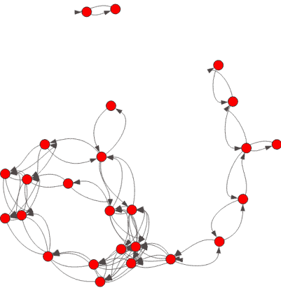
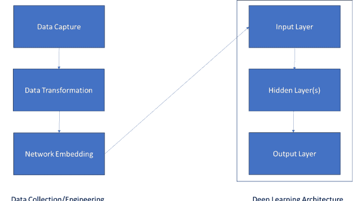

# 面向网络的机器学习

在本章中，我们将讨论常用于关系数据的**机器学习**（ML）模型及其在网络科学中的应用。虽然许多网络专用工具能够很好地洞察网络结构并预测传播在网络中的扩散，但机器学习工具使我们能够利用网络中个体的额外信息，构建关于关系、传播过程以及与网络或其个体相关的关键结果的更完整图景。我们将研究友谊网络、与个体相关的元数据以及个体与其他个体的联系，以探索网络上的机器学习。

我们首先将回到基于个体共同活动和特征进行网络构建的话题，然后转向基于网络特征和元数据特征进行聚类，最后根据网络及其元数据预测个体和友谊网络的结果。你将学习如何将网络指标与元数据结合起来，以及如何使用网络数据构建多种类型的机器学习模型；本书的后续章节将在此基础上继续深入。让我们深入了解一些友谊网络及其元数据。

具体来说，本章将涵盖以下主题：

- 友谊网络与友谊关系数据集简介
- 网络上的机器学习
- 网络上的 SDL

## 技术要求

本章中实际示例的代码可在以下网址找到：https://github.com/PacktPublishing/Modern-Graph-Theory-Algorithms-with-Python

## 友谊网络与友谊关系数据集简介

在本节中，我们将基于学生行为因素构建一个友谊网络。然后，我们将应用**无监督学习（UL）**方法——即聚类——将个体划分为友谊群体，以比较添加额外网络结构信息前后的性能。

### 友谊网络概述

让我们考虑一所小学校里的一群同班同学；按年龄和地域招生在美国很常见。同学们可能会参加相同的课外活动，例如运动队、校报或管乐团。他们也可能一起学习、一起吃饭，或在周末聚在一起闲逛。有些人可能会形成一个核心朋友群体，一起上一些相同的课程、参加相同的课外活动、一起学习，并在学校相关活动之外一起玩乐。诸如此类的强社会联系往往构成社会支持和持久社会关系不可或缺的来源，并且对个人的生活决策和结果非常重要，尤其是在青春期和成年早期——此时同伴在心理社会发展中扮演着重要角色。

另一些朋友群体可能只一起学习或在同一支队伍中打球，除此之外几乎没有共同兴趣或互动。诸如此类的弱社会联系在社会中也扮演着重要角色：它们将个体与社区中各种各样的资源联结起来，让年轻人接触到更多元的观点和新思想。社会变革往往源于不同社区之间的弱联系，例如加入同一支运动队、在学校同班上课、参与宗教活动等。虽然弱社会联系通常不能提供强大的社会支持，但它们在网络中发挥着桥梁作用，并能将个体引荐给那些日后可能成为强社会联系的人。

在我们的第一个友谊网络中，我们将同时考虑弱社会联系和强社会联系。强社会联系主要出现在一个七人朋友群体中，他们大多在同一支队伍中打球、共享一些课程、一起学习，并在上课前和周末进行体育活动：


图 9.1——一群男孩在课前打篮球的图示

图 9.1 展示了其中三位具有强社会联系的男孩在课前打篮球的情景。由于这个群体大部分时间都在一起度过，我们可以预期，想法、行为和传染病都会在网络的这个部分迅速传播。

相比之下，网络中的弱社会联系由偶然的互动组成，这些互动可能涉及核心课程或某种共同兴趣，使个体在短时间内聚集到一起，从而彼此认识，可能对同学有所了解，但可能对其他学生的兴趣、家庭生活或理想知之甚少：


图 9.2——同一间教室里上课、课后可能互不交流的学生的图示

图 9.2 展示了同在一间教室上课但可能仅在这一门课上才有交集的学生。诸如此类的弱社会联系让学生接触到不同的想法、不同的兴趣、季节性流感等，但它们对个体的影响小于对作为整体的群体的影响。

在本章中，我们将通过对网络指标和与学生人口统计特征相关的元数据应用无监督学习（UL）算法，推断出可能具有强社会联系的学生群体。我们还将通过图神经网络（GNN）进行监督学习（SL），分析随机生成网络上的社交网络风险，以了解不同类型网络面临的不同流行病风险。在深入分析之前，让我们先稍微探索一下初始数据集。

## 友谊人口统计与学校因素数据集

在本章中，我们将主要使用一个包含 25 名学生信息的数据集。这些学生通过许多不同的生活方式因素相互关联：队伍成员身份、日常锻炼、周末体育活动、球赛观赛和作业学习小组的成员身份。人口统计和社会经济因素以及课程分配也将这些学生联系起来，具体包括四门选修课的注册、性别、居住社区，以及此前就读于当地两所初中中的哪一所。

该数据集源自法雷利（Farrelly）高中一年级期间为期一个月的中学日记。法雷利本人就是个体 #7。为了构建加权网络，我们将学生两两之间在各因素上的联系累加起来。这将让我们大致了解哪些学生之间的联结最为紧密。我们将首先探索聚类，以识别友谊群体。

在我们将聚类同时应用于元数据和网络指标之前，先来看看如何仅基于元数据对该网络进行聚类。

## 网络上的机器学习

现在我们已经对友谊数据进行了一些探索，接下来看看聚类算法的性能如何随是否包含网络结构信息而变化。我们先只考虑学生因素。

### 基于学生因素的聚类

在第一次聚类尝试中，我们将关注数据集本身，其中包含关于学生人口统计特征和社交活动的元数据。最简单的聚类算法之一是 *k-means 聚类*，它通过迭代划分数据来最小化簇内方差并最大化簇间方差。这意味着被聚在一起的学生与同一簇中的学生之间的共同点，多于与其他簇中的学生之间的共同点。k-means 聚类是一种简单的算法，在大多数情况下效果良好。然而，我们需要指定预期的簇数，而这一数量通常是事先未知的。我们将簇数设为 3 并评估模型拟合度；此外，我们将算法重新运行五次，以确保无论算法起点和随机误差如何，都能得到最优的三簇解。

> **重要说明**
> 如果你使用的是 Windows 计算机，可能会收到一条不影响结果的警告；scikit-learn 中的某些软件包尚未针对新版 Windows 操作系统进行更新。新版操作系统的发布以及包依赖项的更新往往会触发这些警告。

让我们通过脚本 9.1 来深入了解 k-means 聚类的代码：

```
#import packages needed
import pandas as pd
from sklearn.cluster import KMeans
import igraph as ig
from igraph import Graph
import numpy as np
import os
```


```python
#import file
File ="<YourPath>/Friendship_Factors.csv"
pwd = os.getcwd()
os.chdir(os.path.dirname(File))
mydata \
    pd.read_csv(os.path.basename(File),encoding='latin1')

#k-means model
X=mydata[mydata.columns.drop('Individual ID')]
km=KMeans(n_clusters=3,init='random',n_init=5)
km_model=km.fit_predict(X)

#explore k-means model
km_model

#add to dataset as first solution
km_1=np.array(km_model)+1
mydata['km_1']=km_1
```

聚类结果表明，三聚类解是一个很好的拟合。 一个聚类组（#0）包括个体 1-7 和个体 10；该组大多一起做作业、参加比赛、周末一起锻炼，并在同一支队伍中。 聚类 #0 的特征是一个关系紧密的朋友群体，他们共享许多相同的活动，并且在大多数星期里彼此靠近。 我们会担心疫情从这个群体开始并传播。 很可能他们共享相同的保护行为，例如健康饮食、规律的身体活动和社会参与。 然而，传染病或可能导致身体受伤的风险行为（尝试危险的体育动作、接受挑战……）令人担忧，因为这种行为很可能会通过整个朋友群体传播。

另一个组（#1）包括个体 8-9、12-14、16、19 和 23-25；这些个体通常共享课程 2，不在学校外一起锻炼或进行体育运动，不一起做作业，也不共享许多其他课程。 聚类 #1 的特征是缺乏参与和与样本中其他人的互动。 该群体对保护行为和风险行为的传播风险都很低，因为他们与样本中的其他人没有牢固的社会联系。 很可能他们不会受到行为的影响，也不会影响他人。

最后一个组（#2）包括个体 11、15、17-18 和 20-22；该组异质性较高，包括队友之间除了共同的队伍外没有太多共同点、共享几门课程的个体，以及与其他人联系很少的孤立个体。 总体而言，该组与聚类 #1 一样，对疫情或行为传播的风险较低；然而，他们在样本内部更活跃，并且可能在一定程度上受到队友或与之共享多门课程者的影响。

## 基于学生因素和网络指标的聚类

现在，让我们基于阈值化的皮尔逊相关性创建一个网络，该网络通过添加到 `Script 9.1` 来表示个体之间活动/课程的相似性：

```python
#create network via Pearson correlation
cor=np.corrcoef(X)
cor[cor>=0.5]=1
cor[cor<0.5]=0
X2=np.asmatrix(cor)

#create graph with self-loops removed
friends=Graph.Adjacency(X2)
edge_list=friends.get_edgelist()
self_loop=[]
for i in range(0,25):
    self=(i,i)
    self_loop.append(self)
to_remove=[]
for i in edge_list:
    for j in self_loop:
        if i==j:
            to_remove.append(i)
friends.delete_edges(to_remove)
ig.plot(friends)
```

运行对 `Script 9.1` 的此项添加会生成友谊网络的图，如 *Figure 9.3* 所示：



Figure 9.3 – A network plot of the thresholded friendship dataset

图 9.3 显示了两个独立的组，其中一个非常小的组由两个个体组成，而一个更大的组中个体之间存在稀疏和密集的连接。 鉴于我们友谊数据集的连接模式，我们预计个体之间的度数和 PageRank 中心性会有所不同。 让我们添加到 Script 9.1 并附加我们的特征矩阵，以重新运行我们的 k-means 分析，包括人口统计学因素和两个缩放后的中心性指标，以了解我们的聚类如何变化：

> Note
> You may find a warning about copying objects; this does not impact the analysis or object.

```
#create scaled metrics and attach to X
d=np.array(Graph.degree(friends))/10
p=np.array(Graph.pagerank(friends))*20
X['degree']=d
X['pagerank']=p

#create new k-means model with graph metrics added
km2=KMeans(n_clusters=3,init='random',n_init=5)
km_model2=km2.fit_predict(X)

#explore new k-means model
km_model2

#add to dataset as first solution
km_2=np.array(km_model2)+1
mydata['km_2']=km_2
```

我们可以看到，与初始 k-means 模型相比，我们的聚类结果发生了变化。 在聚类 #0 中，个体 19 被添加进来（与初始 #0 聚类一起做作业并参加比赛的队友）。 我们的初始聚类 #1 显示个体 8-9、12、16 和 23-25；个体 13、14 和 19 不再被分配到此聚类，但其他个体保持不变。 在剩余的聚类中，个体 13 和 14 加入了我们的初始聚类，这两者似乎比初始聚类 #1 具有更高的连通性，根据中心性指标更适合聚类 #2。 看起来添加网络连通性指标可以改善 k-means 聚类结果，因为可能不共享每项活动但显示出相似群体连接的个体会被重新分配到更符合其在社交网络中位置的组中。

现在让我们看看如何使用我们在第 5 章首次遇到的半监督聚类算法——谱聚类——来获得我们友谊网络聚类的半监督解。

## 友谊网络上的谱聚类

正如我们在第 5 章中所看到的，谱聚类提供了一种聚类选项，可用于划分邻接矩阵或距离矩阵；这可以作为 UL 或半 SL（SSL）算法完成。 在这里，我们将使用来自 Script 9.1 的相关矩阵来运行一个无监督谱聚类，使用三个聚类和五次初始化（类似于我们的 k-means 运行），以便与我们的 k-means 结果进行比较，通过添加到 Script 9.1：

> Note
> 
> Again, you may encounter a Windows warning from scikit-learn or a warning about the graph not being fully connected (assessed via Laplacian, which results in a different approach to the clustering than would be run for a fully connected network). Neither of these warnings will impact the result.

```
#import packages needed
from sklearn.cluster import SpectralClustering
from sklearn import metrics

#perform spectral clustering and attach to dataset
sc = SpectralClustering(3, affinity='precomputed',n_init=5)
sp_clust=sc.fit(cor)
mydata['sp']=sp_clust.labels_
sp_clust.labels_
```

这些结果与我们在前一小节中获得的 k-means 解相比差异显著。 鉴于两个 k-means 模型都考虑特定的活动和课程安排，而不是仅仅相关性汇总，这种差异是有意义的。 谱聚类解完全专注于网络连通性，而不考虑友谊数据集中包含的因素或连通性和因素的组合。 在这种情况下，鉴于我们的数据，k-means 解更有意义——特别是第二个 k-means 解，它包含了网络指标和原始因素。

无监督与半监督聚类算法的选择高度特定于手头的任务。 对于非常大的网络，k-means 算法具有可良好扩展的解，并且添加可良好扩展的网络连通性指标可能会在不牺牲效率的情况下改善 k-means 解。 对于涉及纯网络连通性解的问题，谱聚类可能是首选，特别是如果用于构建网络的因素未被收集或对于第三方网络未知。 然而，谱聚类也可以将部分标记数据作为输入，从而允许 SSL，根据已知的关于数据的知识来指导学习过程。

现在我们已经看到了 UL 和 SSL 算法如何可用于网络数据集，让我们把注意力转向 SL 算法，重点关注一种专门设计用于将网络数据集作为输入的令人兴奋的新型深度学习（DL）算法。

## DL on networks

在本节中，我们将考虑一种称为 GNNs 的新型 DL 模型，它通过嵌入网络的顶点、边或全局属性来处理和操作网络，以学习与单个网络、网络内的顶点属性或网络内的边属性相关的结果。 从本质上讲，DL 架构演化了这些嵌入的拓扑结构，以在输入数据中找到可预测结果的关键拓扑特征。 这可以以完全监督或半监督的方式完成。 在此示例中，我们将重点关注 SSL，其中只有部分标签已知；然而，通过提供所有标签作为输入，这可以更改为 SL 设置。

在深入 GNNs 的技术细节之前，让我们更深入地探讨它们的使用案例。 对网络本身进行分类通常会为诸如图像特征或类型、分子化合物毒性或作为药物剂的潜在用途、或在特定国家/地区鉴于旅行路线和人口中心而发生疫情传播的潜力等问题提供重要见解。

通常，诸如分子或图像之类的数据在 GNNs 的网络嵌入步骤之前被转换为网络结构。 在分子化合物的背景下，例如，共享共价键的原子被表示为由边连接的顶点。 然后，每个化合物根据该化合物的分子结构产生一个独特的网络。 对于蛋白质，氨基酸可以作为顶点，连接存在于共享键的氨基酸之间（例如，由二硫键产生的半胱氨酸桥）。

在筛选潜在化合物用于药物开发时，我们通常希望预测该化合物是否可能具有毒性作用。 使用已知有毒化合物和无毒效应的化合物的已知数据库，我们可以开发一个 GNN 来预测新研发化合物的毒性作用，基于新化合物的分子结构，鉴于我们对已知有毒或无毒分子的了解。 这使得在动物或人体试验之前快速筛选潜在新药的毒性成为可能。

GNNs 还能够在给定输入网络的情况下学习顶点标签，这是本章的重点。 例如，在犯罪或恐怖主义网络中，我们可能希望根据收集的情报数据中对领导者和非领导者的一些了解来识别网络中的潜在领导者。 情报数据中不完整的信息很常见，从已知的信息中学习对于识别网络中未知且可能难以通过线人或卧底特工识别的关键人物非常有价值。 由于顶点预测涉及已构建的网络，我们通常跳过 GNN 的嵌入步骤而不是整理数据。 然而，可能有必要向图添加顶点标签以表示网络中领导结构已知的相关信息。

GNNs 中的边学习与顶点学习类似，通常通过使用现有网络并对边属性（例如恐怖主义网络中成员之间沟通频率或重要性，可能涉及协调恐怖袭击或在地理区域招募新成员）具有完整或不完整的信息来实现。 在这种情况下，我们在进行 GNN 训练之前嵌入边而不是顶点。


深度学习架构本身并不是唯一的。熟悉**卷积神经网络**(CNNs)的读者会认出我们将讨论的许多组件和反向拟合算法，因为它们在 GNN 语境下是相同的。我们从维度等于嵌入维度的输入层开始，以维度等于结果类别数量的输出层结束（针对分类问题，我们将在本章中讨论）。当只有输入层和输出层时，**神经网络(NNs)**近似于线性回归，学习输入矩阵和输出向量之间的映射。然而，在这些层之间，我们通常会加入隐藏层，以进一步处理输入层和输出层之间的特征，如图 9.4 所示：



图 9.4 – GNN 生命周期的概要，包括数据工程和深度学习架构步骤

隐藏层细化输入层和输出层之间的拓扑映射，通常在训练过程中汇集发现的拓扑特征，并将其馈送到下一个隐藏层。对于小网络和小规模网络样本，隐藏层的数量应保持较小，以维持解的稳定性并获得良好性能。对于较大网络或网络集合，可以增加更多隐藏层以提高性能，而不会遇到解或拟合不稳定的问题。

隐藏层通常在连接到该特定隐藏层的输入层和输出层之间采用非线性映射函数，称为*激活函数*。在实践中，常见的激活函数只有少数几个，包括*ReLU 函数*，它对负值或零值输入返回 0，对正值输入返回输入值本身。

卷积层也常用于隐藏层，它向输入层应用滤波器函数（通常是核），通过定义的核函数对其进行变换。通常，卷积层会降低矩阵或张量的维度，因此可以使用零填充来保持维度，以避免在层变换时因输出维度而限制可能的层数。对于小数据集（比如我们考虑的这个数据集），这不一定是个问题，因为在数据规模有限的情况下，浅层网络往往是我们唯一能够训练出稳定 GNN 的选择。

构建有效架构的理论超出了本书的范围，对深度学习感兴趣但没有基础的读者，可以通过阅读本章末尾提供的参考资料来获取这方面的知识。

一旦定义了架构（无论是通过专家猜测，还是再次通过网格搜索来优化架构），我们就必须拟合连接各层内部和跨层节点的参数（称为权重）。有很多方法可以做到这一点，也可以定义自定义拟合算法。不过，我们将重点关注示例中使用的 PyTorch 包中最常见的两种选择：Adam 优化器和随机梯度下降（SGD）。

SGD 通过探索定义在神经网络上的梯度函数来拟合层内和层间节点之间的权重，其方式类似于梯度提升拟合线性回归模型。定义一个学习率来控制对梯度函数的探索。学习率较高时，模型拟合更快，但可能无法找到全局最小值或最大值。SGD 的一个问题是，算法可能陷入局部最优，导致结果的准确率低于在给定输入数据、层间映射函数和结果数据的情况下所能达到的水平。而且 SGD 通常较慢，需要更多算法迭代，甚至可能需要更强的计算能力才能拟合模型。

Adam 优化器允许不同节点之间的权重使用灵活的学习率，从而使模型拟合更快，并通过让学习率适应局部梯度景观来避免局部最优。Adam 还允许设置衰减率，进一步定制权重的局部学习。自最初的 Adam 优化器开发以来，已经涌现出许多变体，并且很可能还会有更多针对 GNN 和其他深度学习架构的变体被开发出来。一个缺点是 Adam 优化器通常对内存要求较高。在训练大型 GNN 时，为了避免训练期间的内存问题，可能更适合使用 SGD。

在实践中，很难知道哪种优化器最适合拟合所定义架构的权重，同样，工业 GNN 模型通常使用网格搜索来优化这一选择。一旦选定拟合算法，会运行预定义（通常也由网格搜索优化）的迭代次数，或者算法一直运行到满足停止准则为止。Adam 优化器往往比 SGD 优化器收敛得更快，但性能可能因数据和架构而异。

现在我们对 GNN 的基本构件有了一些了解，接下来让我们探索一个示例，该示例使用一个开源体育网络，其中的学生被分配给两位不同的老师（这是我们关心的结果变量）。

## 示例：使用 GNN 对空手道网络数据集进行分类

在我们的示例中，我们将预测一个常见开源网络中的顶点级属性：Zachary 的空手道网络数据集。该数据集由空手道训练网络中的 34 个人组成，他们通过 78 条边相连，当管理员和一位教练之间发生冲突时，这些人最终分裂成支持管理员和支持教练两派。该网络上的顶点分类和学习问题的主要任务之一是预测哪些人最终在冲突中支持哪一方（管理员还是教练）。我们将通过半监督 GNN 模型方法来预测顶点标签。

我们首先安装所需的包并导入数据集。如果你尚未安装必要的包，请在运行我们的代码之前先在机器上安装。我们已将这一步作为可选操作放在脚本 9.2 中：

```
#install packages if you have not installed them on your machine
#!pip install dgl
#!pip install torch

#import packages
import dgl
import dgl.data
import torch
import torch.nn as nn
import torch.nn.functional as F
import itertools
from dgl.nn import SAGEConv

#import Karate Club dataset with instructor/administrator labels
dataset = dgl.data.KarateClubDataset()
num_classes = dataset.num_classes
g = dataset[0]
```

为了嵌入顶点数据，我们将使用 PyTorch 的默认嵌入算法，维度设为 6。考虑到我们网络的规模，4-6 维范围内的任何取值都应该能工作得相当不错。让我们在脚本 9.2 中添加代码来嵌入顶点：

```
#embed vertices with a dimension of 6
vert_em = nn.Embedding(g.number_of_nodes(),6)
inputs = vert_em.weight
nn.init.xavier_uniform_(inputs)
```

这段脚本应该会输出网络中每个顶点的嵌入向量。现在我们已经完成了顶点的嵌入，可以创建标签了。由于我们希望演示半监督方法，我们将向网络提供六个顶点（1、3、5、12、15 和 32）的信息。你可以调整脚本的这一部分，看看顶点数量的减少或增加会如何影响我们所选架构的性能和稳定性。让我们在 `Script 9.2` 中添加标签信息：

```
```python
#obtain labels and denote available labels for GNN learning
#(here: 1, 3, 5, 12, 15, 32)
labels = g.ndata['label']
labeled_nodes = [1, 3, 5, 12, 15, 32]
```
```

接下来，我们需要构建 GNN 架构并定义训练参数。许多使用该数据集的 GNN 论文和教程都采用非常浅的网络架构和 Adam 优化器。为了比较并演示构建 GNN 的其他选项，我们将使用两个隐藏层而不是一个（包括与 ReLU 函数配合使用的卷积层），采用较小的层（隐藏层分别为 8 个和 6 个节点），使用 SGD 拟合算法（学习率为 `0.01`，动量为 `0.8`，接近默认值）以及 990 次迭代。网上现有的许多示例使用 Adam 优化器和单个隐藏层，且隐藏层节点数比我们的架构多，因此需要的训练迭代次数更少。然而，对于更大的网络顶点标签预测问题，更复杂的架构可能表现更好，因此我们将展示一种包含更多隐藏层的方法，以及一种使用不同于 Adam 的拟合算法的方法。让我们在 `Script 9.2` 中定义架构并拟合权重：

```
```python
#build a three-layer GraphSAGE model
class GraphSAGE(nn.Module):
    def __init__(self, in_feats, h_feats1, h_feats2,
                 num_classes):
        super(GraphSAGE, self).__init__()
        self.conv1 = SAGEConv(in_feats, h_feats1, 'mean')
        self.conv2 = SAGEConv(h_feats1, h_feats2, 'mean')
        self.conv3 = SAGEConv(h_feats2, num_classes, 'mean')

    def forward(self, g, in_feat):
        h = self.conv1(g, in_feat)
        h = F.relu(h)
        h = self.conv2(g, h)
        h = F.relu(h)
        h = self.conv3(g, h)
        return h

#6 embedding dimensions as input,
#a hidden layers of 8 and 6 nodes, and 2 classes to output
net = GraphSAGE(6,8,6,2)
```
```


GNNs 在许多不同领域的基于网络的分类问题中显示出巨大潜力，很可能它们将继续发展并解决涉及大型网络和网络集合的紧迫问题。然而，通常需要云计算解决方案，这需要具备在用于存储数据和拟合 GNN 的云计算平台上使用数据和 Python 笔记本解决方案的专业知识。

## Summary

在本章中，我们考虑了在网络数据集上使用 ML 算法的多个用例。这包括通过拟合 k-means 和谱聚类对友谊网络进行 UL。我们在个体参与的活动原始数据集上以及在添加网络指标以提高聚类准确性后的原始数据集上都考虑了 k-means 聚类。然后我们转向网络和网络集合上的 SL 和 SSL，通过一种称为 GNN 的 DL 算法。我们通过浅层 GNN 准确预测了 Zachary's Karate Network 数据集中个体的标签，并将结果与其他现有网络分类问题的解决方案进行了比较。在第 10 章中，我们将使用与条件概率相关的网络工具挖掘教育数据中的因果关系。

## References

Acharya, D. B., & Zhang, H. (2021). Weighted Graph Nodes Clustering via Gumbel Softmax. arXiv preprint arXiv:2102.10775.

Bongini, P., Bianchini, M., & Scarselli, F. (2021). Molecular generative graph neural networks for drug discovery. Neurocomputing, 450, 242-252.

Fan, W., Ma, Y., Li, Q., He, Y., Zhao, E., Tang, J., & Yin, D. (2019, May). Graph neural networks for social recommendation. In The World Wide Web Conference (pp. 417-426).

Hartigan, J. A., & Wong, M. A. (1979). Algorithm AS 136: A k-means clustering algorithm. Journal of the Royal Statistical Society. Series C (Applied Statistics), 28(1), 100-108.

Imambi, S., Prakash, K. B., & Kanagachidambaresan, G. R. (2021). PyTorch. Programming with TensorFlow: Solution for Edge Computing Applications, 87-104.

Kumar, V. (2020). An Investigation Into Graph Neural Networks (Doctoral dissertation, Trinity College Dublin, Ireland).

Labonne, M. (2023). Hands-On Graph Neural Networks Using Python: Practical techniques and architectures for building powerful graph and deep learning apps with PyTorch. Packt Publishing Ltd.

Liang, F., Qian, C., Yu, W., Griffith, D., & Golmie, N. (2022). Survey of graph neural networks and applications. Wireless Communications and Mobile Computing, 2022.

Mantzaris, A. V., Chiodini, D., & Ricketson, K. (2021). Utilizing the simple graph convolutional neural network as a model for simulating influence spread in networks. *Computational Social Networks*, 8, 1-17.

Min, S., Gao, Z., Peng, J., Wang, L., Qin, K., & Fang, B. (2021). STGSN—A Spatial–Temporal Graph Neural Network framework for time-evolving social networks. *Knowledge-Based Systems*, 214, 106746.

Ng, A., Jordan, M., & Weiss, Y. (2001). On spectral clustering: Analysis and an algorithm. *Advances in neural information processing systems*, 14.

Scarselli, F., Gori, M., Tsoi, A. C., Hagenbuchner, M., & Monfardini, G. (2008). The graph neural network model. *IEEE transactions on neural networks*, 20(1), 61-80.

Wieder, O., Kohlbacher, S., Kuenemann, M., Garon, A., Ducrot, P., Seidel, T., & Langer, T. (2020). A compact review of molecular property prediction with graph neural networks. *Drug Discovery Today: Technologies*, 37, 1-12.

Wu, Z., Pan, S., Chen, F., Long, G., Zhang, C., & Philip, S. Y. (2020). A comprehensive survey on graph neural networks. *IEEE transactions on neural networks and learning systems*, 32(1), 4-24.

Zachary, W. W. (1977). An information flow model for conflict and fission in small groups. *Journal of Anthropological Research*, 33(4), 452-473.

Zhang, L., Xu, J., Pan, X., Ye, J., Wang, W., Liu, Y., & Wei, Q. (2023). Visual analytics of route recommendation for tourist evacuation based on graph neural network. *Scientific Reports*, 13(1), 17240.

Zhou, J., Cui, G., Hu, S., Zhang, Z., Yang, C., Liu, Z., ... & Sun, M. (2020). *Graph neural networks: A review of methods and applications*. AI open, 1, 57-81.
