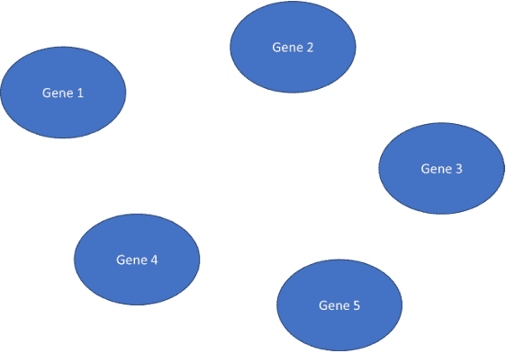
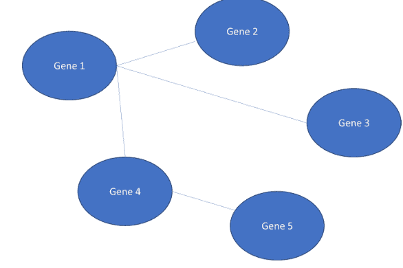
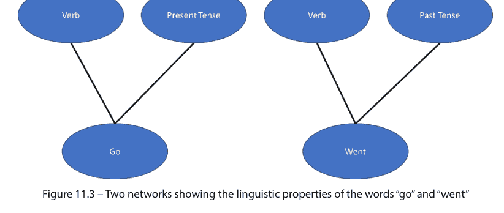
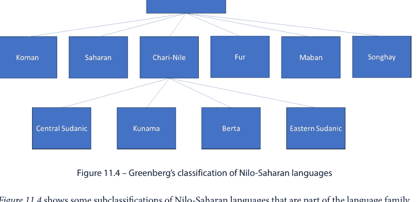
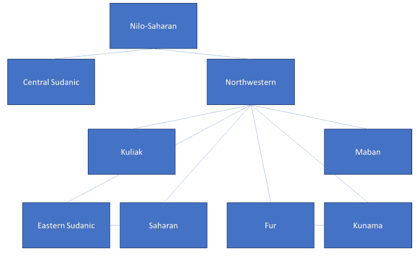
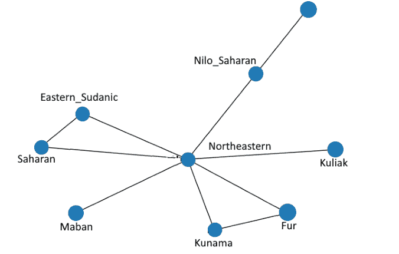

# 映射语言家族——一种本体论方法

在本章中，我们将探索一个重要的科学领域——语言学。**语言学**是对语言的研究，包括词汇使用模式、语法演变以及语言的社会建构。我们将探索**本体论**，它通过定义的关系将诸如词语等概念相互关联，并构建**语言家族**，其中同一家族的语言在时间和地理上相互关联。

网络科学为我们提供了总结和比较本体论与语言家族的工具，以研究假设的相似性和差异性。我们将在本章末尾量化假设的语言家族之间的差异，尽管该方法也可应用于本体论或源于语言学研究的任何其他基于网络的结构。

在本章中，我们将涵盖以下主题：

- 什么是本体论？
- 语言家族
- 映射语言家族

到本章结束时，你将了解语言相关分析中使用的某些基本工具，并能够比较不同网络以理解它们之间的关键差异。由于这些工具具有良好的扩展性，你将能够处理非常大的本体论。

## 技术要求

你需要 Jupyter Notebook 来运行本章的实际示例。

本章代码可从此处获取：`https://github.com/PacktPublishing/Modern-Graph-Theory-Algorithms-with-Python`

## 什么是本体论？

在本节中，我们将学习本体论以及它们如何被表示和存储为网络。虽然本章侧重于语言本体论，但还存在许多其他类型的本体论，包括基因本体论，本节将简要回顾以作为引子。

## 本体论简介

如本章引言所述，本体论是一组通过某种属性相关联的概念。通常，它们用于在特定学科内组织知识。让我们用一个例子使这一点更具体。由于遗传学中的示例在本体论研究中更为常用，我们将在处理语言学之前先通过一个生物学示例建立直觉。

假设我们有五个基因位于调控动物毒液中所含酶或多肽产生的调控通路中。通常，环境条件和地理因素会通过调节毒腺内的基因转录，影响毒液中活性化合物的比例，即使在同一种物种内也是如此。在我们开始收集这些基因及其对毒液产生影响的信息之前，我们只是拥有一组基因，如*图11.1*所示：



图11.1 – 参与调控毒液产生的五个基因集合

为了更好地理解*图11.1*中的基因，我们可能会在不同的环境条件下进行实验，以开启和关闭基因，并阐明它们之间的相互关系——即该调控通路中存在的依赖关系。相互依赖可以通过连接这些基因顶点中的每一个的边来表示。假设我们进行了几次实验并发现了以下关系：



图11.2 – 表示调控毒液产生的基因之间关系的本体论

图11.2显示所有其他四个基因都在Gene 1的下游，表明该基因对动物毒液中关键化合物的调控至关重要。Gene 1的突变可能导致功能丧失（并可能危及动物）。将该本体论可视化为网络，使我们能够轻松定位所研究系统中的关键信息。

然而，许多生物的基因调控通路比这个例子大得多，在实践中很难可视化——尤其是完整的基因本体论，其中生物体的全套基因被映射并通过功能通路连接。这意味着我们需要使用网络分析工具来研究所提出的基因调控通路之间的差异，或比较表现出相同功能的不同生物体之间的基因调控通路。例如，在我们的毒液示例中，我们可能感兴趣的是绘制一种海蛇（眼镜蛇科成员）的完整基因本体论，并将其完整基因本体论与另一种眼镜蛇科物种（如太攀蛇或黑曼巴）进行比较。这些物种可能拥有多达12,000个基因，从而产生一个非常大的本体论比较问题。

让我们回到对语言学的关注上，看看与语言相关的本体论是如何构建的，以及如何用于研究方言、皮钦语或社会经济群体之间的语言差异——或者仅仅是为了理解一种语言的结构和功能。

考虑英语中的两个词：go 和 went。这两个词都是动词。就句子的主语而言，两者具有相同的语义。然而，一个是现在时，另一个是过去时。所有这些信息都帮助我们理解这些词在英语中的功能。我们可以将这些关系映射到每个词的网络结构中，如图11.3所总结：




图 11.3 – 展示词语 “go” 和 “went” 的语言学属性的两个网络

图 11.3 总结了我们两个词的语言学属性：go 和 went。想象一下为英语中的每个词都创建这样的网络。我们将拥有非常多的网络来映射语言学属性与词语，并且很容易丢失重要的网络。我们在图集合中搜索感兴趣的词语或属性时也会消耗大量计算资源。让我们进一步探索本体创建。

## 将信息表示为本体

要创建本体，我们需要定义感兴趣的概念/词语/术语以及它们可能共享的属性。在我们的图 11.3 示例中，我们有一组具有感兴趣的语言学属性的词语。一旦我们定义了这两个集合（在图 11.3 的示例中分别为词语和语言学属性），我们就可以在这两个集合之间创建映射（图 11.3 中显示的线条）。我们的词语示例是一个非常小的示例，不过。很多时候，这些集合中的每一个都可能包含数千甚至数万个项目。

为了处理这些更大的信息集合以及它们之间可能存在的关系，我们需要一种系统的方法来存储这两个集合及其关系。我们还需要很多人来创建这个非常大的本体，最好有一种方式让所有参与创建本体的人之间共享信息。这就是数据库发挥作用的地方。

**本体网络语言（OWL）** 数据库系统组织像图 11.3 中所示的知识网络。每个词语、术语或概念在数据库中占据一行，并映射到本体中与该词语/术语/概念匹配的感兴趣属性，从而创建一种数据库的数据库，用于存储词语/术语/概念数据以及它们与本体中感兴趣的关键属性的关系。从这个数据库中，我们可以搜索信息、可视化感兴趣的关系，并挖掘整个本体以寻找总体主题。

任何类型的知识都可以组织在 OWL 数据库中。例如，我们可以使用 OWL 数据库来组织关于动物分类学或进化遗传学的知识，以便根据遗传分析结果快速搜索不同拟水蛇物种之间的关系。我们还可以组织医学术语，为医生创建一个易于使用的查询系统，以便在遇到超出其专业领域的症状或疾病时促进患者诊断。我们甚至可以组织关于长篇小说中人物关系的知识，为《*战争与和平*》这样的书籍提供学习指南。

现在我们知道了关于本体及其存储系统的基础知识，让我们把注意力转回语言学，在那里我们可能希望研究语言家族中语言的演变。

## 语言家族

**语言家族** 是具有共同祖先并通常在相关地理区域内演化的语言群。例如，罗曼语族由在南欧地区从通俗拉丁语（晚期拉丁语）演化而来的语言组成。尼罗-撒哈拉语族在努比亚王国时期在尼罗河三角洲演化。今天大约有 150 个语言家族被归入主要语言家族，外加几个**语言孤立**，它们与其他语言没有关系（例如澳大利亚的 Tiwi）。语言孤立没有与其它语言相连的遗传祖先。Campbell 给出了七个主要语言家族（每大洲一个），尽管其他研究人员将主要语言家族归类为其他语言组。

## 语言漂移和关系

语言家族的出现是因为不同遗传祖先语言的人群地理上隔离到足以使祖先语言在区域内演化。随着语言的演化，词语可能会改变。发音可能会改变。语法可能会演化。在许多英语 **皮钦语**（两种或多种语言的混合，包括本例中的英语）中，英语与当地语言混合形成了保留英语部分语法和用法的混合语言，同时也包含当地语言。在尼日利亚英语皮钦语中，英语与当地语言如伊博语、豪萨语或约鲁巴语混合。例如，“How are you?” 变为 “How na?” 而 “Please come join me for a meal” 变为 “Abeg come chop food.”

随着时间的推移，皮钦语可能会演化到成为完全独立的语言（英语的后代，就像中古英语从古英语演化而来一样，同时其他语言影响了古英语）或仍保持为母语（本例中为英语）的皮钦语。当语言演化时，它就成为母语的一个子分支。就英语而言，其在商业和学校系统中的广泛使用表明，随着时间的推移，许多子语言将发展为具有不同词汇和语法的独立语言。鉴于尼日利亚皮钦语的广泛使用，尼日利亚英语子语言很可能是未来一两个世纪内最有可能发展的子语言。

有几个驱动因素往往有利于语言演化为子语言或皮钦语。不同国家或地区之间因语言不重叠而产生的商业往来需要交流手段。皮钦语通常在市场中发展，在那里许多不同语言的说话者必须相互交流以买卖商品。常见的词语和短语在交易中可能会反复使用（如货币价值或数量）。棘手的语法或冠词可能会被省略以促进两种不同语言说话者之间的理解。

帝国扩张是语言演化的另一个驱动因素。罗马帝国将拉丁语传播到欧洲大部分地区，影响了语言，特别是那些最接近罗马的语言，历经数个世纪。西班牙和葡萄牙是很有趣的案例，在那里拉丁语的罗马影响和阿拉伯语的摩尔影响都影响了当地方言。随着时间的推移，随着罗马帝国权力衰落以及其他语言和文化影响使曾在商业、学校和宗教中使用拉丁语的地区分离，罗曼语，包括西班牙语和葡萄牙语，从拉丁语中演化出来。事实上，罗马帝国如此直接地影响了这些语言的发展，以至于术语 **罗曼语** 指的就是罗马帝国！

今天存在的多数英语皮钦语都归功于英国殖民主义，正如大不列颠、美利坚合众国和澳大利亚所说的英语不同方言一样。取决于英语作为商业通用语能持续多久，我们可能会在未来几个世纪看到许多子语言从英语演化而来。

**系统发育树** 可以通过显示亲子关系来直观地总结思想、语言或物种随时间的演化关系。这使得演化结构的研究变得更容易，因为视觉提供了关于演化假设路径的线索以及一个易于分析信息和潜在统计差异的网络结构。一般本体结构没有层次结构，其中网络的一部分在意识形态上依赖于网络的先前部分。让我们通过尼罗-撒哈拉语言的假设演化路径来实际看看这一点。

## 尼罗-撒哈拉语言

尼罗-撒哈拉语言包括在南苏丹、埃塞俄比亚、苏丹、肯尼亚、坦桑尼亚、乌干达、乍得、布基纳法索、喀麦隆、马里、刚果民主共和国、贝宁、阿尔及利亚、尼日利亚、尼日尔、埃及和利比亚等国使用的语言。一些其他国家也存在进一步的小型语言社区。该语族中一些常见的语言有马赛语、松盖语、丁卡语、卢奥语和卡努里语。约有 7000 万人使用尼罗-撒哈拉语言，部分地区和方言的使用者数量正在增加。


尼罗-撒哈拉语系的语言学研究可追溯至至少 1800 年代，过去十年来许多论文都在争论语言漂移以及母语与子语之间的关系。在本节中，我们将考察其中几种提出的层级结构，然后在下一节中利用 Python 代码返回分析这些层级结构的相似性和差异。如果你对论文本身感兴趣，可以查阅本章末尾的参考文献，特别是 Dimmendaal 的论文，它总结了尼罗-撒哈拉语系中亲子关系最近的争论。

Greenberg 在 1963 年提出了以下层级结构，对若干语言家族分支进行了分类。图 11.4 显示了该层级结构，包括从更大的尼罗-撒哈拉语系的一个子分支衍生的子分支：



图 11.4 – Greenberg 对尼罗-撒哈拉语系的分类

图 11.4 显示了尼罗-撒哈拉语系的部分亚分类，这些亚分类属于该语言家族。每一个亚分类都继续延伸到单个语言，总计约有 130 种语言分布于该地区，这些语言起源于尼罗河支流汇合的地区，即曾经的努比亚。

自 1963 年以来，许多论文进一步细分了这些子类并增加了额外的子类，最终形成了我们将在本节讨论的 Dimmendaal 论文，有时形成了非常复杂和深层的网络结构。语法、用词、音系学（就本例而言是辅音的发音）以及术语通常决定了划分界限的位置，但语言往往是流动的，可能在某种程度上重叠，使得分类系统难以辨别。让我们转向尼罗-撒哈拉语系的最新研究之一。

Dimmendaal 的最新研究提出了尼罗-撒哈拉语亚家族的新层级结构，总结于图 11.5：



图 11.5 – Dimmendaal 的尼罗-撒哈拉语亚家族层级结构

**注意**
在图 11.5 中，Dimmendaal 的分类首先按地区划分语言，然后按方言或地区划分。还要注意的是，一些语言亚家族似乎是共同出现的（例如 Fur 和 Kunama），而没有中间家族的存在。这比图 11.4 中 Greenberg 的分类结构更为复杂。

随着语言被更系统地研究，语言家族层级结构随时间演变，记录出现的差异及其潜在原因非常重要。这照亮了进一步语言学研究的途径，并可为未来语言家族层级结构的发展做出贡献。

现在我们对尼罗-撒哈拉语言及其层级结构有了一些了解，让我们看看网络科学如何帮助我们理解可能重要的结构差异。

## 注意

我们的示例规模非常有限，因此结果易于可视化，并且我们分析可能显示差异的原因也很清楚。使用完整的 OWL 数据库或完整的语言层级结构会产生更细致和更大的网络来研究。然而，无论网络规模或复杂性如何，所使用的工具都是相同的。因此，我们即将开始的分析可以应用于更复杂的语言数据结构，在这些结构中，仅仅可视化不同研究小组创建的 OWL 数据库或不同语言家族层级结构之间的差异可能不可行。

## 映射语言家族

让我们回到尼罗-撒哈拉语言家族树的两个示例。为了检查结构差异，我们首先需要在 NetworkX 中创建它们。对于 Dimmendaal 家族树，我们将稍微偏离树结构，以显示某些子亚家族之间存在的相互关系。让我们开始通过脚本 11.1 创建并绘制 Greenberg 树：

```
#load needed packages
import numpy as np
import networkx as nx
import matplotlib.pyplot as plt

#create the Greenberg Nilo-Saharan language family network
G = nx.Graph()
G.add_nodes_from([1, 11])
G.add_edges_from([(1,2),(1,3),(1,4),(1,5),(1,6),(1,7),(7,8),
    (7,9),(7,10),(7,11)])

#plot the Greenberg Nilo-Saharan language family network
import matplotlib.pyplot as plt
G.nodes[1]['subfamily'] = 'Nilo_Saharan'
G.nodes[2]['subfamily'] = 'Koman'
G.nodes[3]['subfamily'] = 'Saharan'
G.nodes[4]['subfamily'] = 'Songhay'
G.nodes[5]['subfamily'] = 'Fur'
G.nodes[6]['subfamily'] = 'Maban'
G.nodes[7]['subfamily'] = 'Chari_Nile'
G.nodes[8]['subfamily'] = 'Central_Sudanic'
G.nodes[9]['subfamily'] = 'Kunama'
G.nodes[10]['subfamily'] = 'Berta'
G.nodes[11]['subfamily'] = 'Eastern_Sudanic'
labels = nx.get_node_attributes(G, 'subfamily')
nx.draw(G, labels=labels, font_weight='bold')
```

```
labels2 = nx.get_node_attributes(G2, 'subfamily')
nx.draw(G2, labels=labels2, font_weight='bold')
```

脚本的这一部分生成了 Dimmendaal 的尼罗-撒哈拉语亚家族树的图，显示在图 11.7 中：



图 11.7 – Dimmendaal 的尼罗-撒哈拉语亚家族树的图

注意 Dimmendaal 的尼罗-撒哈拉语亚家族树中 Kunama 与 Fur 之间、以及 Saharan 与 Eastern Sudanic 之间存在的连接。这些代表了尼罗-撒哈拉语东北分支内相关的子亚家族。从图 11.6 和 11.7 可以看出总体结构相似，其中存在大量浅层且不相连的分支。然而，Dimmendaal 的尼罗-撒哈拉语亚家族树在树中增加了额外的一层，并包含了相关亚家族，而这些亚家族没有共同祖先直接产生它们。

鉴于这些差异，我们预计两种语言亚家族树之间的中心性指标会有所不同。我们将从前几章中定义的一些熟悉指标开始。脚本 11.2 分析了我们两种语言亚家族树之间平均中介中心性的差异：

```
#compare betweenness centrality of language families
gb=nx.betweenness_centrality(G)
print(np.mean(np.array(list(gb.values()))))
gb2=nx.betweenness_centrality(G2)
print(np.mean(np.array(list(gb2.values()))))
```

我们得到平均中介中心性为 0.131（Greenberg）和 0.127（Dimmendaal），表明这些亚家族树的桥接属性相似。让我们通过添加到脚本 11.2 来计算平均度中心性来评估枢纽属性：

```
#compare degree centrality of language families
gd=nx.degree_centrality(G)
print(np.mean(np.array(list(gd.values()))))
gd2=nx.degree_centrality(G2)
print(np.mean(np.array(list(gd2.values()))))
```

我们得到平均度中心性为 0.182（Greenberg）和 0.278（Dimmendaal），表明这些亚家族树的枢纽属性在某种程度上有所不同。鉴于 Dimmendaal 的亚家族树结构中连接其他层的额外深度层，我们预计会看到这种差异。

让我们将注意力转向一种特别适合真实世界语言数据（以及其他本体或系统发育网络数据集）的中心性指标。

**子图中心性**衡量每个顶点在网络子图中的参与程度，通过加权网络邻接矩阵的谱，并通过网络上的随机游走估计子网络，对小型子网络赋予较大权重，对大型子网络赋予较小权重。这融合了**谱聚类**（见*第 5 章*）和度中心性的属性，创造出一种混合中心性度量。

我们可以在两个亚家族树上看到这一点，通过添加到脚本 11.2：

```
#compare subgraph centrality of language families
gs=nx.subgraph_centrality(G)
print(np.mean(np.array(list(gs.values()))))
gs2=nx.subgraph_centrality(G2)
print(np.mean(np.array(list(gs2.values()))))
```

该脚本显示两个亚家族树的平均子图中心性有所不同，Greenberg 的平均子图中心性为 2.478，Dimmendaal 的平均子图中心性为 3.276。这表明这些假设亚家族树的谱和度分布是不同的。

虽然本示例仅涉及两个小的本体结构，但当处理许多本体或比较非常大的本体而可视化不被推荐时，这类分析会很有帮助。例如，我们可能希望比较许多不同论文中假设的完整的尼罗-撒哈拉语言树。这些树将包括数百个顶点和可能数十棵树。视觉上跟踪差异将是一项相当大的挑战！


当我们考虑语言学 OWL 数据库时，分析规模会进一步扩大到数十万个顶点，以跨 OWL 数据库进行比较。在这种规模下，通过可视化方式挖掘比较数据是不可能的。网络科学提供了一种比较所提出的 OWL 数据库结构的方法，并聚焦于这些数据库之间存在的差异，从而找到这些结构之间的关键区别。此外，我们之前概述的许多工具都能很好地扩展到这种规模的数据分析，为找到这些关键差异提供了一种高效的方法。然而，理解词源学理论中存在的差异超出了本书的范围，而且许多 OWL 数据库的存储依赖专有系统，或者它们本身就是专有的。

本章聚焦于语言学领域。然而，许多其他学科中也存在多种类型的本体和系统发育。动物学和人类基因组学经常使用本体来研究基因、环境和基因表达之间的关系。这些本体往往规模庞大，而构建这些本体所需的知识整理可能导致试图捕获相同知识的不同本体之间存在显著差异或知识空白。可扩展的中心性度量（例如我们在一个易于可视化的简单示例中概述的那些）能够定位这些复杂本体的整体及个别分支差异，从而找出值得关注的领域，以及使用某个开源本体而非另一个时可能存在的注意事项。

随着不同领域知识的增长，比较本体的方法也将进一步发展，网络科学将在不同学科内本体的管理、理解和使用中发挥重要作用。

## 小结

在本章中，我们学习了如何在数据库和网络中表示语言学数据。我们使用中心性度量比较了尼罗-撒哈拉语系的两个语族网络，并引入了子图中心性，这是一种特别适合分析本体和系统发育的中心性度量。最后，我们将本体的讨论扩展到语言学领域之外，并讨论了如何利用本章中的工具将这些分析扩展到非常庞大的本体群，以比较它们在实际应用中的适用性。

在下一章中，我们将学习图数据库，它可以用来存储诸如本章所讨论数据之类的本体数据。

## 参考文献

Campbell, L. R. (2018). *世界上有多少个语系？*

Dimmendaal, G. J. (2019). *尼罗-撒哈拉语言形态学的类型学视角.* 载于 *牛津语言学研究百科全书*。

Dimmendaal, G. J., Ahland, C., Jakobi, A., and Lojenga, C. K. (2019). *通常被称为“尼罗-撒哈拉语”的语言的语言特征与类型学.* Cambridge Handbook of African Languages, 326-381.

Done, B., Khatri, P., Done, A., and Draghici, S. (2008). *使用语义分析预测新的人类基因本体注释.* IEEE/ACM transactions on computational biology and bioinformatics, 7(1), 91-99.

Ehret, C. (2006). *乍得语的尼罗-撒哈拉背景.* Studies in African Linguistics, 35, 56-66.

Estrada, E., and Rodriguez-Velazquez, J. A. (2005). *复杂网络中的子图中心性.* Physical Review E, 71(5), 056103.

Gene Ontology Consortium. (2008). *2008 年基因本体项目.* Nucleic acids research, 36(suppl_1), D440-D444.

Greenberg, J. H. (1957). *语言学论文集.*

Greenberg, Joseph H. 1963. *非洲的语言.* Bloomington, IN: Indiana University.

Jakobi, A., and Dimmendaal, G. J. (2022). *Karko 语和尼罗-撒哈拉语中的数标记.* Number in World's languages: A Comparative Handbook, 63-106.

McGuinness, D. L., and Van Harmelen, F. (2004). *OWL Web 本体语言概述.* W3C recommendation, 10(10), 2004.

Oladnabi, M., Omidi, S., Mehrpouya, M., Azadmehr, A., Kazemi-Lomedasht, F., and Yardehnavi, N. (2021). *毒液组学与抗毒液组学数据：当前和未来展望.* Archives of Biotechnology and Biomedicine, 5(1), 026-031.

Souag, L. (2022). *西非语言如何变成北非语言，反之亦然.* Linguistic Typology, 26(2), 283-312.

Subich, V. G. (2020). *非洲语言谱系的结构与类型学分析.* Арабистика Евразии, (12), 103-117.

Suryamohan, K., Krishnankutty, S. P., Guillory, J., Jevit, M., Schröder, M. S., Wu, M., ... and Seshagiri, S. (2020). *印度眼镜蛇参考基因组与转录组实现了毒液毒素的全面鉴定.* Nature Genetics, 52(1), 106-117.

Urban, M. (2021). *语言孤立语的地理与发展.* Royal Society open science, 8(4), 202232.

Wardhaugh, R. (1972). *语言学导论.*

*尼日利亚皮钦语——20 个有用的单词和短语* (n.d.): https://www.britishcouncil.org/voices-magazine/nigerian-pidgin-words-phrases

# 12
