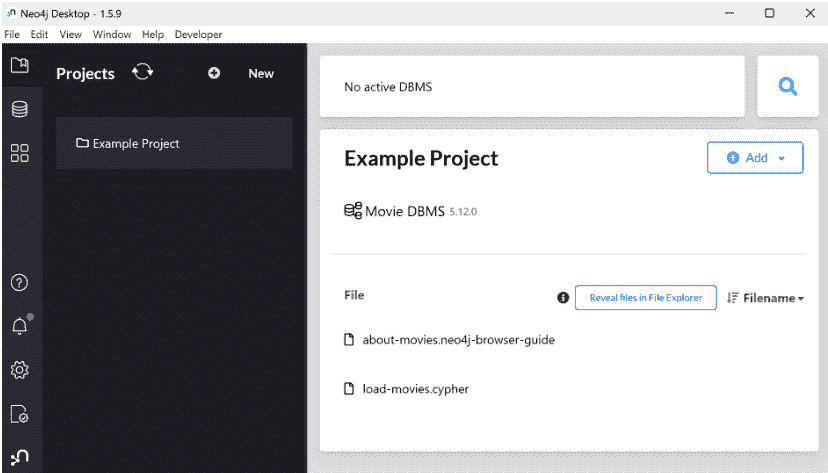
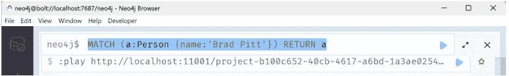
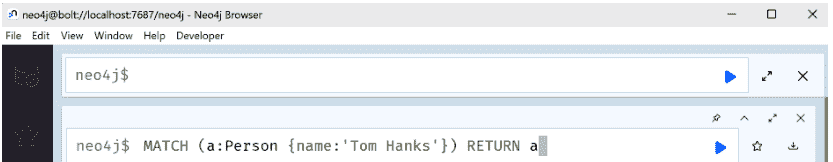
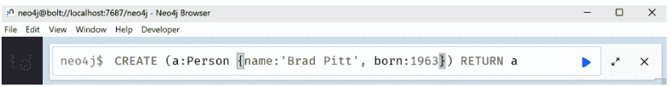
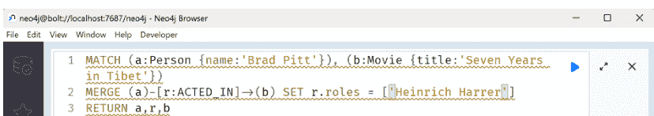
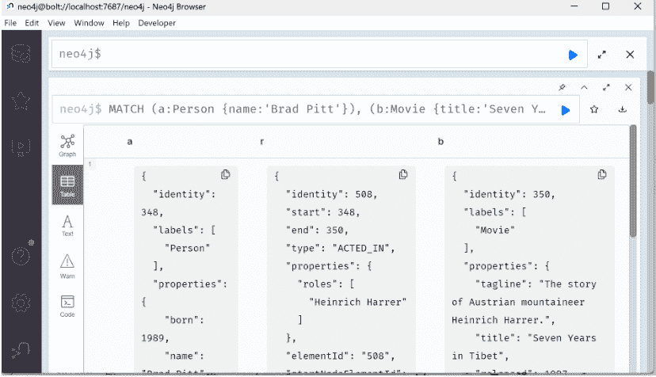
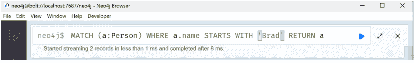
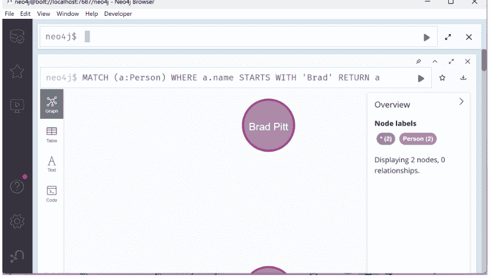
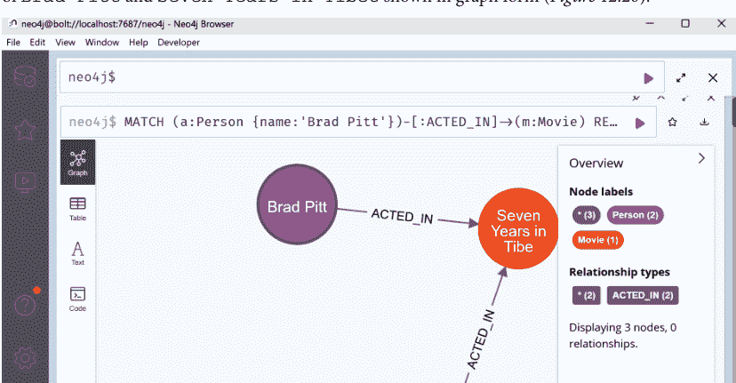

# 图数据库

在前几章中，我们将网络视为可分析的数据结构，以从数据科学问题中提取洞见。在本章中，我们将把网络视为数据存储选项，以多关系的方式将许多信息片段连接起来。存储选项有很多，但我们将重点关注一个与 Python 集成良好的开源选项——Neo4j。

本章将涵盖以下主题：

- 图数据库简介
- 在 Neo4j 中查询和修改数据

学完本章后，你将理解图数据库在存储网络科学数据集方面的优势，能够可视化图数据库，并知道如何查询它们以快速检索相关信息。你将能够自如地通过插入和删除来修改表。你将理解前几章中的工具如何帮助你高效地查询并找到相关数据。让我们从探讨图数据库背后的原理开始。

## 图数据库简介

**图数据库**（以网络形式存储数据的数据库）相比传统关系数据库具有许多优势。首先，图数据库能够捕获和遍历层次关系。关系数据库虽然能够捕获分类体系，但那是通过不同的列来实现的，而这些列并未显式关联。

此外，图数据库通过用边连接条目或条目组来显式捕获它们之间的复杂关系。这使得数据库中可以存在多路关系；例如，当邻居之间通过边相连时，查询最近邻要容易得多，无需对数据库中所有条目进行估算步骤来寻找**欧几里得**距离或**曼哈顿距离**。

此外，图数据库可以非常容易地捕获数据库中条目之间关系的方向性。在关系数据库中，单个关系的方向性可能需要占用多列信息才能捕获。因此，对于可能存在单向复杂关系的条目，图数据库提供了一种紧凑的数据结构表示。

最后，在图数据库中，可以利用网络算法探测网络不同部分的相似模式，或基于三元闭包推断不存在的边，从而挖掘数据集中尚未编程进数据库的隐含关系。对于许多数据集——例如持续增长的组学（-omics）数据集、不断演化的本体，或其他知识不完整的非静态数据集——数据挖掘提供了新的研究途径。

既然我们已经对图数据库的优势有了一些了解，下面让我们深入探讨图数据库与关系数据库之间的具体差异。

## 什么是图数据库？

图数据库是基于网络科学的数据库。与关系数据库将数据存储为电子表格中的列（如下面图所示）不同，图数据库将数据存储为网络：原本占据一行的条目被表示为顶点，并根据现存关系连接到其他顶点。列数据用于向顶点添加元数据，或将其连接到其他顶点。图数据库查询依赖网络科学算法来遍历图、模式发现算法，以及这两种算法的组合。因此，图数据库的查询可以变得相当复杂，却不一定需要像 SQL 中的子查询那样长的运行时间。效率是图数据库的一大优势。让我们来看一个与客服或产品相关的超市客户反馈示例，如图 12.1 所示：

图 12.1 – 关系数据库设计示例，行中包含条目，信息按列组织（经 Microsoft Excel 许可使用）

图 12.1 显示了一个关系型数据库，其中包含大量作为列存在的数据行。然而，这些数据可能更适合表示为图数据库，其中项目通过列相关联，或以可查询的方式使用列作为元数据。也许评论中附带了日期，可以按时间链接项目，并将投诉相关的部门用作元数据。

虽然关系型数据库难以可视化，但可视化图数据库要简单得多。一些图数据库自带内置的可视化工具，可放大感兴趣的区域或查询结果。有些允许开发者在预先存在的可视化基础上进行构建，以根据需要定制此功能。悬停在边和顶点上时，大多数图数据库可视化工具会显示与顶点或边关联的元数据，为查询提取的感兴趣关系提供上下文。Cytoscape 是最常用的大规模网络可视化程序之一；最初，它是为可视化蛋白质组学数据集而构建的，其中记录了跨物种的蛋白质相互作用。以下是 Cytoscape 使用示例图的演示图像：https://js.cytoscape.org/。

Cytoscape 的优势之一是其能够处理保存的 igraph 网络，使得可以在 Python 中对非常大的网络进行分析，然后使用 Cytoscape 进行可视化，而网络大小不会像使用 igraph 绘图函数那样使可视化复杂化。此外，Cytoscape 提供适用于 Java 设备的桌面版本，以及适用于无法访问桌面版本的用户的网络界面版本。如果你感兴趣，建议下载 Cytoscape 并使用本书中使用的数据集或你自己的感兴趣数据集测试其可视化功能。

现在我们了解了图数据库的结构和优势，让我们深入研究一些数据集，在这些数据集中，图数据库在组织信息和检索感兴趣信息方面可能比关系型数据库更有效。

## 图数据库中可以表示什么？

许多数据科学领域都可以从图数据库中受益。我们将在深入研究一个开源图数据库的编码之前，深入探讨其中一些用例。让我们从流行病学的一个例子开始。

## 接触者追踪

当一个地区出现新的流行病时，流行病学家经常使用一种称为接触者追踪的工具，其中收集每个病例的数据以将病例相互连接起来，希望找到疫情源头，或零号病人。零号病人通常可以提供有关疫情来源的线索——无论是动物媒介、实验室泄漏还是环境灾难。然后，流行病学家可以确定有效的遏制政策并监测潜在来源以防止未来爆发。

在病毒有足够时间变异的长期爆发中，接触者追踪使流行病学家能够研究疫情的病毒演变。在 COVID-19 大流行期间，我们看到了许多 COVID-19 的变异株，其死亡率和症状各不相同，其中一些并未

在图 12.2 中，我们看到病例 #161 被识别出来（可能通过检测中心或寻求医疗护理）。该个人的接触者显示其感染来自病例 #165，而病例 #165 则由病例 #173 感染。接触者追踪还揭示了另一名由病例 #165 感染的个体（病例 #169）。如果没有接触者追踪，至少另外三例病例将被遗漏，导致治疗延迟，并可能导致更多暴露和病例。一般来说，因果关系是通过菌株分析和有关通过性伴侣或共用注射器暴露时间的信息来确定的。这些因素包含在病例元数据中。

将病例元数据和因果关系信息存储在关系型数据库中会非常困难，因为感染的方向性对于研究疫情在人群中的演变以及联系尚未接受检测的潜在暴露者至关重要（因为病例接触者可能重叠，并且在这种类型的流行病中经常重叠）。图数据库允许高效存储和检索这些信息，以实现接触者追踪和制定保护该人群中面临 HIV 暴露风险者公共政策的最大效率。早期识别可以挽救人们免受痛苦，甚至死亡。

## 岛屿生态学研究

现在我们知道了图数据库如何改善社会科学数据的分析和结果，让我们考虑图数据库如何改善保护研究。假设科学家在长期与大陆人口隔离的偏远地区发现了一个新岛屿。图 12.3 显示了该假设岛屿：

图 12.3 – 一个长期与大陆隔离的岛屿的插图

在图 12.3 所示的岛屿上，我们希望记录生活在该岛屿上的动植物群，以及该岛屿的食物链。我们将收集有关种群规模、捕食者-猎物关系以及对这些种群和关系构成潜在威胁的信息（例如气候变化）。我们可能希望将物种链接到食物网，以探索在岛屿温度、天气和海平面变化的情况下食物来源的可持续性。我们还可能希望将岛屿划分为不同的生态系统，这些生态系统可能被高悬崖的山谷隔开，或通过迁徙模式或栖息地重叠与岛上的其他生态系统相连。食物网和重叠的栖息地/迁徙模式在我们的数据集中创建了种群数据之间的关系，这些数据自然以网络形式存在。我们可以向网络中的顶点（物种或栖息地）或连接它们的边（例如关于迁徙模式的季节性信息，该模式可能定期连接来自两个不同栖息地的物种）添加元数据。

在这个保护示例中，我们可能会有不止一个收集的数据集。我们可能有来自不同地理区域的多个不同的食物网。我们还可能有连接岛上地理的栖息地重叠数据集，这些数据集连接到我们的食物网，例如种群规模估计、生态系统健康指标和季节性模式的元数据。

连接多个数据集，其中一些包含层次关系，在关系型数据库中相当棘手；然而，使用图数据库则很容易。不同类型的边可以连接收集的网络中的不同顶点，以链接每个网络以及每个收集的网络中包含的元数据。这使得保护主义者更容易查询和探索潜在的关系，这些关系可能未明确定义（也许由于时间限制或地形导航困难而未收集）。

从该数据及其图数据库的探索中，可以推断并定义岛上的保护区，在这些区域中，许多食物网相连或为具有大型生物多样性的孤立区域。这可以保护物种免受人类活动或气候变化威胁，并使研究人员能够将有限的资金集中在对整个生态系统至关重要的区域进行监测。此外，随着进一步的探险和保护工作收集新数据，图数据库设置允许研究人员测试在首次探险中未直接观察到的生态系统或食物网之间的假设联系。

现在我们了解了一些将受益于图数据库存储解决方案的数据集，让我们将注意力转向 Neo4j，这是一个开源图数据库选项。

## 在 Neo4j 中查询和修改数据

在开始使用 Neo4j 之前，我们需要在机器上下载并安装该软件。你可以按照此链接到达 Neo4j Desktop 下载页面：https://neo4j.com/download/。

你应该会看到如下页面，可以通过点击下载按钮下载 Neo4j：

图 12.4 – Neo4j 下载页面

点击图 12.4 中的“下载”按钮后，系统会提示你按照安装程序的说明完成安装。安装完成后，你会看到一个图标，或者安装过程会直接在你的机器上启动 Neo4j。这应该会带你进入一个如下所示的页面：

图 12.5 – Neo4j 的起始页面

如图 12.6 所示，一旦你通过点击“启动”按钮启动了 Movie DBMS 数据库，你就能够连接到该数据库。启动这个数据库可能需要几分钟时间。由于你在阅读本章之前可能不熟悉 Neo4j，因此我们将点击 about-movies.neo4j-browser-guide 文件选项，并运行几个查询示例来熟悉 Cypher 的语法和结果。

当你点击 about-movies.neo4j-browser-guide 文件选项时，你会看到类似图 12.7 的页面。第一页展示了一个基本查询，用于提取某位演员的数据。在这里，我们将演员改为 Brad Pitt，并在图中查询 Brad Pitt 的实例。当你的代码改为图 12.7 所示的内容后，点击箭头运行代码。请注意，你会看到所写代码下方有默认教程。我们的 Neo4j 查询图片中没有显示这个教程，但它会出现在你的屏幕上：

图 12.7 – 一个搜索 Brad Pitt 的基本 Cypher 查询

这个数据库不包含任何关于 Brad Pitt 的信息。对 Tom Hanks 运行建议的查询确实会产生 JSON 形式的信息，因为该数据不包含图元素。当你查询数据库中关于 Tom Hanks 的信息时，你应该会看到类似图 12.8 的内容：

图 12.8 – 在 Movie DBMS 中查询 Tom Hanks 的结果

让我们进入指南的下一页，向数据库中添加一位演员。我们将添加 Brad Pitt，因为我们的查询最初返回为空。图 12.9 展示了如何向数据库中添加演员及其出生年份。

图 12.9 – 为 Brad Pitt 创建条目的说明

我们还可以使用 `MERGE` 语句结合 `CREATE` 和 `MATCH` 语句来创建或更新数据库中的记录，这取决于数据库中已存在的内容，以创建新记录或更新现有记录。我们将使用图 12.14 中所示的代码将 Brad Pitt 的信息重新添加到数据库中：

图 12.14 – Cypher 代码中的更新示例

当我们运行图 12.14 中的代码时，会再次看到图 12.9 的内容，只是此时 Brad Pitt 的信息已被添加到数据库中。既然我们掌握了一些基本的 Cypher 命令，就可以在下一节中继续学习更复杂的图数据库操作。

## 更复杂的查询示例

既然我们已经知道如何执行基本查询，就可以继续学习 Neo4j 中更复杂的操作，例如添加条目之间的关系。让我们通过一个 Cypher 查询，将 Brad Pitt 与《西藏七年》以及他所饰演的角色 Heinrich Harrer 连接起来。

> 注意
> 在运行此查询之前，你需要使用“基本查询示例”一节中的代码将电影和演员重新添加到数据库中。该查询如图 12.15 所示。

图 12.15 – 一个将 Brad Pitt 与其在《西藏七年》中饰演的角色 Heinrich Harrer 连接起来的 Cypher 查询

运行此查询会返回有关演员、电影以及我们刚刚在两个数据集之间创建的关系的信息，如图 12.16 所示：

图 12.16 – 图 12.15 中用于连接 Brad Pitt 和《西藏七年》的 Cypher 查询的结果

Neo4j Cypher 指南的下一页展示了创建此关系的另一种方式。我们鼓励你修改该代码，添加另一位演员和一部电影作为练习。接下来，让我们关注 Cypher 的 `WHERE` 子句，其功能与 SQL 中的 `WHERE` 子句非常相似。

我们将搜索名字以“Brad”开头的人，这应该会拉出 Brad Pitt 的条目，以及任何其他名字为 Brad 的演员。图 12.17 展示了此查询：

图 12.17 – Cypher 中 `WHERE` 查询的示例

当我们运行图 12.17 中的 Cypher 代码时，应该会在数据库中看到两个 Brad Pitt 实例，如图 12.18 所示：

图 12.18 – 图 12.17 中 `WHERE` Cypher 查询的结果

我们还可以基于关系进行匹配，例如查找与某位演员关联的电影。让我们尝试一个关于关系的 Cypher 查询，以查找与 Brad Pitt 关联的所有电影（这里只有《西藏七年》，因为我们添加了这个关系）。图 12.19 展示了我们将用于查询关系的语句：

图 12.19 – 一个关于人物与电影之间图关系的 Cypher 查询

当我们运行图 12.19 中所示的 Cypher 查询时，我们会以图的形式看到 Brad Pitt 实例与《西藏七年》之间的联系（图 12.20）：

图 12.20 – 图 12.19 中图关系查询的结果

图 12.20 展示了图数据库的核心优势。我们能够看到跨表（此处为 Person 表和 Movie 表）连接不同条目的关系，以及这种关系的性质。很容易看出演员与电影之间的关联；如果存在更多电影，我们也能通过 Neo4j 中基于图的查询轻松可视化查询结果。

虽然这个电影数据库包含基本的表和关系，但我们可以想象“你能在图数据库中表示什么？”一节中的示例涉及更多表之间更复杂的关系。以图的形式跨表和表内条目可视化查询结果，能够为查询中感兴趣的数据和关系提供易于理解的摘要。图数据库的强大之处正在于此。即使对于包含许多子查询的查询，或者当搜索非常大的表及其关系时，查询速度也往往很快；而结果的可视化则允许用户深入探索跨表的关系（或者为报告提供简洁的视觉呈现）。

如果你想进一步探索 Neo4j，Neo4j 的 AuraDB 允许用户通过 Python 连接数据库：先创建账户，然后使用 Python 中的 `neo4j` 包和 `GraphDatabase.driver()` 函数通过 API 连接 Neo4j。

**注意**
对于任何大型数据库或希望永久保存的数据库，你需要付费账户。

数据库创建完成后，你可以通过 Python 的 `neo4j driver.execute_query()` 语句查询 Neo4j 数据库，并将数据作为网络导入到 igraph 中进行分析，以便分析结果。这为你的分析项目提供了图存储与图分析的强大组合。如果你感兴趣，我们鼓励你进一步探索 Neo4j，并创建属于自己的将 igraph 与 Neo4j AuraDB 账户连接起来的项目。

## 总结

在本章中，我们探讨了图数据库具有优势的场景，熟悉了一个名为 Neo4j 的开源图数据库，并学习了 Neo4j 的查询语言 Cypher 的一些基础知识。我们在一个 Neo4j 电影数据库中创建、删除和修改了记录。我们还探讨了查询图数据库的优势，以及图数据库所特有的查询结果可视化功能。如果你感兴趣，我建议你查阅 Cypher 和 Neo4j 的相关资源，深入了解图数据库可以实现的功能。

在下一章中，我们将综合运用本书迄今为止学到的所有技能，解决一个现实世界的问题：预测埃博拉疫情在刚果民主共和国各地区随时间和地理分布的严重程度。

## 参考文献

Adler, M. W., and Johnson, A. M. (1988). *Contact tracing for HIV infection.* British Medical Journal (Clinical research ed.), 296(6634), 1420.

Angles, R., Arenas, M., Barceló, P., Hogan, A., Reutter, J., and Vrgoč, D. (2017). *Foundations of modern query languages for graph databases.* ACM Computing Surveys (CSUR), 50(5), 1–40.

Beas-Luna, R., Novak, M., Carr, M. H., Tinker, M. T., Black, A., Caselle, J. E., ... and Iles, A. (2014). *An online database for informing ecological network models:* `http://kelpforest.ucsc.edu`. PloS one, 9(10), e109356.

Hyman, J. M., Li, J., and Stanley, E. A. (2003). *Modeling the impact of random screening and contact tracing in reducing the spread of HIV.* Mathematical biosciences, 181(1), 17–54.

Mueller, W., Rudowicz-Nawrocka, J., Otrzasek, J., Idziaszek, P., and Weres, J. (2016). *Spatial data and graph databases for identifying relations among members of cattle herd.* International Multidisciplinary Scientific GeoConference: SGEM, 1, 835–841.

Pasquale, D. K., Doherty, I. A., Leone, P. A., Dennis, A. M., Samoff, E., Jones, C. S., ... and Miller, W. C. (2021). *失而复得：应用网络分析进行HIV公共卫生接触者追踪*. *应用网络科学*, 6, 1–16.

Pokorný, J. (2015). *图数据库：其能力与局限*. 载于 *计算机信息系统与工业管理：第14届IFIP TC 8国际会议，CISIM 2015，波兰华沙，2015年9月24-26日，会议录14* (pp. 58-69). Springer International Publishing.

Robinson, I., Webber, J., and Eifrem, E. (2015). *图数据库：连接数据的新机遇*. O’Reilly Media, Inc.

Shannon, P., Markiel, A., Ozier, O., Baliga, N. S., Wang, J. T., Ramage, D., ... and Ideker, T. (2003). *Cytoscape：生物分子相互作用网络集成模型的软件环境*. *基因组研究*, 13 (11), 2498–2504.

Webber, J. (2012年10月). *neo4j编程简介*. 载于 *第三届系统、编程与应用年会会议录：面向人类的软件* (pp. 217–218).
