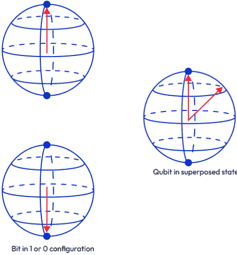
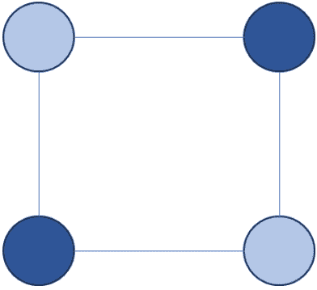
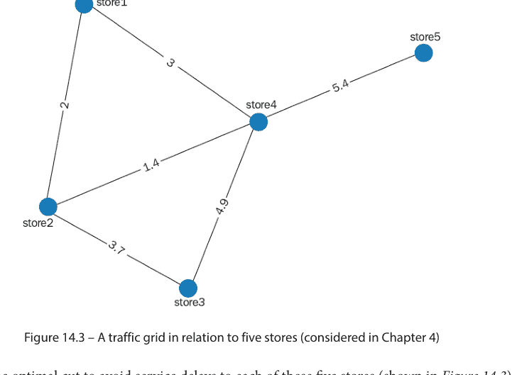
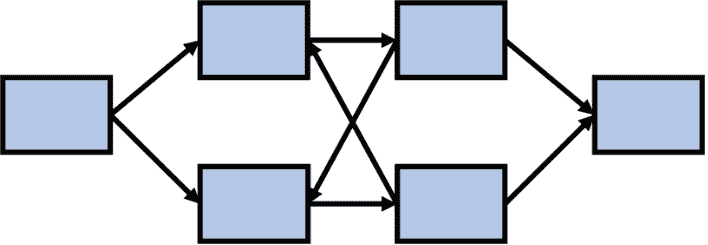
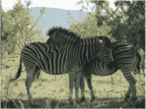
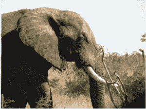
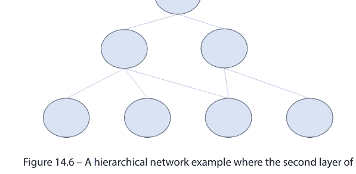
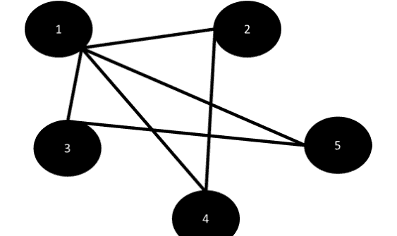
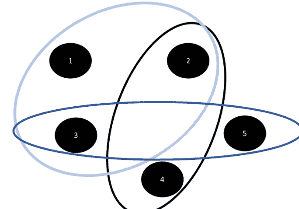

# 新前沿

在之前的章节中，我们概述了网络科学在分析项目中的许多工具和应用。在本章中，我们将展望正在开发的较新工具，这些工具在网络科学中有许多有前景的应用，包括量子图算法、深度学习/大语言模型架构优化，以及用于组织元数据和理解遗传学数据的多级图。

虽然之前的章节包含编码示例，但本章将重点介绍未来的想法和发展可能性。网络科学是一个不断发展的领域，很可能我们现在甚至无法想象的工具在未来十年将变得司空见惯。让我们深入探讨一些较新的应用，看看网络科学如何继续为许多不同领域的知识做出贡献。

具体来说，我们将涵盖以下主题：
- 量子网络科学算法
- 作为图的神经网络架构
- 分层网络
- 超图

## 量子网络科学算法

网络科学算法发展的一个新兴且有前景的途径是量子计算。**量子计算**利用量子层面物理学的许多优势特性来提升计算能力并解决难题。虽然量子计算有多种形式，但我们将重点关注**量子比特**系统，其中比特被其量子版本取代。

量子比特在计算框架中相比比特具有许多优势。**叠加**是量子物理学中的一种属性，允许粒子（如量子比特）同时存在于多种状态。因此，比特必须存在于0或1的配置中，而量子比特可以同时作为1和0存在，直到量子比特被测量，坍缩为通常的比特状态。这允许进行大规模并行搜索解决方案。

除了能够同时作为1和0存在之外，叠加还允许分数值，其中量子比特在概率意义上部分为1、部分为0。由于这种分数状态，可以设计作用于概率函数而非单个比特状态的逻辑门。这种灵活性允许电路设计来增强算法，这种计算方法在图像分类中已显示出收益。*图14.1*显示了量子比特和比特之间的差异：

处于1或0配置的比特

处于叠加态的量子比特

图14.1——量子比特与比特的可视化对比

许多类型的机器学习算法已被移植到量子计算机上，以加速解决方案的收敛或将算法扩展到更大的问题。量子机器学习是一个活跃的研究领域，网络科学算法是量子机器学习中较大的研究领域之一。让我们更详细地探讨两种量子网络科学算法。

## 图着色算法

**图着色算法**是网络科学算法的一个分支，旨在找到图的色数。**色数**是着色网络顶点所需的最小颜色数量，使得没有相邻的顶点颜色相同。在实际应用中，色数对于确定通信系统中分配的频道数量或并行处理中的作业调度非常重要。着色网络顶点所需的最小颜色数量代表了完成上述任务所需的最小频道数或最小作业数。*图14.2*显示了一个带有颜色的小型网络：

图14.2 – 一个具有四个顶点、四条边和色数为2的小型网络

虽然*图14.2*的色数易于确定，但一般来说，计算网络的色数被认为是**NP难**的，这意味着它不能在多项式时间内解决。具有高复杂度的算法转化为计算，对于足够大或足够稠密的网络来说，这是非常困难或目前不可能的。这给解决通信和作业调度中的问题带来了困难，因为呼叫或作业的数量非常大。

幸运的是，量子图着色算法允许算法比在经典机器上运行得快得多，从而为大型图提供更快的解决方案，并可能为非常大的图提供可计算的解决方案。然而，当前的量子硬件系统限制了量子图着色算法可以运行的图的大小，因为问题必须映射到物理系统上。随着量子硬件支持越来越大的网络，色数计算将对更多现实世界的问题变得可行。

## 最大流/最小割

在*第4章*中，我们探讨了**运输物流**和**最大流/最小割算法**。回想一下，该算法用于划分网络中的流，可用于规划交通网格中的道路封闭，例如*图14.3*所示的网格：

图14.3 – 与五家商店相关的交通网格（在第4章中考虑）

找到避免这五家商店（如图14.3所示）服务延迟的最佳割是一个难以计算的问题，计算高效的解决方案为扩展这些类型的分析提供了一种好方法。

最大流/最小割算法的另一个常见用途是图像分割，由此确定图像的前景和背景。图像增强通常依赖于区分图像中不同的焦点部分。Photoshop处理图像也需要前景/背景识别步骤。

与色数计算一样，在处理经典系统时，在大型或稠密图上计算最大流/最小割最优值可能具有挑战性。此算法的量子版本存在，并且可以比经典版本更容易地优化解决方案。然而，硬件大小目前限制了量子最大流/最小割算法在大型问题上的应用。

许多其他网络算法的量子版本也存在，并在小问题上给出了强有力的结果，代表了在硬件新方法方面扩展网络算法的坚实未来方向。随着硬件开发的发展，网络科学很可能会受益，而目前那些不像其他网络科学算法那样可扩展的网络科学算法将为难问题找到前进的道路。到目前为止，网络科学算法代表了量子机器学习研究的主要部分，鉴于它们的成功，网络科学和量子计算很可能会继续相互影响。

让我们把注意力转向深度学习架构，它们可以在经典计算和量子计算中表述。

## 作为图的神经网络架构

在*第1章*中，我们简要讨论了深度学习模型，特别是在生成式人工智能的背景下。深度学习模型出现在许多分析领域，包括**自然语言处理、图像分类**和**时间序列预测**。让我们更详细地探讨这些应用。

自然语言处理在大数据时代无处不在。调查经常采用自由文本收集方法。客户提供产品的文本评论。社会科学家在进行定性观察时记笔记（称为**民族志研究**）。博主定期发布内容以传播思想。法律、医学和教育笔记可能包含有偏见的內容，需要解决以保护人们免受限制未来机会和福祉的制度性偏见的影响。

所有这些数据在输入分类模型或探索性数据工具之前都需要进行解析。大多数执行此操作的工具依赖于深度学习模型，这些模型可以连接句子或段落中分离的信息片段，这些模型被称为**循环神经网络**。Python中的许多常见包依赖于预训练的循环神经网络，其中训练步骤已经在大型数据集上执行并保存为模型。更新预训练模型通常涉及根据新数据调整神经网络的权重和/或连接，这些数据可能来自特定领域，如化学或法律。*图14.4*显示了一个简单的循环神经网络架构。在实践中，循环神经网络可以有更多隐藏层和节点以及它们之间的连接：

图14.4 — 一个简单的循环神经网络图，其中隐藏层以正向和反向方式相互反馈

如今分析中的另一个关键任务是图像分类。社交媒体允许用户上传大量图像，涵盖令人眼花缭乱的主题，需要标记主题信息，并在不安全内容时进行标记。陷阱摄像头和无人机可以监视保护区内的野生动物和潜在偷猎者，需要分析这些图像以保护野生动物并分配有限的资源。农民现在可以使用机器人成像技术监测作物，然后将图像与疾病分类模型匹配，以早期识别作物中危及当地食物来源或损害当地经济的疾病或胁迫。*图14.5*显示了三个

可能用于训练图像分类器以识别南非克鲁格国家公园不同类型动物的训练集中的图像：

图 14.5 – 在克鲁格国家公园拍摄的三张图像，可用于图像分类器的训练样本中

从 *图 14.5* 可看出，从陷阱相机或调查中获得的图像可能不包含整个动物的图像，可能在一张图像中捕捉到多只动物，可能有树枝或其他杂物遮挡图像，或在拍摄中截断整个动物。这些都给图像分类带来问题，并可能增加样本量需求或分类器架构复杂度。让我们在深度学习中探讨解决这些问题的一些潜在方案。

许多图像分类模型利用一种称为 **卷积神经网络（CNNs）** 的深度学习架构。CNNs 包含许多处理层和少数池化层，其中先前层中提取的特征会被汇总并输入到后续层中。这有助于聚焦训练过程中发现的最相关特征。就像自然语言处理一样，存在许多预训练模型，可以用新数据进行更新，以根据新数据修改神经网络权重和连接。

现在我们对深度学习模型有了一些了解，让我们深入了解深度学习模型中常见的一些架构，以及这些架构如何表示为网络。

## 深度学习层和连接

尽管存在许多深度学习算法，它们都包含由边连接的顶点组成的多个处理层。随着算法拟合层和连接以优化其在训练数据和测试数据上的性能，深度学习架构的网络结构会演变。这意味着网络科学及其相关工具，例如在单纯复形研究中发现的工具，可以用于指导拟合过程或在特定基准上评估算法。虽然这是一种相对较新的深度学习算法方法，但该方法改善了模型拟合，减少了获得良好拟合所需的样本量，并加快了训练速度。

在图像生成中，使用一种称为 **持续同调** 的算法对滤波单纯复形特征进行分类，在通过称为 **生成对抗网络** 的深度学习算法逼真生成地形特征和医学特征（例如血管分支）方面发挥了重要作用，我们在 *第 1 章* 中简要概述了它作为图像生成器的基础。将网络基于度量纳入损失函数中，该损失函数用于衡量网络拟合，会促使算法生成更逼真的图像。

人工图像集在医学背景下非常重要。构建图像分类器依赖于大样本量，而对于罕见疾病或小型医疗系统而言，这样的样本量可能不存在。通过图像生成进行数据增强使我们能够创建更大样本量，并配有（希望是！）逼真的图像，以构建其他应用，例如图像分类器。反过来，这使研究人员能够通过例如研究疾病不同阶段细胞结构的形态变化，或通过将患者样本与由在增强的先前患者数据上训练的算法整理的样本进行匹配，从而尽可能快地识别侵袭性疾病，来深入了解疾病的病因。

## 分析架构

从网络结构角度看深度学习架构的另一种视角涉及通过使用网络科学工具分析它们来探索良好的架构。**大型语言模型（LLMs）** 是庞大的深度学习算法，目前涉及在层及其连接之间估计数十亿到数万亿个参数。它们在海量文本数据上训练，并需要大量计算资源来拟合模型。更大的模型往往比更小的模型表现更好，需要更多数据和更多计算能力。这并不理想，因为计算资源受硬件限制，并且对环境有重大影响。

网络科学为寻找良好的小型 LLM 架构提供了潜在途径，这些架构需要更少的训练数据和更少的计算资源来拟合。这些架构使资源匮乏国家的开发者在为代表性不足的语言构建模型时更易于使用，并为可持续的 LLM 增长提供了途径。

将这种网络科学方法与训练数据相结合也可以减少构建有效 LLM 所需的训练样本量。可以从 LLM 所需的每个结构或域中抽样具有相似语言结构或内容的关联文档。这提供了可使用更少资源进行质量检查的全面数据。更好的训练数据增强了模型拟合，减少了训练时间，并减少了拟合良好模型所需的计算资源。现在我们对神经网络架构有了一些了解，让我们转向一种整合层次和分层信息在其结构中的网络类型。

## 层次网络

在第 11 章中，我们在语言和遗传背景下遇到了本体和系统发育。层次网络建立在本体和系统发育中的直觉之上；层次网络是树状网络，可以包括从树的顶部流向树底部的多个源和汇。基因调控网络通常遵循这种层次网络结构，而非严格的树结构，其中网络中不存在多个源和汇，或本体结构，其中父顶点通常不存在。图 14.6 显示了层次网络的一个示例：

图 14.6 – 层次网络示例，其中网络的第二层包含第三层中一个顶点的父节点

研究基因调控为众多研究领域提供了见解，包括器官系统或物种内的进化途径、与基因失调相关的病理，以及细胞功能的辨别。基因调控不仅仅是理解基因途径本身。环境条件可以改变与 DNA 或 RNA 相关联的蛋白质结构，使 DNA/RNA 对参与基因转录的蛋白质更易或更不易接近。反过来，这通常会进一步改变这些蛋白质的结构，通过对 DNA/RNA 的可及性来上调或下调转录速率。

基因组学和表观基因组学（将遗传分析与环境条件相结合）领域的最新进展包括基因表达的测量工具以及基因周围蛋白质的结构（反映局部环境条件）。通过在不同条件和不同遗传突变系下测量这些表达水平，可以辨别生物体内的调控途径。

让我们在考虑蛇毒表观基因组学中层次网络的一个示例之前，先从更理论的角度探讨网络数据中的高阶结构。

## 高阶结构和网络数据

如果我们回顾 *第 11 章*，语言家族从一个源头开始——一种随时间演变到其他语言的初始语言。这使语言家族具有由时间（通常还有地理）定义的层次结构。不同时期会出现不同层级，从原始语言出现的时间到该语言的现代衍生形式。

在基因调控途径中，可能有多个基因影响调控途径中后期步骤所涉及的基因，从而形成比树更复杂的网络结构。然而，顺序仍然很重要，形成了层次网络。在生物学研究中，这种结构很难通过实验室实验辨别，因为结构不是一对一的，有时影响是非线性的。然而，最近的技术进步使研究人员能够通过改变环境和/或敲除途径中的基因，更容易辨别这些途径。

现在我们对层次网络有了一些了解，让我们检查一个现实世界的用例，其中这些网络阐明了进化途径以及不同蛇毒中生物学特性的差异。有毒物种对许多环境的健康至关重要。近年来，对其毒液的研究导致了人类疾病的制药突破，包括非成瘾性止痛药、心血管疾病的治疗方法，以及可以治疗耐药菌株的新抗生素。了解有毒物种之间的差异使研究人员和临床医生能够为蛇咬伤受害者开发更好的治疗方法，使医学研究人员能够研究毒液特性，这些特性可能在人类疾病的药物治疗中发挥作用，并使保护工作能够保护生物多样性。

## 使用基因家族的示例

有毒蛇类以受控方式（攻击猎物）或不受控方式（受到威胁时防御性咬伤）消耗毒液。最终，毒液储备会被耗尽，蛇必须产生更多毒液才能生存。毒液主要由蛋白质和多肽组成；鉴于这一点，快速的毒液产生会给 **内质网（ER）** 带来压力，内质网是细胞中主要参与蛋白质产生的细胞器。这表明参与 ER 调控的基因家族可能在毒液调控和产生中发挥作用。

对草原响尾蛇的一项近期功能基因组学研究揭示了两种与毒液调控密切相关的不同途径：

- 与激酶途径相关的细胞外途径
- 与 ER 相关的蛋白质途径

这是合乎逻辑的，因为这些信号需要响应外部条件（较低浓度的毒液）和内部条件（过度工作的内质网）；毒液浓度与细胞健康之间的平衡，为调节毒液产生量的启停信号提供了合理的依据。有趣的是，这些通路在物种间普遍存在，据推测，类似的通路可能参与一般的毒液调控。

让我们检查某条通路中遗传保守性的系统发育树。你可以在参考文献部分引用的 Perry 2022 论文中找到该图像（图 6C）。我们将在后续章节中讨论该图像及其对进化通路的影响。

这棵系统发育树表明，该通路中研究的增强子区域在毒蛇物种中是保守的，并且在进化路径上发生了一些进一步的突变，从而产生了不同类型的毒液，这些毒液在被毒化的猎物或捕食者体内具有不同的作用方式。

层次网络使我们能够跨层级组织信息，而诸如 Perry 2022 论文中的图 6C 等可视化方式，让我们能够检视与层次网络组织原则相关的其他信息（如时间）。然而，对于某些可视化而言，层次网络可能不够灵活，在下一节中，我们将介绍一种更加灵活的可视化工具。

## 超图

网络科学中另一个令人兴奋的研究方向涉及超图（hypergraphs），它是网络的一种扩展，其中多路关系可以包含多个顶点。这样，边的概念得到了扩展，其扩展方式类似于第 6 章中“将网络度量扩展用于时间序列分析”一节关于单纯复形的扩展方式。事实上，单纯复形的抽象就是超图的一种类型。

超图通常适用于可视化数据库图表和规划信息检索系统，这些系统中通常存在多对多关系。一些分布式计算系统甚至提供超图算法，以支持大规模执行这些检索任务。

通过超图进行可视化也广泛用于生物信息学，其中蛋白质、生物通路、基因表达数据集和代谢过程之间存在着多路关系。在复杂系统中，以可视化方式展示关系通常比展示关系矩阵或关系列表更容易。与包含许多重叠线条的图表或复杂表格相比，这种表示方式也紧凑得多。

让我们深入探讨超图可视化的细节，然后转向一个真实示例，了解超图如何简化生物信息学中的数据可视化。

## 信息展示

在科学领域，清晰简洁的交流非常重要，尤其是在讨论读者可能非常陌生的复杂或微妙概念时。与冗长且充满术语的段落相比，准确简洁的信息图能为读者提供材料的替代表示形式。这使得材料更容易被更广泛的受众所理解。对于机器学习中的新算法或生物信息学中的新测量工具而言，一个酷炫但鲜有人采用的工具与一个人们用来解决实际问题的工具之间的区别，往往在于推广。能够吸引读者进入材料的扎实沟通，会带来更庞大且更多样化的受众。

让我们考虑向受众传达生物网络复杂关系的四种不同方式。第一种方式是纯文本。假设有五条通路在通路的某些阶段发生重叠。**通路 1** 沿着自身通路行进，直到与**通路 2 和 3** 汇合，而通路 2 和 3 最初相互重叠，但在与**通路 1** 汇合后发生分叉。**通路 4** 独立出现，然后与**通路 2** 连接。**通路 5** 独立出现，然后与**通路 3** 连接。阅读这段文本时，你能在脑海中想象出这些吗？通过文本很难将这所有通路可视化。

我们也可以通过关系表来展示这一点。对于五条通路，使用通路表（如*表 14.1*）来可视化还不算太糟。然而，设想一下，对于包含数十或数百条通路的复杂代谢过程或基因网络，这样的表格会是什么样子。通过表格来可视化这些内容并不理想：

|  | 通路 1 | 通路 2 | 通路 3 | 通路 4 | 通路 5 |
|---|---|---|---|---|---|
| 通路 1 |  | X | X | X | X |
| 通路 2 | X |  |  | X |  |
| 通路 3 | X |  |  |  | X |
| 通路 4 | X | X |  |  |  |
| 通路 5 | X |  | X |  |  |

表 14.1——显示生物体内五条代谢通路重叠情况的表格

现在让我们考虑一个网络，其中每条通路表示为一个顶点，每条通过代谢通路的连接表示为一条边。虽然有限数量的通路不会造成过于混乱的图，但这种表示方式无法很好地扩展，尤其是随着更多顶点的加入，通路边的数量也会随之扩展。当通路数量达到十几条时，使用这种方法将很难分辨哪条边连接哪个顶点。*图 14.7* 展示了将代谢通路示例可视化为网络的效果：

图 14.7——代谢通路中关系的网络表示

最后，让我们考虑这些通路及其重叠的超图表示。这种方法看起来有点像显示集合重叠的维恩图，通过不同的颜色或纹理将关系划分到相关项目的集合中。如果数据包含时间成分，我们甚至可以为代谢通路的每个分支点创建演化的超图表示。随着通路数量的增加，这种方式更容易向读者传达；并且将演化中的网络视为一组项目，可以更轻松地计算演化集合中的变化和属性。图 14.8 展示了包含时间成分的超图表示：

图 14.8——代谢通路随时间变化的超图表示

图 14.8 同时捕获了通路合并信息以及通路运行至完成的时间维度。这比文本或表格表示更容易理解，并且比简单的网络图更容易扩展。超图是有用的可视化工具，能够很好地扩展到复杂问题的场景。

## 元数据

通常，网络会包含关于网络中边或顶点的元数据，这些元数据通常存储在表中。正如我们本节前面提到的，超图是处理复杂数据库时的有用工具。事实上，超图数据库已经存在，并且在 OWL 数据库、语言主题模型、文档存储等许多方面的数据管理中都能提供相当大的帮助。与图数据库相比，超图数据库的灵活性体现在能够轻松捕获和表示数据表、文档或表集/文档集之间的多路连接和交互。

回到我们的生物信息学示例，超图数据库非常适合管理涉及基因、蛋白质、代谢通路或其他相互关联过程集的生物信息学数据。这些层可以表示通路重叠的不同方面、不同的时间段，或具有重叠代谢通路或调控通路的不同生物体。

考虑上一节中的毒液示例。超图数据库可以包含所有已知的、与有毒生物毒液产生相关的基因通路。系统发育关系、地理分布、抗蛇毒血清类别和其他类型的元数据可用于连接各组基因通路，从而促进对特定基因或调控功能在不同栖息地、物种以及与人类种群互动中的研究。随着新论文的发表，定期更新这类知识将加速该领域的研究，并以研究人员易于获取的方式将不同的知识分支联系起来。

鉴于超图数据库的实用性，未来几年我们很可能会看到网络科学这一领域取得更多发展。

## 总结

在本章中，我们通过将网络算法与量子计算框架相结合，突破了网络科学的极限；加深了对现代数据科学中无处不在的深度学习算法的扩展性的理解；并探索了在分子生物学和遗传学中至关重要的特殊类型网络。网络科学在数据科学中发挥着重要作用，为常见问题提供了可扩展性和新颖的解决方案。随着网络科学领域的发展，数据科学及其从业者将持续受益。我们希望本书能够装备并激励每一位与数据打交道的人，利用数据拓展知识边界，解决世界上的难题。加入我们吧！

## 参考文献

Bercolaiko, G., & Kuchment, P. (2013). 量子图引论 (No. 186). 美国数学学会.

Biamonte, J., Wittek, P., Pancotti, N., Rebentrost, P., Wiebe, N., & Lloyd, S. (2017). 量子机器学习. Nature, 549(7671), 195-202.

Cerezo, M., Verdon, G., Huang, H. Y., Cincio, L., & Coles, P. J. (2022). 量子机器学习的挑战与机遇. Nature Computational Science, 2(9), 567-576.

Cui, S. X., Freedman, M. H., Sattath, O., Stong, R., & Minton, G. (2016). 量子最大流/最小割. Journal of Mathematical Physics, 57(6).

Ekanayake, E. M. U. S. B., Daundasekara, W. B., & Perera, S. P. C. (2022). 获取网络最大流和运输问题最优解的新方法. Modern Applied Science, 16(1), 30.

Feng, S., Heath, E., Jefferson, B., Joslyn, C., Kvinge, H., Mitchell, H. D., ... & Purvine, E. (2021). 利用生物网络的超图模型识别病原性病毒响应的关键基因. BMC bioinformatics, 22(1), 1-21.

Iordanov, B. (2010). Hypergraphdb: 一个通用图数据库. In Web-Age Information Management: WAIM 2010 International Workshops: IWGD 2010, XMLDM 2010, WCMT 2010, Jiuzhaigou Valley, China, July 15-17, 2010 Revised Selected Papers 11 (pp. 25-36). Springer Berlin Heidelberg.

James, D. F., Kwiat, P. G., Munro, W. J., & White, A. G. (2001). 量子比特的测量. Physical Review A, 64(5), 052312.

Karlebach, G., & Shamir, R. (2008). 基因调控网络的建模与分析. Nature reviews Molecular cell biology, 9(10), 770-780.

Leighton, F. T. (1979). 大规模调度问题的图着色算法. Journal of research of the national bureau of standards, 84(6), 489.

Perry, B. W., Gopalan, S. S., Pasquesi, G. I., Schield, D. R., Westfall, A. K., Smith, C. F., ... & Castoe, T. A. (2022). 蛇毒基因表达由新型调控架构协调并整合多种被共用的脊椎动物通路. Genome Research, 32(6), 1058-1073.

Titiloye, O., & Crispin, A. (2011). 图着色问题的量子退火. Discrete Optimization, 8(2), 376-384.

Vidya, V., Achar, R. R., Himathi, M. U., Akshita, N., Kameshwar, V. H., Byrappa, K., & Ramadas, D. (2021). 毒液肽——疼痛管理中的综合转化视角. Current Research in Toxicology, 2, 329-340.

Wittek, P. (2014). 量子机器学习：量子计算对数据挖掘的意义. Academic Press.
