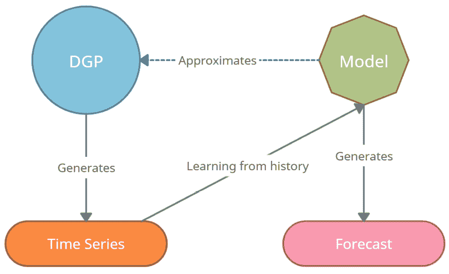
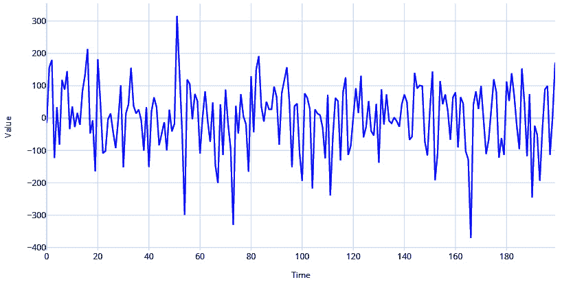
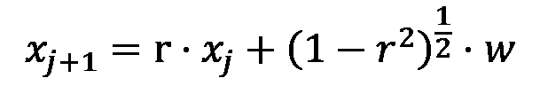
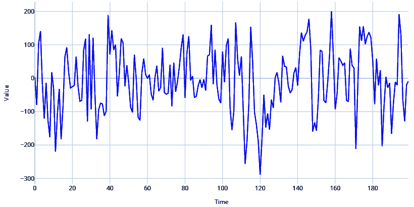
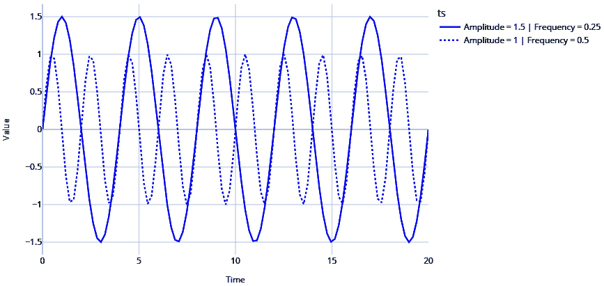
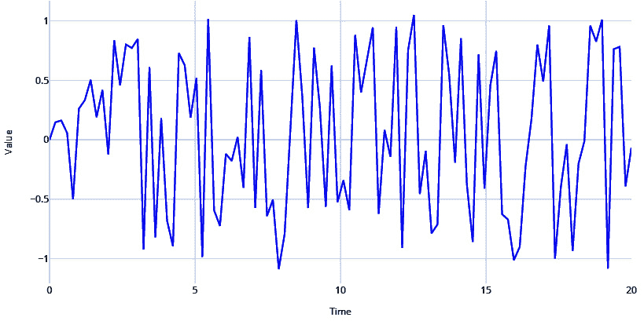
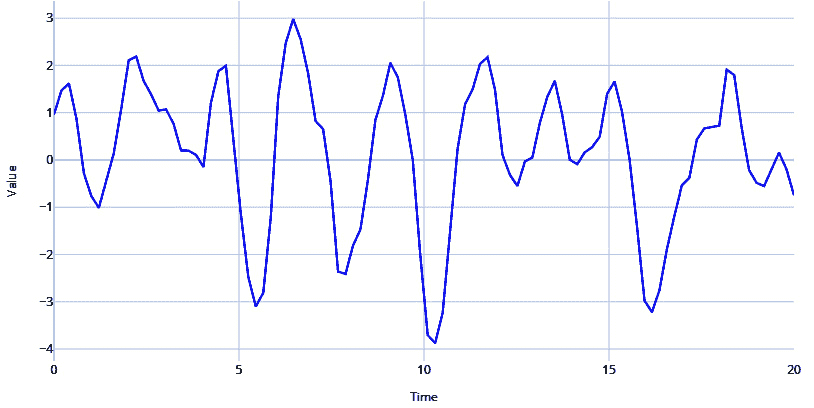
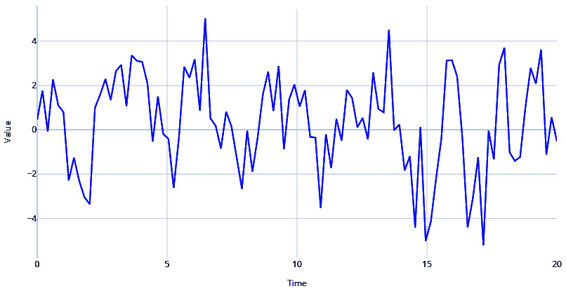
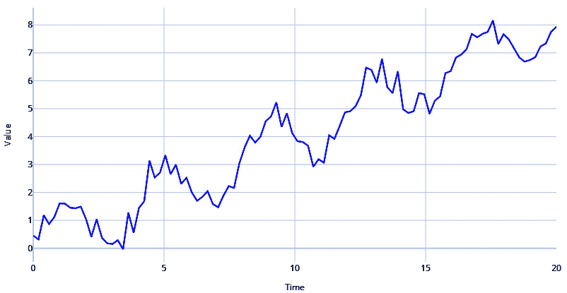
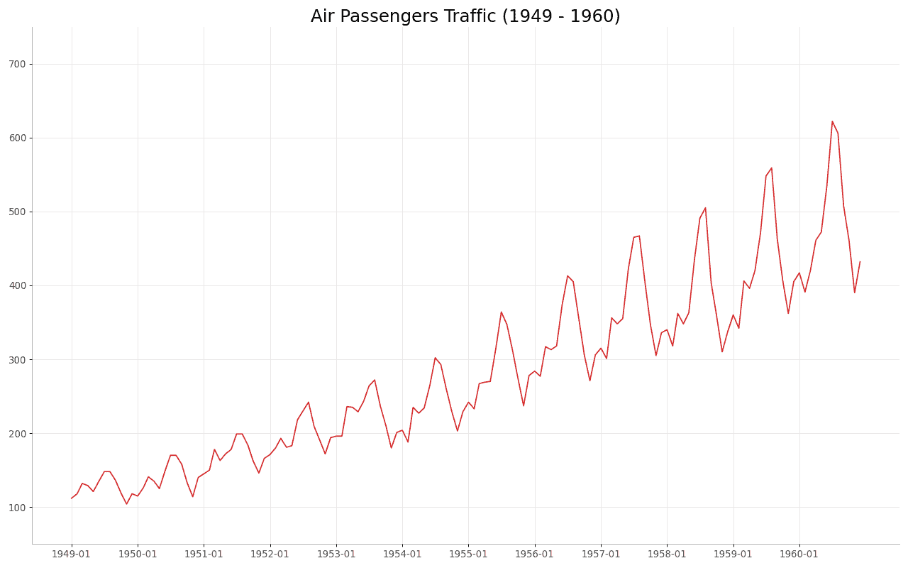

# 第 1 章：时间序列简介

## 加入我们的图书 Discord 社区


[`https://packt.link/EarlyAccess/`](https://packt.link/EarlyAccess/)

欢迎来到 *使用 Python 进行现代时间序列预测*！本书面向希望通过学习机器学习领域的新技术和高级技术来提升时间序列分析技能的数据科学家或 `machine learning` (`ML`) 工程师。`Time series analysis` 是常规机器学习书籍、课程等中常被忽视的内容。它们通常从分类开始，涉及回归，然后继续深入。但这也是在商业中极其宝贵且无处不在的东西。我们用三维视角看世界。但时间是我们很少思考却无处不在的隐藏维度。只要时间是我们所处世界的四个维度之一，时间序列数据就无处不在。

分析时间序列数据为企业解锁了巨大价值。时间序列分析并非新事物——它自 1920 年代以来就已存在。但在当今数据时代，企业收集的时间序列正以每分钟的速度变得更大、更宽。结合收集数据量的爆炸式增长和对 ML 的重新关注，时间序列分析的格局也发生了显著变化。本书旨在带您超越 `AutoRegressive Integrated Moving Average` (`ARIMA`) 等经典统计方法，向您介绍机器学习领域在时间序列分析中的最新技术。

我们将从一些基本概念开始，并迅速深入到更复杂的主题。在本章中，我们将涵盖以下主要主题：

*   什么是时间序列？
*   数据生成过程 (DGP)
*   我们可以预测什么？
*   预测术语和符号

## 技术要求

您需要按照本书*前言*中的说明设置 `Anaconda` 环境，以获得包含本书代码所需的所有库和数据集的工作环境。运行笔记本时将安装任何其他库。

本章相关代码可在 `https://github.com/PacktPublishing/Modern-Time-Series-Forecasting-with-Python-/tree/main/notebooks/Chapter01` 找到。

## 什么是时间序列？

简单来说，`time series` 是按时间顺序获取的一组观测值。重点在于 *time* 这个词。如果我们在不同时间点持续进行相同的观测，就会得到一个时间序列。例如，如果您记录一个月内您拥有的巧克力条数，最终将得到您巧克力消费量的时间序列。假设您在每月初记录体重。您将得到另一个体重时间序列。这两个时间序列之间有关系吗？很有可能。但到本书结束时，我们可以科学地分析这一点。

时间序列的其他一些例子包括您关注的股票的每周收盘价、您所在城市的每日降雨量或降雪量，或来自智能手表的每小时心率读数。

### 时间序列的类型

基于时间间隔，时间序列数据分为两类，如下所述：


#### 规则时间序列

这是最常见的时间序列类型，我们在固定的时间间隔（例如每小时或每月）获得观测值。例如，如果我们采集某城市的温度时间序列，我们将按固定间隔获得时间序列（取决于我们选择的观测频率）。

#### 不规则时间序列

有些时间序列的观测值并不在固定的时间间隔出现。例如，假设我们有一系列患者实验室检测的读数序列。只有当患者前往诊所并进行实验室检测时，我们才能在时间序列中看到观测值，而这可能不会在固定的时间间隔发生。

> **NOTE**
>
> > 本书仅关注规则时间序列，即时间间隔均匀的序列。不规则时间序列稍微高级一些，需要专门的技术来处理。关于该主题的几篇综述论文是入门不规则时间序列的好方法，您可以在本章的*延伸阅读*部分找到它们。

## 时间序列分析的主要应用领域

时间序列分析大体上有三个重要的应用领域，概述如下：

### 时间序列预测

给定过去的值，预测时间序列的未来值——例如，利用过去 5 年的温度数据预测明天的温度。此用例是最流行和最重要的用例之一，因为我们需要进行的任何规划都需要对未来有一定的可见性。例如，规划下个月生产多少巧克力需要对预期需求进行预测。

### 时间序列分类

有时，我们可能不想预测时间序列的未来值，而是想根据过去的值预测一个动作。例如，给定 `EEG`（追踪大脑电活动）或 `EKG`（追踪心脏电活动）的历史记录，我们需要预测 `EEG` 或 `EKG` 的结果是正常还是异常。

### 异常值检测

在某些情况下，我们只想检测是否有事情出错，或者是否有异常情况发生。在这种情况下，我们不需要使用分类或预测，而是可以进行异常值检测。例如，您身上的可穿戴设备记录随时间变化的加速度计读数，并可利用异常值检测来识别跌倒或意外事故。

### 解释与因果关系

基于过去的值理解时间序列的内容和原因，理解多个相关时间序列之间的相互关系，或基于时间序列数据推导因果推断。例如，我们拥有某品牌的市场份额时间序列，以及另一个广告支出时间序列。利用解释和因果关系技术，我们可以开始了解广告支出在多大程度上影响市场份额，并可能采取相应的行动。

> **NOTE**
>
> > 本书的重点主要在于*时间序列预测*，但您学到的技术也将帮助您解决*时间序列分类*问题，只需极少地改变方法。*解释*也有涉及，尽管简略，但*因果关系*是本书不涉足的领域，因为它需要完全不同的方法。

现在我们已经对时间序列全貌有了概览，让我们建立一个关于时间序列数据如何生成的心智模型。

## 数据生成过程（DGP）

我们看到，时间序列数据是沿时间维度按顺序收集的观测值集合。反过来，任何时间序列都是由某种*机制*生成的。例如，工厂每天发货的您最爱吃的巧克力的时间序列数据受许多因素影响，如一年中的时间、假期、可可的供应情况、工厂机器的正常运行时间等。在统计学中，生成时间序列的这一潜在过程被称为 `DGP`。时间序列数据由随机过程和确定性过程产生。确定性过程涉及随时间以可预测方式演变的量。一个例子是元素的放射性衰变，其剩余量根据精确的数学公式减少，从而导致随时间持续减少。但大多数有趣的时间序列（从预测角度来看）是由随机过程生成的。随机过程是一种描述事物如何以随机但某种可预测的方式随时间变化的方法，就像天气每天都在变化，其中包含一些模式和概率。所以，让我们更多地讨论由随机过程生成的时间序列。

如果我们拥有完整且完美的现实知识，我们所要做的就是将这个 `DGP` 用数学形式表达出来，就能得到最准确的预测。但遗憾的是，没有人拥有完整且完美的现实知识。因此，我们试图在数学上尽可能地逼近 `DGP`，以便我们对 `DGP` 的模仿能给我们带来最佳的预测（或我们想要的任何其他分析输出）。这种模仿被称为**模型**，它为 `DGP` 提供了有用的近似。

但我们必须记住，模型不是 `DGP`，而是现实某些本质方面的表征。例如，让我们考虑这里展示的班加罗尔的航拍图和班加罗尔的地图：


图 1.1 – 班加罗尔航拍图（左）和班加罗尔地图（右）（彩色）

班加罗尔的地图当然很有用——我们可以用它从 A 点导航到 B 点。但班加罗尔的地图不等同于班加罗尔的照片。它无法展示繁华的夜生活或令人窒息的交通拥堵。地图只是一个模型，它代表了地点的一些有用特征，如道路和地点。下图可能有助于我们内化这一概念并记住它：



图 1.2 – DGP、模型和时间序列（彩色）

自然而然，下一个问题是：*我们有一个有用的模型吗？* 每个模型都有其自身的局限性和挑战。正如我们所见，班加罗尔的地图不能完美地代表班加罗尔。但如果我们的目的是在班加罗尔导航，那么地图就是一个非常有用的模型。如果我们想了解文化呢？地图无法给你那种风味。所以，现在，原本有用的同一个模型在新语境下变得完全无用。不同的情况和不同的目标需要不同种类的模型。例如，最适合预测的模型可能不适合做因果推断。

我们可以利用 DGP 的概念生成多个复杂程度各异的合成时间序列。

### 生成合成时间序列

合成时间序列，或人工时间序列，是极好的工具，您可以借此理解时间序列空间，尝试不同的方法，甚至将其作为测试新模型或建模设置的方式。这些时间序列被设计为可预测的，尽管有一定挑战性。让我们看几个实际例子，在这些例子中我们可以使用一组基本构建块来生成一些时间序列。您可以发挥创意，混合搭配这些组件中的任意一个，甚至将它们相加，以生成任意复杂度的时间序列。

#### 白噪声与红噪声

生成时间序列的随机过程的一个极端情况是 `white noise`（白噪声）过程。它具有一个均值为零、方差恒定的随机数序列。这也是时间序列中关于噪声最流行的假设之一。


让我们看看如何生成这样一个时间序列并将其绘制出来，如下所示：

```
##### Generate the time axis with sequential numbers upto 200
time = np.arange(200)
##### Sample 200 hundred random values
values = np.random.randn(200)*100
plot_time_series(time, values, "White Noise")
```

这是输出结果：



图 1.3 – 白噪声过程

另一方面，`Red noise`（红噪声）具有零均值和恒定方差，但在时间上呈序列相关。这种序列相关性或红度由相关系数 `r` 参数化，如下所示：



其中 `w` 是从白噪声分布中抽取的随机样本。

让我们看看如何生成它，如下所示：

```
##### Setting the correlation coefficient
r = 0.4
##### Generate the time axis
time = np.arange(200)
##### Generate white noise
white_noise = np.random.randn(200)*100
##### Create Red Noise by introducing correlation between subsequent values in the white noise
values = np.zeros(200)
for i, v in enumerate(white_noise):
    if i==0:
        values[i] = v
    else:
        values[i] = r*values[i-1]+ np.sqrt((1-np.power(r,2))) *v
plot_time_series(time, values, "Red Noise Process")
```

这是输出结果：



图 1.4 – 红噪声过程

#### 周期性或季节性信号

在时间序列中最常见的信号中，包括季节性或周期性信号。因此，你可以通过几种方式将季节性引入生成的序列中。

让我们借助一个非常有用的库来生成其余的时间序列——`TimeSynth`。更多信息请参考 https://github.com/TimeSynth/TimeSynth。

这是一个用于生成时间序列的有用库。它拥有各种数据生成过程（DGP），你可以混合搭配它们来创建逼真的合成时间序列。

> **注意**
>
> 关于确切的代码和用法，请参考相关的 Jupyter 笔记本。

让我们看看如何使用正弦函数来创建周期性。`TimeSynth` 中有一个名为 `generate_timeseries` 的有用函数，可帮助我们组合信号并生成时间序列。请看下面的代码片段：

```
#Sinusoidal Signal with Amplitude=1.5 & Frequency=0.25
signal_1 = ts.signals.Sinusoidal(amplitude=1.5, frequency=0.25)
#Sinusoidal Signal with Amplitude=1 & Frequency=0.5
signal_2 = ts.signals.Sinusoidal(amplitude=1, frequency=0.5)
#Generating the time series
samples_1, regular_time_samples, signals_1, errors_1 = generate_timeseries(signal=signal_1)
samples_2, regular_time_samples, signals_2, errors_2 = generate_timeseries(signal=signal_2)
plot_time_series(regular_time_samples,
                 [samples_1, samples_2],
                 "Sinusoidal Waves",
                 legends=["Amplitude = 1.5 | Frequency = 0.25", "Amplitude = 1 | Frequency = 0.5"])
```

这是输出结果：



图 1.5 – 正弦波

注意这两个正弦波在频率（时间序列穿过零点的速度）和振幅（时间序列偏离零点的距离）方面是不同的。

`TimeSynth` 还有一种称为 `PseudoPeriodic`（伪周期）的信号。这类似于 `Sinusoidal` 类，但频率和振幅本身具有一定的随机性。我们可以在下面的代码片段中看到，这比 `Sinusoidal` 类中的标准正弦和余弦波更真实：

```
##### PseudoPeriodic signal with Amplitude=1 & Frequency=0.25
signal = ts.signals.PseudoPeriodic(amplitude=1, frequency=0.25)
#Generating Timeseries
samples, regular_time_samples, signals, errors = generate_timeseries(signal=signal)
plot_time_series(regular_time_samples,
                 samples,
                 "Pseudo Periodic")
```

这是输出结果：



图 1.6 – 伪周期信号

#### 自回归信号

现实世界中另一种非常流行的信号是 `autoregressive (AR) signal`（自回归信号）。我们将在第 4 章 *Setting a Strong Baseline Forecast*（建立强基线预测）中更详细地讨论这一点，但目前，AR 信号是指时间序列在当前时间步的值依赖于前几个时间步的值。这种序列相关性是 AR 信号的一个关键属性，它由以下几个参数参数化：

*   序列相关的阶数——换句话说，信号依赖的前几个时间步的数量
*   组合前几个时间步的系数

让我们看看如何生成 AR 信号并查看它的样子，如下所示：

```
##### We have re-implemented the class in src because of a bug in TimeSynth
from src.synthetic_ts.autoregressive import AutoRegressive
##### Autoregressive signal with parameters 1.5 and -0.75
##### y(t) = 1.5*y(t-1) - 0.75*y(t-2)
signal = AutoRegressive(ar_param=[1.5, -0.75])
#Generate Timeseries
samples, regular_time_samples, signals, errors = generate_timeseries(signal=signal)
plot_time_series(regular_time_samples,
                 samples,
                 "Auto Regressive")
```

这是输出结果：



图 1.7 – AR 信号

#### 混合搭配

还有许多组件可用于创建你的 DGP 从而生成时间序列，但让我们快速看看如何组合我们已经见过的组件来生成一个逼真的时间序列。

让我们使用带有白噪声的伪周期信号并将其与 AR 信号结合，如下所示：

```
#Generating Pseudo Periodic Signal
pseudo_samples, regular_time_samples, _, _ = generate_timeseries(signal=ts.signals.PseudoPeriodic(amplitude=1, frequency=0.25), noise=ts.noise.GaussianNoise(std=0.3))
##### Generating an Autoregressive Signal
ar_samples, regular_time_samples, _, _ = generate_timeseries(signal=AutoRegressive(ar_param=[1.5, -0.75]))
##### Combining the two signals using a mathematical equation
ts = pseudo_samples*2+ar_samples
plot_time_series(regular_time_samples,
                 ts,
                 "Pseudo Periodic with AutoRegression and White Noise")
```

这是输出结果：



图 1.8 – 带有 AR 和白噪声的伪周期信号

## 平稳与非平稳时间序列

在时间序列中，`stationarity`（平稳性）具有重要意义，是许多建模方法的关键假设。具有讽刺意味的是，许多（如果不是大多数）现实世界的时间序列都是非平稳的。那么，让我们从外行的角度来理解什么是平稳时间序列。

审视平稳性有多种方式，但最清晰直观的方式之一是考虑时间序列的概率分布或数据分布。当概率分布在每个时间点保持不变时，我们称该时间序列为平稳的。换句话说，如果你选择不同的时间窗口，所有这些窗口中的数据分布应该是相同的。

标准高斯分布由两个参数定义——均值和方差。因此，平稳性假设可能以此处概述的两种方式被打破：

*   随时间变化的均值
*   随时间变化的方差

让我们详细看看这些假设并更好地理解它们。

### 随时间变化的均值

这是非平稳时间序列最常见的表现方式。如果时间序列中存在上升/下降趋势，则两个时间窗口的均值将不相同。

非平稳性表现自身的另一种方式是季节性。假设我们正在查看过去 5 年每月平均温度测量值的时间序列。根据经验，我们知道温度在夏季达到峰值，在冬季下降。因此，当我们计算冬季平均温度和夏季平均温度时，它们将会不同。


### 生成具有趋势和季节性的时间序列

让我们生成一个具有趋势和季节性的时间序列，并观察其表现，步骤如下：

```
#### 幅度=1 且 频率=0.25 的正弦信号
signal=ts.signals.Sinusoidal(amplitude=1, frequency=0.25)
#### 标准差 = 0.3 的白噪声
noise=ts.noise.GaussianNoise(std=0.3)
#### 生成时间序列
sinusoidal_samples, regular_time_samples, _, _ = generate_timeseries(signal=signal, noise=noise)
#### Regular_time_samples 是一个线性递增的时间轴，可用作趋势
trend = regular_time_samples*0.4
#### 组合信号和趋势
ts = sinusoidal_samples+trend
plot_time_series(regular_time_samples,
                 ts,
                 "Sinusoidal with Trend and White Noise")
```

输出结果如下：



图 1.9 – 带有趋势和白噪声的正弦信号

如果你观察图 1.9 中的时间序列，你将能够看到明确的趋势和季节性，它们共同导致数据分布的均值在不同的时间窗口中剧烈变化。

### 随时间变化的方差

非平稳性也可能表现为时间序列方差的波动。如果时间序列开始时方差很小，随着时间推移，方差不断变大，那么我们就得到了一个非平稳时间序列。在统计学中，这种现象有一个吓人的名字——**异方差性**。航空乘客数据集，作为时间序列领域的“鸢尾花数据集”（最流行、被过度使用、且毫无用处），是异方差时间序列的一个经典例子。让我们看看这张图。



图 1.10 – 航空乘客数据集 – 异方差时间序列示例

在图中，你可以看到随着时间推移，季节性峰值变得越来越宽，这是时间序列具有异方差性的典型迹象。但并非所有异方差时间序列都容易识别。我们有统计检验方法来检查各种平稳性情况，我们将在第 7 章“时间序列预测的目标变换”中介绍。

本书旨在让你建立关于平稳与非平稳时间序列的直观理解。这方面有大量的统计理论和深度，我们将略过这些内容，以便专注于时间序列的实用方面。

有了数据生成过程（DGP）的心智模型，我们就处于思考另一个重要问题的正确位置：我们能预测什么？

## 我们能预测什么？

在继续之前，我们必须了解时间序列预测的另一个方面——时间序列的可预测性。预测时间序列时最基本的假设是未来取决于过去。但并非所有时间序列都具有同等的可预测性。

让我们看几个例子，并尝试按可预测性对它们进行排序（从最容易到最难），如下所示：

*   下周一的高潮
*   下周日的彩票号码
*   下周五特斯拉的股价

凭直觉，我们很容易对它们进行排序。下周一的高潮最容易预测，因为它非常有规律；彩票号码非常难以预测，因为它们几乎是随机的；下周五特斯拉的股价预测起来很难，但并非不可能。

> **注意**
>
> 然而，对于那些认为可以利用本书涵盖的高级技术预测股价并致富的人来说，这不会发生（极大概率）。虽然这值得长篇大论，但我们可以用一小段话总结关键点。

股价不是其过去值的函数，而是对其未来值的预期，这从而违反了我们预测时的第一个假设。如果这还不够糟糕，金融股价通常具有极低的信噪比。过程中最后的一个绊脚石是**有效市场假说**（**EMH**）。这个看似无害的假说宣称：关于股价的所有已知信息都已经反映在股价中。该假说的含义是，如果你能准确预测，许多其他人也能做到，因此股票的市场价格已经反映了该预测带来的价格变化。

M6 竞赛直面这一问题，通过为期一年的预测和投资策略竞赛来评估 EMH 是否成立。虽然结论不具决定性，但结果显示，对于绝大多数参赛者而言，EMH 成立，仅有少数顶尖团队例外。即使在这些顶尖团队中，他们也发现预测准确性与股票纳入投资组合的选择之间没有显著相关性，即这些团队并没有选择他们能更好预测的股票（完整报告链接见“延伸阅读”）。

回到主题——可预测性——有三个主要因素构成了对此的心智模型，如下所示：

*   **理解 DGP**：你对 DGP 理解得越透彻，时间序列的可预测性就越高。
*   **数据量**：你拥有的数据越多，可预测性就越好。
*   **充分重复的模式**：为了让任何数学模型良好运行，你的时间序列中应该存在充分重复的模式。模式越可重复，可预测性就越好。

即使你有了思考可预测性的心智模型，我们将在第 3 章“分析和可视化时间序列数据”中探讨评估时间序列可预测性的更具体方法，但核心要点是：并非所有时间序列都具有同等的可预测性。

为了充分理解后续章节的讨论，我们需要建立标准符号，并了解时间序列分析特有的术语。

## 预测术语

有几个术语将帮助你理解本书以及其他时间序列文献。这些术语在此进行更详细的描述：

*   **预测**

    预测是利用时间序列已知的过去值和/或其他一些相关变量，对时间序列未来值进行预测。这与机器学习中的预测非常相似，即我们使用模型来预测未见数据。

*   **多元预测**

    多元时间序列由不止一个时间序列变量组成，这些变量不仅依赖于其过去的值，还相互之间存在某种依赖关系。例如，某个国家的一组宏观经济指标，如**国内生产总值**（**GDP**）、通货膨胀率等，可以被视为多元时间序列。多元预测的目标是建立一个模型，捕捉不同变量之间的相互关系及其与自身过去的关系，并共同预测所有时间序列的未来值。

*   **解释性预测**

    除了时间序列自身的过去值，我们可能会利用其他信息来预测时间序列的未来值。例如，在预测零售店销量时，关于促销活动（包括历史和未来的）的信息通常很有帮助。这种利用除自身历史以外的信息进行的预测，称为解释性预测。

*   **回测**

    从训练数据中划分验证集以评估模型，是机器学习领域的常见做法。回测是时间序列领域的验证等价物，即利用历史数据来评估训练好的模型。我们稍后将介绍针对时间序列数据进行验证和交叉验证的不同方法。

*   **样本内和样本外**


再次，借用机器学习（ML）的类比，样本内指训练数据，样本外指未见或测试数据。当你听到样本内指标时，这是指在训练数据上计算的指标，而样本外指标是指在测试数据上计算的指标。

### 外生变量和内生变量

外生变量是不直接为输出建模的平行时间序列变量，而是用来帮助我们建模我们感兴趣的时间序列。通常，外生变量不受系统中其他变量的影响。内生变量是受系统中其他变量影响的变量。纯内生变量是完全取决于系统中其他变量的变量。稍微放宽严格假设，我们可以将目标变量视为内生变量，将模型中包含的解释回归变量视为外生变量。

### 预测组合

在时间序列领域，预测组合类似于机器学习领域中的集成。这是一个通过使用某些函数（无论是学习得出的还是基于启发式的）来组合多个预测的过程，例如三个预测模型的简单平均。

还有许多特定于时间序列的术语，其中一些我们将在全书中介绍。但要建立该领域的基本熟悉度，这些术语应该是一个很好的起点。

## 总结

我们初步涉足了时间序列，了解了时间序列的不同类型，探讨了数据生成过程（DGP）如何生成时间序列，并看到了我们如何思考这个重要问题：*我们能多好地预测时间序列？* 我们还快速回顾了理解本书其余部分所需的术语和符号。在下一章中，我们将动手实践，学习如何处理时间序列数据、如何预处理时间序列、如何处理缺失数据和异常值等。如果你还没有设置环境，请休息一下并花时间完成设置。

## 延伸阅读

*   *从离散化到注意力和不变性：从不规则采样时间序列学习的原理、模型和方法综述* 由 S.N. Shukla 和 B.M. Marlin 撰写 (2020)：https://arxiv.org/abs/2012.00168

*   *从不规则采样时间序列学习：缺失数据视角* 由 S.C. Li 和 B.M. Marlin 撰写 (2020)，ICML：https://arxiv.org/abs/2008.07599

*   *M6 预测竞赛：弥合预测与投资决策之间的差距* 由 Spyros Makridakis 等人撰写 (2023) https://arxiv.org/abs/2310.13357
