# 2 获取和处理时间序列数据

## 加入我们的图书社区


[`packt.link/EarlyAccess/`](https://packt.link/EarlyAccess/)

在上一章中，我们了解了什么是时间序列，并建立了一些标准符号和术语。现在，让我们从理论转向实践。在本章中，我们将动手实践，开始处理数据。虽然我们说过时间序列数据无处不在，但我们还没有真正动手处理一些时间序列数据集。我们将开始处理贯穿全书选定的数据集，以正确的方式处理它，并学习一些处理缺失值的技术。

在本章中，我们将涵盖以下主题：

*   理解时间序列数据集
*   `pandas` 日期时间操作、索引和切片——复习
*   处理缺失数据
*   映射附加信息
*   保存和加载文件到磁盘
*   处理较长时期的缺失数据

## 技术要求

你需要按照本书*前言*中的说明设置 `Anaconda` 环境，以获得一个包含本书代码所需的所有库和数据集的工作环境。任何额外的库将在运行笔记本时安装。

本章的代码可在 [`github.com/PacktPublishing/Modern-Time-Series-Forecasting-with-Python-/tree/main/notebooks/Chapter02`](https://github.com/PacktPublishing/Modern-Time-Series-Forecasting-with-Python-/tree/main/notebooks/Chapter02) 找到。

处理时间序列数据类似于处理其他表格数据集，但侧重于时间维度。与任何表格数据集一样，`pandas` 也完全有能力处理时间序列数据。

让我们从头开始动手处理一个数据集。我们将在全书中使用 *London Smart Meters*（伦敦智能电表）数据集。如果你在环境设置过程中还没有下载数据，请前往*前言*立即下载。

## 理解时间序列数据集

这是你遇到任何新数据集时的关键第一步，甚至在 `Exploratory Data Analysis`（`EDA`，探索性数据分析）之前，我们将在第 3 章 *Analyzing and Visualizing Time Series Data*（分析和可视化时间序列数据）中介绍。了解数据的来源、背后的数据生成过程以及源领域，对于深入理解数据集至关重要。

London Data Store（伦敦数据存储），一个免费开放的数据共享门户，提供了该数据集，该数据集由 Jean-Michel D 收集和丰富，并上传至 Kaggle。

该数据集包含 5,567 个伦敦家庭的能源消耗读数，这些家庭参与了 UK Power Networks（英国电力网络）主导的 Low Carbon London（低碳伦敦）项目，时间跨度为 2011 年 11 月至 2014 年 2 月。读数以半小时为间隔采集。数据集中还包含一些关于家庭的元数据。让我们看看数据集中有哪些元数据可用：

*   CACI UK 将英国人口按人口统计类型细分，称为 Acorn。数据中的每个家庭都有相应的 Acorn 分类。Acorn 类别（奢华生活方式、城市精英、学生生活等）被归类为父类别（富裕成就者、崛起的繁荣者、经济拮据者等）。Acorn 类别的完整列表见 *表 2.1*。详细描述每个类别的完整文档可在 [`acorn.caci.co.uk/downloads/Acorn-User-guide.pdf`](https://acorn.caci.co.uk/downloads/Acorn-User-guide.pdf) 获取。

*   数据集包含两组客户——一组在 2013 年全年接受 `dynamic time-of-use`（`dToU`，动态分时）能源价格，另一组则采用固定费率。`dToU` 的电价提前一天通过智能电表 IHD 或短信发布。

*   Jean-Michel D 还用天气和英国银行假日数据丰富了该数据集。

下表显示了 Acorn 类别：


表 2.1 – ACORN 分类

> **注意**
>
> Kaggle 数据集还每天预处理时间序列数据并合并所有单独的文件。在这里，我们将忽略那些文件，从原始文件开始，这些文件可以在 `hhblock_dataset` 文件夹中找到。学习处理原始文件是工业界处理真实世界数据集不可或缺的一部分。

### 准备数据模型


一旦我们了解数据的来源，就可以查看数据，理解不同文件中包含的信息，并弄清关联不同文件的思维模型。你可能会称其为老派做法，但 Microsoft Excel 是获得这种初步理解的绝佳工具。如果文件太大无法在 Excel 中打开，我们也可以用 Python 读取它，并将数据样本保存到 Excel 文件中打开。但请记住，Excel 有时会破坏数据格式，尤其是日期，因此我们需要小心，不要保存文件并将 Excel 所做的格式更改写回。如果你对 Excel 过敏，也可以在 Python 中完成，只不过需要敲更多的代码。此练习的目的是*查看*不同数据文件包含的内容，探索不同文件之间的关系等。我们可以通过绘制数据模型使这一过程更加正式和明确，类似于下图所示：

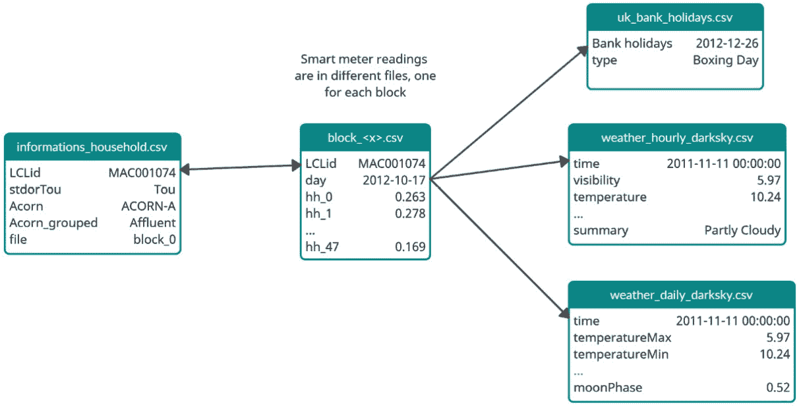

Figure 2.1 – 伦敦智能电表数据集的数据模型

数据模型主要是为了让我们理解数据，而非用于数据工程目的。因此，它仅包含最基本的信息，例如左侧的关键列和右侧的样本数据。我们还用箭头连接不同的文件，并标注用于链接文件的键。

让我们看看几个关键列名及其含义：

*   `LCLid`：家庭的唯一消费者 ID
*   `stdorTou`：家庭是否采用 dToU（分时电价）或标准电价
*   `Acorn`：ACORN 阶层
*   `Acorn_grouped`：ACORN 分组
*   `file`：块编号

每个 `LCLid` 都关联一个唯一的时间序列。时间序列文件采用一种略显棘手的格式——每天在文件的列中会有 48 个半小时频率的观测值。

> **NOTEBOOK ALERT**
>
> > 要跟随完整代码，请使用 `chapter01` 文件夹中的 `01 - Pandas Refresher & Missing Values Treatment.ipynb` 笔记本。

在开始处理数据集之前，我们需要建立一些概念。其中之一是 `pandas` `DataFrame` 中的一个概念，它至关重要——`pandas` 日期时间属性和索引。让我们快速了解几个将会有用的 `pandas` 概念。

> **NOTE**
>
> > 如果你熟悉 `pandas` 中的日期时间操作，请随意跳到下一节。

## pandas 日期时间操作、索引与切片——复习

我们不使用自己的数据集（因为它稍微复杂一些），而是从 UCI 机器学习存储库中选取一个简单、格式良好的股票交易价格数据集，来看看 `pandas` 的功能：

```
df = pd.read_excel("https://archive.ics.uci.edu/ml/machine-learning-databases/00247/data_akbilgic.xlsx", skiprows=1)
```

我们读取的 `DataFrame` 如下所示：


Figure 2.2 – 包含股票交易价格的 DataFrame

现在我们已经读取了 `DataFrame`，开始对其进行操作。

### 将日期列转换为 pd.Timestamp/DatetimeIndex

首先，我们必须将日期列（`pandas` 可能不会自动将其解析为日期）转换为 `pandas` 日期时间。为此，`pandas` 有一个方便的函数叫 `pd.to_datetime`。它会自动推断日期时间格式，如果输入是 `string` 则将其转换为 `pd.Timestamp`，如果输入是字符串 `list` 则转换为 `DatetimeIndex`。因此，如果我们传入单个日期字符串，`pd.to_datetime` 会将其转换为 `pd.Timestamp`；而如果我们传入一个日期列表，它会将其转换为 `DatetimeIndex`：

```
>>> pd.to_datetime("13-4-1987").strftime("%d, %B %Y")
'13, April 1987'
```

现在，让我们看看自动解析失败的情况。日期是 1987 年 1 月 4 日。让我们看看传入字符串时会发生什么：

```
>>> pd.to_datetime("4-1-1987").strftime("%d, %B %Y")
'01, April 1987'
```

好吧，这不是预期的结果，对吧？但如果你仔细想想，任何人都可能犯这个错，因为我们没有告诉计算机月份在前还是日期在前，而 `pandas` 默认假设月份在前。让我们纠正一下：

```
>>> pd.to_datetime("4-1-1987", dayfirst=True).strftime("%d, %B %Y")
'04, January 1987'
```

自动日期解析失败的另一种情况是日期字符串采用非标准形式。在这种情况下，我们可以提供一个 `strftime` 格式化字符串来帮助 `pandas` 正确解析日期：

```
>>> pd.to_datetime("4|1|1987", format="%d|%m|%Y").strftime("%d, %B %Y")
'04, January 1987'
```

完整的 `strftime` 约定列表可以在 [`strftime.org/`](https://strftime.org/) 找到。

> **PRACTITIONER'S TIP**
>
> > 由于数据格式多种多样，`pandas` 可能会错误推断时间。在读取文件时，`pandas` 会尝试自动解析日期并可能产生错误。我们有很多方法可以控制这种行为：可以使用 `parse_dates` 标志关闭日期解析，使用 `date_parser` 参数传入自定义日期解析器，以及使用 `year_first` 和 `day_first` 轻松表示两种流行的日期格式。从 2.0 版本开始，`pandas` 支持 `date_format`，可用于将确切的日期格式作为 Python 字典传入，键为列名。
> >
> > 在所有这些选项中，如果使用 `pandas` >=2.0，我倾向于使用 `date_format`。我们可以保持 `parse_dates=True`，然后使用 `strftime` 约定传入确切的日期格式。这能确保日期按我们想要的方式解析。
> >
> > 如果使用 `pandas` <2.0，我倾向于在 `pd.read_csv` 和 `pd.read_excel` 中都保持 `parse_dates=False`，以确保 `pandas` 不会自动解析数据。之后，你可以使用 `format` 参数转换日期，它允许你使用 `strftime` 约定显式设置列的日期格式。`pd.to_datetime` 中还有两个其他参数也能使日期推断不那么容易出错——`yearfirst` 和 `dayfirst`。如果你不提供显式的日期格式，至少提供其中一个。

现在，让我们将股票价格数据集中的日期列转换为日期时间：

```
df['date'] = pd.to_datetime(df['date'], yearfirst=True)
```

现在，`'date'` 列的 `dtype` 应该是 `datetime64[ns]` 或 `<M8[ns]`，它们都是 `pandas`/NumPy 原生的日期时间格式。但我们为什么要这样做？

这是因为这解锁了广泛的额外功能。传统的 `min()` 和 `max()` 函数将开始生效，因为 `pandas` 知道这是一个日期时间列：

```
>>> df.date.min(),df.date.max()
(Timestamp('2009-01-05 00:00:00'), Timestamp('2011-02-22 00:00:00'))
```

让我们看看日期时间格式给我们带来的一些很酷的功能。

### 使用 .dt 访问器和日期时间属性

既然该列现在是日期格式，编码在日期中的所有语义信息都可以通过 `pandas` 日期时间属性来使用。我们可以使用 `.dt` 访问器访问许多日期时间属性，例如 `month`、`day_of_week`、`day_of_year` 等：

```
>>> print(f"""
     Date: {df.date.iloc[0]}
     Day of year: {df.date.dt.day_of_year.iloc[0]}
     Day of week: {df.date.dt.dayofweek.iloc[0]}
     Month: {df.date.dt.month.iloc[0]}
     Month Name: {df.date.dt.month_name().iloc[0]}
     Quarter: {df.date.dt.quarter.iloc[0]}
     Year: {df.date.dt.year.iloc[0]}
     ISO Week: {df.date.dt.isocalendar().week.iloc[0]}
     """)
Date: 2009-01-05 00:00:00
Day of year: 5
Day of week: 0
Month: 1
Month Name: January
Quarter: 1
Year: 2009
ISO Week: 2
```


截至 pandas 1.1.0 版本，`week_of_year` 已被弃用，因为它在年底/年初会产生不一致的结果。取而代之的是，采用了 ISO 日历标准（常用于政府和商业领域），我们可以访问 ISO 日历来获取 ISO 周数。

### 切片与索引

当我们将日期列设为 DataFrame 的索引时，真正的乐趣才开始。这样做后，你可以使用 `pandas` 支持的所有花哨的切片操作，但作用于 datetime 轴上。让我们看看其中的几个：

```
#### Setting the index as the datetime column
df.set_index("date", inplace=True)
#### Select all data after 2010-01-04(including)
df["2010-01-04":]
#### Select all data between 2010-01-04 and 2010-02-06(not including)
df["2010-01-04": "2010-02-06"]
#### Select data 2010 and before
df[: "2010"]
#### Select data between 2010-01 and 2010-06(both including)
df["2010-01": "2010-06"]
```

除了语义信息以及智能索引和切片外，`pandas` 还提供了用于创建和操作日期序列的工具。

### 创建日期序列与管理日期偏移量

如果你熟悉 Python 中的 `range` 和 NumPy 中的 `np.arange`，那么你就会知道它们通过提供起点和终点来帮助我们创建 `integer`/`float` 序列。`pandas` 为 datetime 提供了类似的功能 —— `pd.date_range`。该函数接受开始和结束日期，以及频率（每日、每月等），并创建中间的日期序列。让我们看看创建日期序列的几种方法：

```
#### Specifying start and end dates with frequency
pd.date_range(start="2018-01-20", end="2018-01-23", freq="D").astype(str).tolist()
#### Output: ['2018-01-20', '2018-01-21', '2018-01-22', '2018-01-23']
#### Specifying start and number of periods to generate in the given frequency
pd.date_range(start="2018-01-20", periods=4, freq="D").astype(str).tolist()
#### Output: ['2018-01-20', '2018-01-21', '2018-01-22', '2018-01-23']
#### Generating a date sequence with every 2 days
pd.date_range(start="2018-01-20", periods=4, freq="2D").astype(str).tolist()
#### Output: ['2018-01-20', '2018-01-22', '2018-01-24', '2018-01-26']
#### Generating a date sequence every month. By default it starts with Month end
pd.date_range(start="2018-01-20", periods=4, freq="M").astype(str).tolist()
#### Output: ['2018-01-31', '2018-02-28', '2018-03-31', '2018-04-30']
#### Generating a date sequence every month, but month start
pd.date_range(start="2018-01-20", periods=4, freq="MS").astype(str).tolist()
#### Output: ['2018-02-01', '2018-03-01', '2018-04-01', '2018-05-01']
```

我们还可以使用 `pd.TimeDelta` 向日期添加或减去天数、月数和其他值：

```
#### Add four days to the date range
(pd.date_range(start="2018-01-20", end="2018-01-23", freq="D") + pd.Timedelta(4, unit="D")).astype(str).tolist()
#### Output: ['2018-01-24', '2018-01-25', '2018-01-26', '2018-01-27']
#### Add four weeks to the date range
(pd.date_range(start="2018-01-20", end="2018-01-23", freq="D") + pd.Timedelta(4, unit="W")).astype(str).tolist()
#### Output: ['2018-02-17', '2018-02-18', '2018-02-19', '2018-02-20']
```

`pandas` 中有许多此类别名，包括 `W`、`W-MON`、`MS` 等。完整列表可参见 [`pandas.pydata.org/docs/user_guide/timeseries.html#timeseries-offset-aliases`](https://pandas.pydata.org/docs/user_guide/timeseries.html#timeseries-offset-aliases)。

在本节中，我们了解了一些可以在 datetime 索引上执行的有用功能和操作，并知道了如何操作包含 datetime 列的 DataFrame。现在，让我们回顾一些处理缺失数据的技术。

## 处理缺失数据

在处理实际的大型数据集时，你必然会遇到缺失数据。如果它不是时间序列的一部分，它可能是你收集和映射的附加信息的一部分。在我们急于求成、用平均值填充或删除这些行之前，让我们先考虑几个方面：

*   首要考虑因素应该是我们担心的缺失数据究竟是不是真的缺失。为此，我们需要考虑 `Data Generating Process` (`DGP`)（生成时间序列的过程）。例如，让我们看看当地超市的销售情况。你获得了过去 2 年的 `point-of-sale` (`POS`) 交易数据，并将其处理为时间序列。在分析数据时，你发现有几种产品在几天内没有任何交易。现在，你需要考虑的是这些缺失数据是真的缺失，还是这种缺失本身在传递某种信息。如果某天某个产品没有交易，在处理数据时它会显示为缺失数据，尽管它并非真正缺失。这告诉我们该商品当天没有销售，你应该用零来填充此类缺失数据。

*   现在，如果你发现每周日的数据都缺失 —— 即缺失具有模式性。这变得棘手，因为如何填补此类空缺取决于你打算使用的模型。如果你用零填补这些空缺，一个依赖近期过去预测未来的模型可能会被误导，尤其是对周一的预测。然而，如果你告知模型前一天是周日，模型仍然可以学会区分这种差异。

*   最后，如果你发现畅销产品某天销量为零，会怎样？这可能是由于 POS 机故障、数据录入错误或缺货等原因造成的。这类缺失值可以用一些技术进行插补。

让我们看看由澳大利亚堪培拉 ACT 政府发布、遵循 CC BY 4.0 国际许可的空气质量数据集（[`www.data.act.gov.au/Environment/Air-Quality-Monitoring-Data/94a5-zqnn`](https://www.data.act.gov.au/Environment/Air-Quality-Monitoring-Data/94a5-zqnn)），并了解如何使用 `pandas` 插补此类值（还有更复杂的技术可用，本章后面将全部介绍）。

> 从业者提示
>
> > 当使用 `read_csv` 等方法读取数据时，`pandas` 提供了一些处理缺失值的便捷方式。`pandas` 默认将许多值（如 `#N/A`、`null` 等）视为 `NaN`。我们可以使用 `na_values` 和 `keep_default_na` 参数来控制此允许的 `NaN` 值列表。

我们选择了 `Monash` 地区和 `PM2.5` 读数，并人为引入了一些缺失值，如下图所示：

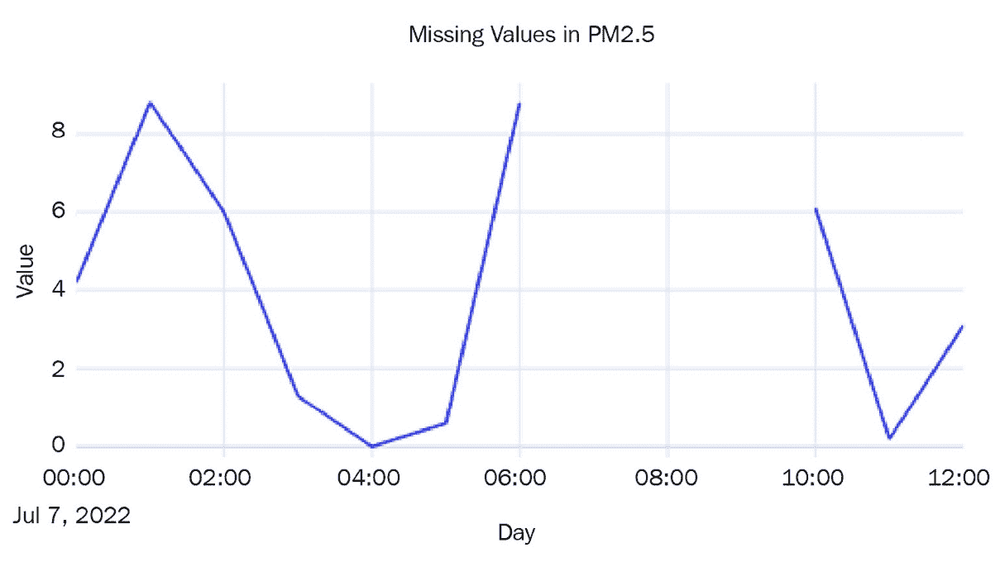

图 2.3 – 空气质量数据集中的缺失值

现在，让我们看看几种可用于填充缺失值的简单技术：

*   `Last Observation Carried Forward or Forward Fill`（最近观测值前延或前向填充）：这种插补技术采用最后一个观测值，并用它来填充所有缺失值，直到找到下一个观测值。这也称为前向填充。我们可以这样做：

```
df['pm2_5_1_hr'].ffill()
```

*   `Next Observation Carried Backward of Backward Fill`（下一个观测值后延或后向填充）：这种插补技术采用下一个观测值，并回溯用该值填充所有缺失值。这也称为后向填充。让我们看看如何在 `pandas` 中实现：

```
df['pm2_5_1_hr'].bfill()
```

*   `Mean Value Fill`（均值填充）：这种插补技术也非常简单。我们计算整个序列的平均值，发现在哪里有缺失值，就用平均值填充：

```
df['pm2_5_1_hr'].fillna(df['pm2_5_1_hr'].mean())
```

让我们绘制使用这三种技术得到的插补曲线：

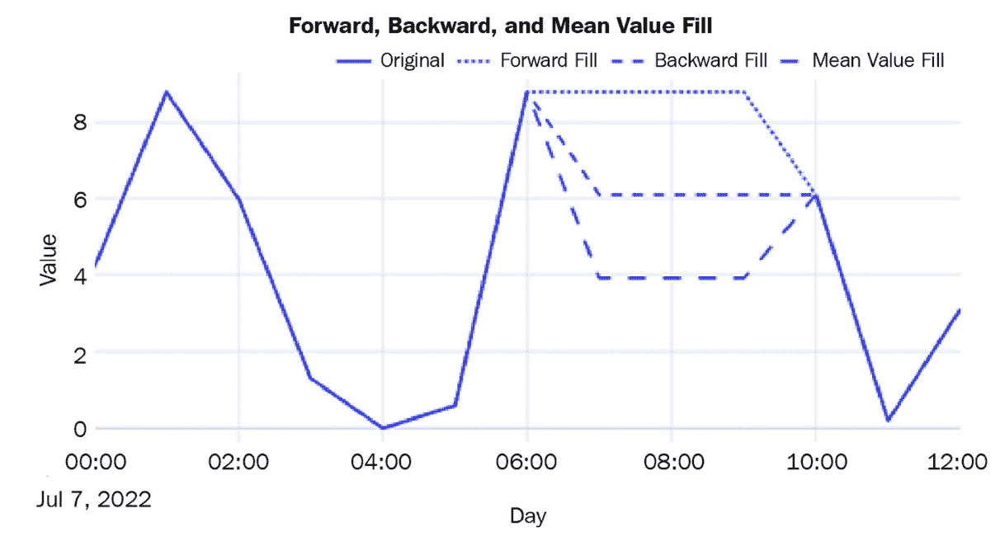

图 2.4 – 使用前向、后向和均值填充插补缺失值


### 插值技术

另一类填补技术涵盖了插值：

*   **`Linear Interpolation`（线性插值）**：线性插值就像在两个观测点之间画一条线，并填补缺失值，使它们落在这条线上。具体操作如下：

```
df['pm2_5_1_hr'].interpolate(method="linear")
```

*   **`Nearest Interpolation`（最近邻插值）**：这直观上类似于前向填充和后向填充的结合。对于每个缺失值，找到最近的观测值并用它来填补缺失值：

```
df['pm2_5_1_hr'].interpolate(method="nearest")
```

让我们绘制这两条插值线：

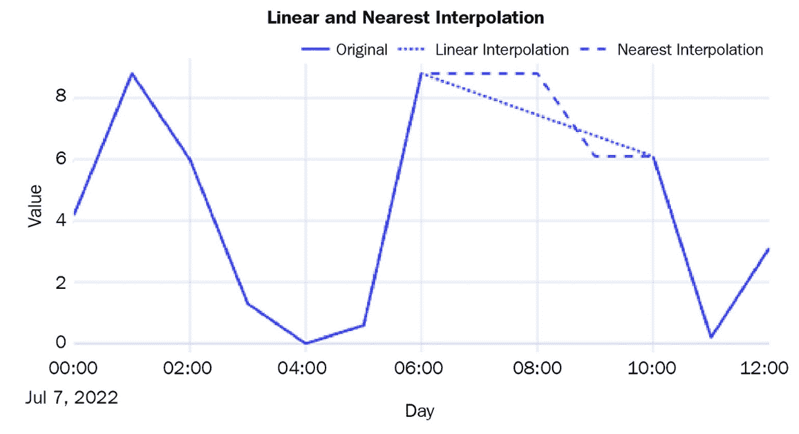

图 2.5 – 使用线性插值和最近邻插值填补缺失值

还有一些非线性插值技术：

*   **`Spline, Polynomial, and Other Interpolations`（样条、多项式及其他插值）**：除了线性插值，`pandas` 还支持在后端调用 `SciPy` 例程的非线性插值技术。样条插值和多项式插值类似。它们将给定阶数的样条/多项式拟合到数据上，并用它来填补缺失值。在 `interpolate` 中使用 `spline` 或 `polynomial` 作为方法时，我们应始终提供 `order`（阶数）。阶数越高，用于拟合观测点的函数就越灵活。让我们看看如何使用样条和多项式插值：

```
df['pm2_5_1_hr'].interpolate(method="spline", order=2)
df['pm2_5_1_hr'].interpolate(method="polynomial", order=5)
```

让我们绘制这两种非线性插值技术：

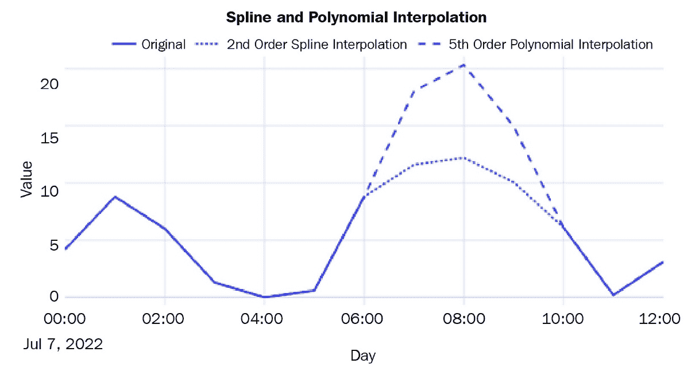

图 2.6 – 使用样条插值和多项式插值填补缺失值

有关 `interpolate` 支持的插值技术的完整列表，请访问 [`pandas.pydata.org/pandas-docs/stable/reference/api/pandas.Series.interpolate.html`](https://pandas.pydata.org/pandas-docs/stable/reference/api/pandas.Series.interpolate.html) 和 [`docs.scipy.org/doc/scipy/reference/generated/scipy.interpolate.interp1d.html#scipy.interpolate.interp1d`](https://docs.scipy.org/doc/scipy/reference/generated/scipy.interpolate.interp1d.html#scipy.interpolate.interp1d)。

现在我们对 `pandas` 管理 datetime 的方式更加熟悉了，让我们回到数据集，将数据转换为更易于管理的形式。

> **NOTEBOOK ALERT（笔记本提示）**
>
> 要跟随完整的预处理代码，请使用 `chapter01` 文件夹中的 `02 - Preprocessing London Smart Meter Dataset.ipynb` 笔记本。

## 将半小时块级数据 (hhblock) 转换为时间序列数据

在开始处理之前，让我们了解一下在时间序列数据集中会发现的几类通用信息：

*   **Time Series Identifiers（时间序列标识符）**：这些是特定时间序列的标识符。它可以是名称、ID 或任何其他唯一特征——例如，零售销售数据集中的 SKU 名称或 ID，又或我们正在处理的能源数据集中的消费者 ID，这些都是时间序列标识符。
*   **Metadata or Static Features（元数据或静态特征）**：此信息不随时间变化。我们数据集中家庭的 ACORN 分类就是一个例子。
*   **Time-Varying Features（时变特征）**：此信息随时间变化——例如，天气信息。对于每个时间点，我们都有不同的天气值，这与 ACORN 分类不同。

接下来，让我们讨论数据集的格式化。

### 数据的紧凑形式、展开形式和宽形式

格式化时间序列数据集有很多种方式，尤其是像我们现在这样拥有许多相关时间序列的数据集。除了标准术语 `wide`（宽）数据外，我们还可以从两种非标准的方式来看待时间序列数据的格式化。虽然这些方式没有标准命名法，但我们在本书中将它们称为 `compact`（紧凑）和 `expanded`（展开）。

紧凑形式数据是指任何特定时间序列在 `pandas` DataFrame 中仅占用单行——即，时间维度作为数组在 DataFrame 行内进行管理。时间序列标识符和元数据占据具有标量值的列，然后是时间序列值；其他时变特征占据具有数组的列。包含两列额外列以推断时间——`start_datetime` 和 `frequency`。如果我们知道时间序列的开始日期时间和频率，就可以轻松构建时间并从 DataFrame 中恢复时间序列。这仅适用于规则采样的时间序列。优势在于 DataFrame 占用的内存少得多，且易于且更快地处理：

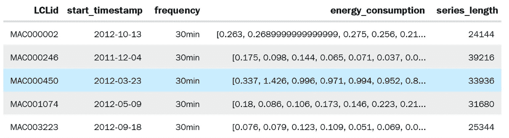

图 2.7 – 紧凑形式数据

展开形式是指时间序列沿 DataFrame 的行展开。如果时间序列中有 *n* 个步骤，它将占据 DataFrame 中的 *n* 行。时间序列标识符和元数据沿所有行重复。时变特征也沿行展开。并且我们不再有开始日期和频率，而是有 `datetime` 作为一列：

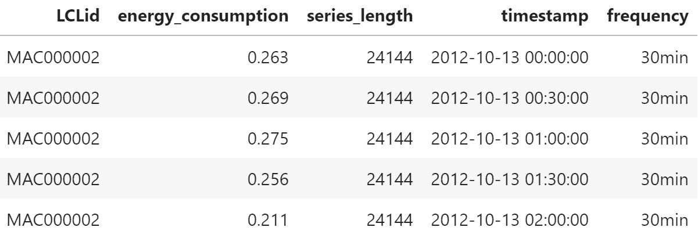

图 2.8 – 展开形式数据

如果紧凑形式以时间序列标识符为键，则时间序列标识符和 `datetime` 列将组合并成为键。

宽格式数据在传统时间序列文献中更为常见。它可以被视为一种遗留格式，在许多方面具有局限性。你还记得我们之前看到的股票数据吗（图 2.2）？我们将日期作为索引或作为其中一列，将不同的时间序列作为 DataFrame 的不同列。随着时间序列数量的增加，它们变得越来越宽，因此得名。这种数据格式不允许我们包含关于时间序列的任何元数据。例如，在我们的数据中，我们有关于特定家庭是处于标准定价还是动态定价下的信息。我们无法在宽格式中包含此类元数据。从操作角度来看，宽格式也不适合关系型数据库，因为当我们获得新的时间序列时，必须不断向表中添加列。我们在本书中不会使用这种格式。

### 在时间序列中强制执行规则间隔

你应该检查并纠正的第一件事之一，是你拥有的规则采样时间序列数据是否具有相等的时间间隔。在实践中，即使是规则采样的时间序列，由于某些数据收集错误或其他特殊的数据收集方式，中间也会缺失一些样本。因此，在处理数据时，我们将确保在时间序列中强制执行规则间隔。

> **BEST PRACTICE（最佳实践）**
>
> 在处理包含多个时间序列的数据集时，最佳实践是检查所有时间序列的结束日期。如果它们不一致，我们可以将它们与数据集中所有时间序列中的最新日期对齐。

在我们的智能电表数据集中，某些 `LCLid` 列比其他列早得多地结束。也许该家庭退出了该计划，或者他们搬出去留下了空房子；原因可能是任何东西。然而，我们在强制执行规则间隔时需要处理这个问题。

我们将在下一节学习如何将数据集转换为时间序列格式。此过程的代码可以在 `02 - Preprocessing London Smart Meter Dataset.ipynb` 笔记本中找到。

### 将伦敦智能电表数据集转换为时间序列格式

对于你遇到的每个数据集，将其转换为紧凑形式或展开形式所需的步骤都会有所不同。这取决于原始数据的结构。在这里，我们将研究如何转换伦敦智能电表数据集，以便我们能将这些经验迁移到其他数据集。


## 数据处理与存储

### 预处理步骤

在我们开始将数据处理为紧凑形式或展开形式之前，需要完成两个步骤：

1.  `Find the Global End Date`（查找全局结束日期）：我们必须找到所有块文件中的最大日期，以便了解时间序列的全局结束日期。

2.  `Basic Preprocessing`（基础预处理）：如果你还记得 `hhblock_dataset` 的结构，你会记得每一行都有一个日期，而在列方向上，我们有半小时块。我们需要将其重塑为长格式，即每一行包含一个日期和一个半小时块。这样更容易处理。

现在，让我们分别定义将数据转换为紧凑形式和展开形式的函数，并将该函数 `apply()` 到每个 `LCLid` 列上。我们将分别对每个 `LCLid` 执行此操作，因为每个 `LCLid` 的开始日期不同。

### 展开形式

转换为展开形式的函数执行以下操作：

1.  查找开始日期。
2.  使用开始日期和全局结束日期创建一个标准 `DataFrame`。
3.  将 `LCLid` 的 `DataFrame` 左连接到标准 `DataFrame` 上，缺失数据保留为 `np.nan`。
4.  返回合并后的 `DataFrame`。

一旦我们拥有了所有 `LCLid` 的 `DataFrame`，必须执行几个额外步骤来完成展开形式的处理：

1.  将所有 `DataFrame` 连接成一个单一的 `DataFrame`。
2.  创建一个名为 `offset` 的列，它是半小时块的数值表示；例如，`hh_3` → `3`。
3.  通过向日期添加 30 分钟的偏移量来创建时间戳，并删除不必要的列。

对于一个块，这种表示大约占用 47 MB 内存。

### 紧凑形式

转换为紧凑形式的函数执行以下操作：

1.  查找开始日期和时间序列标识符。
2.  使用开始日期和全局结束日期创建一个标准 `DataFrame`。
3.  将 `LCLid` 的 `DataFrame` 左连接到标准 `DataFrame` 上，缺失数据保留为 `np.nan`。
4.  按日期对值进行排序。
5.  返回时间序列数组，以及时间序列标识符、开始日期和时间序列长度。

一旦我们拥有了每个 `LCLid` 的这些信息，就可以将其汇编成一个 `DataFrame` 并添加 `30min` 作为频率。

对于一个块，这种表示仅占用约 0.002 MB 内存。

我们将使用紧凑形式，因为它易于处理且消耗资源少得多。

### 映射附加信息

从我们之前准备的数据模型中，我们知道有三个关键文件需要映射：*Household Information*（住户信息）、*Weather*（天气）和 *Bank Holidays*（银行假日）。

#### 住户信息

`informations_households.csv` 文件包含关于住户的元数据。这些是不随时间变化的静态特征。为此，我们只需根据 `LCLid`（即时间序列标识符）将 `informations_households.csv` 左连接到紧凑形式上。

> **最佳实践**
>
> 在进行 pandas 合并时，最常见且意想不到的结果之一是操作前后的行数不相同（即使你执行的是左连接）。这通常是因为你正在合并的键中存在重复项。作为最佳实践，你可以使用 pandas merge 中的 `validate` 参数，它接受诸如 `one_to_one` 和 `many_to_one` 之类的输入，以便在合并时进行此检查，如果假设不成立则会抛出错误。更多信息请访问 [`pandas.pydata.org/docs/reference/api/pandas.merge.html`](https://pandas.pydata.org/docs/reference/api/pandas.merge.html)

#### 银行假日

另一方面，银行假日和天气是随时间变化的特征，应相应处理。需要牢记的最重要方面是，在映射此信息时，它应与我们已作为数组存储的时间序列完美对齐。

`uk_bank_holidays.csv` 是一个包含假期日期和假期类型的文件。假期信息在此非常重要，因为在家庭成员待在家里共度时光或看电视等的假期，能源消费模式会有所不同。请遵循以下步骤处理此文件：

1.  将日期列转换为 datetime 格式并将其设置为 `DataFrame` 的索引。
2.  使用我们之前看到的 `resample()` 函数，我们必须确保索引每 30 分钟重采样一次，这是时间序列的频率。
3.  在一天内向前填充假期，并用 `NO_HOLIDAY` 填充其余的 `NaN` 值。

现在，我们已将假期文件转换为一个在每 30 分钟间隔都有一行的 `DataFrame`。在每一行中，我们都有一列指示那天是否为假期。

#### 天气

`weather_hourly_darksky.csv` 文件同样是按日频率的。我们需要将其降采样到 30 分钟频率，因为我们需要映射的数据是半小时频率的。如果不这样做，天气将只映射到小时时间戳，导致半小时时间戳为空。

处理此文件必须遵循的步骤与处理假期的方式也类似：

1.  将日期列转换为 datetime 格式并将其设置为 `DataFrame` 的索引。
2.  使用 `resample()` 函数，我们必须确保索引每 30 分钟重采样一次，这是时间序列的频率。
3.  向前填充天气特征，以填充重采样时产生的缺失值。

现在你已确保时间序列与随时间变化的特征之间的对齐，你可以遍历每个时间序列，提取天气和银行假日数组，然后将其存储在 `DataFrame` 的对应行中。

### 将文件保存到磁盘并加载

紧凑形式的完全合并 `DataFrame` 仅占用约 10 MB。但保存此文件需要一些工程技巧。如果我们尝试以 CSV 格式保存文件，将无法工作，因为我们将数组存储在 pandas 列中的方式（因为数据处于紧凑形式）。我们可以将其保存为 `pickle` 或 `parquet` 格式，或任何二进制文件存储形式。这取决于我们机器上可用的 RAM 大小。虽然完全合并的 `DataFrame` 只有约 10 MB，但以 `pickle` 格式保存会使大小激增至约 15 GB。

我们可以将其保存为文本文件，同时进行一些调整以适应列名、列类型和读取文件回内存所需的其他元数据。生成的磁盘文件大小仍约为 15 GB，但因为我们将其作为 I/O 操作进行，所以不会将所有数据保留在内存中。我们称之为时间序列（`.ts`）格式。以紧凑形式保存为 `.ts` 格式、读取 `.ts` 格式以及将紧凑形式转换为展开形式的函数可在本书的 GitHub 存储库中的 `src/data_utils.py` 下找到。

如果你不需要将所有 `DataFrame` 存储在单个文件中，可以将其拆分为多个块并单独以二进制格式（如 `parquet`）保存。对于我们的数据集，让我们遵循这条路线，将整个 `DataFrame` 拆分为块并将它们保存为 `parquet` 文件。这是最适合我们的路线，原因有几点：

*   它利用了该格式自带的压缩。
*   它读取整个数据的部分内容以进行快速迭代和实验。
*   数据类型在读写操作之间得以保留，减少了歧义。

> **注意**
>
> 对于超大数据集，我们可以使用一些 pandas 替代库，它们使处理超出内存的数据集变得更容易。`Polars` 是一个很棒的库，具有惰性加载且速度非常快。而对于真正海量的数据集，带有分布式集群的 `pyspark` 可能是正确的选择。


现在我们已经处理了数据集并将其存储在磁盘上，让我们将其读回内存，并再看几种处理缺失数据的技术。

### 处理较长时段的缺失数据

我们之前见过一些处理缺失数据的技术——前向填充和后向填充、插值等。如果只有一两个缺失数据点，这些技术通常有效。但如果大段数据缺失，这些简单技术就力不从心了。

> **笔记本提示**
>
> 要跟随完整的缺失数据插补代码，请使用 `chapter02` 文件夹中的 `03 - Handling Missing Data (Long Gaps).ipynb` 笔记本。

让我们从内存中读取块 0-7 的 `parquet` 文件：

```
block_df = pd.read_parquet("data/london_smart_meters/preprocessed/london_smart_meters_merged_block_0-7.parquet")
```

我们保存的数据是紧凑形式。我们需要将其转换为展开形式，因为在这种形式下处理时间序列数据更容易。由于我们只需要时间序列的一个子集（为了更快地演示），我们只是从这七个块中提取一个块。要将紧凑形式转换为展开形式，我们可以使用 `src/utils/data_utils.py` 中一个名为 `compact_to_expanded` 的有用函数：

```
#### Converting to expanded form
exp_block_df = compact_to_expanded(block_df[block_df.file=="block_7"], timeseries_col = 'energy_consumption',
static_cols = ["frequency", "series_length", "stdorToU", "Acorn", "Acorn_grouped", "file"],
time_varying_cols = ['holidays', 'visibility', 'windBearing', 'temperature', 'dewPoint',
       'pressure', 'apparentTemperature', 'windSpeed', 'precipType', 'icon',
       'humidity', 'summary'],
ts_identifier = "LCLid")
```

可视化一组相关时间序列中的缺失数据的最佳方法之一是使用一个名为 `missingno` 的非常有用的包：

```
#### Pivot the data to set the index as the datetime and the different time series along the columns
plot_df = pd.pivot_table(exp_block_df, index="timestamp", columns="LCLid", values="energy_consumption")
#### Generate Plot. Since we have a datetime index, we can mention the frequency to decide what do we want on the X axis
msno.matrix(plot_df, freq="M")
```

前面的代码生成以下输出：

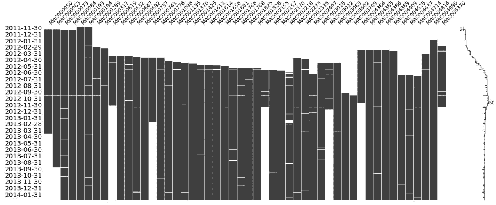

图 2.9 – 第 7 块中缺失数据的可视化

> **重要提示**
>
> 仅在少于 25 个时间序列的相关时间序列上尝试 `missingno` 可视化。如果你的数据集包含数千个时间序列（如我们的完整数据集），应用此可视化将产生不可读的图表并导致计算机死机。

此可视化一眼就能告诉我们很多信息。`Y` 轴包含我们绘制可视化的日期，而 `X` 轴包含列，在本例中列是不同的住户。我们知道所有时间序列并未完美对齐——即并非所有序列都在同一时间开始和结束。许多时间序列开头处的大片空白间隙表明，这些消费者的数据收集比其他人开始得晚。我们也可以看到少数时间序列比其他序列早结束，这意味着它们要么不再是消费者，要么测量阶段已停止。许多时间序列中还有一些较小的白线，这些是真正的缺失值。我们还可以注意到右侧有一个迷你图，它是每行缺失列数的紧凑表示。如果没有缺失值（所有时间序列都有值），迷你图将位于最右侧。最后，如果有大量缺失值，线条将向左偏移。

仅仅因为存在缺失值，我们并不打算填充/插补它们，因为是否插补缺失数据的决定在工作流的后期才做。对于某些模型，我们不需要插补，而对于其他模型则需要。有多种插补缺失数据的方法，选择哪一种是另一个我们无法预先决定的问题。

因此，目前让我们选择一个 `LCLid` 并深入挖掘。我们已经知道在 2012-09-30 和 2012-10-31 之间存在一些缺失值。让我们可视化该时期：

```
#### Taking a single time series from the block
ts_df = exp_block_df[exp_block_df.LCLid=="MAC000193"].set_index("timestamp")
msno.matrix(ts_df["2012-09-30": "2012-10-31"], freq="D")
```

前面的代码生成以下输出：

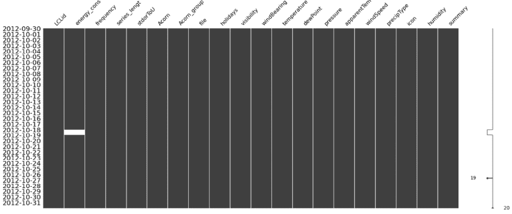

图 2.10 – MAC000193 在 2012-09-30 至 2012-10-31 之间缺失数据的可视化

在这里，我们可以看到缺失数据实际上在 2012-10-18 和 2012-10-19 之间。通常，我们会继续插补这一时期的缺失数据，但既然我们是以学术角度来审视，我们将采取略微不同的路线。让我们引入一个人工缺失数据段，看看我们将要研究的不同技术如何插补缺失数据：

```
#### The dates between which we are nulling out the time series
window = slice("2012-10-07", "2012-10-08")
#### Creating a new column and artificially creating missing values
ts_df['energy_consumption_missing'] = ts_df.energy_consumption
ts_df.loc[window, "energy_consumption_missing"] = np.nan
```

现在，让我们绘制时间序列中的缺失区域：

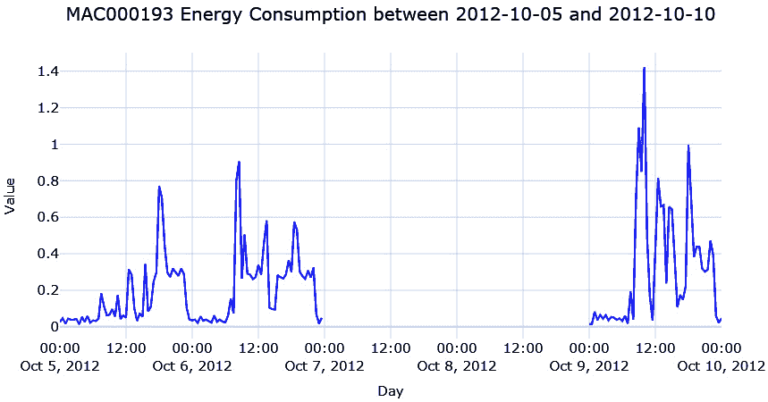

图 2.11 – MAC000193 在 2012-10-05 至 2012-10-10 之间的能耗

我们缺失了整整 2 天的能耗读数，这意味着有 96 个缺失数据点（半小时粒度）。如果我们使用之前见过的技术之一（如插值），我们会发现它大多是一条直线，因为没有一种方法足够复杂，能捕捉长时间跨度的模式。

有几种技术可用于填补此类大的数据缺口。我们现在将介绍这些技术。

#### 使用前一天的数据进行插补

由于这是半小时粒度的能耗时间序列，合理推测可能存在日复一日的重复模式。上午 9:00 到 10:00 之间的能耗可能较高，因为每个人都在准备去上班；白天大多数房子可能空无一人，能耗会下降。因此，填补缺失数据最简单的方法是使用前一天的能耗读数，这样 2012-10-18 上午 10:00 的读数就可以用 2012-10-17 上午 10:00 的读数来填补：

```
##### Shifting 48 steps to get previous day
ts_df["prev_day"] = ts_df['energy_consumption'].shift(48)
##### Using the shifted column to fill missing
ts_df['prev_day_imputed'] =  ts_df['energy_consumption_missing']
ts_df.loc[null_mask,"prev_day_imputed"] = ts_df.loc[null_mask,"prev_day"]
mae = mean_absolute_error(ts_df.loc[window, "prev_day_imputed"], ts_df.loc[window, "energy_consumption"])
```

让我们看看插补效果如何：

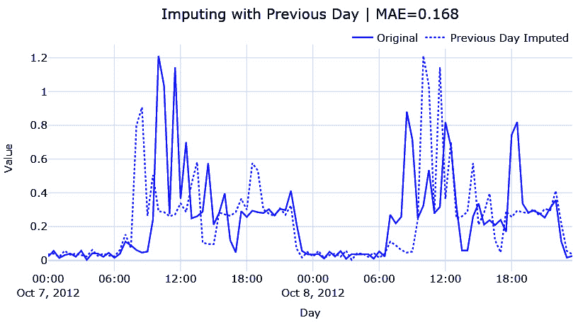

图 2.12 – 使用前一天数据进行插补

虽然这看起来好多了，但也非常脆弱。当我们复制前一天的数据时，也假设了任何变化或异常行为也会重复。我们已经可以看到，前一天和后一天的模式并不相同。

#### 小时平均剖面

更好的方法是从数据中计算小时剖面——即每小时的平均消耗量——并用平均值填补缺失数据：


```
#Create a column with the Hour from timestamp
ts_df["hour"] = ts_df.index.hour
#Calculate hourly average consumption
hourly_profile = ts_df.groupby(['hour'])['energy_consumption'].mean().reset_index()
hourly_profile.rename(columns={"energy_consumption": "hourly_profile"}, inplace=True)
#Saving the index because it gets lost in merge
idx = ts_df.index
#Merge the hourly profile dataframe to ts dataframe
ts_df = ts_df.merge(hourly_profile, on=['hour'], how='left', validate="many_to_one")
ts_df.index = idx
#Using the hourly profile to fill missing
ts_df['hourly_profile_imputed'] = ts_df['energy_consumption_missing']
ts_df.loc[null_mask,"hourly_profile_imputed"] = ts_df.loc[null_mask,"hourly_profile"]
mae = mean_absolute_error(ts_df.loc[window, "hourly_profile_imputed"], ts_df.loc[window, "energy_consumption"])
```

让我们看看这是否更好：

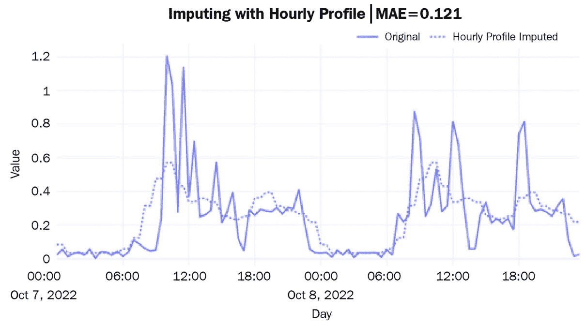

图 2.13 – 使用每小时概况进行插补

这给了我们一条更加泛化的曲线，没有我们在单独日期中看到的那些尖峰。每小时的起伏也符合我们的预期被捕捉到了。`mean absolute error` (`MAE`) 也比之前低了。

#### 每个工作日的每小时平均值

我们可以通过为每个工作日引入特定的概况来进一步细化此规则。合理推测，工作日的使用模式不会与周末相同。因此，我们可以分别计算每个工作日的平均每小时消耗量，以便为周一、周二等分别建立一个概况：

```
#Create a column with the weekday from timestamp
ts_df["weekday"] = ts_df.index.weekday
#Calculate weekday-hourly average consumption
day_hourly_profile = ts_df.groupby(['weekday','hour'])['energy_consumption'].mean().reset_index()
day_hourly_profile.rename(columns={"energy_consumption": "day_hourly_profile"}, inplace=True)
#Saving the index because it gets lost in merge
idx = ts_df.index
#Merge the day-hourly profile dataframe to ts dataframe
ts_df = ts_df.merge(day_hourly_profile, on=['weekday', 'hour'], how='left', validate="many_to_one")
ts_df.index = idx
#Using the day-hourly profile to fill missing
ts_df['day_hourly_profile_imputed'] = ts_df['energy_consumption_missing']
ts_df.loc[null_mask,"day_hourly_profile_imputed"] = ts_df.loc[null_mask,"day_hourly_profile"]
mae = mean_absolute_error(ts_df.loc[window, "day_hourly_profile_imputed"], ts_df.loc[window, "energy_consumption"])
```

让我们看看这看起来如何：

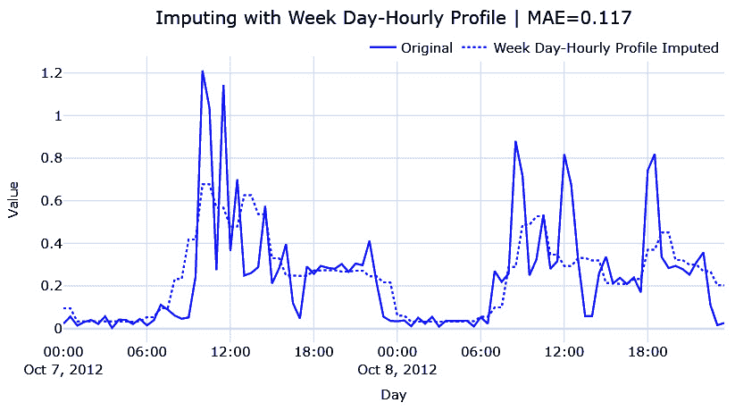

图 2.14 – 每个工作日每小时平均值的插补

这看起来与另一个非常相似，但这是因为我们要插补的那一天是工作日，而工作日的概况是相似的。`MAE` 也比日概况低。周末的概况略有不同，您可以在相关的 Jupyter Notebook 中看到。

#### 季节性插值

虽然计算季节性概况并用它们进行插补效果很好，但在某些情况下，特别是当时间序列中存在趋势时，这种简单的技术就会力不从心。简单的季节性概况完全无法捕捉趋势，而是完全忽略它。对于这种情况，我们可以执行以下操作：

1.  计算季节性概况，类似于我们之前计算平均值的方式。
2.  减去季节性概况，并应用我们之前看到的任何插值技术。
3.  将季节性概况加回到插值后的序列中。

此过程已在本书的 GitHub 存储库的 `src/imputation/interpolation.py` 文件中实现。我们可以按如下方式使用它：

```
from src.imputation.interpolation import SeasonalInterpolation
##### Seasonal interpolation using 48*7 as the seasonal period.
recovered_matrix_seas_interp_weekday_half_hour = SeasonalInterpolation(seasonal_period=48*7,decomposition_strategy="additive", interpolation_strategy="spline", interpolation_args={"order":3}, min_value=0).fit_transform(ts_df.energy_consumption_missing.values.reshape(-1,1))
ts_df['seas_interp_weekday_half_hour_imputed'] = recovered_matrix_seas_interp_weekday_half_hour
```

这里的关键参数是 `seasonal_period`，它告诉算法寻找每 `seasonal_period` 重复一次的模式。如果我们指定 `seasonal_period=48`，它将寻找每 48 个数据点重复一次的模式。在我们的例子中，它们在每一天之后重复（因为我们一天有 48 个半小时时间步）。除此之外，我们还需要指定需要执行哪种插值。

> 附加信息
> 
> > 在内部，我们使用了一种称为季节性分解 (`statsmodels.tsa.seasonal.seasonal_decompose`) 的方法，这将在第 3 章 *分析和可视化时间序列数据* 中介绍，以分离季节性成分。

在这里，我们使用 48（半小时）和 48\*7（工作日到半小时）进行了季节性插值，并绘制了生成的插补结果：

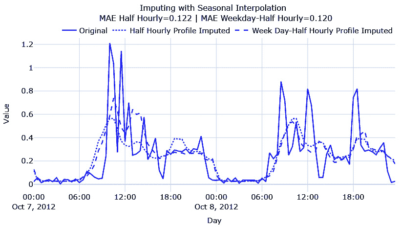

图 2.15 – 使用季节性插值进行插补

在这里，我们可以看到两者都捕捉到了季节性模式，但每个工作日的半小时概况更好地捕捉了第一天的峰值，因此它们的 `MAE` 更低。在每小时平均值方面没有改进，主要是因为时间序列中没有强烈的上升或下降模式。

至此，我们已经完成了本章的内容。我们现在正式进入了处理时间序列数据、清洗和加工它的核心细节。恭喜您完成了本章！

## 概要

在简要回顾了 `pandas` `DataFrames`，特别是日期时间操作和处理缺失数据的简单技术之后，我们了解了存储和处理时间序列数据的两种形式——紧凑型和展开型。利用所有这些知识，我们获取原始数据集并构建了一个管道将其转换为紧凑形式。如果您运行了随附的笔记本，您应该已经将预处理后的数据集保存到磁盘上。我们还深入研究了一些处理长缺失数据间隔的技术。

现在我们有了处理后的数据集，在下一章中，我们将学习如何可视化和分析时间序列数据集。
