# 3 分析和可视化时间序列数据

## 加入我们的图书社区 Discord


[`packt.link/EarlyAccess/`](https://packt.link/EarlyAccess/)

在上一章中，我们学习了在哪里获取时间序列数据集，以及如何使用 `pandas` 操作时间序列数据、处理缺失值等。现在我们有了处理后的时间序列数据，是时候了解数据集了，数据科学家称之为**探索性数据分析**（**EDA**）。这是一个数据科学家通过查看汇总统计、特征分布、可视化等来分析数据，以尝试发现数据中可用于建模的模式的过程。在本章中，我们将介绍几种分析时间序列数据集的方法、一些专门为时间序列量身定制的特定技术，并回顾一些时间序列数据的可视化技术。

在本章中，我们将涵盖以下主题：

*   时间序列的组成部分
*   可视化时间序列数据
*   分解时间序列
*   检测和处理异常值

## 技术要求

您需要按照书籍*前言*中的说明设置 `Anaconda` 环境，以获得一个包含本书代码所需的所有库和数据集的工作环境。任何额外的库将在运行笔记本时安装。

您需要从 `Chapter02` 文件夹运行 `02 - Preprocessing London Smart Meter Dataset.ipynb` 笔记本。


本章的代码可在 `https://github.com/PacktPublishing/Modern-Time-Series-Forecasting-with-Python-/tree/main/notebooks/Chapter03` 找到。

## 时间序列的组成部分

在开始分析和可视化时间序列之前，我们需要了解时间序列的结构。任何时间序列都可能包含以下部分或全部组成部分：

1.  **趋势**
2.  **季节性**
3.  **周期性**
4.  **非规则性**

这些组成部分可以以不同方式混合，但两种非常常见的假设方式是*加法模式*（`Y = Trend + Seasonal + Cyclical + Irregular`）和*乘法模式*（`Y = Trend * Seasonal * Cyclical * Irregular`）。

### 趋势分量

**趋势**是时间序列均值的长期变化。它是时间序列沿特定方向平滑且稳定的移动。当时间序列向上移动时，我们称存在*上升趋势*或*增加趋势*，而当它向下移动时，我们称存在*下降趋势*或*减少趋势*。在撰写本文时，如果我们考虑特斯拉多年来的收入，如下图所示，我们可以看到它在过去几年里持续增长：

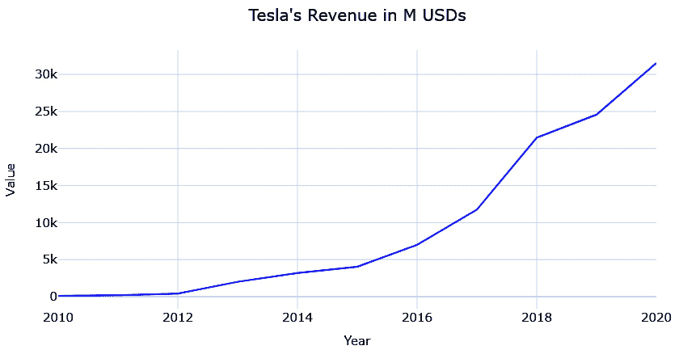

图 3.1 – 特斯拉收入（百万美元）

观察上图，我们可以得出特斯拉收入呈上升趋势的结论。趋势不一定是线性的；它也可以是非线性的。

### 季节性分量

当时间序列表现出规律的、重复的、上下波动时，我们称之为**季节性**。例如，零售销售通常在假日期间激增，西方国家尤以圣诞节为甚。同样，热带地区的用电量在夏季达到高峰，而寒冷国家则在冬季达到高峰。在所有这些例子中，你都可以看到一种特定的上下波动模式每年重复一次。另一个例子是太阳黑子，如下图所示：

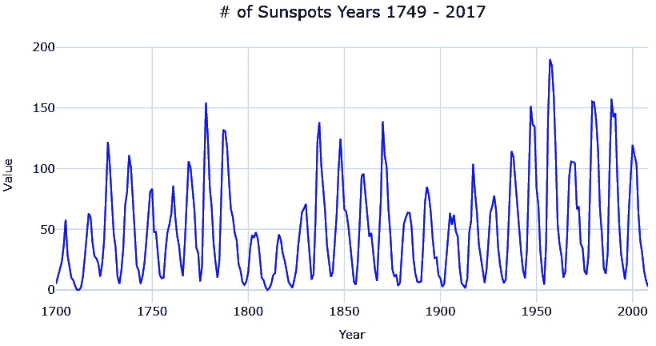

图 3.2 – 1749 年至 2017 年的太阳黑子数量

正如你所见，太阳黑子每 11 年达到一个峰值。

### 周期性分量

**周期性**分量常与季节性混淆，但两者因一个微妙的差异而有所区别。与季节性一样，周期性分量也在趋势线周围表现出类似的上下波动模式，但周期性分量不是每个周期都重复该模式，而是不规则的。一个很好的例子是经济衰退，它大约以 10 年为一个周期发生。然而，这并非像钟表那样准时；有时可能少于 10 年，有时可能多于 10 年。

### 非规则性分量

该分量是在从时间序列中移除趋势、季节性和周期性后剩下的部分。传统上，该分量被认为是*不可预测*的，也称为*残差*或*误差项*。在常见的基于经典统计的模型中，任何“模型”的目的都是捕捉所有其他分量，以至于唯一未被捕捉的部分就是非规则性分量。在现代机器学习中，我们并不认为该分量完全不可预测。我们尝试通过使用外生变量来捕捉该分量或其部分。例如，零售销售的非规则性分量可能由其开展的不同促销活动来解释。当我们拥有这些额外信息时，“不可预测”的分量开始再次变得可预测。但无论向模型添加多少额外变量，总会有一些分量，即真正的非规则性分量（或真实误差），被留在后面。

现在我们了解了时间序列的不同组成部分，让我们看看如何将它们可视化。

## 可视化时间序列数据

在第 2 章 *获取和处理时间序列数据* 中，我们学习了如何准备数据模型作为分析新数据集的第一步。如果准备数据模型就像接近你喜欢的人并建立第一次联系，那么 EDA（探索性数据分析）就像与那个人约会。此时，你拥有了数据集，正试图了解它，弄清楚是什么让它运转，它喜欢什么、不喜欢什么，等等。

EDA 通常采用可视化技术来发现模式、识别异常、形成并检验假设等。花些时间了解你的数据集，将在你试图从模型中榨取每一分性能时大有裨益。你可能会明白必须创建什么样的特征，或应用什么样的建模技术，等等。

在本章中，我们将介绍几种非常适合时间序列数据集的可视化技术。

> **笔记本提示**
>
> 要跟随完整的时间序列可视化代码，请使用 `chapter03` 文件夹中的 `01-Visualizing Time Series.ipynb` 笔记本。

### 折线图

这是用于理解时间序列最基础、最常见的可视化方式。我们只需将时间绘制在 `X-axis` 上，将时间序列值绘制在 `Y-axis` 上。让我们看看如果绘制数据集中的一个家庭会是什么样子：

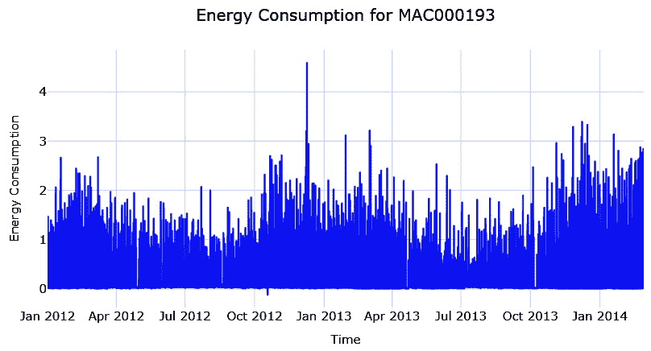

图 3.3 – 家庭 `MAC000193` 的折线图

当你拥有一个长且变化大的时间序列时，就像我们现在这样，折线图可能会变得有点混乱。为了从趋势和移动的角度获得时间序列的宏观视图，其中一个选择是绘制时间序列的平滑版本。让我们看看时间序列的滚动月度平均值是什么样子的：

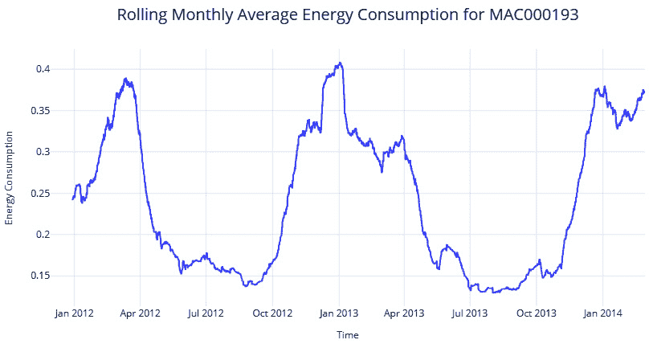

图 3.4 – 家庭 `MAC000193` 的滚动月度平均能耗

现在我们可以更清晰地看到宏观模式。季节性很明显——序列在冬季达到峰值，在夏季达到谷值。如果你仔细想想，这是合情合理的。我们讨论的是伦敦，由于气温较低且随后使用供暖系统，冬季的能耗会更高。例如，对于热带地区的家庭，模式可能会反转，峰值出现在夏季空调开始运行的时候。

折线图的另一个用途是将两个或多个时间序列一起可视化，并研究它们之间的相关性。在我们的例子中，让我们尝试将温度与能耗一起绘制，看看我们关于温度影响能耗的假设是否成立：

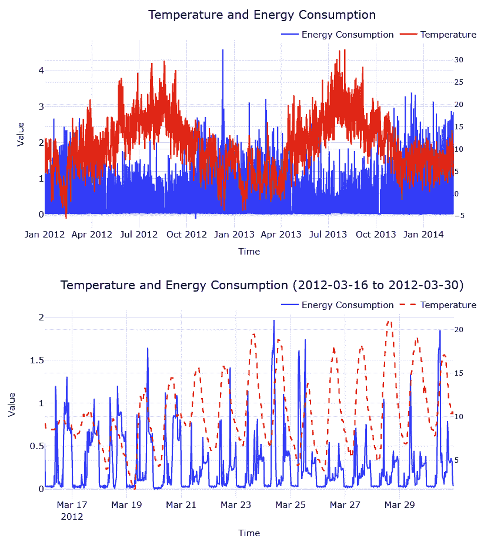

图 3.5 – 温度与能耗（底部为放大图）（彩图）

在这里，我们可以看到在年度分辨率下，能耗与温度之间存在明显的负相关。从宏观尺度来看，冬季显示出更高的能耗。我们还可以看到与温度松散相关的日常模式，但这可能是由于其他因素，例如人们下班回家等。

还有其他一些可视化方法更适合展现时间序列中的季节性。让我们来看看。

### 季节性图

**季节性图**与折线图非常相似，但关键区别在于 `X-axis` 表示“季节”，`Y-axis` 表示时间序列值，不同的季节周期用不同的颜色或线型表示。例如，月度分辨率下的年度季节性可以用 `X-axis` 上的月份和不同颜色的不同年份来描绘。

让我们看看我们关注的家庭的季节性图是什么样子的。这里，我们绘制了跨多年的平均月度能耗：

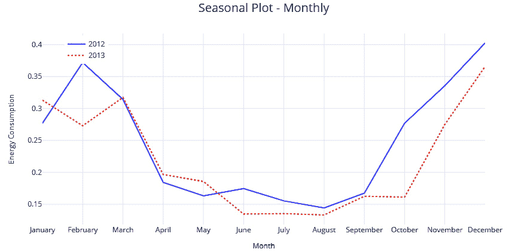


图 3.6 – 月度分辨率的季节图（彩图）

我们可以立刻看出这种可视化的优势，因为它让我们能够轻松地直观呈现季节性模式。我们可以看到，夏季月份的消费量会下降，并且可以看到这种情况在多年间持续发生。在我们拥有数据的这 2 年中，我们可以看到 10 月份 2013 年的行为略微偏离了 2012 年。也许还有其他因素可以帮助我们解释这种差异——比如温度？我们还可以绘制包含另一感兴趣变量（如温度）的季节图：

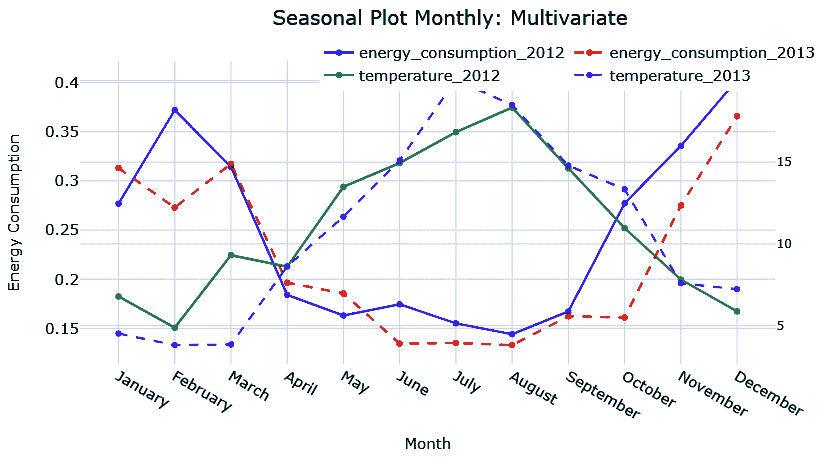

图 3.7 – 月度分辨率的季节图（能耗与温度对比）（彩图）

注意 10 月？2013 年 10 月气温维持在较高水平的时间多持续了 1 个月，因此能耗模式与去年略有不同。

我们也可以在其他分辨率下绘制这类图表，例如小时级季节性。但当需要绘制的季节周期过多时，会增加视觉混乱度。季节图的一种替代方案是季节箱线图。

### 季节箱线图

我们不再用不同颜色或线型绘制不同的季节周期，而是用箱线图来表示它们。这能瞬间消除图表中的混乱。这种表示法的额外好处是，它让我们能够了解季节周期之间的变异性：

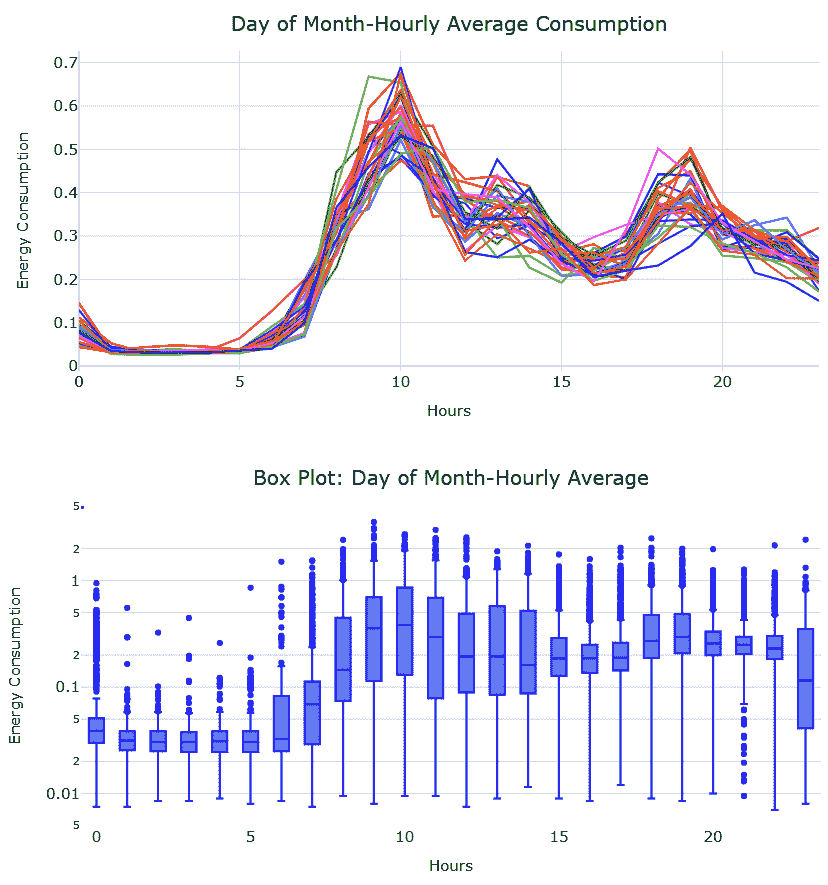

图 3.8 – 小时分辨率下的季节图（上）和季节箱线图（下）（彩图）

在这里，我们可以看到，在这个分辨率下，季节图过于杂乱，无法辨别模式和季节周期间的变化。然而，季节箱线图提供的信息要丰富得多。箱体中的水平线代表中位数，箱体代表`四分位距`（`IQR`），标记的点则是异常值。通过观察中位数，我们可以看到峰值消费发生在上午 9 点之后。但从上午 9 点开始，变异性也更高。例如，如果你为每周绘制单独的箱线图，你会发现周日的模式略有不同（相关笔记本中有额外的可视化内容）。

不过，还有另一种可视化方法，能让你在两个维度上检查这些模式。

### 日历热力图

我们不必为每周的每一天单独绘制箱线图或折线图，如果能将这些信息浓缩到一张图中，那将非常有用。这就是`日历热力图`发挥作用的地方。日历热力图使用矩形块中的彩色单元格来表示信息。在矩形的两边，我们可以找到两个独立的时间粒度，例如月份和年份。在每个交叉点处，单元格的颜色根据该交叉点处时间序列的值进行着色。

让我们在日历热力图中查看不同工作日的小时平均能耗：

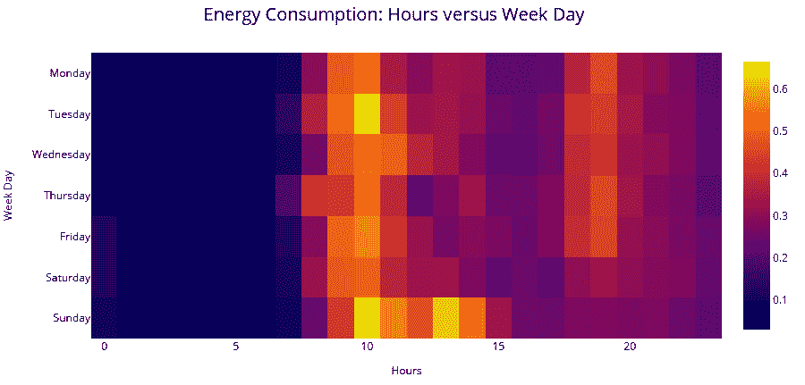

图 3.9 – 能耗日历热力图（彩图）

从右侧的颜色刻度可知，颜色越浅代表数值越高。我们可以看到周一至周六有相似的峰值——即上午一次，晚上一次。然而，周日的模式略有不同，全天消费量较高。

到目前为止，我们已经回顾了许多能够揭示季节性的可视化方法。现在，让我们看一种用于检查自相关的可视化方法。

### 自相关图

如果相关性表示两个变量之间线性关系的强度和方向，那么自相关就是时间序列在连续时期数值之间的相关性。大多数时间序列都严重依赖前一期的值，这也是我们将要看到的许多预测模型中的关键组成部分。诸如`ARIMA`之类的模型（我们将在第 4 章 *建立强基准预测* 中简要介绍）就是建立在自相关基础上的。因此，可视化并了解对先前时间步的依赖程度总是很有帮助的。

这就是`自相关图`派上用场的地方。在这类图表中，`X 轴` 上是不同的滞后阶数（`t-1`、`t-2`、`t-3` 等），`Y 轴` 上是 `t` 与不同滞后阶数之间的相关性。除了自相关，我们还可以查看`偏自相关`，它与自相关非常相似，但有一个关键区别：偏自相关在呈现相关性之前会移除任何可能存在的间接相关性。让我们通过一个例子来理解这一点。如果 `t` 是当前时间步，假设 `t-1` 与 `t` 高度相关。因此，推而广之，`t-2` 将与 `t-1` 高度相关，并由于这种相关性，`t` 和 `t-2` 之间的自相关性会很高。然而，偏自相关会修正这一点，并提取纯粹归因于 `t-2` 和 `t` 的相关性。

我们需要记住一点：如果时间序列是平稳的，自相关和偏自相关分析效果最好（我们将在第 6 章 *时间序列预测特征工程* 中详细讨论平稳性）。

> **最佳实践**
>
> 使序列平稳的方法有很多，但一种快速粗略的方法是使用季节性分解，仅保留残差。残差应不包含趋势和季节性，因为它们是导致时间序列非平稳的主要驱动因素。但正如我们稍后在本书中将看到的，这并不是使序列在真正意义上平稳的万无一失的方法。

现在，让我们看看经过平稳化处理后，数据集中我们这户家庭的这些图表是什么样子的：

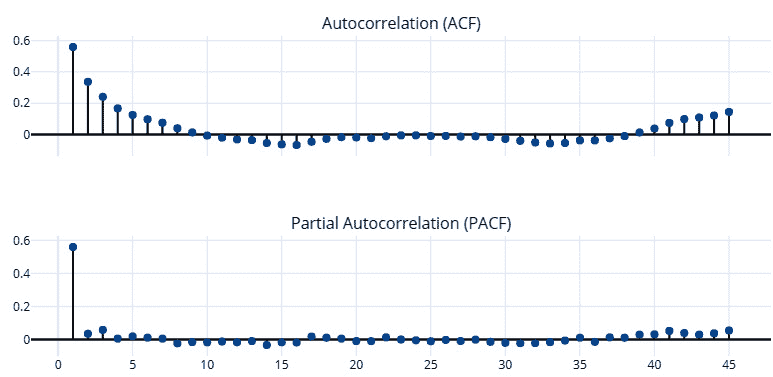

图 3.10 – 自相关图和偏自相关图

在这里，我们可以看到，第一个滞后阶数（`t-1`）影响最大，且其影响在偏自相关图中迅速下降至接近零。这意味着某天的能耗与前一天的能耗高度相关。

如果你以前见过这种图表，你会看到其上方有一个包络线，显示置信区间，作为选择显著自相关的指南。虽然这是一个不错的经验法则，但这里没有包含它，因为我不想让你把它当作一条规则来用。置信区间的相关性取决于一些假设（正态性等），这些假设并不总是能得到满足，尤其是在实际应用场景中。

至此，我们已经了解了时间序列的不同组成部分，并学习了如何可视化其中的一些部分。现在，让我们看看如何将时间序列分解为其组成部分。

## 分解时间序列

季节性分解是将时间序列分解为其组成部分的过程——通常包括趋势、季节性和残差。分解时间序列的一般方法如下：

1.  **去趋势**：这里我们估计`趋势分量`（即时间序列中的平滑变化），并将其从时间序列中移除，得到`去趋势时间序列`。

2.  **去季节性**：这里我们从去趋势时间序列中估计季节性分量。移除季节性分量后，剩下的就是残差。

让我们详细讨论一下它们。

### 去趋势


#### 去趋势

去趋势可以通过几种不同的方式完成。两种常用的方法是使用移动平均和局部估计散点图平滑（LOESS）回归。

### 移动平均

估计趋势最简单的方法之一是在时间序列上使用移动平均。它可以被视为一个沿着时间序列分步移动的窗口，在每一步，窗口内所有值的平均值都会被记录下来。这个移动平均是一个平滑后的时间序列，帮助我们估计时间序列中的缓慢变化，即趋势。缺点是该技术相当嘈杂。即使使用该技术平滑了时间序列，提取出的趋势也不会平滑；它仍会有噪声。理想情况下，噪声应存在于残差中，而不应在趋势中（参见图 3.11 所示的趋势线）。

### LOESS

LOESS 算法，也称为局部加权多项式回归，由 Bill Cleveland 在 70 年代至 90 年代开发。它是一种非参数方法，用于将平滑曲线拟合到含噪信号上。我们使用一个在时间序列中移动的有序变量作为自变量，时间序列信号作为因变量。对于有序变量中的每个值，算法使用一小部分最近的点，并仅使用这些点在加权回归中估计平滑趋势。加权回归中的权重是距离相关点最近的点。该点被赋予最高权重，随着远离该点，权重逐渐衰减。这为我们提供了一个非常有效的工具，用于建模时间序列中的平滑变化（趋势）。

### 去季节化

季节性成分也可以通过几种不同的方式来估计。两种最常用的方法是使用周期调整平均值或傅里叶级数。

#### 周期调整平均值

这是一种相当简单的技术，我们通过计算所有周期中所有此类周期的平均值，来计算预期周期中每个周期的季节性指数。为了讲清楚，让我们看一个月度时间序列，我们预期该序列中存在年度季节性。因此，上下波动模式将在 12 个月内完成一个完整周期，即季节性周期为 12。换句话说，时间序列中每 12 个点具有相似的季节性成分。所以，我们取所有 1 月数值的平均值作为 1 月的周期调整平均值。同样地，我们计算所有 12 个月的周期平均值。最后，我们得到 12 个周期平均值，也可以计算一个平均周期平均值。现在，我们可以将这些周期平均值转化为指数，方法是用每个周期平均值减去所有周期平均值的平均值（加法模型），或用每个周期平均值除以所有周期平均值的平均值（乘法模型）。

#### 傅里叶级数

在 18 世纪晚期，数学家兼物理学家约瑟夫·傅里叶在研究热流时，有了一个深刻的认识——任何周期函数都可以分解为一系列简单的正弦和余弦波。让我们稍作停留思考一下。任何周期函数，无论其形状、曲线、是否存在，还是如何剧烈地围绕轴线振荡，都可以分解为一系列正弦和余弦波。

> 附加信息
>
> > 对于数学基础较好的人，原理论提议将任何周期函数分解为指数函数的积分。利用欧拉公式，
> >
> > 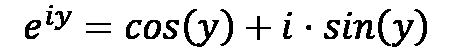
> >
> > 我们可以将它们视为正弦和余弦波的求和。*延伸阅读* 部分包含一些资源，如果你想深入探究并探索相关概念，例如傅里叶变换。

我们利用这一特性从时间序列中提取季节性，因为季节性是周期函数，而任何周期函数都可以用正弦和余弦波的组合来近似。傅里叶级数的正弦-余弦形式如下：

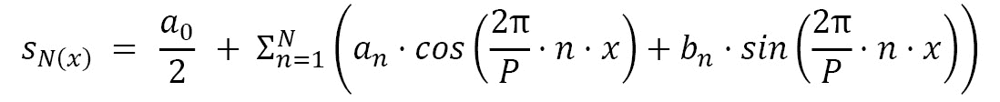这里，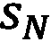 是信号 `S` 的 `N` 项近似。理论上，当 `N` 为无穷大时，得到的近似等于原始信号。`P` 是周期的最大长度。我们可以使用这个傅里叶级数，或其中的几项，来建模我们的季节性。在我们的应用中，`P` 是我们试图建模的周期的最大长度。例如，对于月度数据的年度季节性，周期的最大长度（`P`）为 12。`x` 将是一个从 `1` 增加到 `P` 的有序变量。在此例中，`x` 将为 `1`、`2`、`3`，…… `12`。现在，有了这些项，剩下的就是找到 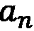 和 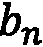，我们可以通过对信号进行回归来实现。

我们已经看到，通过合适的傅里叶项组合，我们可以复制任何信号。但问题是，我们应该这样做吗？我们希望从数据中学到一个泛化的季节性概况，使其在未见数据上也表现良好。因此，我们使用 `N` 作为超参数，从数据中提取我们想要的任意复杂度的信号。

现在是复习三角函数、回顾正弦和余弦波长什么样的好时机。第一项傅里叶项（`n=1`）是古老的正弦和余弦波，它们在最大周期长度（`P`）内完成一个完整周期。随着 `n` 增加，我们得到的正弦和余弦波在最大周期长度（`P`）内包含多个周期。这可以在下图中看到：

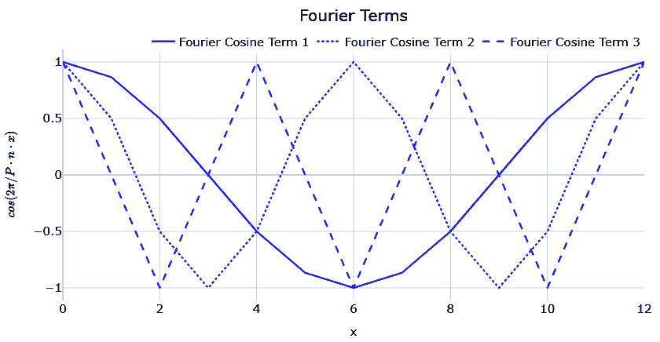

图 3.11 – 余弦傅里叶项 (n=1, 2, 3)

正弦波和余弦波互补，如下图所示：

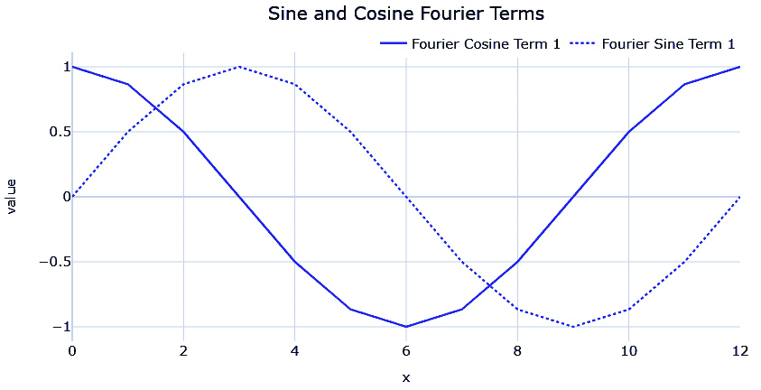

图 3.12 – 正弦和余弦傅里叶项 (n=1)

现在，让我们看看如何在实践中使用它。

### 实现

> 笔记本提示
>
> > 要跟随完整的时间序列分解代码，请使用 `chapter03` 文件夹中的 `02-Decomposing Time Series.ipynb` 笔记本。

接下来的小节中，我们将介绍四种实现。

### statsmodel 中的 seasonal_decompose

`statsmodels.tsa.seasonal` 有一个名为 `seasonal_decompose()` 的函数。这是一种实现，它对趋势成分使用移动平均，对季节成分使用周期调整平均值。它支持加法和乘法两种分解模式。但是，它不容忍缺失值。让我们看看如何使用它：

```
#### Does not support missing values, so using imputed ts instead
res = seasonal_decompose(ts, period=7*48, model="additive", extrapolate_trend="freq")
```

有几个关键参数需要注意，如下所示：

1. `period` 是你预期模式重复的季节性周期。
2. `model` 接受 `additive` 或 `multiplicative` 作为参数以确定分解类型。
3. `filt` 接受一个数组，用作移动平均中的权重（具体来说是卷积）。它也可用于定义我们需要移动平均的窗口。我们可以增加它来在一定程度上平滑趋势成分。
4. `extrapolate_trend` 是一个参数，我们可以用它将趋势成分向两侧延伸，以避免应用移动平均滤波器时产生的缺失值。
5. `two_sided` 是一个参数，让我们定义如何计算移动平均。如果为 `True`（默认值），则移动平均使用过去和未来的值计算，因为移动平均的窗口是居中的。如果为 `False`，则仅使用过去的值来计算移动平均。


让我们看看我们对数据集中的一条时间序列进行分解的效果如何。我们使用了`period=7*48`来捕获工作日-小时级的概况，并使用`filt=np.repeat(1/(30*48), 30*48)`以均匀权重制作 30 天的移动平均：

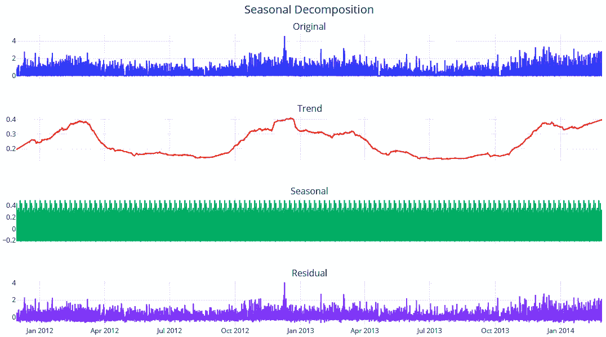

Figure 3.13 – Seasonal decomposition using statsmodels

由于季节性模式在整体绘图尺度下太小，我们无法看到它。配套的笔记本提供了放大后的图表，帮助你理解季节性模式。即使使用较大的窗口（例如 20 天）进行平滑，趋势仍然包含一些噪声。我们或许可以通过增加窗口来进一步减少噪声，但有一种更好的替代方案，我们马上就会看到。

## 使用 LOESS 进行季节性与趋势分解 (STL)

正如我们之前所见，LOESS 更适合趋势估计。**Seasonality and trend decomposition using LOESS** (**STL**) 是一种利用 LOESS 进行趋势估计、利用周期平均进行季节性估计的实现。虽然 `statsmodels` 有相关实现，但我们为了更好的性能和灵活性重新实现了它。该实现位于本书的 GitHub 仓库中的 `src.decomposition.seasonal.py`。它期望输入为带有 datetime 索引的 pandas DataFrame 或 Series。让我们看看如何使用它：

```
stl = STL(seasonality_period=7*48, model = "additive")
res_new = stl.fit(ts_df.energy_consumption)
```

此处的关键参数如下：

1. `seasonality_period` 是你预期模式重复的季节周期。
2. `model` 接受 `additive` 或 `multiplicative` 参数，以确定分解类型。
3. `lo_frac` 是用于拟合 LOESS 回归的数据比例。
4. `lo_delta` 是我们在其中使用线性插值而非加权回归的分数距离。使用非零的 `lo_delta` 可显著减少计算时间。

让我们看看这种分解的效果。这里我们使用了 `seasonality_period=7*48` 来捕获工作日-小时级的概况：

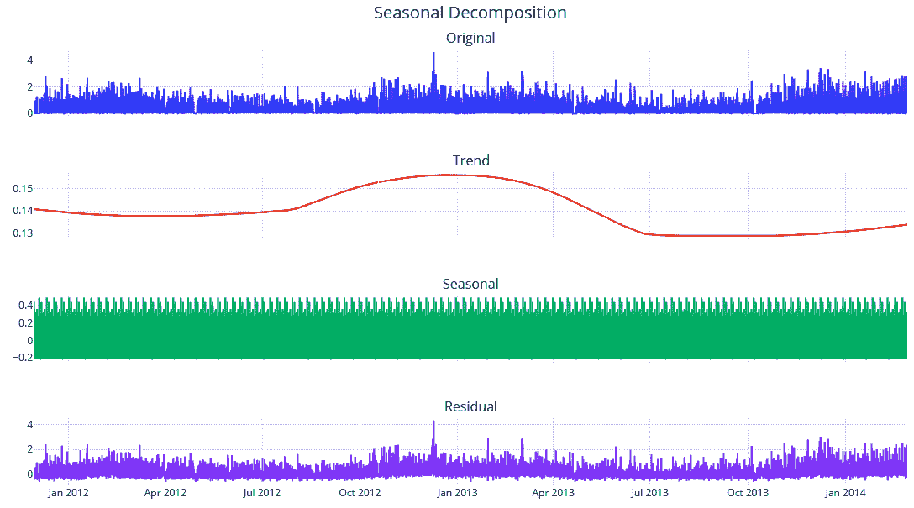

Figure 3.14 – STL decomposition

让我们也看看仅一个月的分解，以更清晰地看到提取的季节性模式：

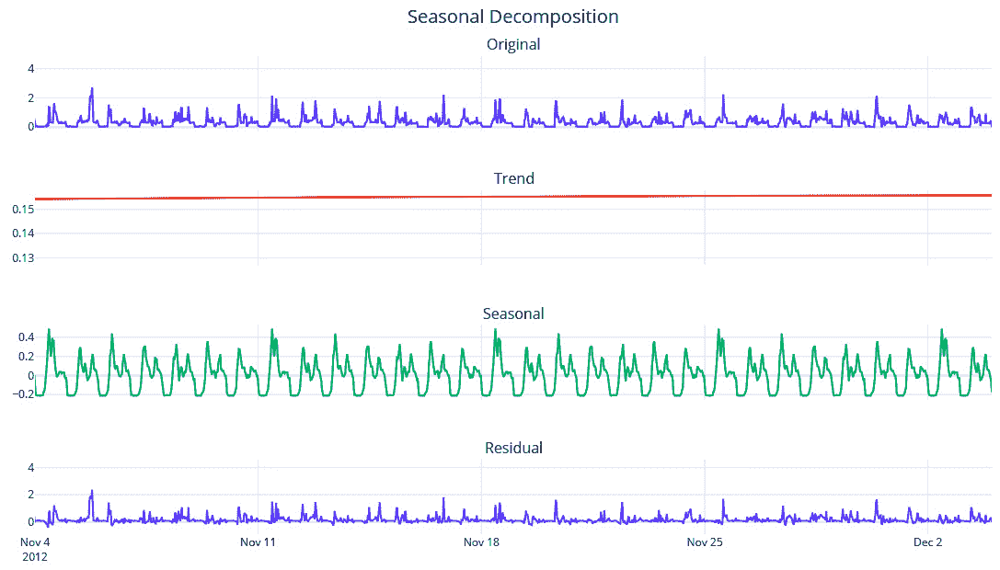

Figure 3.15 – STL decomposition (zoomed-in for a month)

现在趋势足够平滑，季节性也被捕获了。这里我们可以清晰地看到每小时的峰值和谷值，以及周末更高的峰值。但由于我们依赖平均值来推导季节性，它也极易受异常值影响。时间序列中极少数极高或极低的值都会扭曲从周期平均得出的季节性概况。该技术的另一个缺点是：当数据分辨率与预期季节性周期之间的差异较大时，提取出的季节性的“优度”会下降。例如，在日度或亚日度数据上提取年度季节性，会使提取的季节性非常嘈杂。如果你拥有的数据少于预期季节性的两个周期，该技术也将失效——例如，我们想提取年度季节性，但数据不足两年。

## 傅里叶分解

我们可以在 `src.decomposition.seasonal.py` 中找到使用傅里叶项分解时间序列的 Python 实现。它使用 LOESS 进行趋势检测，使用傅里叶项进行季节性提取。有两种使用方式。首先，我们可以将 `seasonality_period` 指定为 `pandas` datetime 属性之一（如 `hour`、`week_of_day` 等）：

```
stl = FourierDecomposition(seasonality_period="hour", model = "additive", n_fourier_terms=5)
res_new = stl.fit(pd.Series(ts.squeeze(), index=ts_df.index))
```

或者，我们可以创建一个与时间序列长度相同、具有季节性序数表示的自定义季节性数组。如果是日度数据的年度季节性，该数组的最小值为 `1`，最大值为 `365`，因为它每天增加 1：

**# 制作自定义季节性项**

```
ts_df["dayofweek"] = ts_df.index.dayofweek
ts_df["hour"] = ts_df.index.hour
```

**# 创建排序后的唯一组合 DataFrame**

```
map_df = ts_df[["dayofweek","hour"]].drop_duplicates().sort_values(["dayofweek", "hour"])
```

**# 分配序数变量以捕获顺序**

```
map_df["map"] = np.arange(1, len(map_df)+1)
```

**# 将序数映射映射回原始 DataFrame 并获取季节性数组**

```
seasonality = ts_df.merge(map_df, on=["dayofweek","hour"], how='left', validate="many_to_one")['map']
stl = FourierDecomposition(model = "additive", n_fourier_terms=50)
res_new = stl.fit(pd.Series(ts, index=ts_df.index), seasonality=seasonality)
```

该过程中涉及的关键参数如下：

1. `seasonality_period` 是从 `datetime index` 中提取的季节性。可以使用 `pandas` datetime 属性（如 `week_of_day`、`month` 等）来指定最显著的季节性。如果设为 `None`，则在调用 `fit` 时需要提供季节性数组。
2. `model` 接受 `additive` 或 `multiplicative` 参数，以确定分解类型。
3. `n_fourier_terms` 决定用于提取季节性的傅里叶项数量。增加该参数可从数据中提取更复杂的季节性。
4. `lo_frac` 是用于拟合 LOESS 回归的数据比例。
5. `lo_delta` 是我们在其中使用线性插值而非加权回归的分数距离。使用非零的 `lo_delta` 可显著减少计算时间。

让我们看看使用 `FourierDecomposition` 进行分解的放大图：

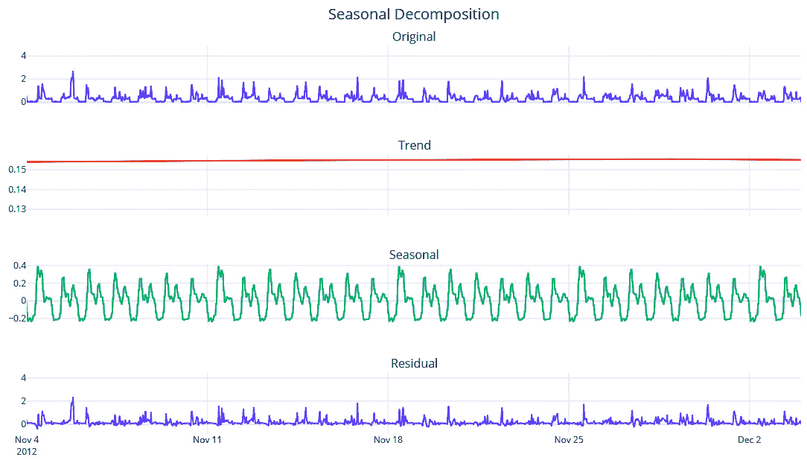

Figure 3.16 – Decomposition using Fourier terms (zoomed-in for a month)

趋势将与 STL 相同，因为我们这里也使用了 LOESS。季节性概况可能略有不同，且对异常值更稳健，因为我们在信号上使用傅里叶项进行正则化回归。另一个优势是我们将数据分辨率与预期季节性解耦了。现在，在亚日度数据上提取年度季节性不再像使用周期平均那样具有挑战性。

到目前为止，我们只看到了每个序列提取一种季节性的技术；大多提取主要季节性。那么，当我们有多个季节性模式时该怎么办？

## 使用 LOESS 进行多重季节性分解 (MSTL)

高频数据（如日度、小时度或分钟度数据）的时间序列容易表现出多重季节性模式。例如，可能存在小时级季节性模式、周级季节性模式和年度季节性模式。但如果我们只提取主导模式而将其余留给残差，就没有做到充分的分解。Kasun Bandara 等人提出了 STL 分解的多重季节性扩展，称为 **multiple seasonal-trend decomposition using LOESS** (**MSTL**)，并在 R 生态系统中有相应实现。一个非常相似的 Python 实现可以在 `src.decomposition.seasonal.py` 中找到。除了 MSTL，该实现还使用傅里叶项提取多重季节性。

> REFERENCE CHECK
> 
> > Kasun Bandara 等人的研究论文在 `References` 部分被引用为参考文献 *1*。

让我们看一个如何使用它的示例：


```python
stl = MultiSeasonalDecomposition(seasonal_model="fourier", seasonality_periods=["day_of_year", "day_of_week", "hour"], model="additive", n_fourier_terms=10)
res_new = stl.fit(pd.Series(ts, index=ts_df.index))
```

此处的关键参数如下：

1.  `seasonality_periods` 是预期季节性的列表。对于 `STL`，它是季节周期的列表，而对于 `FourierDecomposition`，它是表示 `pandas` 日期时间属性的字符串列表。

2.  `seasonality_model` 接受 `fourier` 或 `averages` 作为参数，以确定季节性分解的类型。

3.  `model` 接受 `additive` 或 `multiplicative` 作为参数，以确定分解的类型。

4.  `n_fourier_terms` 决定用于提取季节性的傅里叶项数。随着该参数的增加，从数据中提取的季节性会变得更复杂。

5.  `lo_frac` 是用于拟合 LOESS 回归的数据比例。

6.  `lo_delta` 是在该范围内使用线性插值代替加权回归的分数距离。使用非零 `lo_delta` 可显著减少计算时间。

让我们看看使用傅里叶分解时的分解效果：

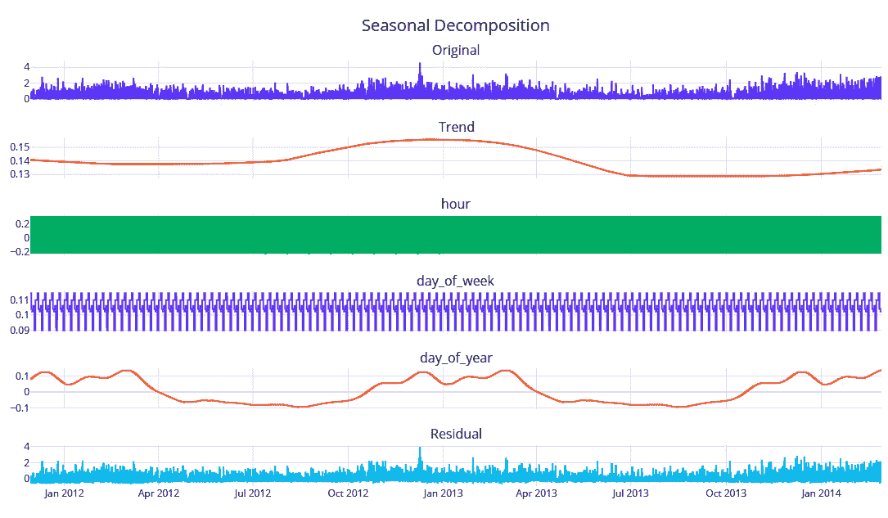

图 3.17 – 使用傅里叶项进行多重季节性分解

在这里，我们可以看到 `day_of_week` 季节性已被提取。要查看 `day_of_week` 和 `hour` 季节分量，我们需要稍微放大一下：

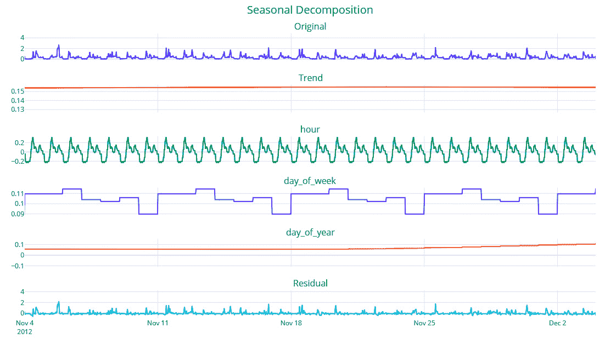

图 3.18 – 使用傅里叶项进行多重季节性分解（放大至一个月）

在这里，我们可以观察到 `hour` 季节性已被很好地提取，并且它还分离出了 `day_of_week` 季节分量，该分量在周末达到峰值。`day_of_week` 季节分量的 `离散阶跃` 特性是因为数据频率是半小时级的，对于 48 个数据点，`day_of_week` 将保持相同。

> **注意**
>
> `MSTL` 也已在 `statsmodels` 中实现，随附的笔记本中包含使用它的代码。`statsmodels` 与本书代码中捆绑的实现之间的关键区别在于，书中的实现还提供了基于傅里叶级数分解的选项。

我们在下表中总结了所涵盖的四种技术：

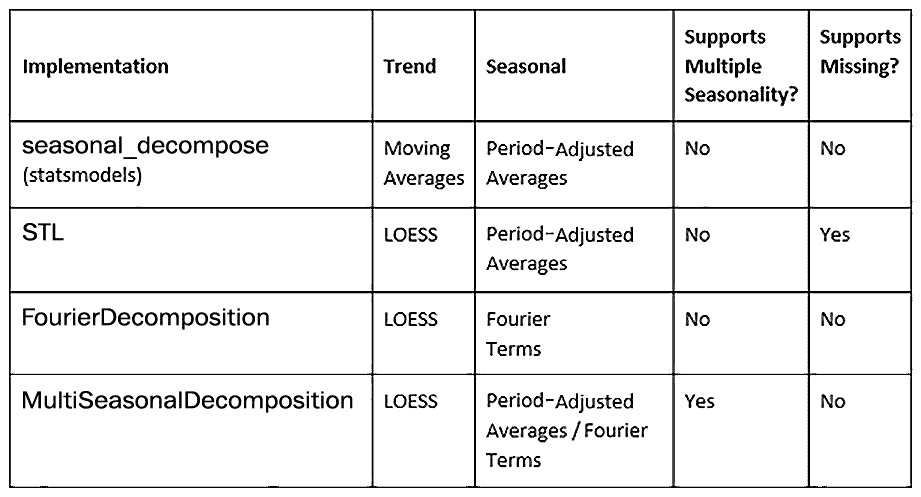

表 3.1 – 不同的季节性分解技术

## 检测和处理异常值

`异常值`（`outlier`），顾名思义，是指与其余观测值距离异常远的观测值。如果我们将 `数据生成过程`（`DGP`）视为生成时间序列的随机过程，则异常值是那些由 `DGP` 生成概率最低的点。这可能有多种原因，包括测量设备故障、数据录入错误和黑天鹅事件等。能够检测并*处理*此类异常值可能有助于您的预测模型更好地理解数据。

异常值/异常检测本身就是时间序列中的一个专门领域，但在这本书中，我们将局限于更简单的识别和处理异常值的技术。这是因为我们的主要目的不是检测异常值，而是清洗数据，以便我们的预测模型表现得更好。如果您想了解更多关于异常检测的信息，请前往*延伸阅读*部分获取一些入门资源。

现在，让我们看看几种识别异常值的技术。

> **笔记本提示**
>
> 要跟随完整的异常值检测代码，请使用 `chapter03` 文件夹中的 `03-Outlier Detection.ipynb` 笔记本。

### 标准差

这是一个几乎所有处理数据一段时间的人都听说过的经验法则——如果 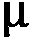 是时间序列的均值，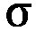 是标准差，则落在 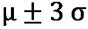 之外的任何值都是 `异常值`。其背后的理论深植于统计学。如果我们假设时间序列的值遵循正态分布（这是一种具有非常理想性质的对称分布），利用概率论，我们可以推导出正态分布曲线下 68% 的面积位于均值两侧的一个标准差内，约 95% 的面积位于两个标准差内，约 99% 的面积位于三个标准差内。因此，当我们将边界设为三个标准差（通过使用经验法则）时，我们的意思是：如果任何观测值属于该概率分布的概率小于 1%，则它们是异常值。转到稍微实际一点的问题上，这个三个标准差的截断点绝非不可更改。我们需要尝试该倍数的不同值，并通过主观评估结果来确定合适的倍数。倍数越高，异常值就越少。

对于高度季节性的数据，将规则直接应用于原始时间序列的朴素方法效果不佳。在这种情况下，我们必须使用前面讨论的任何技术对数据进行去季节化，然后将异常值检测应用于残差。如果不这样做，我们可能会将季节性峰值标记为异常值，这不是我们想要的。

这里的另一个关键假设是正态分布。然而，在现实中，我们遇到的许多时间序列可能不符合正态分布，因此该规则将很快失去其理论保证。

### 四分位距（IQR）

另一种非常相似的技术是使用 `IQR` 代替标准差来定义边界，超出该边界的观测值将被标记为异常值。`IQR` 是第 3 四分位数（或第 75 百分位数或 0.75 分位数）与第 1 四分位数（或第 25 百分位数或 0.25 分位数）之间的差值。上下界定义如下：

*   上界 = Q3 + n x IQR
*   下界 = Q1 - n x IQR

这里，`IQR = Q3 - Q1`，`n` 是 IQR 的倍数，决定了可接受区域的宽度。

对于我们观察到高频异常值和剧烈变化的数据集，这比标准差稍微更稳健。这是因为标准差和均值高度受数据集中个别点的影响。如果 `2σ` 是早期方法的经验法则，那么这里是 1.5 倍 `IQR`。这也回溯到相同的正态分布假设，1.5 倍 `IQR` 约等于 ~3σ（确切地说是 2.7σ）。关于在应用规则前进行去季节化的观点在此也适用。它适用于我们这里将看到的所有技术。

### 孤立森林


#### 孤立森林

**孤立森林**是一种基于决策树的无监督异常检测算法。典型的异常检测算法对*正常*点建模，并将不符合*正常*模式的点标记为异常值。但**孤立森林**走了一条不同的路径，直接对异常值建模。它通过随机分割特征空间来创建一片决策树森林。该技术基于这样一个假设：异常点位于外围，更容易落入树的叶子节点。因此，你可以在短分支中找到异常值，而正常点彼此更接近，需要更长的分支。任意点的“异常分数”由到达该特定点前需要遍历的树深度决定。**scikit-learn**在`sklearn.ensemble.IsolationForest`下提供了该算法的实现。除了决策树的标准参数外，这里的关键参数是`contamination`。它默认设置为`auto`，但可以设置为 0 到 0.5 之间的任何值。该参数指定了你预期数据集中异常数据的百分比。但我们必须牢记一点：`IsolationForest`完全不考虑时间因素，只是突出显示落在*正常范围之外*的值。

### 极端学生化偏差 (ESD) 和季节性 ESD (S-ESD)

这种基于统计的技术比基本的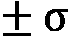技术更复杂，但仍使用相同的正态性假设。它基于另一种称为**Grubbs 检验**的统计检验，用于在正态分布数据集中寻找*单个异常值*。**ESD**通过在每一步识别并移除一个异常值，迭代地使用**Grubbs 检验**。它还会根据剩余点的数量调整临界值。要更详细地了解该检验，请前往*延伸阅读*部分，我们在那里提供了关于**ESD**和**S-ESD**的几个资源。2017 年，**Hochenbaum 等人**来自**Twitter 研究院**，提出使用带有去季节化的广义**ESD**作为检测时间序列异常值的方法。

我们改编了现有的算法实现以适应我们的用例，并将其放在本书的 GitHub 仓库中。虽然其他所有方法都将确定合适的异常值水平留给用户，通过调整一些参数来完成，但**S-ESD**只需输入预期异常值数量的上限，然后独立识别异常值。例如，我们将上限设为 800，算法在我们处理的数据中识别出了约 400 个异常值。

> 参考文献核查
>
> > **Hochenbaum 等人**的研究论文在*参考文献*部分被引用为参考文献 *2*。

让我们看看使用我们回顾的所有技术检测异常值的结果：

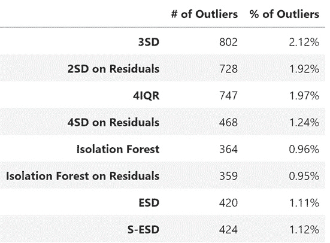

**图 3.19 – 使用不同技术检测到的异常值**

现在我们已经学会了如何检测异常值，接下来讨论如何处理它们并清洗数据集。

### 处理异常值

我们必须回答的第一个问题是：是否应该修正我们识别出的异常值。自动识别异常值的统计检验应该经过另一层人工验证。如果我们盲目地“处理”异常值，可能会切除有助于我们预测时间序列的宝贵模式。如果你只预测少量时间序列，那么查看异常值并通过寻找其成因将其与现实挂钩仍然是有意义的。

但当你有数千个时间序列时，人工无法检查所有异常值，因此我们必须求助于自动化技术。一种常见做法是用启发式值（如最大值、最小值、第 75 百分位数等）替换异常值。更好的方法是将异常值视为缺失数据，并使用我们之前讨论的任何技术来填补异常值。

我们必须记住一点：异常值修正并非预测的必要步骤，尤其是在使用机器学习或深度学习等现代方法时。是否进行异常值修正是我们需要通过实验来确定的。

干得好！这一章内容很充实，包含大量概念和代码，恭喜你完成了它。如有需要，随时可以返回复习一些主题。

## 总结

在本章中，我们了解了时间序列的关键组成部分，并熟悉了趋势、季节性等术语。我们还回顾了一些时间序列专用的可视化技术，这些技术在**探索性数据分析 (EDA)**中将派上用场。然后，我们学习了将时间序列分解为其组成部分的技术，并看到了检测数据中异常值的技术。最后，我们学习了如何处理识别出的异常值。现在，你已经准备好开始预测时间序列了，我们将在下一章开始。

## 参考文献

以下是本章的参考文献：

1.  **Kasun Bandara**、**Rob J Hyndman** 和 **Christoph Bergmeir**。(2021)。*MSTL: A Seasonal-Trend Decomposition Algorithm for Time Series with Multiple Seasonal Patterns*。arXiv:2107.13462 \[stat.AP\]. https://arxiv.org/abs/2107.13462.

2.  **Hochenbaum, J.**、**Vallis, O.** 和 **Kejariwal, A.** (2017)。*Automatic Anomaly Detection in the Cloud Via Statistical Learning*。ArXiv, abs/1704.07706. https://arxiv.org/abs/1704.07706.

## 延伸阅读

要了解本章涵盖主题的更多信息，请查看以下资源：

*   **傅里叶级数**: https://www.setzeus.com/public-blog-post/the-fourier-series.
*   **可汗学院的傅里叶级数**: https://www.youtube.com/watch?v=UKHBWzoOKsY.
*   **傅里叶变换**: https://betterexplained.com/articles/an-interactive-guide-to-the-fourier-transform/.
*   **Ane Blázquez-García**、**Angel Conde**、**Usue Mori** 和 **Jose A. Lozano**。(2021)。*A Review on Outlier/Anomaly Detection in Time Series Data.* arXiv:2002.04236. https://arxiv.org/abs/2002.04236.
*   **Braei, M.** 和 **Wagner, S.** (2020)。*Anomaly Detection in Univariate Time-series: A Survey on the State-of-the-Art*。ArXiv, abs/2004.00433. https://arxiv.org/abs/2004.00433.
*   **广义 ESD 异常值检验**: https://www.itl.nist.gov/div898/handbook/eda/section3/eda35h3.htm.
