# 4 建立强基线预测

## 加入我们的 Discord 图书社区


[`packt.link/EarlyAccess/`](https://packt.link/EarlyAccess/)

在上一章中，我们看到了一些可用于理解**时间序列数据**、进行**探索性数据分析 (EDA)** 等的技术。但现在，让我们直奔主题——**时间序列预测**。理解数据集并观察模式、季节性等的目的，是为了让预测该序列的工作变得更容易。而在任何机器学习练习中，在进一步深入之前我们需要建立的第一件事之一就是**基线**。

基线是一种简单的模型，它能在不需要花费大量时间开发的情况下提供合理的结果。许多人认为基线源于常识，例如平均值或一些经验法则。但作为最佳实践，基线可以像我们想要的那样复杂，只要它能快速且轻松地实现。我们想要取得的任何进步都将体现在相对于该基线的性能上。


## 在本章中，我们将介绍一些可作为基线的经典技术，这些技术构成了强有力的基线。有人可能会觉得本章讨论的预测技术不应作为基线，但我们将它们保留在此，因为这些技术经受住了时间的考验——且有充分理由。得益于实现这些技术的优秀开源库，它们也非常成熟，且只需极少的精力即可应用。在许多类型的问题/数据集中，很难超越本章将讨论的基线技术，在这种情况下，坚持使用其中一种基线技术并不丢人。

本章将涵盖以下主题：

1.  搭建测试工具
2.  生成强基线预测
3.  评估时间序列的可预测性

## 技术要求

您需要按照本书前言中的说明设置 Anaconda 环境，以获得一个包含本书代码所需的所有库和数据集的工作环境。任何额外的库将在运行笔记本时安装。

在使用本章代码之前，您需要运行以下笔记本：

*   `Chapter02` 文件夹中的 `02-Preprocessing London Smart Meter Dataset.ipynb` 预处理笔记本。

本章的代码可在 `https://github.com/PacktPublishing/Modern-Time-Series-Forecasting-with-Python-2E/tree/main/notebooks/Chapter04` 找到。

## 搭建测试工具

在开始预测和设置基线之前，我们需要搭建一个 `test harness`（测试工具/测试平台）。在软件测试中，`test harness` 是经过配置的一组代码和输入，用于在各种情况下测试程序。就机器学习而言，`test harness` 是一组可用于评估算法的代码和数据。搭建 `test harness` 非常重要，以便我们能以标准且快速的方式评估所有未来的算法。

首先我们需要 `holdout`（`test`，保留/测试）数据集和 `validation`（验证）数据集。

### 创建保留（测试）数据集和验证数据集

作为标准做法，在机器学习中，我们会划分出数据集的两部分，将它们命名为 `validation data`（验证数据）和 `test data`（测试数据），并且完全不使用它们来训练模型。`validation data` 用于建模过程中评估模型质量。为了在不同模型类别中选择、调整超参数、执行特征选择等，我们需要一个数据集。`Test data` 就像是对您所选模型的最终测试。它告诉您模型在未见数据上的表现如何。如果 `validation data` 就像期中考试，那么 `test data` 就是您的期末考试。

在常规回归或分类中，我们通常随机抽取几条记录并将其放在一边。但在处理时间序列时，我们需要尊重数据集的时间属性。因此，最佳实践是将数据集的最新部分作为 `test data`。另一个经验法则是设置等大小的 `validation` 和 `test` 数据集，以便基于 `validation data` 做出的关键建模决策尽可能接近 `test data`。我们在第 2 章 *获取和处理时间序列数据* 中介绍的数据集（伦敦智慧能源数据集）包含 2011 年 11 月至 2014 年 2 月伦敦家庭的能源消耗读数。因此，我们将把 2014 年 1 月作为 `validation data`，2014 年 2 月作为 `test data`。

让我们打开 `chapter04` 文件夹中的 `01-Setting up Experiment Harness.ipynb` 并运行它。在笔记本中，我们必须在使用 `SeasonalInterpolation`（季节性插值）填补缺失值之前和之后都创建训练-测试集划分，并相应地保存它们。笔记本运行完成后，您将在预处理文件夹中创建以下文件，其中 2014 年的数据单独保存：

*   `selected_blocks_train.parquet`
*   `selected_blocks_val.parquet`
*   `selected_blocks_test.parquet`
*   `selected_blocks_train_missing_imputed.parquet`
*   `selected_blocks_val_missing_imputed.parquet`
*   `selected_blocks_test_missing_imputed.parquet`

现在我们有了一个固定的数据集，可用于公平地评估多种算法，我们还需要一种方法来评估不同的预测。

### 选择评估指标

在机器学习中，我们有一小把指标可用于衡量连续输出，主要是 `Mean Absolute Error`（`MAE`，平均绝对误差）和 `Mean Squared Error`（`MSE`，均方误差）。但在时间序列预测领域，有大量的指标，且对于使用哪些指标没有真正的共识。造成这种指标数量压倒性优势的原因之一是，没有任何单一指标能衡量预测的每一个特征。因此，我们专门用一整章来讨论这个主题（第 18 章，*评估预测——预测指标*）。目前，我们将仅回顾几个指标，所有这些指标我们都将用来衡量预测。我们只是按其表面含义来考虑它们：

*   `Mean Absolute Error`（`MAE`）：MAE 是一个非常简单的指标。它是时间步 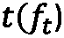 处的预测值与时间 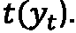 处的观测值之间无符号误差的平均值。公式如下：

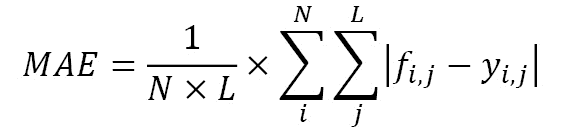

此处，`N` 是时间序列的数量，`L` 是时间序列的长度（在本例中为测试期的长度），`f` 和 `y` 分别是预测值和观测值。

*   `Mean Squared Error`（`MSE`）：MSE 是预测值 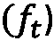 和观测值 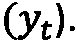 之间平方误差的平均值：

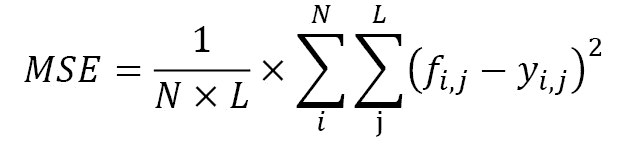

*   `Mean Absolute Scaled Error`（`MASE`）：MASE 比 MSE 或 MAE 稍微复杂一些，但给了我们一个稍好的度量来克服前两个度量的尺度依赖性。如果我们有多个具有不同平均值的时间序列，与低值时间序列相比，MAE 和 MSE 会显示高值时间序列的较高误差。MASE 通过基于 `naïve forecasting method`（朴素预测法，这是最基本的预测之一；我们稍后将在本章中回顾）的样本内 MAE 来缩放误差，从而克服了这一问题。直观上，MASE 给出了我们的预测比朴素预测好多少的度量：

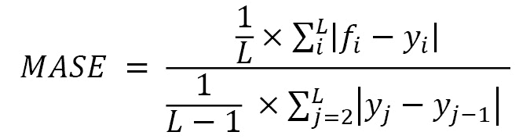

*   `Forecast Bias`（`FB`，预测偏差）：这是一个与我们见过的其他指标略有不同侧面的指标。虽然其他指标有助于评估预测的*正确性*，而不考虑误差的方向，但预测偏差让我们了解模型的整体*偏差*。预测偏差是一个指标，帮助我们理解预测是持续高估还是低估。我们将预测偏差计算为预测值之和与观测值之和的差，以所有实际值之和的百分比表示：

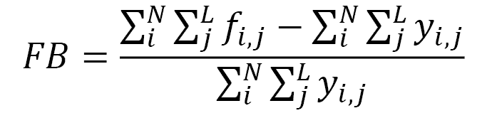

现在，我们的测试工具已准备就绪。我们也知道如何在一个固定的保留数据集上，使用一组预定的指标，评估和比较来自不同模型的预测。现在，是时候开始预测了。

## 生成强基线预测

`Time series forecasting`（时间序列预测）自 20 世纪 20 年代初就已存在，多年来，许多杰出人士提出了不同的模型，有些基于统计，有些基于启发式。我统称它们为 `classical statistical models`（经典统计模型）或 `econometrics models`（计量经济学模型），尽管它们并不严格属于统计/计量经济学范畴。


### 使用 NIXTLA 进行基线预测

在本节中，我们将回顾一些模型，当我们想要尝试现代预测技术时，这些模型可以形成非常强的基线。作为练习，我们将使用一个优秀的时间序列预测开源库 – `NIXTLA` (https://github.com/Nixtla)。笔记本 `02-Baseline Forecasts using NIXTLA.ipynb` 包含本节的代码，以便您跟随操作。

在开始研究预测技术之前，让我们快速了解如何使用 `NIXTLA` 库生成预测。我们将从数据集中挑选一个消费者，并逐一在验证数据集上尝试所有基线技术。

首先我们需要做的是使用每个客户的唯一 ID，即 `LCLid` 列（来自展开形式的数据），选择我们想要的消费者，并将时间戳设置为 DataFrame 的索引：

```python
ts_train = train_df.loc[train_df.LCLid=="MAC000193",['LCLid',"timestamp","energy_consumption"]]
ts_val = val_df.loc[val_df.LCLid=="MAC000193", ['LCLid',"timestamp","energy_consumption"]]
ts_test = test_df.loc[test_df.LCLid=="MAC000193", ['LCLid',"timestamp","energy_consumption"]]
```

`NIXTLA` 具有灵活性，可以直接处理 `pandas` 或 `Polars` DataFrame。默认情况下，`NIXTLA` 寻找 3 列：

- `id_col`：默认情况下，它期望一列 'unique_id'。此列唯一标识时间序列。如果您只有 1 个时间序列，请添加一个具有相同唯一标识符的虚拟列。
- `time_col`：默认情况下，它期望一列 'ds'。这是您的时间戳列。
- `target_col`：默认情况下，它期望一列 'y'。此列是您希望 `NIXTLA` 预测的内容。

这非常方便，因为从数据到建模不需要进一步的操作。`NIXTLA` 遵循 `scikit-learn` 风格，具有 `.fit()` 和 `.predict()` 方法，还采用了 `.forecast()` 方法。Forecast 是一种内存高效的方法，避免存储部分模型输出，而 Scikit-learn 接口存储拟合后的模型。

```python
sf = StatsForecast(
    models=[model],
    freq=freq,
    n_jobs=-1,
    fallback_model=Naive()
)
sf.fit( df = _ts_train,   
     id_col = 'LCLid',
     time_col = 'timestamp',
     target_col = 'energy_consumption',
)
baseline_test_pred_df = sf.predict(len(ts_test) )
#### Or
#### 高效地拟合和预测，无需存储内存
y_pred = sf.forecast(
    h=len(ts_test),
    df=ts_train,
    id_col = 'LCLid',
    time_col = 'timestamp',
    target_col = 'energy_consumption',
)
```

当我们调用 `.predict` 或 `.forecast` 时，必须告诉模型我们需要预测多远的未来。这称为预测的**预测期（horizon）**。在我们的例子中，我们需要预测测试期，这可以通过获取 `ts_test` 数组的长度轻松完成。

我们也可以使用 `NIXTLA` 的类轻松计算我们之前在测试工具中讨论的指标。为了增加灵活性，我们可以遍历指标列表，以获取每个预测的多个测量值。

```python
### 计算指标
metrics = [mase, mae, mse, rmse, smape, forecast_bias]
for metric in metrics:
    metric_name = metric.__name__
    if metric_name == 'mase':
        evaluation[metric_name] =   
metric(results[target_col].values,            results[model_name].values,
ts_train[target_col].values, seasonality=48)
    else:
        evaluation[metric_name] =
metric(results[target_col].values,
results[model_name].values)
```

请注意，对于 MASE，训练集也被包含在内。

为了方便实验，我们已将所有这些封装到笔记本中的一个便捷函数 `evaluate_performance` 中。这将返回预测结果和计算出的指标 DataFrame。

现在，让我们开始看看一些非常简单的预测方法。

## 朴素预测

朴素预测简单得不能再简单了。预测只是时间序列中的最后一个/最近的观测值。如果时间序列中的最新观测值是 10，那么所有未来时间步的预测都是 10。这可以使用 `NIXTLA` 中的 `Naive` 类实现，如下所示：

```python
from statsforecast.models import Naive
models = Naive()
```

一旦我们初始化了模型，就可以调用笔记本中我们有用的 `evaluate_performance` 函数来运行并记录预测和指标。

让我们可视化一下刚才生成的预测：

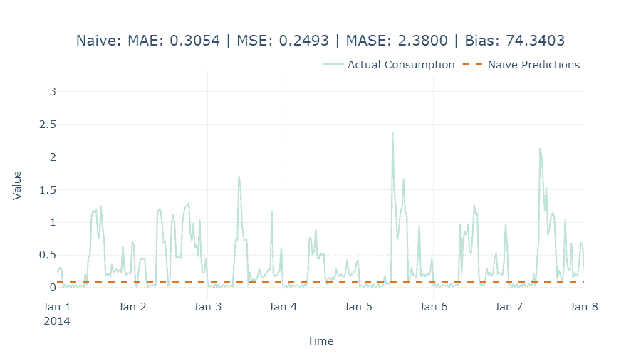

图 4.1 – 朴素预测

在这里，我们可以看到预测是一条直线，完全忽略了序列中的任何模式。这是迄今为止最简单的预测方法，因此被称为朴素。现在，让我们看看另一种简单的方法。

## 移动平均预测

虽然朴素预测记住了最近的过去，但它也记住了任何时间步的噪声。**移动平均预测**是另一种简单的方法，试图克服朴素方法的纯记忆。它不是取最新的观测值，而是取最近 *n* 步的平均值作为预测。移动平均不是 `NIXTLA` 中现有的模型之一，但我们在本书的 GitHub 存储库的 `chapter04` 文件夹中实现了一个兼容 `NIXTLA` 的模型：

```python
from src.forecasting.baselines import NaiveMovingAverage
### 在 48 个时间步上取移动平均，即一天
naive_model = NaiveMovingAverage(window=48)
```

让我们看看生成的预测：

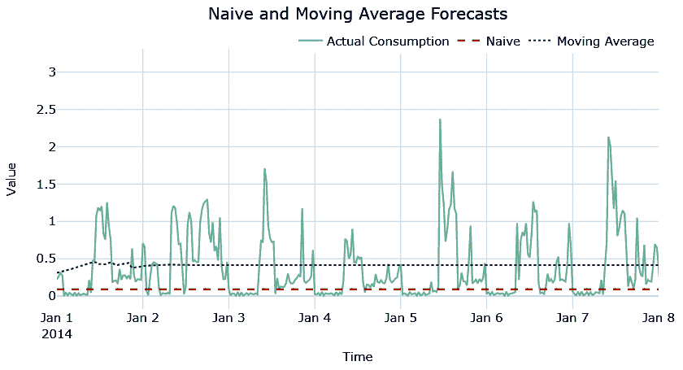

图 4.2 – 移动平均预测

这个预测也几乎是一条直线。现在，让我们看看另一种简单的方法，但这种方法也考虑了季节性。

## 季节性朴素预测

**季节性朴素预测**是对简单朴素方法的一种变体。而在朴素方法中，我们取最后一个观测值 (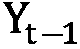)，在季节性朴素中，我们取 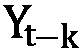 观测值。因此，我们为每个预测向后看 *k* 步。这使算法能够模仿最后一个季节性周期。例如，如果我们设置 **k=48*7**，我们将能够模仿最近的季节性周周期。此方法在 `NIXTLA` 中实现，我们可以这样使用：

```python
from statsforecast.models import SeasonalNaive
seasonal_naive = SeasonalNaive(season_length=48*7)
```

让我们看看这个预测是什么样子的：

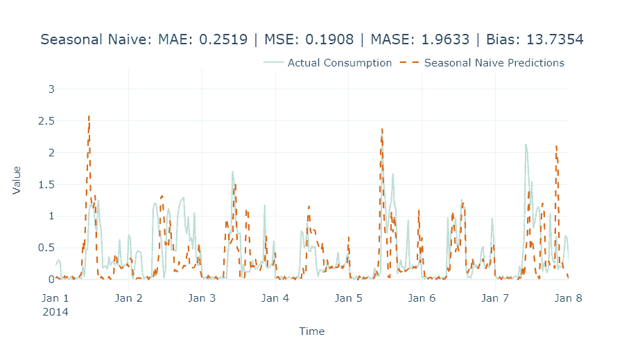

图 4.3 – 季节性朴素预测

在这里，我们可以看到预测试图模仿季节性模式。然而，它不是很准确，因为它盲目地遵循最后一个季节性周期。

既然我们已经看了几种简单的方法，现在让我们看看一些统计模型。

## 指数平滑 (ETS)

**指数平滑** (**ETS**) 是生成预测最流行的方法之一。它自 1950 年代末以来就已存在，并证明了自己的价值，经受住了时间的考验。ETS 有几种不同的变体 – 单指数平滑、双指数平滑、Holt-Winters 季节性平滑等。但它们都有一个关键思想，以不同的方式被使用。在朴素方法中，我们只是使用最新的观测值，这就像说历史中只有最近的数据点重要，之前的数据点都不重要。另一方面，移动平均方法认为最后 *n* 个观测值同等重要，并取它们的平均值。

ETS 结合了这两种直觉，认为所有历史都很重要，但最近的历史**更重要**。因此，预测是使用加权平均生成的，随着我们深入历史，权重呈指数级衰减：

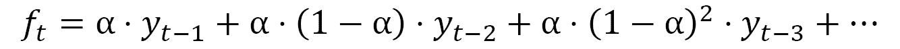这里， 是平滑参数，让我们决定权重衰减的快慢，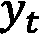 是时间步 *t* 的实际值，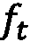 是时间步 *t* 的预测值。


### 简单指数平滑 (SES)

**简单指数平滑** (**SES**) 是指你直接将这种平滑过程应用于历史数据。这更适用于没有趋势或季节性的时间序列，且预测结果将是一条平线。预测是通过以下公式生成的：


### 双指数平滑 (DES)

**双指数平滑** (**DES**) 将平滑思路扩展到了趋势建模。它有两个平滑方程——一个用于水平，另一个用于趋势。一旦你得到了水平和趋势的估计值，就可以将它们结合起来。由于使用估计趋势将其外推到未来，因此该预测不一定是平的。预测是根据以下公式生成的：

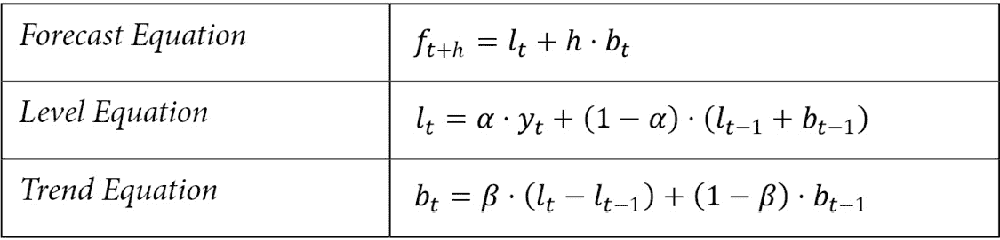

首先，我们使用可用观测值通过*水平方程*估计水平 (`l_t`)。然后，我们使用*趋势方程*估计趋势。最后，为了得到预测，我们使用*预测方程*将 `l_t` 和 `b_t` 结合起来。研究人员发现了实证证据表明，这种恒定外推可能导致长期预测中的过度预测。这是因为在现实世界中，时间序列数据不会永远以恒定速率增长。受此启发，人们引入了一种改进，通过因子 `φ` 来抑制趋势，使得当 `φ = 1` 时不存在抑制，且与双指数平滑完全相同。

### 三指数平滑 (Holt-Winters / HW)

**三指数平滑** 或 **Holt-Winters** (**HW**) 通过引入另一个平滑项来建模季节性，向前迈进了一步。它有三个参数 (`α`, `β`, `γ`) 用于平滑，并使用季节性周期 (`m`) 作为输入参数。你也可以选择加法或乘法季节性。加法模型的预测方程如下：

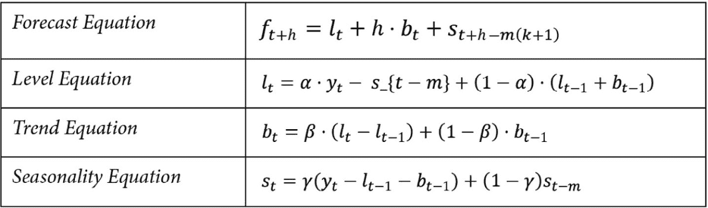

这些公式的使用方式与双指数平滑情况类似。我们不再仅估计水平和趋势，而是分别估计水平、趋势和季节性。

### 指数平滑家族

指数平滑方法家族不仅限于我们刚才讨论的三种。理解不同模型的一种方式是从这些模型的趋势和季节性分量来考虑。趋势可以是无趋势、加法或加法阻尼。季节性可以是无季节性、加法或乘法。这些参数的每一种组合都是该家族中的一种不同技术，如下表所示：

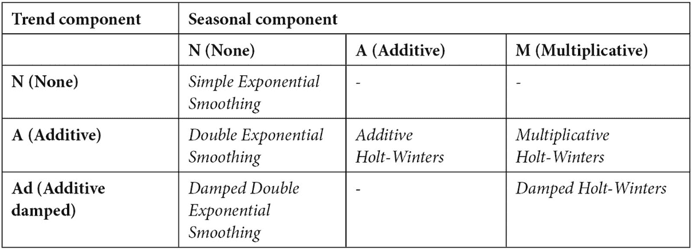

表 4.1 – 指数平滑家族

`NIXTLA` 拥有完整的指数平滑方法家族。

### NIXTLA 实现

让我们看看如何在 **NIXTLA** 中初始化 `ETS` 模型：

```
from statsforecast.models import (SimpleExponentialSmoothing, Holt, HoltWinters, AutoETS)
exp_smooth = HoltWinters(error_type = 'A', season_length = 48)
```

这里的 `error_type = 'A'` 指的是加法误差。用户可以选择加法误差或乘法误差，后者可通过 `error_type = 'M'` 调用。`NIXTLA` 模型提供了使用 `AutoETS()` 的选项。该模型将自动选择哪种指数平滑模型是最佳选项：`SimpleExponentialSmoothing`、`Holt`（双指数平滑 / Holt 方法）或 `HoltWinters`（三指数平滑 / Holt-Winters 方法）。它还将为每个单独的时间序列选择最佳参数和误差类型。请参阅 GitHub 笔记本以获取如何使用 `AutoETS()` 的示例。

让我们看看 Figure 4.4 中使用 `ETS` 进行预测的效果：

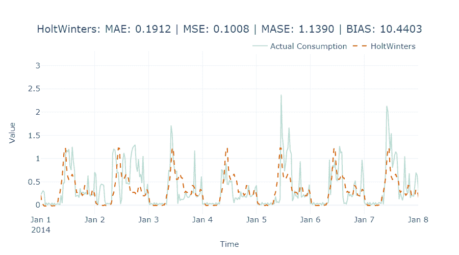

Figure 4.4 – 指数平滑预测

预测捕捉到了季节性，但未能捕捉到峰值。但我们已经可以看到 `MAE` 的改进。

现在，让我们看看最流行的预测方法之一。

## ARIMA

**自回归积分滑动平均** (**ARIMA**) 模型是另一类方法，与 `ETS` 一样，经受住了时间的考验，是最流行的经典预测方法之一。`ETS` 方法家族围绕趋势和季节性建模，而 `ARIMA` 依赖于**自相关**（`y_t` 与 `y_{t-1}`、`y_{t-2}` 等的相关性）。

### AR(p) 模型

家族中最简单的是 `AR(p)` 模型，它使用带有 `p` 个先前时间步（换句话说，`p` 个滞后项）的**线性回归**。数学上可以写成如下形式：

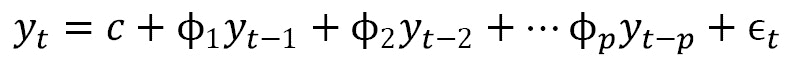

这里，`c` 是截距，`ε_t` 是时间步 `t` 处的噪声或误差。

### MA(q) 模型

家族中的下一个是 `MA(q)` 模型，我们不使用过去的观测值，而是使用预测中过去的 `q` 个误差（假设为纯白噪声）来进行预测：

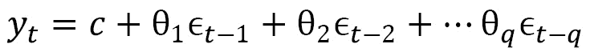

这里，`ε_t` 是白噪声，`c` 是截距。这通常不单独使用，而是与 `AR(p)` 模型结合使用，这就构成了我们列表中的下一个 `ARMA(p,q)` 模型。`ARMA` 模型定义为 `ARMA(p,q)`。

### ARIMA(p,d,q) 模型

在所有 `ARIMA` 模型中，有一个基本假设——*时间序列是平稳的*（我们在第 1 章 *时间序列简介* 中讨论过平稳性，并将在第 6 章 *时间序列预测特征工程* 中详细阐述）。有许多方法可以使序列平稳，但对连续值取差分是其中一种技术。这被称为**差分**。有时我们只需要差分一次，而有时我们必须进行连续差分，直到时间序列变得平稳。我们进行差分操作的次数称为*差分阶数*`ARIMA` 中的 `I`，也是拼图的最后一块，代表*积分*。它定义了序列变得平稳前所需的差分阶数，用 `d` 表示。

因此，完整的 `ARIMA(p,d,q)` 模型表示：我们进行 `d` 阶差分，然后以自回归方式考虑最后 `p` 项，再包含最后 `q` 个移动平均项以得出预测。

### 季节性 ARIMA

我们目前讨论的 `ARIMA` 模型仅处理非季节性时间序列。但利用我们讨论的相同概念，作用于季节性周期，我们得到**季节性 ARIMA**。`p`、`d` 和 `q` 稍作调整以适应季节性周期 `m`。为了将它们与普通的 `p`、`d` 和 `q` 区分开来，我们称季节性值为 `P`、`D` 和 `Q`。例如，如果 `p` 意味着取最后 `p` 个滞后项，`P` 则意味着取最后 `P` 个季节性滞后项。如果 `y_t` 是 `y_{t-1}`，`y_{t-P}` 将是 `y_{t-m}`。同样，`D` 表示季节性差分阶数。

### 自动 ARIMA

选择正确的 `p`、`d`、`q` 和 `P`、`D`、`Q` 值并不直观，我们必须求助于统计检验来找到它们。然而，当你预测许多时间序列时，这变得不太现实。一种自动遍历不同参数并为数据找到最佳 `p`、`d`、`q` 和 `P`、`D`、`Q` 值的方法称为**自动 ARIMA**。在 Python 中，`NIXTLA` 实现了此方法 `AutoARIMA()`。**NIXTLA** 也有普通的 `ARIMA` 实现，速度快得多，但需要手动输入 `p,d,q`。

### 实际考量


### 使用 NIXTLA 进行 ARIMA 和 AutoARIMA 建模

> 尽管 `ARIMA` 和 `Auto ARIMA` 在许多情况下都能提供表现良好的模型，但当存在长季节周期和长时间序列时，它们可能会变得相当缓慢。在我们的案例中，历史数据有近 27k 个观测值，`ARIMA` 变得非常缓慢且占用大量内存。即使对数据进行子集划分，单次 `AutoARIMA` 拟合也需要约 60 分钟。放弃季节参数能大幅缩短运行时间，但对于能源消耗这类季节性时间序列来说，这说不通。`AutoARIMA` 包含许多此类拟合以识别最佳参数，因此对于长时间序列数据集变得不切实际。Python 生态系统中几乎所有的实现都存在这个缺点。`NIXTLA` 声称拥有最快、最准确的 `AutoARIMA` 版本，甚至比原始的 `R` 方法还要快。

### 使用 `NIXTLA` 应用 `ARIMA` 和 `AutoARIMA`

```python
from statsforecast.models import (ARIMA, AutoARIMA)
#### ARIMA model by specifying parameters
arima_model = ARIMA(order = (2,1,1), seasonal_order = (1,1,1), season_length = 48)
#### AutoARIMA model by specifying max limits for parameters and letting the algorithm find the best ones
auto_arima_model = AutoARIMA(max_p = 2, max_d=1, max_q = 2, max_P=2, max_D = 1, max_Q = 2, stepwise = True, season_length=48)
```

有关 `AutoARIMA` 的完整参数列表，请访问 `NIXTLA` 文档：https://nixtlaverse.nixtla.io/statsforecast/docs/models/autoarima.html。

## ETS 和 ARIMA 预测

让我们看看我们正在试验的那些家庭的 `ETS` 和 `ARIMA` 预测结果如何：

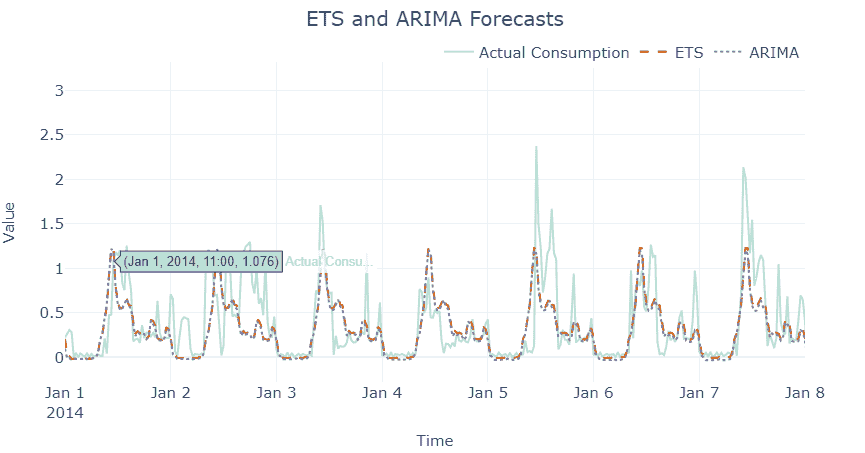

图 4.5 – ETS 和 ARIMA 预测（彩图）

借助 `NIXTLA`，`ETS` 和 `ARIMA` 都很好地捕捉了季节性和峰值。生成的 MAE 分数也非常相似，分别为 0.191 和 0.203。现在，让我们看看另一种方法——Theta 预测法。

### Theta 预测法

`Theta 预测法` 是 2002 年 M3 预测竞赛中表现最佳的提交方法。该方法依赖于一个参数 ，根据所选值的不同，该参数会放大或平滑时间序列的局部曲率。使用 ，我们对原始时间序列进行平滑或放大。这些平滑后的线被称为 **theta lines**（Theta 线）。V. Assimakopoulos 和 K. Nikolopoulos 提出了这种作为预测分解方法的方法。虽然理论上可以使用任意数量的 Theta 线，但最初提出的方法使用了两条 Theta 线，即 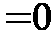 和 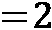，并取两条 Theta 线预测值的平均值作为最终预测。

> **旁注**
>
> > M 竞赛是由领先的预测研究者 Spyros Makridakis 组织的预测竞赛。它们通常会策划一组时间序列数据集，规定评估预测的指标，并向全球研究人员开放竞赛以获得最佳预测。这些竞赛被认为是世界上最大、最受欢迎的时间序列预测竞赛之一。截至撰写时，已完成六届此类竞赛。要了解最新竞赛的更多信息，请访问此网站：*https://mofc.unic.ac.cy/the-m6-competition/*。

2002 年，Rob Hyndman 等人简化了 Theta 方法，并证明我们可以使用带有漂移项的 `ETS` 来获得与原始 Theta 方法相当的结果，这也是当今大多数该方法实现所采用的方式。Theta 预测法（在 `NIXTLA` 中实现）涉及的主要步骤如下：

1.  **去季节化**：应用经典的乘法分解以移除时间序列中的季节性成分（如果存在）。这使分析聚焦于潜在的趋势和周期成分。去季节化使用 `statsmodels.tsa.seasonal.seasonal_decompose` 完成。此步骤创建一个新的去季节化时间序列。
2.  **应用 Theta 系数**：使用系数 和 将去季节化序列分解为 2 条 "Theta" 线。这些系数修改时间序列的二阶差分，以抑制局部波动。
3.  **Theta 线外推**：将每条 Theta 线视为单独的序列并向未来进行预测。这通过线性回归对 Theta 线 进行（产生一条直线），并通过简单指数平滑对 Theta 线 进行。
4.  **重组**：结合两条 Theta 线的预测。原始方法对两条线使用等权重，从而有效地整合了长期趋势和短期变动。
5.  **重新季节化**：如果数据在开始时已去季节化。

`NIXTLA` 拥有 `THETA` 方法的多种不同变体。关于 `NIXTLA` 实现的具体细节，请见此处：

https://nixtlaverse.nixtla.io/statsforecast/docs/models/autotheta.html

让我们看看如何实际使用它：

```python
theta_model = Theta(season_length =48, decomposition_type = 'additive' )
```

此处的关键参数如下：

*   **`season_length` 与 `decomposition_type`：** 这些参数用于初始季节分解。如果留空，实现会自动检测季节性并使用乘法分解自动对时间序列进行去季节化。如果我们知道这些领域知识，建议设置这些参数。分解类型可以是 'multiplicative'（默认）或 'additive'。

让我们可视化一下刚才使用 Theta 预测法生成的预测结果：

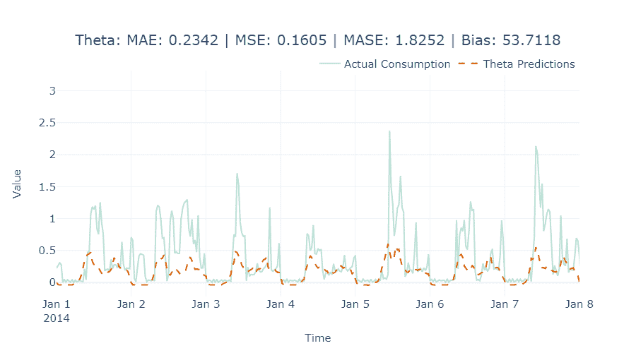

图 4.6 – Theta 预测

> **参考文献核对**
>
> > V. Assimakopoulos 和 K. Nikolopoulos 提出 Theta 方法的研究论文在*参考文献*部分被引用为参考文献 *1*，而 Rob Hyndman 后来的简化工作被引用为参考文献 *2*。

### TBATS

有时时间序列具有多个季节性模式或非整数季节周期，通常称为复杂季节性。例如，小时预测可能具有日季节性（一天中的时间）、周季节性（一周中的日子）和年季节性（一年中的日子）。此外，大多数时间序列模型是为较小的整数季节周期设计的，例如月度 (12) 或季度 (4) 数据，但年季节性可能构成问题，因为一年是 364.25 天。`TBATS` 旨在解决这些给许多预测模型带来麻烦的挑战。然而，像任何自动化方法一样，它有时容易产生糟糕的预测。

*   **`TBATS`** 代表
    *   **T** 三角函数季节性
    *   **B** Box-Cox 变换
    *   **A** ARMA 误差
    *   **T** 趋势
    *   **S** 季节性成分

该模型由 Rob J Hyndman、Alysha M De Livera 和 Ralph D Snyder 于 2011 年首次提出。还有一种 `TBATS` 的变体，称为 `BATS`，它不包含三角函数季节性成分。`TBATS` 属于状态空间模型家族。在状态空间预测模型中，观测到的时间序列被假设为潜在状态变量和将状态变量与观测数据相关联的测量方程的组合。状态变量捕捉数据中的潜在模式、趋势和关系。

`BATS` 具有指示 Box-Cox 参数、阻尼参数、ARMA 参数和季节周期的参数。由于其灵活性，`BATS` 模型可被视为一个模型家族，涵盖了我们之前见过的许多其他模型。例如：

*   `Holt Winters 加法季节性`
*   `Holt Winters 加法双重季节性`


## TBATS 和 MSTL 预测方法

### TBATS 概述

BATS 具有处理多重季节性的灵活性；然而，它仅限于整数季节周期，并且在多重季节性情况下可能会产生大量状态，导致模型复杂性增加。`TBATS` 旨在解决这一问题。

参考一下，`TBATS` 参数空间为

#### TBATS 的优势

`TBATS` 的主要优势如下：

1.  适用于单一、复杂和非整数季节性（三角函数季节性）
2.  处理现实世界时间序列中常见的非线性模式（Box-Cox 变换）
3.  处理残差中的自相关（ARMA 误差）

#### TBATS 处理顺序

为了更好地理解 `TBATS` 的内部工作原理，让我们分解每个步骤。

使用 `TBATS` 进行操作的顺序是：

1.  `Box-Cox 变换`
2.  `指数平滑趋势`
3.  `使用傅里叶级数进行季节性分解`
4.  `自回归移动平均 (ARMA)`
5.  `基于似然的参数估计方法`

### TBATS 组件

#### Box-Cox 变换

`Box-Cox` 是幂变换族中的一种变换。

在时间序列中，使数据平稳是预测前的重要步骤（如第 1 章所述）。平稳性确保我们的数据在统计上不随时间变化，从而更准确地类似于概率分布。可以应用多种可能的变换。有关各种目标变换（包括 `Box-Cox`）的更多详细信息，请参阅第 7 章。

作为预览，这里展示了一个 `Box-Cox` 变换的示例输出。变换后，我们的数据更接近正态分布。`Box-Cox` 变换只能用于正数据，但在实践中这通常是成立的。图 4.7 展示了时间序列在 `Box-Cox` 变换前后的样子示例。

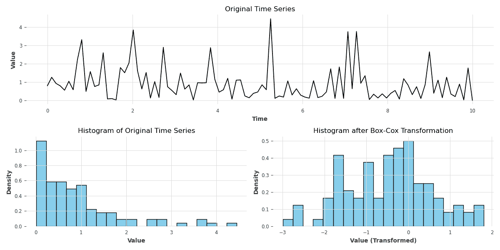

图 4.7 – Box-Cox 变换

#### 指数平滑趋势

使用 `局部估计散点图平滑 (LOESS)`，从时间序列中提取平滑趋势。

`LOESS` 通过在数据点上应用局部加权的低次多项式回归来创建一条平滑流畅的曲线。这种技术在捕捉局部趋势变化方面非常有效，且不假设数据的整体形式，这使其特别适用于具有变化趋势或季节性变化的数据。

#### 三角函数季节性

然后使用傅里叶项（第 3 章讨论）对剩余残差建模，以分解季节性成分。

使用傅里叶建模季节性的主要优势在于其能够建模多重季节性，以及非整数季节性，例如每日数据的年度季节性，因为一年有 364.25 天。大多数其他分解方法无法处理非整数周期，只能四舍五入为 365 天，这可能无法识别真实的季节性。下面是一个使用傅里叶分解时间序列的示例。本例中的观测时间序列是小时数据。因此，我们的季节周期为：

*   日 = 24
*   周 = 24 \* 7 = 168

这里可以清晰地看到定义的季节模式、趋势和剩余残差。图 4.8 展示了趋势和季节性的分解，随后残差使用 `ARMA` 过程建模。

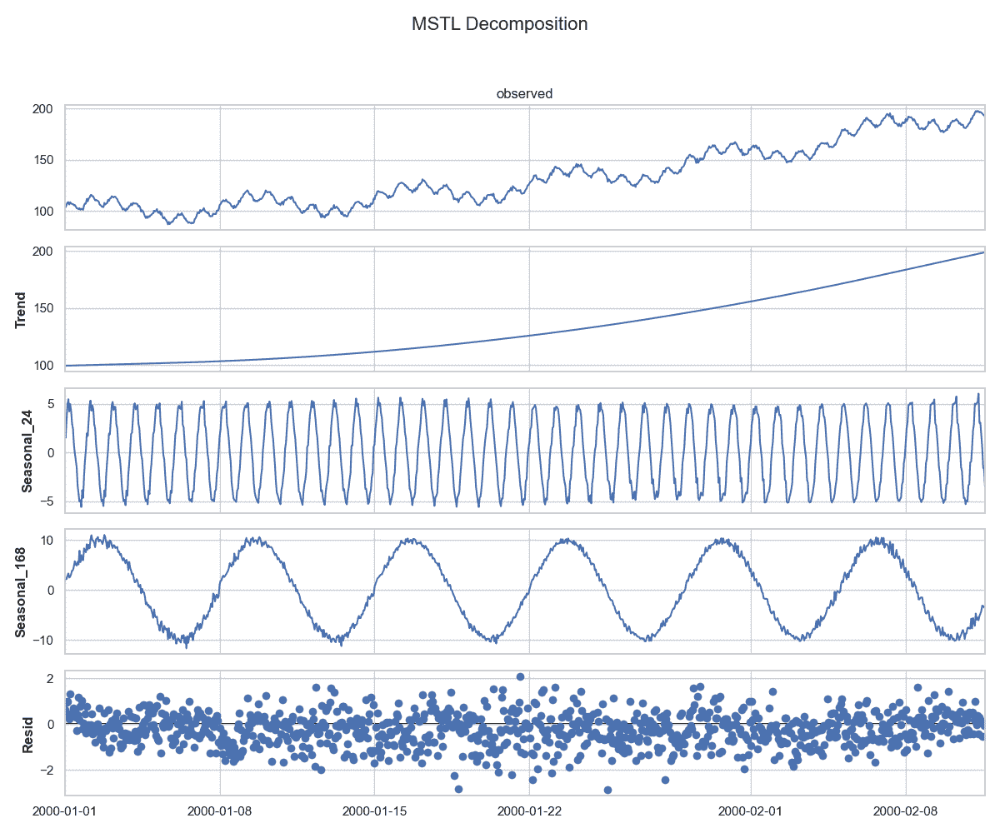

图 4.8 – 分解后的时间序列

#### 自回归移动平均 (ARMA)

`ARMA` 之前作为 `ARIMA` 系列的一个子集进行过讨论。

`TBATS` 中的 `ARMA` 模型用于建模剩余残差，以捕捉滞后变量的任何自相关。`自回归 (AR)` 成分捕捉一个观测值与多个滞后观测值之间的相关性。这处理了序列的动量或延续性。`移动平均 (MA)` 成分将误差项建模为前几个时间周期误差的线性组合，捕捉 `AR` 部分单独无法解释的信息。

#### 参数优化

为了选择最优参数空间，`TBATS` 将拟合多个模型并自动选择最佳参数。`TBATS` 内部拟合的一些模型包括：

*   带和不带 `Box-Cox 变换`
*   带和不带趋势
*   带和不带趋势阻尼
*   季节性和非季节性模型
*   `ARMA(p,q)` 参数

最终模型通过参数组合最小化 `赤池信息准则 (AIC)` 来选择，并使用 `auto-ARIMA` 来确定 `ARMA` 参数。

与所有预测方法一样，不同模型都有利弊。虽然 `TBATS` 在许多其他模型的缺点上提供了一些增强，但代价是需要构建许多模型，导致计算时间更长。如果必须对多个时间序列建模，这可能会成为一个问题。此外，`TBATS` 不允许包含外生变量。

### 从业者注

> **从业者注：**
>
> > `TBATS` 无法处理外生回归，因为根据 Hyndman 本人的说法，它与 `ETS` 模型相关，不太可能包含协变量 (Hyndman, 2014)。如果要使用外部回归变量，应使用其他方法，如 `ARIMAX` 或 `SARIMAX`。如果时间序列具有复杂的季节性，可以将傅里叶特征作为协变量添加到 `ARIMAX` 或 `SARIMAX` 模型中，以帮助捕捉季节性模式。

### NIXTLA 实现

这在 `NIXTLA` 中已实现，我们可以使用如下所示的实现：

```
TBATS_model = TBATS(seasonal_periods = 48, use_trend=True, use_damped_trend=True)
```

在 `NIXTLA` 中，你也可以使用 `AutoTBATS` 让系统优化如何处理各种参数。

让我们看看 `TBATS` 预测的样子：

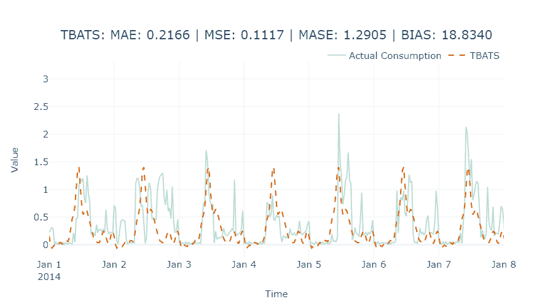

图 4.9 – TBATS 预测

同样，季节性模式已被复制，并捕捉了预测中的大多数峰值。

## MSTL 方法

`NIXTLA` 中的 `MSTL` 方法应用 `LOESS` 技术将时间序列分解为其各个季节性成分。分解后，它使用专门的非季节性模型预测趋势，并使用 `SeasonalNaive` 模型预测每个季节性成分。这种方法允许对具有复杂季节性模式的时间序列进行详细分析和预测。

```
MSTL_model = MSTL(season_length = 48)
```

`MSTL` 内部工作原理的更多信息在第 3 章中讨论过。

让我们看看 `MSTL` 预测的样子：

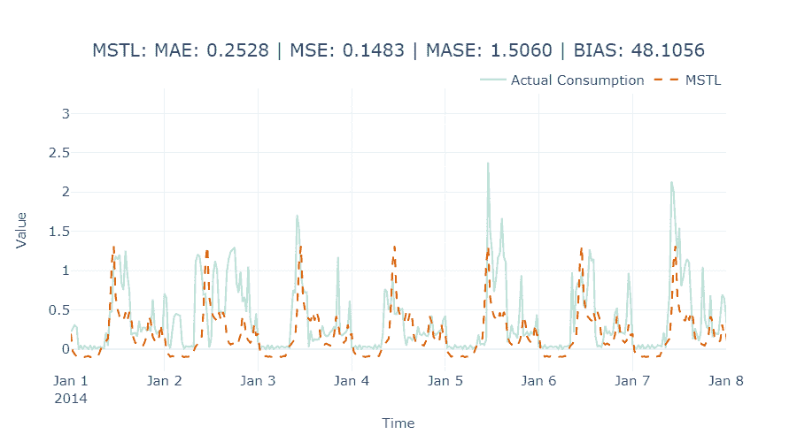

图 4.10 – MSTL 预测

让我们也看看我们选择的不同指标在我们实验的家庭（来自笔记本）的每个预测中的表现：

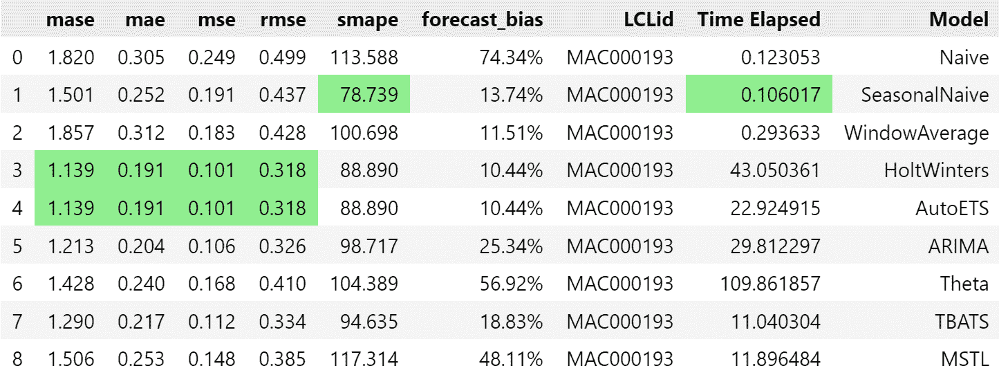

图 4.11 – 所有基线算法的汇总

在我们尝试的所有基线算法中，`AutoETS` 在 `MAE` 和 `MSE` 上表现最好。`ARIMA` 是第二好的模型，其次是 `TBATS`。然而，如果你看 `Time Elapsed`（耗时）列，`TBATS` 仅用 7.4 秒，而 `ARIMA` 用 19 秒，`TBATS` 突出。由于它们性能相似，我们将选择 `TBATS` 而不是 `ARIMA`，连同 `AutoETS` 作为我们的基线，并在我们选择的数据集中的所有 399 个家庭（包括验证集和测试集）上运行它们（相关代码可在 `02-Baseline Forecasts using NIXTLA.ipynb` 笔记本中找到）。

## 预测评估

### 评估基线预测

既然我们有了来自 `ETS` 和 `TBATS` 生成的基线预测，我们也应该评估这些预测。这两种方法对于所有选定家庭的汇总指标如下：

| 验证集 | | 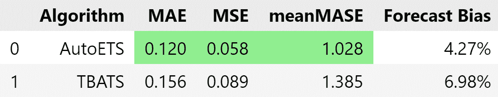 |
| --- | | --- |
|  | | 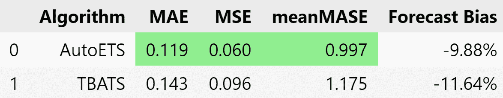 |
|  | |  |

图 4.12 – 所有选定家庭的汇总指标（验证集和测试集）


看起来 `AutoETS` 在所有三个指标上的表现都好得多。我们也有在家庭层面计算的这些指标。让我们看看验证数据集中所有选定家庭这些指标的分布情况：

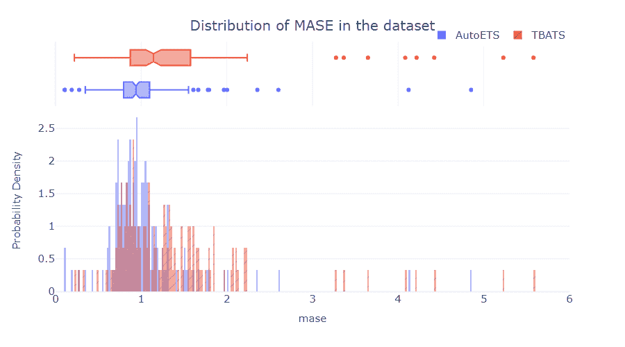

`ETS` 的 `MASE` 直方图似乎比 `TBATS` 的分布范围更小。`ETS` 的中位数 `MASE` 也低于 `TBATS`。我们在预测偏差上也能看到类似的模式，`ETS` 的预测偏差以零为中心，且分布范围小得多。

回到第 1 章 *时间序列简介*，我们了解了为什么并非每个时间序列都具有同等的可预测性，并看到了三个有助于我们思考该问题的因素——理解数据生成过程（`DGP`）、数据量以及模式的充分重复。在大多数情况下，前两个因素很容易评估，但第三个因素需要一些分析。虽然基准方法的性能给了我们一些关于时间序列可预测性的概念，但它们仍然依赖于模型。因此，与其衡量时间序列有多大程度可预测，我们不如衡量所选模型能多好地逼近时间序列。这就是一些更基础的技术（依赖于时间序列的统计特性）派上用场的地方。

### 评估时间序列的可预测性

虽然我们可以使用许多统计指标来评估时间序列的可预测性，但我们只关注几个在处理大规模时间序列数据集时更容易理解且实用的指标。相关的笔记本（`02-Forecastability.ipynb`）包含了可供跟随操作的代码。

#### 变异系数（`CoV`）

`变异系数`（`CoV`）基于这样一个直觉：时间序列中的变异性越大，预测起来就越难。我们如何衡量随机变量的变异性？`标准差`。

在许多现实世界的时间序列中，我们在时间序列中看到的变异取决于时间序列的尺度。让我们想象一下有两个零售产品，*A* 和 *B*。*A* 的平均月销量为 15，而 *B* 为 50。如果我们看几个这样的现实例子，会发现如果 *A* 和 *B* 具有相同的标准差，*B* 由于均值较高，比 *A* 更容易预测。为了适应这种现象，并确保将数据集中的所有时间序列带到一个通用的尺度上，我们可以使用 `CoV`：

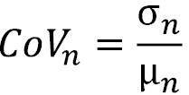此处，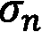是标准差，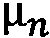是时间序列 *n* 的均值。

`CoV` 是数据点围绕均值的相对离散程度，这比单纯看标准差要好得多。

`CoV` 的值越大，时间序列的可预测性越差。没有硬性截止值，但 0.49 被视为一个经验法则，用于区分相对容易预测的时间序列和难以预测的时间序列。但根据数据集的整体*难度*，我们可以调整这个截止值。我发现绘制数据集中 `CoV` 值的直方图并以此为基础得出截止值很有用。

尽管 `CoV` 在工业界被广泛使用，但它有几个关键缺陷：

1.  它不考虑季节性。正弦波或余弦波的 `CoV` 会比水平线高，但我们知道两者同样可预测。

2.  它不考虑趋势。线性趋势会使序列具有更高的 `CoV`，但我们知道它像水平线一样同样可预测。

3.  它无法处理时间序列中的负值。如果有负值，会使均值变小，从而虚增 `CoV`。

为了克服这些缺陷，我们提出另一个衍生指标。

#### 残差变异性（`RV`）

残差变异性（`RV`）背后的思路是尝试衡量与 `CoV` 试图捕捉的同类变异性，但避免其缺陷。我曾针对如何避免使用 `CoV` 的问题（通常是季节性问题）进行头脑风暴，并将 `CoV` 应用于季节性分解后的残差。那时我意识到残差会有几个负值，`CoV` 效果不好。Stefan de Kok 是需求预测和概率预测领域的思想领袖，他建议使用原始实际值的均值，这行得通。

要计算 `RV`，必须执行以下步骤：

1.  执行季节性分解。

2.  计算残差或非规则分量的标准差。

3.  用原始观测值的均值（分解前）除以该标准差。

这里的关键假设是季节性和趋势是可预测的分量。因此，我们对时间序列可预测性的评估应仅关注残差的变异性。但我们不能在残差上使用 `CoV`，因为残差可能包含正负值，所以残差的均值失去了序列水平的解释，且趋向于零。当残差趋向于零时，`CoV` 指标因除以均值而趋向于无穷大。因此，我们使用原始序列的均值作为缩放因子。

让我们看看如何计算数据集中所有时间序列的 `RV`（这些数据采用紧凑形式存储）：

```
block_df["rv"] = block_df.progress_apply(lambda x: calc_norm_sd(x['residuals'],x['energy_consumption']), axis=1)
```

在本节中，我们介绍了两个基于时间序列标准差的指标。现在，让我们看看评估时间序列可预测性的其他方法。

#### 基于熵的指标

`熵` 是科学界一个无处不在的术语。我们在物理学、量子力学、社会科学和信息论中都能看到它的身影。在所有领域，它都用于描述系统中混乱程度或缺乏可预测性的度量。我们现在最感兴趣的熵来自信息论。信息论涉及量化、存储和通信数字信息。

Claude E. Shannon 在其开创性论文 *A Mathematical Theory of Communication* 中，将通信的定性和定量模型作为一个统计过程呈现出来。虽然该论文引入了许多思想，但与我们相关的一些概念是信息熵和 `比特`（`bit`）的概念——信息的基本度量单位。

> 参考文献检查
>
> > Claude E. Shannon 的 *A Mathematical Theory of Communication* 在*参考文献*部分被引用为参考文献 *3*。

该理论本身内容庞大，但为了总结关键信息点，请参阅以下简短词汇表：

*   信息无非是一系列*符号*，可通过一种称为*信道*的媒介从*接收者*传输到*发送者*。例如，当我们发短信时，符号序列是我们用于发短信的语言的字母/单词；信道是电子媒介。

*   `熵` 可以被认为是给定符号分布下，一系列符号中*不确定性*或*惊讶度*的数量。

*   `比特`，如前所述，是信息的单位，即二进制数字。它可以是 0 或 1。


### 熵与信息论

### 理解熵

现在，如果我们传输 1 比特的信息，接收者的不确定性将减少一半。为了更好地理解这一点，让我们考虑一次抛硬币。我们将硬币抛向空中，当它在空中旋转时，我们不知道它会是正面还是反面。但我们知道它将是这两者之一。当硬币落地并最终静止时，我们发现它是正面。我们可以用 1 比特的信息来表示硬币是正面还是反面（0 代表正面，1 代表反面）。因此，硬币落地时传递给我们的信息将可能的结果从两个减少到了一个（正面）。这种传输只需 1 比特的信息即可实现。

在信息论中，离散随机变量的熵是该变量可能结果中固有的*信息*、*惊讶度*或*不确定性*的平均水平。用更专业的术语来说，它是对随机变量中所含信息进行最佳可能编码方案所需的比特数的期望值。

> **补充阅读**
>
> > 如果你想直观地理解熵、交叉熵、Kullback-Leibler 散度等，请前往*延伸阅读*部分。
>
> > 那里有几个博客链接（其中一个是我自己的），我们在其中尝试阐述这些指标背后的直觉。

### 熵的正式定义

熵的正式定义如下：

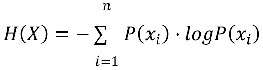

这里，`X` 是具有可能结果的离散随机变量，且 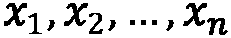。这些结果中的每一个都有其发生的概率，分别用 和 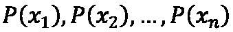 表示。

为了建立对此的直觉，我们可以认为：概率分布越分散，分布中的混乱度越高，因此熵也越大。让我们在代码中快速验证一下：

```
#### Creating an array with a well balanced probability distribution
flat = np.array([0.1,0.2, 0.3,0.2, 0.2])
#### Calculating Entropy
print((-np.log2(flat)* flat).sum())
>> 2.2464393446710154
#### Creating an array with a peak in probability
sharp = np.array([0.1,0.6, 0.1,0.1, 0.1])
#### Calculating Entropy
print((-np.log2(sharp)* sharp).sum())
>> 1.7709505944546688
```

在这里，我们可以看到，分散其质量的概率分布具有更高的熵。

### 时间序列中的熵

在时间序列的背景下，`n` 是时间序列观测值的总数，且 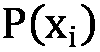 是时间序列字母表中每个符号的概率。尖峰分布意味着时间序列值集中在一个小区域内，因此应该更容易预测。另一方面，宽分布或平坦分布意味着时间序列值在更宽的范围内具有同等可能性，因此难以预测。

如果我们有两个时间序列——一个包含抛硬币的结果，另一个包含掷骰子的结果——掷骰子的输出将在一到六之间，而抛硬币的结果将是零或一。抛硬币时间序列的熵较低，比掷骰子时间序列更容易预测。

但由于时间序列通常是连续的，而熵需要离散随机变量，我们可以采用一些策略将连续时间序列转换为离散时间序列。可以应用许多策略，如量化或分箱，这会导致出现无数种复杂度度量。让我们回顾一种既有用又实用的度量。

### 谱熵

要计算时间序列的熵，我们需要对时间序列进行离散化。一种方法是使用 `FFT` 和**功率谱密度 (PSD)**。这种对连续时间序列的离散化用于计算谱熵。

我们在本章前面学习了什么是傅里叶变换，并用它来生成基线预测。但使用 `FFT`，我们还可以估计一个称为功率谱密度的量。这回答了*信号在特定频率上有多少*的问题。从时间序列估计功率谱密度有很多方法，但最简单的方法之一是使用**韦尔奇法**，这是一种基于离散傅里叶变换的非参数方法。这在 `scipy` 中也作为一个签名为 `periodogram(x)` 的便捷函数实现。

返回的 `PSD` 长度将等于估计的频率数量，但这些是密度，而不是明确定义的概率。因此，我们需要将 `PSD` 归一化到零到一之间：

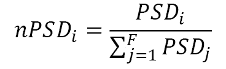

这里，`F` 是返回的功率谱密度中包含的频率数量。

现在我们有了概率，只需将其代入熵公式即可得到谱熵：

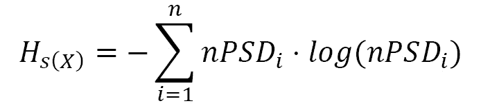

当我们介绍**基于熵的度量**时，我们看到分布的概率质量越分散，熵就越高。在此背景下，谱密度分布的频率越多，谱熵就越高。因此，较高的谱熵意味着时间序列更复杂，因此更难预测。

由于 `FFT` 假设平稳性，建议在使用谱熵作为指标之前使序列平稳。我们甚至可以将此指标应用于去趋势和去季节化的时间序列，我们可以称之为**残差谱熵**。本书的 GitHub 仓库在 `src.forecastability.entropy.spectral_entropy` 下包含谱熵的实现。该实现还有一个参数 `transform_stationary`，如果设置为 `True`，将在应用谱熵之前对序列进行去趋势处理。让我们看看如何计算我们数据集的谱熵：

```
from src.forecastability.entropy import spectral_entropy
block_df["spectral_entropy"] = block_df.energy_consumption.progress_apply(lambda x: spectral_entropy(x, transform_stationary=True))
block_df["residual_spectral_entropy"] = block_df.residuals.progress_apply(spectral_entropy)
```

还有其他基于熵的度量，如 `approximate entropy`（近似熵）和 `sample entropy`（样本熵），但我们将不在本书中涵盖它们。它们计算量更大，且不太适用于包含少于 200 个值的时间序列。如果你有兴趣了解更多关于这些度量的信息，请前往*延伸阅读*部分。

另一种采取略微不同路径的指标是 Kaboudan 指标。

#### Kaboudan 指标


### 预测性指标：Kaboudan 指标与修正 Kaboudan 指标

### 原始 Kaboudan 指标

1999 年，Kaboudan 定义了一个时间序列可预测性指标，称之为 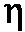\-指标。其背后的思想非常简单。如果我们对时间序列进行**分块打乱**，本质上就是在破坏时间序列中的信息。**分块打乱**是将时间序列分成块，然后打乱这些块的过程。因此，如果我们计算在时间序列上训练的预测的**平方误差和**（**SSE**），然后将其与在打乱后的时间序列上训练的预测的 SSE 进行对比，就可以推断该时间序列的可预测性。计算公式如下：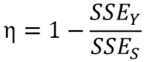
其中，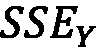 是基于原始时间序列生成的预测的 SSE，而 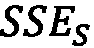 是基于分块打乱序列生成的预测的 SSE。如果时间序列包含一些可预测的信号，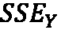 会低于 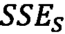，且 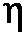 会接近 1。这是因为分块打乱破坏了一些信息或模式。另一方面，如果序列只是白噪声（根据定义不可预测）， 和  之间几乎不会有差异，且  会接近零。

> **参考文献检查**
>
> 提出 Kaboudan 指标的研究论文在*参考文献*部分被引用为参考文献 *4*。Duan 提出的后续修正被引用为参考文献 *5*。

### 修正 Kaboudan 指标

2002 年，Duan 在其论文中研究了该指标并提出了一些修正。他发现的问题之一，特别是在长时间序列中，是  值分布在 1 附近的一个窄带内，因此建议对公式进行轻微修改。我们称之为**修正 Kaboudan 指标**。下限也被截断为零。有时指标可能低于零，因为  低于 ，这是由于序列不可预测，且纯粹由于偶然，分块打乱导致 SSE 降低：

该修正版本以及原始版本均已在本书的 GitHub 仓库中实现。

对用于生成预测的预测模型没有限制，这使其更加灵活。理想情况下，我们可以选择一种足够快、可应用于整个数据集的经典统计方法。但这也使得 Kaboudan 指标依赖于模型，模型的局限性内在于该指标中。该指标衡量的是序列预测难度与模型预测该序列难度的组合。

同样，这两个指标都已在本书的 GitHub 仓库中实现。让我们看看如何使用它们：

### Python 实现

```
from src.forecastability.kaboudan import kaboudan_metric, modified_kaboudan_metric
model = Theta(theta=3, seasonality_period=48*7, season_mode=SeasonalityMode.ADDITIVE)
block_df["kaboudan_metric"] = [kaboudan_metric(r[0], model=model, block_size=5, backtesting_start=0.5, n_folds=1) for r in tqdm(zip(*block_df[["energy_consumption"]].to_dict("list").values()), total=len(block_df))]
block_df["modified_kaboudan_metric"] = [modified_kaboudan_metric(r[0], model=model, block_size=5, backtesting_start=0.5, n_folds=1) for r in tqdm(zip(*block_df[["energy_consumption"]].to_dict("list").values()), total=len(block_df))]
```

虽然还有更多指标可用于此目的，但我们刚才回顾的用于评估预测性的指标涵盖了许多常见用例，足以衡量任何时间序列数据集的预测难度。我们可以使用这些指标来比较一个时间序列与另一个时间序列，或者对数据集中的一整组相关时间序列进行画像，并与另一个数据集进行基准测试。

> **延伸阅读**
>
> 如果您想深入分析这些指标的行为、它们之间的相似性以及它们在衡量预测性方面的有效性，请前往 `03-Forecastability.ipynb` 笔记本的末尾。我们计算这些指标之间的秩相关性，以了解它们的相似程度。我们还可以计算这些指标与表现最好的基线方法计算出的指标之间的秩相关性，以了解这些指标在估计时间序列预测性方面的表现如何。我强烈建议您动手操作该笔记本，理解不同指标之间的差异。挑选几个时间序列，检查不同指标如何给出略微不同的解读。

恭喜您生成了基线预测——这是我们使用本书生成的第一组预测！请随意前往笔记本，调整方法的参数，观察预测如何变化。这将帮助您建立对基线方法工作原理的直觉。如果您有兴趣了解如何改进这些基线方法，请前往*延伸阅读*部分，我们在那里提供了 F. Petropoulos 和 E. Spiliotis 的论文《The Wisdom of the Data: Getting the Most Out of Univariate Time Series Forecasting》的链接。

## 总结

至此，我们已完成*第 1 部分* *熟悉时间序列*的学习。我们从仅仅理解什么是时间序列，一路走到了生成具有竞争力的基线预测。在此过程中，我们学习了如何处理缺失值和异常值，以及如何使用 `pandas` 操作时间序列数据。我们将所有这些技能应用于一个真实的能源消耗数据集。我们还探讨了可视化和分解时间序列的方法。在本章中，我们搭建了测试框架，学习了如何使用 `NIXTLA` 库生成基线预测，并介绍了几个可用于理解时间序列预测性的指标。对某些读者而言，这可能是复习，我们希望本章在细节和实践考量方面能带来一些价值。对其他读者而言，我们希望你们在基础上已有良好掌握，准备好在本书的下一部分探索使用机器学习的现代技术。

在下一章中，我们将讨论机器学习的基础知识，并深入探讨时间序列预测。

## 参考文献

本章提供了以下参考文献：

*   Assimakopoulos, Vassilis and Nikolopoulos, K.. (2000). *Theta 模型：一种用于预测的分解方法*. International Journal of Forecasting. 16. 521-530. https://www.researchgate.net/publication/223049702_The_theta_model_A_decomposition_approach_to_forecasting.

*   Rob J. Hyndman, Baki Billah. (2003). *揭开 Theta 方法的面纱*. International Journal of Forecasting. 19. 287-290. https://robjhyndman.com/papers/Theta.pdf.

*   Shannon, C.E. (1948), *通信的数学理论*. Bell System Technical Journal, 27: 379-423. https://people.math.harvard.edu/~ctm/home/text/others/shannon/entropy/entropy.pdf.

*   Kaboudan, M. (1999). *一种利用遗传编程应用于股票收益的时间序列可预测性度量*. Journal of Forecasting, 18, 345-357: http://www.aiecon.org/conference/efmaci2004/pdf/GP_Basics_paper.pdf.

*   Duan, M. (2002). *时间序列可预测性*: https://citeseerx.ist.psu.edu/viewdoc/download?doi=10.1.1.68.1898&rep=rep1&type=pdf.

*   De Livera, A. M., & Hyndman, R. J. (2009). *使用指数平滑法预测具有复杂季节模式的时间序列* (计量经济学与商业统计系工作论文系列 15/09)

*   Hyndman, Rob. "Rob J Hyndman - 带回归变量的 TBATS." Rob J Hyndman, 2014 年 10 月 6 日, http://robjhyndman.com/hyndsight/tbats-with-regressors

## 延伸阅读


