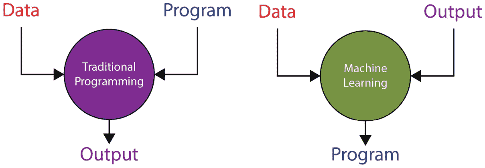
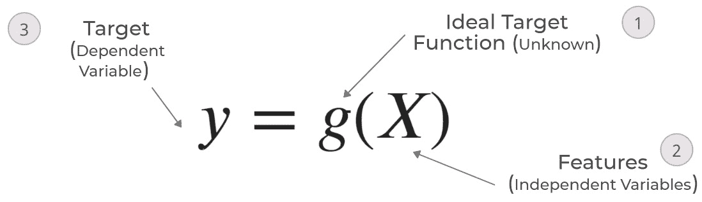
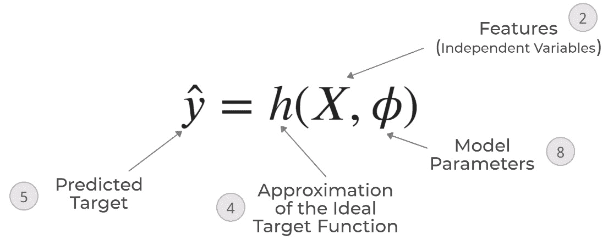
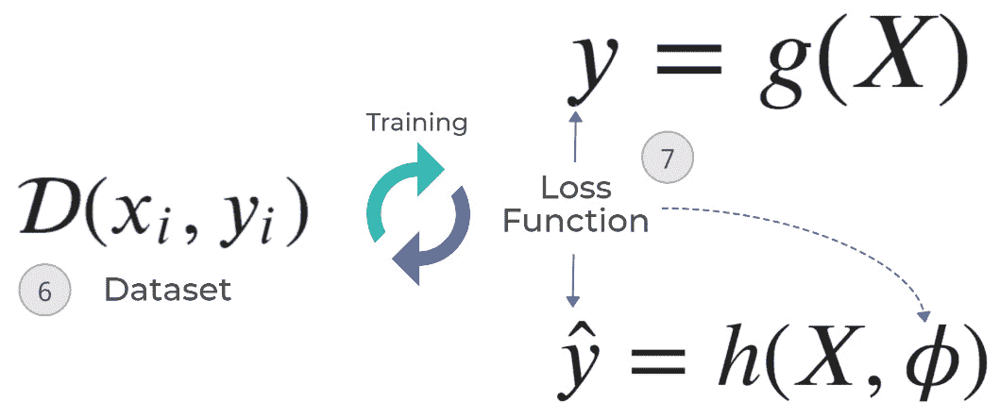
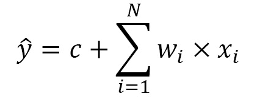
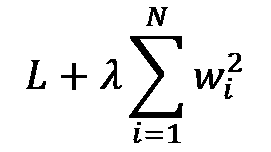
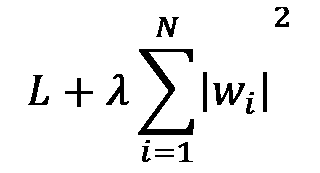
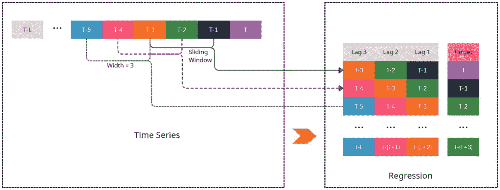
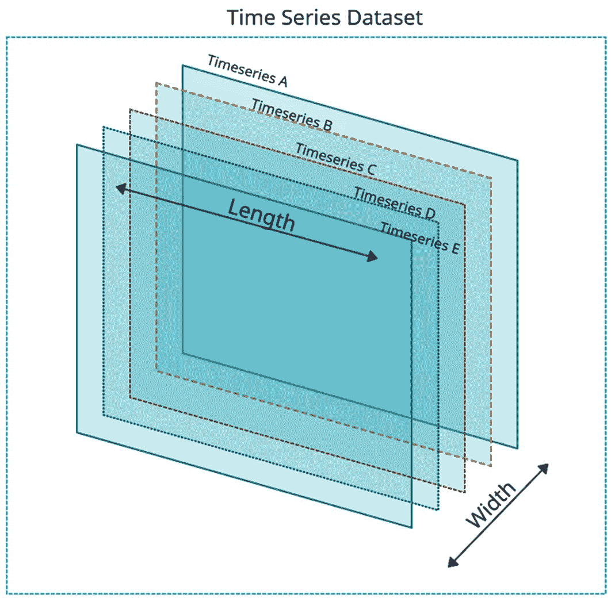

# 5 时间序列预测作为回归

## 学习资源

要了解本章涵盖主题的更多信息，请参阅以下资源：

*   *信息论与熵*，作者 Manu Joseph：https://deep-and-shallow.com/2020/01/09/deep-learning-and-information-theory/
*   *可视化信息*，作者 Chris Olah：https://colah.github.io/posts/2015-09-Visual-Information
*   傅里叶变换：https://betterexplained.com/articles/an-interactive-guide-to-the-fourier-transform/
*   *傅里叶变换*，作者 3blue1brown – 可视化入门：https://www.youtube.com/watch?v=spUNpyF58BY&vl=en
*   *通过示例理解傅里叶变换*，作者 Richie Vink：https://www.ritchievink.com/blog/2017/04/23/understanding-the-fourier-transform-by-example/
*   Delgado-Bonal A, Marshak A. *近似熵与样本熵：综合教程*. Entropy. 2019; 21(6):541: https://www.mdpi.com/1099-4300/21/6/541
*   Yentes, J.M., Hunt, N., Schmid, K.K. 等. *短数据集中近似熵与样本熵的适当使用*. Ann Biomed Eng 41, 349–365 (2013): https://doi.org/10.1007/s10439-012-0668-3
*   Ponce-Flores M, Frausto-Solís J, Santamaría-Bonfil G, Pérez-Ortega J, González-Barbosa JJ. *时间序列复杂性及其与预测性能的关系*. Entropy. 2020; 22(1):89. https://www.mdpi.com/1099-4300/22/1/89
*   Petropoulos F, Spiliotis E. *数据的智慧：充分利用单变量时间序列预测*. Forecasting. 2021; 3(3):478-497. https://doi.org/10.3390/forecast3030029

## 加入我们的图书社区


[`packt.link/EarlyAccess/`](https://packt.link/EarlyAccess/)

在本书的前几部分中，我们已经建立了对时间序列的基本理解，并掌握了分析和可视化时间序列以及生成第一个基线预测的工具和技术。到目前为止，我们主要介绍了经典和统计技术。现在让我们涉足现代**机器学习**领域，学习如何利用这一相对较新的领域进行**时间序列预测**。机器学习是一个近年来飞速发展的领域，能够利用这些新技术进行时间序列预测，将成为当今世界一项不可估量的技能。

本章将涵盖以下主要主题：

*   理解机器学习基础
*   时间序列预测作为回归
*   局部模型与全局模型

## 理解机器学习基础

在开始将机器学习用于时间序列之前，让我们花些时间确立什么是机器学习，并建立一个框架来演示它的作用（如果你已经非常熟悉机器学习，可以跳过这部分，或者继续跟随我们复习概念）。1959 年，Arthur Samuel 将机器学习定义为“一个无需显式编程就能让计算机获得学习能力的研究领域”。传统上，编程是一种范式，我们在其中知道一组执行动作的规则/逻辑，该动作作用于给定数据以获得我们想要的输出。但是，机器学习颠覆了这一点。在机器学习中，我们从数据和输出开始，让计算机告诉我们实现从数据获得期望输出的规则：



**图 5.1 – 传统编程与机器学习**

机器学习中有许多种问题设置，如监督学习、无监督学习、自监督学习等，但我们将坚持使用监督学习，因为它是最流行且最适用于本书内容的一种。

让我们从小处着手，逐步构建完整的示意图，它封装了监督机器学习问题的大多数关键组件：



**图 5.2 – 监督机器学习示意图，第 1 部分 – 理想函数**

正如我们已经讨论的，我们希望从机器学习中获得的是从数据中*学习*并得出一组规则/逻辑。数学中对逻辑/规则最接近的类比是函数，它接受输入（此处为数据）并提供输出。数学上可以写为：

```
y = g(X)
```

其中 `X` 是特征集合，`g` 是**理想目标函数**（*图 5.2* 中标记为 **1**），它将 `X` 输入（示意图中标记为 **2**）映射到目标（理想）输出 `y`（示意图中标记为 **3**）。理想目标函数在很大程度上是一个未知函数，类似于我们在第 1 章 *Introducing Time Series* 中看到的**数据生成过程**（**DGP**），它不在我们的控制范围内。



**图 5.3 – 监督机器学习示意图，第 2 部分 – 学习到的近似**

但我们希望计算机*学习*这个理想目标函数。这个理想目标函数的近似用另一个函数 `h` 表示（**4** 在示意图中），它接受相同的特征集合 `X`，并输出预测目标（**5** 在示意图中）。`θ` 是 `h` 函数的参数（或模型参数）：



**图 5.4 – 监督机器学习示意图，第 3 部分 – 综合整合**

现在，我们如何找到这个近似函数 `h` 及其参数 `θ`？通过示例数据集（**6** 在示意图中）。监督机器学习问题的前提是我们能够收集一组示例，展示特征 `X` 和相应的目标 `y`，这在文献中也称为*标签*。正是从这组示例（数据集）中，计算机*学习*近似函数 `h` 和最优模型参数 `θ`。在前面的图表中，唯一真正的未知实体是理想目标函数 `g`。因此，我们可以使用训练数据集 `D` 来获得数据集中每个样本的预测目标。我们已经知道所有示例的理想目标。我们需要一种方法来比较理想目标和预测目标，这就是**损失函数**（**7** 在示意图中）的作用。损失函数告诉我们用近似函数 `h` 偏离真实情况有多远。虽然 `h` 可以是任何函数，但通常从一组已知的函数类中选择，`H` 是可以拟合数据的有限函数集合。这类函数就是我们通俗所说的**模型**。例如，`h` 可以从所有线性函数或所有基于树的函数中选择，等等。从 `H` 中选择 `h` 是通过超参数（由建模者指定）和模型参数 `θ`（从数据中学习）的组合完成的。

剩下的就是遍历不同的函数，找到使损失最小的最佳近似函数 `h`。这个优化过程我们称之为**训练**。

让我们也看看几个关键概念，它们将在我们后续的所有讨论中都很重要。

### 监督机器学习任务

机器学习可用于解决各种任务，如**回归**、**分类**和**推荐**。但由于分类和回归是最流行的问题类别，我们将花一点时间回顾它们是什么。


### 分类与回归

分类任务和回归任务的区别非常简单。在机器学习示意图（图 5.2）中，我们讨论了 `y`，即目标值。这个目标可以是一个实数，也可以是一类项目。例如，我们可能预测下周的股价，也可能仅仅预测股价是涨还是跌。在第一种情况下，我们预测的是一个实数，这被称为**回归**。在另一种情况下，我们预测的是两个类别中的一个（涨或跌），这被称为**分类**。

### 过拟合与欠拟合

机器学习系统面临的最大挑战是，我们训练的模型必须在新的、未见过的数据集上表现良好。机器学习模型具备这种能力称为模型的**泛化能力**。机器学习设置中的训练过程类似于数学优化，但有一个微妙的区别。数学优化的目标是在提供的数据集中找到全局最优解。但在机器学习中，目标是通过以训练误差为代理，来实现较低的测试误差。机器学习模型在训练误差和测试误差上的表现如何，与过拟合和欠拟合的概念密切相关。让我们通过一个例子来理解这些术语。

机器学习模型的学习过程与人类学习有许多相似之处。假设三个学生 A、B 和 C 正在为考试复习。A 是个懒汉，前一晚去蹦迪了。B 决定死记硬背，把课本从头背到尾。而 C 上课认真听讲，理解了考试涉及的主题。

正如预期的那样，A 考试不及格，C 得分最高，B 表现尚可。

A 考试不及格是因为他们学得不够。当机器学习模式没有学到足够的模式时，也会发生这种情况，这被称为**欠拟合**。其特征是训练误差高、测试误差高。

B 的分数不如预期高；毕竟他们逐字逐句地背下了全书。但考试中的许多题目并非直接来自课本，B 无法正确回答。换句话说，考题是新的、未见过的。因为 B 死记硬背却未努力理解底层概念，无法将所学知识泛化到新题目中。这种情况在机器学习中称为**过拟合**。其典型特征是训练误差和测试误差之间存在巨大差距。通常我们会看到非常低的训练误差和很高的测试误差。

第三个学生 C 用正确的方式学习，理解了底层概念，因此能够泛化到新的、未见过的问题中。这也是机器学习模型的理想状态。其特征是测试误差合理地低，且训练误差与测试误差之间的差距很小。

我们刚看到了机器学习中最大的两个挑战。现在，让我们也看看有哪些方法可以用来应对这些挑战。

模型的**容量**与欠拟合或过拟合有着密切关系。模型的容量是指其足够灵活以拟合各种函数的能力。容量低的模型可能难以拟合训练数据，导致欠拟合。容量高的模型可能会通过过度记忆训练数据而过拟合。为了建立关于容量概念的直观理解，让我们看一个例子。当我们从线性回归转向多项式回归时，我们增加了模型的容量。我们不再仅拟合直线，而是让模型也能拟合曲线。当模型的容量适合手头的学习问题时，机器学习模型通常表现良好。



图 5.5 – 欠拟合与过拟合

图 5.5 展示了一个非常经典的案例来说明过拟合和欠拟合。我们使用一个已知函数创建了一些随机点，并尝试利用这些数据样本来学习该函数。我们可以看到，线性回归作为最简单的模型之一，通过这些点画一条直线，出现了欠拟合。多项式回归本质上是线性回归，但增加了一些高阶特征。目前，你可以将从线性回归到高阶多项式回归的转变视为增加模型容量。因此，当我们使用 4 次多项式时，可以看到学到的函数很好地拟合了数据，并与我们的理想函数相符。但如果我们继续增加模型容量，达到 `degree = 15` 时，会发现学到的函数虽然仍穿过训练样本，却学到了一个截然不同的函数，对训练数据产生了过拟合。找到学习泛化函数的最优容量是机器学习的核心挑战之一。

容量是模型的一个方面，另一个方面是**正则化**。即使容量相同，模型也可以从所有函数的假设空间中选择多种函数。通过正则化，我们试图在假设空间中对一组函数给予比其他函数更高的偏好。虽然所有这些函数都是可选的有效函数，但我们以这样一种方式引导优化过程，使我们最终得到一种我们偏好的函数类型。虽然正则化是一个通用术语，指我们施加在学习过程上的任何约束以减少学习到的函数的复杂度，但更常见的是以权重衰减的形式使用。让我们以线性回归为例，即通过学习与每个特征相关的权重，将一条直线拟合到输入特征上。

线性回归模型在数学上可以写成如下形式：

此处，`N` 是特征数量，`c` 是截距，是第 `i` 个特征，是与第 `i` 个特征相关的权重。我们通过将其视为一个最小化  和 `y`（真实输出）之间误差的优化问题，来估计正确的权重（`L`）。

现在，通过正则化，我们在 `L` 中添加一个额外项，迫使权重变小。通常使用 `l1` 或 `l2` 正则化项来实现。`l1` 正则化项是将平方权重之和加到 `L` 中：

其中  是正则化系数，决定了我们惩罚权重的力度。`l2` 正则化项是将绝对权重之和加到 `L` 中：

在这两种情况下，我们都在强制偏好较小的权重而非较大的权重，因为这能防止函数过度依赖机器学习模型中使用的任何单一特征。正则化本身就是一个完整的主题，如果你想了解更多，请前往“延伸阅读”部分查看一些关于正则化的资源。

减少过拟合另一个非常有效的方法就是简单地用更多数据训练模型。有了更大的数据集，模型过拟合的可能性就会降低，因为大数据集能捕捉到巨大的多样性。

现在，我们如何调整旋钮，在欠拟合和过拟合之间取得平衡？让我们在下一节中探讨。

### 超参数与验证集


## 机器学习在时间序列中的基础

### 超参数

几乎所有机器学习模型都有几个与之相关的超参数。`Hyperparameters`（超参数）是模型的参数，它们不是从数据中学习得来的，而是在训练开始前设定的。例如，正则化的权重就是一个超参数。大多数超参数要么帮助我们控制模型的容量，要么对模型施加正则化。通过控制容量、正则化或两者兼施，我们可以在欠拟合和过拟合模型之间的边界上游走，从而得到一个`just right`（恰到好处）的模型。

### 验证集与交叉验证

但既然这些超参数必须在算法之外设定，我们该如何估计最佳超参数呢？虽然这不是核心`learning process`（学习过程）的一部分，但我们也是从数据中学习超参数的。但如果我们仅使用训练数据来学习超参数，它只会选择最大可能的模型容量，导致过拟合。这时我们就需要一个`validation set`（验证集），即训练过程无法访问的那部分数据。但当数据集较小（不是成百上千个样本）时，单一验证集上的表现无法保证公平的评估。在这种情况下，我们依赖`cross-validation`（交叉验证）。通用的技巧是在原始数据集的不同子集上重复训练和评估过程。一种常见的方法称为`k-fold cross validation`（k 折交叉验证），即将原始数据集划分为`k`个大小相等、不重叠且随机的子集，然后在所有其他子集上训练后对每个子集进行评估。如果您想了解交叉验证技术，我们在`Further reading`（延伸阅读）部分提供了一个链接。本书后面也会涉及这个话题，但会从时间序列的角度出发，这与标准的交叉验证方式有几处不同。

> **建议阅读**
>
> 虽然我们在书中涉及了机器学习的皮毛，但还有更多内容，为了更好地领会本书其余部分，我们建议加深对机器学习的理解。我们建议从[*Machine Learning* by *Stanford (Andrew Ng)*](https://www.coursera.org/learn/machine-learning)入手。如果您赶时间，[*Machine Learning Crash Course* by *Google*](https://developers.google.com/machine-learning/crash-course/ml-intro)也是一个很好的起点。

既然我们已对机器学习有了基本了解，让我们开始看看如何利用它进行时间序列预测。

## 时间序列预测作为回归

## 时间序列预测作为回归

时间序列，正如我们在第 1 章*Introducing Time Series*（时间序列简介）中所见，是按时间顺序获取的一组观测值。通常，时间序列预测旨在尝试预测这些观测值在未来会是什么。给定任意长度历史的观测序列，我们预测任意长度的未来。

我们看到回归，即预测连续变量的机器学习，作用于一个示例数据集上，每个示例都是一组输入特征和目标。我们可以看到，回归的任务是根据一组输入预测单个输出，这从根本上与预测不兼容，后者给定一组历史值，要求预测未来值。时间序列与机器学习回归范式之间的这种根本不兼容性，就是我们无法直接将回归用于时间序列预测的原因。

此外，根据定义，时间序列预测是一个外推问题，而回归大多时候是一个内插问题。外推通常更难用数据驱动方法求解。回归问题中的另一个关键假设是用于训练的样本是`independent and identically distributed`（独立同分布，`IID`）。但时间序列也打破了这一假设，因为时间序列中后续的观测值表现出相当大的依赖性。

然而，为了使用机器学习中的各种技术，我们需要将时间序列预测转化为回归问题。幸运的是，有方法可以将时间序列转化为回归，并通过特征向机器学习模型引入一些记忆来克服`IID`假设。让我们看看如何做到这一点。

### 时间延迟嵌入

我们在第 4 章*Setting a Strong Baseline Forecast*（建立强基线预测）中讨论了`ARIMA`模型，并看到了它是如何作为一个自回归模型工作的。我们可以利用相同的概念将时间序列问题转化为回归问题。让我们使用下图使概念更清晰：



**图 5.6 – 使用滑动窗口将时间序列转换为回归**

假设我们有一个带有时间步的时间序列。假设我们在时间`t`，拥有一个历史长度为`L`的时间序列。因此，我们的时间序列看起来会像图中那样，`media/file159.png`是时间序列中最新的观测值，`media/file161.png`等是随着我们向后推移时间的观测值。在理想情况下，当我们预测时，`media/file161.png`中的每个观测值都应以所有先前的观测值为条件。但这不切实际，因为`L`可以任意长。我们通常限制预测函数仅使用序列中最近的`M`个观测值，其中`M < L`。这些被称为有限记忆模型或`Markov models`（马尔可夫模型），`M`称为自回归阶数、记忆大小或感受野。

因此，在时间延迟嵌入中，我们假设一个任意长度`M < L`的窗口，并通过在时间序列长度上滑动窗口来提取固定长度的子序列。

在图中，我们采用了一个记忆大小为 3 的滑动窗口。因此，我们可以提取的第一个子序列（如果我们从最近的开始向后推）是`media/file163.png`。而`media/file164.png`是紧随该子序列之后的观测值。这成为我们数据集中的第一个示例（图中表格的第 1 行)。现在，我们将窗口向左滑动一个时间步（向后推移时间）并提取新的子序列`media/file164.png`。相应的目标将变为`media/file163.png`。当我们移回时间序列的开头时，我们重复这个过程，在滑动窗口的每一步，我们向数据集添加一个示例。

最终，我们得到了一个对齐的数据集，具有固定向量大小的特征（将等于窗口大小）和单个目标，这正是典型机器学习数据集的样子。

现在我们有了一个包含三个特征的表，让我们也给这三个特征赋予语义含义。如果我们看图中表格最右边的列，可以看到该列中的时间步总是落后于目标一个时间步。我们称之为`Lag 1`（滞后 1）。从右数第二列总是落后于目标两个时间步，这称为`Lag 2`。推广开来，包含落后于目标`n`个时间步的观测值的特征，我们称为`Lag n`。

这种利用`time-delay embedding`（时间延迟嵌入）从时间序列到回归的转换，以一种标准回归框架可利用的方式编码了时间序列的自回归结构。我们考虑将回归用于时间序列预测的另一种方法是执行`regression on time`（时间回归）。

### 时间嵌入


如果我们在自回归模型中依赖先前的观测值，那么在时间嵌入模型中我们则依赖时间的概念。核心思想是，我们忽略时间序列的自回归特性，假设时间序列中的任何值仅依赖于时间。我们从与时间序列相关的时间戳中衍生出能够捕捉时间、时间流逝、时间周期性等特征，然后利用这些特征通过回归模型来预测目标。实现这一点的方法有很多，从简单地对齐一个单调且均匀递增的数值列来捕捉时间流逝，到复杂的 `Fourier` 项来捕捉时间中的周期性成分。我们将在第 6 章 *时间序列预测的特征工程* 中详细讨论这些技术。

在本章结束前，让我们也来谈谈一个在时间序列预测领域稳步获得认可的关键概念。本书的很大一部分内容都拥抱这一新的预测范式。

## 全局预测模型——范式转变

传统上，每条时间序列都被孤立处理。因此，传统预测在拟合预测函数时，一直只关注单条时间序列的历史。但最近，由于当今数字化优先的世界中数据收集变得容易，许多公司开始从相似来源收集大量时间序列，或收集相关时间序列。

例如，沃尔玛等零售商收集数千家门店中数百万产品的销售数据。Uber 或 Lyft 等公司收集城市中所有区域的网约车需求数据。在能源领域，会收集所有消费者的能源消耗数据。所有这些时间序列集合都具有共同的行为模式，因此被称为 `related time series`。

我们可以认为，`related time series` 中的所有时间序列都来自独立的 `data generating processes` (`DGPs`，数据生成过程)，因此对它们分别建模。我们称这些为预测中的 `local`（局部）模型。另一种方法是假设所有时间序列都来自单一的 `DGP`。我们不再为每个时间序列单独拟合预测函数，而是为所有 `related time series` 拟合单一预测函数。在文献中，这种方法被称为 `global`（全局）或 `cross-learning`（交叉学习）。

> 参考文献核查
>
> > 术语 `global` 由 *David Salinas 等人* 在 *DeepAR* 论文中引入（参考文献 1），`Cross-learning` 由 *Slawek Smyl* 提出（参考文献 2）。

我们之前看到，拥有更多数据会降低过拟合的几率，从而降低泛化误差（训练误差与测试误差之差）。这正是 `local` 方法的缺陷之一。传统上，时间序列通常不算很长，而且在许多情况下，收集更多数据也既困难又耗时。在小数据上拟合机器学习模型（尽管其表达能力强）容易导致过拟合。这就是为什么传统上使用强先验的时间序列模型来预测此类时间序列。但这些限制传统时间序列模型拟合的强先验，也可能导致一种欠拟合的形式，从而限制准确性。

像机器学习那样强且富有表现力的数据驱动模型，需要更大量的数据才能得到一个能泛化到新数据和未见数据的模型。根据定义，时间序列与时间绑定，有时收集更多数据意味着等待数月或数年，这是不可取的。因此，如果我们无法增加时间序列数据集的*长度*，我们可以增加时间序列数据集的*宽度*。如果我们向数据集中添加多条时间序列，就增加了数据集的宽度，从而增加了模型训练所用的数据量。*Figure 5.7* 直观地展示了增加时间序列数据集宽度的概念：



图 5.7 – 时间序列数据集的长度与宽度

这对机器学习模型有利，因为随着拟合预测函数的灵活性提高和可用数据的增加，机器学习模型能以完全数据驱动的方式学习到比传统时间序列模型更复杂的预测函数，而传统模型通常是在 `related time series` 之间共享的。

`local` 方法的另一个缺陷在于可扩展性。以我们前面提到的沃尔玛为例，有数百万条时间序列需要预测，不可能对所有这些模型进行人工监督。如果从工程角度考虑，在生产系统中训练和维护数百万个模型会让任何工程师感到噩梦般困扰。但在 `global` 方法下，我们只需为所有这些时间序列训练一个模型，这大幅减少了我们需要维护的模型数量，却能生成所有必需的预测。

这种新的预测范式已获得关注，并在多项时间序列竞赛中持续被证明优于 `local` 方法，主要是在 `related time series` 数据集上。在 Kaggle 竞赛中，如 *Rossman Store Sales*（2015）、*Wikipedia WebTraffic Time Series Forecasting*（2017）、*Corporación Favorita Grocery Sales Forecasting*（2018）和 *M5 Competition*（2020），获胜方案均为 `global` 模型——无论是机器学习、深度学习还是两者的结合。*Intermarché Forecasting Competition*（2021）的获胜提交方案也是 `global` 模型。这些竞赛的链接在 *延伸阅读* 部分提供。

尽管我们有许多实证发现表明 `global` 模型在 `related time series` 上优于 `local` 模型，但 `global` 模型仍是一个相对较新的研究领域。*Montero-Manson and Hyndman*（2020）展示了一些非常有趣的结果，表明任何 `local` 方法都可以用具有所需复杂度的 `global` 模型来近似，他们提出的最有趣的发现是，`global` 模型甚至在不相关的时间序列上也会表现得更好。我们将在第 10 章 *全局预测模型* 中更多地讨论 `global` 模型及其策略。

> 参考文献核查
>
> > *Montero-Manson and Hyndman*（2020）的研究论文在 *参考文献* 中作为参考文献 3 被引用。

## 概要

我们已经开始了超越基线预测方法的旅程，并初涉机器学习领域。在简要回顾机器学习时，我们了解了过拟合、欠拟合、正则化等关键概念，随后我们看到了如何将时间序列预测问题转化为机器学习领域的回归问题。我们还建立了对不同嵌入方式的概念性理解，如时间延迟嵌入和时间嵌入，它们可用于将时间序列问题转化为回归问题。最后，我们还了解了时间序列预测中的新范式——`global` 模型，并在概念层面将其与 `local` 模型进行了对比。在接下来的几章中，我们将开始将这些概念付诸实践，探讨特征工程技术和 `global` 模型策略。

## 参考文献

以下是本章使用的参考文献：

1.  David Salinas, Valentin Flunkert, Jan Gasthaus, Tim Januschowski (2020). *DeepAR: Probabilistic forecasting with autoregressive recurrent networks*. 国际预测期刊. 36-3. 1181-1191: https://doi.org/10.1016/j.ijforecast.2019.07.001


2. Slawek Smyl (2020). *指数平滑与循环神经网络的混合方法用于时间序列预测*。International Journal of Forecasting. 36-1: 75-85 https://doi.org/10.1016/j.ijforecast.2019.03.017

3. Montero-Manso, P., Hyndman, R.J.. (2020), *时间序列组预测的原则与算法：局部性与全局性*。arXiv:2008.00444 [cs.LG]: https://arxiv.org/abs/2008.00444

## 延伸阅读

您可以查看以下资源以进行延伸阅读：

* *来自 Google 机器学习速成课程的稀疏性正则化*：https://developers.google.com/machine-learning/crash-course/regularization-for-sparsity/l1-regularization

* *来自机器学习基础，Bloomberg ML EDU 的 L1 和 L2 正则化*：https://www.youtube.com/watch?v=d6XDOS4btck

* *来自 scikit-learn 的交叉验证：评估估计器性能*：https://scikit-learn.org/stable/modules/cross_validation.html

* *Rossmann 商店销售额*：https://www.kaggle.com/c/rossmann-store-sales

* *网络流量时间序列预测* – https://www.kaggle.com/c/web-traffic-time-series-forecasting

* *Corporación Favorita 食品杂货销售预测* – https://www.kaggle.com/c/favorita-grocery-sales-forecasting

* *M5 预测 – 准确性* – https://www.kaggle.com/c/m5-forecasting-accuracy
